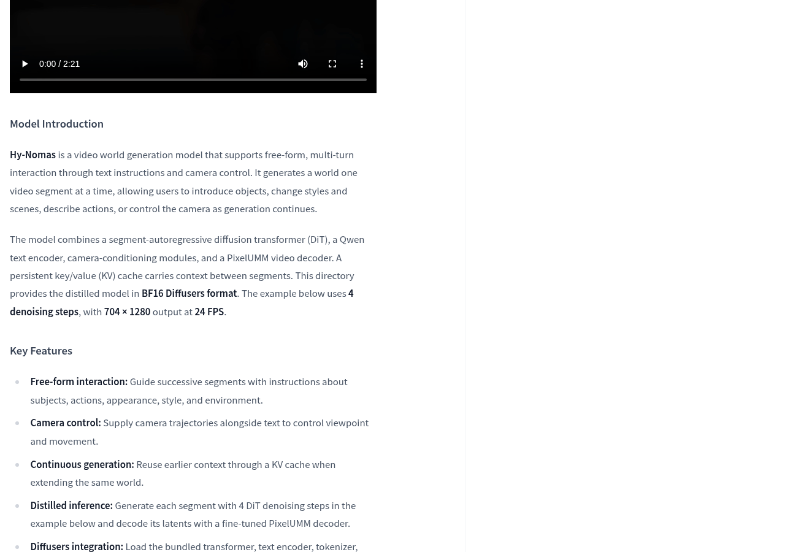
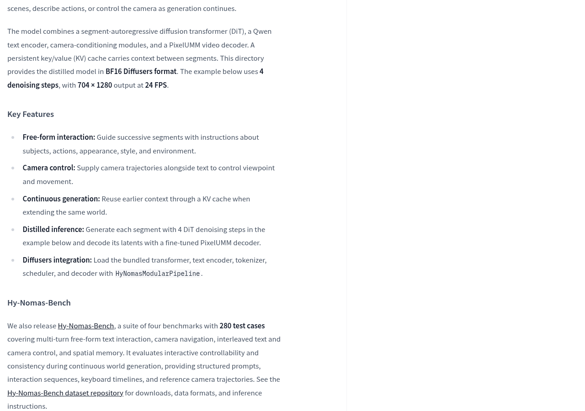
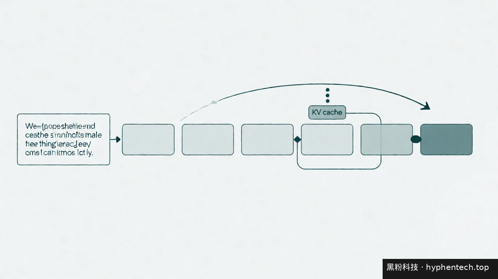
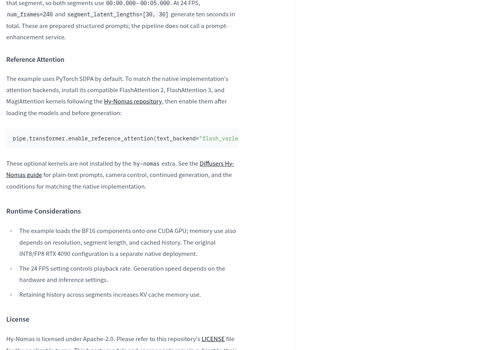
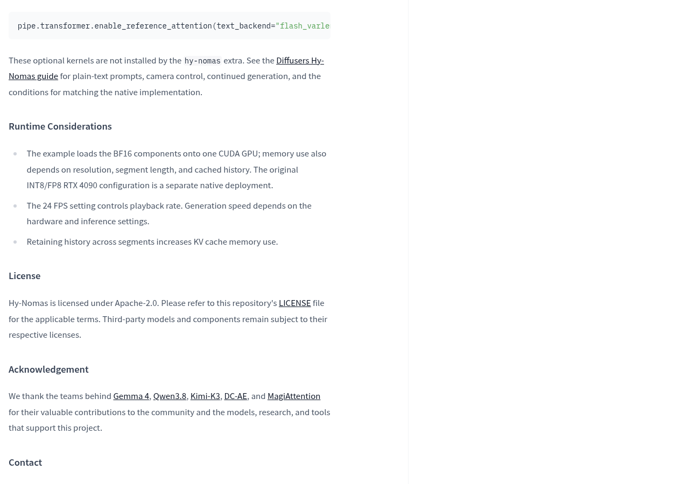
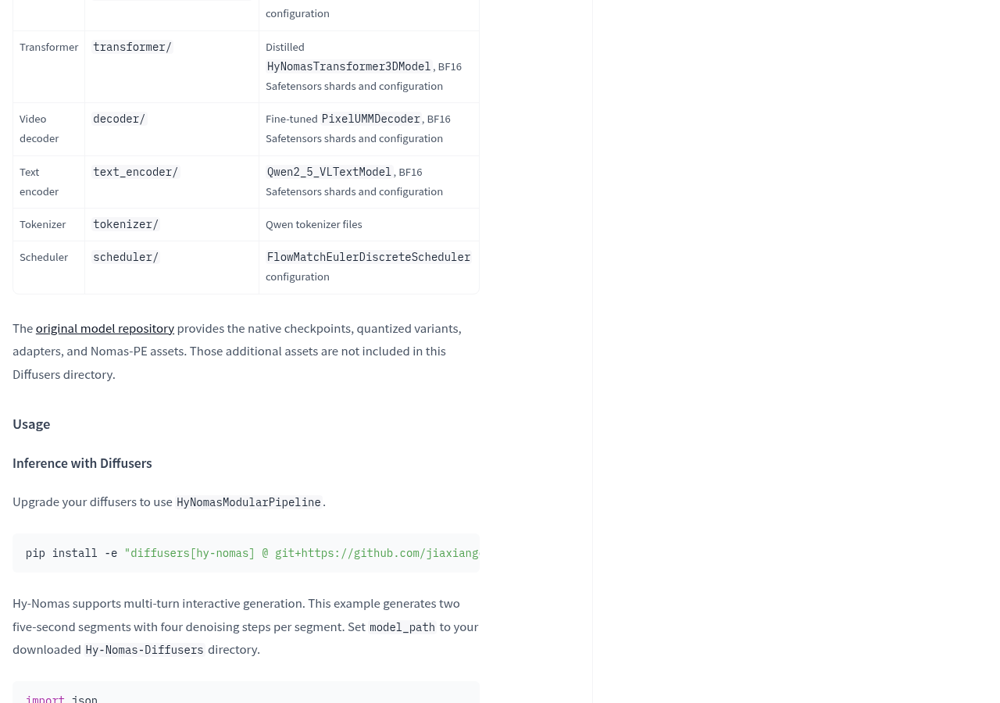

如果你的需求是“让视频生成记住前面发生了什么，并且能一边生成一边下达新指令”，那这次腾讯混元开放的新仓库值得关注。腾讯混元官方在 Hugging Face 新增了 tencent/Hy-Nomas-Diffusers，提供 Hy-Nomas 的 BF16 Diffusers 格式权重，模型页显示 9B 参数、Apache-2.0 许可，基础模型为 tencent/Hy-Nomas。

先说清楚它是什么。官方仓库把它描述为“一种面向自由形式交互式世界生成的视频模型”，通过文本指令和镜头控制支持多轮交互：它一段视频一段视频地生成世界，用户可以在生成过程中引入物体、改变风格和场景、描述动作，或者控制镜头。

这跟常见的“一句提示词出几秒片段”的文生视频不同。更准确的理解类似一段可以反复续写的剧本：前一段生成的内容会作为上下文保留，后一段接着往下写，而不是重新抽一次随机数。官方把这种能力的关键点写成三条：自由形式交互、镜头轨迹控制、以及借助 KV 缓存复用历史上下文实现连续生成。

### 先搞懂两个术语，再看能不能上手

“Diffusers 格式”可以理解为把一套模型拆成标准零件的打包方式——像把散装零件按说明书分好类，标好型号，这样主流推理框架能直接按目录加载，不用自己拼装。这份仓库里就摆着这些零件：transformer 目录是蒸馏后的 HyNomasTransformer3DModel，decoder 目录是微调过的 PixelUMMDecoder，text_encoder 目录是 Qwen2_5_VLTextModel，还有 Qwen 分词器文件、FlowMatchEulerDiscreteScheduler 调度器配置，以及一份描述各组件如何加载的 modular_model_index.json。官方说明这些是用 HyNomasModularPipeline.save_pretrained() 序列化出来的。

“KV 缓存”是模型自己记东西用的空间：生成时把已经算过的注意力键值留在显存里，下一段直接接着用，不用从头再算。好处是上下文能延续，代价是显存占用会随着保留的历史增长——官方在运行环境注意事项里明确写了这一点：“Retaining history across segments increases KV cache memory use.”

### 官方给出的运行条件

安装方式不是普通的 pip install diffusers，而是从源码分支装：官方给出的命令是 `pip install -e "diffusers[hy-nomas] @ git+https://github.com/jiaxiangc/diffusers.git@hy-nomas"`，并且要求先升级 diffusers 才能使用 HyNomasModularPipeline。

示例代码把组件加载到一块 CUDA GPU 上，用 bfloat16 精度，输出 704 × 1280、24 FPS，每个片段 4 步去噪，示例里生成了两个五秒片段，合计十秒。官方同时说明：示例默认用 PyTorch 的 SDPA 注意力实现，如果要贴近原生实现的效果，需要另外安装 FlashAttention 2、FlashAttention 3 和 MagiAttention 这几个可选内核——它们不由 hy-nomas 这个 extra 自动安装。

硬件方面官方没有给出统一门槛，只说明示例把 BF16 组件加载到单块 CUDA GPU 上，实际显存占用还取决于分辨率、片段长度和缓存的历史量；原生部署另有 INT8/FP8 的 RTX 4090 配置，属于另一套路径。生成速度同样取决于硬件和推理设置，没有固定承诺。

> [!warning]
> 这份 Diffusers 目录并不包含原始模型仓库里的全部东西。官方说明：原生检查点、量化变体、适配器和 Nomas-PE 资产都保留在原始模型仓库中，不包含在这个 Diffusers 目录里。

还有一个容易踩的坑：网页 Demo 使用的 Nomas-PE 是一套独立的提示词增强服务，会把用户指令转换成结构化的生成提示词；而这份 Diffusers 管线直接接受普通文本或已经准备好的结构化提示词，本身不会调用 Nomas-PE。

### 能用，但不能当玩具用

就目前公开的信息看，这个仓库对想自己搭交互式视频工作流的人是有价值的：权重开放、许可清晰、组件结构完整，官方还给了可直接改写的多轮示例代码。

但它的位置更接近“研究和开发用的底座”，而不是下载即用的成品。至少三道门要自己过：diffusers 需要从源码分支安装；可选的注意力内核要另外装；显存要同时扛住视频分支、文本编码器、解码器，以及随对话轮次不断增长的 KV 缓存。模型页还标注该模型目前没有被任何推理服务商部署。

官方也发布了 Hy-Nomas-Bench，一套包含四个基准、280 个测试用例的评测集，覆盖多轮自由形式文本交互、镜头导航、文本与镜头交错的控制，以及空间记忆能力，附带结构化提示词、交互序列、键盘时间线和参考镜头轨迹。这些是官方自带的评测材料，能用来核对效果，但不能等同于第三方独立验证。

下一步怎么验收，可以按这个顺序：先确认自己手上的 GPU 能否在单卡 BF16 下跑通官方示例的两段十秒生成，再看多轮对话下 KV 缓存的显存增长曲线，最后用 Hy-Nomas-Bench 的提示词和镜头轨迹对比自己与官方的差距。这三步比任何跑分榜更能说明它是否适合你的场景。

模型仓库地址：https://huggingface.co/tencent/Hy-Nomas-Diffusers

## 官方资料

- [腾讯混元 官方发布说明](https://huggingface.co/tencent/Hy-Nomas-Diffusers)

---

## 🧰 我做的工具

这些工具都由我持续维护。预览版会明确标注，下载、更新和已知边界以发行页为准。

### 黑粉助手 HyphenAssistant

初步构建 · 预览版。手机浏览器接续电脑上的 DeepSeek Harness 会话；需本人配对、电脑与原服务在线，模型费用沿用原配置

[下载与更新](https://github.com/HackerChi-Hub/hyphen-assistant-releases/releases)

### 黑粉盒子 HyphenBox

正式迭代。免费大模型 API 雷达：持续复测可用性，本地统一接口，Key 只存本机

[下载与更新](https://github.com/HackerChi-Hub/hyphenbox-release/releases)

### 方寸智匣 LocalBrain

正式迭代。本地模型的多模态 MCP 工具箱：TTS / Whisper / 视频生成一站接入

[下载与更新](https://github.com/HackerChi-Hub/localbrain-releases/releases)

### ScreenLex 光影词库

正式迭代。看美剧顺手把生词背了，Mac/Windows 双平台，免费

[下载与更新](https://github.com/HackerChi-Hub/screenlex-download/releases)

### 黑粉录屏 HyphenScreen

正式迭代。录屏 + 智能剪辑一体：达芬奇式时间线、自动打码、导出前成片体检，免费

[下载与更新](https://github.com/HackerChi-Hub/HyphenScreen-Releases/releases)
