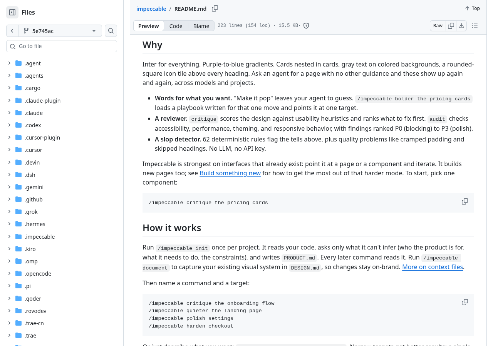
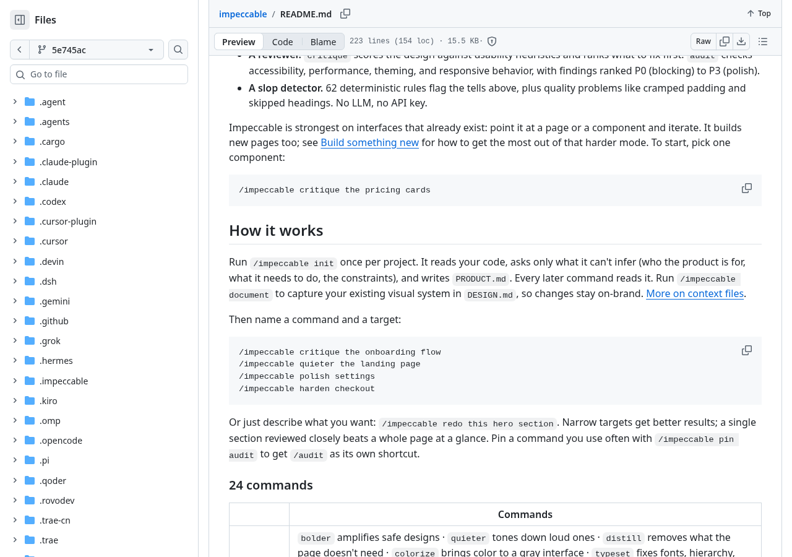
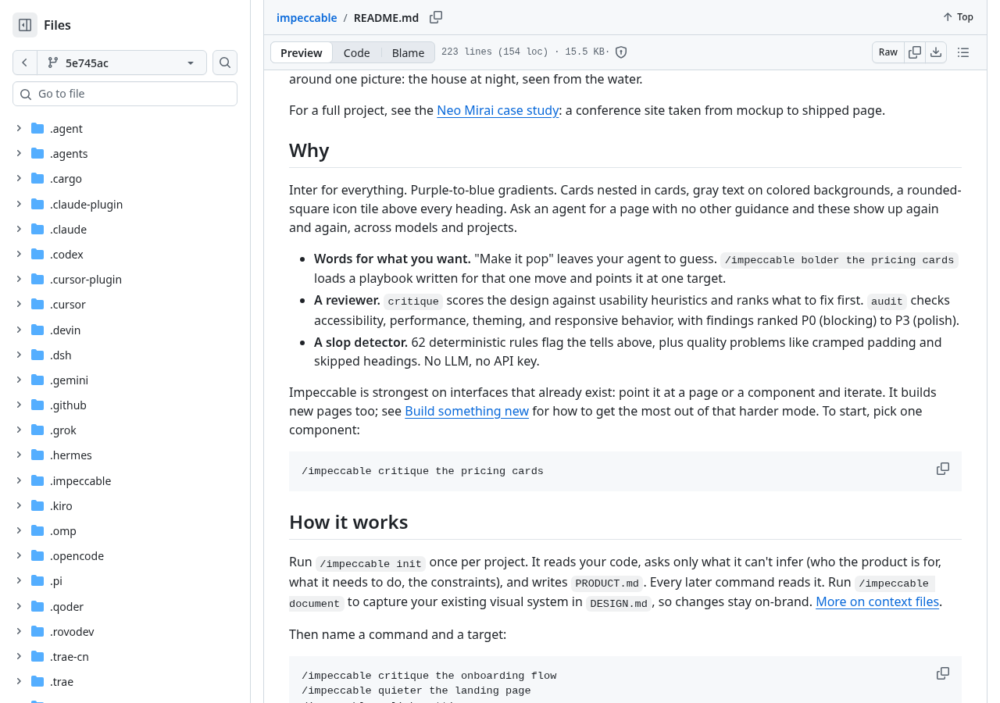
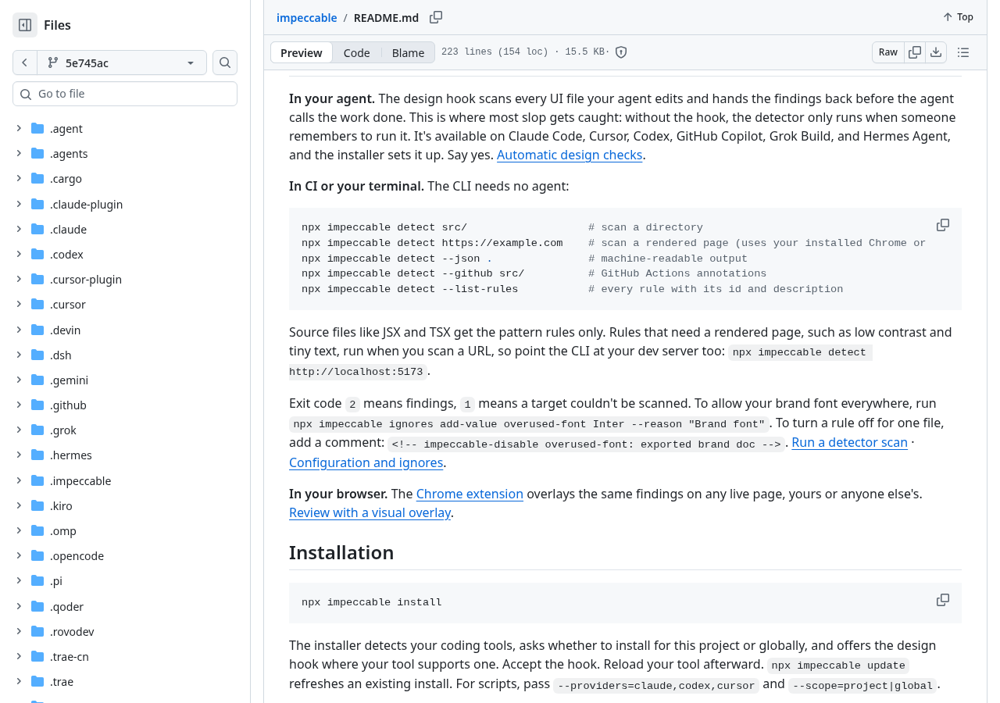
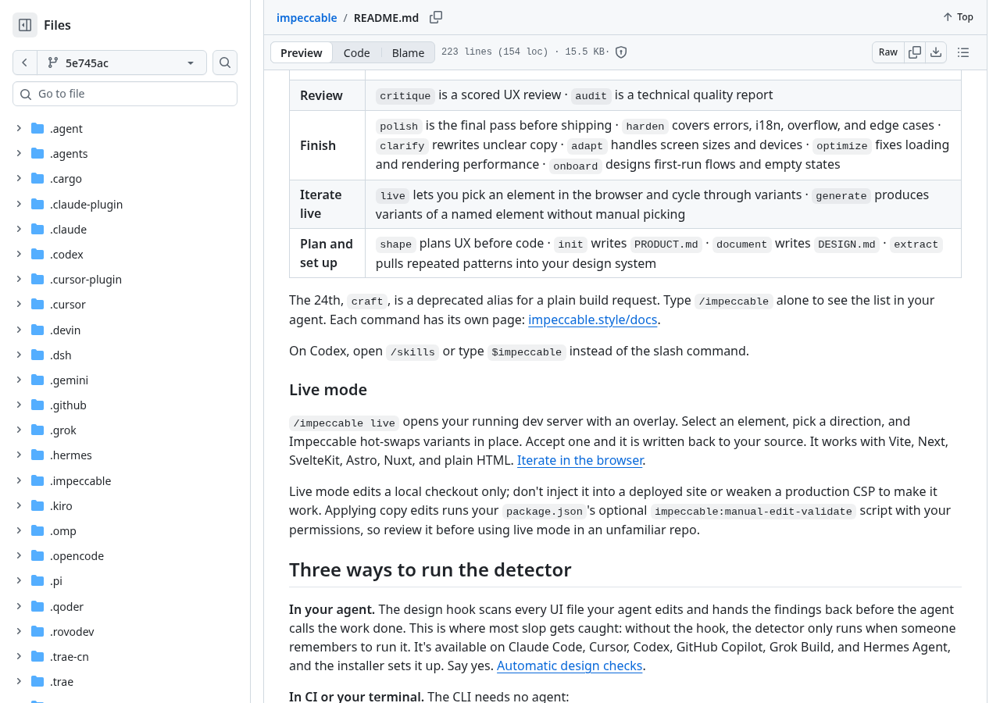
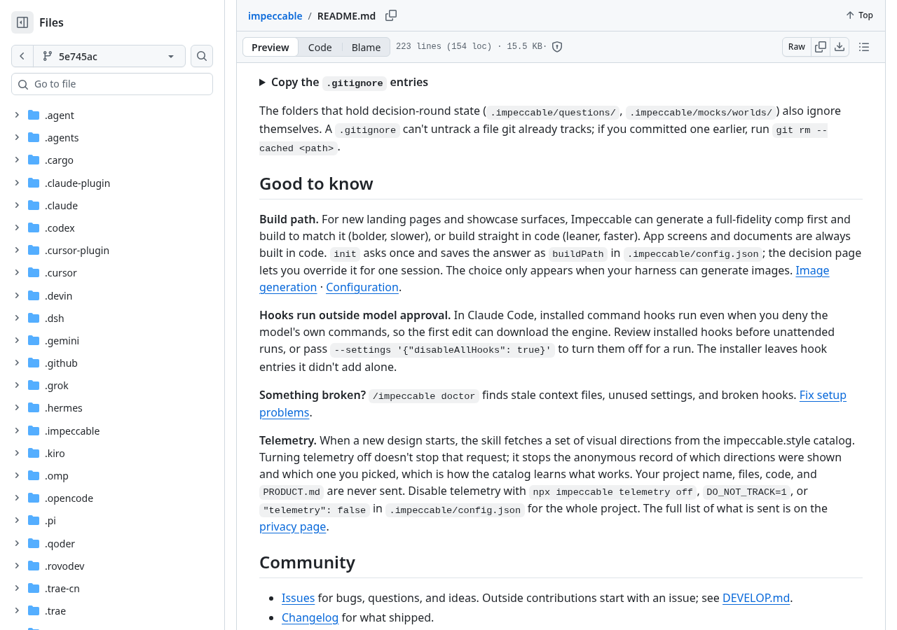
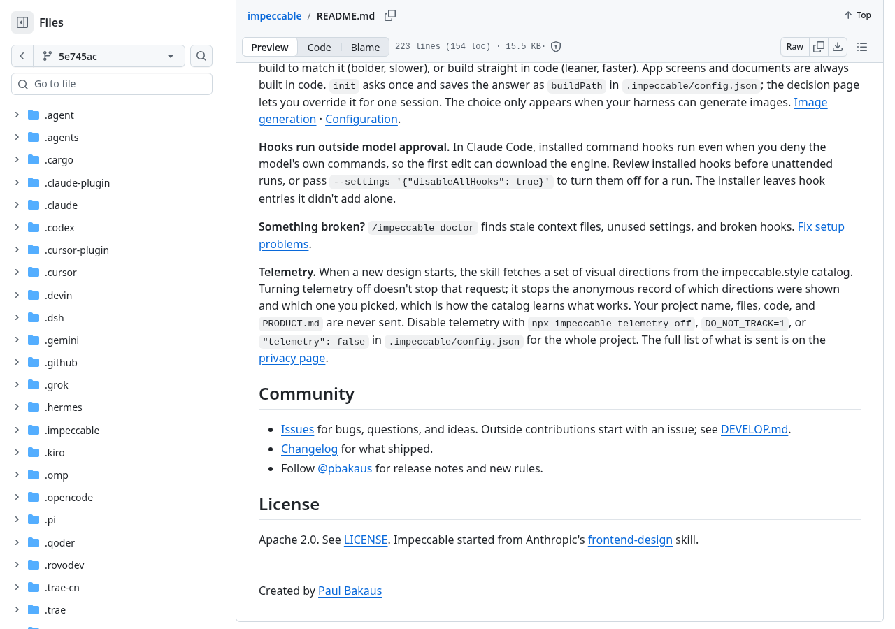
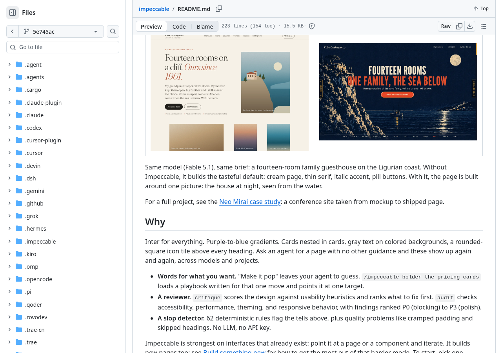
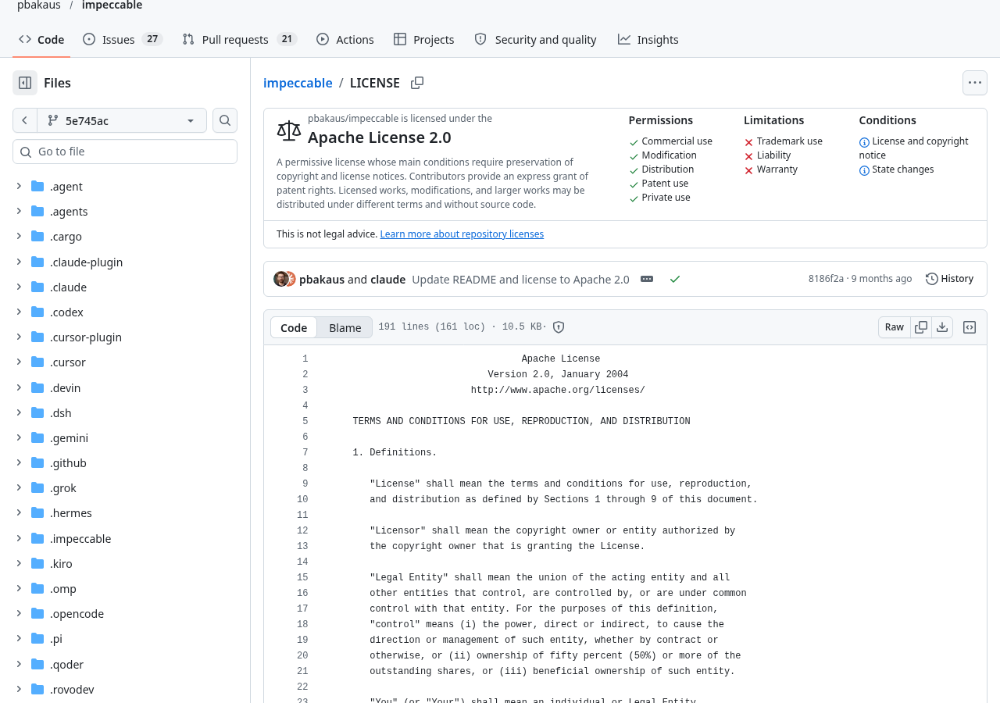

让编程助手改网页，最难说清的往往不是“按钮放在哪”，而是“已经能用了，为什么还是不好用”。字号、间距、颜色、操作反馈，问题可能挤在同一个页面里。一句“再精致一点”，没有交代先改什么，也没有说明哪些东西必须保留。

Impeccable 想解决的就是这类沟通问题：给编程助手一套界面设计与检查流程，把笼统的修改要求拆成有目标的动作。作者明确表示，它更擅长围绕已有界面迭代，也能创建新页面。对于已经有产品页面、但缺少设计复核的人，这比单看漂亮样片更值得关注。

## 它交付的是修改流程，不是自动变漂亮的保证

可以把这类技能理解成给装修师傅的施工交底。只说“客厅弄好看点”，对方得猜审美；说明“保留家具，把过道腾出来，再检查灯光”，动作就具体了。Impeccable 中的技能负责组织要求、读取项目背景、选择处理方法，真正改代码的仍是承载它的编程助手。它不是一个独立替你完成所有工作的设计模型。

作者提供的入口各有分工：critique 按可用性原则评价界面，并排列修改优先级；audit 检查无障碍、性能、主题和响应式表现；polish 用于交付前打磨；harden 关注错误状态、国际化、内容溢出和边界情况。这里的“响应式”，就是同一个页面换到手机等不同尺寸的屏幕时，内容和操作仍能合理排布。

因此，值得期待的交付物不只是改过的页面，还包括有优先级的检查结果，以及能供后续修改使用的项目说明。适用范围也有边界：技能文件将前端界面列为目标，明确排除纯后端和非界面任务。数据库问题不会因为装了设计技能就自动解决。

## 先交代产品，再缩小到一个组件

按作者描述，初始化会读取代码，只追问无法推断的内容，例如产品给谁用、要完成什么、有哪些限制，再写入 PRODUCT.md。后续命令会读取这份说明。另一个 document 入口用于把已有视觉体系记录到 DESIGN.md，让修改尽量沿用原来的设计。

这相当于装修前先讲清房子怎么住：有的空间需要展示效果，有的空间首先要方便通行。放回软件里，宣传页需要吸引人采取行动，后台和设置页则更看重找得到、看得懂、操作不费劲。技能文件也区分了这些使用目标，而不是要求所有页面都往醒目、复杂的方向改。

开始时不必把整站都交出去。README 建议先选一个组件，并指出目标越窄，越容易获得有针对性的结果。更稳妥的试用方式是：选定现有页面中的一个区域，说明用户要完成的动作、必须保留的内容和当前困扰，先让助手评价，再决定修改范围。

验收也应回到这个动作：原来难找的入口是否更清楚，文字变长后会不会遮挡按钮，手机上是否仍能完成操作。只有外观变化，不能证明使用问题已经解决；检查报告列出了问题，也不代表修改后就不必再看实际页面。技能文件本身要求查看最终渲染结果。

## 免费的是开源项目，不是编程助手的全部开销

仓库采用 Apache 2.0 许可证，属于开源资源。作者还单独强调，确定性检测器不使用大模型、不需要 API Key。这项承诺有明确范围：它说的是检测器，不是所有设计、改代码和生成图片的过程都免费。

所谓确定性检测，可以理解成按固定清单检查快递运单：哪些栏位缺了、哪些格式不对，按规则逐项找。README 列出 62 条规则，用来发现重复设计套路和质量问题。但固定清单不能替用户判断整个页面是否适合业务，正如运单填全了，也不代表包裹里的东西就符合需求。

检测范围还取决于输入。按作者说明，扫描 JSX、TSX 等源文件时只运行模式规则；低对比度、文字过小等需要看到实际页面的问题，要扫描页面地址。像检查衣服，平铺时能看缝线，穿起来才知道是否合身。只扫代码就报告“界面全面检查通过”，超出了这些规则能支持的结论。

设计和代码修改仍依赖所用编程助手及其模型，费用要按对应服务另行确认。作者还描述了先生成完整视觉稿、再照着实现的路线，但该选择只在客户端具备图像生成能力时出现。现有资料没有给出统一免费额度，也没有证明必须购买某一家云服务；不能据此承诺零成本完成全流程。

## 客户端支持和自动执行权限，要分开看

作者声明支持 Claude Code、Cursor、Codex CLI、GitHub Copilot、Gemini CLI 等客户端，并提供各自的技能目录与安装说明。Codex 的调用入口与其他客户端不同，README 写明可从技能菜单进入，或使用 $impeccable。这些是作者提供的兼容说明，尚不是跨客户端运行验证。

环境依赖也不是简单一句“装个技能就行”。README 说明，Node 用于 npx 安装入口；技能自身调用随包提供或首次下载的独立引擎。手动复制技能会跳过自动检查钩子和子代理，因此“技能已经出现”和“每次修改后都会自动检查”是不同状态。

自动检查钩子，就是预先挂在某个动作后面的检查程序，好比快递出库后自动触发运单核对，不必每次再人工点一次。方便之处在自动，风险也在自动：作者提醒，Claude Code 中已安装的命令钩子，即使模型自身的命令被拒绝，也可能继续运行，首次编辑还可能触发引擎下载。Codex 的项目钩子则需要单独批准，相关更新后可能需要再次批准。

> [!warning]
> 先查看安装内容和钩子权限，再决定是否启用自动执行。作者限定 Live 模式只编辑本地代码副本，不应注入已部署网站，也不应为了使用它而放宽生产环境的内容安全策略。陌生项目中的可选校验脚本同样需要先检查。

如果需要边看页面边选择方案，作者提供了 Live 模式：打开正在运行的开发服务，选中元素，切换变体，接受后写回源代码。README 列出的适配对象包括 Vite、Next、SvelteKit、Astro、Nuxt 和普通 HTML。它适合怎样的项目、能否在具体环境里稳定写回，仍需用自己的代码验证。

还要区分关闭遥测与完全断网。按 README 的说明，新设计开始时会从在线目录获取视觉方向；关闭遥测不会停止这次目录请求。作者声明项目名称、文件、代码和 PRODUCT.md 不会发送，但这仍是项目方的隐私说明，不能据此把整个工作流称为完全离线。

## 作者样片能说明方向，不能代替效果验收

README 展示了同一模型 Fable 5.1、同一旅馆网站需求下的有无技能对照。作者将差异描述为：未使用时偏向常见的浅色页面和胶囊按钮，使用后围绕旅馆夜景组织画面。它有助于理解作者追求的视觉方向，但仍是作者提供的案例，不是独立横评，也不能证明不同任务都能得到相同改善。

样片尤其不能回答所有使用问题：页面是否更容易操作、维护成本是否下降、复杂状态是否完整，都需要对应任务的结果。当前资料没有功能运行记录，也没有独立对比结果，因此适合把 Impeccable 当成一个值得试用的设计工作流，而不是已经验证有效的通用提质保证。

许可证也需要看清适用对象。仓库声明 Apache 2.0，并提供 LICENSE；这不等于已经逐项确认案例中的图片、字体或其他外部内容都可以随意搬用。现有资料未提供这些内容的完整授权清单。借鉴工作方法与直接复制展示内容，应当分开处理。

## 有现成页面的人，更值得从小处开始

如果已经在用编程助手做网页，手里有能运行的页面，却经常卡在“说不清哪里不好用”，Impeccable 值得列入候选。它把背景记录、局部修改、设计评价和技术检查接起来，有机会让修改目标更清楚。若期待装上后自动获得设计能力、完全离线，或免去所有模型费用，现有资料都不足以支持这些期待。

下一步可以先阅读[固定版本的安装与使用说明](https://github.com/pbakaus/impeccable/blob/5e745ace7e151feb2a93d360d0281fe39448b857/README.md)，按自己的客户端选择入口，在可回退的本地代码副本里，从一个确实存在问题的组件开始。先确认助手能读取项目背景，再看检查结果是否具体、修改是否解决原问题，最后核对实际页面和额外服务开销。

需要了解任务范围，可查看[Impeccable 技能文件](https://github.com/pbakaus/impeccable/blob/5e745ace7e151feb2a93d360d0281fe39448b857/.claude/skills/impeccable/SKILL.md)；需要确认使用和分发条件，可查看[项目许可证](https://github.com/pbakaus/impeccable/blob/5e745ace7e151feb2a93d360d0281fe39448b857/LICENSE)。决定是否留下它，应该看具体页面上的问题有没有被解决，而不是样片是否足够惊艳。

## 项目一手资料

- [pbakaus/impeccable 项目仓库](https://github.com/pbakaus/impeccable)

---

## 🧰 我做的工具

这些工具都由我持续维护。预览版会明确标注，下载、更新和已知边界以发行页为准。

### 黑粉助手 HyphenAssistant

正式迭代。手机浏览器接续电脑上的 DeepSeek Harness 会话；需本人配对、电脑与原服务在线，模型费用沿用原配置

[下载与更新](https://github.com/HackerChi-Hub/hyphen-assistant-releases/releases)

### 黑粉盒子 HyphenBox

正式迭代。免费大模型 API 雷达：持续复测可用性，本地统一接口，Key 只存本机

[下载与更新](https://github.com/HackerChi-Hub/hyphenbox-release/releases)

### 方寸智匣 LocalBrain

正式迭代。本地模型的多模态 MCP 工具箱：TTS / Whisper / 视频生成一站接入

[下载与更新](https://github.com/HackerChi-Hub/localbrain-releases/releases)

### ScreenLex 光影词库

正式迭代。看美剧顺手把生词背了，Mac/Windows 双平台，免费

[下载与更新](https://github.com/HackerChi-Hub/screenlex-download/releases)

### 黑粉录屏 HyphenScreen

正式迭代。录屏 + 智能剪辑一体：达芬奇式时间线、自动打码、导出前成片体检，免费

[下载与更新](https://github.com/HackerChi-Hub/HyphenScreen-Releases/releases)
