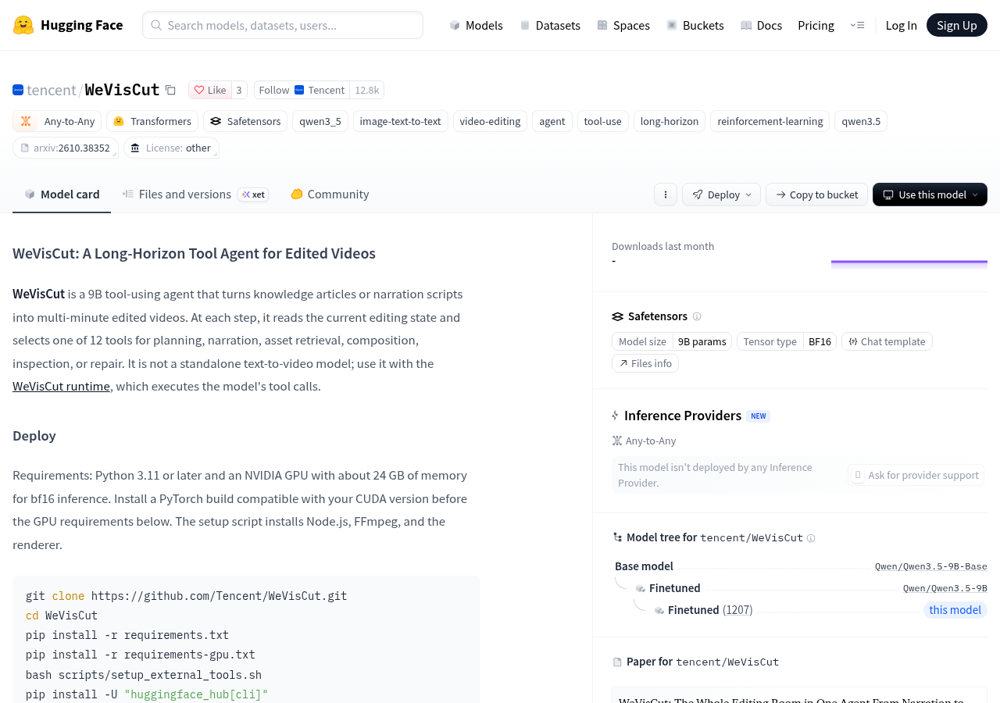
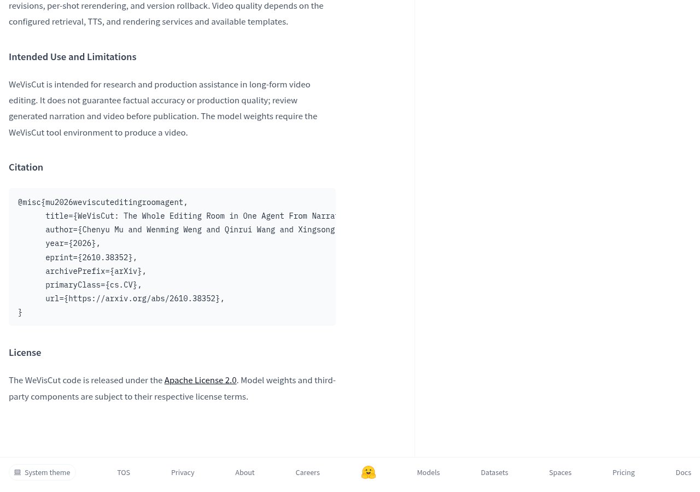
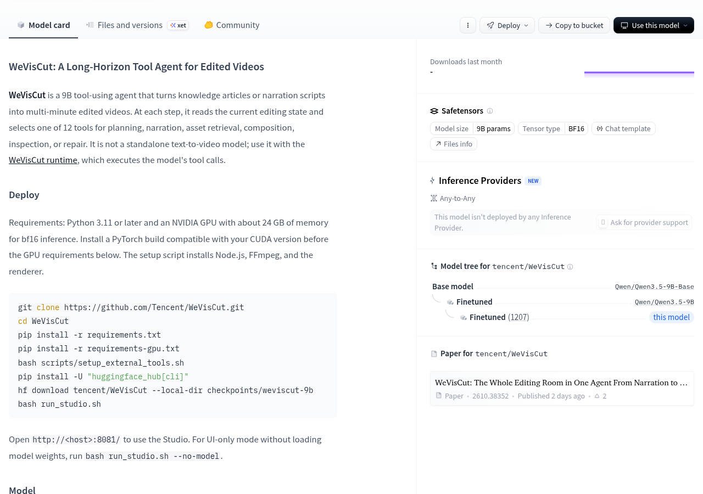
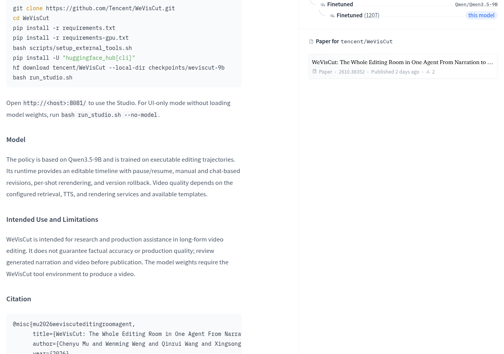
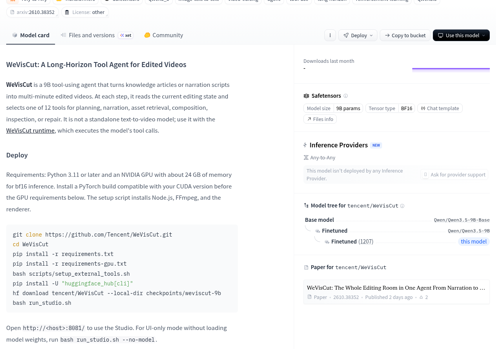

写完一篇文章或者一段解说稿之后，最花时间的往往不是写，而是把它变成一条能发出去的成片：找画面、配旁白、对时间线、导出。腾讯在 Hugging Face 上新放出的 tencent/WeVisCut 想接的就是这段活——它不是文生视频模型，而是一个 9B 的工具调用智能体，每读一次当前剪辑状态，就从 12 个工具里挑一个来用。

官方模型页对它的定位写得很直接：把知识文章或解说脚本变成多分钟的成片视频。每一步要么规划、要么写旁白、要么检索素材、要么合成、要么检查、要么修复。这 12 个工具像是剪辑台上的几排按钮，模型扮演的是那个坐在台前、知道下一步该按哪个的人。



> It is not a standalone text-to-video model; use it with the WeVisCut runtime, which executes the model's tool calls.

这句话是使用它之前必须先看懂的一点：模型权重单独下载下来并不能直接吐出一条视频，它需要 WeVisCut 运行时来真正执行它发出的工具调用。用日常的说法，这就像买了一个会写菜谱的厨师，但他做菜要的锅灶和灶台，得由另外一套厨房系统提供。权重是“大脑”，运行时才是那间厨房。


## 权重放在哪、基座是谁

模型页标注的模型规模是 9B 参数，张量类型为 BF16，采用 Safetensors 格式，模型树显示它的基座是 Qwen/Qwen3.5-9B-Base，属于在 Qwen3.5-9B 基础上做的微调。官方描述称其策略基于 Qwen3.5-9B，并在可执行的剪辑轨迹上训练。也就是说它的“剪辑直觉”来自看过的操作序列，而不是靠推理时临时猜。

许可方面分成两块，需要分开看：代码以 Apache License 2.0 发布；模型权重与第三方组件则各自遵循其对应的许可条款。这个划分在实践中很关键——代码部分可以宽松地拿去改，权重能不能商用、能不能再分发，要按权重仓库的许可单独确认，不能从代码的宽松直接推过去。



## 本地跑起来需要什么



官方给出的部署要求是：Python 3.11 或更高版本，一块大约 24GB 显存的英伟达 GPU 用于 bf16 推理，并且要先装好与本机 CUDA 版本匹配的 PyTorch。安装脚本会顺带装上 Node.js、FFmpeg 和渲染器。整体流程是克隆仓库、装 requirements 和 requirements-gpu、跑 setup 脚本，再用 huggingface_hub 把 tencent/WeVisCut 下载到 checkpoints/weviscut-9b，最后 bash run_studio.sh 启动，打开 8081 端口进 Studio。

```bash
git clone https://github.com/Tencent/WeVisCut.git
cd WeVisCut
pip install -r requirements.txt
pip install -r requirements-gpu.txt
bash scripts/setup_external_tools.sh
pip install -U "huggingface_hub[cli]"
hf download tencent/WeVisCut --local-dir checkpoints/weviscut-9b
bash run_studio.sh
```

如果只想先看看界面长什么样，官方还留了一条轻量入口：bash run_studio.sh --no-model，不加载任何模型权重就跑起 Studio。这对想先判断这套剪辑流程合不合自己口味的人比较友好，不用先腾出一块 24GB 显卡。



## 它实际交付的是什么体验


运行时的能力被描述为：提供可编辑的时间线，支持暂停与继续、手动修改和对话式修改、逐镜头重渲染，以及版本回滚。这几项决定了这东西到底能不能进日常流程——可以停下来手动改一版、改坏了退回上一个版本，而不是只能从头跑一遍等它出结果。

官方也明确承认成片质量取决于外部配置：检索服务、TTS 服务、渲染服务以及可用模板。也就是说“稿子变视频”这件事里，模型负责决定怎么剪、往哪配，而素材从哪来、声音怎么念、最终画面怎么合成，取决于你给它接了哪些服务。服务没配好，模型再聪明也变不出成片。



> [!warning]
> 官方在“预期用途与限制”里写明：它面向长视频剪辑的研究与生产辅助，不保证事实准确性或制作质量，发布前需人工审看生成的旁白与视频。这条限制值得单独记住——它是负责干活的助手，不是可以不看就发出去的自动机。

此外，模型页显示当前还没有任何 Inference Provider 部署这个模型，页面上挂着“请求提供方支持”的入口。想省事走托管 API 的路，眼下暂时没有现成选项，自建是主要路径。

## 什么时候值得试

如果你的日常产出是那种“稿子已经写好、只差剪成一条”的内容，这个项目值得放进候选：它把剪辑动作拆成 12 个可调用的步骤，并且留了暂停、回滚和逐镜头重渲染这些工程上的余地。配套的论文是 arXiv:2610.38352，标题为“WeVisCut: The Whole Editing Room in One Agent From Narration to Long-Form Video”，模型页显示该论文为两天前发布。

如果你的显卡达不到 24GB 显存，或者你更想要一个开箱即用的在线服务，那现在不是合适的入手时机——前者是硬门槛，后者目前没有可用的托管提供方。最省事的验证路径是先跑 --no-model 模式看 Studio 的时间线交互合不合手，再决定要不要为一块显卡投入。

模型页还给出了项目仓库地址，代码在 Apache License 2.0 之下，权重与第三方组件按各自许可执行，需要商用或再分发的人应当以权重仓库的许可条款为准。

## 官方资料

- [腾讯混元 官方发布说明](https://huggingface.co/tencent/WeVisCut)


---

## 🧰 我做的工具

这些工具都由我持续维护。预览版会明确标注，下载、更新和已知边界以发行页为准。

### 黑粉助手 HyphenAssistant

正式迭代。手机浏览器接续电脑上的 DeepSeek Harness 会话；需本人配对、电脑与原服务在线，模型费用沿用原配置

[下载与更新](https://github.com/HackerChi-Hub/hyphen-assistant-releases/releases)

### 黑粉盒子 HyphenBox

正式迭代。免费大模型 API 雷达：持续复测可用性，本地统一接口，Key 只存本机

[下载与更新](https://github.com/HackerChi-Hub/hyphenbox-release/releases)

### 方寸智匣 LocalBrain

正式迭代。本地模型的多模态 MCP 工具箱：TTS / Whisper / 视频生成一站接入

[下载与更新](https://github.com/HackerChi-Hub/localbrain-releases/releases)

### ScreenLex 光影词库

正式迭代。看美剧顺手把生词背了，Mac/Windows 双平台，免费

[下载与更新](https://github.com/HackerChi-Hub/screenlex-download/releases)

### 黑粉录屏 HyphenScreen

正式迭代。录屏 + 智能剪辑一体：达芬奇式时间线、自动打码、导出前成片体检，免费

[下载与更新](https://github.com/HackerChi-Hub/HyphenScreen-Releases/releases)
