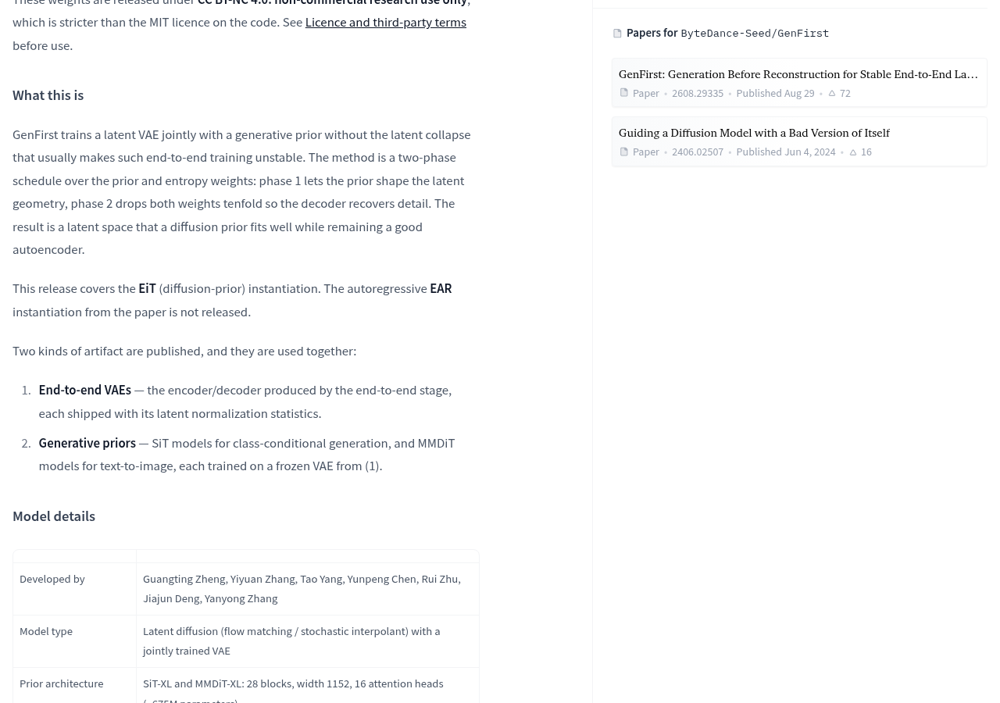
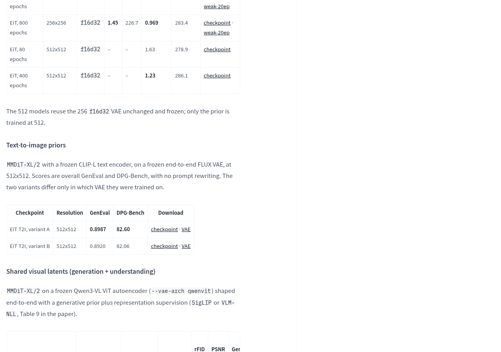
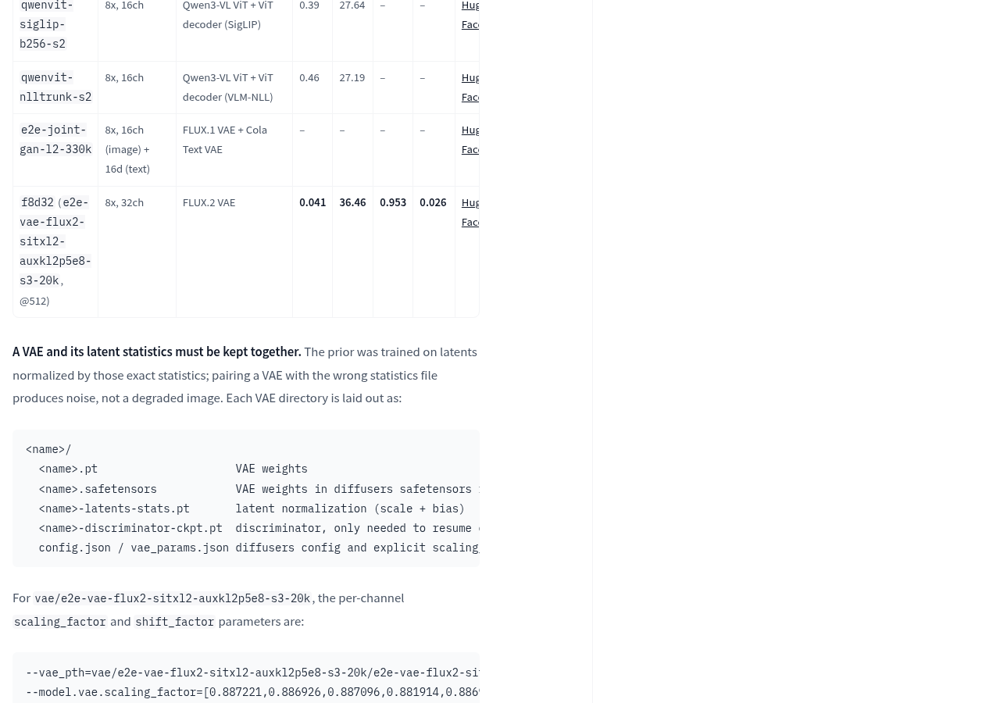
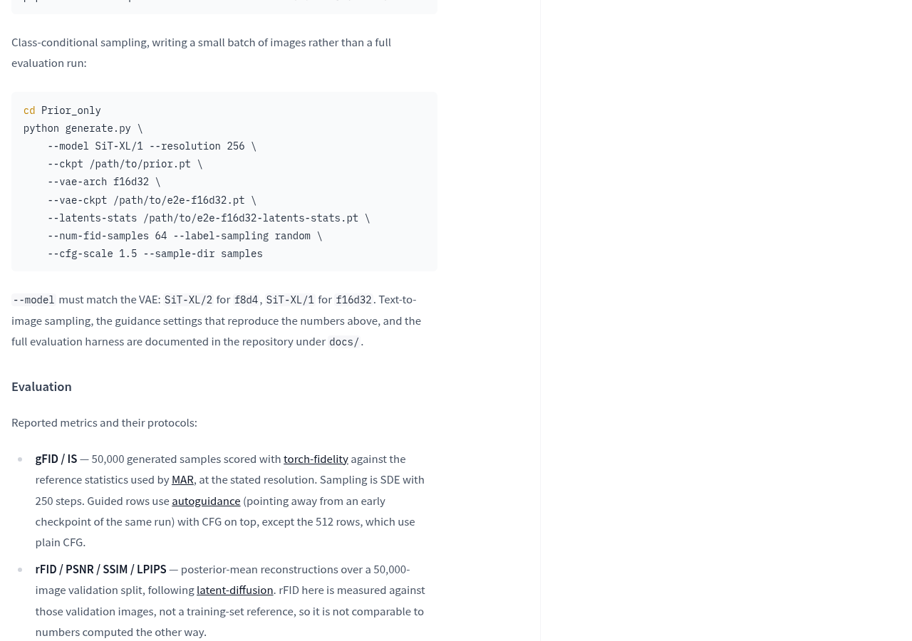
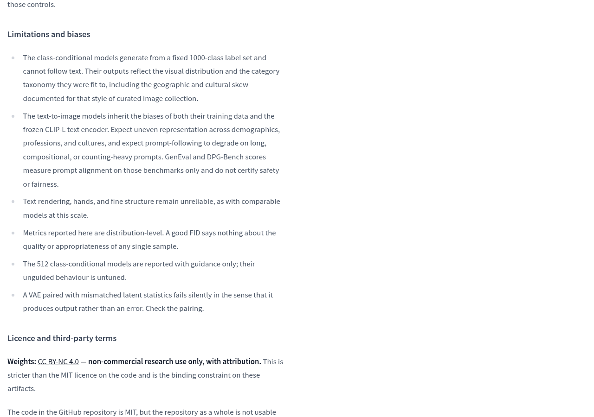
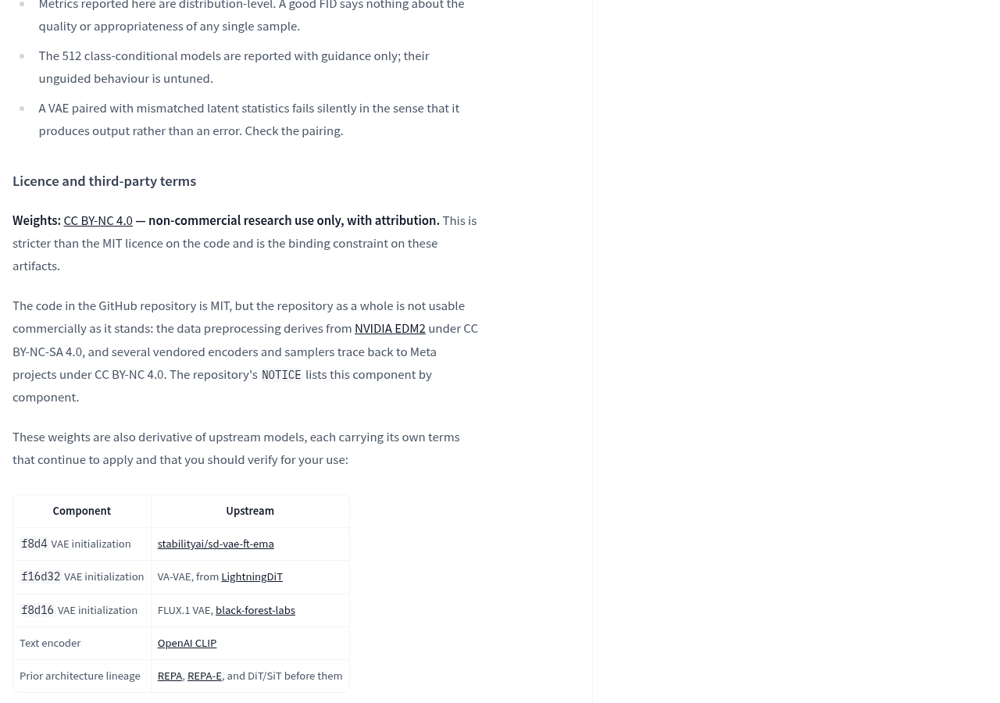
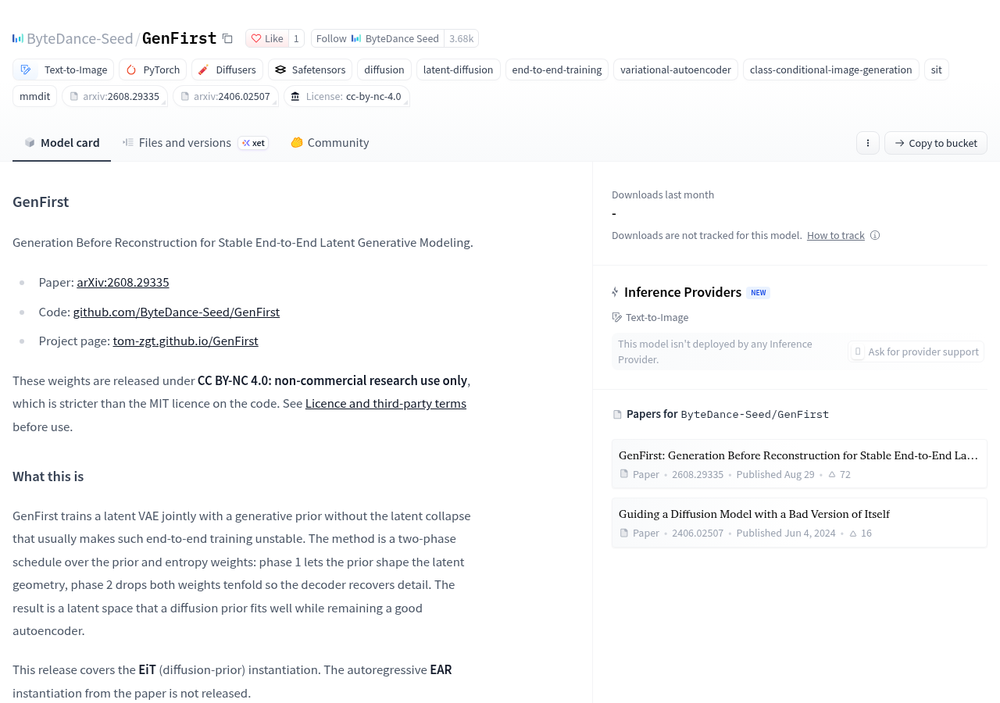

想把字节 GenFirst 下载到电脑上，输入一句描述就开始生图？官方已经列出文生图权重和配套文件，但它交付的是研究用模型组件，不是安装后就能使用的生图软件。是否值得下载，先看用途是否符合要求，再看能否配齐运行环境。

官方模型卡明确：权重仅供非商业研究；推理需要项目代码，没有现成的 diffusers 集成，也没有 from_pretrained 加载入口。对想复现论文或研究图像生成的人，它提供了具体材料；对想直接接入日常商用出图流程的人，用途限制已经挡在前面。

## 能下载哪些文件，决定了能做什么

官方仓库列出了端到端训练得到的 VAE，以及与其配合的生成模型权重。本次开放的是采用扩散生成路线的 EiT 实现；论文中的自回归 EAR 实现没有发布。不能把论文讨论过的全部方案，都当成当前可以下载的内容。

选择文件时，最容易混淆的是“按类别生图”和“按文字生图”。类别条件模型接收的是固定类别编号，没有文字输入；文生图模型才接收文字描述。想输入场景描述，应从官方模型卡的文生图部分找对应权重，而不是看到生图文件就下载。

官方还列出了共享视觉表示和统一图文建模的研究权重。不过，统一图文建模部分明确区分了文生图与图片描述任务所用的检查点。对于只想复现文生图的读者，先选清任务，比一次下载所有变体更有意义。

可从[官方模型卡的文生图部分](https://huggingface.co/ByteDance-Seed/GenFirst#text-to-image-priors)查看权重与配套 VAE 入口，再按[官方代码仓库](https://github.com/ByteDance-Seed/GenFirst)中的说明准备环境。模型卡没有给出可据此确认的个人电脑显存需求、Mac 兼容性或生成速度，暂时不能按某台设备“肯定能跑”来安排下载和部署。

## 本地运行的难点，是把模型组件配对

理解这些组件，可以先想想快递站：包裹按一套货架规则存放，取件时也得沿用同一套规则。这里的 VAE 负责把图像转换成紧凑的内部表示，再把这种表示还原成图像；生成模型则在这种内部表示里学习生成。内部表示就是所谓的“潜在表示”，不是最终可以直接查看的图片。

GenFirst 研究的重点，是让 VAE 与生成模型一起训练，使内部表示既适合生成，也能保留图像细节。官方介绍的方法先让生成模型影响内部表示的组织方式，随后调整训练权重，让解码器恢复细节。因此，它的价值更偏向研究“图像该怎样压缩和生成”，而不只是多提供一个生图文件。

实际部署时，VAE 还必须带上对应的潜在表示归一化统计文件。沿用快递站的类比，这份文件像货架坐标的换算规则：生成模型训练时用了哪套规则，运行时就得继续用哪套。官方明确提醒，配错统计文件会生成噪声，而且程序可能照常输出，并不报错。

这意味着，验收不能只看命令有没有执行完。应先按官方文档确认生成模型、VAE、统计文件与模型架构的对应关系，再检查实际输出。模型卡提供了类别条件采样示例，文生图采样及复现成绩所需设置则指向代码仓库的文档目录；不能把类别采样示例直接当作文生图教程。

## 官方成绩能帮助选方向，不能代替出图验收

对于文生图用途，最相关的是官方列出的两个变体。它们的分辨率均为 512×512，使用冻结的 CLIP-L 文本编码器，区别在于训练时采用的 VAE。变体 A 的 GenEval 为 0.8987、DPG-Bench 为 82.60；变体 B 分别为 0.8920 和 82.06。这些都是官方报告的成绩。

这两项评测关注的是生成图像与文字要求的对齐情况。可以把它理解成拿着订单核对交付内容：成绩回答的是在指定题目和评分规则下，图像有多符合要求，而不是某张图是否一定好看、文字是否一定正确。官方说明，这些成绩采用 50 步 Euler 采样，CFG 为 7.0，作用区间为 [0.35, 1.0]，没有进行提示语重写。复现时应连同这些条件一起看。

实际选择还要看官方列出的短板：长描述、复杂组合和计数要求可能降低遵循效果，图中文字、手部与精细结构仍不可靠。因此，如果目标是研究文生图方法，可以从对应变体开始；如果任务要求准确排字、复杂数量关系或稳定交付，应使用自己的目标内容验收，不能仅凭榜单成绩决定采用。

## 下载之前，先过用途与安全这道门

官方将权重标为 CC BY-NC 4.0，并明确限定为署名、非商业研究用途。代码自身采用 MIT 许可证，也不代表整个项目都能商用：模型卡说明，数据预处理及部分随附组件另有非商业条款，上游模型和训练数据的条款也分别适用。仅凭代码页上的 MIT 标签，不能给整套方案开商用绿灯。

安全方面，官方提醒这些 .pt 检查点涉及 pickle 加载，可执行任意 Python 代码；所发布文件还包含参数命名空间，需要采用允许加载这些对象的方式。应只从可信官方来源获取文件，并按项目安全说明处理，不要为了让陌生权重加载成功而随意放宽限制。

模型也没有附带安全过滤、水印或内容分类器。官方将生成可识别真人内容、把输出当作真实照片或事实记录等用途列为范围之外；若让输出接触其他人，部署者还需补上相应控制。这些工作不会随着权重下载自动完成。

如果目标是非商业研究，下一步可以从[官方使用说明](https://huggingface.co/ByteDance-Seed/GenFirst#usage)进入，选定任务和权重，核对配套文件，再验收目标图像是否正确生成。若需要商用授权、开箱即用的生图界面，或已确认的个人电脑运行方案，当前材料还不足以满足这些要求。模型页面也显示，尚无 Hugging Face 推理服务商部署该模型，不能把权重页面当作现成在线生图服务。

## 官方资料

- [字节 Seed 官方发布说明](https://huggingface.co/ByteDance-Seed/GenFirst)

---

## 🧰 我做的工具

这些工具都由我持续维护。预览版会明确标注，下载、更新和已知边界以发行页为准。

### 黑粉助手 HyphenAssistant

正式迭代。手机浏览器接续电脑上的 DeepSeek Harness 会话；需本人配对、电脑与原服务在线，模型费用沿用原配置

[下载与更新](https://github.com/HackerChi-Hub/hyphen-assistant-releases/releases)

### 黑粉盒子 HyphenBox

正式迭代。免费大模型 API 雷达：持续复测可用性，本地统一接口，Key 只存本机

[下载与更新](https://github.com/HackerChi-Hub/hyphenbox-release/releases)

### 方寸智匣 LocalBrain

正式迭代。本地模型的多模态 MCP 工具箱：TTS / Whisper / 视频生成一站接入

[下载与更新](https://github.com/HackerChi-Hub/localbrain-releases/releases)

### ScreenLex 光影词库

正式迭代。看美剧顺手把生词背了，Mac/Windows 双平台，免费

[下载与更新](https://github.com/HackerChi-Hub/screenlex-download/releases)

### 黑粉录屏 HyphenScreen

正式迭代。录屏 + 智能剪辑一体：达芬奇式时间线、自动打码、导出前成片体检，免费

[下载与更新](https://github.com/HackerChi-Hub/HyphenScreen-Releases/releases)
