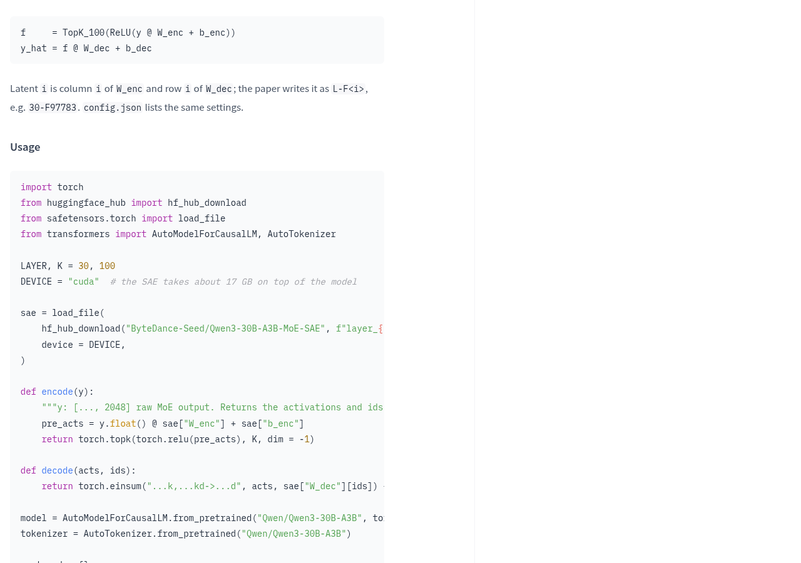
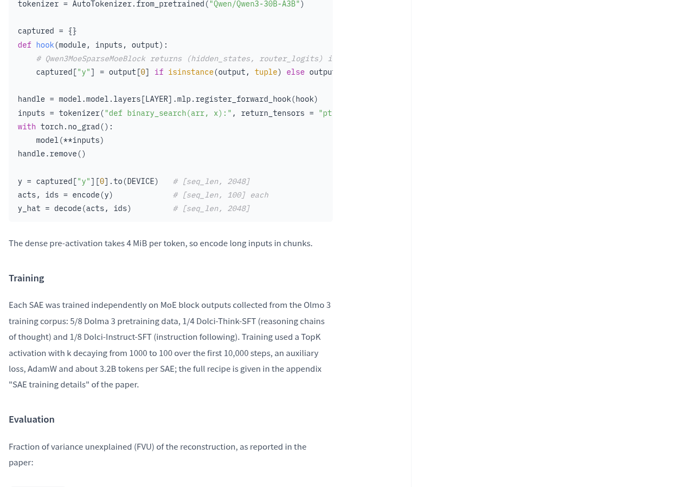
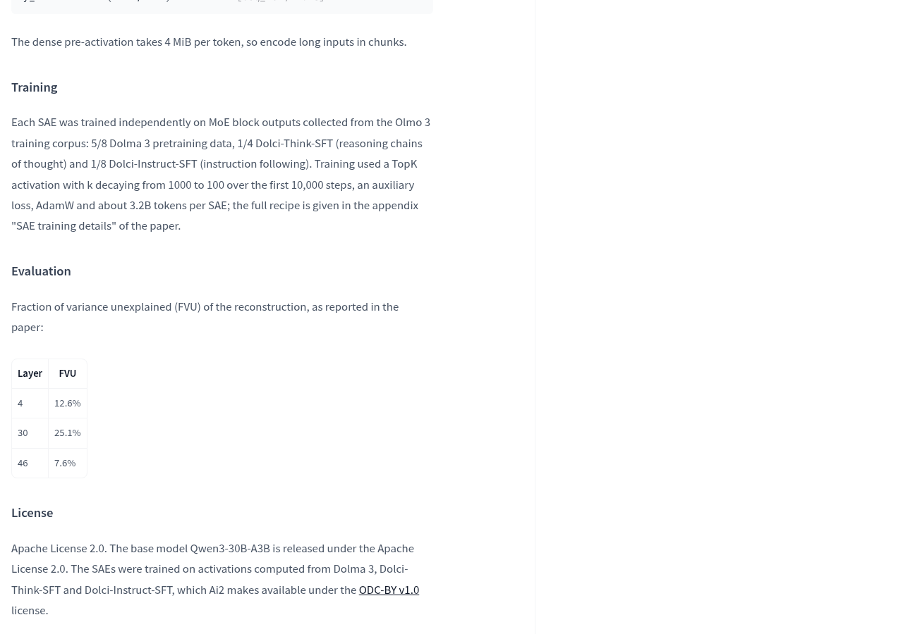
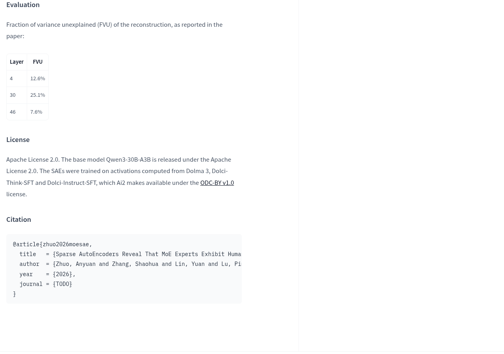
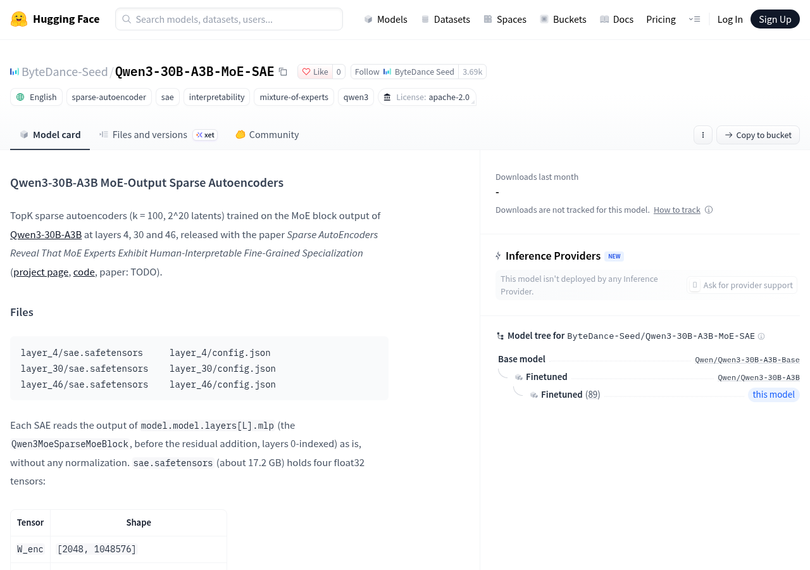

看到 Qwen3-30B-A3B-MoE-SAE 出现在字节 Seed 的官方模型仓库，先别急着把它当成新的聊天模型。官方说明把它定位为分析 Qwen3-30B-A3B 内部输出的稀疏自编码器，使用示例也要另外加载原来的 Qwen 模型。如果目标是直接换一个更好用的聊天助手，这份资源并没有给出相应的能力成绩。

它更适合另一个问题：模型内部产生的一团数字，能不能拆成更容易研究的特征？理解这一点，才能判断这些权重值不值得下载，以及下载之后应该验收什么。

## 它拆解的是内部输出，不是替你回答问题

MoE 通常译作“混合专家”。可以借小区快递站理解：不同货架分担不同包裹，但只看最后取出来的一堆包裹，不容易知道里面有哪些具体类别。这里的稀疏自编码器，也就是 SAE，更像一套整理与标记办法：把混在一起的内部输出映射到大量候选特征，再只保留其中较强的一部分。这里的“专家”和“特征”都是模型中的计算结构，不是有人躲在后台分拣。

官方提供的 SAE 分别针对第 4、30、46 层训练，层号从 0 开始计算。它们读取的是 MoE 模块的原始输出，位置在残差相加之前，而且不做归一化。可以把这个位置理解为包裹还没与其他批次合并时的交接点：取样位置一旦变了，读到的东西也会变。因此，接入哪一层、读取哪个模块，是复现时必须对上的条件。

这套配置有 1,048,576 个候选潜在特征，采用 TopK 方法保留最强的 100 项。沿用快递站的例子，就是标签库很大，但每次只留下当前最明显的一组标签。官方代码随后还会用这些特征重建原来的输出，用来检查拆解过程中丢失了多少信息。候选特征数量多，并不自动说明每个特征都已经有清楚的人类语义。

## 下载前，先看额外显存开销

官方页面已经列出各层的 sae.safetensors 和 config.json，并提供下载与加载示例。文件说明写明，每份 SAE 权重约 17.2 GB，内部保存的是 float32 张量。使用示例还特意注明：SAE 会在基础模型之外额外占用约 17 GB。这个数字不能拿来当整套流程的显存需求。

实际流程要先加载 Qwen3-30B-A3B，再捕获指定层的输出，交给 SAE 编码和重建。它更像给正在运行的设备接上一套检测仪器，原设备本身仍然要供电、占地方；检测仪器的体积，不包含原设备的体积。判断能否运行时，基础模型与 SAE 的资源需求需要分别核算。

输入变长还会增加中间计算的负担。词元可以理解为微信消息进入模型前被切成的小片段，不一定一个汉字对应一个词元。官方提醒，稠密预激活计算每个词元需要 4 MiB，因此长输入应分块编码。这是中间计算的内存提醒，不是每条消息的收费标准，也不是完整运行所需内存。

现有示例使用 CUDA，并包含针对 transformers 4.x 模块返回形式的处理。准备复现时，需要核对运行环境与模块接口；这些代码本身没有给出 Mac、MLX 或其他运行路线的适配结果。仅凭权重文件开放，还无法判断某台个人电脑能否顺利完成分析。

## 官方成绩衡量重建损失，不是聊天水平

官方列出的评估指标是 FVU，也就是重建后仍未能解释的方差。仍用分拣来理解：把一堆包裹整理成标签，再根据标签还原原来的分布，总会有一些细节没被保留下来。FVU 衡量的就是这种重建遗漏，而不是答案正确率。

| 对应层 | 官方报告的 FVU |
| --- | --- |
| 4 | 12.6% |
| 30 | 25.1% |
| 46 | 7.6% |

> 这些数值来自官方模型说明中转述的论文结果。

这些成绩能帮助研究者了解不同层的重建表现，但选择分析层时，还要看要研究的问题发生在哪里。重建遗漏较少，也不自动意味着特征更容易命名，或者模型回答得更准确。若想用它研究某种内部行为，验收应继续追问：哪些输入会激活目标特征，这种对应关系能否在其他输入中重复出现？

## 适合研究者起步，普通使用者不必急着换模型

许可证也要分开看。官方说明写明，这套 SAE 和基础模型 Qwen3-30B-A3B 采用 Apache License 2.0；训练所用激活来自 Dolma 3、Dolci-Think-SFT 和 Dolci-Instruct-SFT，说明中标注这些数据由 Ai2 以 ODC-BY v1.0 提供。需要再分发权重或处理相关数据时，应分别核对对应条款，不能把权重许可直接套到所有材料上。

就官方页面显示的状态而言，它已经列出研究权重文件与使用代码，但页面同时注明，没有推理服务商部署这个模型。对希望直接打开网页聊天、调用现成托管服务的使用者，这不是一个现成入口；对准备分析 MoE 内部输出的研究者，它提供了明确的接入位置、权重格式和编码示例。

准备动手，可以从[查看官方模型说明与文件清单](https://huggingface.co/ByteDance-Seed/Qwen3-30B-A3B-MoE-SAE)开始，先核对基础模型、额外显存开销、运行接口和许可证。具备相应环境后，再按官方示例验收指定层输出能否被捕获、特征能否编码、输出能否重建。完成这些步骤，才有条件继续研究特征的含义；如果只是需要一个聊天助手，不必为了这套分析权重更换现有模型。

## 官方资料

- [字节 Seed 官方发布说明](https://huggingface.co/ByteDance-Seed/Qwen3-30B-A3B-MoE-SAE)

---

## 🧰 我做的工具

这些工具都由我持续维护。预览版会明确标注，下载、更新和已知边界以发行页为准。

### 黑粉助手 HyphenAssistant

正式迭代。手机浏览器接续电脑上的 DeepSeek Harness 会话；需本人配对、电脑与原服务在线，模型费用沿用原配置

[下载与更新](https://github.com/HackerChi-Hub/hyphen-assistant-releases/releases)

### 黑粉盒子 HyphenBox

正式迭代。免费大模型 API 雷达：持续复测可用性，本地统一接口，Key 只存本机

[下载与更新](https://github.com/HackerChi-Hub/hyphenbox-release/releases)

### 方寸智匣 LocalBrain

正式迭代。本地模型的多模态 MCP 工具箱：TTS / Whisper / 视频生成一站接入

[下载与更新](https://github.com/HackerChi-Hub/localbrain-releases/releases)

### ScreenLex 光影词库

正式迭代。看美剧顺手把生词背了，Mac/Windows 双平台，免费

[下载与更新](https://github.com/HackerChi-Hub/screenlex-download/releases)

### 黑粉录屏 HyphenScreen

正式迭代。录屏 + 智能剪辑一体：达芬奇式时间线、自动打码、导出前成片体检，免费

[下载与更新](https://github.com/HackerChi-Hub/HyphenScreen-Releases/releases)
