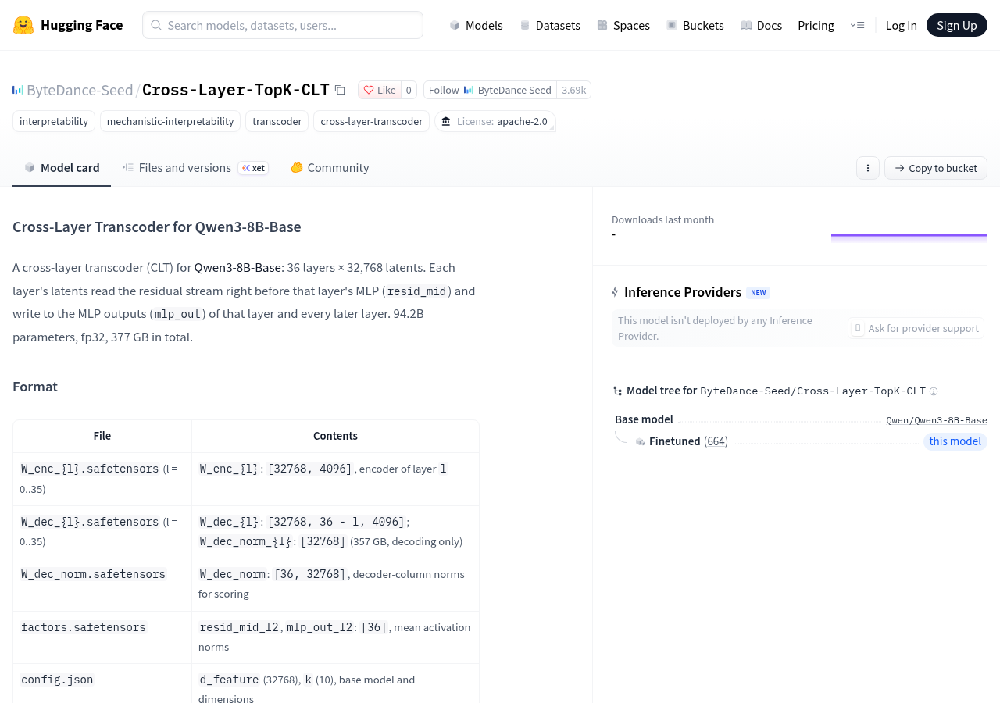
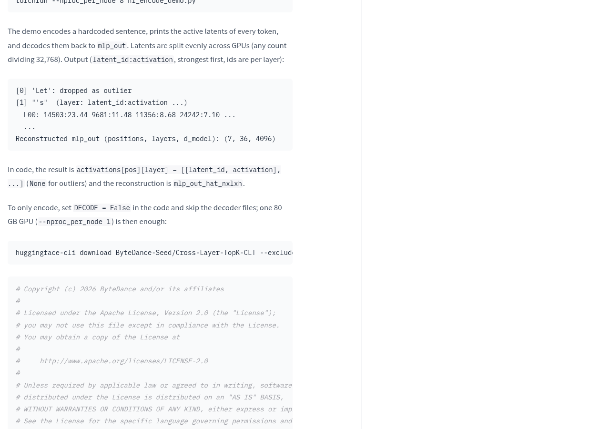
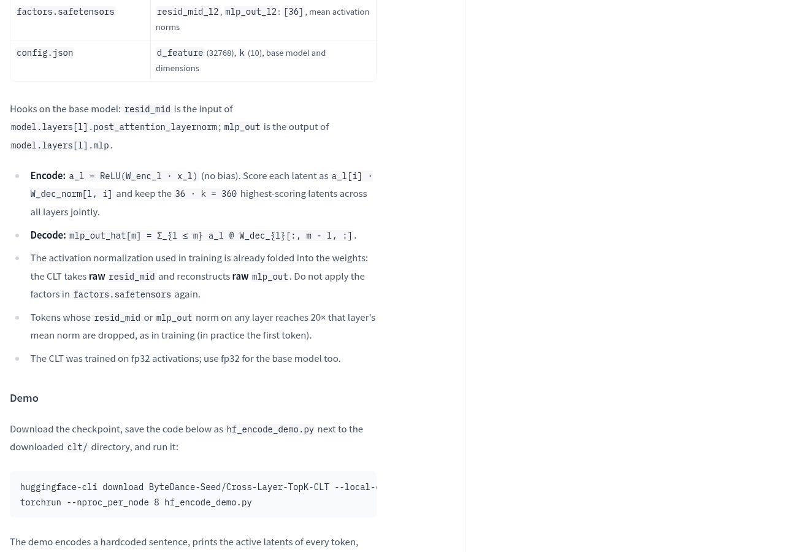
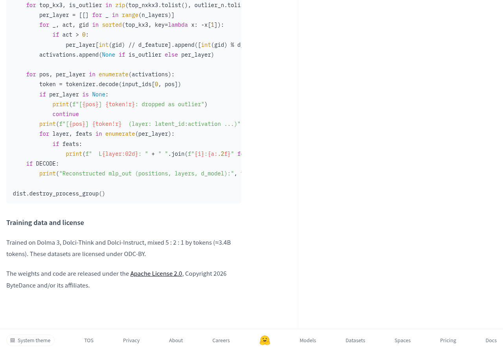

想知道千问处理一句话时，内部哪些特征被激活了？字节 Seed 的 Cross-Layer-TopK-CLT 提供了一个研究入口：针对 Qwen3-8B-Base 提取内部特征，并用这些特征重建部分内部计算结果。想研究模型内部计算的人可以继续看；想直接提升聊天效果的人，这份资源没有给出相应承诺。

## 它提取的是内部特征，不是现成的思考说明

官方将它称为跨层转码器，简称 CLT。可以把模型内部的处理过程暂时想成快递分拣：包裹经过不同工位，每个工位都有正在处理的信息。CLT 从各层指定位置读取这些信息，把它们转换成一组带编号、带激活值的特征，再用选中的特征重建对应计算模块的输出。这里的编号像货架位置，告诉你特征在哪里、激活多强；编号本身并没有附上一张解释含义的取件单。

具体到这个项目，特征读取的位置是每层前馈计算模块 MLP 之前的残差流，官方记为 resid_mid；重建的目标是 MLP 输出，记为 mlp_out。每层的特征可以参与重建本层及后续层的 MLP 输出，因此它观察的关系跨越了层与层，而不只停留在某一层内部。

官方列出的结构是 36 层，每层 32,768 个潜在特征。编码后，程序结合激活值和解码器列范数打分，在所有层中联合保留得分最高的 360 个特征。这里的 TopK 是跨层共同筛选，不是每层各自固定挑出同样多的特征。

这能把内部计算整理成可进一步分析的稀疏特征记录。但官方示例展示的是特征编号、激活值和重建结果的形状，没有为每个特征提供自然语言含义。要回答某个特征究竟对应什么，还需要另外设计验证过程，不能直接把输出列表当成模型的完整思考说明。

## 先选编码还是重建，再考虑下载

最影响使用选择的数字是体积：官方列出 CLT 有 94.2 billion，也就是 942 亿参数，采用 fp32 格式，文件总量为 377 GB。这是转码器自身的规模，不是把基础模型 Qwen3-8B-Base 的参数量改写成了 942 亿，也不是对聊天能力的评分。

如果目标只是查看哪些特征被激活，可以选择只编码。官方要求在示例代码中设置 DECODE = False，并跳过解码器文件；文档给出的条件是一张 80 GB 显卡足以运行这个编码示例。对于暂时不需要重建输出的研究任务，这条路径更值得先检查。

如果还要将特征还原成 MLP 输出，就需要解码器。官方标注解码器文件为 357 GB，并提供了使用 8 个进程的多卡启动示例。文件大小是存储信息，启动命令是示例配置；文档没有据此给出完整重建的通用最低显存，也没有列出运行耗时，不能直接换算成某台电脑的可用配置。

运行方式也要分开看：随附示例使用 PyTorch、CUDA 和 NCCL。资料没有提供 Mac、MLX 或其他运行后端的适配说明。因此，权重已经开放和现有电脑可以直接运行，是需要分别确认的事情。

## 跑出特征列表之后，该验收什么？

官方示例使用代码中预设的句子，逐个词元打印激活特征，再将它们重建为 mlp_out。词元可以理解成一条微信消息被模型切成的小片段：一个片段不一定对应一个完整汉字或单词。示例按这些片段列出不同层的特征，所以阅读输出时，要把文字片段、所在层和特征编号一起看。

复现时有两个容易影响结果的设置。官方说明，训练所用的激活归一化已经合并进权重，不要再应用 factors.safetensors 中的缩放因子；基础模型也应使用 fp32，与训练时的激活精度保持一致。另有异常值处理：任意层的相关向量范数达到该层均值的 20 倍时，对应词元会被丢弃，官方示例中首个词元就被标记为异常值。

因此，验收可以沿着实际输出推进：编码是否产生了逐词元、逐层的特征记录，异常值是否按规则处理，启用重建后是否得到预期结构的输出。若要进一步判断重建得好不好，还需要比较重建值与基础模型原始 MLP 输出。页面展示了重建结果的形状，没有给出重建误差成绩；成功打印形状，只完成了运行流程的检查。

## 现在适合谁用，下一步去哪里？

官方说明权重和代码已按 Apache License 2.0 发布；训练数据涉及的许可另列为 ODC-BY。使用或再分发前，应分别查看项目与数据的对应条款。页面同时显示，没有推理服务商部署该模型，不能把仓库入口当成现成的在线调用服务。

如果你正在研究 Qwen3-8B-Base 的内部特征，并且具备官方示例要求的运行条件，可以先从只编码路径检查输出，再决定是否需要下载解码器、继续做重建比较。如果需求是日常聊天，或者期待工具自动解释每个特征的含义，当前文档没有提供这样的使用流程。

下一步可查看[官方项目说明与权重入口](https://huggingface.co/ByteDance-Seed/Cross-Layer-TopK-CLT)，重点阅读[示例运行说明](https://huggingface.co/ByteDance-Seed/Cross-Layer-TopK-CLT#demo)和[文件格式说明](https://huggingface.co/ByteDance-Seed/Cross-Layer-TopK-CLT#format)。先确认任务需要编码还是重建、设备能否匹配示例，再开始下载；完成运行后，再用原始输出与重建结果回答真正的研究问题。

## 官方资料

- [字节 Seed 官方发布说明](https://huggingface.co/ByteDance-Seed/Cross-Layer-TopK-CLT)

---

## 🧰 我做的工具

这些工具都由我持续维护。预览版会明确标注，下载、更新和已知边界以发行页为准。

### 黑粉助手 HyphenAssistant

正式迭代。手机浏览器接续电脑上的 DeepSeek Harness 会话；需本人配对、电脑与原服务在线，模型费用沿用原配置

[下载与更新](https://github.com/HackerChi-Hub/hyphen-assistant-releases/releases)

### 黑粉盒子 HyphenBox

正式迭代。免费大模型 API 雷达：持续复测可用性，本地统一接口，Key 只存本机

[下载与更新](https://github.com/HackerChi-Hub/hyphenbox-release/releases)

### 方寸智匣 LocalBrain

正式迭代。本地模型的多模态 MCP 工具箱：TTS / Whisper / 视频生成一站接入

[下载与更新](https://github.com/HackerChi-Hub/localbrain-releases/releases)

### ScreenLex 光影词库

正式迭代。看美剧顺手把生词背了，Mac/Windows 双平台，免费

[下载与更新](https://github.com/HackerChi-Hub/screenlex-download/releases)

### 黑粉录屏 HyphenScreen

正式迭代。录屏 + 智能剪辑一体：达芬奇式时间线、自动打码、导出前成片体检，免费

[下载与更新](https://github.com/HackerChi-Hub/HyphenScreen-Releases/releases)
