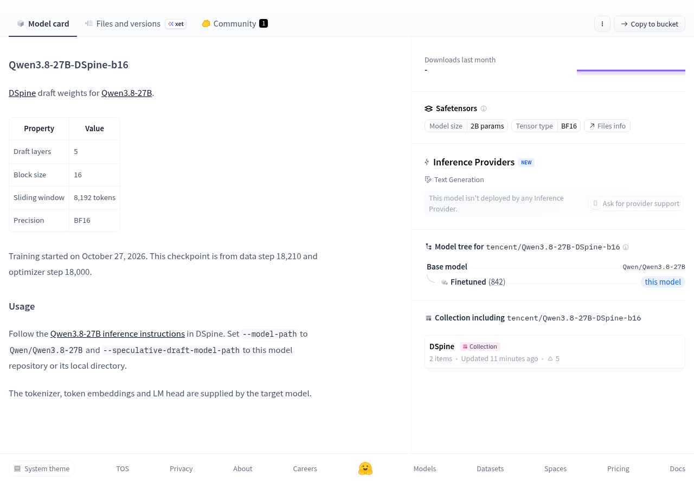
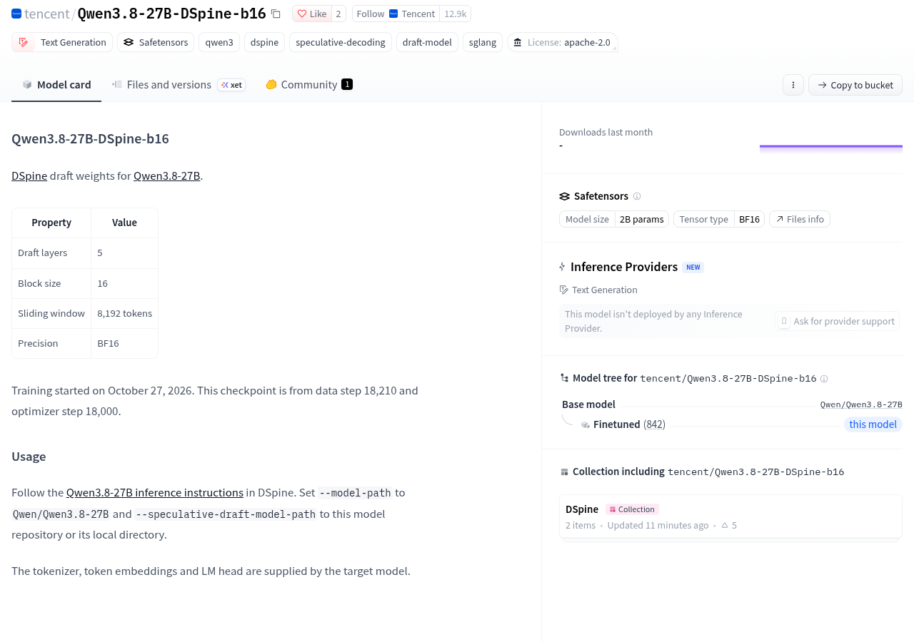

看到腾讯账号下的 Qwen3.8-27B-DSpine-b16，先别把它当成一个下载后就能独立聊天的小模型。官方模型卡把它写为 Qwen3.8-27B 的 DSpine 草稿权重，使用说明也要求同时指定目标模型与草稿模型。它更适合已经准备使用目标模型、希望进一步研究配套推理流程的人。

## 页面标着二十亿参数，为什么还要另一个模型？

页面的模型大小栏标注为 2B，也就是二十亿参数。但这个数字描述的是当前仓库的模型规模，不能拿来当作整套运行方案的规模。官方明确说明，分词器、词元嵌入和语言模型输出头由目标模型提供。

可以借快递取件理解这些依赖：分词器负责把输入拆成系统能处理的编号，像把快递信息整理成可查的取件记录；词元嵌入把编号转换成模型计算使用的表示，像根据记录找到对应货位；输出头再把内部计算结果对应回候选词元，像把货位重新对应到能交给收件人的包裹。这只是功能关系的类比。这里影响使用选择的事实是：这些部件需要由目标模型提供，当前仓库并不自带完整的一套。

因此，想找一个独立聊天模型的人，不宜只看二十亿参数就把它加入下载清单。对于已经在研究 Qwen3.8-27B 推理的人，这份草稿权重才有进一步查看的价值；需要核实的是整套配合能否运行，而不只是草稿文件有多大。

## 使用入口是配套推理流程，不是现成聊天服务

官方用法指向 DSpine 中的 Qwen3.8-27B 推理说明：目标模型路径设为 Qwen/Qwen3.8-27B，草稿模型路径设为当前仓库或它的本地目录。也就是说，配置中需要明确区分两个角色，不能把草稿仓库直接填进目标模型的位置，就认为已经完成部署。

名称中的 b16 也不要和精度混为一谈。模型卡分别列出块大小为 16、精度为 BF16；它们是不同的配置项。官方页面没有给出这份草稿权重的加速成绩、运行内存要求或具体设备适配结果，因此不能据此判断普通电脑是否能用，也不能承诺换上它就会更快。

如果希望不部署、直接找在线入口体验，页面同样没有提供现成答案：资料采集时，托管推理区域明确显示，没有推理服务商部署这个模型。这描述的是该页面列出的服务状态，不代表其他渠道一定不存在服务。

## 现在值得做的是核实整条链，而不是急着下载

当前能确认的是，腾讯账号下已经出现模型卡，说明了草稿权重的用途、配置和配套入口。页面还写明训练开始于 2026 年十月 27 日，但这是训练日期，不是发布日期。资料没有给出正式发布日期，也没有提供文件列表和实际下载验证，不能把模型卡出现直接写成权重已验证可下载。

- 只想直接聊天：先选择具备完整使用入口的目标模型，不把这份草稿权重当作独立替代品。
- 准备研究配套推理：从模型卡的用法说明进入 DSpine，继续核实目标模型与草稿模型的加载方式、运行时支持和硬件要求。
- 准备下载或用于项目：分别确认权重文件是否实际可获取，以及目标模型、草稿权重和运行代码各自的许可证；现有资料没有给出完整许可结论。
- 准备判断是否值得采用：成功加载后，使用自己的实际任务记录输出结果、耗时和资源占用，再决定是否保留这套配合方式；当前没有可引用的官方性能成绩。

下一步可以查看[官方模型卡与用法说明](https://huggingface.co/tencent/Qwen3.8-27B-DSpine-b16#usage)。把目标模型、草稿权重、运行环境和许可逐项确认后，再进入部署。对于只需要一个立即可用的聊天入口的人，这份仓库目前不是优先选择；对于正在研究目标模型推理流程的人，它是一个需要继续核实的配套资源。

## 官方资料

- [腾讯混元 官方发布说明](https://huggingface.co/tencent/Qwen3.8-27B-DSpine-b16)

---

## 🧰 我做的工具

这些工具都由我持续维护。预览版会明确标注，下载、更新和已知边界以发行页为准。

### 黑粉助手 HyphenAssistant

正式迭代。手机浏览器接续电脑上的 DeepSeek Harness 会话；需本人配对、电脑与原服务在线，模型费用沿用原配置

[下载与更新](https://github.com/HackerChi-Hub/hyphen-assistant-releases/releases)

### 黑粉盒子 HyphenBox

正式迭代。免费大模型 API 雷达：持续复测可用性，本地统一接口，Key 只存本机

[下载与更新](https://github.com/HackerChi-Hub/hyphenbox-release/releases)

### 方寸智匣 LocalBrain

正式迭代。本地模型的多模态 MCP 工具箱：TTS / Whisper / 视频生成一站接入

[下载与更新](https://github.com/HackerChi-Hub/localbrain-releases/releases)

### ScreenLex 光影词库

正式迭代。看美剧顺手把生词背了，Mac/Windows 双平台，免费

[下载与更新](https://github.com/HackerChi-Hub/screenlex-download/releases)

### 黑粉录屏 HyphenScreen

正式迭代。录屏 + 智能剪辑一体：达芬奇式时间线、自动打码、导出前成片体检，免费

[下载与更新](https://github.com/HackerChi-Hub/HyphenScreen-Releases/releases)
