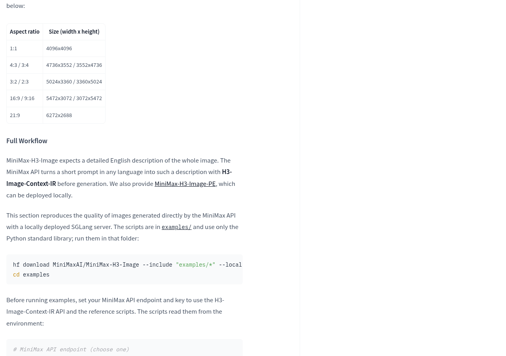
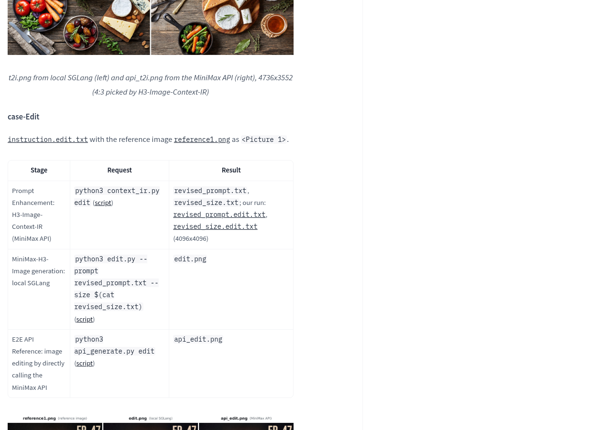
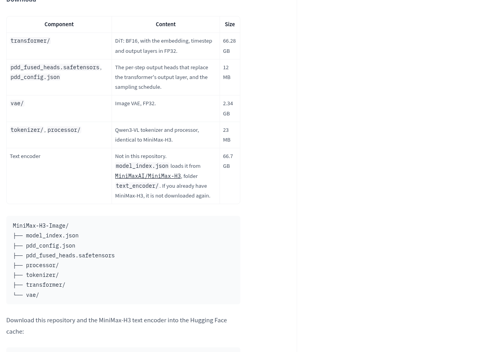
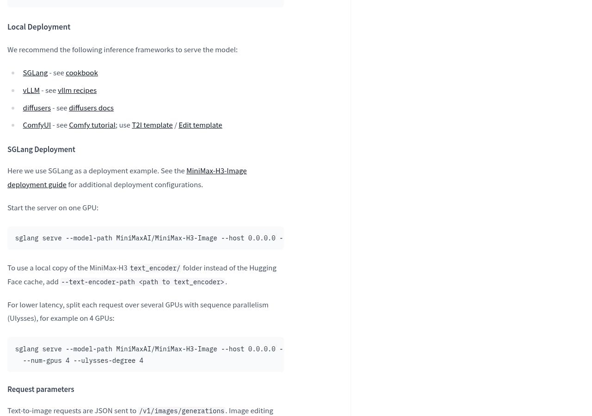
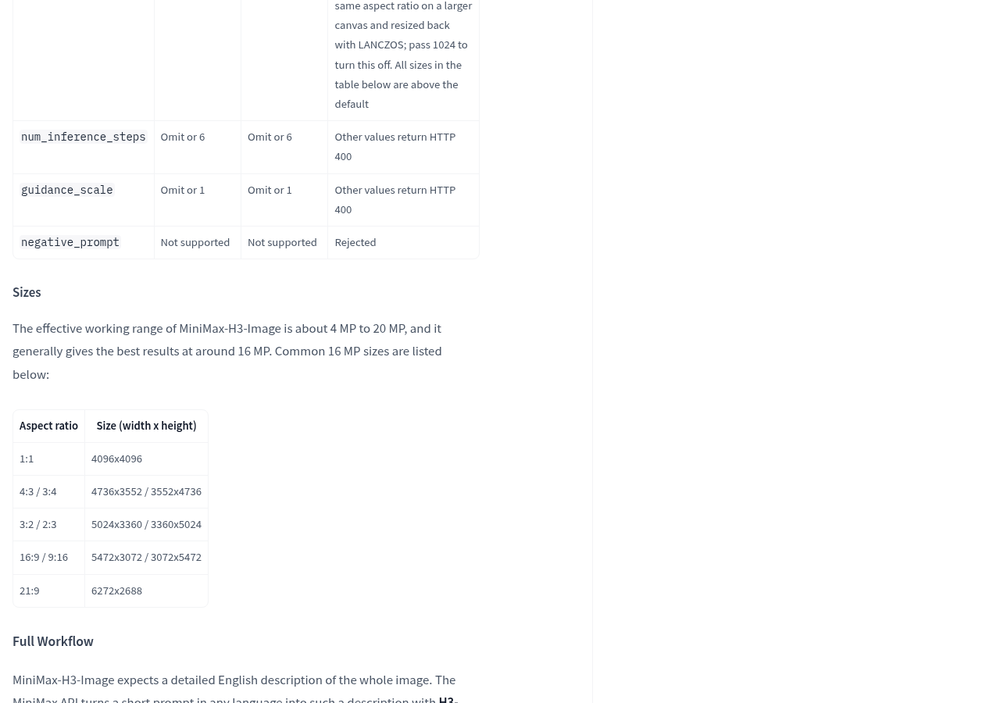
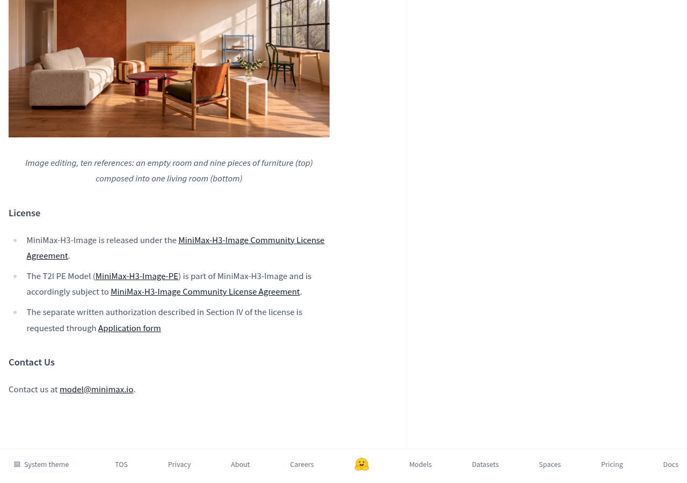

MiniMax-H3-Image的官方模型页已经列出权重下载命令和本地部署流程：同一套模型支持文字生图与参考图编辑，能够直接生成4096×4096的图像，无须再用放大模型补尺寸。想把它搬到自己的电脑上，先别只盯着生成效果——模型之外还有文本编码器，官方完整示例中的提示扩写也会调用云端接口。

如果目标是搭建本地生图服务，它已经有明确的官方部署路径；如果目标是断网完成从中文想法到最终图片的全过程，就需要继续检查提示扩写、组件依赖和运行条件。能下载模型，与整条流程都留在本机，是两个需要分别落实的问题。

## 图片可以本地生成，完整流程还要看提示扩写

官方说明，MiniMax-H3-Image需要的是描述整幅画面的详细英文指令。在线接口会先用H3-Image-Context-IR，把任意语言的简短要求扩写成这样的描述，再交给图像模型生成。可以把它理解成给装修师傅交需求：只说“客厅温馨一点”还不够，先整理清楚布局、物件和氛围，后面的执行才有更具体的依据。这里的扩写负责整理要求，图像模型负责把要求变成画面。

这会直接影响本地使用方式。官方完整流程中的文字生图和改图示例，都先调用MiniMax的提示扩写接口，再把整理好的描述交给本地SGLang服务。因此，照着这套示例运行，图片生成在本机完成，前面的需求整理仍会用到云端；有保密要求的文字或参考图，需要先检查具体提交给接口的内容。

文字生图还有一个官方给出的本地替代方案：单独部署MiniMax-H3-Image-PE提示扩写模型。模型列表将它标为可选组件，大小为17.9 GB。不过，现有说明把它的用途写成文字生图提示扩写，不能据此推定它已经覆盖改图所需的全部处理。想直接准备详细英文描述，也可以按模型要求输入；能否达到在线示例的效果，仍需用实际任务验收。

## 下载清单不是硬件配置单

官方模型列表把MiniMax-H3-Image标为68.65 GB，但下载说明还单独列出66.7 GB的文本编码器。这个编码器不在图像模型仓库内，而是从MiniMax-H3仓库的对应目录加载；如果已经下载过，官方说明不会重复下载。准备存储空间时，不能只看图像模型列表里的那个大小。

文本编码器负责把文字等输入转成后续生成模块能处理的表示。像快递点先根据取件信息找到对应货架，图像生成模块再接着处理；图像模型文件已经到位，不代表负责理解输入的组件也已经齐全。部署前应分别确认主模型、文本编码器，以及是否需要可选的提示扩写模型。

文件大小也不能直接当作显存要求。官方模型页推荐SGLang、vLLM、diffusers和ComfyUI，并给出SGLang的单卡启动与多卡并行示例，但所提供的说明没有列出可据此选购设备的具体显卡型号、显存门槛和生成耗时。仅凭这些命令，无法判断某台Mac或消费级显卡是否适合运行。

准备部署时，可以从[官方模型页的下载说明](https://huggingface.co/MiniMaxAI/MiniMax-H3-Image#download)检查组件，再按[本地部署说明](https://huggingface.co/MiniMaxAI/MiniMax-H3-Image#local-deployment)选择运行框架。这里提供的是部署入口，不是特定设备的成功保证；选定框架后，还需要核对它对当前设备和模型版本的支持。

## 先验收自己的图片任务，再决定是否长期部署

对需要大尺寸素材的人，值得关注的是原生输出：官方列出的常用尺寸包括方图4096×4096、横图5472×3072，以及宽幅6272×2688。官方称这些图像直接生成，不依靠额外放大。模型还采用6步采样，但采样步数描述的是生成过程，不能直接换算成等待秒数；实际是否适合日常出图，还要看所用设备与任务。

对需要改图的人，官方说明它最多支持16张参考图，并展示了把空房间与家具图片组合成客厅等案例。这些是官方展示，适合用来判断模型想解决什么问题。真正决定是否好用的，是你的素材能否保住关键物件、改动是否符合要求，以及反复修改时能否维持画面关系；参考图数量本身回答不了这些问题。

许可也要单独看。模型页写明采用MiniMax-H3-Image社区许可协议，可选的PE模型同样受该协议约束，并提到协议第四节涉及单独书面授权。需要用于商业项目或产品集成时，应先阅读[许可文件](https://huggingface.co/MiniMaxAI/MiniMax-H3-Image/blob/main/LICENSE)，确认具体用途是否符合条款。权重有下载入口，不代表用途没有限制。

- 只想先判断画面是否合用：官方列有[海螺网页应用](https://hailuoai.com/)与[图像生成接口文档](https://platform.minimax.cn/docs/guides/image-generation)入口；现有资料没有给出免费额度或价格，使用前应查看入口内的实际条件。
- 准备本地部署：先检查主模型和文本编码器是否齐全，再核对运行框架对设备的支持，记录真实任务的出图时间、资源占用和修改结果。
- 要求全程离线：分别检查需求扩写与图像生成，尤其注意官方完整示例中的云端接口调用；文字生图可继续核对本地PE方案，改图流程则需要另行确认。
- 计划商用或集成：先核对社区许可及单独授权要求，再决定是否投入部署和维护。

MiniMax-H3-Image值得关注的地方，是官方已经把大尺寸生成、参考图编辑和本地部署放进同一条可查阅的路径。是否值得搬到本机，取决于你的任务是否真的需要这些能力，以及完整流程能否满足设备、数据去向和许可要求。下一步最有价值的验收，是拿实际要交付的图片走完需求整理、生成和修改，看看省下的是工作量，还是只把等待从网页搬到了自己的设备上。

## 官方资料

- [MiniMax 官方发布说明](https://huggingface.co/MiniMaxAI/MiniMax-H3-Image)

---

## 🧰 我做的工具

这些工具都由我持续维护。预览版会明确标注，下载、更新和已知边界以发行页为准。

### 黑粉助手 HyphenAssistant

正式迭代。手机浏览器接续电脑上的 DeepSeek Harness 会话；需本人配对、电脑与原服务在线，模型费用沿用原配置

[下载与更新](https://github.com/HackerChi-Hub/hyphen-assistant-releases/releases)

### 黑粉盒子 HyphenBox

正式迭代。免费大模型 API 雷达：持续复测可用性，本地统一接口，Key 只存本机

[下载与更新](https://github.com/HackerChi-Hub/hyphenbox-release/releases)

### 方寸智匣 LocalBrain

正式迭代。本地模型的多模态 MCP 工具箱：TTS / Whisper / 视频生成一站接入

[下载与更新](https://github.com/HackerChi-Hub/localbrain-releases/releases)

### ScreenLex 光影词库

正式迭代。看美剧顺手把生词背了，Mac/Windows 双平台，免费

[下载与更新](https://github.com/HackerChi-Hub/screenlex-download/releases)

### 黑粉录屏 HyphenScreen

正式迭代。录屏 + 智能剪辑一体：达芬奇式时间线、自动打码、导出前成片体检，免费

[下载与更新](https://github.com/HackerChi-Hub/HyphenScreen-Releases/releases)
