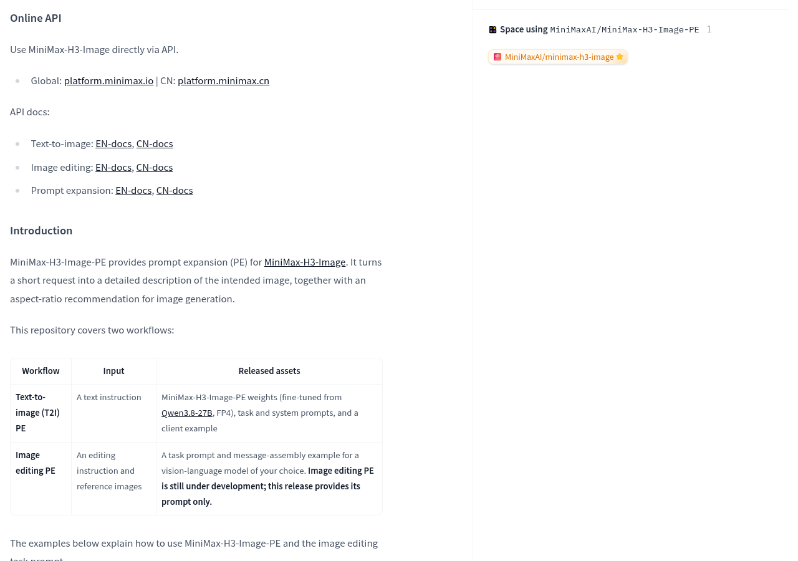
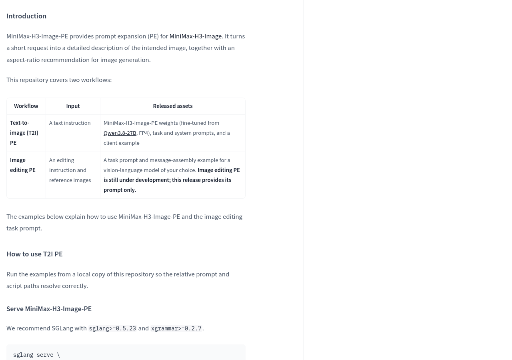
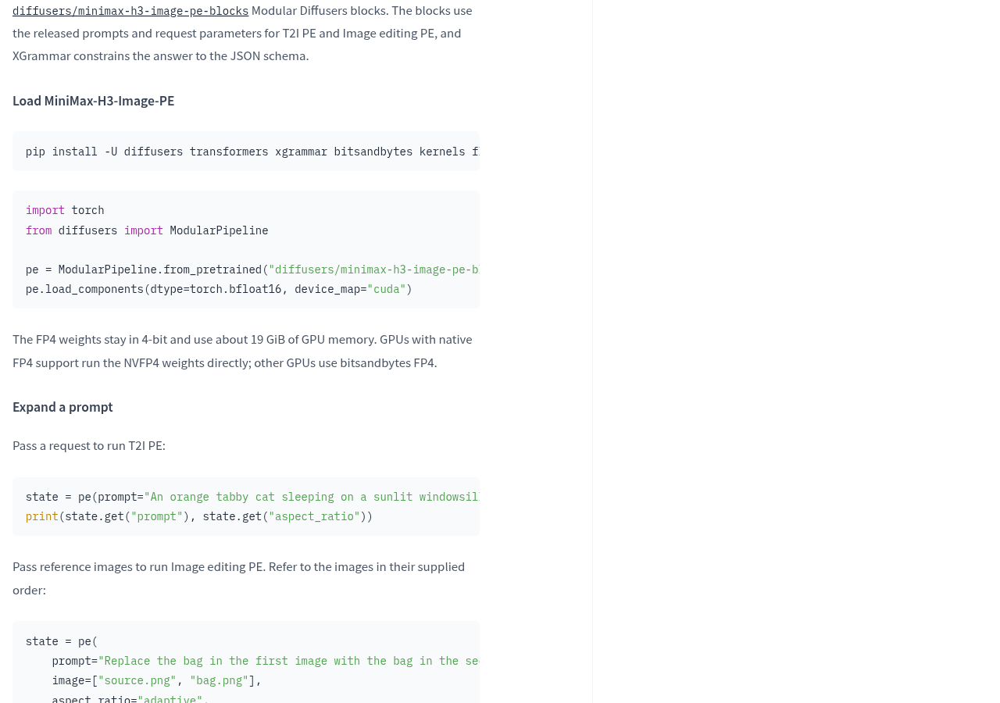
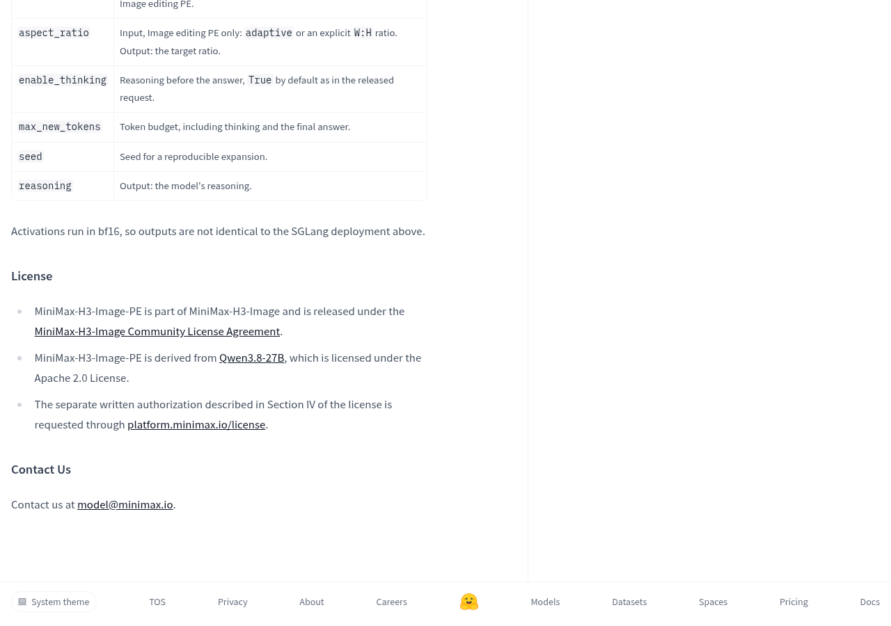

MiniMax-H3-Image-PE 已提供文生图描述扩写权重，输出却不是图片，而是一段更详细的图像描述和画幅建议。图片编辑分支仍在开发，当前发布的是任务指令。想把它接进画图工具，先分清拿到的是哪个环节。

它适合解决的问题是：怎样把简短要求整理成供图像生成环节使用的描述。最终图片仍要交给后续图像模型生成。是否值得部署，应看这一步能否改善实际工作流，以及是否值得额外维护一个模型。

## 它负责把要求写清楚，不负责把图片画出来

可以把这条流程想成给设计师发微信：一句简短需求，先整理成更具体的画面说明，再交给负责出图的人。MiniMax-H3-Image-PE 承担的是前面的整理工作；后面的图像生成，仍是另一个环节。描述变详细，也需要检查有没有偏离原来的要求。

官方文生图示例输入的是“阳光照着的窗台上，一只橘猫正在睡觉”。示例输出补充了摄影风格、午后光线和毛发受光等描述，并给出画幅比例。这个例子展示了扩写结果的形式，没有展示最终生成的图片，也没有提供画质提升的对比成绩。

画幅建议也有明确的使用条件：选择自动画幅时，后续生成使用模型返回的比例；已经手动指定比例时，则使用手动选择。就像已经要求设计师交横版海报，就不该让整理需求的助手擅自换成竖版。

## 文生图已有权重，图片编辑要另看交付范围

官方列出的文生图交付包括：基于 Qwen3.8-27B 微调的 FP4 权重、任务与系统指令，以及客户端示例。图片编辑的交付则是任务指令和消息组装示例，需要配合自行选择的视觉语言模型使用，也就是能够同时处理文字与图片的模型。

图片编辑流程像给修图人员发微信：先按顺序附上图片，再说明改哪张、参考哪张、保留什么。官方要求把图片标签与原始画幅紧贴对应图片放置，最后提供修改要求和目标画幅。返回的仍是编辑描述与目标比例，不是修改完成的图片。

这里要分清两件事：官方明确说，图片编辑扩写仍在开发，本次仅提供其任务指令；同一文档又给出了通过 Modular Diffusers 传入参考图的使用示例。可以据此研究如何接入编辑描述流程，但不能把示例当成专用图片编辑扩写权重已经发布，或编辑效果已经得到验证。

## 接入前先看运行条件，再看许可和验收

本地运行方面，官方给出了 SGLang 服务部署与 Modular Diffusers 两条路径。前者推荐 sglang>=0.5.23 和 xgrammar>=0.2.7；后者示例使用 CUDA。运行时可以理解成让模型文件真正开始工作的配套软件：文件已经开放，不代表现有电脑的软件和硬件都已满足条件。

FP4 可以粗略理解成用更紧凑的方式存放模型权重，类似把快递货架上的包裹压缩包装，减少存放占用；取件和处理仍需要工作空间。官方在 Modular Diffusers 路径中写明，权重保持四位存储，约使用 19 GiB 显存。这个数值属于该扩写组件的运行说明，不是后续整套图像生成流程的总显存预算。

官方还说明，原生支持 FP4 的显卡直接运行 NVFP4 权重，其他显卡使用 bitsandbytes FP4；Modular Diffusers 路径的激活计算使用 bf16，输出与前述 SGLang 部署并不完全相同。因此，选择路径不能只看能否加载文件，还要检查所需依赖与实际输出。

许可同样要分开看。MiniMax-H3-Image-PE 使用 MiniMax-H3-Image 社区许可协议，基础模型 Qwen3.8-27B 使用 Apache 2.0。基础模型的许可不能直接代替派生模型的使用条件；涉及许可第四节所述情形时，官方给出了另行申请书面授权的入口。

- 准备自建流程：从[官方模型文档](https://huggingface.co/MiniMaxAI/MiniMax-H3-Image-PE)确认文生图与图片编辑各自提供了什么，再选择运行路径。
- 只想在线生成图片：模型文档列有[官方在线图像生成指南](https://platform.minimax.cn/docs/guides/image-generation)入口；账户条件、费用和可用范围还需在对应服务中确认，不能从权重开放推定在线免费。
- 准备接入产品：先查看[社区许可文件](https://huggingface.co/MiniMaxAI/MiniMax-H3-Image/blob/main/LICENSE)，再判断是否涉及[书面授权申请](https://platform.minimax.io/license)。

实际验收应从自己的图像需求出发：先检查扩写有没有保留主体、必须出现的文字和明确的画幅要求，再检查结构化输出能否被后续程序正确接收，最后把扩写描述送入图像生成环节，观察成图是否更符合原意。接入图片编辑时，还应检查参考图的顺序与修改对象有没有对应错误。这些是接入后的检查步骤，不是官方已经给出的效果结论。

如果只是偶尔画图，单独部署描述扩写模型是否划算，要看维护负担与实际收益；如果正在搭建自动出图工具，它提供了一个可接入的需求整理环节。真正值得关注的变化，是图像工作流开始把“理解要求”和“执行生成”拆开。接下来要验收的，就是多出的这一步，究竟减少了返工，还是增加了需要纠正的细节。

## 官方资料

- [MiniMax 官方发布说明](https://huggingface.co/MiniMaxAI/MiniMax-H3-Image-PE)

---

## 🧰 我做的工具

这些工具都由我持续维护。预览版会明确标注，下载、更新和已知边界以发行页为准。

### 黑粉助手 HyphenAssistant

正式迭代。手机浏览器接续电脑上的 DeepSeek Harness 会话；需本人配对、电脑与原服务在线，模型费用沿用原配置

[下载与更新](https://github.com/HackerChi-Hub/hyphen-assistant-releases/releases)

### 黑粉盒子 HyphenBox

正式迭代。免费大模型 API 雷达：持续复测可用性，本地统一接口，Key 只存本机

[下载与更新](https://github.com/HackerChi-Hub/hyphenbox-release/releases)

### 方寸智匣 LocalBrain

正式迭代。本地模型的多模态 MCP 工具箱：TTS / Whisper / 视频生成一站接入

[下载与更新](https://github.com/HackerChi-Hub/localbrain-releases/releases)

### ScreenLex 光影词库

正式迭代。看美剧顺手把生词背了，Mac/Windows 双平台，免费

[下载与更新](https://github.com/HackerChi-Hub/screenlex-download/releases)

### 黑粉录屏 HyphenScreen

正式迭代。录屏 + 智能剪辑一体：达芬奇式时间线、自动打码、导出前成片体检，免费

[下载与更新](https://github.com/HackerChi-Hub/HyphenScreen-Releases/releases)
