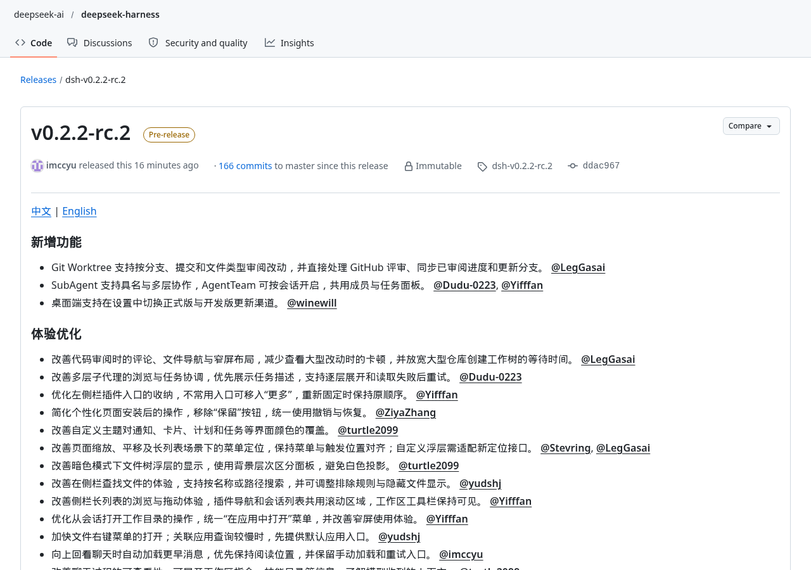
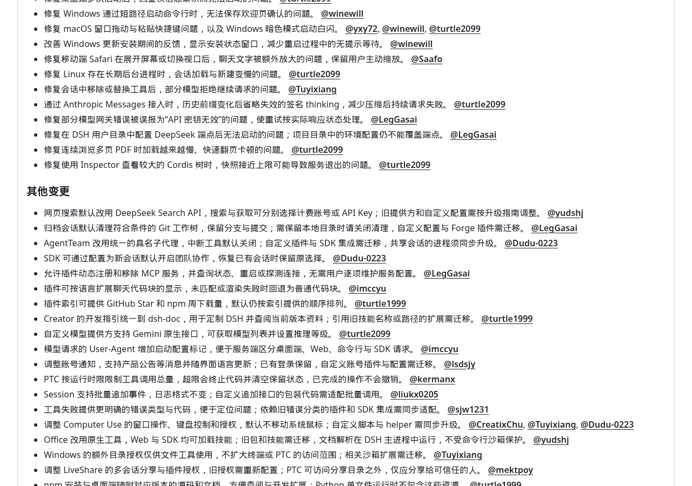
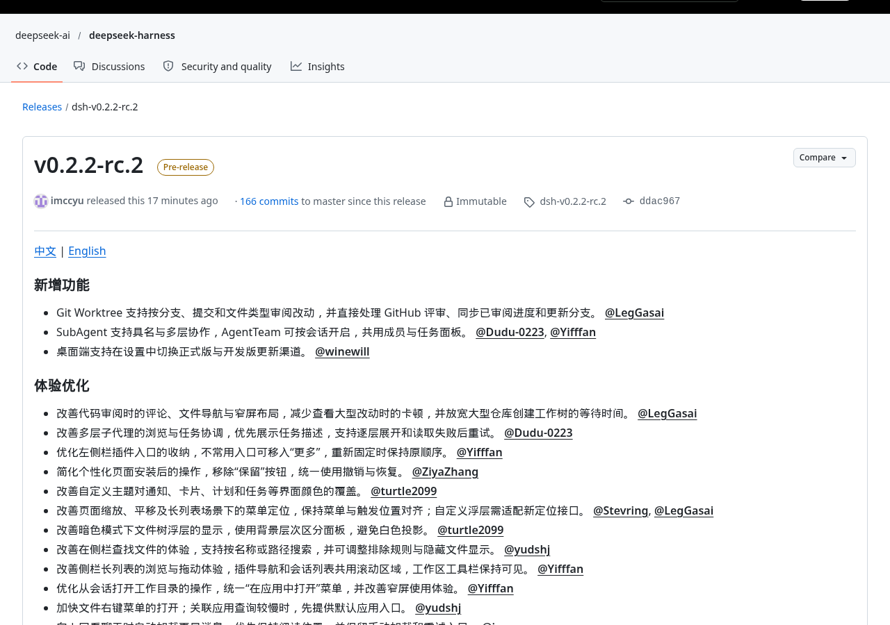
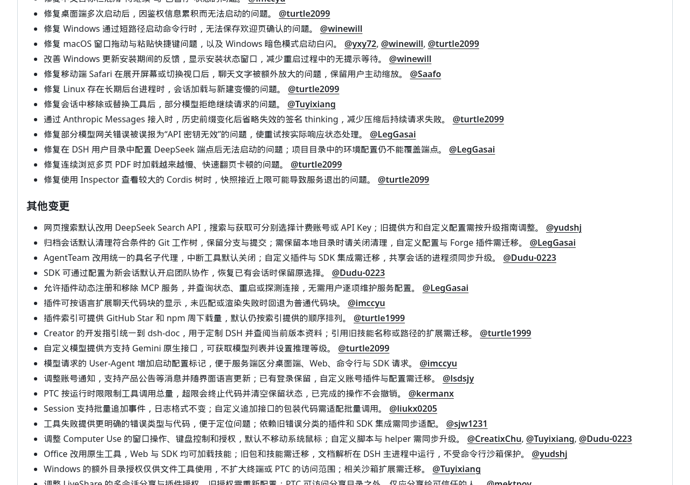
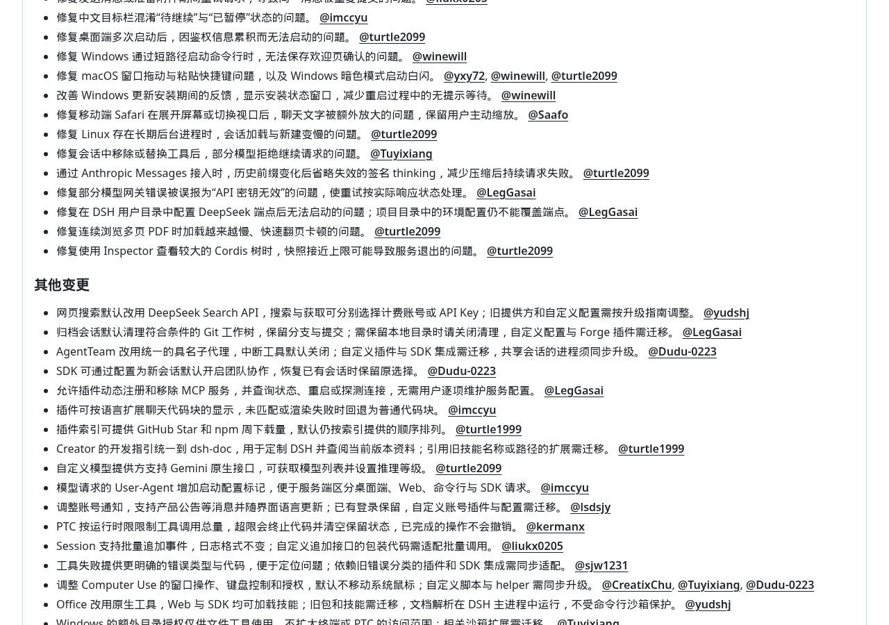
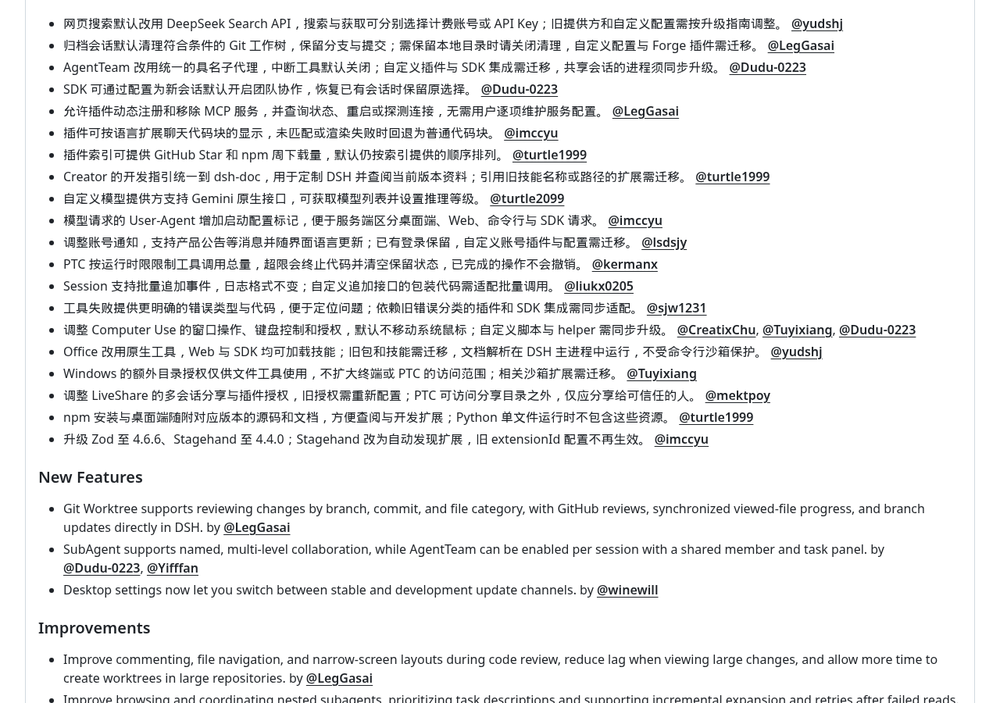
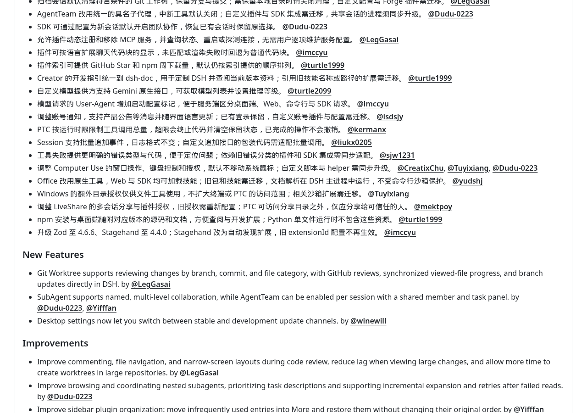

多个代理可以分工，代码改动可以按分支审阅，但归档会话也可能清理本地工作树。DeepSeek Harness在2026年11月11日发布的v0.2.2-rc.2，同时带来了协作功能和需要迁移的默认行为。官方发布页将它标为预发布版，不是稳定正式版。

如果现有项目已经接了自定义插件、搜索服务或团队协作，是否升级，主要看新功能能否解决眼前问题，以及旧配置能否接续。单纯想增加参与任务的代理数量，还不足以成为直接切换日常工作环境的理由。

## 协作更容易看清，交付仍要逐项验收

官方公告列出的变化是：SubAgent支持具名与多层协作，AgentTeam可以按会话开启，并共用成员与任务面板。子代理可以理解为分工处理任务的助手。像在微信群里安排工作，给参与者写清姓名和任务，比只有一串聊天记录更容易追踪谁负责什么；多层协作则允许分工继续往下展开。

这次更新也调整了查看分工的方式：优先展示任务描述，支持逐层展开，读取失败后可以重试。对于需要来回查看不同任务的项目，这些变化有望减少查找过程的负担。不过，面板更清楚解决的是组织与查看问题，任务做得对不对，仍要回到实际文件、运行结果和验收条件。公告没有提供协作成功率或完成时间数据。

已有团队集成的用户要留意迁移要求：AgentTeam改用统一的具名子代理，中断工具默认关闭；自定义插件与SDK集成需要迁移，共享会话的进程需要同步升级。SDK就是程序接入这套工具所用的开发接口。若已有程序依赖旧协作方式，就应先验证成员与任务能否正确显示、已有会话能否恢复，再接入正式任务。

## 审阅改动更集中，归档却可能收走工作目录

Git Worktree这次支持按分支、提交和文件类型审阅改动，并直接处理GitHub评审、同步已审阅进度和更新分支。分支可以看成同一项目的不同修改路线，提交是沿途保存的版本记录，工作树则像为某条路线单独摆开的工作台。审阅时按路线、记录和文件类型筛选，比把所有改动混在一起更方便定位检查对象。

与审阅直接相关的修复也值得关注：官方称修复了PR更新后审阅差异与提交行号不一致的问题，并改善大量评审讨论的统计。PR是提交给项目维护者审阅的一组改动；如果更新之后评论位置与代码版本对不上，讨论就容易失去落点。对于依赖这套审阅流程的用户，这比界面是否更漂亮更影响实际使用。

> [!warning]
> 归档会话默认清理符合条件的Git工作树，保留分支与提交；需要保留本地目录时，应关闭清理。自定义配置与Forge插件需要迁移。

保留版本记录和保留整个工作目录，是不同的事情。官方这条说明没有承诺保留目录中的全部内容，也没有在这里展开“符合条件”的具体判定。依赖本地目录继续工作的项目，应先确认清理设置并备份需要保留的文件；不要把“归档”直接理解为原样封存。

## 升级前先查搜索配置与工具权限

网页搜索默认改用DeepSeek Search API，搜索与获取内容可以分别选择计费账号或API Key。API Key可以理解为服务调用凭证，像取件时出示的凭证，用来确认这次请求使用哪个账号的服务。这里涉及计费选择，不能从功能可用直接推断免费；公告没有给出价格或赠送额度。旧提供方和自定义配置需要按升级指南调整，但这份公告没有展开具体迁移步骤。

工具权限也不能只看一个“沙箱已开启”的状态。沙箱像限定工作区域的围栏，关键是哪些操作真的在围栏里运行。官方明确说明，Office文档解析运行在DSH主进程中，不受命令行沙箱保护；Windows的额外目录授权仅供文件工具使用，不扩大终端或PTC的访问范围。文件能打开，不代表命令执行也获得了同样权限。

协作分享还有更直接的提醒：LiveShare旧授权需要重新配置，PTC可以访问分享目录之外，官方要求仅分享给可信任的人。此外，获准读取的用户终端内容会进入模型与会话记录。如果工作目录或终端里可能出现凭证、客户资料等敏感内容，就应把分享对象和可读取内容纳入升级检查，而不只检查按钮是否正常。

- 需要团队协作：验证成员与任务面板、会话恢复，以及共享会话进程同步升级后的行为。
- 需要代码审阅：验证分支筛选、更新后的评论位置和已审阅进度，并确认归档清理设置。
- 已有自定义集成：检查搜索提供方、计费凭证、插件与SDK迁移，再确认文件、终端和分享授权各自覆盖什么。
- 只求日常稳定使用：先记住它仍是预发布版；桌面端新增更新渠道切换，不代表这个版本已经成为稳定版。

具体变化可查阅[DeepSeek Harness v0.2.2-rc.2官方发布说明](https://github.com/deepseek-ai/deepseek-harness/releases/tag/dsh-v0.2.2-rc.2)。发布页的附件区域在现有材料中未成功加载，无法据此确认安装包名称、平台覆盖或下载是否可用；已有工作环境也不应仅凭公告就直接替换。

这次升级更适合有明确协作或审阅需求、也愿意处理配置迁移的用户。接下来值得检验的，不是能同时安排多少助手，而是任务能否看清、改动能否审清、归档后需要的文件是否仍在。若这些环节接不上，增加分工也可能只是把整理工作留到了最后。

## 官方资料

- [DeepSeek 官方发布说明](https://github.com/deepseek-ai/deepseek-harness/releases/tag/dsh-v0.2.2-rc.2)

---

## 🧰 我做的工具

这些工具都由我持续维护。预览版会明确标注，下载、更新和已知边界以发行页为准。

### 黑粉助手 HyphenAssistant

正式迭代。手机浏览器接续电脑上的 DeepSeek Harness 会话；需本人配对、电脑与原服务在线，模型费用沿用原配置

[下载与更新](https://github.com/HackerChi-Hub/hyphen-assistant-releases/releases)

### 黑粉盒子 HyphenBox

正式迭代。免费大模型 API 雷达：持续复测可用性，本地统一接口，Key 只存本机

[下载与更新](https://github.com/HackerChi-Hub/hyphenbox-release/releases)

### 方寸智匣 LocalBrain

正式迭代。本地模型的多模态 MCP 工具箱：TTS / Whisper / 视频生成一站接入

[下载与更新](https://github.com/HackerChi-Hub/localbrain-releases/releases)

### ScreenLex 光影词库

正式迭代。看美剧顺手把生词背了，Mac/Windows 双平台，免费

[下载与更新](https://github.com/HackerChi-Hub/screenlex-download/releases)

### 黑粉录屏 HyphenScreen

正式迭代。录屏 + 智能剪辑一体：达芬奇式时间线、自动打码、导出前成片体检，免费

[下载与更新](https://github.com/HackerChi-Hub/HyphenScreen-Releases/releases)
