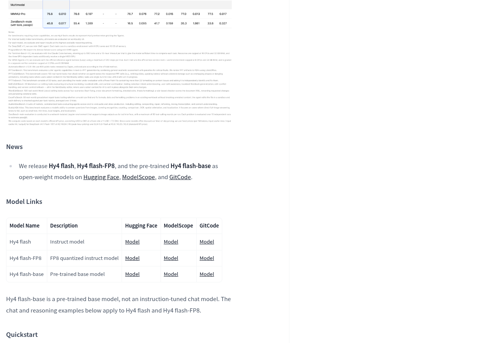
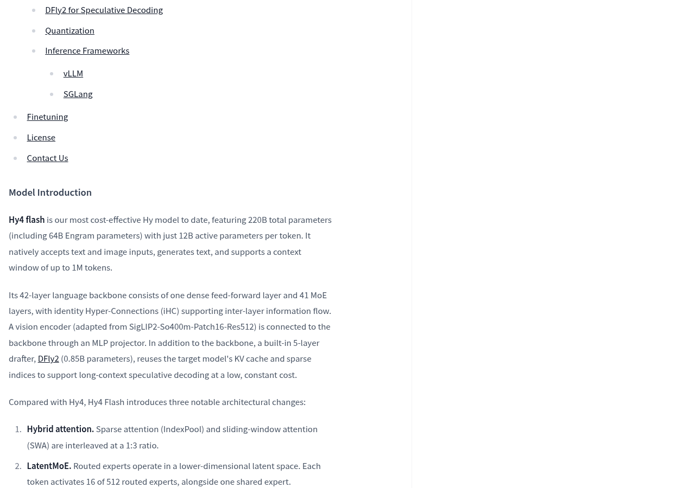
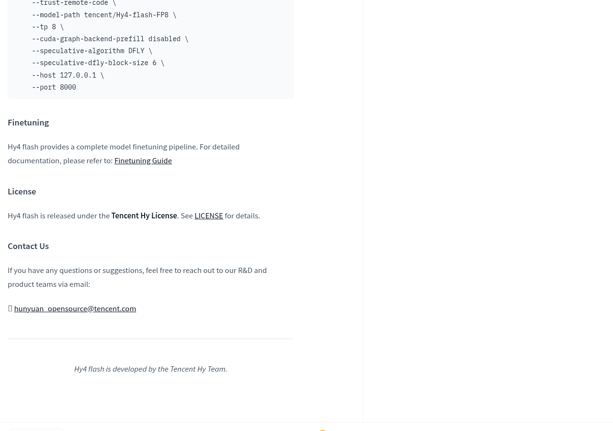
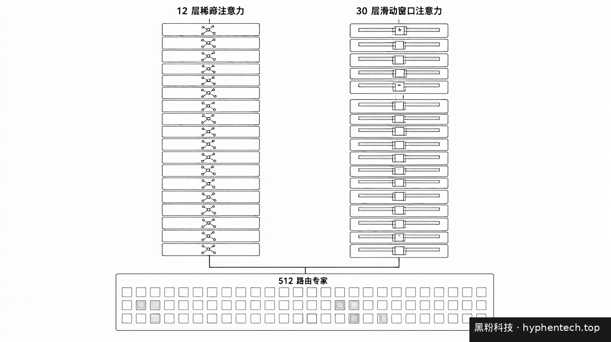
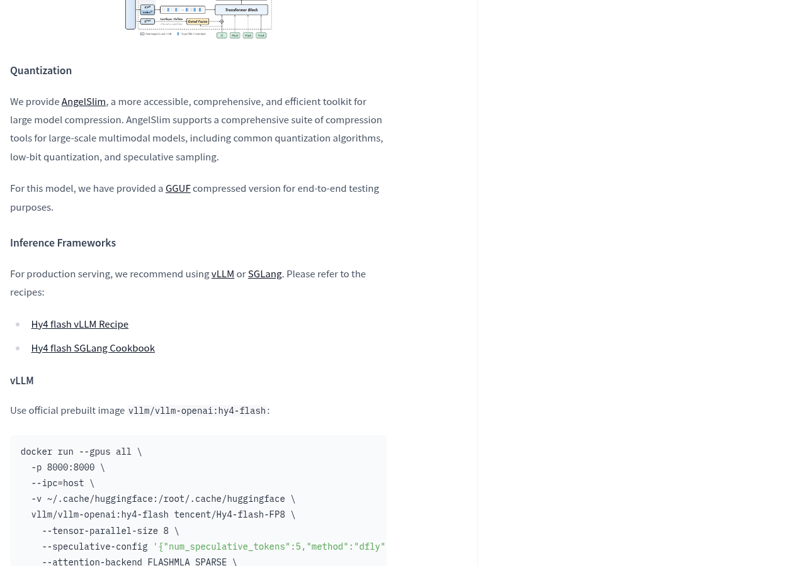
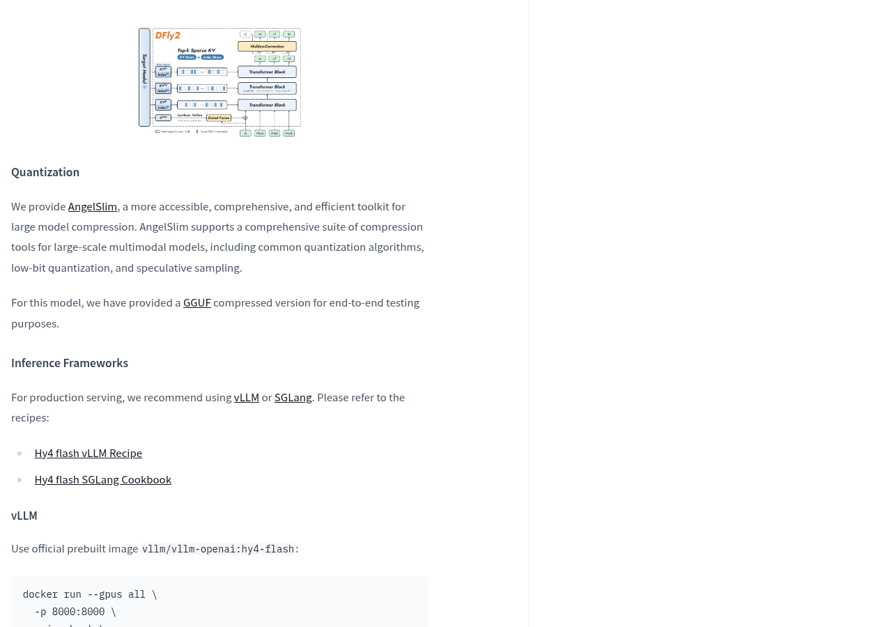
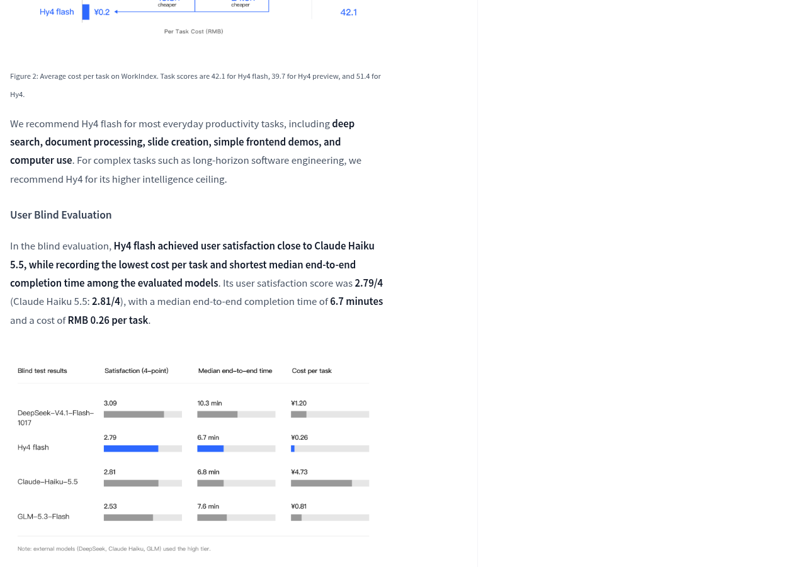

- 总参数 220B（含 64B Engram 参数），每个 token 只激活 12B 参数；官方参数表细分为文本 11.3B + 视觉 0.43B
- 上下文长度 1M（1,048,576 tokens）
- 原生接受文本与图像输入，生成文本
- 同时开放 Hy4 flash、Hy4 flash-FP8、Hy4 flash-base 三个权重，托管在 Hugging Face、ModelScope 与 GitCode
- 许可证为 Tencent Hy License；官方文档显示目前尚无任何 Inference Provider 部署该模型



腾讯混元在官方模型仓库放出 Hy4 flash，官方称它是目前 Hy 系列里成本效益最高的一个。关键数字是 220B 总参数、每 token 只激活 12B 参数、上下文 1M，并且原生吃图像。对想在自己机器上跑模型的人来说，最该看的不是总参数那一栏，而是“激活参数”和官方给出的部署配置——后者写的是 8 卡张量并行。

## 三个必须分清的词：开放权重、激活参数、许可证

“开放权重”这件事，用微信群发文件的比喻最直观：文件本身可以随便下载转发，但群里贴了张纸说“请按这张纸的规则用”，那规则照样约束你。Hy4 flash 的权重文件是公开的，许可证是 Tencent Hy License，官方要求自行查看 LICENSE 细节。也就是说，文件开放不等于没有任何使用条件，规则和文件要分开核实。



“激活参数”是另一个容易看错的数字。220B 是模型全部家当，好比仓库里堆了 220 吨货；但每个 token 生成时只有其中一部分会取出来用。官方表格写得很清楚：排除 Engram、ViT 和 DFly2 之后主体是 155.5B，Engram 占 63.5B，视觉编码器 0.43B，DFly2 起草模型 0.85B，每个 token 激活的是文本 11.3B 加视觉 0.43B。激活参数少，说明每步计算量小，但货还在硬盘里，占多少显存取决于你怎么装它。

推理时真正占地方的是那 220B 权重本身。可以把它类比成快递：仓库发货时一次发 220B 的整批货，但分拣时只挑 12B 那一小袋去处理。分拣便宜，可整批货还是得先拉回来并拆开摆放。真正决定“能不能跑”的，是权重体积、量化格式和显存，不是那个 12B。

## 官方给出的两条部署路线，以及它们的门槛差别



### 生产级服务：官方明确是 8 卡起步



官方推荐的 vLLM 启动命令里写着 --tensor-parallel-size 8，SGLang 那一侧是 --tp 8，两者用的都是 FP8 权重（tencent/Hy4-flash-FP8）。这是官方给的服务配置，属于多卡 GPU 场景，跟个人笔记本不是一回事。同时官方还提供了预置镜像 vllm/vllm-openai:hy4-flash 和 lmsysorg/sglang:hy4-flash，后者标注多架构，含 x86 和 Arm。



```bash
docker run --gpus all \
  -p 8000:8000 \
  --ipc=host \
  -v ~/.cache/huggingface:/root/.cache/huggingface \
  vllm/vllm-openai:hy4-flash tencent/Hy4-flash-FP8 \
    --tensor-parallel-size 8 \
    --speculative-config '{"num_speculative_tokens":5,"method":"dfly"}' \
    --attention-backend FLASHMLA_SPARSE \
    --tool-call-parser hy_v4 \
    --reasoning-parser hy_v4 \
    --enable-auto-tool-choice \
    --port 8000 \
    --served-model-name hy4-flash
```

### 本地尝试路径：Transformers 与 GGUF

官方文档里写着 Hy4 flash 的支持会很快合进 transformers 主分支，在那之前需要从指定提交安装。示例代码用 AutoModelForImageTextToText 加载 tencent/Hy4-flash，device_map 交给 auto 分配。量化方面，官方提供 AngelSlim 工具包，并说明为端到端测试准备了一个 GGUF 压缩版本，托管在 AngelSlim/Hy4-flash-GGUF。

```bash
pip install "transformers[torch,vision] @ git+https://github.com/huggingface/transformers.git@refs/pull/50903/head"
```

这些官方命令回答的是“怎么启动”，没有回答“需要多大显存”。官方材料里没有给出单卡或消费级硬件的最低显存数字，这一点需要读者自行按量化后的权重体积估算，并在自己机器上实测，而不是把 8 卡配置当成入门方案。



## 速度与成本：官方口径，以及它的可比性边界

官方称把 megakernels、4-bit 量化与 DFly2 结合起来后，解码速度超过 150 tokens/s。DFly2 是内置的 5 层起草模型，0.85B 参数，它复用目标模型的 KV cache 和稀疏索引来做长上下文投机解码，官方列出的好处是每个草稿 token 最多关注约 2K 个 key、与上下文长度无关的恒定开销、以及不需要单独维护草稿模型的 KV 显存。

成本侧的对比来自官方内部的 WorkIndex 基准：Hy4 flash 得分 42.1，Hy4 preview 39.7，Hy4 51.4；官方称 Hy4 flash 的单任务平均成本是 Hy4 preview 的 1/13、Hy4 的 1/20、DeepSeek-V4.1-Flash-1017（Max 档、高峰期定价）的 1/8。用户盲评部分，官方给出的数字是满意度 2.79/4（Claude Haiku 5.5 为 2.81/4），中位端到端完成时间 6.7 分钟，单任务成本 0.26 元人民币，样本为 85 名内部 WorkBuddy 用户、259 个任务、27 个类别。

> [!tip]
> 这些成绩都是官方报告或官方列出的数值，基准也是官方自建的 WorkIndex，盲评人群来自内部用户，横向对比用的是各自的官方成本口径。它们适合用来理解官方的产品定位和取舍，不等于第三方独立验证过的横评结论；换到自己的任务上验收，仍然要另跑一遍。

另外官方在文档里主动写了一条提醒：基础模型在中期训练中接触了大量合成指令数据，少样本评测中偶尔会不按预期格式作答，可能影响分数。这条自曝对想拿它做基准复现的人很关键——某些榜单分数会受输出格式影响。

## 现在能做什么，还不能做什么



- 能做的：下载三个版本的开放权重，按官方文档用 Transformers 或 vLLM/SGLang 起服务，用 OpenAI 兼容接口调用；用 GGUF 版本在本地做端到端测试；做微调（官方提供完整微调流程文档）
- 还不能做的：把 8 卡 FP8 配置当成个人电脑方案；假设开放权重意味着任何机器都能一键跑起来；期待官方托管的在线推理服务——官方模型页显示该模型目前没有任何 Inference Provider 部署

官方自己也给出了选型建议：日常生产力任务，包括深度搜索、文档处理、幻灯片制作、简单前端 demo 和电脑操作，推荐用 Hy4 flash；长周期的复杂软件工程任务，推荐用 Hy4，因为它的智能上限更高。这句话对读者的实际意义是：先想清楚自己的任务是“做一次交付”还是“做一条长链路”，再决定要不要为 220B 的家当付出硬件代价。

下一步怎么验收：先确定自己要走哪条路——生产服务就照 vLLM 或 SGLang 的官方 recipe 配硬件，个人实验就先从 Transformers 指定提交或 GGUF 压缩版开始；在自己机器上量三件事：权重下载体积与加载后的实际占用、单请求的生成速度、以及同一任务的输出质量与格式稳定度（尤其是基础模型在合成指令数据上遗留的格式漂移问题）。这三项数据出来之前，官方数字只能当作参考坐标。

## 官方资料

- [腾讯混元 官方发布说明](https://huggingface.co/tencent/Hy4-flash)


---

## 🧰 我做的工具

这些工具都由我持续维护。预览版会明确标注，下载、更新和已知边界以发行页为准。

> [!info] 黑粉盒子 HyphenBox
> **状态：** 正式迭代
>
> 免费大模型 API 雷达：持续复测可用性，本地统一接口，Key 只存本机
>
> [下载与更新：黑粉盒子 HyphenBox](https://github.com/HackerChi-Hub/hyphenbox-release/releases)

> [!info] 方寸智匣 LocalBrain
> **状态：** 正式迭代
>
> 本地模型的多模态 MCP 工具箱：TTS / Whisper / 视频生成一站接入
>
> [下载与更新：方寸智匣 LocalBrain](https://github.com/HackerChi-Hub/localbrain-releases/releases)

---

> [!quote] 黑粉科技
> **让AI成为你的超能力**
> 本地部署 · 免费白嫖 · 自制软件
> [黑粉科技](https://hyphentech.top)
