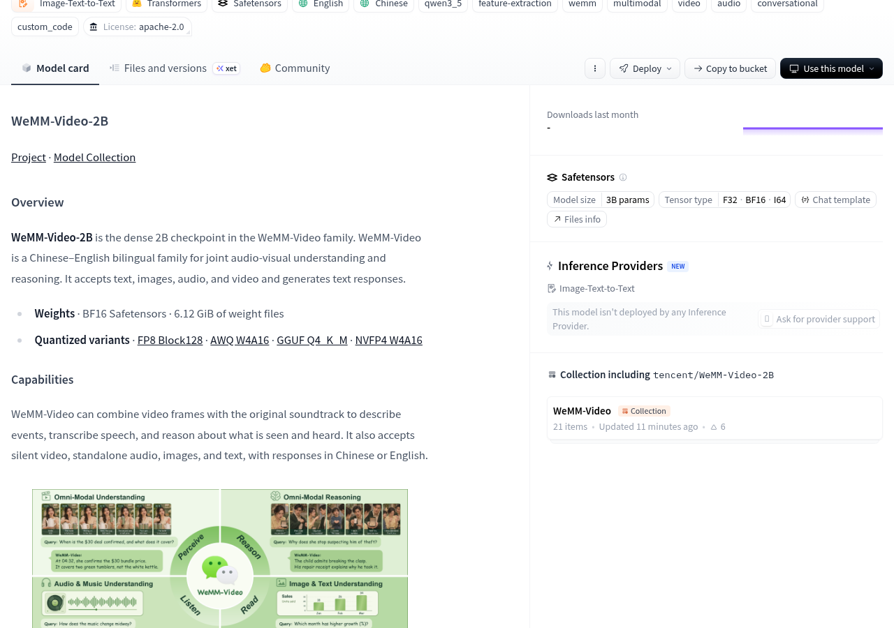
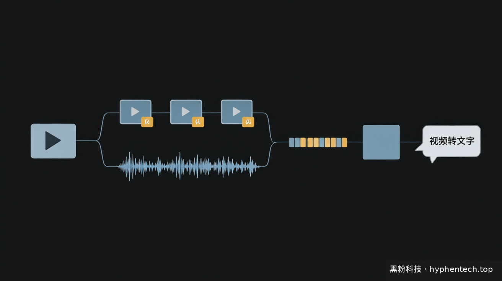
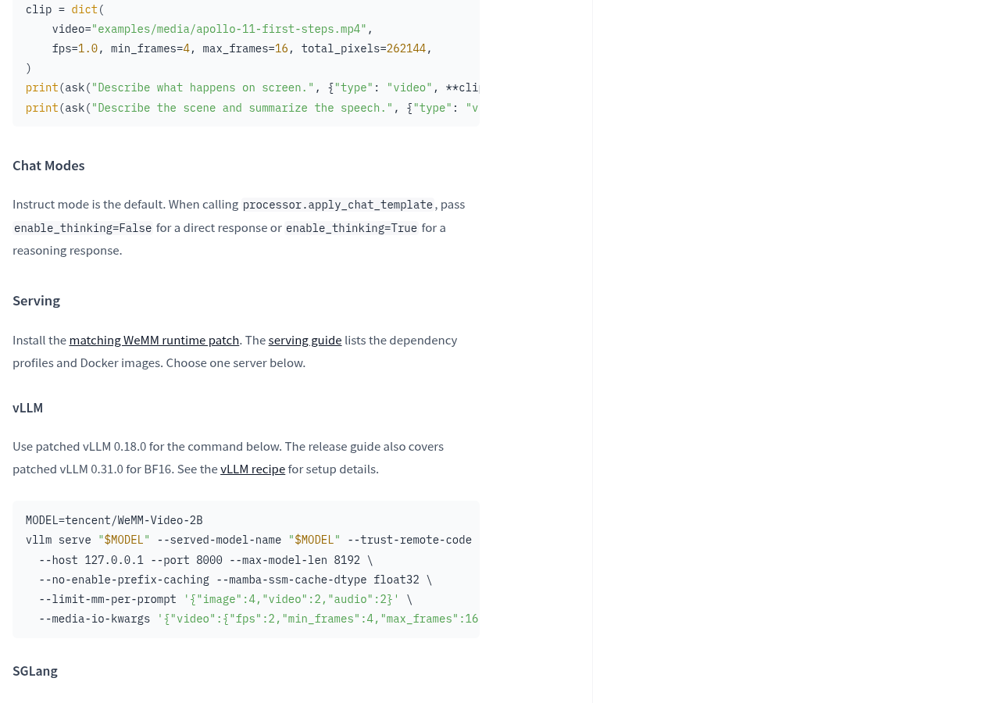
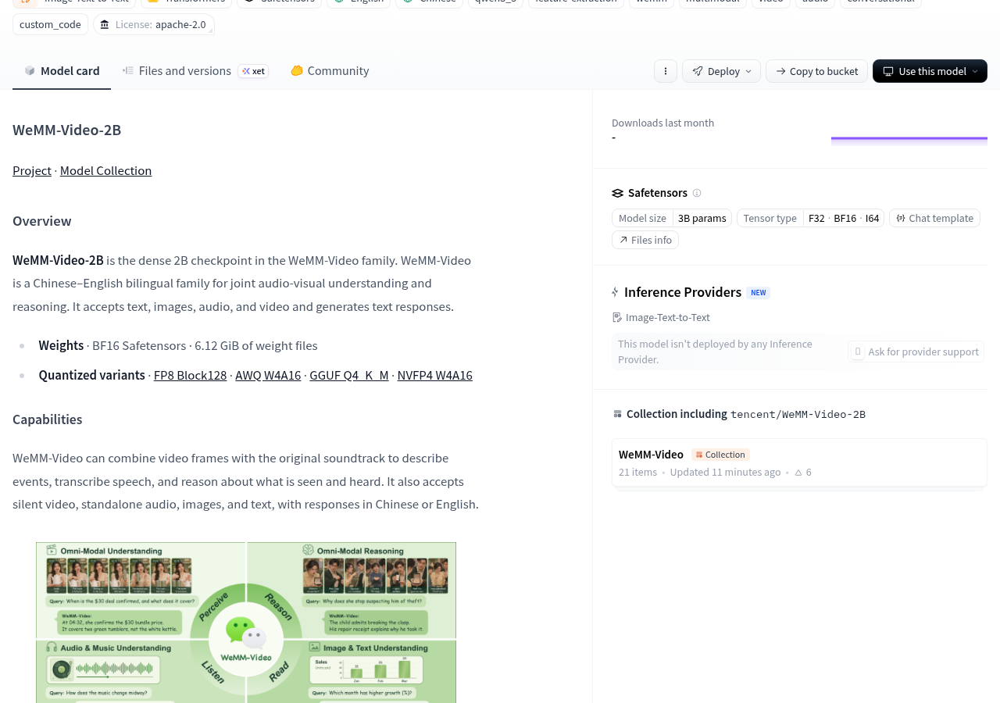
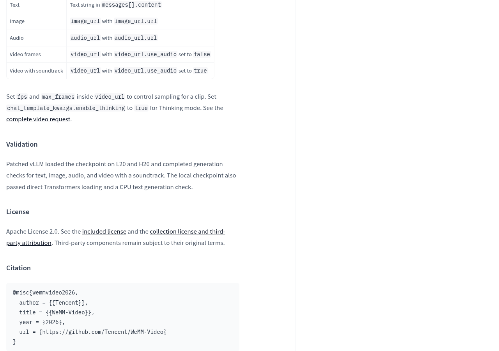

腾讯混元在 Hugging Face 上新放出一个模型仓库：tencent/WeMM-Video-2B。按官方模型页的说明，它是 WeMM-Video 系列里稠密的 2B 检查点，属于中英双语、面向音视频联合理解与推理的模型家族；权重是 BF16 Safetensors，官方标注为 6.12 GiB 权重文件。仓库页面同时给出四种量化变体：FP8 Block128、AWQ W4A16、GGUF Q4_K_M 与 NVFP4 W4A16。许可证一栏写的是 Apache License 2.0。



这个模型要解决的使用问题很具体：给一段视频，能不能同时听出里面说了什么、看出发生了什么，并把两者合起来回答问题。官方页面给出的答案是能——它把视频帧和原始音轨一起处理，用来描述事件、转写语音，并对看到和听到的内容做推理；也可以只给无声视频、单独音频、图片或纯文本提问，回答用中文或英文。

## 它到底怎么处理视频和声音

按官方模型页的架构说明，视觉编码器和音频编码器把媒体变成 token，语言模型再把这些 token 和文本一起处理；视频帧自带时间戳。这解释了一个实际差别：只看画面和同时看画面加声音，是两种不同的输入形态，而不是同一件事的两种说法。在 Python 调用示例里，这两种写法是分开的——video 只处理帧，video_audio 带上原始音轨，两者都在 video 字段里传文件路径。



官方给的两个例子很能说明它的定位：一个问题是“一场 20 分钟的会议从 09:45 开始，什么时候结束”，另一个问题是“这张图里的行星是什么样子”。前者要靠时间戳和时间算术，后者是单图理解。也就是说，它的重点不是生成视频，而是读懂视频之后把答案写成文字。

训练规模官方也有交代：这个家族先在约 1.2 万亿多模态 token 上预训练，之后用 multi-teacher OPD、抗重复的 MrDPO 以及专项强化学习做后训练。这是官方自述的训练口径，不代表任何第三方独立评测。

## 下载之后怎么跑起来

官方给的最短路径是从 WeMM-Video 仓库根目录跑示例脚本，加载带音轨的 MP4：

```bash
python examples/transformers_video.py --model tencent/WeMM-Video-2B \
  --video ./clip.mp4 --prompt "Describe what happens and summarize what you hear."
```

官方特别提到一点：需要为完整权重文件、媒体输入和生成缓存一起预留 GPU 显存。这一条决定了“能不能本地跑”的答案——能不能跑，取决于你手上的显存要同时装下模型、素材和解码缓存，而不只是模型本身。官方也提醒可以用 --revision 把模型和处理器的版本固定到某个 Hub 提交上，避免拉到不一致的版本。



## 部署不是装个包就行

> [!warning]
> 要把它变成一个能持续调用的服务，官方要求先装对应的 WeMM 运行时补丁。页面给出的两套服务方案都指定了打过补丁的版本：vLLM 0.18.0（另有打补丁的 vLLM 0.31.0 用于 BF16）和 SGLang 0.5.16 / 0.5.19。也就是说，直接拿社区现成的 vLLM 或 SGLang 版本启动，很可能不是官方验证过的那条路径。

```bash
MODEL=tencent/WeMM-Video-2B
vllm serve "$MODEL" --served-model-name "$MODEL" --trust-remote-code --dtype bfloat16 \
  --host 127.0.0.1 --port 8000 --max-model-len 8192 \
  --no-enable-prefix-caching --mamba-ssm-cache-dtype float32 \
  --limit-mm-per-prompt '{"image":4,"video":2,"audio":2}' \
  --media-io-kwargs '{"video":{"fps":2,"min_frames":4,"max_frames":16,"total_pixels":262144}}'
```

起服务之后，请求走的是 OpenAI 兼容的 chat 接口，媒体直接内联在请求里：文本放 messages[].content 的文本串，图片用 image_url，音频用 audio_url，视频用 video_url，并用 use_audio 区分是只送帧还是连音轨一起送。采样频率和最大帧数放在 video_url 里控制，比如官方示例里 fps 为 2、max_frames 为 16。





模型有两种对话模式：Instruct 是默认模式，调 apply_chat_template 时传 enable_thinking=False 就直接给答案，传 enable_thinking=True 则走推理式回答。用视频推理模式做需要时间算术或跨段核对的任务时，这个开关值得先试。

## 官方验证到什么程度，哪些还没验证

官方模型页的验证一栏写得很克制：打过补丁的 vLLM 在 L20 和 H20 上加载了这个检查点，并对文本、图片、音频、带音轨视频完成了生成检查；本地检查点还通过了直接用 Transformers 加载和一次 CPU 文本生成检查。这是官方报告的验证范围，其中并没有包含消费级显卡，也没有第三方独立评测。

同时要说明的是发布状态上的一处现实限制：仓库的 Inference Providers 区域显示，目前没有任何推理服务商部署这个模型，页面上直接给出“没有被任何 Inference Provider 部署”的说明，并提供一个给平台提需求的入口。也就是说，现在没有现成的托管 API 可以直接调用，走这条路只能自己部署。

## 怎么判断值不值得自己搭

把上面这些条件合起来看，一个务实的判断是：这是一个权重开放、许可宽松（Apache 2.0）、任务定位清楚的 2B 音视频理解模型，适合的用法是自己搭服务，在本地或自己的机器上做视频摘要、语音转写和图文音混合推理；不适合的用法是把它当成“今天就能调用的在线接口”。前者的门槛在于显存预算、官方补丁的版本对齐和 SGLang/vLLM 的部署经验；后者之所以不成立，不是因为模型不行，而是因为托管方还没上线。

> [!tip]
> 如果要动手，按官方顺序验收：先在仓库根目录用 Transformers 示例跑通一个带音轨的 MP4，确认能同时用上帧和声音；再按 serving 指南装好对应的运行时补丁，用官方给的 vLLM 或 SGLang 命令起服务；最后用项目自带的 chat.py 客户端分别测 text、image、audio、video、video-audio 五种请求，确认五种都能返回再接自己的业务。官方在验证一栏提到的 L20、H20 只是它验证过的硬件，落到别的卡上仍需自己量一遍显存和速度。

接下来的可验证问题是两件事：官方列出的量化变体在普通显卡上能省多少显存与时间，以及五种输入形态在真实业务素材上的稳定性。这两点官方材料都没有给出结论，需要在部署之后自己测；仓库页面显示该系列集合收录 21 个条目、近期仍在更新，也说明这条音视频线还在持续推进中。

## 官方资料

- [腾讯混元 官方发布说明](https://huggingface.co/tencent/WeMM-Video-2B)


---

## 🧰 我做的工具

这些工具都由我持续维护。预览版会明确标注，下载、更新和已知边界以发行页为准。

> [!info] 黑粉盒子 HyphenBox
> **状态：** 正式迭代
>
> 免费大模型 API 雷达：持续复测可用性，本地统一接口，Key 只存本机
>
> [下载与更新：黑粉盒子 HyphenBox](https://github.com/HackerChi-Hub/hyphenbox-release/releases)

> [!info] 方寸智匣 LocalBrain
> **状态：** 正式迭代
>
> 本地模型的多模态 MCP 工具箱：TTS / Whisper / 视频生成一站接入
>
> [下载与更新：方寸智匣 LocalBrain](https://github.com/HackerChi-Hub/localbrain-releases/releases)

---

> [!quote] 黑粉科技
> **让AI成为你的超能力**
> 本地部署 · 免费白嫖 · 自制软件
> [黑粉科技](https://hyphentech.top)
