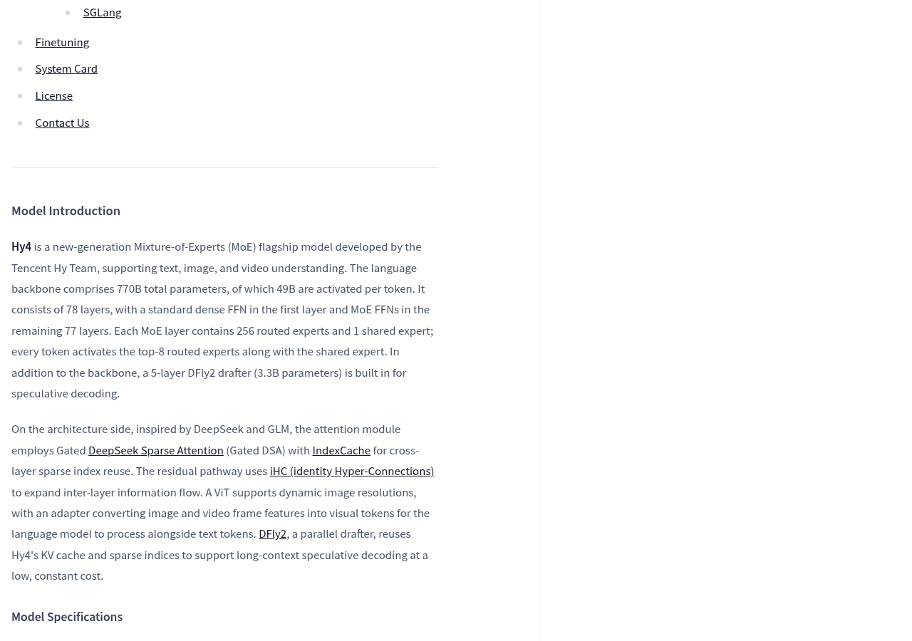
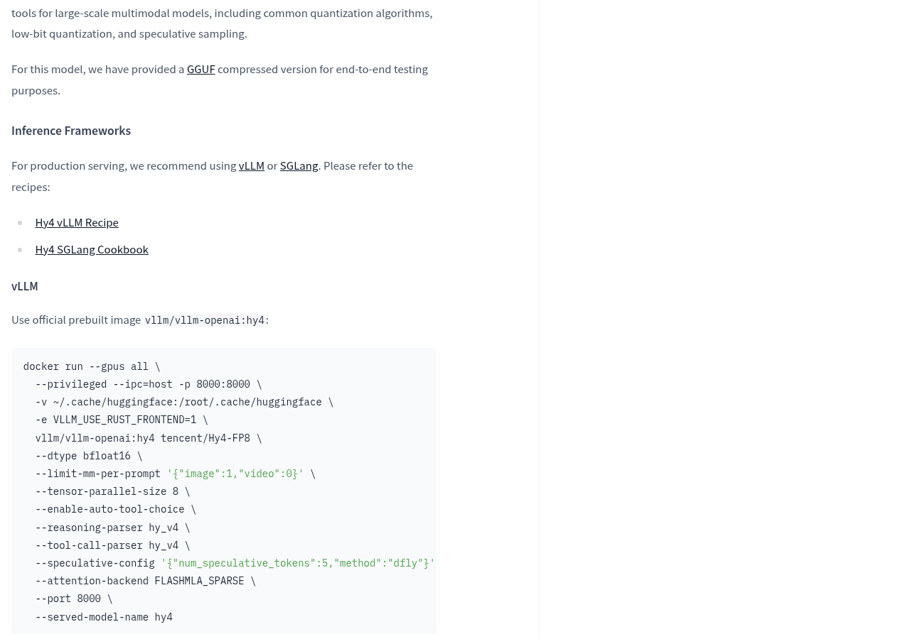
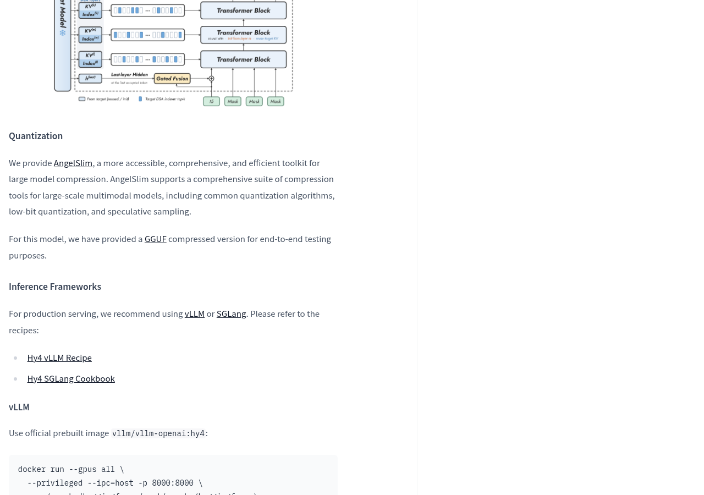
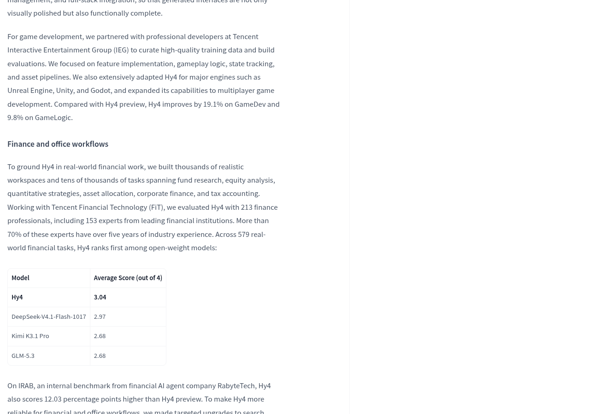
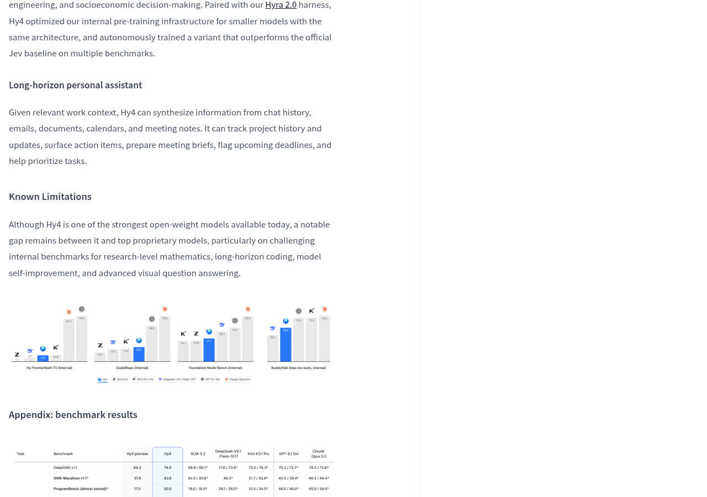

腾讯混元官方模型仓库里多了一个新名字：tencent/Hy4。官方页面写明它支持文本、图像和视频理解，语言主干总参数 770B，每个 token 实际激活 49B；上下文长度 1M（1,048,576 tokens）。同时放出来的还有 Hy4-FP8 量化版和只做了预训练的 Hy4 base 权重，分发渠道是 Hugging Face、ModelScope 和 GitCode。

## 开放权重不等于人人本地可跑

官方给出的部署方式是 vLLM 或 SGLang 服务：vLLM 示例镜像直接写死了 --tensor-parallel-size 8，SGLang 示例是 --tp 8，都是 8 卡并行在跑 774B 参数的 safetensors 权重（BF16 / F32 张量类型）。这意味着官方推荐的用法是把它放在一台多卡机器上做成 OpenAI 兼容接口服务，官方给的调用示例 base_url 是 `http://127.0.0.1:8000/v1`。

那“每 token 只激活 49B”是什么意思？可以把它理解成快递仓储：仓库总货量是 770B 件，但每次给你送货的只从 256 个分区里挑 8 个分区加 1 个共享分区出货，实际搬货量约 49B。好处是搬运的人手少，坏处是货还在那儿——仓库本身要占地方。存放这些货物需要的显存或内存，不会因为每次只搬一部分而消失。所以想在自己电脑上跑的读者，先看仓库尺寸，而不是看每次出货量。

> [!tip]
> 官方在量化一节写明：为了端到端测试目的，提供了 GGUF 压缩版本，并推荐用 AngelSlim 工具链做压缩；仓库另列了 AngelSlim/Hy4-GGUF。权重开放、许可证、运行时和硬件条件是四件分开的事——Hy4 采用 Tencent Hy License，文件在仓库 LICENSE 里；本地能不能跑起来还取决于你手上的显存、量化格式和推理框架版本，这几项需要分别核实，不能从“开放权重”四个字直接推出来。

## 官方成绩里最值得看的两类

按官方列出的数字看，Hy4 base 的知识类少样本预训练评测里，SimpleQA 得分 57.2、Chinese-SimpleQA 83.9、SuperGPQA 62.7；数学类 U-MATH 71.6、OCW Courses 66.7。多模态部分只报了 Hy4 Base 与 Hy4 flash Base 两行，MMMU-Pro（10 选项）59.6、RealWorldQA 72.3、CountBenchQA 90.6。官方表格明确标注加粗只表示该行可得的最高数值，不代表统计显著性。

官方自己给出的定位是评测数据，不是独立验证：在 579 个真实金融任务上，参与评测的是 213 位金融从业者，其中 153 位来自头部金融机构，超过 70% 有五年以上从业经验；Hy4 平均得分 3.04（满分 4），同表列出的对照模型为 DeepSeek-V4.1-Flash-1017 的 2.97、Kimi K3.1 Pro 的 2.68、GLM-5.3 的 2.68，官方表述是在开放权重模型中排名第一。同一节还写明 Hy4 的幻觉率从 Hy4 preview 的 15.76% 降到 5.45%，推测性错误从 23.1% 降到 5.6%。

> [!warning]
> 官方在 Known Limitations 里写得很直白：尽管 Hy4 是当下最强的开放权重模型之一，但在研究级数学、长周期编码、模型自我改进和高级视觉问答等内部高难基准上，与顶级专有模型仍存在明显差距。模型卡还附了一条免责声明：base 模型在中期训练阶段接触了大量合成指令数据，偶尔不按预期的答案格式输出，可能影响少样本评测分数。这些都属于官方自述，不能当成第三方复现结论。

## 怎么判断值不值得上

- 如果你只有消费级显卡，先看 GGUF 与 AngelSlim 的量化路线能否压到你机器的显存范围，而不是先看总参数。
- 如果你需要图、视频理解或 computer use 工作流，Hy4 的多模态训练是这次相对 preview 的主要增量，值得实测。
- 如果你的场景是财务、办公文档协作，官方给的 579 任务评测和幻觉率数据是最贴近你需求的参考，但结论来自官方内部评测。
- 如果你的目标是研究级数学或超长周期编码任务，官方自己承认与专有模型有差距，别把它当唯一方案。

落地时的下一步很具体：权重地址是 [查看页面：huggingface.co · Hy4](<https://huggingface.co/tencent/Hy4>) ，同批次还有 [查看页面：huggingface.co · Hy4-FP8](<https://huggingface.co/tencent/Hy4-FP8>) 和 [查看页面：huggingface.co · Hy4-base](<https://huggingface.co/tencent/Hy4-base>) ；官方推理配方分别指向 vLLM recipe 与 SGLang cookbook，系统卡在 hy.tencent.ai。核实顺序建议是：先确认手上的推理框架版本是否已支持该模型，再看量化权重体积是否落在自己硬件能承受的范围，最后用官方推荐参数 temperature=0.9、top_p=1.0、reasoning_effort 默认 high 跑一个自己熟悉的真实任务，测三到五个自己的问题而不是看公开榜单。

## 官方资料

- [腾讯混元 官方发布说明](https://huggingface.co/tencent/Hy4)

---

## 🧰 我做的工具

这些工具都由我持续维护。预览版会明确标注，下载、更新和已知边界以发行页为准。

> [!info] 黑粉盒子 HyphenBox
> **状态：** 正式迭代
>
> 免费大模型 API 雷达：持续复测可用性，本地统一接口，Key 只存本机
>
> [下载与更新：黑粉盒子 HyphenBox](https://github.com/HackerChi-Hub/hyphenbox-release/releases)

> [!info] 方寸智匣 LocalBrain
> **状态：** 正式迭代
>
> 本地模型的多模态 MCP 工具箱：TTS / Whisper / 视频生成一站接入
>
> [下载与更新：方寸智匣 LocalBrain](https://github.com/HackerChi-Hub/localbrain-releases/releases)

---

> [!quote] 黑粉科技
> **让AI成为你的超能力**
> 本地部署 · 免费白嫖 · 自制软件
> [黑粉科技](https://hyphentech.top)
