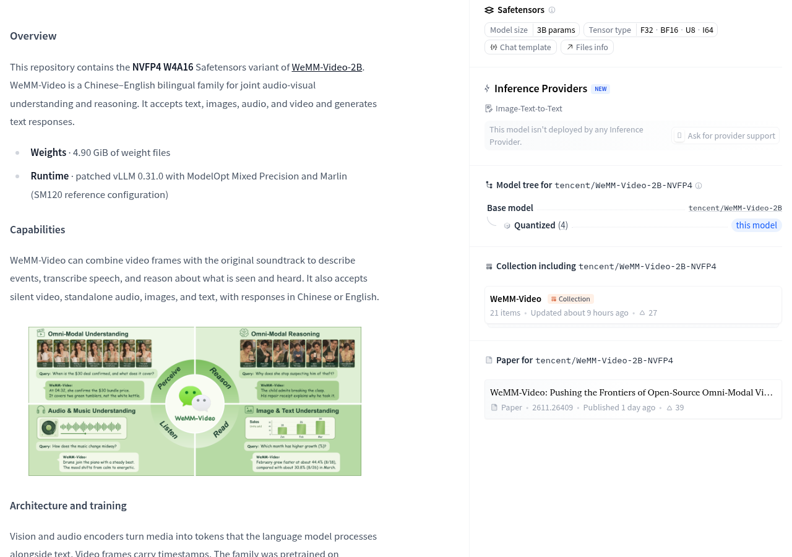
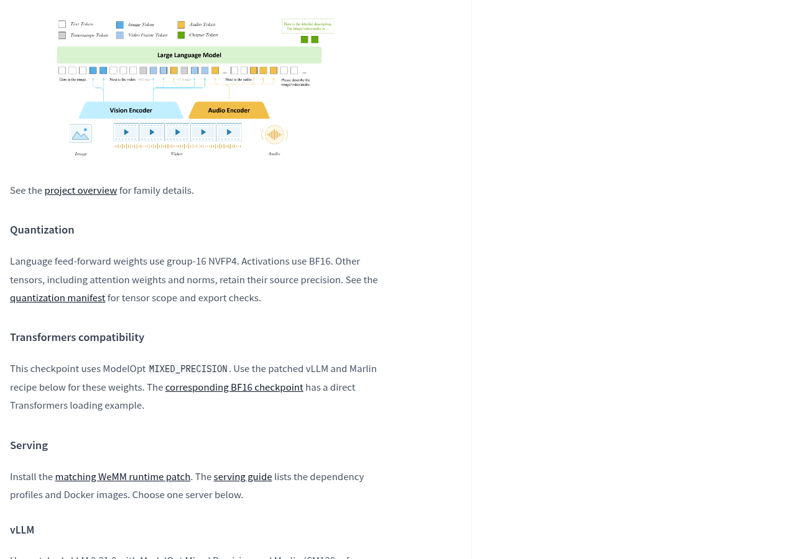
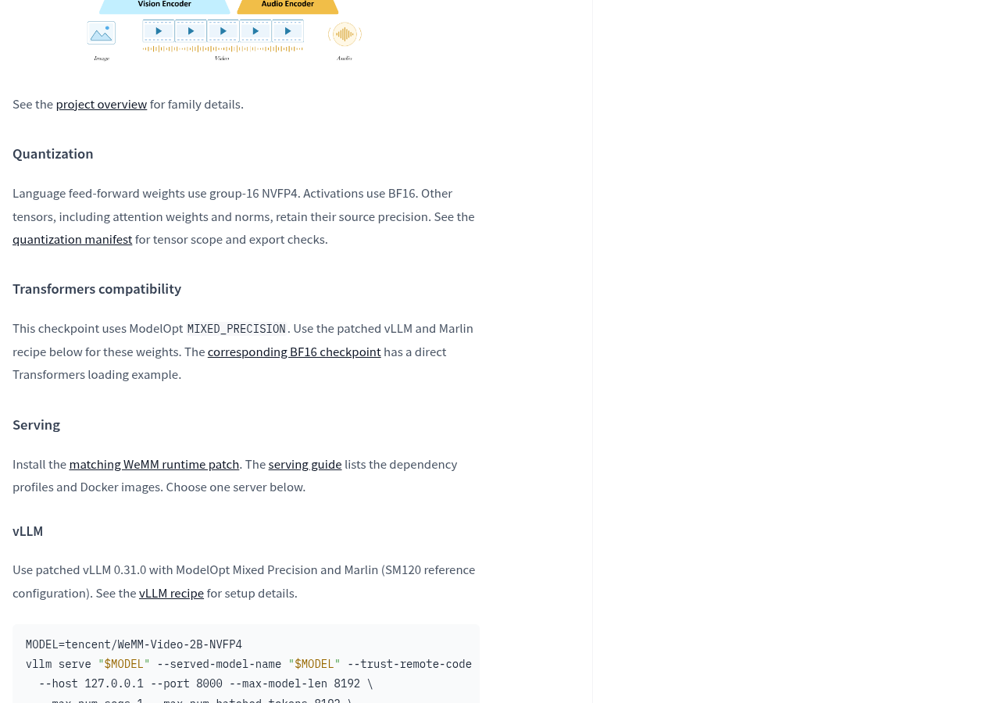
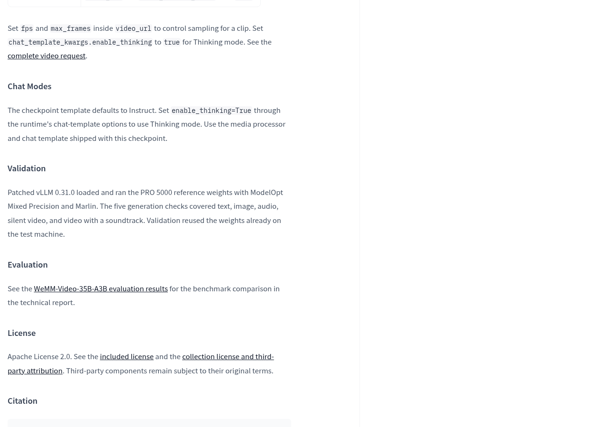
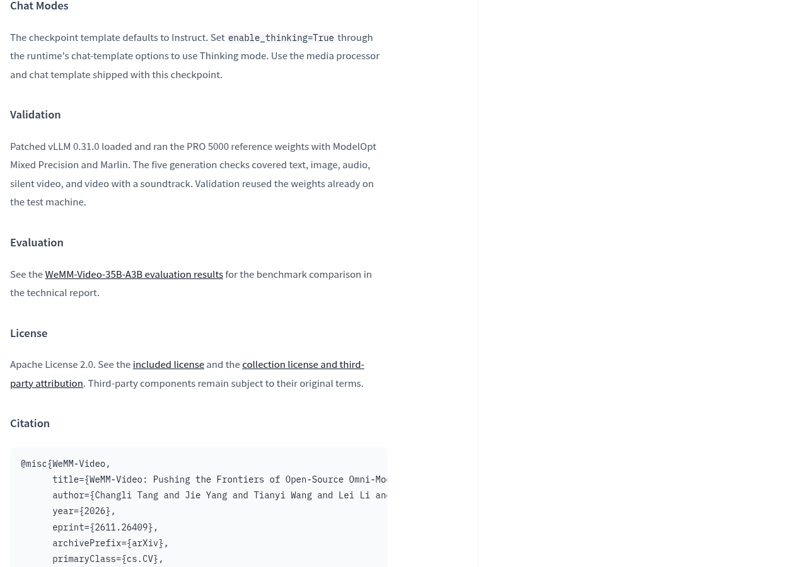
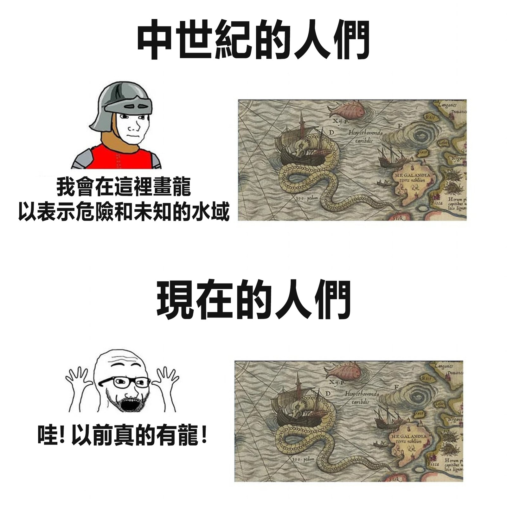

把一段有声视频交给模型，让它同时看画面、听原声，再用中文回答问题——WeMM-Video-2B-NVFP4 的官方模型卡列出了这项能力，也记录了对应的生成检查。权重文件标注为4.90 GiB，但部署指定了打过补丁的 vLLM 0.31.0、ModelOpt 混合精度与 Marlin，并给出 SM120 参考配置。

想把它接进本地视频整理流程，最该先看的是运行环境是否匹配，其次才是文件大小。官方提供了有声视频理解的部署路径；普通电脑能否直接使用、处理自己的视频是否可靠，还需要分别验收。

## 它能结合画面和声音回答，输出仍然是文字

WeMM-Video 是支持中英文的视听理解与推理模型系列。模型卡说明，它可以结合视频帧与原始音轨描述事件、转写语音，并根据看到和听到的内容进行推理；也接受无声视频、独立音频、图片和文字，生成中文或英文的文字回答。这里的“视频”指输入和理解对象，不是生成视频。

可以把有声视频理解成一条同时包含画面和语音的微信消息：只看画面，可能漏掉说话内容；只听语音，又可能不知道声音对应哪个动作。官方描述的能力，是把两路信息结合起来回答。对于视频整理任务，这意味着值得检查的不是回答写得多流畅，而是它是否把声音、画面和事件关系对应正确。

输入视频也不意味着所有画面都会原样进入模型。模型卡说明，视觉和音频编码器先把媒体转换为词元，视频帧带有时间戳。词元可以理解成送入处理流程的小份信息；视频请求还可以控制采样帧率和最大帧数，类似从连续录像中选取画面供模型查看。因此，验收时需要同时记录取了哪些画面，不能只看最终答案。

官方请求说明区分了无声视频和带原声的视频，模板默认使用指令模式，也提供思考模式选项。准备做有声视频问答，应先按官方入口确认音轨确实参与处理，再讨论回答质量；只传入画面，验收的就是另一种任务。

## 4.90 GiB 是权重文件大小，不是整套部署的内存账单

这个版本标为 NVFP4 W4A16，模型卡同时写明：语言模型前馈部分的权重采用 group-16 NVFP4，激活值使用 BF16，注意力权重、归一化等其他张量保留来源精度。它采用的是混合精度方案，不能把名称理解成整个模型的所有部分都压成了同一种低精度格式。

把权重文件想成快递仓库里已经打包的货物，量化类似于让部分货物包装得更紧凑。但仓库真正运转，还要留出分拣和临时周转的位置。对应到模型，权重文件大小与运行时的全部内存、显存占用是不同口径。4.90 GiB 说明要存放的权重文件有多大，不能据此给某台电脑开出“够用”的结论。

兼容性比文件大小更值得提前检查。这份权重采用 ModelOpt MIXED_PRECISION，官方要求使用配套补丁版 vLLM 和 Marlin 方案；模型卡把直接通过 Transformers 加载的示例指向对应 BF16 版本。准备沿用现成加载代码时，先确认代码对应的是哪份权重，不要把两个版本的使用方法混在一起。

官方还要求安装匹配的 WeMM 运行时补丁，并指向依赖配置与容器说明。对已有相关部署环境的人，这提供了可继续核查的路径；对只想下载文件、双击运行的人，它目前展示的是服务部署方案，而不是桌面软件入口。

许可证也要与运行条件分开看。模型卡标注 Apache License 2.0，同时要求查看随附许可、合集许可和第三方署名，第三方组件仍受各自原始条款约束。许可标注回答使用授权问题，运行环境回答能否加载问题，两者都需要核对。

## 官方跑通记录值得看，自己的视频仍要单独验收

模型卡的验证记录写明：补丁版 vLLM 0.31.0 配合 ModelOpt 混合精度与 Marlin，加载并运行了 PRO 5000 参考权重。五项生成检查覆盖文字、图片、音频、无声视频和带原声视频；验证复用了测试机器上已有的权重。它提供了明确的运行记录，但没有给出普通电脑的通用硬件门槛，也没有交代从重新下载到完整部署的全过程。

评测入口还需要看清型号。这张模型卡把技术报告中的榜单比较指向 WeMM-Video-35B-A3B 的评测结果，没有在该位置列出这份 2B 量化版本自己的成绩。选择小模型部署时，不能把另一型号的榜单成绩直接算到它头上。

在线使用也不是现成的替代入口。所提供页面在采集时显示，该模型尚未由 Hugging Face 的推理服务商部署。模型仓库可见、官方列出权重信息，与已有托管服务可以直接调用，是两种不同状态。

- 先查看官方模型卡和部署说明，核对设备、依赖、运行时补丁与这份量化权重是否匹配，再决定是否下载和配置。
- 部署后使用有权处理、内容已知的视频，检查语音转写、画面描述，以及声音和画面的对应关系；回答通顺不能替代内容正确。
- 保留输入片段、采样设置、原始回答和失败情况，并记录处理时间与资源占用，再判断能否接入自己的日常任务。

相关入口：[查看官方模型卡](https://huggingface.co/tencent/WeMM-Video-2B-NVFP4)、[查看官方部署说明](https://github.com/Tencent/WeMM-Video/blob/main/docs/serving.md#nvfp4)、[查看运行环境配置入口](https://github.com/Tencent/WeMM-Video/blob/main/docs/serving.md#runtime-profiles)。后两项是模型卡提供的文档链接，具体配置以文档实际内容为准。

这份模型值得关注的，是把有声视频理解落到了明确的权重格式与运行方案上。对准备本地部署的人，下一步最有价值的结果不是再多一段漂亮回答，而是找到一套能反复运行、声音画面对得上、资源占用也能接受的配置。只有这条链走通，模型才算从仓库里的文件变成了可用工具。

## 官方资料

- [腾讯混元 官方发布说明](https://huggingface.co/tencent/WeMM-Video-2B-NVFP4)

---

## 🧰 我做的工具

这些工具都由我持续维护。预览版会明确标注，下载、更新和已知边界以发行页为准。

> [!info] 黑粉助手 HyphenAssistant
> **状态：** 正式迭代
>
> 手机浏览器接续电脑上的 DeepSeek Harness 会话；需本人配对、电脑与原服务在线，模型费用沿用原配置
>
> [下载与更新：黑粉助手 HyphenAssistant](https://github.com/HackerChi-Hub/hyphen-assistant-releases/releases)

> [!info] 黑粉盒子 HyphenBox
> **状态：** 正式迭代
>
> 免费大模型 API 雷达：持续复测可用性，本地统一接口，Key 只存本机
>
> [下载与更新：黑粉盒子 HyphenBox](https://github.com/HackerChi-Hub/hyphenbox-release/releases)

> [!info] 方寸智匣 LocalBrain
> **状态：** 正式迭代
>
> 本地模型的多模态 MCP 工具箱：TTS / Whisper / 视频生成一站接入
>
> [下载与更新：方寸智匣 LocalBrain](https://github.com/HackerChi-Hub/localbrain-releases/releases)

> [!info] ScreenLex 光影词库
> **状态：** 正式迭代
>
> 看美剧顺手把生词背了，Mac/Windows 双平台，免费
>
> [下载与更新：ScreenLex 光影词库](https://github.com/HackerChi-Hub/screenlex-download/releases)

> [!info] 黑粉录屏 HyphenScreen
> **状态：** 正式迭代
>
> 录屏 + 智能剪辑一体：达芬奇式时间线、自动打码、导出前成片体检，免费
>
> [下载与更新：黑粉录屏 HyphenScreen](https://github.com/HackerChi-Hub/HyphenScreen-Releases/releases)

---

> [!quote] 黑粉科技
> **让AI成为你的超能力**
> 本地部署 · 免费白嫖 · 自制软件
> [黑粉科技](https://hyphentech.top)
