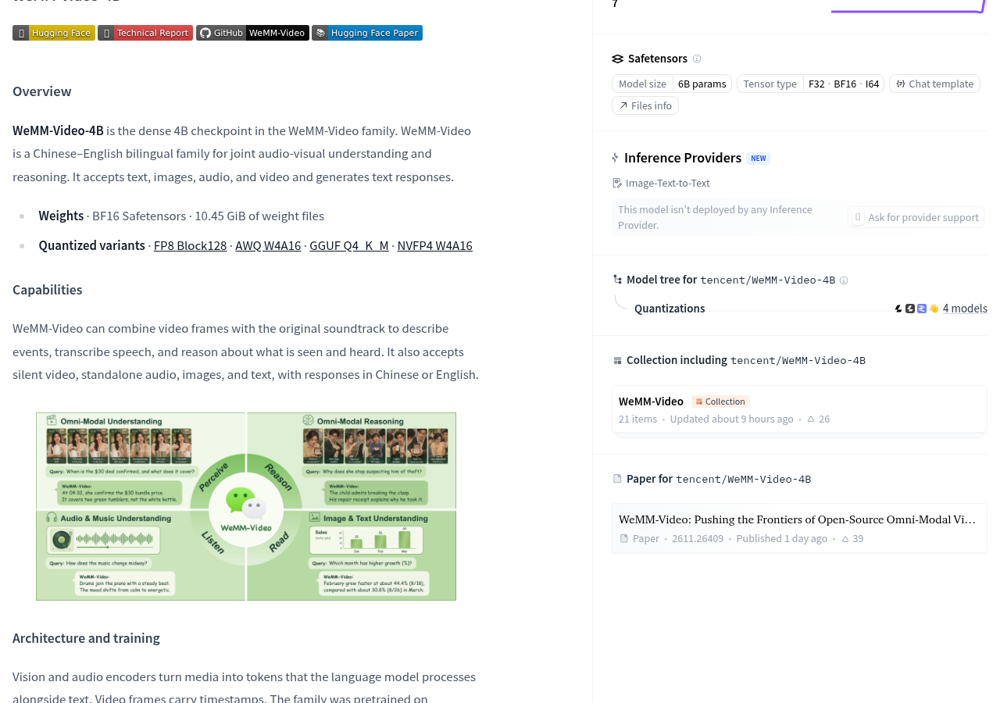
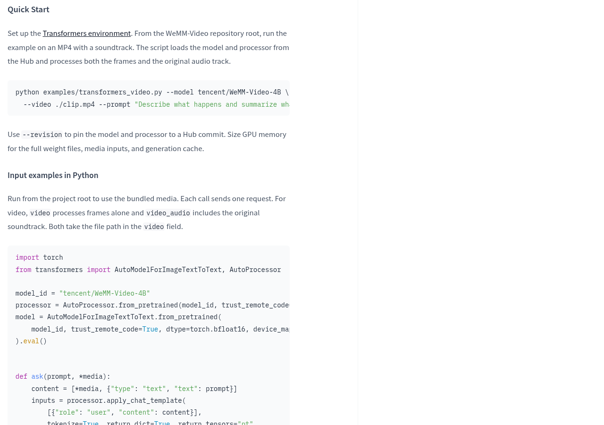
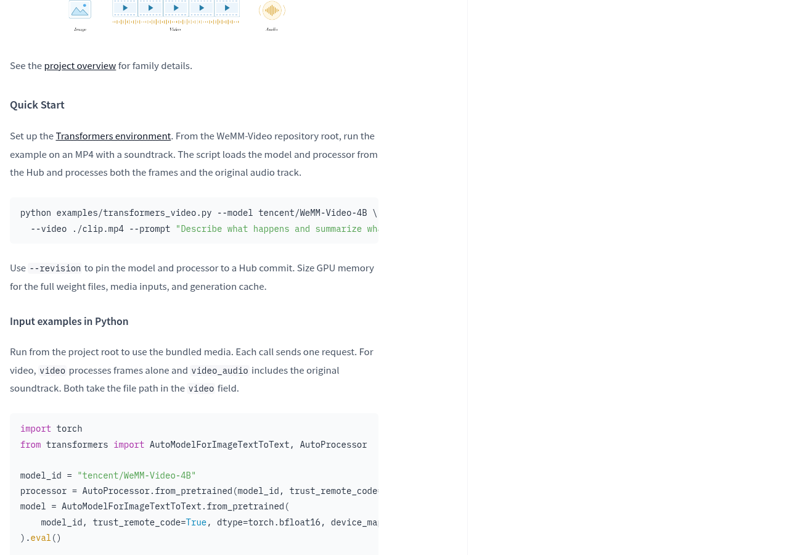
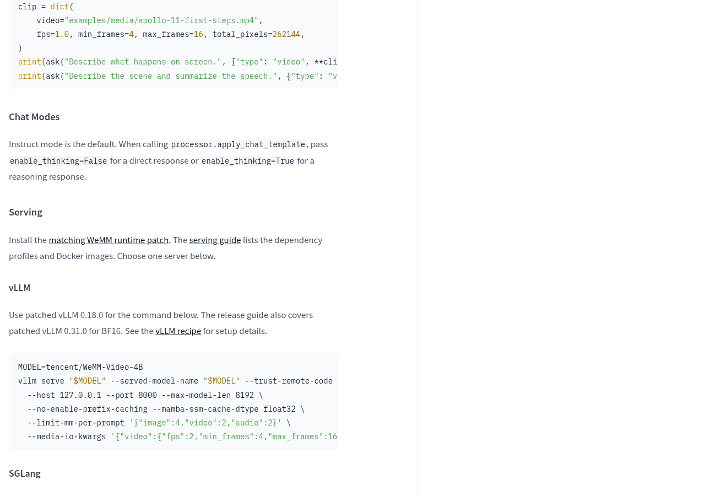
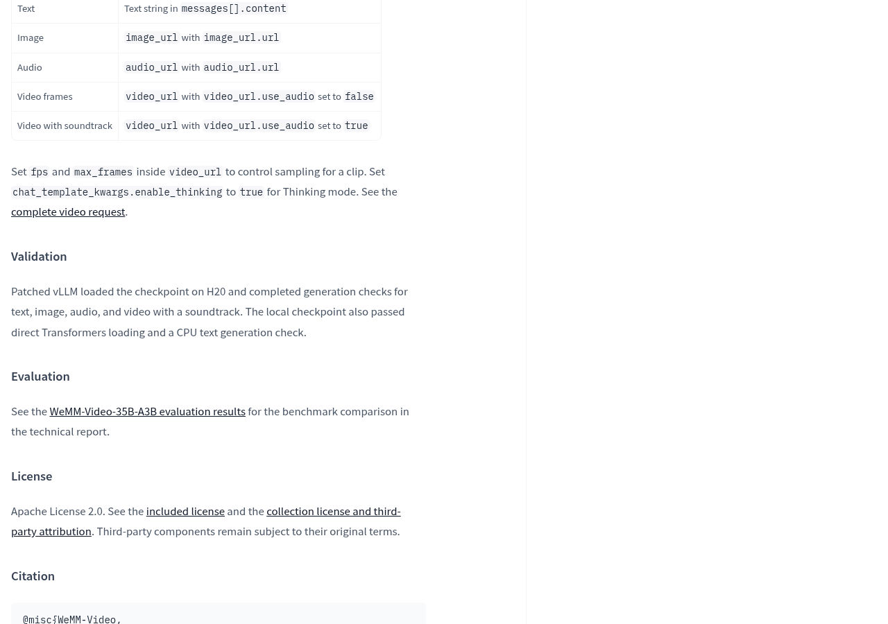
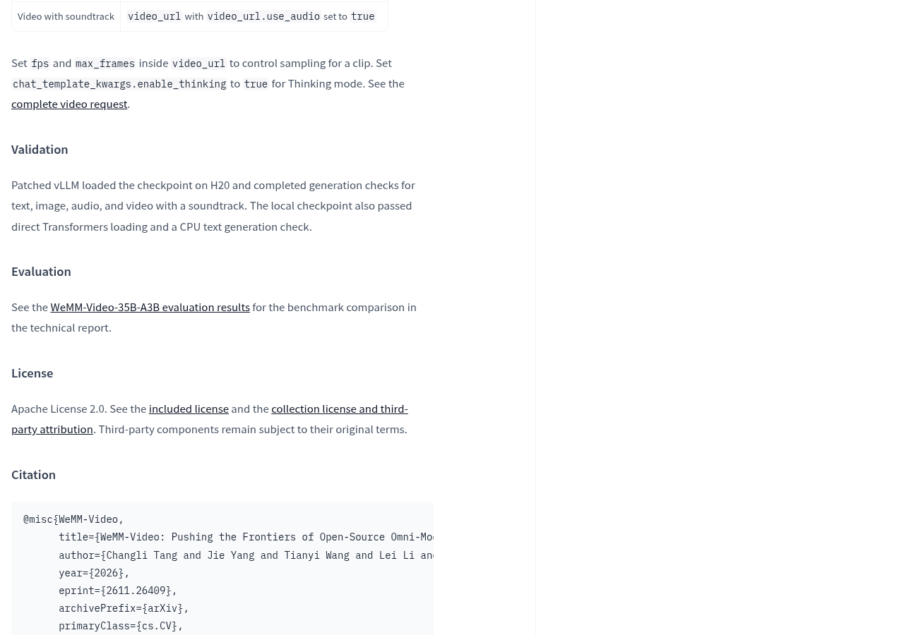

视频里发生了什么，和视频里说了什么，经常是两个问题。腾讯WeMM-Video-4B的官方模型卡明确写到：它可以结合视频画面与原始音轨描述事件、转写语音，并围绕看到和听到的内容进行推理，输出中文或英文文字。

模型卡已经列出BF16权重，文件体积为10.45 GiB，也提供了量化版本入口。对准备处理带声音视频的人，值得关注的是这条音画联合处理路径；决定是否部署，则要看输入方式、运行环境和自己的任务能否一起走通。

## 先分清：要看画面，还是要连原声一起理解？

WeMM-Video-4B接收文字、图片、音频和视频，生成的是文字回答。它适合考察的方向是理解与问答，而不是生成视频或配音。官方还列出了静音视频、独立音频、图片和纯文字输入，带原声视频只是其中一条处理路径。

可以把它想成查看一段微信群视频：只看画面，能知道谁走进了房间；打开声音，才可能知道对方是在介绍产品，还是在提醒设备故障。画面与声音提供的信息不同，把两者放在一起，才有机会回答依赖音画关系的问题。这里对应的是官方声明的能力方向，具体素材上能否答对，还要检查实际回答。

这个区别落实到了官方示例里：Python输入中的video只处理视频帧，video_audio才包含原始音轨。服务接口也区分是否使用音频，通过video_url.use_audio选择。若任务需要听懂讲话，却走了只处理画面的路径，后续再追问声音内容就找错了入口。

模型会把媒体内容转换成供语言模型处理的词元，视频帧还带有时间戳。词元可以理解为整理后交给模型的处理单元：就像把微信里不同时间发来的文字、图片和语音整理成可对照的记录。时间戳帮助保留视频帧的先后位置，但模型卡没有给出这里的时间定位误差，不能据此承诺精确定位每个事件。

## 权重入口已有，部署条件还得分开看

官方模型卡列出了BF16 Safetensors权重，以及FP8 Block128、AWQ W4A16、GGUF Q4_K_M和NVFP4 W4A16量化版本入口。量化可以先理解为换一种精度记录模型数值；选定格式后，还要确认运行软件能否正确加载，并把视频与原声送进去。不能仅凭文件格式名称，就认定某个桌面客户端已经支持完整流程。

10.45 GiB是模型卡列出的权重文件体积，不是整套任务的显存需求。官方明确提醒，显存规划需要同时考虑完整权重、媒体输入和生成缓存。就像快递货架除了放包裹，还要留出分拣和临时周转的位置；把模型文件装下，只解决了其中一部分。

名称里的4B也不宜直接当成整包参数总量。正文将它称为dense 4B checkpoint，页面文件信息另显示6B params，给定说明没有解释两处统计范围的差别。设备选择应回到实际权重、运行时与媒体负载，不用名称推算内存门槛。

运行软件同样有条件。官方要求安装匹配的WeMM运行补丁，服务示例使用经过补丁处理的vLLM或SGLang。模型卡列出的vLLM示例对应0.18.0，另提到BF16的0.31.0方案；SGLang列出0.5.16或0.5.19。运行时就像负责拆包、分拣和送件的流程，权重文件能拿到，不代表任意版本的软件都能接手。

许可证也要与部署条件分开看。官方模型卡标注Apache License 2.0，并要求同时查看附带许可证、集合许可证和第三方署名，第三方组件仍遵守各自条款。权重开放解决的是获取文件的问题，具体使用还要核对对应条款与依赖。

入口可以从[官方模型卡](https://huggingface.co/tencent/WeMM-Video-4B)开始，再查看其中链接的[项目仓库](https://github.com/Tencent/WeMM-Video)和[运行环境配置文档](https://github.com/Tencent/WeMM-Video/blob/main/docs/serving.md#runtime-profiles)。后两者是模型卡提供的文档入口，不代表其中所有配置已经得到逐项验证。

## 先验收自己的视频任务，再决定是否接入工作流

官方验证记录写到：打过补丁的vLLM曾在H20上加载该模型，并完成文字、图片、音频和带原声视频的生成检查；本地检查点也通过了直接使用Transformers加载和CPU文字生成检查。这里能看到具体的运行路径，但CPU文字生成记录没有覆盖CPU视频理解，H20上的生成检查也没有给出普通电脑的速度和资源占用。

评测成绩还要认准对象。4B模型卡的评测章节指向WeMM-Video-35B-A3B的技术报告成绩，没有在这里展开4B自己的对应结果。选4B时，不应把另一个型号的成绩直接贴过来；这份模型卡更适合用来判断功能入口和部署路线。

想省去本地部署、直接使用托管推理的人，也要先确认服务入口。在这份页面记录中，Hugging Face的推理服务商区域显示尚无服务商部署该模型。这不涉及其他平台是否提供服务，但至少不能把模型页面当作已经可用的托管调用入口。

- 先确认素材需要哪些信息：只分析画面，还是必须结合讲话与环境声音；选择对应的输入路径。
- 按官方补丁和依赖配置环境，核对权重格式、可用内存以及媒体处理是否匹配，不直接套用其他模型的安装经验。
- 使用自己有权处理的视频，把回答中的事件、语音内容和音画关系逐项对照原片，检查是否漏听、误认或补出了不存在的内容。
- 记录实际耗时、资源占用与失败环节；需要复现时，使用官方支持的revision选项固定模型和处理器版本，再判断是否值得持续维护。

对有部署经验、确实需要音画联合理解的人，WeMM-Video-4B值得进入候选；对期待下载后立即在普通电脑上处理视频的人，现有资料还缺对应设备上的完整结果。更有价值的下一步，是看它能否把画面中的动作和声音中的信息可靠地对应起来。只有这一步在真实任务里成立，音画联合输入才会从功能清单变成可用的工作能力。

## 官方资料

- [腾讯混元 官方发布说明](https://huggingface.co/tencent/WeMM-Video-4B)

---

## 🧰 我做的工具

这些工具都由我持续维护。预览版会明确标注，下载、更新和已知边界以发行页为准。

> [!info] 黑粉助手 HyphenAssistant
> **状态：** 正式迭代
>
> 手机浏览器接续电脑上的 DeepSeek Harness 会话；需本人配对、电脑与原服务在线，模型费用沿用原配置
>
> [下载与更新：黑粉助手 HyphenAssistant](https://github.com/HackerChi-Hub/hyphen-assistant-releases/releases)

> [!info] 黑粉盒子 HyphenBox
> **状态：** 正式迭代
>
> 免费大模型 API 雷达：持续复测可用性，本地统一接口，Key 只存本机
>
> [下载与更新：黑粉盒子 HyphenBox](https://github.com/HackerChi-Hub/hyphenbox-release/releases)

> [!info] 方寸智匣 LocalBrain
> **状态：** 正式迭代
>
> 本地模型的多模态 MCP 工具箱：TTS / Whisper / 视频生成一站接入
>
> [下载与更新：方寸智匣 LocalBrain](https://github.com/HackerChi-Hub/localbrain-releases/releases)

> [!info] ScreenLex 光影词库
> **状态：** 正式迭代
>
> 看美剧顺手把生词背了，Mac/Windows 双平台，免费
>
> [下载与更新：ScreenLex 光影词库](https://github.com/HackerChi-Hub/screenlex-download/releases)

> [!info] 黑粉录屏 HyphenScreen
> **状态：** 正式迭代
>
> 录屏 + 智能剪辑一体：达芬奇式时间线、自动打码、导出前成片体检，免费
>
> [下载与更新：黑粉录屏 HyphenScreen](https://github.com/HackerChi-Hub/HyphenScreen-Releases/releases)

---

> [!quote] 黑粉科技
> **让AI成为你的超能力**
> 本地部署 · 免费白嫖 · 自制软件
> [黑粉科技](https://hyphentech.top)
