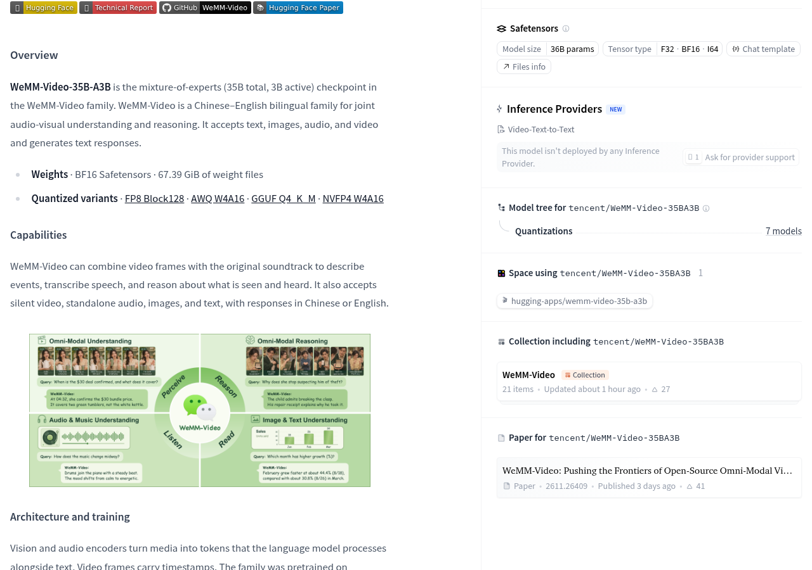
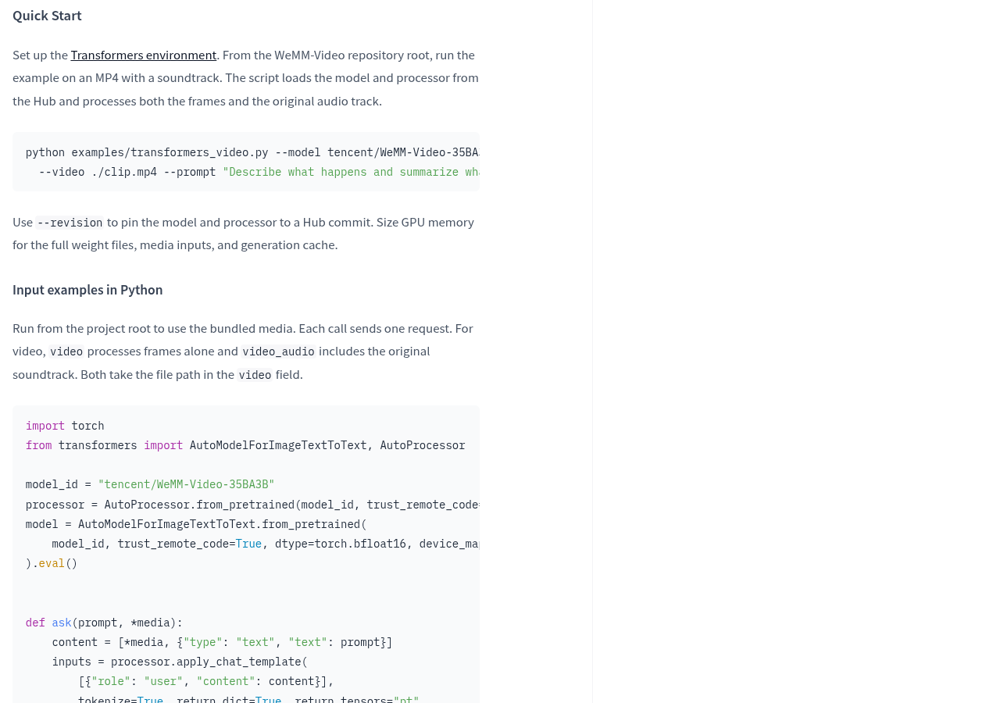
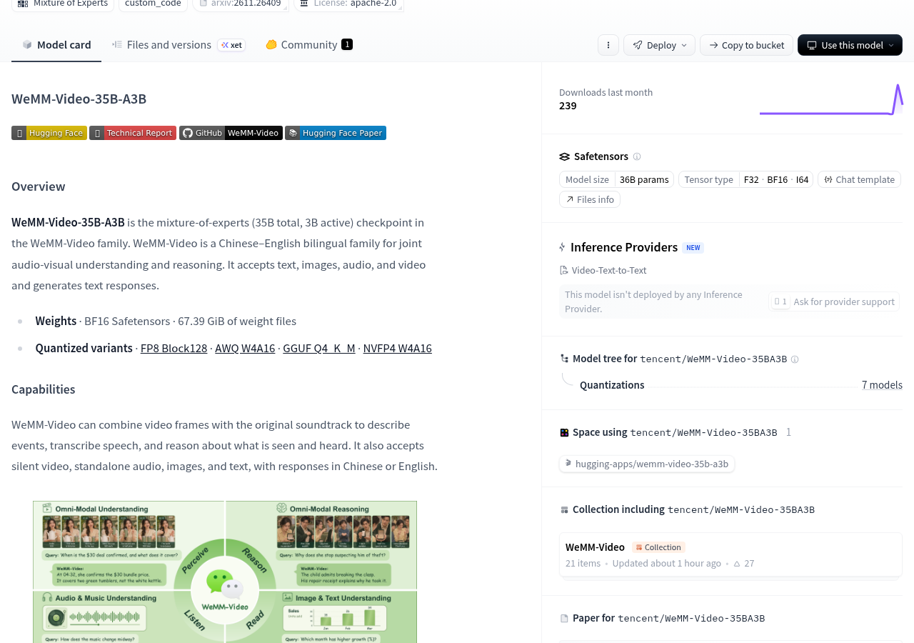
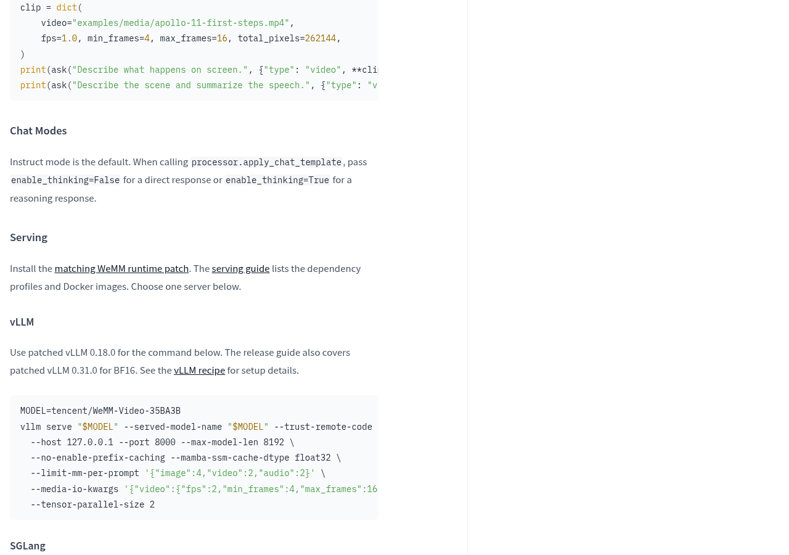
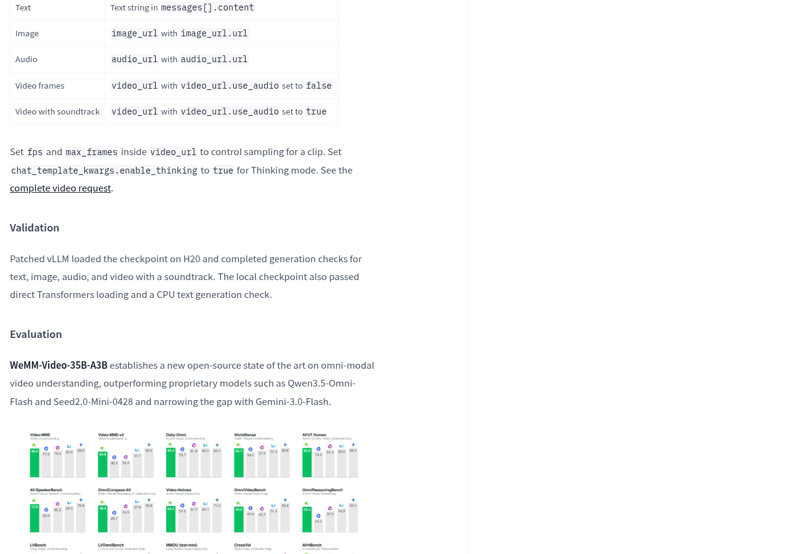

把带原声的视频交给模型，让它同时描述画面、转写语音，再结合所见所闻回答问题——这是腾讯WeMM-Video官方模型卡列出的能力。它接收文字、图片、音频和视频，输出中文或英文文本；它做的是理解视频，不是生成视频。

真正影响使用选择的，是两个放在一起才看得清的条件：WeMM-Video-35BA3B标称总参数35B、激活参数3B，原始BF16权重文件却有67.39 GiB。想把它接进视频整理或内容分析流程，先确认是否需要联合理解声音与画面，再看设备和运行环境能否承接完整模型，不能只盯着“激活3B”。

## 声音是否送进去，会改变它能回答的问题

官方介绍中，WeMM-Video可以结合视频帧与原始音轨描述事件、转写语音，并对视听内容进行推理。它也支持无声视频和独立音频，因此“能接收视频”还不够具体：同一个文件，究竟只送画面，还是连声音一起送，必须在调用时选对。

这和微信里收到一段视频很像：静音看时，能看到人做了什么，却未必知道他说了什么；打开声音后，才有机会把动作与话语对应起来。模型的联合视听理解，也需要两路内容真正进入处理流程，而不是文件有声音就自动算听过。

官方Python示例明确区分了video和video_audio：前者只处理视频帧，后者包含原始音轨。服务接口也通过video_url.use_audio区分是否使用声音。需要整理讲话内容、解释画面与对白关系时，应检查实际走的是带音轨的输入路径。

画面如何采样同样影响结果。官方说明可通过fps和max_frames控制视频采样。可以把它理解成从一段视频里抽出画面交给模型看：抽取方式决定送进去哪些视觉信息。因此，回答遗漏某个动作时，应先检查输入是否包含相关画面，再判断模型是否理解失败。需要这些能力的开发者，可以从[官方输入示例](https://huggingface.co/tencent/WeMM-Video-35BA3B#input-examples-in-python)了解两种路径。

## 激活3B，不代表只需要装下3B

这款模型采用混合专家架构。模型卡标称总参数35B，也就是350亿；激活参数3B，也就是30亿。可以把它想成快递站：货架上存着全部包裹，某次取件只会用到其中一部分。一次取件涉及的包裹少，不代表整个站点只需要那一点货架空间。对应到模型，参与当前计算的参数量和部署时要容纳的完整权重，是两件事。

官方列出的BF16权重文件体积是67.39 GiB，并明确要求为完整专家权重、媒体输入和生成缓存安排显存。文件体积不是可以直接照抄的最低显存门槛；视频与音频输入、生成过程还需要额外空间。官方给出的vLLM和SGLang服务命令均使用两张GPU做张量并行，也就是把模型计算分摊到设备上。

这里还有一个值得留意的口径差异：正文将模型称为35B总参数，页面自动元数据显示36B参数。现有说明没有解释两者的统计关系，不宜自行补成精确的硬件预算。选设备时，应以实际下载文件、所选运行方案及加载结果为依据，而不是从模型名直接推出“某台电脑肯定能跑”。

模型卡列出了FP8、AWQ、GGUF和NVFP4量化版本入口。量化可以理解为用更紧凑的数字表示保存权重，但有一个格式入口，不等于所有设备都已有可用方案。各版本的实际文件、运行时支持、视听功能完整性和硬件要求，仍需分别检查；不能看到GGUF就直接认定Mac已经能完整运行带声音的视频理解。

运行环境也有明确要求：官方服务说明要求安装匹配的WeMM运行时补丁，而非只安装通用推理框架。准备部署时，先沿着[官方服务说明](https://huggingface.co/tencent/WeMM-Video-35BA3B#serving)确认对应方案，再检查依赖和补丁。只按熟悉的通用启动方式尝试，可能漏掉模型所需的适配。

## 现在适合按部署项目评估，别当成现成在线工具

官方模型页已经列出权重文件、加载示例和服务方法，不是只有未来开放的承诺。模型卡标注Apache License 2.0，同时说明第三方组件仍受各自原始条款约束。权重入口、使用许可和运行条件需要分开看：文件开放了，既不代表任意设备都能运行，也不代表部署和使用没有成本。

如果只想打开网页上传视频，目前这份资料还不能提供这样的现成服务承诺。抓取时，Hugging Face页面显示没有推理服务商部署该模型；页面上的下载入口也不能当成已经替读者完成安装。可以先查看[官方模型页](https://huggingface.co/tencent/WeMM-Video-35BA3B)，再根据自身条件决定是否进入部署。

官方报告了在H20上使用修补版vLLM加载模型，并完成文字、图片、音频及带音轨视频的生成检查；另报告了直接通过Transformers加载，以及CPU文字生成检查。这些是官方给出的运行记录。其中，CPU文字生成只覆盖文字路径，不能据此判断普通电脑处理视听视频的速度与可用性。

决定投入部署前，先选一段有权使用、内容熟悉的视频，把想验收的问题写具体：画面中的动作是否描述准确，讲话是否转写正确，声音与动作之间的关系是否解释到位。测试时保留输入方式、采样设置、模型版本、实际耗时和原始回答；这些是待执行的验收动作，不是已经取得的测试结果。

只有画面问题时，先确认纯视频路径是否满足需求；确实需要对白、环境声与画面一起参与判断，再检查带音轨路径的结果。官方榜单可以作为继续了解的线索，真正决定能否进入工作流的，仍是目标视频上的正确性，以及当前设备上的运行表现。

有合适设备、愿意处理运行时适配，又确实需要联合分析声音与画面的开发者，可以把WeMM-Video列入部署候选；只想即开即用，或尚未确认硬件支持的用户，先核对条件更合适。它后续能否成为实用的视频整理工具，值得追问的不是能否复述一段画面，而是加入声音后，能否稳定解决原本答不出来的问题，并且让部署与维护投入值得。

## 官方资料

- [腾讯混元 官方发布说明](https://huggingface.co/tencent/WeMM-Video-35BA3B)

---

## 🧰 我做的工具

这些工具都由我持续维护。预览版会明确标注，下载、更新和已知边界以发行页为准。

> [!info] 黑粉盒子 HyphenBox
> **状态：** 正式迭代
>
> 免费大模型 API 雷达：持续复测可用性，本地统一接口，Key 只存本机
>
> [下载与更新：黑粉盒子 HyphenBox](https://github.com/HackerChi-Hub/hyphenbox-release/releases)

> [!info] 方寸智匣 LocalBrain
> **状态：** 正式迭代
>
> 本地模型的多模态 MCP 工具箱：TTS / Whisper / 视频生成一站接入
>
> [下载与更新：方寸智匣 LocalBrain](https://github.com/HackerChi-Hub/localbrain-releases/releases)

---

> [!quote] 黑粉科技
> **让AI成为你的超能力**
> 本地部署 · 免费白嫖 · 自制软件
> [黑粉科技](https://hyphentech.top)
