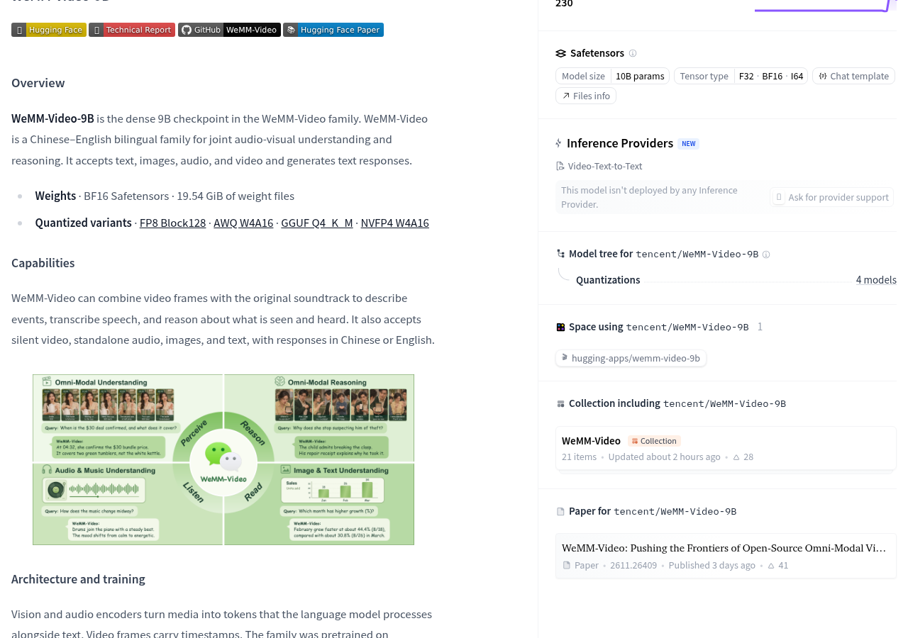
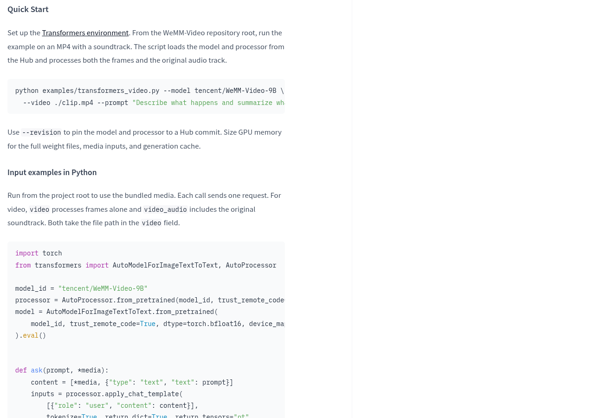
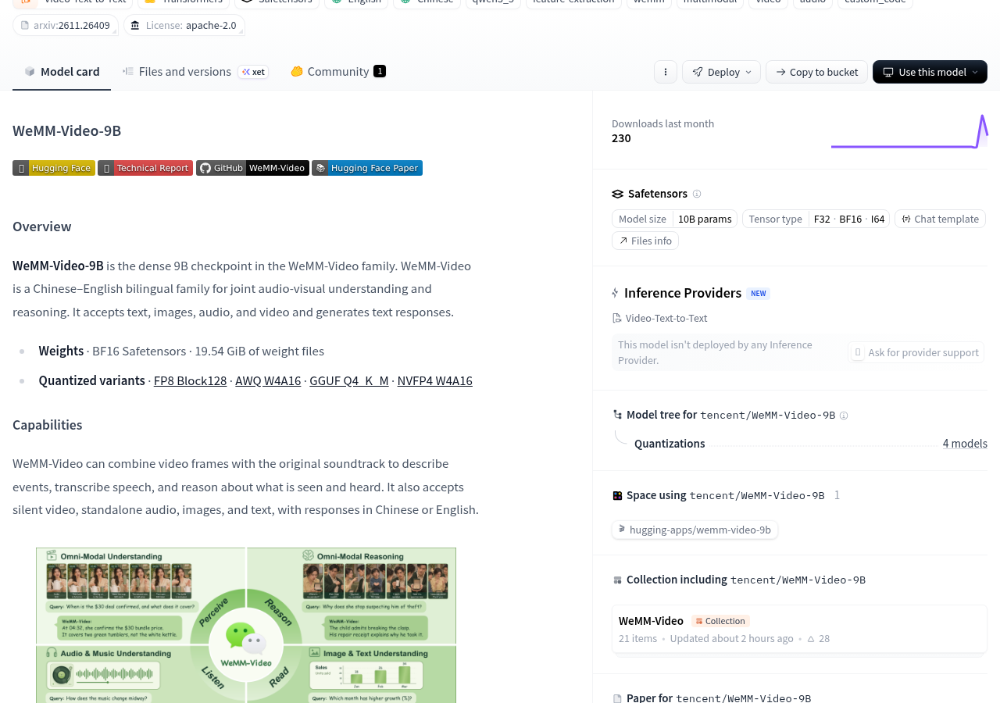
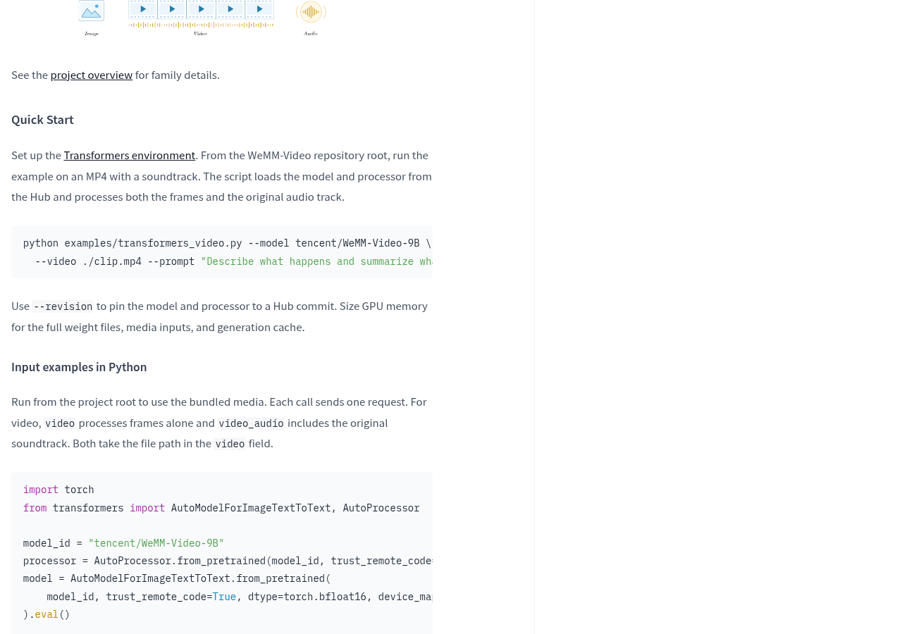
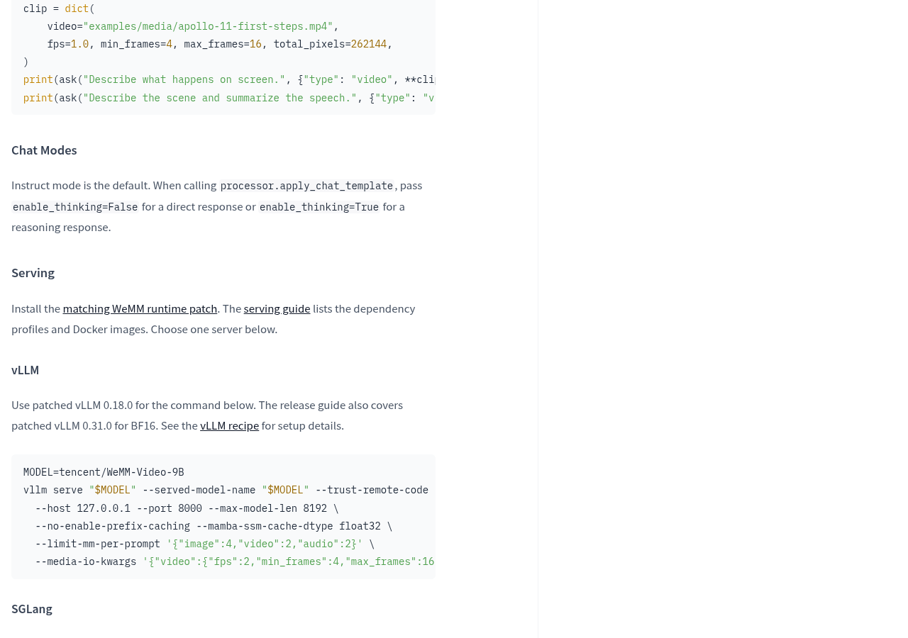
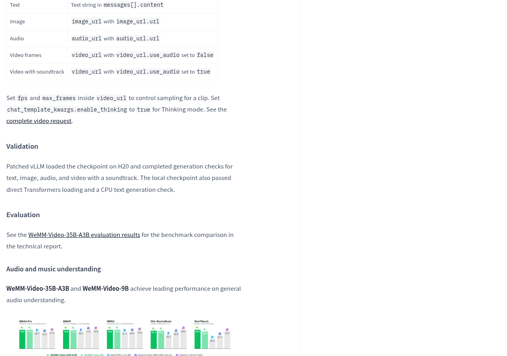

把带讲解的视频交给模型，想要的往往不只是“画面里有什么”，还包括“讲解说了什么、声音和画面能不能对上”。腾讯WeMM-Video-9B的官方模型卡明确写到：它可以结合视频帧与原始音轨描述事件、转写语音，并围绕看到和听到的内容推理，最终输出文字。

真正影响接入选择的，是声音有没有送进去、权重之外还要准备什么，以及部署后怎样检查结果。官方已经列出权重与调用路径；准备接入时，应先确认这些环节，而不是把“支持视频”直接理解成上传文件就能完整分析。

## 想让它听懂视频，先确认原声有没有送进去

官方把WeMM-Video介绍为支持中文和英文的音视频联合理解模型系列。WeMM-Video-9B接受文字、图片、音频和视频，返回文字答案。它适合关注视频内容分析、语音转写和声画联合问答的人；这里的“视频能力”指理解输入内容，不是生成视频。

这有点像在微信里收到一段带讲解的视频：只看截出来的画面，能知道镜头拍到了什么，却听不到讲解。官方Python示例也明确区分了输入方式：video只处理视频帧，video_audio才包含原始音轨。文件里有声音，还需要选对处理方式。

部署为服务后，这个区别仍然存在。官方接口示例通过video_url.use_audio控制是否带入原声，还通过fps和max_frames控制视频抽帧。抽帧可以理解为从视频中挑出画面交给模型，因此验收答案时，也要检查关键动作是否落在实际送入的画面里。

官方说明，视觉和音频编码器会把媒体转换成词元，与文字一起交给语言模型处理，视频帧还带有时间戳。词元可以理解为模型处理内容时使用的小单元，类似一长段微信消息需要拆成可处理的片段；这里的音视频也会先转换，而不是把原文件不加处理地直接交给语言模型。

## 权重已有说明，运行条件还要分别确认

官方模型卡已列出BF16 Safetensors权重，权重文件体积为19.54 GiB，并提供FP8、AWQ、GGUF和NVFP4量化版本入口。对准备自行部署的人，这意味着已经有具体文件格式和部署资料可查，而不只是等待未来开放的预告。

19.54 GiB是权重文件体积，不是整套任务的显存需求。官方要求为完整权重、媒体输入和生成缓存一起预留GPU内存。就像快递柜除了放包裹，还得留出取件操作的位置：模型加载进去以后，处理视频和生成答案仍然需要额外空间，不能只按下载包大小选择设备。

部署环境也有明确要求。官方要求安装匹配的WeMM运行时补丁，并给出了打补丁的vLLM和SGLang路径。打算接入已有服务时，应先检查对应依赖与补丁说明，不能把模型名称换进现有启动命令，就认定环境已经兼容。

许可证方面，模型卡标注Apache License 2.0，同时提醒第三方组件仍受各自原有条款约束。权重文件、使用许可、运行时支持和硬件容量是不同的问题：有文件可取，不代表任意设备都能运行；有模型许可，也仍需查看相关组件的要求。

如果只想打开托管接口直接使用，还要留意服务入口。所提供页面在采集时显示，该模型尚未由Hugging Face的Inference Providers部署。这个状态只说明该平台的这类托管入口，不能据此判断其他渠道是否提供服务。

## 先验收声音与画面，再决定是否接入工作流

官方记录的部署验证包括：打补丁的vLLM在H20上加载模型，并完成文字、图片、音频及带原声视频的生成检查；直接通过Transformers加载和CPU文字生成检查也已通过。这些记录能帮助选择起步路径，但没有给出消费级设备的视频处理速度或完整硬件需求。

准备验证时，可以先沿官方快速开始说明，从项目根目录运行带原声MP4的示例，分别检查画面描述和声音概括是否对应原片。之后再按官方输入区分，观察只送画面与同时送入原声时的回答。对需要声画联合分析的任务，验收重点是答案有没有准确利用相关声音，而不只是写出一段流畅描述。

官方还提供直接回答和推理回答模式。选择模式时，仍应回到同一段原片检查答案：画面事件是否说对，语音转写是否准确，声音与画面的关系有没有依据。对于接入选择，能否在目标环境中重复完成自己的任务，比回答是否写得更长更有意义。

需要部署的人，可以从[官方模型卡与快速开始](https://huggingface.co/tencent/WeMM-Video-9B#quick-start)进入，再查看[运行环境说明](https://github.com/Tencent/WeMM-Video/blob/main/docs/serving.md#runtime-profiles)和[视频请求说明](https://github.com/Tencent/WeMM-Video/blob/main/docs/serving.md#send-a-video-request)。量化版是否适合目标环境、实际处理速度如何，仍需结合对应版本文档和实际运行结果判断。

这类工具是否值得接入，关键在于声音能否为任务补上画面之外的信息。对需要同时核对动作与讲解的工作，WeMM-Video-9B提供了明确的尝试路径。下一步值得验收的是：加入原声后，答案是否更准确地回答了原来的问题，以及这条处理链能否在目标设备上持续运行。

## 官方资料

- [腾讯混元 官方发布说明](https://huggingface.co/tencent/WeMM-Video-9B)

---

## 🧰 我做的工具

这些工具都由我持续维护。预览版会明确标注，下载、更新和已知边界以发行页为准。

> [!info] 黑粉助手 HyphenAssistant
> **状态：** 正式迭代
>
> 手机浏览器接续电脑上的 DeepSeek Harness 会话；需本人配对、电脑与原服务在线，模型费用沿用原配置
>
> [下载与更新：黑粉助手 HyphenAssistant](https://github.com/HackerChi-Hub/hyphen-assistant-releases/releases)

> [!info] 黑粉盒子 HyphenBox
> **状态：** 正式迭代
>
> 免费大模型 API 雷达：持续复测可用性，本地统一接口，Key 只存本机
>
> [下载与更新：黑粉盒子 HyphenBox](https://github.com/HackerChi-Hub/hyphenbox-release/releases)

> [!info] 方寸智匣 LocalBrain
> **状态：** 正式迭代
>
> 本地模型的多模态 MCP 工具箱：TTS / Whisper / 视频生成一站接入
>
> [下载与更新：方寸智匣 LocalBrain](https://github.com/HackerChi-Hub/localbrain-releases/releases)

> [!info] ScreenLex 光影词库
> **状态：** 正式迭代
>
> 看美剧顺手把生词背了，Mac/Windows 双平台，免费
>
> [下载与更新：ScreenLex 光影词库](https://github.com/HackerChi-Hub/screenlex-download/releases)

> [!info] 黑粉录屏 HyphenScreen
> **状态：** 正式迭代
>
> 录屏 + 智能剪辑一体：达芬奇式时间线、自动打码、导出前成片体检，免费
>
> [下载与更新：黑粉录屏 HyphenScreen](https://github.com/HackerChi-Hub/HyphenScreen-Releases/releases)

---

> [!quote] 黑粉科技
> **让AI成为你的超能力**
> 本地部署 · 免费白嫖 · 自制软件
> [黑粉科技](https://hyphentech.top)
