> [!abstract]
> 不摆复杂公式，一文拆透黎曼猜想本来在问什么、网银密码与百万大奖两大误区，以及普通人如何用三道机械裁判驯服 AI。
> 2026-11-23 · 黑粉科技

　　11 月 20 日，数学界和 AI 圈在同一天迎来了剧烈震动。Anthropic 数学研究员 Levent Alpöge 在个人主页 [alpo.ge](https://alpo.ge/remark.pdf) 上放出了一份仅有 **4 页**的简短声明，外加 **14 个**源码压缩包。他宣布自己与 Claude 配合耗时 **6 个礼拜**，完成了悬挂在人类头顶 **167 年**的广义黎曼猜想与标准黎曼猜想的形式化证明。

　　反常的地方在于，他压根没有提交传统的数学期刊长论文。原因他在声明里写得毫不遮掩：如果把 AI 推演过程中的草稿展开成自然语言英文文章，足足有 **25 万页**，连他自己都吐槽那是一堆谁都啃不动的啰嗦废话。于是他干脆只交出了 **1,700 万行**、超过 **17.5 万个**文件的 Lean 4 程序代码。

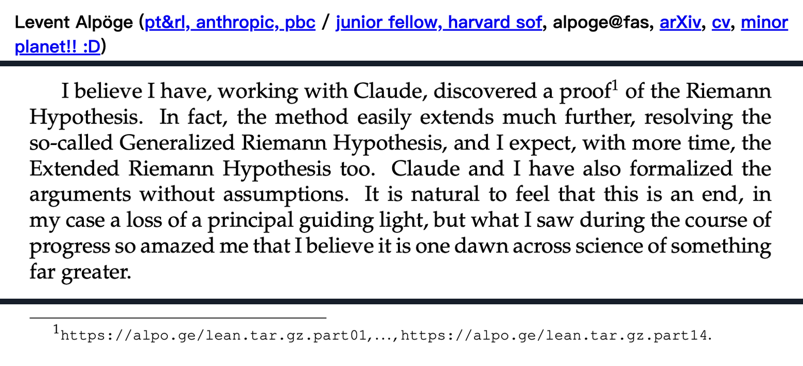

　　仅仅隔了一天，11 月 21 日，最权威的形式化数学组织 Lean 社区与 Mathlib 团队就发布了[官方联合认证声明](https://leanprover-community.github.io/blog/posts/riemann-hypothesis/)。全球几十个独立研究组连夜在各自电脑上从头编译了全套源码，最终以**零报错**全部通过：这 **1,700 万行**代码没有偷换命题，也没有夹带私货外挂，锁定的确实就是标准版黎曼猜想。

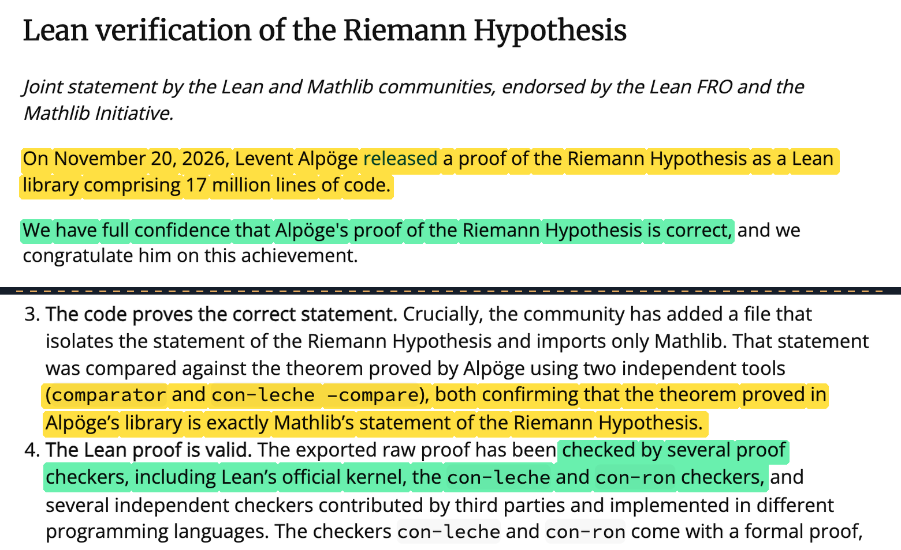

> [!important]
> 先按下刷屏的热闹，解决三个最实际的问题：第一，黎曼猜想本来什么意思，明天网银和手机密码会集体崩盘吗？第二，平时写几十行脚本都能胡编接口的 AI，凭什么啃下 167 年难题还不翻车？第三，这件事和普通人明天上班用 AI 有什么直接关系？

## 一、不摆复杂公式：一分钟看清黎曼猜想与两大热传误区

　　把高冷的学术术语剥掉，黎曼猜想真正的主角其实是小学算术里就见过的**素数**——也就是 **2、3、5、7、11、13** 这些只能被 **1** 和它自己整除的自然数。你可以把素数看作数字世界里的底层乐高积木，任何一个大于 1 的整数，都能唯一拆解成几块素数相乘（比如 **12** 拆成 **2 × 2 × 3**，**30** 拆成 **2 × 3 × 5**，**2026** 拆成 **2 × 1013**）。

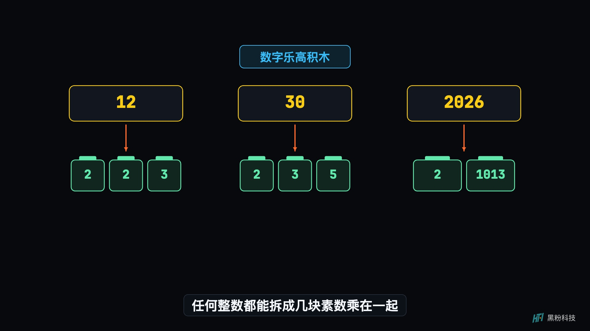

　　真正让数学家抓狂了 **2,000 多年**的难题是：这些素数积木在数轴上冒出来的节奏，表面看去像喝醉了酒一样毫无章法。有时候两块积木紧挨着出现，比如 **11** 和 **13**、**17** 和 **19**；可有时候往后走很远一段荒漠，才冷不丁蹦出下一块。两千年来数论学者死磕的核心追问只有一句：**表面乱蹦的素数背后，到底藏没藏着一套严格的暗线秩序？**

　　**1859 年**，德国数学家黎曼想出了一个神来之笔。他造出了一面数学光学棱镜（黎曼 Zeta 函数），把原本数不清、抓不准的素数颗粒分布，折射成了一张连续的声音频谱图。以前数积木让人头疼，折射之后就变成了决定波动起伏节奏的一组关键音符——数学上把这些关键落点称为**非平凡零点**。

　　翻译成画面，黎曼猜想其实只有极其干脆的一句话：**在这张数学调音台的正中央，立着一条写着 0.5（即 1/2）的竖直中轴线，所有关键音符必须一个不落、老老实实排在这条 0.5 中轴线上，半步都不许跑偏。**

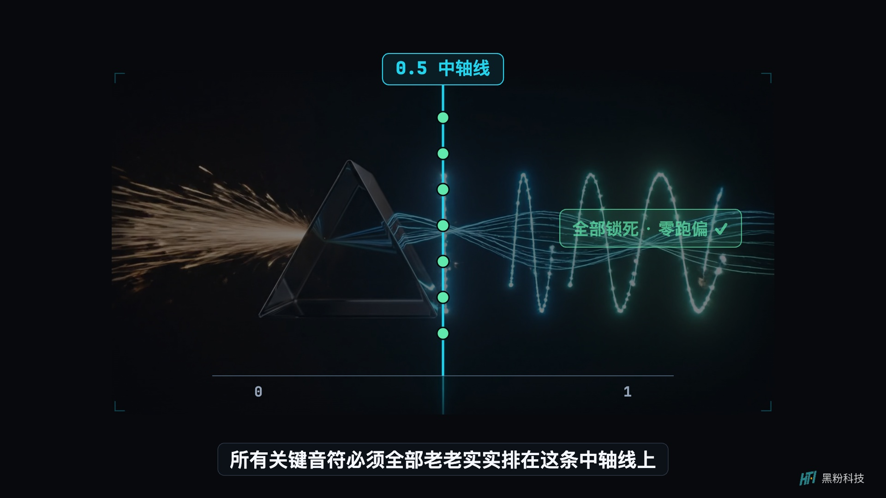

　　只要所有零点全部锁死在 **0.5** 这条线上，就意味着素数分布的起伏误差被死死按在自然界允许的最均匀极限之内，永远不会失控乱飞。过去 **167 年**里，数学界实在等不及它被证出来，干脆把“假设黎曼猜想成立”当成临时地基，在上面硬生生盖起了 **1,000 多座**现代数学定理高楼。如今机器编译宣布地基被彻底浇实，整个学术圈自然像经历了一场大地震。

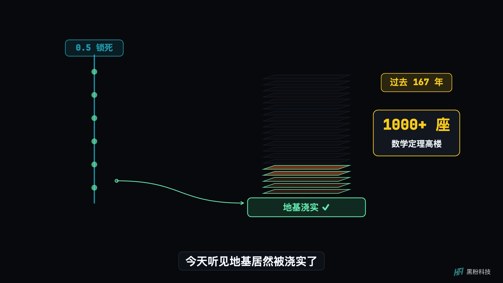

### 误区一：素数摸透了，网银、HTTPS 和比特币明天要崩盘？

　　消息一传开，社交平台上最吓人的传言就是“现代密码学靠大素数撑腰，黎曼猜想一破，网银密码、HTTPS 网页加密和比特币签名明天就要全线裸奔”。**这个担心完全多余。**

　　打个最直观的比方：生态学家用激光雷达测清了整片原始森林平均每公里长多少棵树，不等于他手里突然多了一把能在一秒钟内锯断参天铁树的万能电锯。黎曼猜想刻画的是素数在宏观尺度上的平均分布密度有多均匀，**压根不提供快速分解超大合数（RSA 加密锁的核心壁垒）的实用算法**。你手机和银行卡里的加密锁，今天照样稳稳当当。

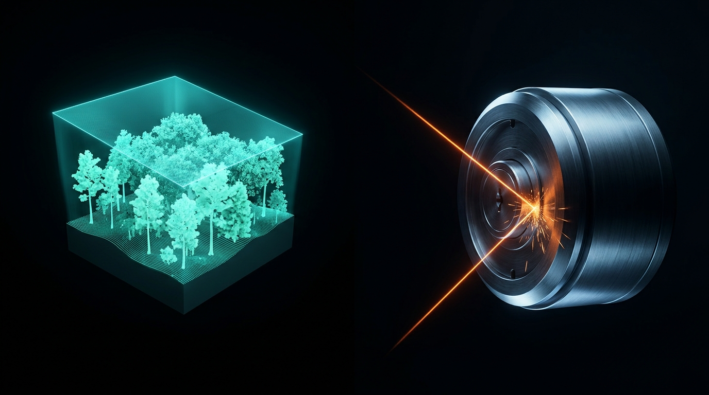

### 误区二：作者已经稳拿克雷研究所 100 万美元千禧年大奖？

　　另一个传得很广的说法是恭喜作者喜提 **100 万美元**奖金。去克雷数学研究所（Clay Mathematics Institute）[千禧年大奖官方页面](https://www.claymath.org/millennium/riemann-hypothesis/)核对一眼就能看到，黎曼猜想词条旁至今依然清清楚楚挂着未解决状态。

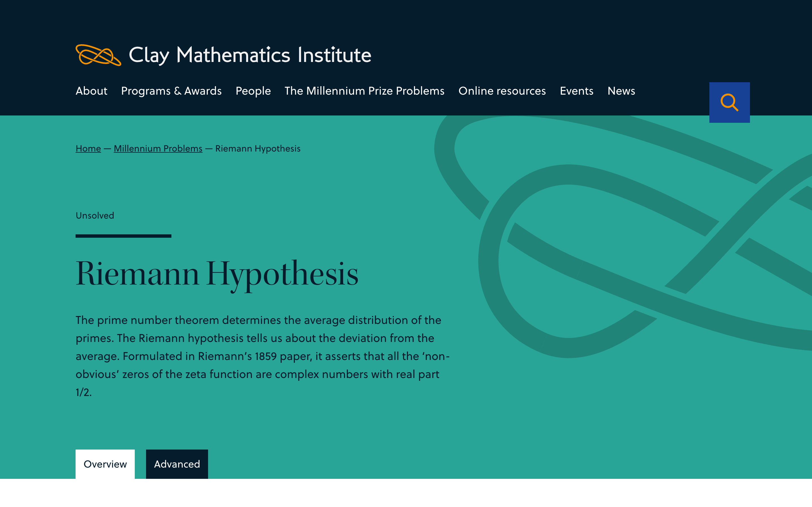

　　克雷研究所的发奖章程写得很死：光往个人网页扔一堆源码压缩包不算数，成果必须先在合格的传统数学期刊通过同行评议正式发表，随后还得扛住全球数学界足足 **2 年**的公开检验与挑刺期，才有资格启动授奖程序。想端走这 **100 万美元**，流程还长得很。

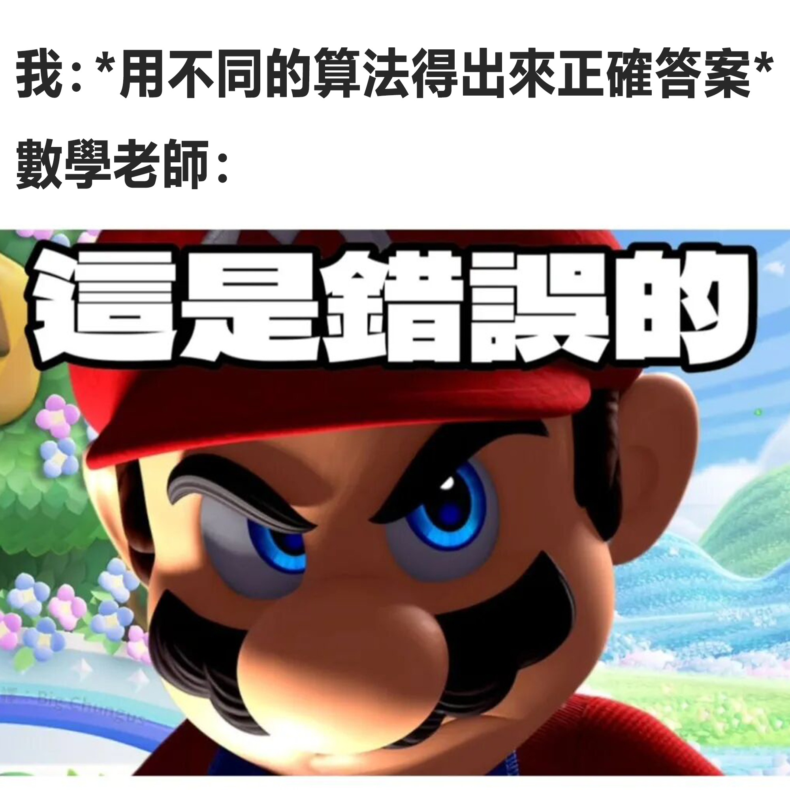

## 二、全人类都没读完 1,700 万行代码，凭啥一天就敢亮绿灯？

　　紧接着就是更深一层的疑问：Alpöge 在声明第 **2** 页自己都坦白，连他本人目前也还没把周边那么多数学枝节完全消化透。既然全世界几乎没人从头读完过这套代码，权威社区凭什么只隔了 **1 天**就敢拍胸脯背书？

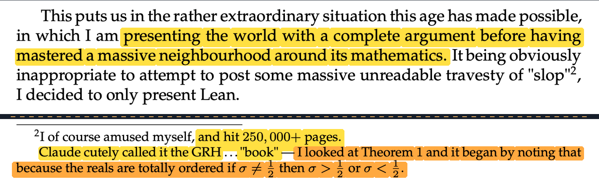

　　答案就藏在 **25 万页自然语言论文**与 **1,700 万行形式化代码**的物理结构差异里。如果让大模型用英语写出 **25 万页**证明长文，那就像徒手糊起一座摇摇欲坠的废纸塔——审稿教授看前 **50 页**就已经眼花了，只要 AI 在第 **12 万页**悄悄混进一句“此处同理可得”，或者暗中偷改了一个边界条件，整座纸塔逻辑早就塌了，人类审稿人也根本抓不到现行。

　　Alpöge 自己看了 AI 生成的那部名为《广义黎曼大书》的文字草稿都忍不住发笑：第一章定理一居然从“实数大于 **1/2** 或者小于 **1/2**”这种正确的废话开始啰嗦。于是他果断把 **25 万页**文字草稿锁进抽屉，只放出 Lean 4 形式化证明代码。这相当于把虚浮的纸塔，改造成 **1,700 万颗**严丝合缝咬合的钛合金齿轮：只要少写 **1 个**括号，或者某一步推导偏了 **0.01 毫米**，编译器齿轮当场咬死报错，整台机器原地停工，绝无半点蒙混过关的余地。

　　为了彻底堵死 AI“偷改考题”或“塞作弊公理”的偏门，Lean 社区、Mathlib 团队与麻省理工学院（MIT）的数论学者连夜架起了**四道考场安检门**：

| 考场安检关卡 | 防范的作弊风险 | 实际执行的硬核查验手段 |
| --- | --- | --- |
| 第一道门：查考卷真伪 | 防止把百年大题偷偷改成简单题交卷 | 编写独立隔离脚本，动用两套比对工具与 Mathlib 官方题库多年审定的标准定义逐字对齐 |
| 第二道门：搜口袋查私货 | 防止暗中塞入未经证明的赖皮假设或留白 | 全库公理依赖扫描，确认零作弊留白，仅依赖 3 条最基础的常规数学公理 |
| 第三道门：冷面考官交叉复核 | 防止单套官方编译器自身暗藏底层漏洞 | 除 Lean 官方内核外，动用多种不同编程语言重写的第三方检查器逐行重放复核 |
| 第四道门：全球独立重编 | 防止作者本地环境存在不可复现的缓存巧合 | 全球几十个团队在各自机器从零编译 17.5 万多个文件，输出结果一字节不差全部绿灯 |

> 查验记录整理自 Lean 社区与 Mathlib 2026 年 11 月 21 日联合认证声明

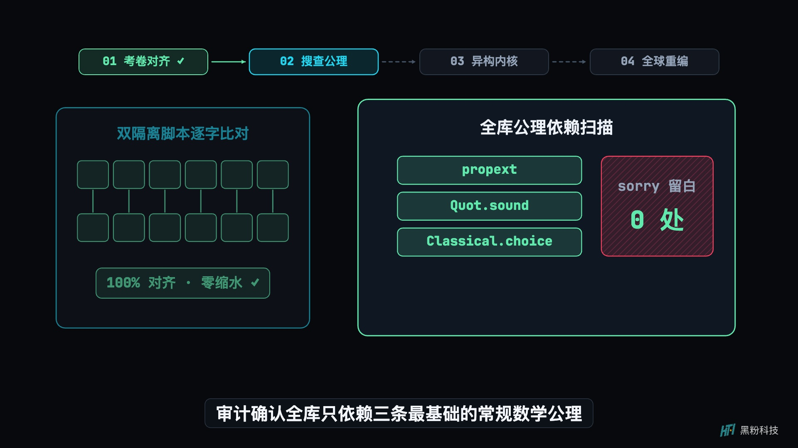

　　过去人工审一篇顶级数论突破往往要熬上 **3 到 5 年**，而这四位冷面机器考官只花了 **1 天多**，就把 **1,700 万颗**逻辑铆钉逐颗拧紧核验完毕。

## 三、平时爱胡编的大模型，为什么这次一步都没踩空？

　　弄清了防作弊机制，真正值得所有技术人琢磨的工程秘密就浮出水面了：平时咱们在网页聊天框里让大模型改个软件，它都经常一本正经编造出根本不存在的函数名来糊弄人；为什么拉去攻坚 **167 年**的数学圣杯，它反而能连续推进几万步都不踩空？

　　根源在于，**裸聊模式和验证闭环压根不是同一种物种。**单独和自然语言模型对话，好比让一位脑洞极大、又极怕冷场的速写手蒙着眼睛往下画画。哪怕每一步推理只有 **1%** 的走神概率，在没有任何外部标尺纠正的情况下连续往下画几万步，误差也会像滚雪球一样指数级放大，到了中后段必定彻底跑偏崩溃。

　　但在 **Claude + Lean 4** 的工程流水线里，狂飙突进的速写手身旁，寸步不离地坐着一位铁面无私的机械质检员。这位质检员手里攥着游标卡尺，根本听不懂任何漂亮客套话：Claude 负责高频试探各种数论变换与跨领域组合；每吐出几行推导步骤，Lean 4 编译器就在几毫秒内卡尺一卡，一旦发现类型或条件接不上，当场亮红灯打回重写，直到每一颗齿轮严丝合缝咬合才放行下一段。

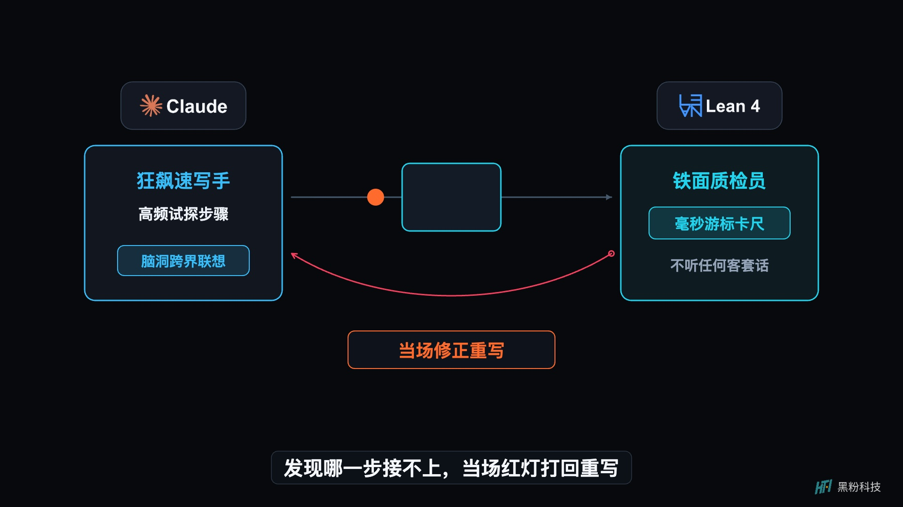

　　这套组合拳吃透了逻辑世界里最丰厚的一份**不对称红利**：在黑暗中凭空想出一条正确证明路径难如登天，但拿到现成步骤之后，让机器逐行检查合不合法却便宜得惊人。大模型补上了高速试错与跨界联想的火力，形式化编译器兜住了零容忍校验的铁底，两边一咬合，困扰行业多年的幻觉直接被死死锁在了大门之外。

　　翻开菲尔兹奖得主陶哲轩（Terence Tao）在 **11 月 20 日**发布的[最新分析博文](https://terrytao.wordpress.com/2026/11/20/unforced-euler-singularity-unforced-navier-stokes-singularity-and-the-generalized-riemann-hypothesis/)就能看清，这次突破绝非 AI 偶然中了 **1 次**彩票，而是一条清晰可见的**三级加速阶梯**：

- **第一阶梯（无外力三维欧拉方程奇点）**：研究团队借助 AI 拿下后，不仅 Lean 代码过了验证，写出来的数学论文人类学者也能顺畅读懂，好比人与 AI 并肩陪跑；
- **第二阶梯（三维纳维-斯托克斯方程奇点）**：同属千禧年大奖级别，人类还能看清总体策略背影，但大量繁琐段落已经必须靠机器形式化兜底，传统论文还得慢慢打磨；
- **第三阶梯（广义黎曼猜想）**：AI 在终点线前直接把人类选手套圈甩出视野之外，率先交出纯机器可验的 1,700 万行代码。

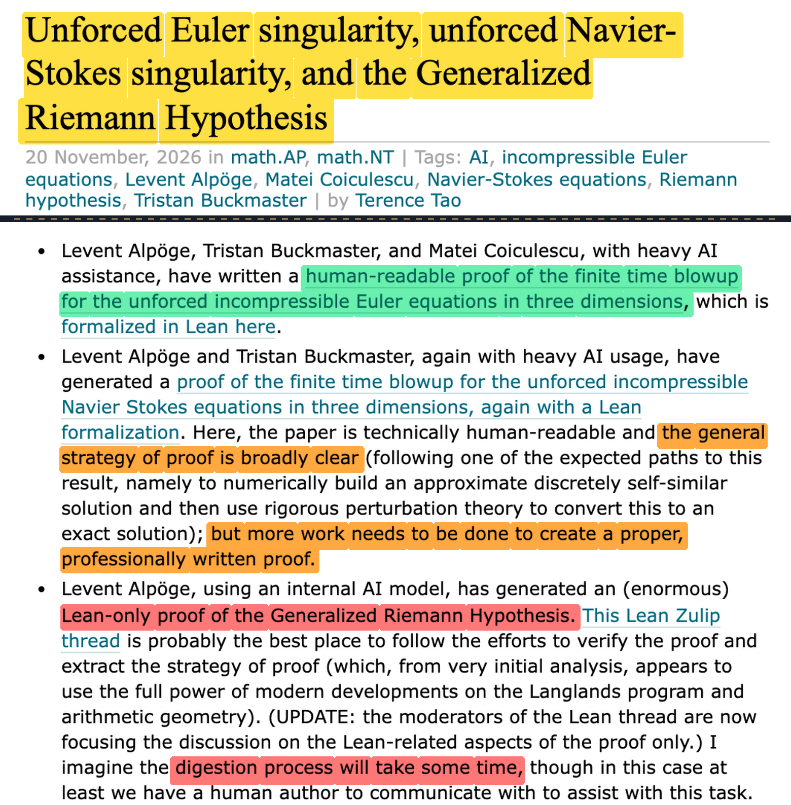

　　在 **11 月 15 日**那个决定性的周日深夜，Alpöge 在声明第 **1** 页留下了一段极具画面感的自白：临近终点线时，Claude 彻底脱离了他的掌控节奏，像飞起来、跳起舞、闪着光一路冲过终点，把他远远甩在身后。激动之余，他半夜小心翼翼发消息试探 Anthropic 掌门人 Dario Amodei：“假设我真的摸到了点大东西，能不能往外公布？”

　　这步棋背后的分寸感非常微妙。眼下 Anthropic 正卡在巨额估值冲刺上市的敏感窗口期，公司官方一旦敲锣打鼓开发布会高调认领“攻克百年数学圣杯”，哪怕表述稍有瑕疵都极易惹出合规与舆论风波；反倒是允许研究员以个人身份把 **4 页**说明和 **14 个**代码包静静挂在简陋的个人主页上，不搞公关喧哗、任凭全球数学家自己拉代码重编，结果用最冷硬的绿灯输出赢下了全场口碑。

　　学术圈的震动与纠结也随之推向高潮。量子计算学者 Scott Aaronson 写下了那篇刷屏评论[《随机鹦鹉显然证明了黎曼猜想》](https://scottaaronson.blog/?p=10344)，用最辛辣的反讽回敬了过去几年把大模型贬为“随机鹦鹉”的论调；而陶哲轩也清醒地点破了眼下的新尴尬：**计算机只花 1.5 天就把逻辑全验通了，可全人类要想真正读懂这 1,700 万行代码背后到底动用了什么精妙数学直觉、再把它消化成能教给下一代学生的教材，少说还得啃上好几年。**

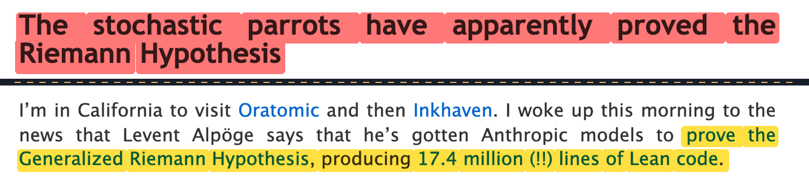

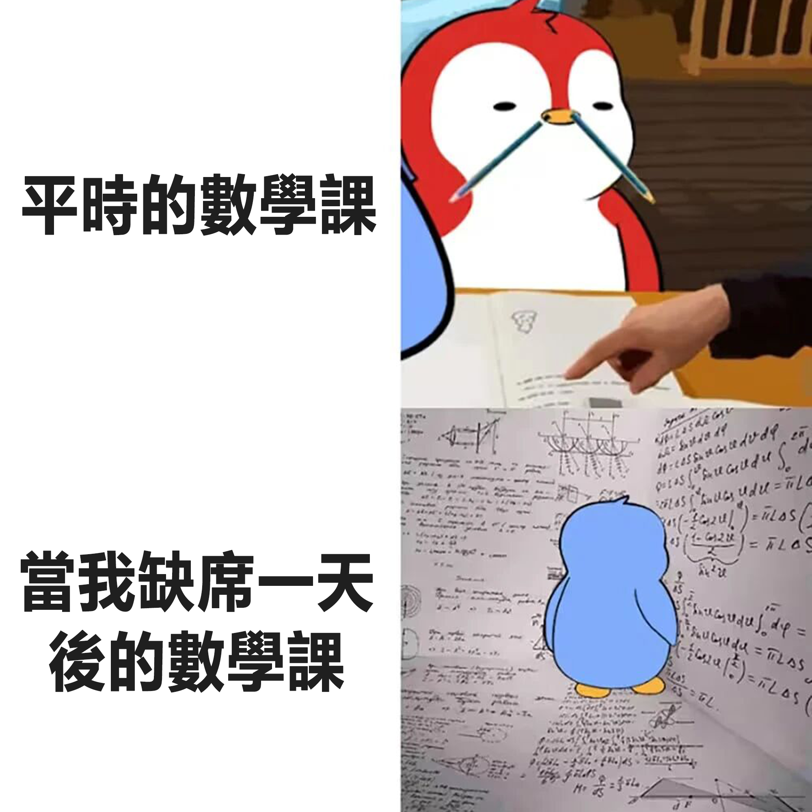

## 四、落回普通人桌面：别把提示词写成散文，给 AI 装上机械裁判

　　把视线拉回咱们自己每天面对的电脑桌面。这场高耸入云的数论突破，对普通人和开发者日常用 AI 干活到底有什么实实在在的启发？

　　**第一，趁早丢掉“AI 只会拼接网上旧题库”的老印象。**黎曼猜想挂了 **167 年**，互联网语料库里没有任何一份现成标准答案可抄，配齐形式化验证闭环后照样能蹚出新路。这就立下了一条铁律：往后只要你手头的工作存在**清晰客观的判定标准**——比如代码能不能编译通过、网页按钮点不点得动、财务表格算出来平不平——AI 迟早会捅穿普通人类专家的效率天花板。

　　**第二，决定日常用 AI 水平高低的分水岭，已经从“谁更会哄模型”变成了“谁懂得装机械裁判”。**平时不管你是调 Claude、接免费云端 API，还是在自己电脑显卡上跑本地开源小模型，千万别盲信聊天框里那句自信满满的“任务已全部完成”。拿日常改软件或批处理数据来说，明天就能直接照抄三道低成本检查关卡：

- **第一关（门口静态校验）**：开启强类型检查与格式静态扫描，把拼写错、空指针和假接口直接掐死在进门处；
- **第二关（红线自动单测）**：给核心函数配上固定输入输出的自动测试脚本，跑不过红线不让人肉擦屁股，直接把报错日志塞回给模型自动重写；
- **第三关（结果边界抽检）**：批量改表格或跑脚本后，挂一段几十行的小核对脚本专门清点文件行数、空缺字段与极值范围。

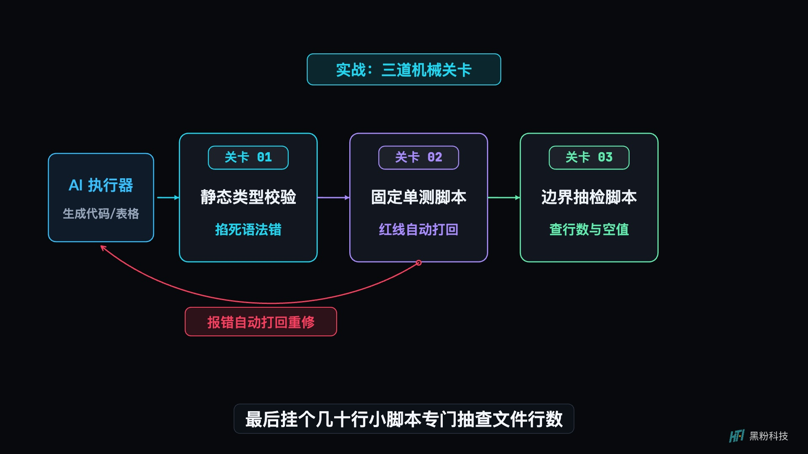

　　只要把“报错自动打回重修”的小闭环搭起来，哪怕是跑在你自己本地电脑上的轻量开源模型，实际交付稳健度也能立刻蹿升一大截。

　　**第三，一个谁都绕不开的新考题已经摆上了桌面。**试想不久之后就会在无数企业上演的一幕：AI 帮团队写出了几十万行核心业务代码，全套自动化测试一路绿灯、线上性能跑得飞快，可整个部门里没有一位工程师能从头到尾讲清它内部到底是怎么绕过去的。到了按下上线开关的那一刻，这个字到底谁敢签？一旦现实世界出了极端事故，责任又该算在谁头上？

> [!summary] 写在最后
> 黎曼猜想被计算机验证通过，今天没有偷走任何一张银行卡的密码；它真正撬动的，是延续了几千年“只有人类亲眼看懂才算突破”的旧前提。编译器可以替逻辑正确性签字，但现实世界的风险依然要由人来兜底——往后谁能把大胆的好想法装进严苛的机械验收框里，谁就先一步握住了下一轮效率革命的主动权。

## 主要查证来源

- [Levent Alpöge 个人声明与 14 分卷源码入口 (Remark)](https://alpo.ge/remark.pdf)
- [Lean 与 Mathlib 社区联合验证声明](https://leanprover-community.github.io/blog/posts/riemann-hypothesis/)
- [Terence Tao：三维欧拉、纳维-斯托克斯与广义黎曼猜想对比分析](https://terrytao.wordpress.com/2026/11/20/unforced-euler-singularity-unforced-navier-stokes-singularity-and-the-generalized-riemann-hypothesis/)
- [Scott Aaronson：随机鹦鹉显然证明了黎曼猜想](https://scottaaronson.blog/?p=10344)
- [Clay Mathematics Institute 千禧年大奖黎曼猜想官方状态页](https://www.claymath.org/millennium/riemann-hypothesis/)

---

## 🧰 我做的工具

这些工具都由我持续维护。预览版会明确标注，下载、更新和已知边界以发行页为准。

> [!info] 黑粉盒子 HyphenBox
> **状态：** 正式迭代
>
> 免费大模型 API 雷达：持续复测可用性，本地统一接口，Key 只存本机
>
> [下载与更新：黑粉盒子 HyphenBox](https://github.com/HackerChi-Hub/hyphenbox-release/releases)

> [!info] 方寸智匣 LocalBrain
> **状态：** 正式迭代
>
> 本地模型的多模态 MCP 工具箱：TTS / Whisper / 视频生成一站接入
>
> [下载与更新：方寸智匣 LocalBrain](https://github.com/HackerChi-Hub/localbrain-releases/releases)

---

> [!quote] 黑粉科技
> **让AI成为你的超能力**
> 本地部署 · 免费白嫖 · 自制软件
> [黑粉科技](https://hyphentech.top)
