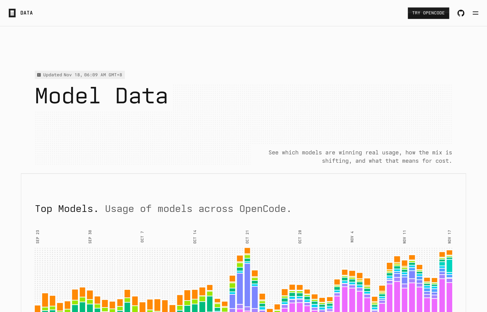
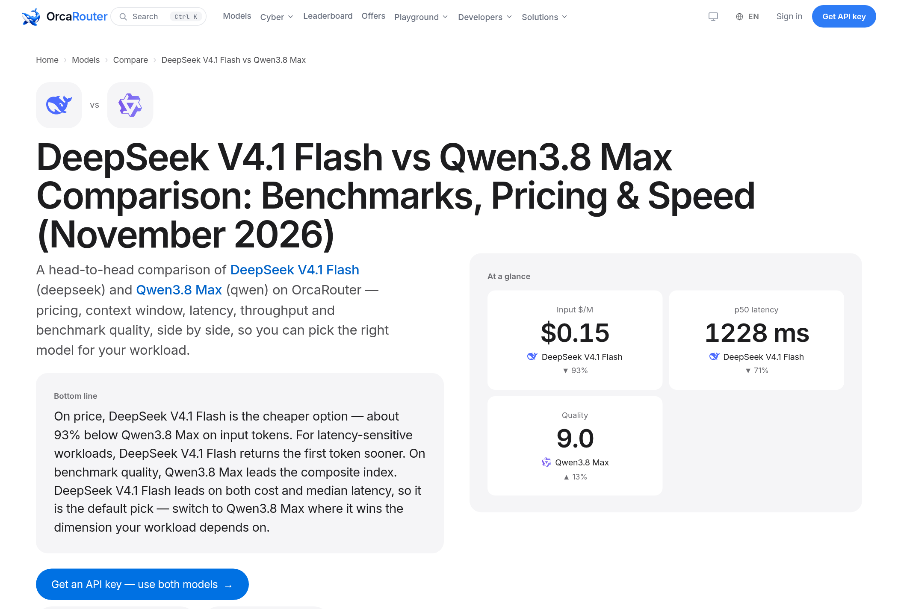
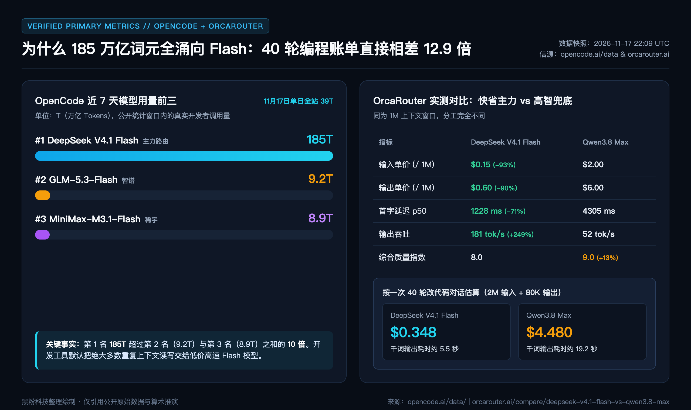
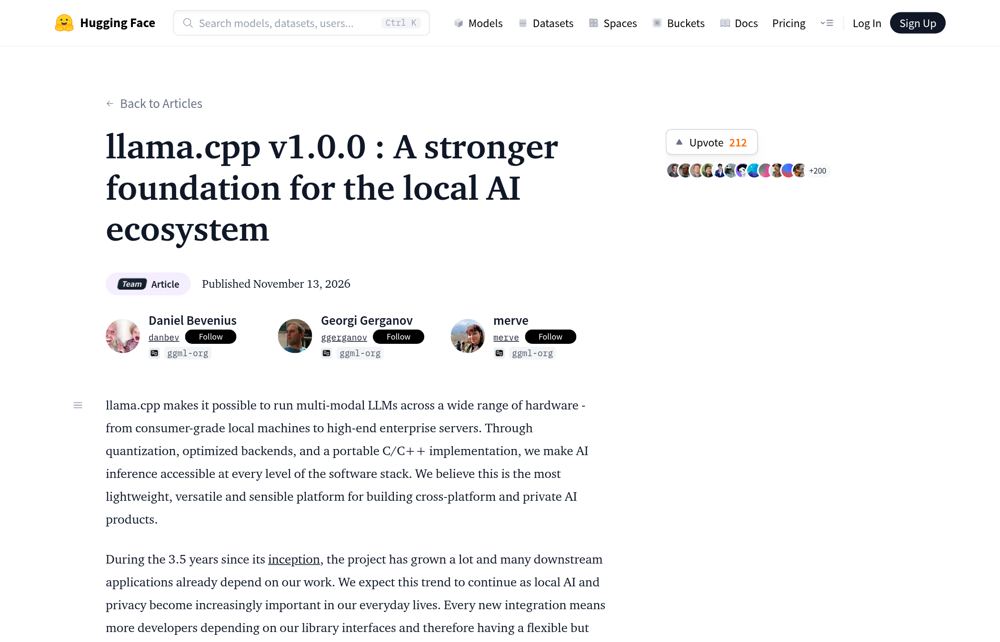
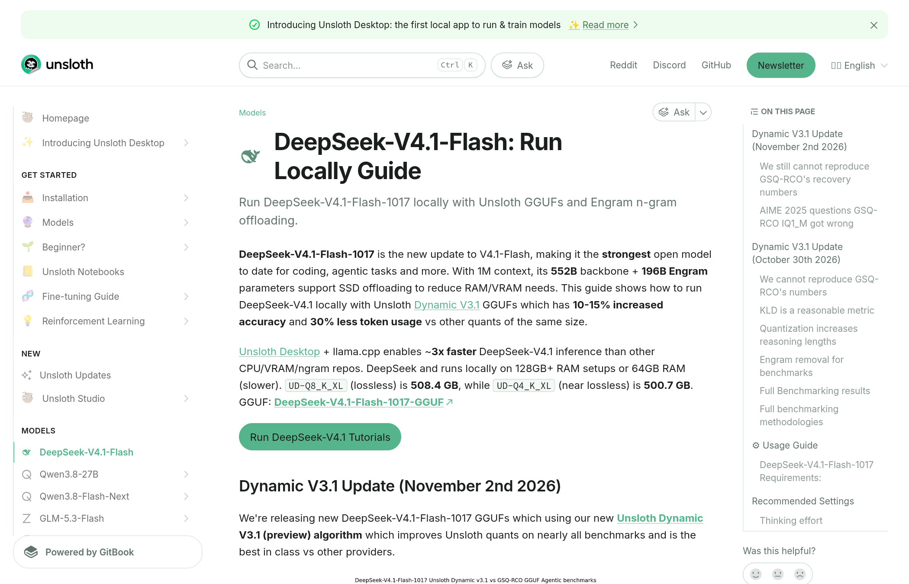
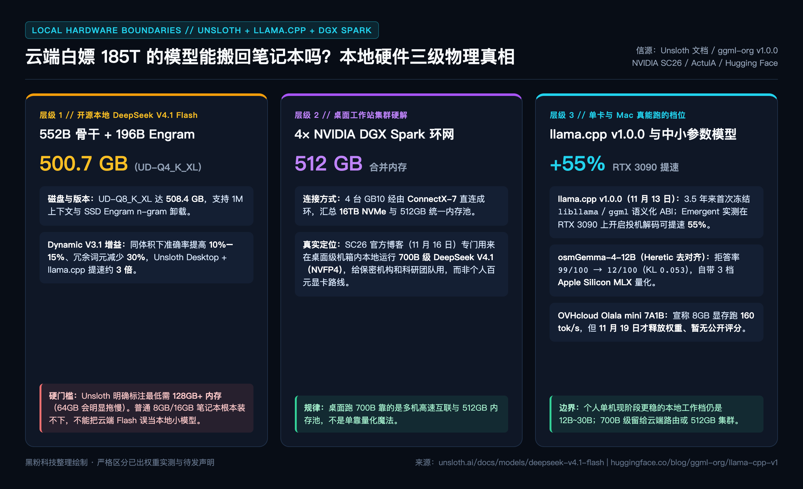
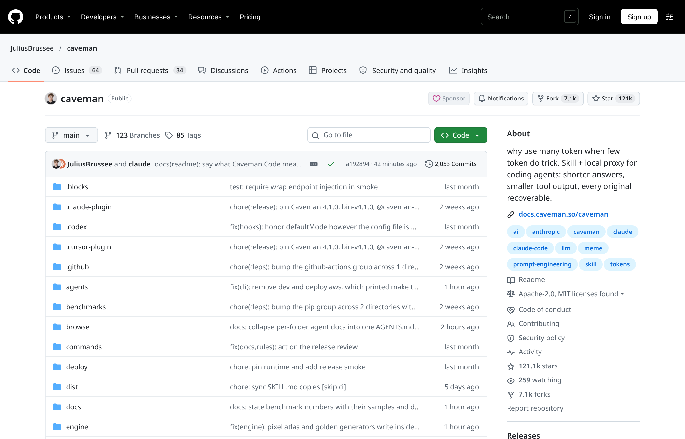

> [!abstract]
> 把 OpenCode 公开用量、Unsloth 本地 500.7GB 量化文档与 12.1 万星 caveman 仓库摊在同一张桌上算清
> 黑粉科技 · 2026-11-18

　　刷到今天 AI 编程圈的一组公开数据时，不少朋友第一反应就是成本快归零了。OpenCode 数据看板显示，过去 7 天全球开发者把 **185 万亿词元**（185T）投给了 **DeepSeek V4.1 Flash**；几乎同时，能给智能体省 65% 输出词元的开源技能 caveman 在 GitHub 冲到 **121,053 颗星**，llama.cpp 也发了正式的 v1.0.0。

　　但你顺手把 DeepSeek-V4.1-Flash-1017 的本地量化文档点开，数字画风当场反转：就算切到 **UD-Q4_K_XL**，磁盘还要占掉 **500.7 GB**，Unsloth 官方标出来的最低内存要求依然是 **128GB 以上**。一边是云端狂跑上百万亿词元和动辄省 65% 的截图，另一边是笔记本根本塞不下的物理门槛，这中间哪些钱真省进自己腰包、哪些只是把开销挪了个地方，咱们把一手公开文档和源代码逐个打开算一遍。

## 一、OpenCode 七天 185T：开发工具为什么把主力流量全切给 Flash

　　先看 OpenCode 官方看板截至 2026 年 11 月 17 日 22:09 UTC 的 7 日公开统计。

　　全站单日在 11 月 17 日冲上 **39 万亿词元**（16 日是 38T），近 7 天排名前三清一色是快速路由档位：**DeepSeek V4.1 Flash** 独揽 **185T**，第二名智谱 GLM-5.3-Flash 为 **9.2T**，第三名稀宇 MiniMax-M3.1-Flash 为 **8.9T**。第一名单独跑出的用量，已经超过第二名和第三名加起来（18.1T）的 **10 倍**。

　　这么悬殊的倾斜，主要原因是编程智能体的真实计费结构变了。你在终端里改一行功能，代理每跑一轮都要把工程目录、报错堆栈、前几轮对话历史重新塞进上下文发给模型，真正烧钱的大头往往不是最后吐出来的几百字代码补丁，而是每一轮重复重传的输入上下文。

　　拿 OrcaRouter 公开页上的 **DeepSeek V4.1 Flash** 和高位旗舰 **Qwen3.8 Max** 对着看就能明白。两款都在 1M 上下文窗口这一档，可单价和响应速度完全在两条线上：Flash 输入每百万词元 **$0.15**、输出 **$0.60**，p50 首字延迟 **1228 毫秒**，流式吞吐 **181 token/s**；Qwen3.8 Max 输入 **$2.00**、输出 **$6.00**，p50 延迟 **4305 毫秒**，吞吐 **52 token/s**。

　　按照公开单价和吞吐做个直接算术推演：假设一次连续 40 轮的代码修改对话累计消耗 200 万输入词元、8 万输出词元，全走 **DeepSeek V4.1 Flash** 的总费用大约是 **$0.348**（约合人民币两块半），每输出 1000 个词元等待约 5.5 秒；换成 **Qwen3.8 Max**，同样这 40 轮要 **$4.480**，账单拉高将近 **12.9 倍**，每 1000 词元等待也拉长到约 19.2 秒。

　　这也不意味着高位大模型就被淘汰了。同一张 OrcaRouter 对照表里，**Qwen3.8 Max 的综合质量指数给到 9.0**，比 Flash 的 **8.0** 整整高出 **13%**。实际项目里常见的稳妥搭配，是让 Flash 扛住 90% 的读文件、跑测试、修语法循环，遇到跨模块重构或死活过不去的架构卡点，再切一两次 9.0 档的旗舰收口。省出来的真钱，靠的是按节点分级路由，不是靠一味降配。

## 二、搬回本地先撞内存墙：500.7GB 量化档与笔记本 12B 的真实界线

　　云端用量这么猛，很多人顺手就搜「DeepSeek V4.1 本地部署」，结果把两类完全不同量级的硬件混进了一个筐里。这周本地推理圈确实出了硬核进展：11 月 13 日，ggml-org 在 Hugging Face 博客正式发了 **llama.cpp v1.0.0**。这个撑起开源端侧推理的底层项目跑了三年半，第一次把 libllama 和 ggml 的 C 接口推进语义化版本冻结，后面做客户端封装和升级依赖，总算不用三天两头跟着主干拆重构。

　　速度层面也有实打实的公开测试。Emergent 这几天基于 llama.cpp v1.0.0 做了单卡测试：在老牌 24GB 显存的 **RTX 3090** 上打开投机解码，生成速度最高拉出 **55%** 的涨幅。

　　同时 Unsloth 发布的 **Dynamic V3.1** 量化方案在文档里给出对比，同体积下准确率能往上提 **10% 到 15%**，输出阶段少废话约 **30%** 词元；配合 Unsloth Desktop 跑 llama.cpp 的 CPU + 显存 + n-gram 卸载，推理效率比其它常规卸载工具快出大约 **3 倍**。

　　可你真按文档去拉 DeepSeek-V4.1-Flash-1017 的权重，马上就会撞上物理参数墙。它的本体是 **552B 主干外加 196B Engram 参数**，即使依托固态硬盘来做 Engram n-gram 卸载，UD-Q4_K_XL 依然要占用 **500.7 GB** 存储，完整一点的 UD-Q8_K_XL 到 **508.4 GB**。

　　Unsloth 页面白纸黑字写着最低需要 **128GB 以上系统内存**，64GB 内存虽然能强行挂载但速度会明显往下掉。普通 8GB 显存或者 16GB～32GB 内存笔记本，现阶段压根接不住这尊大佛。

　　桌面想稳稳塞进 700B 级权重，行业里给出的方案也不是靠某一段魔法量化代码，而是堆硬件。NVIDIA 在 11 月 16 日 SC26 博客里刚秀过方案：把 **4 台 DGX Spark（GB10）用 ConnectX-7 高速网卡串成桌面环网**，合并出 **512GB 统一内存池和 16TB NVMe 硬盘**，才能在桌面上直接用 NVFP4 跑完 DeepSeek V4.1 这一档模型。

　　回到我们绝大多数开发者手里那台 8GB 独显或者 Apple Silicon Mac，真正能稳稳落地的依然是中小体量路线。像 Hugging Face 社区这周更新的 **Heretic 去对齐版 osmGemma-4-12B-uncensored**，作者贴出的测试里把拒答率从 **99/100 压到 12/100**、KL 散度控制在 **0.053**，保留了视觉音频权重并直接给了 3 档 Mac **MLX 量化**，拿来做离线红队安全测试和本地隐私分类很合适。

　　至于同日被热传「8GB 显存跑 160 tok/s」的 OVHcloud **Olala mini 7A1B**（7B 总参数 / 1B 激活 MoE），ActuIA 报道里也明确注明**权重得等到 11 月 19 日才释放、目前还没任何公开能力跑分**，值不值得作为日常编码备机，得等实测分数出来再定。

| 目标模型 / 方案 | 硬件门槛与空间占用 | 公开状态与速度参考 | 真实适用边界 |
| --- | --- | --- | --- |
| DeepSeek-V4.1-Flash-1017 (UD-Q4_K_XL) | 500.7 GB 磁盘；128GB+ 内存 | Unsloth SSD Engram 卸载提速 ~3x | 高内存工作站 / Mac Studio 离线跑长程任务，64GB 会明显变慢 |
| 4× NVIDIA DGX Spark 桌面环网 | ConnectX-7 互联；512GB 内存 + 16TB NVMe | SC26 官方演示 700B 级 NVFP4 运行 | 涉密内网或实验室小型多机方案，不面向百元消费卡 |
| llama.cpp v1.0.0 + RTX 3090 | 24GB 显存单卡 + 常规桌面内存 | Emergent 实测投机解码最高提速 55% | 日常跑 12B～32B 编码与重构最划算的桌面单卡基座 |
| osmGemma-4-12B (Heretic) | 12B 档；含 3 档 Apple Silicon MLX | 拒答率 99/100 → 12/100，KL 0.053 | 本地 Mac 离线安全边界测试、不连外网的数据整理 |
| OVHcloud Olala mini 7A1B | 宣称 8GB 显存即可运行 (Apache 2.0) | 宣称 A4500 160 tok/s，11月19日发权重 | 尚无公开质量跑分，先观望权重上线后的代码可用度 |

## 三、12 万星「省 65% Token」神器什么时候反而让你倒亏钱

　　聊完模型和显卡，看第三个最容易踩坑的点：这几天在 GitHub 冲到 **121,053 颗星**、分叉破 7100 的网红仓库 JuliusBrussee/caveman。社交媒体流传最广的说法是「装上这个技能，Claude Code 和终端智能体立刻省下 65% 的 Token」。这套话术听着特解渴，因为谁都不嫌 API 费太少，而且仓库星标高到让人懒得再去点开说明文档。

　　但你把 caveman 文档里的 HONEST-NUMBERS.md 和 Zentor 团队的 54 轮 Claude Code 审计博客翻出来看，里面的账不是这么一刀切的。那个著名的 **65% 降幅，仅仅测的是 10 道样题里的「输出 Token」数量**——让模型学原始人说话，省掉寒暄、过渡词和解释长句，输出端确实变短了。

　　问题出在每次调用都要带上的系统提示词税。HONEST-NUMBERS.md 自己写得很坦白：只要启用这套提示词技能，**每一轮请求都得额外往输入上下文里塞进大约 1,000 到 1,500 个词元**。如果你的问题本来只需要回复一两百词、或者你的提问本来就很简练，输出端就算帮你砍掉 65%，省下的百来个词元也根本补不回每轮多交上去的一千多输入词元——结果就是**净亏损**，总消耗不降反升。

　　什么时候它才真能帮你省到钱？Zentor 对 54 次真实 Claude Code 任务的对照组审计指出了条件：别只靠压缩输出的软提示，得配合仓库里的 **caveman wrap 本地代理** 去压缩终端命令输出和超长输入文件噪声。

　　打开这套代理链之后，服务商侧统计到的**输入 Token 实测降了 33.2%**，长程多轮开发才开始进入净赚区间。另外集成进公司工具链前还要多看一眼协议历史：它的提示词层是 MIT，而早期 Go 运行时代理曾用 BSL-1.1 后来才转 Apache-2.0，拉库时务必确认自己装的是哪个分支的许可。

　　顺手我也核查了一批跟着热度一起被转发的「免费 AI 工具包清单」，比如最近流传的 DevAnimecx/free-ai-agent-stack。通过 GitHub 接口实查这个仓库，截至目前其实只有 **2 颗星**，协议标为 NOASSERTION。这种刚刚建仓还没过社区检验和长期复测的新清单，我建议不要直接往主力生产脚本里套。

　　省钱路数其实更朴素，拿我自己日常维护免费 API 雷达工具 **黑粉盒子 HyphenBox** 来说，靠的也不是一两个神秘代码，而是脚本定时实测各个免费通道有没有限流或挂掉，把真能跑通的通道收进本地统一接口，Key 只留本机；真正让单次开发账单掉下来的，永远是低价快模型配大路任务、高智模型留给攻坚卡点，加上把没用的长日志在进上下文前滤干净。

| 降本手段 | 动了账单哪一头 | 隐藏前提或额外税 | 回本判定 |
| --- | --- | --- | --- |
| 单挂 caveman 输出压缩提示词 | 输出侧 (-65% 样表参考) | 每轮输入固定 +1,000～1,500 词元提示税 | 仅长文本输出才回本；短问答和简单改 bug 净亏损 |
| caveman wrap 本地命令行代理 | 输入侧 (-33.2% / 54 轮实测) | 需注意早期运行时协议历史与终端拦截兼容 | 多轮读巨型日志、长程代码代理场景有净收益 |
| 云端分级路由 (Flash + 旗舰兜底) | 输入+输出双侧单价 (-90%～-93%) | 复杂架构问题 Flash 质量指数低 13%，需手工/规则切模型 | 当下编程智能体最直接有效的降本方案 |
| 持续复测本地免费通道网关 | 免月租 / 零额度试错成本 | 免费额度有并发或稳定性上限，Key 必须本地隔离保管 | 适合轻量日常辅助与多路备份 |

## 把整套账合起来看，瓶颈只是换了位置

　　把上面这三件事排成一排，背后的机械道理其实连在同一张网里。**AI 系统里单独压缩某一项成本，从来不会让总耗凭空消失，它只会把压力挪给上下游最贵或者最硬的那段短板**。

　　开发工具把 185T 流量全倒给 Flash，是因为多轮编程最贵的是反复重读输入，把输入单价打穿九成，循环才转得动；本地开源模型哪怕靠 SSD Engram 卸载绕开了一部分显存，也把瓶颈从显卡甩给了 500.7GB 存储带宽与 128GB 内存门槛；提示词压缩插件把输出端字数砍掉六成，转身却把一千多字的规则税叠回了输入端，一不小心就在短交互里帮倒忙。

　　真正能替自己把钱和时间省下来的，从来不是海报上单个惊人的百分比，而是动手配置前先对照「每轮总账、本地真实内存、回本净收益线」这三笔实数去挑工具。

## 主要查证来源

- [OpenCode 7 天与单日模型调用量实时榜单（opencode.ai/data）](https://opencode.ai/data/)
- [OrcaRouter：DeepSeek V4.1 Flash 与 Qwen3.8 Max 单价及延迟对比](https://www.orcarouter.ai/compare/deepseek-v4.1-flash-vs-qwen3.8-max)
- [Hugging Face 官方博客：llama.cpp v1.0.0 语义化版本发布说明](https://huggingface.co/blog/ggml-org/llama-cpp-v1)
- [Emergent：llama.cpp v1.0 在 RTX 3090 上的投机解码加速实测](https://emergent.sh/news/llama-cpp-v1-0-delivers-55-speed-boost-rtx)
- [Unsloth 官方文档：DeepSeek-V4.1-Flash 量化体积、SSD 卸载与内存要求](https://unsloth.ai/docs/models/deepseek-v4.1-flash)
- [NVIDIA SC26 博客：4× DGX Spark 512GB 桌面环网运行 700B 模型方案](https://blogs.nvidia.com/blog/dgx-spark-hpc-developer-kit-sc26/)
- [ActuIA：OVHcloud Olala mini 7A1B 8GB 显存端侧混合专家模型报道](https://www.actuia.com/en/news/ovhcloud-unveils-olala-mini-its-first-llm-speeds-no-scores/)
- [Hugging Face：Heretic 去对齐版 osmGemma-4-12B-uncensored 与 MLX 量化](https://huggingface.co/blog/junafinity/gemma-4-12b-abliterated)
- [GitHub：JuliusBrussee/caveman 仓库与 HONEST-NUMBERS.md 说明](https://github.com/JuliusBrussee/caveman)
- [Zentor：caveman 54 轮 Claude Code 实测与许可证分裂分析](https://zentor.ai/blog/caveman-skill-token-savings)

---

## 🧰 我做的工具

这些工具都由我持续维护。预览版会明确标注，下载、更新和已知边界以发行页为准。

> [!info] 黑粉盒子 HyphenBox
> **状态：** 正式迭代
>
> 免费大模型 API 雷达：持续复测可用性，本地统一接口，Key 只存本机
>
> [下载与更新：黑粉盒子 HyphenBox](https://github.com/HackerChi-Hub/hyphenbox-release/releases)

> [!info] 方寸智匣 LocalBrain
> **状态：** 正式迭代
>
> 本地模型的多模态 MCP 工具箱：TTS / Whisper / 视频生成一站接入
>
> [下载与更新：方寸智匣 LocalBrain](https://github.com/HackerChi-Hub/localbrain-releases/releases)

---

> [!quote] 黑粉科技
> **让AI成为你的超能力**
> 本地部署 · 免费白嫖 · 自制软件
> [黑粉科技](https://hyphentech.top)
