> [!abstract]
> 在 Mac 上用方寸智匣断网连跑 14 道压测题：完整复盘中英排字、多轮改图与 0-1000 千分坐标框的真实上限（附全套提示词）
> 黑粉科技 · 2026-11-21

　　给小猫和小狗在画面里各画一个方框，本地免费跑的生图模型真能让它们乖乖站进指定区域，同时不碰坏旁边原本的人像和背景吗？昨晚 11 点多，我在 Mac 上打开自己维护的开源工具 **方寸智匣 LocalBrain**，把 Black Forest Labs 开源的 **FLUX 3 Image Klein**（日常简称 **FLUX 3 Klein**）拉下来挑灯连测了 **14 道**硬核题目。按照录制视频时答应大家的，这篇把全部 **14 张**实测原图、真实耗时、翻车细节以及每一道题的**完整可复制提示词**一次性整理齐全。

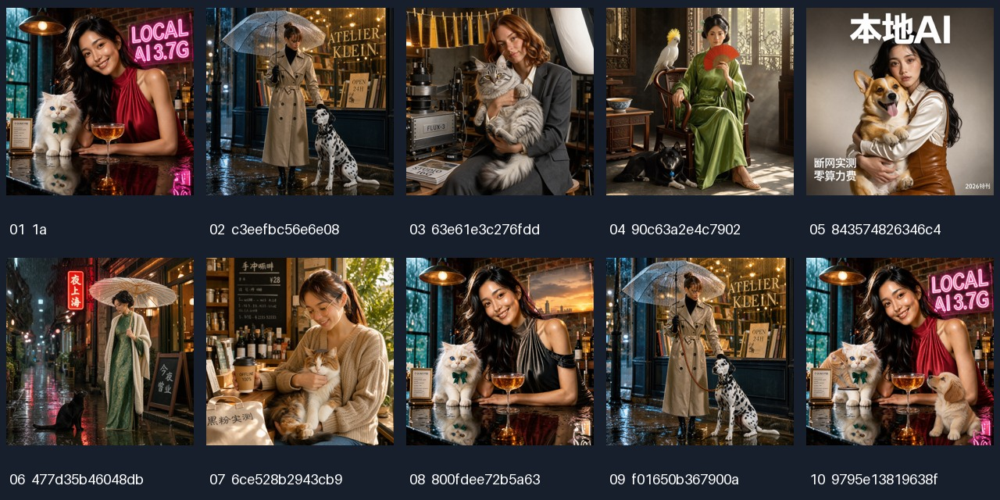

　　先交代清楚这套模型为什么值得放进主力机。据 [查看 Black Forest Labs 官方发布公告：FLUX 3 Image Klein](https://bfl.ai/blog/flux-3-image-klein) 与 [查阅 NVIDIA NIM 官方模型卡与坐标框说明](https://build.nvidia.com/black-forest-labs/flux-3-image-klein/modelcard)，它把 **5.6B**（**56 亿**参数）的图像扩散主干和独立的 **Qwen3-VL-4B-Instruct** 视觉语言编码器装进了同一套管线里，单靠这一套权重就能同时干**文生图**、**单图指令编辑**、最多 **10 张**参考图组合，外加 **0 至 1000** 归一化坐标框布局控制。

　　落到咱们自己电脑上，[查看 Unsloth GGUF 量化权重页：flux-3-image-klein-GGUF](https://huggingface.co/unsloth/flux-3-image-klein-GGUF) 压出来的 `UD-Q4_K_XL` 主生图文件只有 **3.66 GiB**（约 **3.7 GB**），加上 `Qwen3VL-4B-Instruct-Q4_K_M` 文本编码器和 `ae.safetensors`，在方寸智匣里一键拉取整套运行包总共约 **6.8 GB**。**16 GB** 统一内存的 Mac（建议 **24 GB** 更宽裕）或者 **8 GB** 独显的 Windows 笔记本都能全程断网直跑，云端算力费 **0 元**。想先看动态录屏与放大对比的朋友，也可以直接打开同步上线的 [观看 B 站完整实测视频（BV1TSyazNEkF）](https://www.bilibili.com/video/BV1TSyazNEkF) 或 [观看 YouTube 完整实测视频](https://youtu.be/SdbAttC71D8)。

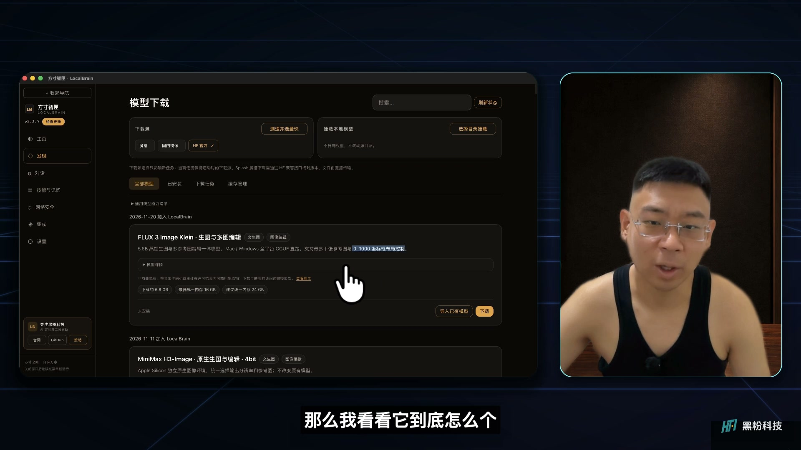

> [!tip] 本轮 14 题统一实测基线（可复现控制变量）
> • **本地运行栈**：Mac 端方寸智匣 LocalBrain（底层 `stable-diffusion.cpp` `Flux3ImageKleinGGUF` 管线），模型包为 `flux-3-image-klein-UD-Q4_K_XL.gguf` + `Qwen3VL-4B-Instruct-Q4_K_M.gguf` + `ae.safetensors`。
> • **锁定采样参数**：步数蒸馏版固定 **16 步**、`Euler` 采样器、引导系数 **CFG 1.0**（官方蒸馏版调高外部 CFG 反而劣化）、固定随机种子 **Seed 42**，画幅为 `1024×1024` 方图与 `1248×832` 横图。
> • **真机耗时实录**：常规单张生图约 **2 分钟**（`5C` 实测 **106.67 秒**、`6C` **109.53 秒**）；单图参考编辑约 **3 至 4 分钟**（`3A-2` **236.44 秒**）；三张参考图 `1248×832` 合成（`4b-2`）耗时 **726.92 秒**（约 **12.1 分钟**）。

## 一、英文多平面排字与光学质感：3.7GB 主权重能把异瞳、水珠和微缩铭牌抠到多细？

　　很多小体积量化模型一画复杂光影就会糊成油画，或者把宠物装饰的颜色染得满身都是。第一关我直接上了三道「双色温冲突 + 反射折射 + 远近多平面英文」的组合题，全部一次成图不抽卡。

### 1A｜霓虹吧台黑曜石倒影 + 异瞳白波斯猫 + 远近双层英文

```text
Glamorous high-fashion magazine editorial photo of a stunning adult East Asian woman in her mid-20s, cascading dark wavy hair with loose strands catching rim light, wearing a tailored crimson silk halter evening dress with a high collar, confident warm smile, leaning gracefully on a wet polished black obsidian bar counter. Beside her right elbow sits a fluffy pure-white Persian cat with heterochromia (one sapphire-blue eye and one amber-gold eye) wearing a tiny emerald velvet bow. Behind them, a glowing magenta neon sign clearly spells "LOCAL AI 3.7G" on an exposed brick wall, while a small brass table menu stand in the foreground clearly reads "0 CLOUD FEE". A crystal coupe glass filled with amber sparkling tea refracts the neon glow, and the wet black bar surface reflects both the woman's crimson sleeve, the white cat's paws, and the inverted pink neon glow. Dual-color-temperature lighting mixing cool cyan rainlight from a window on the left with warm tungsten pendant lamps overhead, 85mm f/1.4 lens, visible natural skin pores, individual glowing cat whiskers, Vogue cover photography.
```

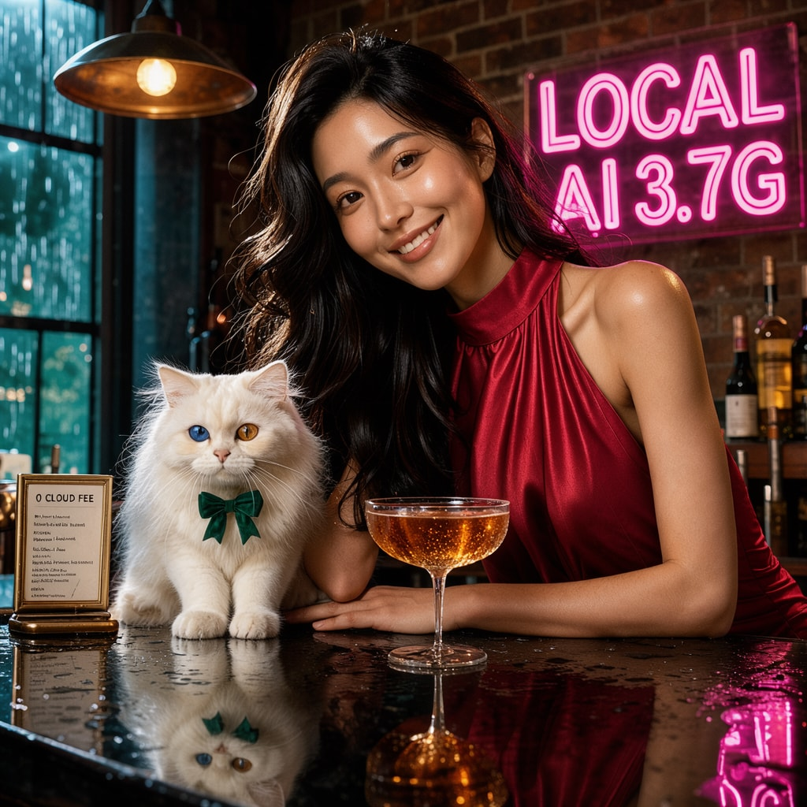

　　放大检查这张 `1024×1024` 原图，四个苛刻条件全部立住了：白波斯猫左蓝右琥珀黄的异瞳分毫不差；脖子上的祖母绿丝绒蝴蝶结边缘利落，周围一圈白毛干干净净没有染绿；远景砖墙霓虹大字 `LOCAL AI 3.7G` 和左下角黄铜立牌小字 `0 CLOUD FEE` 一个字母没拼错；连湿润黑曜石台面上倒映出的猫下巴、绿蝴蝶结和粉红霓虹位置都严丝合缝。

### 1B｜雨夜巴黎橱窗双向透视 + 大麦町斑点狗 + 双平面文字

```text
Cinematic editorial street portrait of an elegant adult woman in her late 20s with sleek chestnut hair tied in a French twist with rain-dampened bangs, wearing a structured champagne trench coat cinched at the waist over a black turtleneck, standing outside a vintage Parisian bookshop window on a rainy night. She holds a transparent dome umbrella covered in sharp raindrops while gently resting her left gloved hand on the head of an alert Dalmatian dog with crisp black spots on white fur sitting faithfully beside her boots. Gold leaf lettering painted directly on the glass window behind her clearly reads "ATELIER KLEIN", and a warm paper poster inside the shop window reads "OPEN 24H". Warm 3000K golden bookstore light spills outward through the rain-streaked glass onto her cheekbones and the Dalmatian's spotted ears, contrasting with cool 7000K cobalt-blue streetlamp reflections on the wet cobblestone puddles at their feet, 50mm Summilux lens, rich film grain.
```

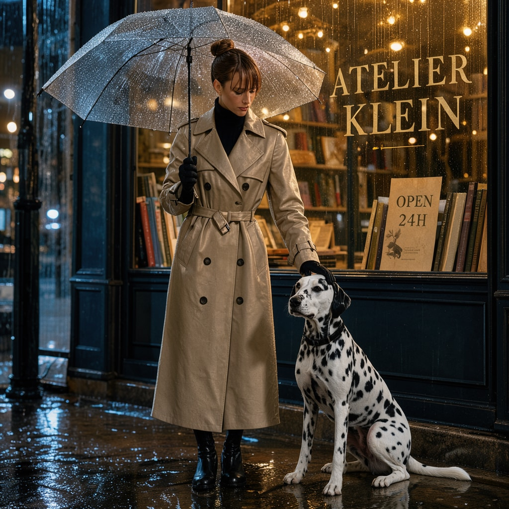

### 1C｜胶片暗房双色光 + 银虎斑缅因猫 + 三处微缩工业铭牌

```text
Atmospheric editorial portrait of a charismatic adult woman in her mid-20s with shoulder-length wavy auburn hair and subtle freckles, wearing an oversized charcoal linen blazer over a crisp ivory silk shirt, sitting on a wooden stool in a vintage analog photography studio. She cradles a massive silver-tabby Maine Coon cat with long ear tufts in her arms; the cat's fluffy tail drapes naturally over her forearm. Overhead hangs a clothesline of translucent developed film strips glowing under a warm amber safelight, while a cool daylight softbox from the right illuminates her iris catchlights and the silver guard hairs of the cat. On the metal enlarger machine beside her, a brushed-steel nameplate clearly reads "FLUX-3", a stacked magazine proof on the desk reads "STUDIO 16G", and a vintage lens cap reads "85MM". Shallow depth of field, tactile fabric weave, zero hair-fur merging.
```

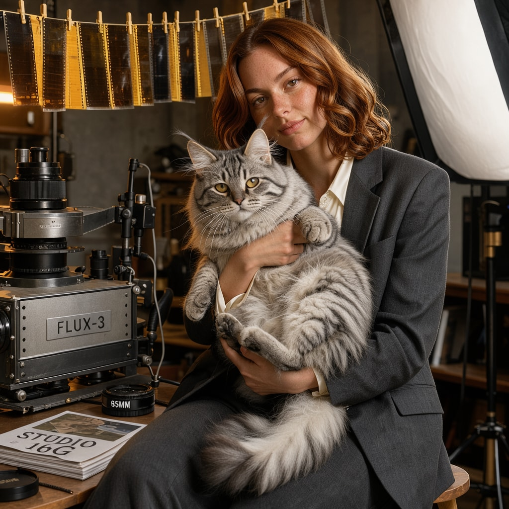

　　`1B` 里透明雨伞的水珠透光、大麦町黑白斑点与香槟风衣的干净切边、鹅卵石积水反光，再到玻璃金箔字 `ATELIER KLEIN` 与店里海报 `OPEN 24H` 的前后景深层次都挑不出硬伤；`1C` 里人物红棕碎发贴着缅因猫银灰耳簇毛也没糊成一团，金属放大机上的 `FLUX-3` 和桌面样刊上的 `STUDIO 16G` 照样清晰可辨。**单论英文短词排版与复杂光影质感，这颗 3.7GB 量化权重已经完全够得上日常主力水准。**

## 二、中文理解与汉字笔画阶梯挑战：「听得懂中文」和「写得出小字」是两码事

　　测中文生图最忌讳把「语义理解」和「像素写字」混成一谈。因为 FLUX 3 Klein 直接挂了 **Qwen3-VL-4B-Instruct** 当文本编码器，它读长段纯中文提示词的功底相当扎实；但要把十几画的汉字准确画进像素格子里，还得看 **5.6B** 扩散主干的本事。咱们分五级台阶一路往上加码，就能看清它的精确断裂点在哪。

### 2A｜纯中文六重高饱和属性隔离（零英文词，专测编码器防串色）

```text
博物馆级东方时尚大片，一位二十六岁的成年东方女性端坐在明式紫檀木圈椅上，乌黑盘发插着一支碧玉簪，身穿祖母绿重磅真丝立领长裙，左手执一把朱砂红宣纸折扇半掩下颌，右肩稳稳停着一只雪白葵花凤头鹦鹉（黄色羽冠展开），脚边青砖地上趴着一只戴宝蓝色铃铛项圈的黑柴犬（清晰四点白眉）。背景是雕花木格窗，清晨丁达尔阳光穿过薄雾在青砖地面投下整齐的窗格光斑，茶几上放着一只盛满琥珀色茶汤的青花瓷盖碗，85毫米人像镜头，皮肤细腻真实，每一根羽毛与狗毛分明。
```

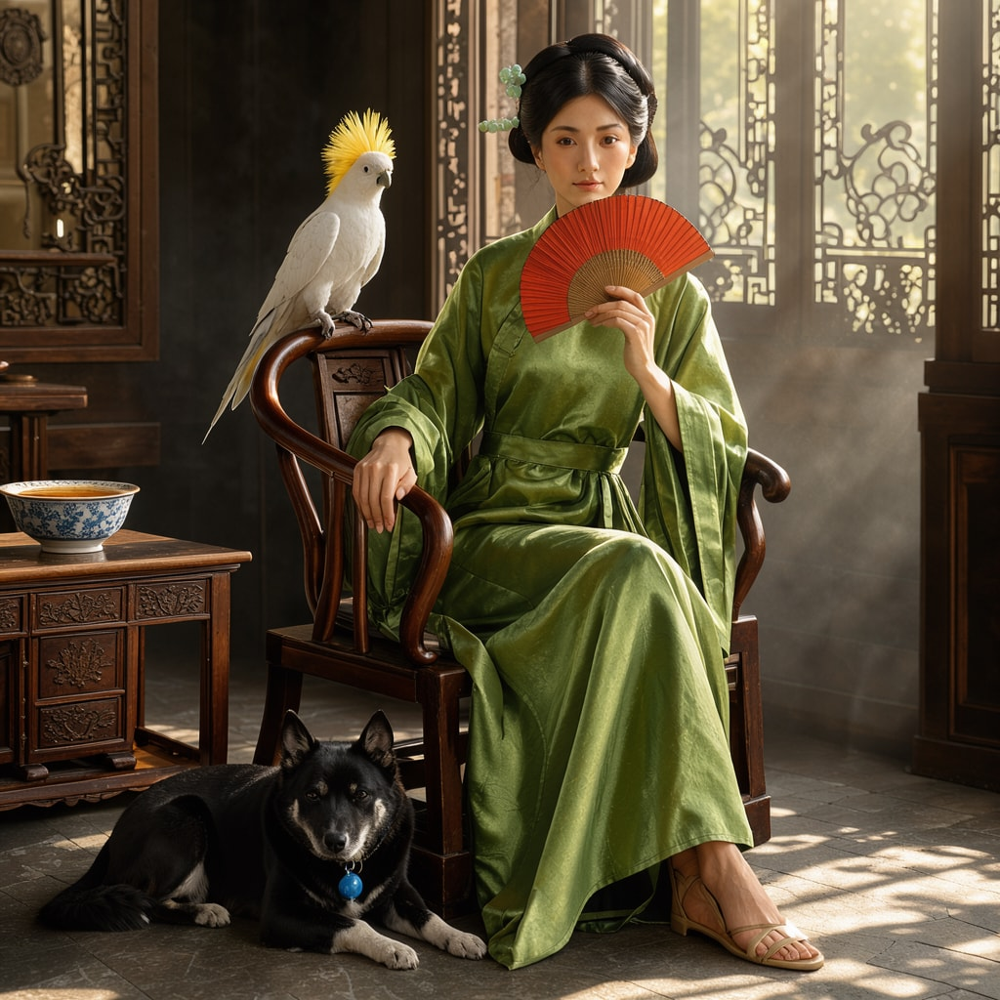

　　一句英文没写，紫檀圈椅、祖母绿长裙、朱砂红折扇、右肩黄冠白鹦鹉、脚边宝蓝项圈黑柴犬、桌角青花瓷茶碗 **6 组**高饱和色彩和左右上下方位全部对号入座，没有任何一处串色。缺点也摆在明面上：和前三张英文时尚大片比起来，这张东方古风人像的脸部涂粉感偏重，脚背跟青砖地面交界处有一点轻微穿模。

### 2B｜时尚杂志双层中文封面（大号粗黑体主标题 vs 副标题）

```text
一线时尚杂志封面大片，一位二十五岁的成年东方气质美女，蓬松微卷黑长发，身穿剪裁利落的象牙白真丝衬衫与焦糖色皮质背带裙，眼神松弛自信地看向镜头，双臂温柔环抱一只正在吐舌微笑的黄白双色威尔士柯基犬，柯基毛茸茸的爪子自然搭在她的小臂袖口上。画面顶部居中排版醒目的白色粗黑体杂志主标题"本地AI"，左下角排版清晰副标题"断网实测 零算力费"，右下角印着刊号"2026特刊"。高级商业影棚蝴蝶光配合发丝轮廓光，背景为高级暖灰渐变幕布，中画幅相机质感。
```

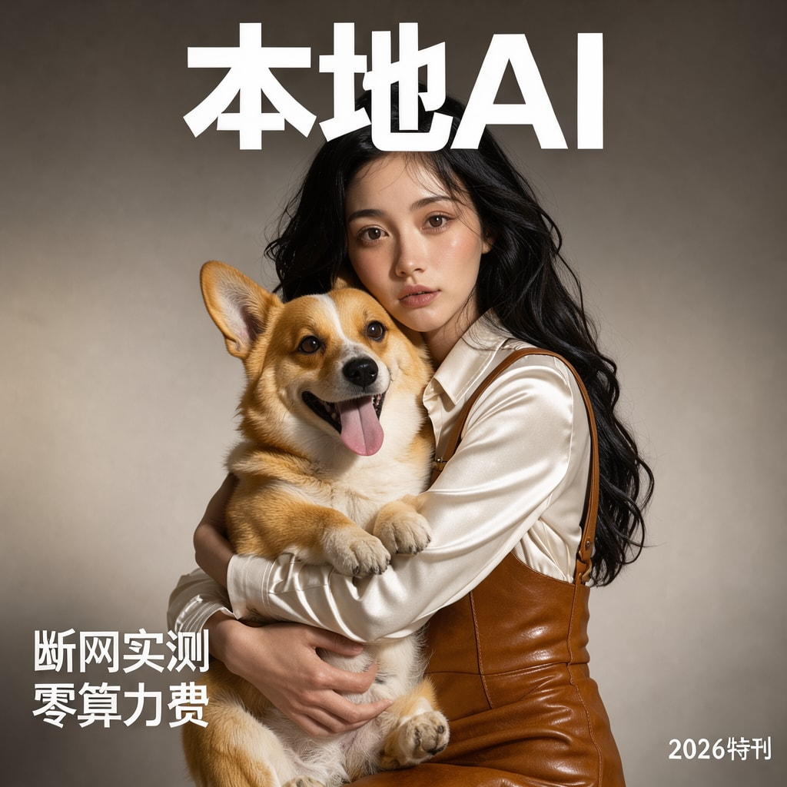

　　这张封面给了我一个不小的惊喜：顶部白色粗黑体主标题 `本地AI`、左下角副标题 `断网实测 零算力费`、乃至右下角很小的 `2026特刊` 全部成字，录制现场我在 macOS 预览里直接用鼠标划选，系统实况文本当场就把汉字认了出来，而且人物头顶与主标题的前后压叠关系也很像正经商业杂志。

### 2C / 2D / 5C｜从发光霓虹、粉笔木牌、三载体混排一路压到双语书页正文

```text
【2C 雨夜弄堂霓虹与粉笔双材质】
王家卫电影感时尚写真，一位二十七岁的成年东方古典美女，复古手推波纹盘发，身着墨绿色暗纹织锦缎高领长旗袍，外披珍珠白羊绒披肩，撑着一把半透明竹骨油纸伞站在雨夜石板弄堂口，脚边蹲坐着一只仰头看她的绿瞳纯黑短毛猫，积水路面清晰倒映出人影与黑猫。她身后上方悬挂一块竖排红色发光霓虹灯牌写着"夜上海"，身旁咖啡馆门口立着一块深胡桃木黑板手写白色粉笔字"今夜营业"。冷青色雨雾与暖红霓虹交织，35毫米电影镜头，雨丝与油纸伞透光质感极致细腻。

【2D 独立书店中英数符号混排】
独立书店午后写真，一位二十五岁的成年知性女性店长，琥珀棕低马尾配金丝圆框眼镜，穿燕麦色麻花针织开衫，坐在原木吧台后微笑注视怀里熟睡的长毛三花猫（黑白橘三色分明）。吧台后方黑板菜单用工整白字写着"手冲咖啡 ¥28"，她右手握着的牛皮纸杯套上印着黑色英文"OFFLINE 100%"，桌上帆布托特包印着"黑粉实测"。窗外暖阳穿过绿植叶片在猫背和针织衫上投下斑驳树影，50毫米定焦实拍质感。

【5C 双语摊开精装书页微距（补测耗时 106.67 秒）】
Close-up editorial portrait of an adult woman in her late 20s in a cream cashmere turtleneck sitting by a rain-streaked cafe window, a fluffy ragdoll cat resting its chin on her forearm as she holds open a hardcover bilingual art book tilted toward the camera. The left page displays a crisp multi-line English paragraph under the heading "CHAPTER 04: LOCAL INFERENCE", and the right page displays a neat vertical Chinese poem under the heading "第四章：本地算力自由", illuminated by soft directional window light, 50mm lens.
```

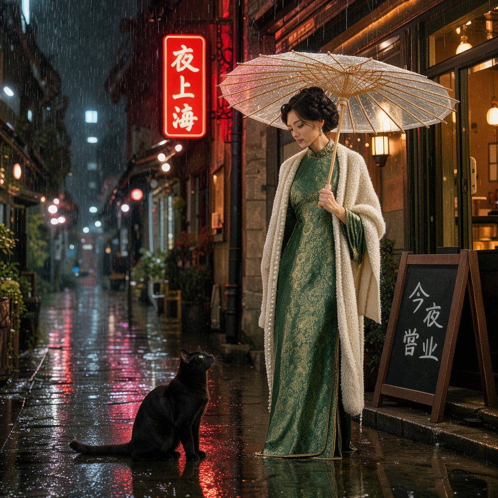

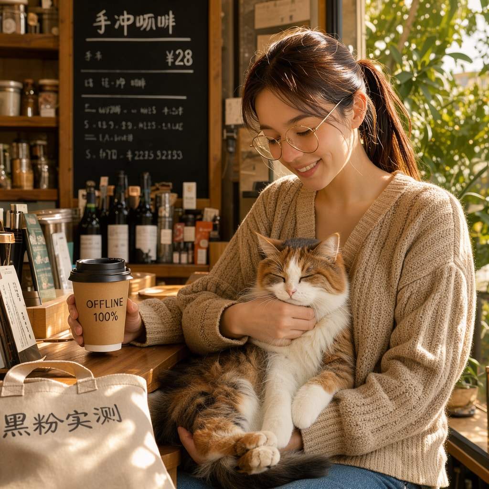

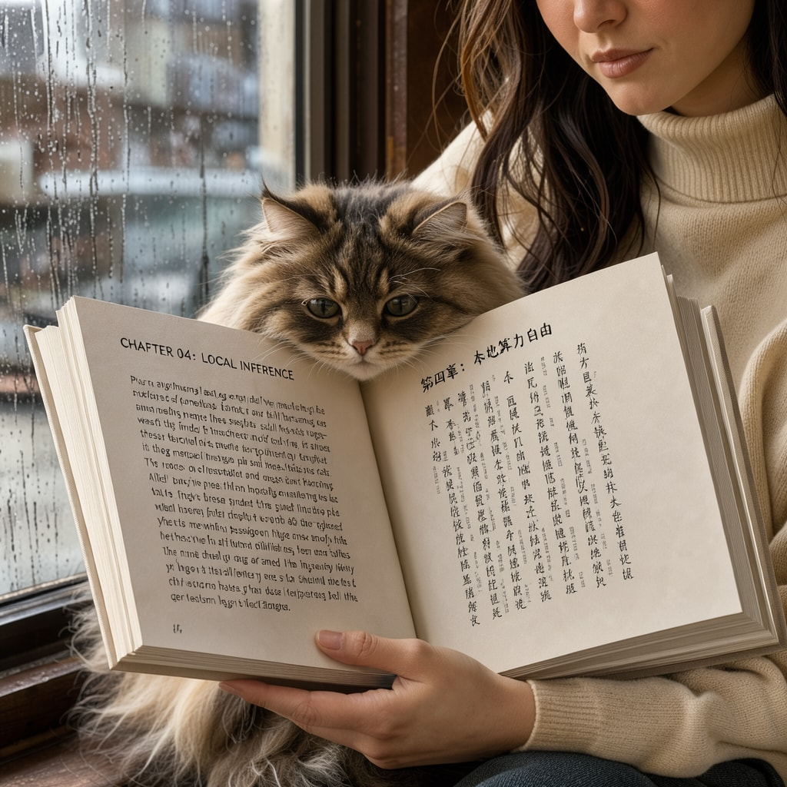

　　把这三张摆在一起，FLUX 3 Klein 写汉字的边界线就清清楚楚了：**高反差粗黑体或发光霓虹大字（4 至 8 个字）基本稳过**；一旦换成低反差手写粉笔字且笔画偏密（如 `2C` 里的“营”、`2D` 里的“咖”），就开始多横少竖；再到 `5C` 双语书页这种密集小字号段落，模型只能保住 `CHAPTER 04: LOCAL INFERENCE` 和 `第四章：本地算力自由` 两行大标题，底下整页正文只能当背景氛围看，没法逐字细读。

## 三、单图与连续二轮编辑：加细狗绳不断裂，为何二轮换雪景会留下「绿领结幽灵倒影」？

　　按 [阅读 ComfyUI 官方教程：FLUX 3 Image Klein 文生图与编辑](https://docs.comfy.org/tutorials/flux/flux-3-klein) 的说明，给它喂参考图做编辑时，提示词不能只写干巴巴的“把裙子改成黑色”，而是要把 `<ref_image_0>` 嵌进完整的结果画面描述里。我先测了单轮换礼服换光、单轮跨躯干加细狗绳，接着又追测了连续第二轮大改场景，正好抓到了它最典型的潜空间锚定脾气。

```text
【3A-1 首轮编辑：吧台换黑丝绒晚礼服与黄昏天际线（源图 1A）】
In <ref_image_0>, keep the exact same adult woman's facial features, eye shape, confident smile, dark wavy hairstyle, and the exact same fluffy white heterochromia Persian cat with one blue eye and one amber eye. She now wears a floor-length midnight-black velvet off-shoulder evening gown with subtle silver embroidery, leaning against a glass balcony railing on a luxury skyscraper rooftop at golden-hour sunset, with the white Persian cat sitting calmly on a marble pedestal beside her. Warm orange-gold sunset sunlight illuminates her skin and the white fur naturally from the right, completely replacing all pink neon reflections from the bar, overlooking a glowing metropolitan skyline under a twilight sky.

【3A-2 第二轮追击编辑：再改冬夜飘雪大衣与猫咪红围巾（源图 3A-1，耗时 236.44 秒）】
In <ref_image_0>, preserve the exact same woman's face, hairstyle, the white heterochromia Persian cat, and the rooftop skyline composition. Transform the entire scene into a snowy winter blue-hour evening: she now wears a thick double-breasted cream cashmere trench coat with snow-dusted lapels, soft snowflakes falling through the air with subtle motion blur, and the white Persian cat wears a tiny knitted crimson wool scarf around its neck. Cool 6500K winter twilight ambient light with warm city window lights bokeh in the background, faint frosty breath in the cold air.
```

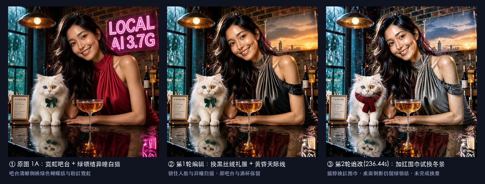

　　看上面这张三联对比图，最值得细品的是右数第三格（`3A-2`，耗时 **236.44 秒**）：第一轮把红裙改成黑丝绒露肩礼服、把粉红霓虹换成黄昏城市天际线时，虽然人和猫还靠在原本的吧台和高脚杯旁没有真正挪到露天阳台，但整体光影和台面倒影都跟着同步刷新了；等拿第一轮结果再套第二轮提示词想改成冬夜雪景羊绒大衣时，**模型只挑最省力的局部改了——给白猫脖子上织了一条漂亮的红围巾，可你低头看一眼黑曜石桌面，水面倒影里映出来的居然还是绿色的蝴蝶结！**同时大衣没换上，背后的黄昏天际线也缩成了一幅挂在砖墙上的装饰画。

　　这个现象跟 [查看 Fuser 同提示词横评报告](https://fuser.studio/articles/flux-3-klein-vs-flux-3-image) 测出的“厨房改夜景时桌面残留正午阳光斑”完全同源：参考图在潜空间里对原有大面积几何结构的锁死力度很强，连续多轮叠改极易留下局部物理穿帮。**日常改图尽量直接拿最初的原图一步写清目标状态，别像接龙一样连套好几轮换景。**

### 3C｜专打第三方翻车重灾区：跨躯干加皮革狗绳与金丝眼镜

```text
In <ref_image_0>, keep the woman's face, champagne trench coat, transparent umbrella, the Dalmatian dog, and the rainy Parisian street completely unchanged. Add thin gold-rimmed oval eyeglasses on her face with realistic lens refraction, and add a braided cognac-brown leather dog leash held firmly in her right hand that drapes naturally in a smooth catenary curve across the front of her champagne trench coat and clips cleanly onto a brass ring on the Dalmatian's collar, without breaking or floating.
```

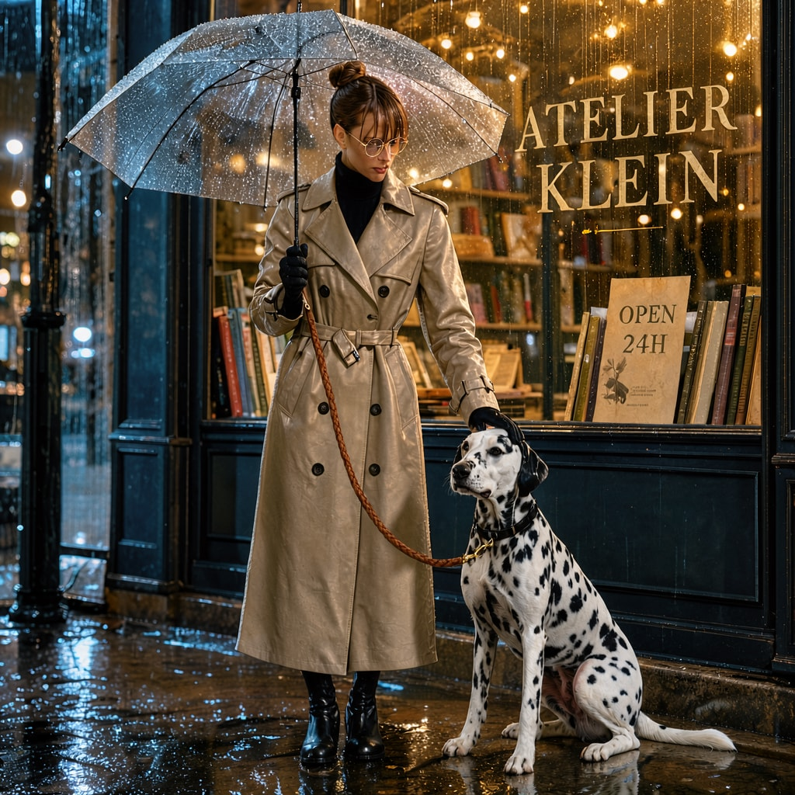

　　此前 [查看 MindStudio 独立实测报告](https://www.mindstudio.ai/blog/flux-3-klein-image-tests) 提到这类紧凑模型最怕处理跨过人物躯干的安全带或细绳。但在 `3C` 这道局部新增题上，棕色编织皮牵引绳从右手自然垂落、跨过香槟风衣下摆精准扣进大麦町脖子上的金属环，全程不断裂不悬空；反倒是顺手加的那副金丝眼镜，镜框贴合处稍微有点小穿帮。

## 四、杀手锏实测：0-1000 归一化坐标框摆位有多准？多图拼合注意哪两个坑？

　　整轮测试里最让我觉得好玩的，就是 FLUX 3 Klein 原生自带的 **`0-1000` 归一化坐标框布局控制**。以前想往成片指定角落塞一只宠物，要么得手涂局部重绘蒙版，要么靠抽卡碰运气；现在直接把整张画布横竖都当成 `0` 到 `1000` 的千分尺，在提示词末尾附一段 JSON 数组就能指哪打哪。

> [!warning] 写坐标框前必避的顺序坑：是 [上, 左, 下, 右]，不是 [x1, y1, x2, y2]！
> 据 [查阅 NVIDIA NIM 官方模型卡与坐标框说明](https://build.nvidia.com/black-forest-labs/flux-3-image-klein/modelcard)，FLUX 3 Klein 的每一个 `bbox` 四元组顺序固定为 **`[top, left, bottom, right]`（上、左、下、右，取值 0..1000）**，并且在正文里要用 `<id>` 把对象锚定出来。如果你按习惯写成 `[左, 上, 右, 下]`，左右并排的两个人会被模型直接叠成上下两层！

### 4a-1｜单图左右高低错落塞入一猫一狗，保持原女主与异瞳白猫不动

```text
In <ref_image_0>, keep the woman and her white Persian cat unchanged, add a fluffy golden retriever puppy <dog_1> sitting on the floor in the lower-right foreground looking up at her, and add a small ginger tabby kitten <cat_2> perched on the left end of the bar counter batting at a coaster. Keep everything else in the image exactly unchanged. [{"id": "dog_1", "from": null, "src_bbox": null, "tgt_bbox": [600, 620, 960, 950], "desc": "fluffy golden retriever puppy looking up"}, {"id": "cat_2", "from": null, "src_bbox": null, "tgt_bbox": [460, 60, 700, 290], "desc": "small ginger tabby kitten sitting on the bar counter"}]
```

![评测实图｜4a-1 千分坐标框示意与编辑前后对照：左中橘猫 [460, 60, 700, 290] 与右下金毛 [600, 620, 960, 950] 一步落位](/obsidian-assets/flux-3-klein-local-image-test/image-ev13-d2355df529.jpg)

　　对照上图的青色框和黄色框就能一眼看明白：原本的红裙女主、高脚杯和异瞳白波斯猫稳稳待在原地，新增的小橘猫精准蹲进了左侧 `[460, 60, 700, 290]` 区域，还跟原白猫做出了自然贴靠的毛发挤压感；右下 `[600, 620, 960, 950]` 框里也长出了一只仰头看女主的金毛幼犬。唯一的小瑕疵是右下角原本是吧台台面而非地面，金毛幼犬前爪搭接处有一点透视穿帮。

### 4b-2 & 6C｜三参考图跨图拼合（726.92 秒）与茶室水镜八维压力题（109.53 秒）

```text
【4b-2 三参考图咖啡馆坐标组局（1248×832，耗时 726.92 秒，输入 1A + 1B + 2A 三图）】
Sunlit Parisian outdoor cafe terrace editorial photo. The adult woman <woman_1> from <ref_image_0> sits on a woven bistro chair on the left, the adult woman <woman_2> from <ref_image_1> sits across the small marble table on the right, the exact pet <pet_1> from <ref_image_2> rests on a plush cushion in the center foreground between their chairs, and a three-tier silver pastry stand <tray_1> sits on the tabletop in the middle. Warm afternoon golden sunlight, 50mm lens. [{"id": "woman_1", "from": "ref_image_0", "src_bbox": [0, 0, 1000, 1000], "tgt_bbox": [100, 30, 950, 370], "desc": "adult woman from ref_image_0 sitting at cafe"}, {"id": "tray_1", "from": null, "src_bbox": null, "tgt_bbox": [360, 410, 620, 590], "desc": "three-tier silver afternoon tea pastry stand"}, {"id": "pet_1", "from": "ref_image_2", "src_bbox": [0, 0, 1000, 1000], "tgt_bbox": [640, 360, 980, 640], "desc": "exact pet from ref_image_2 on a cushion"}, {"id": "woman_2", "from": "ref_image_1", "src_bbox": [0, 0, 1000, 1000], "tgt_bbox": [100, 630, 950, 970], "desc": "adult woman from ref_image_1 sitting at cafe"}]

【6C 京都红叶琉璃茶室水镜（1248×832，耗时 109.53 秒）】
Exquisite editorial portrait on the wooden veranda of a Kyoto lakeside pavilion at autumn twilight. An adult East Asian woman in her mid-20s with poised gaze wears an indigo silk furisode kimono intricately embroidered with golden cranes and crimson maple leaves, kneeling beside a calm shallow reflecting pool. Her right hand holds a translucent glass wind chime with a paper strip reading "AUTUMN 26", while her left hand rests gently on the back of a red Shiba Inu sitting attentively beside her knees; beneath the clear water surface, three orange-and-white koi carp swim among fallen red maple leaves, creating concentric ripples that slightly distort the upside-down reflection of the woman, the Shiba Inu, and a warm glowing paper lantern hanging overhead reading "KLEIN". Afternoon sunbeams pass through a half-rolled bamboo blind, casting crisp parallel striped light-and-shadow bands continuously across her kimono sleeve, her cheek, and the Shiba Inu's fur in physically consistent alignment, 85mm medium-format photography.
```

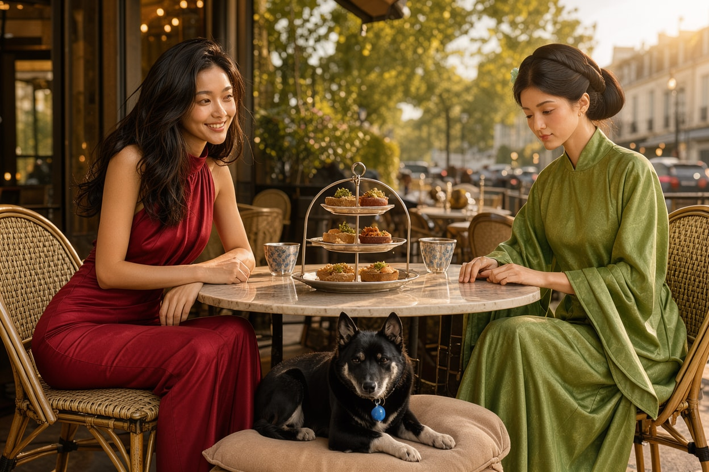

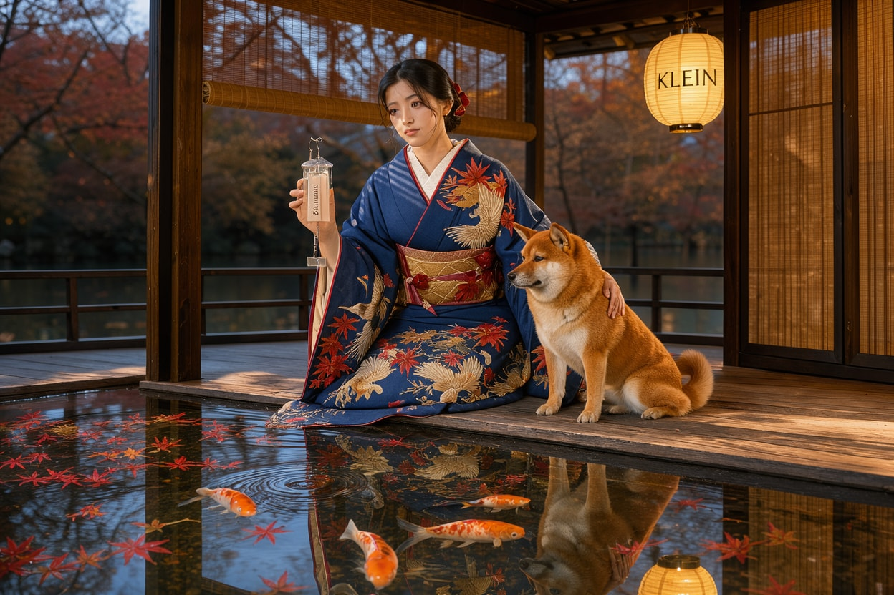

　　最后这两道极限压力题把多图合成和复杂物理约束的脾气摸透了：`4b-2` 同时塞进 **3 张** `1024×1024` 参考图跑 `1248×832` 大横幅，首先耗时直接涨到了 **726.92 秒**（约 **12.1 分钟**）；虽然左女、中茶点架、下黑柴犬、右女四个坐标框全部站对了位置，但因为我随手拿来做第 3 张宠物参考的 `2A` 原图里本身还坐着一位盘发绿裙姑娘，右侧本该穿香槟风衣的 `<woman_2>` 当场被第 3 张图“夺舍”换上了盘发和绿衣——**多图参考要想不串造型，喂进去的宠物或道具参考图一定要提前裁成干净的单主体图。**而在 `6C` 茶室水镜里，仙鹤枫叶刺绣、水面涟漪倒影和灯笼上的 `KLEIN` 都很稳，唯独明确要求的 **3 条**锦鲤多画成了 **4 条**，竹帘平行条纹光也只停在了和服肩头，没能跨曲面延续到脸颊和柴犬背上。

## 五、14 题实测汇总与日常最省心用法

| 测试维度（题号） | 本机耗时（Seed 42 / 16步） | 实测稳态长板 | 真实翻车边界与规避办法 |
| --- | --- | --- | --- |
| 英文排字与复杂光影（1A / 1B / 1C） | 约 2 分钟 / 张 | 异瞳、毛发分界、水珠反射扎实；霓虹大字与微缩铭牌拼写全对 | 极小号镜头盖字（如 85MM）偶有模糊，主视觉字号留够即可 |
| 中文语义与汉字渲染（2A–2D / 5C） | 约 2 分钟（5C 实测 106.67 秒） | 纯中文 6 色方位零串色；4–8 字粗体封面大字可被系统直接识别 | 复杂粉笔字（如“营”）易错笔，书页多行正文小字必糊；正文留给后期排字 |
| 单图与多轮参考编辑（3A-1 / 3A-2 / 3C） | 约 3–4 分钟（3A-2 实测 236.44 秒） | 单轮换衣换天际线锁脸稳；跨躯干加皮革狗绳自然不断裂 | 二轮接力大换景会留原桌面绿领结倒影；尽量从原图一步改到位 |
| 0-1000 坐标框与多图（4a-1 / 4b-2） | 单图约 3–4 分钟；三图 726.92 秒 | 按 [top, left, bottom, right] 指定双宠与四人宠站位落框精准 | 多图耗时翻倍，且参考图带多余人物易串衣串发；先裁成纯单主体再喂入 |
| 单图八维极限叠满（6C 茶室水镜） | 109.53 秒（1248×832） | 复杂刺绣、水面涟漪倒影与灯笼英文同框观感自然 | 3 条锦鲤画成 4 条，跨曲面条纹光未对齐；严格计数成片需人工清点 |

　　如果你手头正好有一台 **16 GB** 以上统一内存的 Mac 或 **8 GB** 独显的 Windows 电脑，可以直接去 [查看方寸智匣 LocalBrain 功能介绍页](https://hyphentech.top/localbrain) 或 [下载与更新：方寸智匣 LocalBrain（GitHub 发行页）](https://github.com/HackerChi-Hub/localbrain-releases/releases) 免费拉下这颗约 **6.8 GB** 的 FLUX 3 Image Klein 试跑（本期同步实测视频全程由黑粉录屏 HyphenScreen 录制剪辑）。**日常拿它断网零成本出高质感底图、配合 `[上, 左, 下, 右]` 千分坐标框把关键元素摆准位置，再把细碎正文小字交给后期排版软件补齐——这就是目前本地轻量生图模型最聪明、也最省钱的打开方式。**

## 主要查证来源

- [Black Forest Labs 官方发布说明：FLUX 3 Image Klein（5.6B 开源权重与功能介绍）](https://bfl.ai/blog/flux-3-image-klein)
- [Hugging Face 官方模型仓库：black-forest-labs/flux-3-image-klein](https://huggingface.co/black-forest-labs/flux-3-image-klein)
- [Unsloth GGUF 量化权重仓库：unsloth/flux-3-image-klein-GGUF（UD-Q4_K_XL）](https://huggingface.co/unsloth/flux-3-image-klein-GGUF)
- [NVIDIA NIM 模型卡：flux-3-image-klein 架构参数与 [top, left, bottom, right] 0-1000 坐标框规范]([查看页面：build.nvidia.com · modelcard](<https://build.nvidia.com/black-forest-labs/flux-3-image-klein/modelcard>))
- [ComfyUI 官方文档：FLUX 3 Image Klein 本地文生图与参考图编辑教程](https://docs.comfy.org/tutorials/flux/flux-3-klein)
- [Fuser 独立对比评测：FLUX.3 Klein vs FLUX.3 同提示词排字与改光残影测试](https://fuser.studio/articles/flux-3-klein-vs-flux-3-image)
- [MindStudio 独立实测：FLUX 3 Klein 图像生成与局部物理穿插测试](https://www.mindstudio.ai/blog/flux-3-klein-image-tests)
- [黑粉科技 B 站完整实测视频：FLUX 3 Klein 本地生图实测（BV1TSyazNEkF）](https://www.bilibili.com/video/BV1TSyazNEkF)
- [HyphenTech YouTube 完整实测视频：FLUX 3 Klein 本地生图与改图实测](https://youtu.be/SdbAttC71D8)


---

## 🧰 我做的工具

这些工具都由我持续维护。预览版会明确标注，下载、更新和已知边界以发行页为准。

> [!info] 黑粉盒子 HyphenBox
> **状态：** 正式迭代
>
> 免费大模型 API 雷达：持续复测可用性，本地统一接口，Key 只存本机
>
> [下载与更新：黑粉盒子 HyphenBox](https://github.com/HackerChi-Hub/hyphenbox-release/releases)

> [!info] 方寸智匣 LocalBrain
> **状态：** 正式迭代
>
> 本地模型的多模态 MCP 工具箱：TTS / Whisper / 视频生成一站接入
>
> [下载与更新：方寸智匣 LocalBrain](https://github.com/HackerChi-Hub/localbrain-releases/releases)

---

> [!quote] 黑粉科技
> **让AI成为你的超能力**
> 本地部署 · 免费白嫖 · 自制软件
> [黑粉科技](https://hyphentech.top)
