> [!abstract]
> 专题日期：2026-11-27 · 二次复核：2026-11-27
> 黑粉科技

> [!tip]
> 距离 2026-09-23 上一期完整雷达刚好过去 2 个月。这次我在 Mac 本机同时跑了中国大陆直连与国际网络双视角真请求，并逐家核对了注册、手机号、实名、信用卡门槛：477 个模型的 OpenRouter 里零价文本对话只剩 10 个，Mistral 与 Hugging Face 免费 API 已成历史，而真正能稳跑的口子必须看清本地使用条件。

> [!warning]
> 所有结论均区分「无需注册免密直调」「仅邮箱/GitHub 免卡注册」「需 +86 手机号与实名认证」「强制绑外币卡试用」及「已停供退役」，绝不把网页能打开或模型列表可读冒充 API 真能调通。

## 我怎么复测，以及免费到底卡在哪

　　先说这 2 个月最大的体感变化：各家大厂都在收紧「无门槛撒币」。OpenRouter 全站 477 个模型里，输入输出双零的文本对话变体已经缩水到只剩 10 个，而且全部是单供应商裸奔承载——上个月还能跑通的 nvidia/nemotron-3-super-120b-a12b:free 和 inclusionai/ling-3.0-flash-sante:free 今天实测直接返回 HTTP 404 转成付费，Recraft 免费生图变体更是挂上了 2026-11-28 下架倒计时；Mistral 官方文档干脆挑明 Free mode 不再包含 API 权限，Cerebras 也改成了必须绑信用卡才给一次性 5 美元 30 天试用。

　　但好消息是，只要按你手头的本地网络和账号条件对号入座，依然有非常能打的真口粮：如果你有国际网络，Groq 上的 qwen/qwen3.8-27b（409ms–1125ms）和 Google AI Studio 的 gemini-3.5-flash-lite（621ms–1387ms）、gemini-embedding-2（495ms–785ms），以及 OpenRouter 新上架的 nvidia/nemotron-3-ultra-550b-a55b:free 全部通过了连续 4 次真实任务压测；如果你在国内直连环境、不想折腾代理，用 +86 手机号加实名认证就能直连智谱 GLM-4.7-Flash（200K 上下文永久免费，直连 137ms）和魔搭每日 250 魔粒兑换池（直连 84ms）。

　　至于连账号都不想注册、只想零配置试一条命令的朋友，OVHcloud AI Endpoints（直连 1366ms）和 Pollinations（直连 7836ms、代理 1696ms）今天依然能免 Key 调通 Qwen3.8-27B、bge-m3 向量或基础对话，但匿名 IP 阀门收得很死——OVH 连续突发第 2 次就弹 429 冷却约 49 分钟，Pollinations 匿名层改成了单 IP 每 45 秒限 1 条回复。下面这张表把每家的注册条件、网络要求和实测状态一次摊开，我也同步把这份结果签发进了黑粉盒子 2026.11.27.1 目录。

## 一句话推荐

- 🟢 国际网络免绑卡主力首选：Groq（qwen/qwen3.8-27b，4/4 实测通过 409–1125ms）+ Google Gemini API（优先用 gemini-3.5-flash-lite 与 gemini-embedding-2，4/4 实测通过；避开高峰期弹 503 的 3.6-flash）+ OpenRouter（精选在架 nvidia/nemotron-3-ultra-550b-a55b:free，4/4 通过）。
- 🟢 国内直连免代理主力首选：智谱 BigModel（+86 手机号+实名，GLM-4.7-Flash 200K 上下文永久免费且默认不拿数据训练，直连 137ms）+ 魔搭 ModelScope（+86 手机号+绑定实名阿里云，每日领 250 魔粒可调 Kimi-K3.1-Pro 等，直连 84ms）。
- 🟡 零注册免密应急测试：OVHcloud AI Endpoints 与 Pollinations 均可国内直连免 Key 跑通首条请求，但分别受单 IP 冷却（49 分钟）与每 45 秒 1 次回复限制，切勿接入高频编程 Agent。
- 🔴 明确劝退防踩坑：Mistral 免费 API 已取消（强制绑卡付费）、Hugging Face 免费月赠已归零（None）、GitHub Models 独立推理接口已退役、Cerebras 已改为强制绑外币卡领一次性 5 美元试用。

## 核实速查

| 平台 | 当前核实 |
| --- | --- |
| Groq（海外极速主力） | 🟢 实测通过（4/4 请求 200 OK，409–1125ms）｜需免卡注册 + 国际网络 |
| Google Gemini API（AI Studio） | 🟢 实测通过（flash-lite 与向量均 4/4 通过）｜需 Google 账号 + 国际网络 |
| OpenRouter（零价聚合池） | 🟢 精选可调通（477 款中仅剩 10 款零价文本，550B 款 4/4 通过，旧款大面积下架） |
| 智谱开放平台 BigModel（国内直连首选） | 🟢 官方永久免费政策确认（大陆直连 137ms）｜需 +86 手机号 + 实名认证 |
| 魔搭 ModelScope API-Inference | 🟢 官方每日魔粒免费池确认（大陆直连 84ms）｜需 +86 手机 + 绑定实名阿里云 |
| NVIDIA NIM（build.nvidia.com） | 🟡 官方 36 款免费开发端点在架（大陆直连列表 746ms）｜需邮箱注册验证 |
| OVHcloud AI Endpoints（免注册免密公共接口） | 🟡 免 Key 实测可调通（大陆直连 200 OK，但连续匿名突发秒弹 429 冷却） |
| Pollinations（免注册免密社区接口） | 🟡 免 Key 实测可调通（触发新限规：匿名每 IP 每 45 秒仅限 1 次回复） |
| 硅基流动 SiliconFlow | 🟡 官方 L0 免费政策仍在，但本机既有测试号触发 HTTP 402 余额不足拦截 |
| Cloudflare Workers AI | 🟡 官方每日 10000 Neurons 免费重置确认｜适合轻量边缘小模型与向量 |
| Cerebras Cloud（免卡免费层已取消） | 🟠 门槛收紧：必须绑定信用卡才给一次性 $5 / 30 天试用 |
| Mistral AI La Plateforme（免费 API 已取消） | 🔴 踩坑劝退：原 Experiment 免费 API 已取消，创建 API Key 必须绑卡付费 |
| Hugging Face Inference Providers（月赠已取消） | 🔴 踩坑劝退：免费用户月度额度已归零（None），旧 $0.10/月已失效 |
| GitHub Models（独立免费推理 API 已退役） | 🔴 已退役：本机持有效 GitHub Token 复测确认不再返回大模型补全 |

> 专题日期 2026-11-27；状态复核于 2026-11-27

> [!warning]
> 仅测试官方面向开发者公开提供的合法免费层级与公开免密接口；遇到短信验证码、实名认证、人机验证或绑卡门槛一律如实记录准入条件，不绕过安全校验、不收录任何黑灰产中转站。

---

## Groq（海外极速主力）

**🟢 实测通过（4/4 请求 200 OK，409–1125ms）｜需免卡注册 + 国际网络**

| 项目 | 核实内容 |
| --- | --- |
| 可用模型 | qwen/qwen3.8-27b、openai/gpt-oss-120b、openai/gpt-oss-20b、allam-2-7b |
| 接入 | OpenAI 兼容；需国际网络环境（大陆直连易受阻） |
| Base URL | https://api.groq.com/openai/v1 |
| 免费类型 | 永久周期免费层 |
| 鉴权 | 需注册 Groq 账号创建 API Key（支持邮箱 / Google / GitHub，无需手机实名） |
| 免费额度 | 主力模型官方免费档 30 RPM、1000 RPD、8000 TPM、200000 TPD |
| 重置周期 | 按分钟与每日窗口自动恢复 |
| 有效期 | 长期有效 |
| 地区 | 国际（本地需开代理） |
| 支付／实名门槛 | 无需绑定信用卡、无需充值 |
| 隐私政策 | 官方默认不将 API 请求用于模型训练 |
| 核实结论 | 本机网关实测 qwen/qwen3.8-27b 连续 4 次对话（含较长中文备份方案）与 gpt-oss-120b 2 次对话全部 200 通过，延迟仅 409–1125ms。 |
| 证据状态 | 2026-11-27 官方文档截图 + 本机真实请求通过 |

> [!warning]
> 单次超长上下文容易先撞 8000 TPM 分钟上限；大陆直连不可靠，必须配国际网络。

- 官方来源：https://console.groq.com/docs/rate-limits

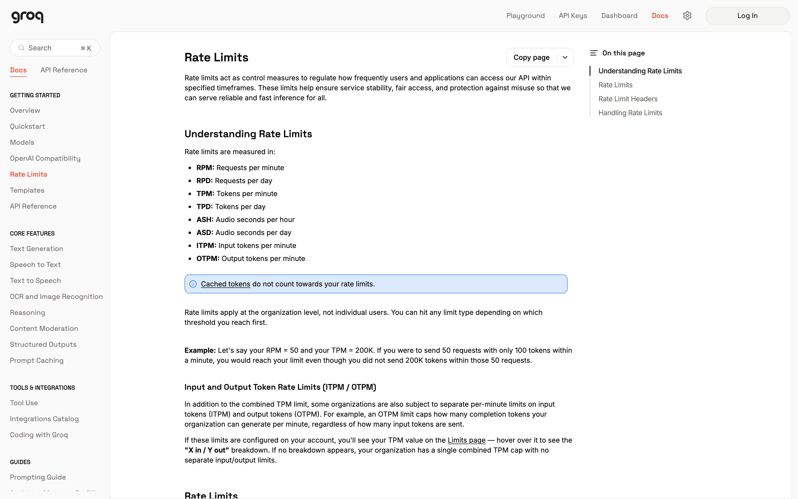

---

## Google Gemini API（AI Studio）

**🟢 实测通过（flash-lite 与向量均 4/4 通过）｜需 Google 账号 + 国际网络**

| 项目 | 核实内容 |
| --- | --- |
| 可用模型 | gemini-3.5-flash-lite（主力推荐）、gemini-embedding-2、gemini-3.1-flash-lite、Gemini 4 Hydrogen（限流档）；注：Gemini 4 Carbon/Neon 仅付费 |
| 接入 | 原生 REST + OpenAI 兼容层；需支持地区的国际网络 |
| Base URL | https://generativelanguage.googleapis.com/v1beta/openai/ |
| 免费类型 | 永久周期免费层（指定轻量型号） |
| 鉴权 | 需登录 Google 账号在 AI Studio 一键生成 Key |
| 免费额度 | 按模型与账户层级在 AI Studio 展示 RPM / RPD 免费配额 |
| 重置周期 | 每分钟及太平洋时间午夜重置 |
| 有效期 | 长期有效 |
| 地区 | 国际（需支持地区代理出口） |
| 支付／实名门槛 | Free 层级无需绑定信用卡 |
| 隐私政策 | ⚠️ 官方定价页明确：Free 层级输入输出会被用于改进 Google 产品与模型 |
| 核实结论 | gemini-3.5-flash-lite 四次对话（621–1387ms）与 gemini-embedding-2 四次向量（495–785ms）全部 200 通过；但 gemini-3.6-flash 与 gemma-4-31b-it 高峰期多次弹出 HTTP 503 High Demand。 |
| 证据状态 | 2026-11-27 官方定价页核实 + 本机真实请求通过 |

> [!warning]
> 切勿把需要付费的 Gemini 4 Carbon/Neon 当免费模型调；免费层勿传私密商业代码。

- 官方来源：https://ai.google.dev/gemini-api/docs/pricing

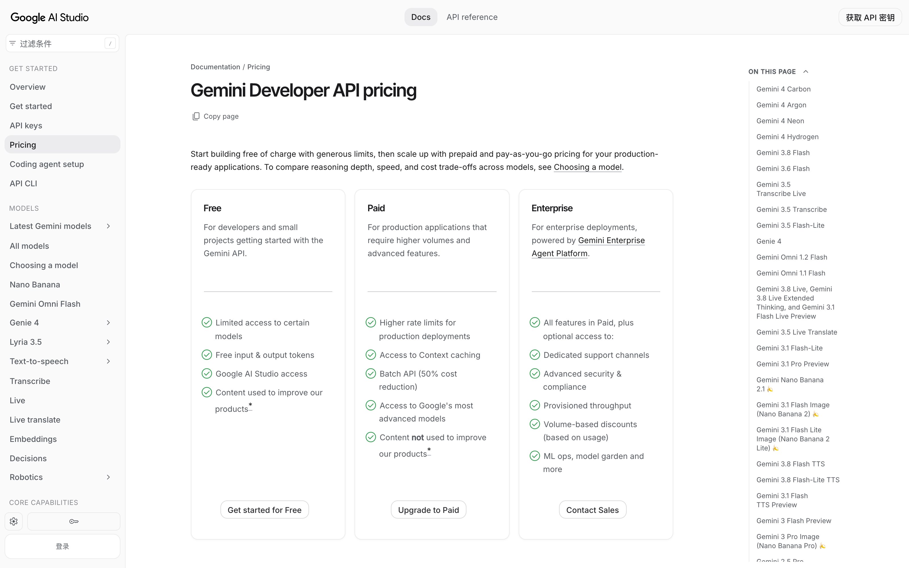

---

## OpenRouter（零价聚合池）

**🟢 精选可调通（477 款中仅剩 10 款零价文本，550B 款 4/4 通过，旧款大面积下架）**

| 项目 | 核实内容 |
| --- | --- |
| 可用模型 | 在架实测通过：nvidia/nemotron-3-ultra-550b-a55b:free（1M 上下文）；其余在架含 baidu/ernie-5.5-flash-preview:free、nvidia/nemotron-3.5-super-vl:free、google/gemma-4-31b-it:free 等 |
| 接入 | OpenAI 兼容；大陆直连可达（1377ms），挂国际网络更快（806ms） |
| Base URL | https://openrouter.ai/api/v1 |
| 免费类型 | 指定 :free 零价变体 |
| 鉴权 | 需注册账号创建 Key（邮箱 / Google / GitHub 登录） |
| 免费额度 | 免费账户约 20 RPM、50 次/日（充过 10 credits 账户日限 1000 次） |
| 重置周期 | 按日重置，叠加单供应商实时限流 |
| 有效期 | 随上游合作随时上下架（Recraft 免费生图已标 2026-11-28 下架） |
| 地区 | 国际（国内直连可通） |
| 支付／实名门槛 | 无需信用卡；但账户若出现负余额会锁死免费调用 |
| 隐私政策 | ⚠️ 免费端点上游普遍记录提示词用于产品改进 |
| 核实结论 | nvidia/nemotron-3-ultra-550b-a55b:free 连续 4 次任务（2029–13132ms）全部 200 通过；gemma-4-26b-a4b-it:free 第 2 次请求即回 429；上月热门 nemotron-3-super-120b:free 与 ling-3.0-flash-sante:free 已返回 404 下架。 |
| 证据状态 | 2026-11-27 全站 477 模型扫描 + 端点可用率核查 + 本机实测 |

> [!warning]
> 10 个零价文本模型当前全部只有 1 家供应商承载（eps=1），必须挂在黑粉盒子这类支持自动冷却换路的网关后面用。

- 官方来源：https://openrouter.ai/models?max_price=0
- 官方来源：https://openrouter.ai/docs/api-reference/limits

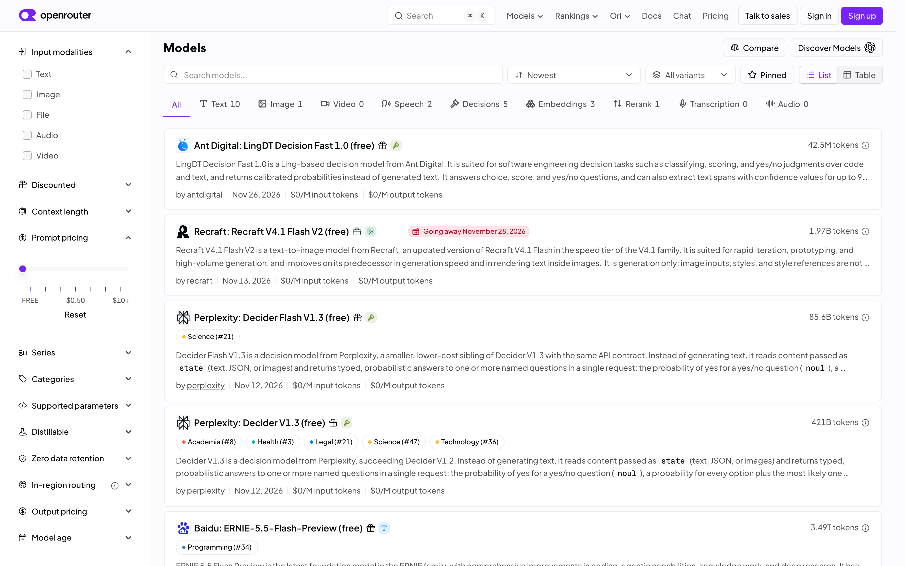

---

## 智谱开放平台 BigModel（国内直连首选）

**🟢 官方永久免费政策确认（大陆直连 137ms）｜需 +86 手机号 + 实名认证**

| 项目 | 核实内容 |
| --- | --- |
| 可用模型 | GLM-4.7-Flash（30B·200K 上下文）、GLM-4.6V-Flash（128K 多模态）、GLM-4-Flash-250414、CogView-3-Flash（生图） |
| 接入 | OpenAI 兼容；中国大陆原生极速直连（137ms），无需任何代理 |
| Base URL | https://open.bigmodel.cn/api/paas/v4 |
| 免费类型 | 永久免费型号 + 新户 2000 万 Tokens 体验包 |
| 鉴权 | 需 +86 中国手机号短信验证码登录（或微信扫码）并创建 API Key |
| 免费额度 | 上述 Flash 系列单价为 0，按账号等级（V0–V3）限制同时在途并发请求数 |
| 重置周期 | 并发连接完成即释放，无日总额上限 |
| 有效期 | 长期有效（旧 GLM-4.5-Flash 与 GLM-Z1-Flash 已下线迁移） |
| 地区 | 国产（国内直连） |
| 支付／实名门槛 | 无需信用卡；API 调用需完成国内实名认证 |
| 隐私政策 | ✅ 官方协议明确默认不将用户 API 输入输出用于模型训练 |
| 核实结论 | 内置浏览器核查因需 +86 手机短信验证码未越权代登，但官方免费文档与价格表完整确认 GLM-4.7-Flash 永久免费，大陆直连端点探活 137ms。 |
| 证据状态 | 2026-11-27 官方免费模型文档截图 + 直连端点探活 |

> [!warning]
> 注意区分免费后缀：GLM-5.3-Flash 与 GLM-5.4 均为收费模型，写错名字会直接扣体验金或余额。

- 官方来源：https://docs.bigmodel.cn/cn/guide/models/free/glm-4.7-flash

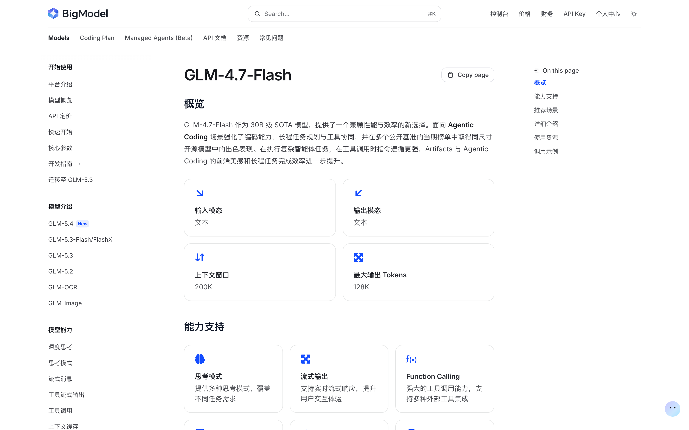

---

## 魔搭 ModelScope API-Inference

**🟢 官方每日魔粒免费池确认（大陆直连 84ms）｜需 +86 手机 + 绑定实名阿里云**

| 项目 | 核实内容 |
| --- | --- |
| 可用模型 | Kimi-K3.1-Pro、DeepSeek-V4.1-Flash-1017、Qwen3.8-27B、GLM-5.3-Flash 等开源与国产热门模型 |
| 接入 | OpenAI 兼容；中国大陆直连 /v1/models 实测 200 OK 仅 84ms |
| Base URL | https://api-inference.modelscope.cn/v1/ |
| 免费类型 | 每日登录领取「魔粒」免费兑换 |
| 鉴权 | 需 +86 手机号注册魔搭、验证邮箱，并强制绑定已实名认证的阿里云账号 |
| 免费额度 | 每日登录送 200 短期魔粒 + 绑阿里云加送 50 短期魔粒/日（约合每日免费调 125–500 次） |
| 重置周期 | 每日登录刷新（短期魔粒 24 小时有效） |
| 有效期 | 长期开放（面向开发者单并发体验） |
| 地区 | 国产（国内直连） |
| 支付／实名门槛 | 无需信用卡，必须完成阿里云实名认证绑定 |
| 隐私政策 | ⚠️ 通用协议未对免费推理接口作单独零留存免训练承诺 |
| 核实结论 | 想在国内免代理白嫖 Kimi K3.1 Pro 或 Qwen3.8-27B 级别大模型，魔搭是目前给得很大方的官方正规路子，前提是你愿意完成阿里云实名绑定并每天登录领魔粒。 |
| 证据状态 | 2026-11-27 官方魔粒与限制文档核实 + 大陆直连列表 200 OK |

> [!warning]
> 动态单并发限流，不能当商业后端高并发接口；短期魔粒不登录领取不会自动累加。

- 官方来源：https://modelscope.cn/docs/model-service/API-Inference/intro

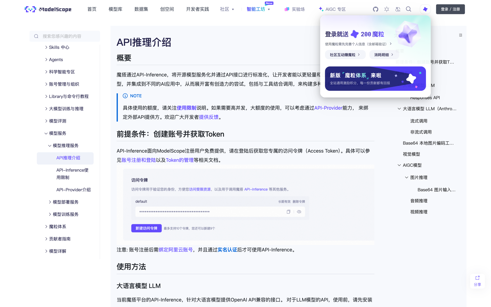

---

## NVIDIA NIM（build.nvidia.com）

**🟡 官方 36 款免费开发端点在架（大陆直连列表 746ms）｜需邮箱注册验证**

| 项目 | 核实内容 |
| --- | --- |
| 可用模型 | 36 个标注 Free Endpoint 的模型（含 kimi-k3.1-pro、Mistral Large 4、nemotron-3.5-super-vl-120b 等） |
| 接入 | OpenAI 兼容；接口大陆直连可达（746ms），网页后台建议国际网络 |
| Base URL | https://integrate.api.nvidia.com/v1 |
| 免费类型 | 开发者原型免费端点（不按 token 计费） |
| 鉴权 | 需邮箱注册并验证加入 NVIDIA Developer Program 生成 API Key |
| 免费额度 | 免费端点最高限流约 40 RPM，账户级开发配额由控制台管理 |
| 重置周期 | 按分钟速率窗口控制 |
| 有效期 | 开发者测试期有效 |
| 地区 | 国际（接口直连可通） |
| 支付／实名门槛 | 无需绑定信用卡 |
| 隐私政策 | ⚠️ 官方明确记录输入输出用于改进 NVIDIA 产品与 AI 模型 |
| 核实结论 | 适合需要免费试用超大参数前沿开源模型的个人开发者，只需邮箱验证免绑卡，但注意数据会被记录。 |
| 证据状态 | 2026-11-27 官方模型中心核实 + /v1/models 实测 200 OK |

> [!warning]
> 仅限带 Free Endpoint 标签的模型免费，且严禁投入生产环境。

- 官方来源：https://build.nvidia.com/models

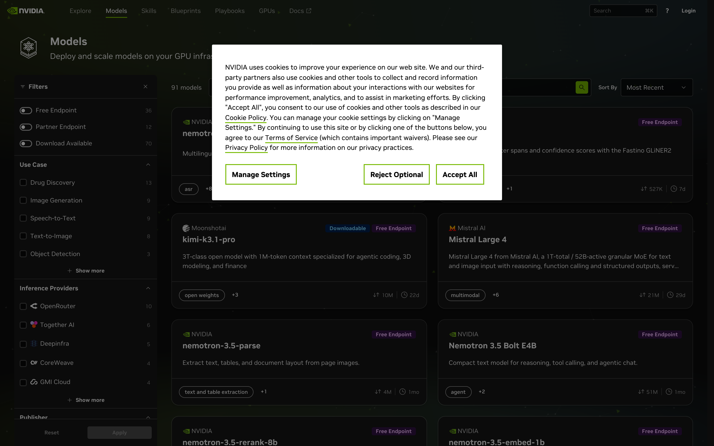

---

## OVHcloud AI Endpoints（免注册免密公共接口）

**🟡 免 Key 实测可调通（大陆直连 200 OK，但连续匿名突发秒弹 429 冷却）**

| 项目 | 核实内容 |
| --- | --- |
| 可用模型 | Qwen3.8-27B、gpt-oss-120b、Mistral-Small-3.2-24B-Instruct-2506、bge-m3（1024 维向量）等 |
| 接入 | OpenAI 兼容；完全免注册、免 Key，中国大陆直连直接通（1366ms） |
| Base URL | https://oai.endpoints.kepler.ai.cloud.ovh.net/v1 |
| 免费类型 | 公开免密试用接口（严格单 IP 限频） |
| 鉴权 | 匿名层无需任何注册或 Key；高频使用需注册 OVH Public Cloud 账户建 Token |
| 免费额度 | 匿名 IP 约 2 RPM 且带严格时段配额（超限 retry_after 约 2967537ms 即约 49 分钟） |
| 重置周期 | 按单 IP 冷却窗口恢复 |
| 有效期 | 官方公开体验期 |
| 地区 | 国际（欧洲节点，国内直连可用） |
| 支付／实名门槛 | 匿名体验零门槛；正式云账户需欧区/国际支付验证 |
| 隐私政策 | 公共匿名接口请勿传入任何敏感信息 |
| 核实结论 | 本机中国大陆直连免 Key 请求 Qwen3.8-27B（1415ms）、gpt-oss-120b（2090ms）与 bge-m3 向量（1087ms）首轮均成功返回真实结果，随后立即触发单 IP 429 冷却。 |
| 证据状态 | 2026-11-27 官方页面截图 + 本机直连/代理免密实测 |

> [!warning]
> 仅适合写脚本时零配置跑通第一条 Demo，绝对扛不住连续对话或 Agent 循环。

- 官方来源：https://endpoints.ai.cloud.ovh.net/

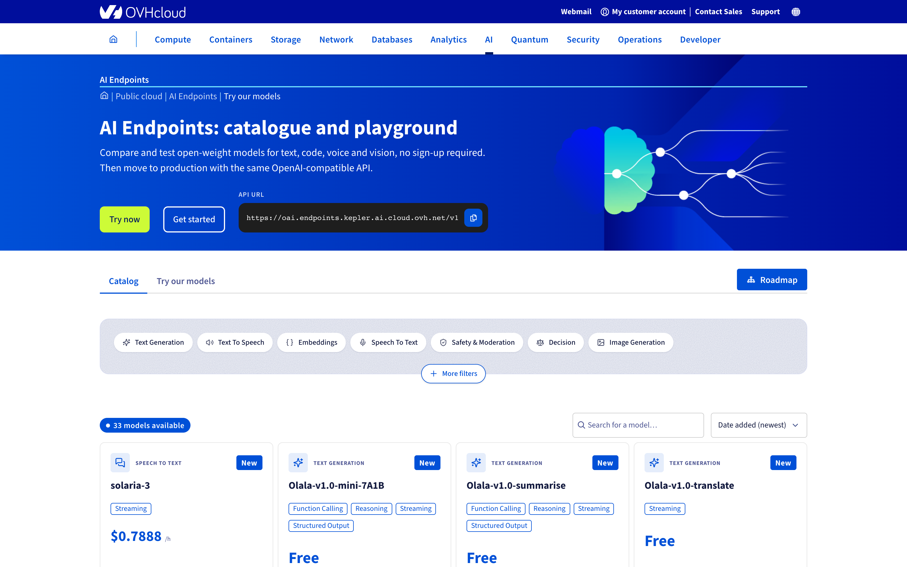

---

## Pollinations（免注册免密社区接口）

**🟡 免 Key 实测可调通（触发新限规：匿名每 IP 每 45 秒仅限 1 次回复）**

| 项目 | 核实内容 |
| --- | --- |
| 可用模型 | openai 等社区聚合文本与基础图像接口 |
| 接入 | OpenAI 兼容路径；大陆直连可通（7836–9470ms），国际代理更快（1696–3534ms） |
| Base URL | https://text.pollinations.ai/openai |
| 免费类型 | 免 Key 公共接口（或免费注册 Key 提额） |
| 鉴权 | 匿名直调免注册免 Key；前往 enter.pollinations.ai 注册免费 Key 可解除 45s 限制 |
| 免费额度 | 匿名每 IP 每 45 秒限 1 次回复（超频返回 HTTP 402 FREE_LIMIT） |
| 重置周期 | 45 秒间隔滚动恢复 |
| 有效期 | 社区尽力提供 |
| 地区 | 国际（国内直连较慢但可用） |
| 支付／实名门槛 | 无需信用卡 |
| 隐私政策 | 公开社区网关，严禁发送隐私或敏感代码 |
| 核实结论 | 本机大陆直连 2 次与代理前 2 次均 200 成功返回，第 3 次快速请求返回 HTTP 402 明确告知新规：1 reply every 45 seconds per IP。 |
| 证据状态 | 2026-11-27 本机双网免密实测 + 官网核对 |

> [!warning]
> 匿名层只能慢速单句问答，高频调用必须去官网领免费 Key 或换 Groq。

- 官方来源：https://pollinations.ai/
- 官方来源：https://enter.pollinations.ai/

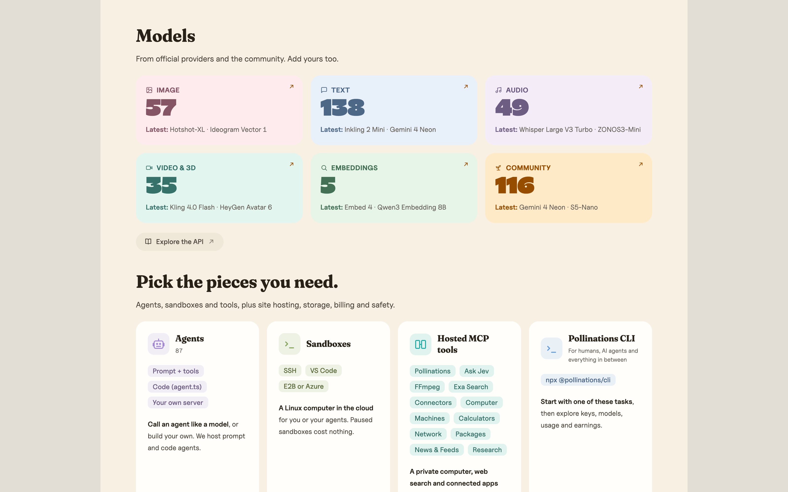

---

## 硅基流动 SiliconFlow

**🟡 官方 L0 免费政策仍在，但本机既有测试号触发 HTTP 402 余额不足拦截**

| 项目 | 核实内容 |
| --- | --- |
| 可用模型 | Qwen/Qwen2.5-7B-Instruct、Qwen/Qwen3-8B、BAAI/bge-m3、PaddlePaddle/PaddleOCR-VL-1.5、FunAudioLLM/SenseVoiceSmall |
| 接入 | OpenAI 兼容；中国大陆直连极快（142–200ms） |
| Base URL | https://api.siliconflow.cn/v1 |
| 免费类型 | 实名账户指定 L0 模型零价调用 |
| 鉴权 | 需 +86 手机号注册并完成实名认证 |
| 免费额度 | L0 免费模型固定限流：对话 1000 RPM / 50000–80000 TPM，向量 2000 RPM / 500000 TPM |
| 重置周期 | 按分钟与日窗口滚动恢复 |
| 有效期 | 长期有效 |
| 地区 | 国产（国内直连） |
| 支付／实名门槛 | 无需信用卡，强制要求实名认证；注意账户欠费会阻断免费模型 |
| 隐私政策 | 按国内标准云 API 协议执行 |
| 核实结论 | 官方文档仍明确实名后免费模型消耗为 0，但本机绑定的旧账户本次请求 Qwen/Qwen2.5-7B-Instruct 与 PaddleOCR-VL-1.5 均返回 HTTP 402（code 30001），说明不能盲目假设有 Key 就永远能调通。 |
| 证据状态 | 2026-11-27 官方限流文档截图 + 本机真实 402 响应记录 |

> [!warning]
> 最容易踩坑的是同名模型前加了 Pro/ 或 LoRA/ 前缀变成收费版，一旦把赠金扣穿就会触发 402。

- 官方来源：https://docs.siliconflow.cn/cn/userguide/faqs/rate-limit-and-upgradation

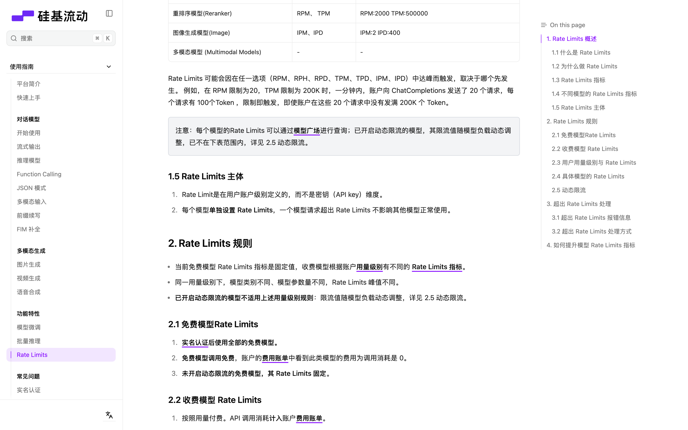

---

## Cloudflare Workers AI

**🟡 官方每日 10000 Neurons 免费重置确认｜适合轻量边缘小模型与向量**

| 项目 | 核实内容 |
| --- | --- |
| 可用模型 | Workers Free 开放的轻量开源对话、翻译与 Embedding 模型 |
| 接入 | Cloudflare REST（含专属 account_id）或 Worker 绑定；直连 743ms / 代理 544ms |
| Base URL | https://api.cloudflare.com/client/v4/accounts/{account_id}/ai/run/{model} |
| 免费类型 | 每日重置免费算力包 |
| 鉴权 | 需注册 Cloudflare 账号获取 Account ID 与 API Token |
| 免费额度 | 每天合计 10000 Neurons 免费（按算力计而非直接等于 token 数） |
| 重置周期 | 每天 00:00 UTC 自动清零恢复 |
| 有效期 | 长期有效 |
| 地区 | 国际（国内直连可通） |
| 支付／实名门槛 | Workers Free 计划免绑卡（超额即停不产生账单）；部分大模型需绑卡升级 Paid |
| 隐私政策 | 默认不将客户推理负载用于训练模型 |
| 核实结论 | 适合本来就在用 Cloudflare Workers 部署个人小工具或博客接口的开发者顺手白嫖，日均约百来次短对话够用。 |
| 证据状态 | 2026-11-27 官方定价文档截图核实 |

> [!warning]
> 接口 URL 结构带 account_id，接到标准 OpenAI 客户端前需确认兼容路径。

- 官方来源：https://developers.cloudflare.com/workers-ai/platform/pricing/

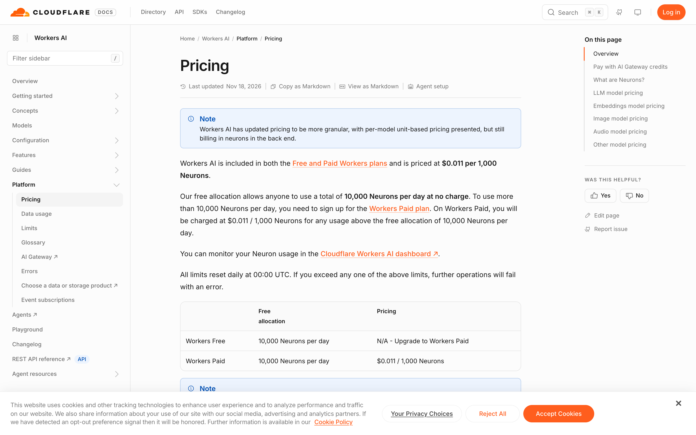

---

## Cerebras Cloud（免卡免费层已取消）

**🟠 门槛收紧：必须绑定信用卡才给一次性 $5 / 30 天试用**

| 项目 | 核实内容 |
| --- | --- |
| 可用模型 | qwen-3.8-27b（300 RPM）、gpt-oss-120b（5 RPM / 1M TPD） |
| 接入 | OpenAI 兼容；登录受 reCAPTCHA 保护，需国际网络 |
| Base URL | https://api.cerebras.ai/v1 |
| 免费类型 | 绑卡一次性 30 天试用金 |
| 鉴权 | 需国际网络注册账号、过 reCAPTCHA 并绑定有效支付方式 |
| 免费额度 | 绑卡验证后发放一次性 $5 Free Trial（30 天有效） |
| 重置周期 | 一次性试用，到期或用尽即暂停，不按月重置 |
| 有效期 | 激活后 30 天 |
| 地区 | 国际（需代理 + 外币卡） |
| 支付／实名门槛 | ⚠️ 必须绑定有效信用卡/支付方式才能激活试用额度 |
| 隐私政策 | ✅ 官方承诺零留存且绝不用于模型训练 |
| 核实结论 | 虽然推理速度极快且隐私条款极佳，但取消免绑卡免费档后已不再适合国内无外币卡用户长期白嫖。 |
| 证据状态 | 2026-11-27 官方定价与限流文档核实 |

> [!warning]
> 不要再按旧攻略去空手注册找免费 Key；好在 $5 用完会自动停机，不买 PayGo 不会反撸扣费。

- 官方来源：https://www.cerebras.ai/pricing
- 官方来源：https://inference-docs.cerebras.ai/support/rate-limits

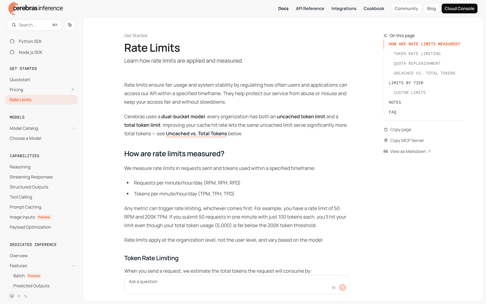

---

## Mistral AI La Plateforme（免费 API 已取消）

**🔴 踩坑劝退：原 Experiment 免费 API 已取消，创建 API Key 必须绑卡付费**

| 项目 | 核实内容 |
| --- | --- |
| 可用模型 | 无免费 API 模型（Free mode 仅限网页端 Vibe / Studio 试用） |
| 接入 | OpenAI 兼容；需国际网络且强制要求开通计费 |
| Base URL | https://api.mistral.ai/v1 |
| 免费类型 | 已无免费 API 层 |
| 鉴权 | 注册账号后若要创建 API Key 必须先激活 Billing 并绑定信用卡 |
| 免费额度 | API 端 0 免费额度（全部走 Pay-as-you-go 按量计费） |
| 重置周期 | 不适用 |
| 有效期 | 已取消免费 API |
| 地区 | 国际 |
| 支付／实名门槛 | 🔴 强制绑定支付方式并开启按量计费才允许建 API Key |
| 隐私政策 | Free/Pro 默认允许用于训练改进，需手动在设置中 Opt-out 关闭 |
| 核实结论 | 全网大量旧白嫖清单还在把 Mistral / Codestral 列为免卡神站，本次核查官方文档实锤 Free mode 已彻底踢除 API 权限。 |
| 证据状态 | 2026-11-27 官方 Usage and limits 文档实锤截图 |

> [!warning]
> 绑卡开通后就是真金白银按量扣费，不再属于免费白嫖范畴。

- 官方来源：https://docs.mistral.ai/admin/billing-usage/usage-limits

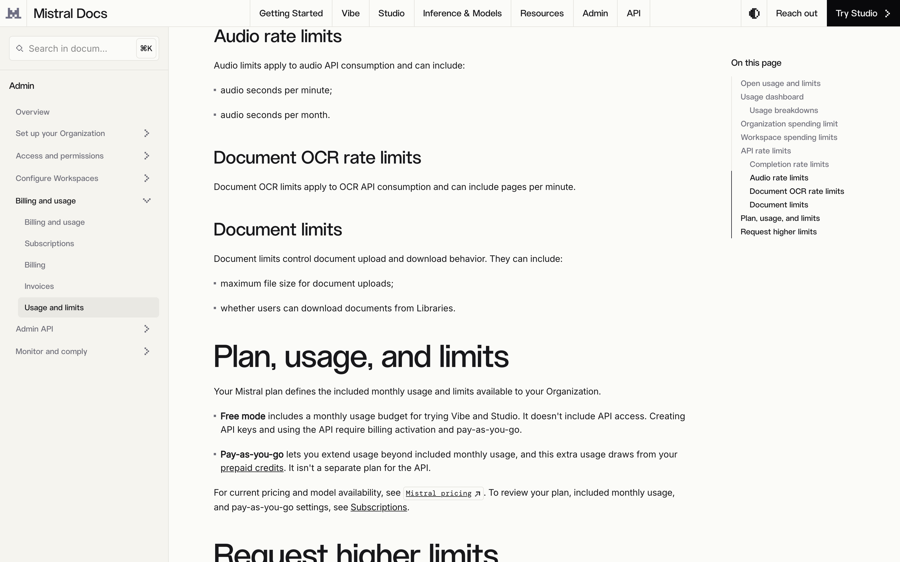

---

## Hugging Face Inference Providers（月赠已取消）

**🔴 踩坑劝退：免费用户月度额度已归零（None），旧 $0.10/月已失效**

| 项目 | 核实内容 |
| --- | --- |
| 可用模型 | 无免费托管推理额度 |
| 接入 | OpenAI 兼容；需国际网络且需充值或订 PRO |
| Base URL | https://router.huggingface.co/v1 |
| 免费类型 | 已取消免费账户月赠 |
| 鉴权 | 免费注册账号已无推理赠金，需买 credits 或升 PRO（$9/月） |
| 免费额度 | Free Users 月度赠送额度 = None |
| 重置周期 | 无 |
| 有效期 | 免费层已停供 |
| 地区 | 国际 |
| 支付／实名门槛 | 🔴 必须充值或付费订阅才可调用托管推理 API |
| 隐私政策 | 按具体下游推理商条款执行 |
| 核实结论 | 网页逛 Spaces Demo 依然免费，但拿免费 HF Token 调 router.huggingface.co 的路子已经彻底堵死。 |
| 证据状态 | 2026-11-27 官方 Pricing 页核实截图 |

> [!warning]
> 旧脚本继续调会直接报额度不足。

- 官方来源：https://huggingface.co/docs/inference-providers/pricing

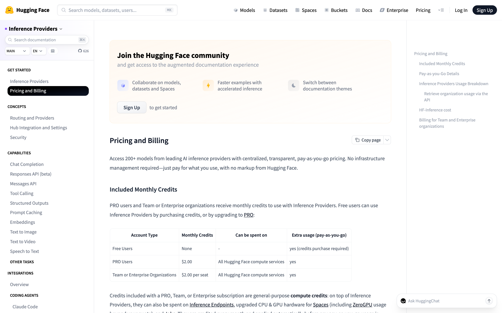

---

## GitHub Models（独立免费推理 API 已退役）

**🔴 已退役：本机持有效 GitHub Token 复测确认不再返回大模型补全**

| 项目 | 核实内容 |
| --- | --- |
| 可用模型 | 独立 API 已下线（仅保留编辑器内 Copilot 自身体系） |
| 接入 | 已停服 |
| Base URL | https://models.github.ai/inference |
| 免费类型 | 已退役 |
| 鉴权 | 原 GitHub PAT 免卡调 GPT-4 接口已于 2026-07-30 退役 |
| 免费额度 | 无 |
| 重置周期 | 无 |
| 有效期 | 已于 2026-07-30 退役 |
| 地区 | 国际 |
| 支付／实名门槛 | 不适用 |
| 隐私政策 | 不适用 |
| 核实结论 | 本机实测请求 /catalog/models 仅返回 4 字节空数组，POST 推理仅回 2 字节纯文本 OK 而非对话 JSON，彻底印证退役事实。 |
| 证据状态 | 2026-11-27 官方退役说明 + 本机 GITHUB_TOKEN 实测验证 |

> [!warning]
> 看到还在教用 GitHub Token 白嫖 GPT-4 API 的过时文章可直接划走。

- 官方来源：https://docs.github.com/en/github-models
- 官方来源：https://hyphentech.top/free-ai-api-radar-2026-09-23/

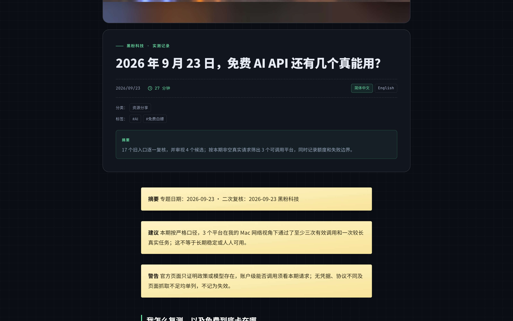

---

## 重点提醒

- OpenRouter 当前 10 个零价文本模型 100% 为单供应商承载：gemma-4-26b-a4b-it:free 实测连续第 2 次请求即触发 429，Recraft 免费生图 2026-11-28 下架，切勿单点硬绑。
- 硅基流动虽保留 L0 免费型号，但本机旧账户实测返回 HTTP 402（code 30001 余额不足），且带 Pro/ 或 LoRA/ 前缀的同名模型会扣费，使用前必须确认实名与钱包状态。
- 代码与隐私红线：Google AI Studio 免费层、NVIDIA NIM 免费端点及多数 OpenRouter :free 节点均明确会记录输入输出改进产品；涉及公司代码或密钥请用默认不训练的智谱 API 或直接上 Ollama / LocalBrain 本地部署。

## 我的接入优先级

- 第一顺位（速度与工具调用兼顾，需国际网络 + 邮箱/Google 免卡注册）：Groq + Google Gemini 3.5 Flash-Lite。
- 第二顺位（国内直连零代理，需 +86 手机号 + 实名认证）：智谱 GLM-4.7-Flash + 魔搭每日魔粒池。
- 第三顺位（超长上下文补充，需免卡注册 + 自动容错路由）：OpenRouter 在架零价模型（经黑粉盒子自动冷却降级）。
- 第四顺位（零账单绝对隐私终极兜底）：M5 Pro / 本地电脑跑 Ollama、MLX 与方寸智匣 LocalBrain。

> [!summary] 最终结论
> 2026 年 11 月底的免费 API 已经告别「随便抄个旧教程就能无限刷」的时代：免卡长期口粮集中在 Groq、Gemini Flash-Lite、OpenRouter 精选在架款（需国际网络）以及智谱 Flash、魔搭魔粒（国内直连需手机实名）。把稳用主力和降级备胎交给黑粉盒子统一接管，敏感重活留给本机开源模型，才是年底最省心不花钱的组合。

---

## 🧰 我做的工具

这些工具都由我持续维护。预览版会明确标注，下载、更新和已知边界以发行页为准。

> [!info] 黑粉盒子 HyphenBox
> **状态：** 正式迭代
>
> 免费大模型 API 雷达：持续复测可用性，本地统一接口，Key 只存本机
>
> [下载与更新：黑粉盒子 HyphenBox](https://github.com/HackerChi-Hub/hyphenbox-release/releases)

> [!info] 方寸智匣 LocalBrain
> **状态：** 正式迭代
>
> 本地模型的多模态 MCP 工具箱：TTS / Whisper / 视频生成一站接入
>
> [下载与更新：方寸智匣 LocalBrain](https://github.com/HackerChi-Hub/localbrain-releases/releases)

---

> [!quote] 黑粉科技
> **让AI成为你的超能力**
> 本地部署 · 免费白嫖 · 自制软件
> [黑粉科技](https://hyphentech.top)
