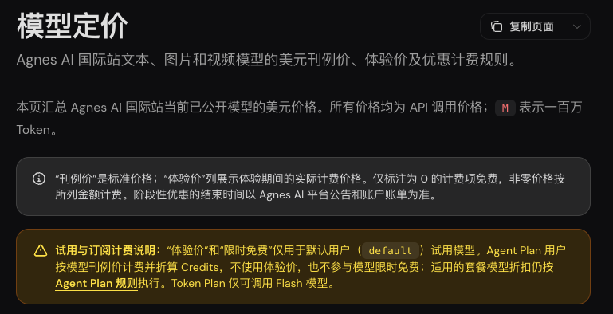
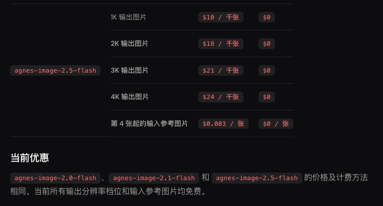
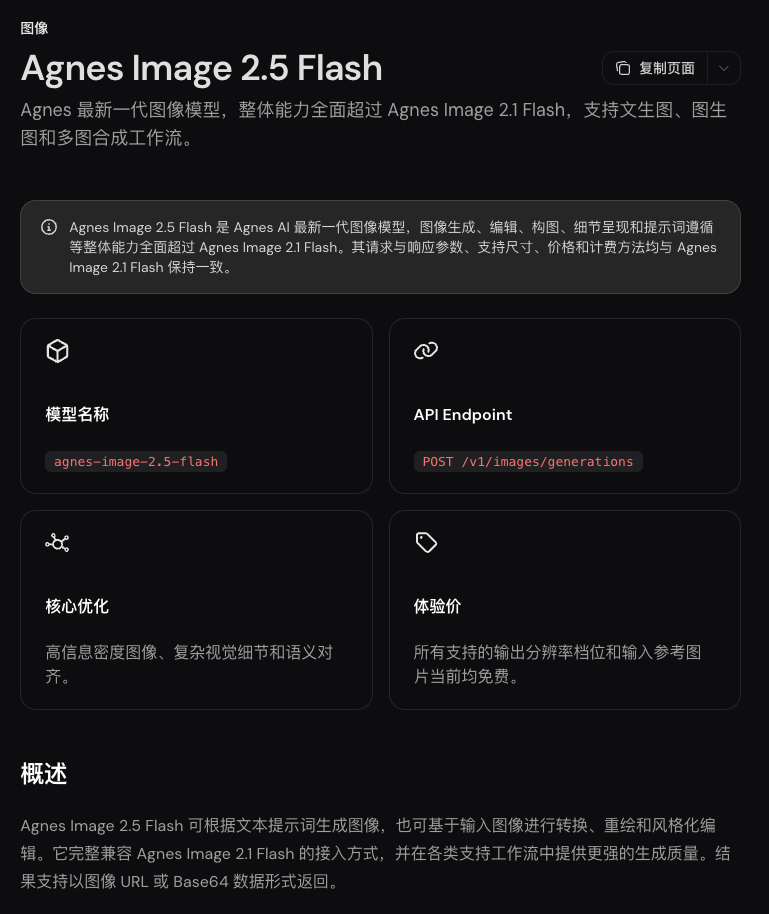

> [!abstract]
> 先看真实出图，再看默认试用档的免费条件
> 黑粉科技 · 2026年11月2日资料与实测

想把生图接进自己的工具，最有用的东西就是一张真正由接口返回的图。我给Agnes Image 2.5 Flash发了一条“机器人给幼苗浇水”的任务，图片收全用了15.688秒。先看原图。


画面里有机器人、手持水壶、幼苗和水流，主要对象与动作都对上了。这次请求选的是agnes-image-2.5-flash，要求1K、16∶9、一次一张；收到的原文件是1312×736的PNG，没有放大成所谓4K样片。

## 免费给谁用，这一句先说清

11月2日采集的官网定价页，把这款图片模型的体验价列为零。**这是默认用户试用档的阶段优惠。**同页说明：Agent Plan按刊例价折算积分，不参加这项限免。已经买了套餐，也不能直接照着“零价”三个字理解自己的计费。





本次提交前，程序检查了对应型号的官方即时价格，确认零价才发出请求，也没有在失败时切到收费型号。最终账户账单还没有读取，所以我展示的是当前政策和实际产物，不把它写成已核销的零元账单。

入口从[Agnes官网](https://agnes-ai.com/)进入，自己创建账户和密钥；再打开[图片模型文档](https://wiki.agnes-ai.com/zh-Hans/docs/agnes-image-25-flash)。免费条件看定价页，参数看模型文档，两处各管一件事。

## 接口怎么接，参数怎样填



文生图使用POST /v1/images/generations。接口地址是https://apihub.agnes-ai.com/v1/images/generations。下面是本轮实际使用的请求体。直连时按官网配置自己的密钥；本轮经黑粉盒子转发，没有额外重复执行直连请求。

```JSON
{
  "model": "agnes-image-2.5-flash",
  "prompt": "白色摄影棚里，一台青绿色的小机器人拿着浇水壶，正在给一盆绿色幼苗浇水。完整展示机器人、浇水壶和花盆，水流清楚可见，柔和自然光，没有人物，没有文字。",
  "size": "1K",
  "ratio": "16:9",
  "n": 1
}
```

size是输出档位，ratio是画幅。像点餐时先选大杯小杯，再选冷饮热饮，这两个选项合在一起才确定你要的规格。1K不是“精确宽度1000像素”；本次1312×736就说明，最后还得查看原文件尺寸。

文档也支持图生图、多图合成和更高分辨率。它们和这一张文生图属于不同操作，本篇没有拿文生图结果替它们做效果保证。需要参考图时，按文档把图片放进extra_body.image；私有原图不要为了一个公开链接随手传到图床。

## 这张图够不够用，怎样验收

我会先看任务里的名词和动词，再看画面细节：机器人是否真的拿着壶，水是否流向幼苗，手、壶柄和水流有没有穿插错误。只检查“下载到一张图片”，会漏掉真正影响使用的部分。

| 本次项目 | 实际记录 |
| --- | --- |
| 请求型号 | agnes-image-2.5-flash |
| 输出档位／画幅 | 1K／16:9 |
| 原文件 | PNG，1312×736 |
| 完整上游耗时 | 15.688秒，不含本机排队 |
| 执行型号回报 | 服务未返回该字段 |
| 次数 | 1次文生图，未做批量稳定性测试 |

另一个免密绘图入口Pollinations，我也发了机器人浇水的任务。它返回了图片，但主体变成了人物。这张失败图会在免费绘图目录篇保留：接口回200和任务做对，是两层验收。

> [!quote] 我的判断
> 想给个人工具补一个文生图入口，可以先用这组参数跑一张自己的任务。默认试用档的阶段零价是吸引力；套餐差异、实际尺寸和任务遵循，是决定你能不能接着用的三件事。

## 主要查证来源

- [Agnes Image 2.5 Flash 官方文档](https://wiki.agnes-ai.com/zh-Hans/docs/agnes-image-25-flash)
- [Agnes 官方定价与试用计费](https://wiki.agnes-ai.com/zh-Hans/docs/pricing)
- [Agnes 官网](https://agnes-ai.com/)


---

## 🧰 我做的工具

这些工具都由我持续维护。预览版会明确标注，下载、更新和已知边界以发行页为准。

> [!info] 黑粉助手 HyphenAssistant
> **状态：** 正式迭代
>
> 手机浏览器接续电脑上的 DeepSeek Harness 会话；需本人配对、电脑与原服务在线，模型费用沿用原配置
>
> [下载与更新：黑粉助手 HyphenAssistant](https://github.com/HackerChi-Hub/hyphen-assistant-releases/releases)

> [!info] 黑粉盒子 HyphenBox
> **状态：** 正式迭代
>
> 免费大模型 API 雷达：持续复测可用性，本地统一接口，Key 只存本机
>
> [下载与更新：黑粉盒子 HyphenBox](https://github.com/HackerChi-Hub/hyphenbox-release/releases)

> [!info] 方寸智匣 LocalBrain
> **状态：** 正式迭代
>
> 本地模型的多模态 MCP 工具箱：TTS / Whisper / 视频生成一站接入
>
> [下载与更新：方寸智匣 LocalBrain](https://github.com/HackerChi-Hub/localbrain-releases/releases)

> [!info] ScreenLex 光影词库
> **状态：** 正式迭代
>
> 看美剧顺手把生词背了，Mac/Windows 双平台，免费
>
> [下载与更新：ScreenLex 光影词库](https://github.com/HackerChi-Hub/screenlex-download/releases)

> [!info] 黑粉录屏 HyphenScreen
> **状态：** 正式迭代
>
> 录屏 + 智能剪辑一体：达芬奇式时间线、自动打码、导出前成片体检，免费
>
> [下载与更新：黑粉录屏 HyphenScreen](https://github.com/HackerChi-Hub/HyphenScreen-Releases/releases)

---

> [!quote] 黑粉科技
> **让AI成为你的超能力**
> 本地部署 · 免费白嫖 · 自制软件
> [黑粉科技](https://hyphentech.top)
