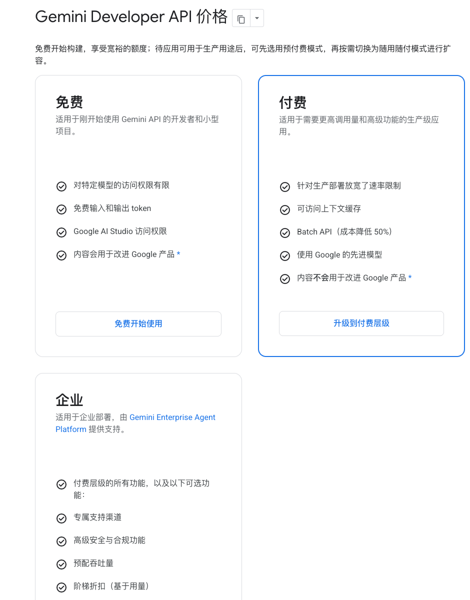
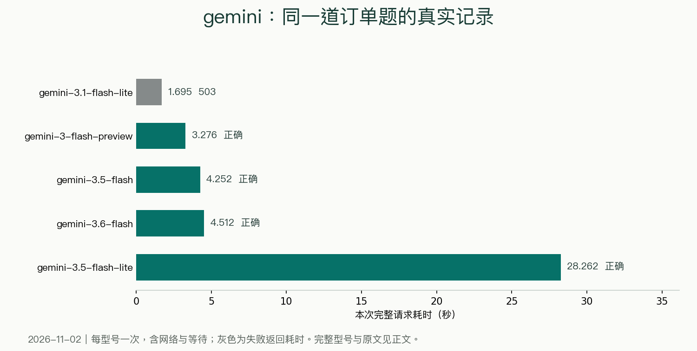

> [!abstract]
> 从两次503，到换型号完成任务
> 黑粉科技 · 2026年11月2日资料与实测

第一次调用Gemini，两道题都只收到503服务繁忙。我换成gemini-3.5-flash-lite后，订单和中文改写都回来了：订单等了28.262秒，改写等了18.393秒。这段过程，比一句“Gemini免费可用”更能说明实际体验。



## 先给同一份题，不用不同提示词比速度

订单里两台设备A各1200元、三台设备B各350元，加80元运费，减130元优惠，正确总价3400元。要求返回商品明细和固定字段。另一个任务是把技术说明压成两句中文，不能丢掉原来的四项要求。

本次用已有账户，经本机黑粉盒子把请求转发给对应平台。计时从本机发出请求到收完回答，包含网络和服务等待；每个型号的订单题只跑了一次。账户配置为免费档，未读取最终账单。

| 请求型号／任务 | 完整耗时 | 实际返回 |
| --- | --- | --- |
| gemini-3.1-flash-lite<br>订单 | 1.695秒 | 503；调用失败 |
| gemini-3.1-flash-lite<br>改写 | 1.422秒 | 503；调用失败 |
| gemini-3-flash-preview<br>订单 | 3.276秒 | 200；JSON字段及金额与标准答案一致 |
| gemini-3.5-flash<br>订单 | 4.252秒 | 200；JSON字段及金额与标准答案一致 |
| gemini-3.6-flash<br>订单 | 4.512秒 | 200；JSON字段及金额与标准答案一致 |
| gemini-3.5-flash-lite<br>订单 | 28.262秒 | 200；JSON字段及金额与标准答案一致 |
| gemini-3.5-flash-lite<br>改写 | 18.393秒 | 200；已返回，四项信息保留 |

> 本机经黑粉盒子转发；每行一次请求，非多轮平均。耗时包含网络和上游等待。



最先请求的gemini-3.1-flash-lite，两次错误都写明当前需求过高。后面换型号重新发原任务，没有改得更简单，也没有把错误页从记录里删掉。

## 28秒以后，拿到的是完整结果

```JSON
{
  "items": [
    {
      "name": "设备A",
      "quantity": 2,
      "unit_price": 1200,
      "subtotal": 2400
    },
    {
      "name": "设备B",
      "quantity": 3,
      "unit_price": 350,
      "subtotal": 1050
    }
  ],
  "shipping": 80,
  "discount": 130,
  "total": 3400
}
```

更换型号后的订单原始返回

商品名、数量、小计、运费、优惠和总价都与标准答案一致。28秒里包含网络和服务端等待，也可能包含模型内部处理；这次没有保存足够的阶段计时，不能把全部时间都算作“思考”。

```中文改写原始返回
每天自动重置免费额度，每任务限生成一张图。若失败会保留错误信息，需自行申请密钥使用。
```

后面另外三个型号的订单请求分别是3.276秒、4.252秒和4.512秒，也都做对了。名字里有Lite，不等于每次端到端都更快；选择时把你真正要完成的任务跑一遍，比根据名字猜快慢可靠。

## 免费档和付费档，接入时别混在一起

从[Google AI Studio密钥页](https://aistudio.google.com/api-keys)创建自己的项目和密钥，按[官方快速开始](https://ai.google.dev/gemini-api/docs/quickstart)接入。免费权益按项目、型号和支持地区生效；同一个品牌名，文字理解、图片生成和语音生成的权益也各不相同。本文只把这次跑过的文字能力列为实测。

官网新手文档当前以Interactions接口演示，而本轮黑粉盒子使用已有文字路由。文档推荐的最新型号与本文实际请求型号分开看：表里保留的是当时发出的真实名字，不用新名字替换旧记录。

在第三方客户端配置时，选择它明确支持的Gemini接口或按官方文档设置兼容接口。Google密钥、其他平台密钥和本地路由令牌是不同钥匙，填错位置无法互相代用。

## 遇到繁忙，软件该怎么处理

503适合稍后重试，429表示受到限流；二者都应保留原始错误和任务状态。文字请求尚可重新发送，图片、视频等异步任务还需要确认原任务有没有提交成功，避免重复生成。

我会在界面里让用户知道正在等待、收到繁忙，还是已经拿到完整答案。把“正在生成”一直挂着，最后悄悄换成另一家服务，既看不出失败，也没法比较实际体验。

> [!quote] 我的判断
> Gemini的免费文字入口值得放进候选，但型号必须单独试。本次已有完整正确回答，也有503和较长等待。对等待敏感的任务，先拿自己的短任务测一遍完整耗时，再决定默认型号。

## 主要查证来源

- [Gemini API官方定价](https://ai.google.dev/gemini-api/docs/pricing)
- [Google AI Studio密钥页](https://aistudio.google.com/api-keys)
- [Gemini快速开始](https://ai.google.dev/gemini-api/docs/quickstart)
- [Gemini调用限额](https://ai.google.dev/gemini-api/docs/rate-limits)


---

## 🧰 我做的工具

这些工具都由我持续维护。预览版会明确标注，下载、更新和已知边界以发行页为准。

> [!info] 黑粉助手 HyphenAssistant
> **状态：** 正式迭代
>
> 手机浏览器接续电脑上的 DeepSeek Harness 会话；需本人配对、电脑与原服务在线，模型费用沿用原配置
>
> [下载与更新：黑粉助手 HyphenAssistant](https://github.com/HackerChi-Hub/hyphen-assistant-releases/releases)

> [!info] 黑粉盒子 HyphenBox
> **状态：** 正式迭代
>
> 免费大模型 API 雷达：持续复测可用性，本地统一接口，Key 只存本机
>
> [下载与更新：黑粉盒子 HyphenBox](https://github.com/HackerChi-Hub/hyphenbox-release/releases)

> [!info] 方寸智匣 LocalBrain
> **状态：** 正式迭代
>
> 本地模型的多模态 MCP 工具箱：TTS / Whisper / 视频生成一站接入
>
> [下载与更新：方寸智匣 LocalBrain](https://github.com/HackerChi-Hub/localbrain-releases/releases)

> [!info] ScreenLex 光影词库
> **状态：** 正式迭代
>
> 看美剧顺手把生词背了，Mac/Windows 双平台，免费
>
> [下载与更新：ScreenLex 光影词库](https://github.com/HackerChi-Hub/screenlex-download/releases)

> [!info] 黑粉录屏 HyphenScreen
> **状态：** 正式迭代
>
> 录屏 + 智能剪辑一体：达芬奇式时间线、自动打码、导出前成片体检，免费
>
> [下载与更新：黑粉录屏 HyphenScreen](https://github.com/HackerChi-Hub/HyphenScreen-Releases/releases)

---

> [!quote] 黑粉科技
> **让AI成为你的超能力**
> 本地部署 · 免费白嫖 · 自制软件
> [黑粉科技](https://hyphentech.top)
