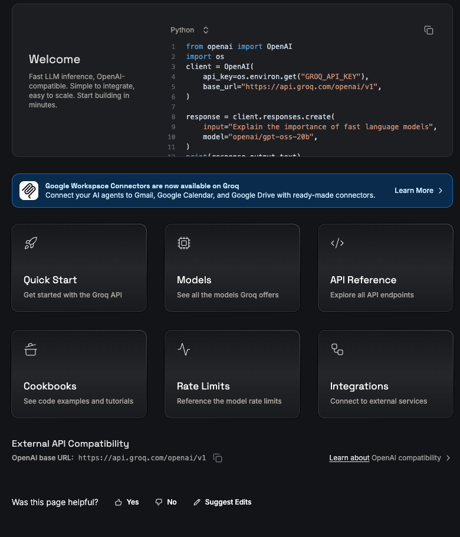
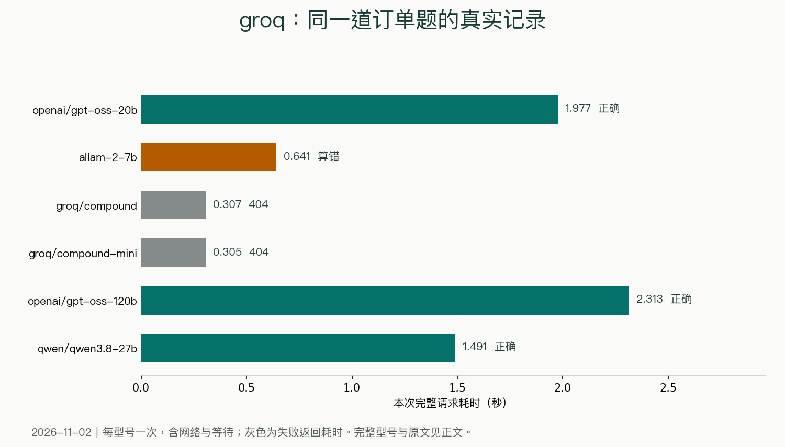
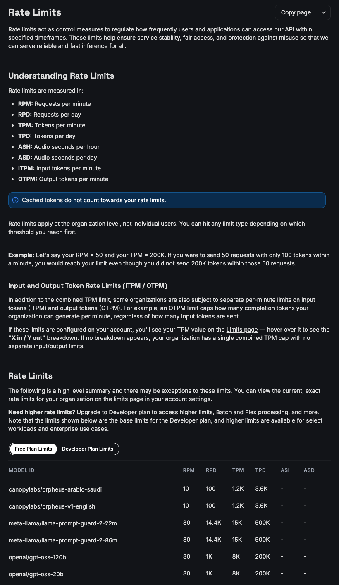

> [!abstract]
> 两秒拿到订单结果，也保留一次加总错误
> 黑粉科技 · 2026年11月2日资料与实测

同一份订单，Groq上的gpt-oss-20b在1.977秒后给出正确明细；换成allam-2-7b，小计都列对了，总价却写成4530元。免费接口值不值得接，先看这两个回答，比只看平台介绍更直接。



## 订单很简单，答案也能手算

我让模型从一段中文里提取商品、数量、单价、小计、运费、优惠和总价，按固定JSON字段返回。JSON就像一张每格都有名字的表单，程序才能继续读取“总价”这格；少字段、半截内容和改了商品名，都会影响后面的处理。

```本次真实输入
这是自制测试数据。只返回JSON，不加代码围栏。订单：设备A每台1200元，买2台；设备B每台350元，买3台；运费80元；优惠130元。输出字段items（包含name、quantity、unit_price、subtotal），shipping、discount、total。所有金额用整数。
```

```手工标准答案
1200 × 2 + 350 × 3 + 80 − 130 = 3400（元）
```

本次用已有账户，经本机黑粉盒子把请求转发给对应平台。计时从本机发出请求到收完回答，包含网络和服务等待；每个型号的订单题只跑了一次。账户配置为免费档，未读取最终账单。

## gpt-oss-20b：明细、总价都对上

```JSON
{"items":[{"name":"设备A","quantity":2,"unit_price":1200,"subtotal":2400},{"name":"设备B","quantity":3,"unit_price":350,"subtotal":1050}],"shipping":80,"discount":130,"total":3400}
```

原始返回

这份回答把设备A和设备B的名称、小计以及3400元总价都写对了。再让它把四条技术要求改成两句话，0.956秒收完，保留了每天重置、一次一图、失败提示和自己申请密钥四项信息。

```中文改写原始返回
每天免费额度重置，每个任务仅能生成一张图。若生成失败会保留错误信息，使用前请自行申请密钥。
```

## 同平台换型号，结果并不一样

| 请求型号／任务 | 完整耗时 | 实际返回 |
| --- | --- | --- |
| openai/gpt-oss-20b<br>订单 | 1.977秒 | 200；JSON字段及金额与标准答案一致 |
| openai/gpt-oss-20b<br>改写 | 0.956秒 | 200；已返回，四项信息保留 |
| allam-2-7b<br>订单 | 0.641秒 | 200；返回了内容，但总价错误 |
| groq/compound<br>订单 | 0.307秒 | 404；调用失败 |
| groq/compound-mini<br>订单 | 0.305秒 | 404；调用失败 |
| openai/gpt-oss-120b<br>订单 | 2.313秒 | 200；JSON字段及金额与标准答案一致 |
| qwen/qwen3.8-27b<br>订单 | 1.491秒 | 200；JSON字段及金额与标准答案一致 |

> 本机经黑粉盒子转发；每行一次请求，非多轮平均。耗时包含网络和上游等待。



gpt-oss-120b和qwen/qwen3.8-27b也把订单做对了。本轮分别用了2.313秒和1.491秒；这只是同一道小题各跑一次的记录，不能从这张表推出所有任务的性能排行。

```JSON
{
  "items": [
    {
      "name": "Device A",
      "quantity": 2,
      "unit_price": 1200,
      "subtotal": 2400
    },
    {
      "name": "Device B",
      "quantity": 3,
      "unit_price": 350,
      "subtotal": 1050
    }
  ],
  "shipping": 80,
  "discount": 130,
  "total": 4530
} 
```

allam-2-7b原始返回

4530和正确答案相差1130元。回答里的2400、1050、80、130都在，却没有算出对应的总和。要把模型接进订单工具，金额仍应交给确定的计算代码，模型负责提取。让它直接给一个看着工整的JSON，再把total入账，出错时会很安静。

两个compound旧配置返回404，本次没有拿到答案；不要在客户端保留一个历史名字，就当它今天仍可用。

## 去哪里领密钥，客户端填哪几项

先打开[Groq控制台密钥页](https://console.groq.com/keys)，创建自己的密钥。支持兼容接口的客户端通常填三项：基础地址https://api.groq.com/openai/v1、密钥、精确模型名openai/gpt-oss-20b。模型名前面的groq/是本轮本地路由前缀，直连Groq时不要照抄这个前缀。

```官方SDK接法示例
from groq import Groq

client = Groq()  # 从环境变量GROQ_API_KEY读取
result = client.chat.completions.create(
    model="openai/gpt-oss-20b",
    messages=[{"role": "user", "content": "把这句话改得更容易懂：每天重置免费额度。"}],
)
print(result.choices[0].message.content)
```

按官方快速开始安装groq包再运行。示例默认读取环境变量，密钥别写进要分享的脚本或截图。实际实测使用的是已有免费账户；这段SDK代码用于说明直连接法，没有额外发出一次重复请求。



免费能用多少，要看当前账户和具体型号。官方限额页还列出Developer基础限额，不能把整张表当成每个免费用户的待遇。遇到429先等返回建议的时间，避免连续刷新把一个任务变成一串失败请求。

> [!quote] 我的判断
> 这次的gpt-oss-20b适合先试信息整理和中文改写：两道任务完成，完整请求都很短。涉及钱和固定格式，提取后仍要校验字段、自己计算。平台快不快与任务对不对，分别看结果。

## 主要查证来源

- [Groq官网介绍](https://console.groq.com/docs/overview)
- [创建Groq密钥](https://console.groq.com/keys)
- [Groq快速开始](https://console.groq.com/docs/quickstart)
- [Groq官方限流](https://console.groq.com/docs/rate-limits)


---

## 🧰 我做的工具

这些工具都由我持续维护。预览版会明确标注，下载、更新和已知边界以发行页为准。

> [!info] 黑粉助手 HyphenAssistant
> **状态：** 正式迭代
>
> 手机浏览器接续电脑上的 DeepSeek Harness 会话；需本人配对、电脑与原服务在线，模型费用沿用原配置
>
> [下载与更新：黑粉助手 HyphenAssistant](https://github.com/HackerChi-Hub/hyphen-assistant-releases/releases)

> [!info] 黑粉盒子 HyphenBox
> **状态：** 正式迭代
>
> 免费大模型 API 雷达：持续复测可用性，本地统一接口，Key 只存本机
>
> [下载与更新：黑粉盒子 HyphenBox](https://github.com/HackerChi-Hub/hyphenbox-release/releases)

> [!info] 方寸智匣 LocalBrain
> **状态：** 正式迭代
>
> 本地模型的多模态 MCP 工具箱：TTS / Whisper / 视频生成一站接入
>
> [下载与更新：方寸智匣 LocalBrain](https://github.com/HackerChi-Hub/localbrain-releases/releases)

> [!info] ScreenLex 光影词库
> **状态：** 正式迭代
>
> 看美剧顺手把生词背了，Mac/Windows 双平台，免费
>
> [下载与更新：ScreenLex 光影词库](https://github.com/HackerChi-Hub/screenlex-download/releases)

> [!info] 黑粉录屏 HyphenScreen
> **状态：** 正式迭代
>
> 录屏 + 智能剪辑一体：达芬奇式时间线、自动打码、导出前成片体检，免费
>
> [下载与更新：黑粉录屏 HyphenScreen](https://github.com/HackerChi-Hub/HyphenScreen-Releases/releases)

---

> [!quote] 黑粉科技
> **让AI成为你的超能力**
> 本地部署 · 免费白嫖 · 自制软件
> [黑粉科技](https://hyphentech.top)
