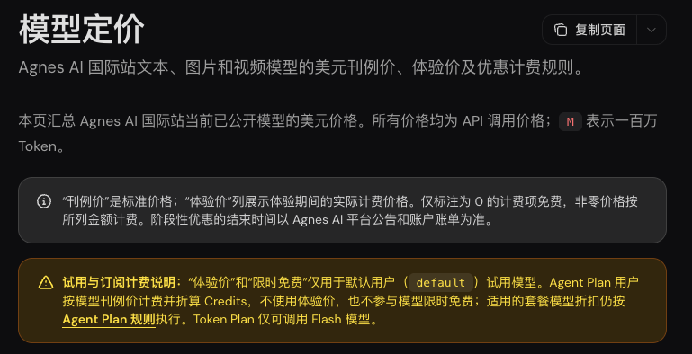
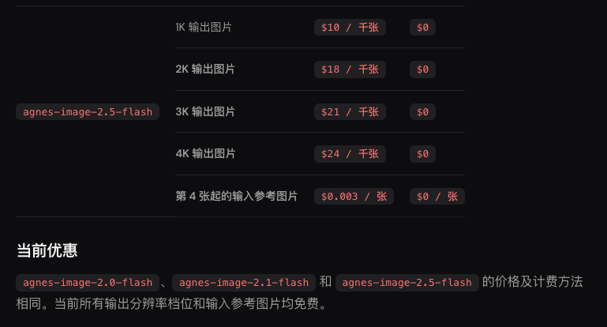

> [!abstract]
> 先看原图，再选免密、周期额度或试用积分
> 黑粉科技 · 2026年11月2日资料与实测

免费的绘图入口里，既有不用密钥的公共服务，也有注册后按额度生成的接口，还有完成任务换积分的方式。这一篇把已经收集的图片方案分开讲。最先展示两份真正拿到的输出：同样想让机器人浇水，一家画对了主体，另一家返回了人物。


Agnes这次选agnes-image-2.5-flash，1K、16∶9，收到1312×736的PNG，上游完整请求15.688秒。Pollinations Classic收到768×768的JPEG，但内容与机器人浇水的任务不符。第二张图能打开，不等于任务完成。

## 先看已完成的Agnes文生图

默认试用档当前对指定Flash图片模型阶段限免，Agent Plan按刊例价折算积分，不能直接套用零价。这次调用前确认了即时零价并禁止付费回退；最终账单未读取。完整接法、参数和原图检查在Agnes实测篇。





官方入口：[图片接口文档](https://wiki.agnes-ai.com/zh-Hans/docs/agnes-image-25-flash)；[定价与试用规则](https://wiki.agnes-ai.com/zh-Hans/docs/pricing)。

## 其余绘图入口，按免费来源分开选

### CogView-3-Flash 免费绘图（待实测）

**周期免费／指定零价。**官方定价表列为免费；本期未取得统一次数上限。

需要自己的密钥；核对当前模型开放状态、限流和分辨率。

本版记录的型号：cogview-3-flash。

```接口基础地址
https://open.bigmodel.cn/api/paas/v4
```

官方入口：[查看资料1](https://docs.bigmodel.cn/cn/guide/start/pricing.md)；[查看资料2](https://docs.bigmodel.cn/cn/guide/models/free/cogview-3-flash)。

### 魔搭 API-Inference（待实测）

**周期免费／指定零价。**官方设有免费推理；历史官方公告写每日2000次，当前分模态限额页为动态页面，本期未完整取得。

使用自己的访问令牌，只选带 API-Inference 服务的模型；模型仓库存在不代表开放接口。

这一项同时包含文字和图片，本文只把它放进绘图资料目录，并未测出图片结果。

官方入口：[查看资料1](https://www.modelscope.cn/docs/model-service/API-Inference/limits)；[查看资料2](https://www.modelscope.cn/headlines/article/795)。

### Cloudflare 绘图（待实测）

**周期免费／指定零价。**每天共享10000 Neurons；不是10000次，也不是10000个Token。

同一账户多模态共同消耗；Workers Free超额停止，Workers Paid超额计费；部分前沿型号可能另需预付费。

本版记录的型号：@cf/lykon/dreamshaper-8-lcm。

官方入口：[查看资料1](https://developers.cloudflare.com/workers-ai/platform/pricing/)；[查看资料2](https://developers.cloudflare.com/workers-ai/models/dreamshaper-8-lcm/)。

### Pollinations Classic 绘图

**免密限流。**免注册；同IP串行，图片至少间隔45秒；面积最多768×768，JPEG带小标志。

内容可能被过滤；适合轻量原型，不能当稳定批量生产服务。

测试进度：已返回768×768图片，主体与任务不符。

```接口基础地址
https://image.pollinations.ai
```

官方入口：[查看资料](https://raw.githubusercontent.com/pollinations/pollinations/master/APIDOCS.md)。

### Pollinations 任务积分绘图（待实测）

**任务／贡献换积分。**完成任务获得Pollen；兑换额度依任务，积分购买价不等于免费。

需自己的Key；仅选择当前模型目录paid_only=false且账户免费余额可抵扣的型号。

```接口基础地址
https://gen.pollinations.ai
```

官方入口：[查看资料1](https://raw.githubusercontent.com/pollinations/pollinations/master/APIDOCS.md)；[查看资料2](https://gen.pollinations.ai/models)。

### AI Horde 志愿者共享队列（待实测）

**社区共享队列。**志愿者共享算力，免费文字和图像任务；队列与优先级随供给变化。

用正式公开API；贡献和kudos影响优先级；不能承诺固定等待时间或商用授权。

官方入口：[查看资料1](https://aihorde.net/)；[查看资料2](https://aihorde.net/api/)。

### Stability API新人积分（待实测）

**一次性新人试用。**25免费credits；1credit=0.01美元。

一次性试用；具体图像或Stable Audio型号能否抵扣、消耗量与权限须逐项确认。

官方入口：[查看资料1](https://platform.stability.ai/pricing)；[查看资料2](https://platform.stability.ai/docs/getting-started)。

### WaveSpeed 图片与视频试用（待实测）

**一次性新人试用。**符合条件的新账户1美元免费积分，无需信用卡。

部分高价型号不允许试用积分；能生成多少由型号、时长、清晰度决定。

官方入口：[查看资料](https://wavespeed.ai/pricing)。

## 图片接口和聊天接口，要分开接

看图回答是把已有图片交给模型理解，文生图是产出新图片；后者还可能走异步任务。平台支持图片上传，不能直接推出它有免费绘图。接入黑粉盒子时，文字、图片、视频分别登记能力与测试状态，不能用一个“可用”开关包住全部。

生成结果先下载原文件，检查格式、尺寸、任务对象和动作；只拿临时网址作收藏，链接失效后连样图也看不到。需要排队的服务还要保存任务号，稍后查原任务，避免超时后重复提交多张图。

商业使用再查该服务和具体模型的许可。免费描述的是当次调用成本，不能自动推导素材可以用于一切商业场景。本版尚未逐项核完商用许可。

> [!quote] 我的判断
> 优先从已有原图的Agnes实测入手；免密入口可以做轻量验证，但这次Pollinations返回与任务不符，暂不放进成功推荐。其余按免费类型留好入口，补到真正生成的结果后，再安排各自的详细实测篇。

## 主要查证来源

- [Agnes Image 2.5 Flash 官方文档](https://wiki.agnes-ai.com/zh-Hans/docs/agnes-image-25-flash)
- [Agnes 官方定价与试用计费](https://wiki.agnes-ai.com/zh-Hans/docs/pricing)
- [CogView-3-Flash 免费绘图](https://docs.bigmodel.cn/cn/guide/start/pricing.md)
- [CogView-3-Flash 免费绘图](https://docs.bigmodel.cn/cn/guide/models/free/cogview-3-flash)
- [魔搭 API-Inference](https://www.modelscope.cn/docs/model-service/API-Inference/limits)
- [魔搭 API-Inference](https://www.modelscope.cn/headlines/article/795)
- [Cloudflare 绘图](https://developers.cloudflare.com/workers-ai/platform/pricing/)
- [Cloudflare 绘图](https://developers.cloudflare.com/workers-ai/models/dreamshaper-8-lcm/)
- [Pollinations Classic 绘图](https://raw.githubusercontent.com/pollinations/pollinations/master/APIDOCS.md)
- [Pollinations 任务积分绘图](https://raw.githubusercontent.com/pollinations/pollinations/master/APIDOCS.md)
- [Pollinations 任务积分绘图](https://gen.pollinations.ai/models)
- [AI Horde 志愿者共享队列](https://aihorde.net/)
- [AI Horde 志愿者共享队列](https://aihorde.net/api/)
- [Stability API新人积分](https://platform.stability.ai/pricing)
- [Stability API新人积分](https://platform.stability.ai/docs/getting-started)
- [WaveSpeed 图片与视频试用](https://wavespeed.ai/pricing)


---

## 🧰 我做的工具

这些工具都由我持续维护。预览版会明确标注，下载、更新和已知边界以发行页为准。

> [!info] 黑粉助手 HyphenAssistant
> **状态：** 正式迭代
>
> 手机浏览器接续电脑上的 DeepSeek Harness 会话；需本人配对、电脑与原服务在线，模型费用沿用原配置
>
> [下载与更新：黑粉助手 HyphenAssistant](https://github.com/HackerChi-Hub/hyphen-assistant-releases/releases)

> [!info] 黑粉盒子 HyphenBox
> **状态：** 正式迭代
>
> 免费大模型 API 雷达：持续复测可用性，本地统一接口，Key 只存本机
>
> [下载与更新：黑粉盒子 HyphenBox](https://github.com/HackerChi-Hub/hyphenbox-release/releases)

> [!info] 方寸智匣 LocalBrain
> **状态：** 正式迭代
>
> 本地模型的多模态 MCP 工具箱：TTS / Whisper / 视频生成一站接入
>
> [下载与更新：方寸智匣 LocalBrain](https://github.com/HackerChi-Hub/localbrain-releases/releases)

> [!info] ScreenLex 光影词库
> **状态：** 正式迭代
>
> 看美剧顺手把生词背了，Mac/Windows 双平台，免费
>
> [下载与更新：ScreenLex 光影词库](https://github.com/HackerChi-Hub/screenlex-download/releases)

> [!info] 黑粉录屏 HyphenScreen
> **状态：** 正式迭代
>
> 录屏 + 智能剪辑一体：达芬奇式时间线、自动打码、导出前成片体检，免费
>
> [下载与更新：黑粉录屏 HyphenScreen](https://github.com/HackerChi-Hub/HyphenScreen-Releases/releases)

---

> [!quote] 黑粉科技
> **让AI成为你的超能力**
> 本地部署 · 免费白嫖 · 自制软件
> [黑粉科技](https://hyphentech.top)
