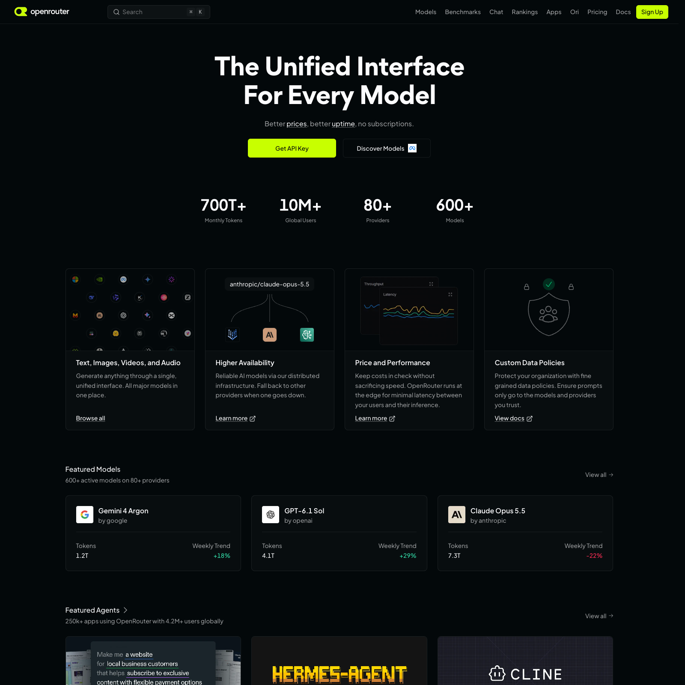
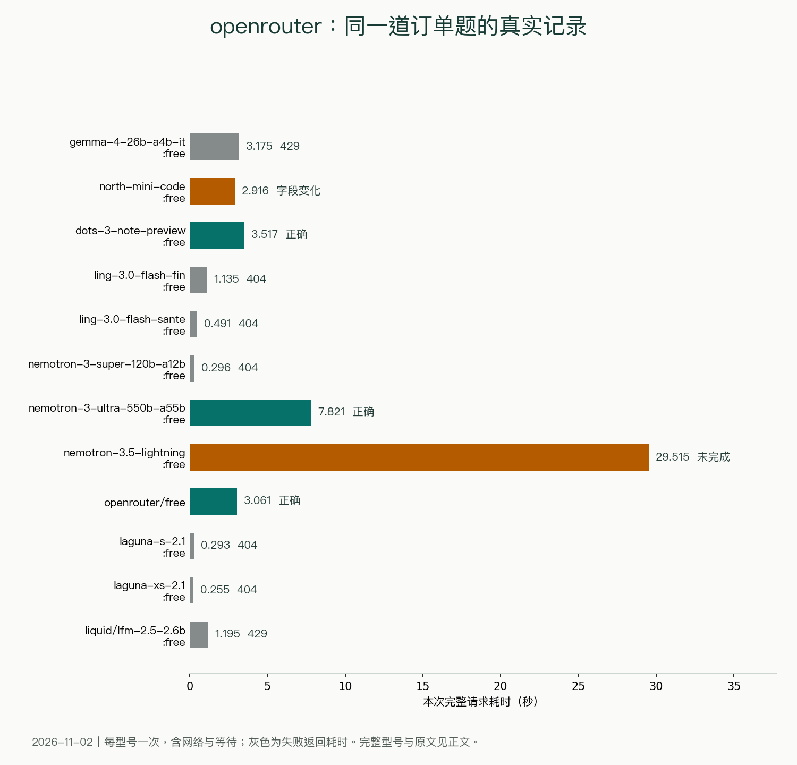
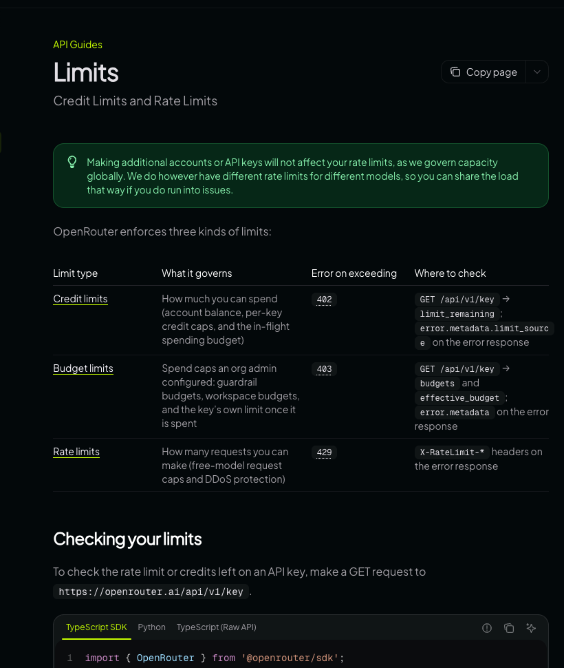

> [!abstract]
> 12次真实请求：答案、限流、旧型号与半截JSON
> 黑粉科技 · 2026年11月2日资料与实测

OpenRouter第一轮两个免费型号都返回429。继续把本机其他免费配置试下去，才拿到完整订单答案。12次请求里，有正确结果，也有名称被翻译、输出被截断和旧型号404。不能停在最早那两个错误，也不能只挑后面的成功。



OpenRouter把多个模型供应商放在同一套接口里，像一个有许多档口的商场。拿到商场通行证，不代表每个档口都有货、同样免费或同样拥挤。接入时要看精确型号和本次实际路由。

## 相同订单，逐项留下原始结果

这次仍用正确总价为3400元的设备订单，要求固定JSON字段。本次用已有账户，经本机黑粉盒子把请求转发给对应平台。计时从本机发出请求到收完回答，包含网络和服务等待；每个型号的订单题只跑了一次。账户配置为免费档，未读取最终账单。

| 请求型号／任务 | 完整耗时 | 实际返回 |
| --- | --- | --- |
| google/gemma-4-26b-a4b-it:free<br>订单 | 3.175秒 | 429；调用失败 |
| cohere/north-mini-code:free<br>订单 | 2.916秒 | 200；总价正确，设备名称被译成英文 |
| dots-studio/dots-3-note-preview:free<br>订单 | 3.517秒 | 200；JSON字段及金额与标准答案一致 |
| inclusionai/ling-3.0-flash-fin:free<br>订单 | 1.135秒 | 404；调用失败 |
| inclusionai/ling-3.0-flash-sante:free<br>订单 | 0.491秒 | 404；调用失败 |
| nvidia/nemotron-3-super-120b-a12b:free<br>订单 | 0.296秒 | 404；调用失败 |
| nvidia/nemotron-3-ultra-550b-a55b:free<br>订单 | 7.821秒 | 200；JSON字段及金额与标准答案一致 |
| nvidia/nemotron-3.5-lightning:free<br>订单 | 29.515秒 | 200；返回内容不完整，JSON无法解析 |
| openrouter/free<br>订单 | 3.061秒 | 200；JSON字段及金额与标准答案一致 |
| poolside/laguna-s-2.1:free<br>订单 | 0.293秒 | 404；调用失败 |
| poolside/laguna-xs-2.1:free<br>订单 | 0.255秒 | 404；调用失败 |
| liquid/lfm-2.5-2.6b:free<br>订单 | 1.195秒 | 429；调用失败 |

> 本机经黑粉盒子转发；每行一次请求，非多轮平均。耗时包含网络和上游等待。



dots-studio/dots-3-note-preview:free在3.517秒后给出了完整正确结果；nvidia/nemotron-3-ultra-550b-a55b:free是7.821秒。下面保留其中一份原始回答。

```JSON


{"items":[{"name":"设备A","quantity":2,"unit_price":1200,"subtotal":2400},{"name":"设备B","quantity":3,"unit_price":350,"subtotal":1050}],"shipping":80,"discount":130,"total":3400}
```

指定免费型号原始返回

## 免费自动路由，必须看实际落到哪一个

有一次请求选择openrouter/free，返回模型字段是nvidia/nemotron-3-nano-omni-30b-a3b-reasoning:free，3.061秒完成。这是一次自动路由结果，不是我直接指定这个NVIDIA型号做出的独立测试。保存请求名字和返回名字，才能复现自己到底用了什么。

cohere/north-mini-code:free的金额正确，但把“设备A／设备B”写成“Device A／Device B”。用来读一眼问题不大；如果后续程序必须按原名匹配商品，就要算字段遵循问题。这和总价算错要分开记录。

## 200也可能只拿到半截回答

nvidia/nemotron-3.5-lightning:free这次用了29.515秒，HTTP是200，但JSON没有闭合，finish_reason是length。本轮请求的max_tokens为1024；输出预算用尽后，任务还没写完。推理型模型可能还消耗内部推理预算，需要一起检查返回的用量信息。

```真实记录摘录
HTTP 200
finish_reason: length
本次请求 max_tokens: 1024
实际验收：JSON不完整，无法解析
```

这次没有提高预算后重测，所以保留“本配置未完成”，不顺手把它评成这个型号的能力上限。程序侧可以同时检查HTTP状态、结束原因、JSON能否解析以及关键字段，而不是把200直接当作“完成”。

## 免费型号怎么找，密钥和地址怎么填

从[OpenRouter密钥页](https://openrouter.ai/settings/keys)申请自己的密钥，基础地址https://openrouter.ai/api/v1。在[模型目录](https://openrouter.ai/models)里找到当前免费型号，核对输入、输出价格，再复制完整名字。名字末尾的:free要保留，不能把收费版同名型号当成免费版。



日请求额度与当前账户有关，本轮没有读取你的账户权益，不给出一个对所有人都相同的数字。429要等限流恢复，404先检查型号是否仍在当前目录；负余额也可能阻止免费调用。充值后的权益和无充值账户分开看。

> [!quote] 我的判断
> 想用一个入口试多个免费文字模型，OpenRouter方便。本轮有实际成功答案，但不同档口的限流、可用性和输出格式差异很明显。固定任务先指定型号；用自动路由时，记录实际返回型号。

## 主要查证来源

- [OpenRouter官网](https://openrouter.ai/)
- [OpenRouter免费调用限制](https://openrouter.ai/docs/api-reference/limits)
- [OpenRouter模型目录](https://openrouter.ai/models)
- [OpenRouter接入文档](https://openrouter.ai/docs/quickstart)
- [OpenRouter密钥管理](https://openrouter.ai/settings/keys)


---

## 🧰 我做的工具

这些工具都由我持续维护。预览版会明确标注，下载、更新和已知边界以发行页为准。

> [!info] 黑粉助手 HyphenAssistant
> **状态：** 正式迭代
>
> 手机浏览器接续电脑上的 DeepSeek Harness 会话；需本人配对、电脑与原服务在线，模型费用沿用原配置
>
> [下载与更新：黑粉助手 HyphenAssistant](https://github.com/HackerChi-Hub/hyphen-assistant-releases/releases)

> [!info] 黑粉盒子 HyphenBox
> **状态：** 正式迭代
>
> 免费大模型 API 雷达：持续复测可用性，本地统一接口，Key 只存本机
>
> [下载与更新：黑粉盒子 HyphenBox](https://github.com/HackerChi-Hub/hyphenbox-release/releases)

> [!info] 方寸智匣 LocalBrain
> **状态：** 正式迭代
>
> 本地模型的多模态 MCP 工具箱：TTS / Whisper / 视频生成一站接入
>
> [下载与更新：方寸智匣 LocalBrain](https://github.com/HackerChi-Hub/localbrain-releases/releases)

> [!info] ScreenLex 光影词库
> **状态：** 正式迭代
>
> 看美剧顺手把生词背了，Mac/Windows 双平台，免费
>
> [下载与更新：ScreenLex 光影词库](https://github.com/HackerChi-Hub/screenlex-download/releases)

> [!info] 黑粉录屏 HyphenScreen
> **状态：** 正式迭代
>
> 录屏 + 智能剪辑一体：达芬奇式时间线、自动打码、导出前成片体检，免费
>
> [下载与更新：黑粉录屏 HyphenScreen](https://github.com/HackerChi-Hub/HyphenScreen-Releases/releases)

---

> [!quote] 黑粉科技
> **让AI成为你的超能力**
> 本地部署 · 免费白嫖 · 自制软件
> [黑粉科技](https://hyphentech.top)
