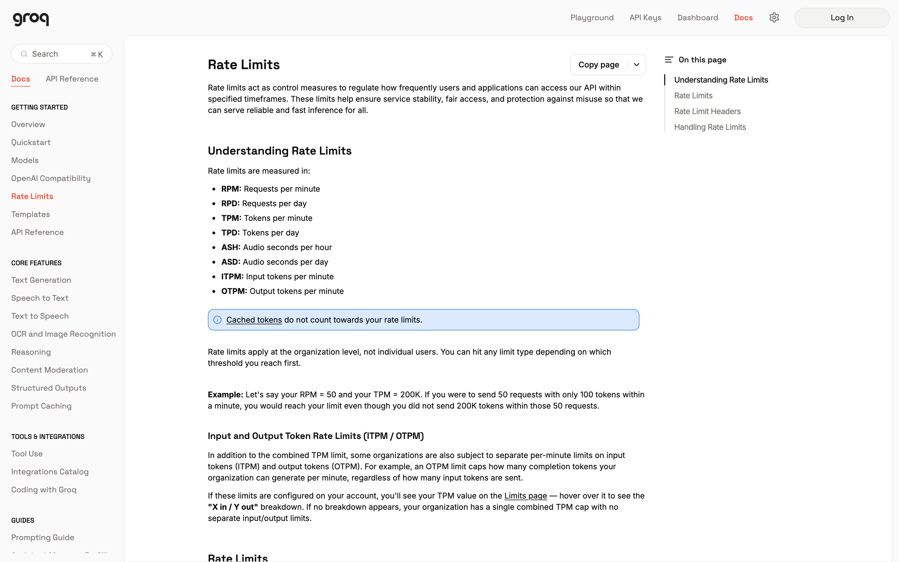
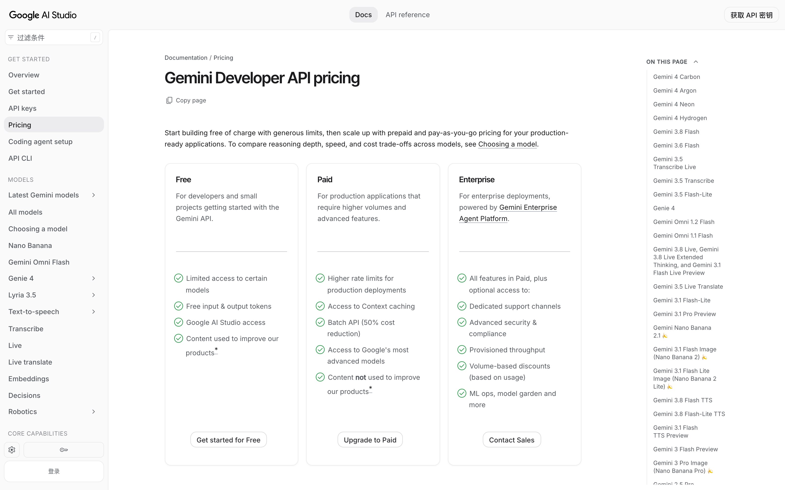
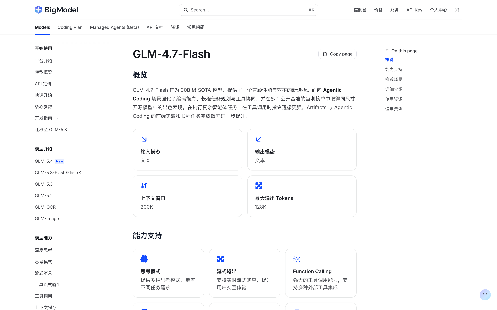
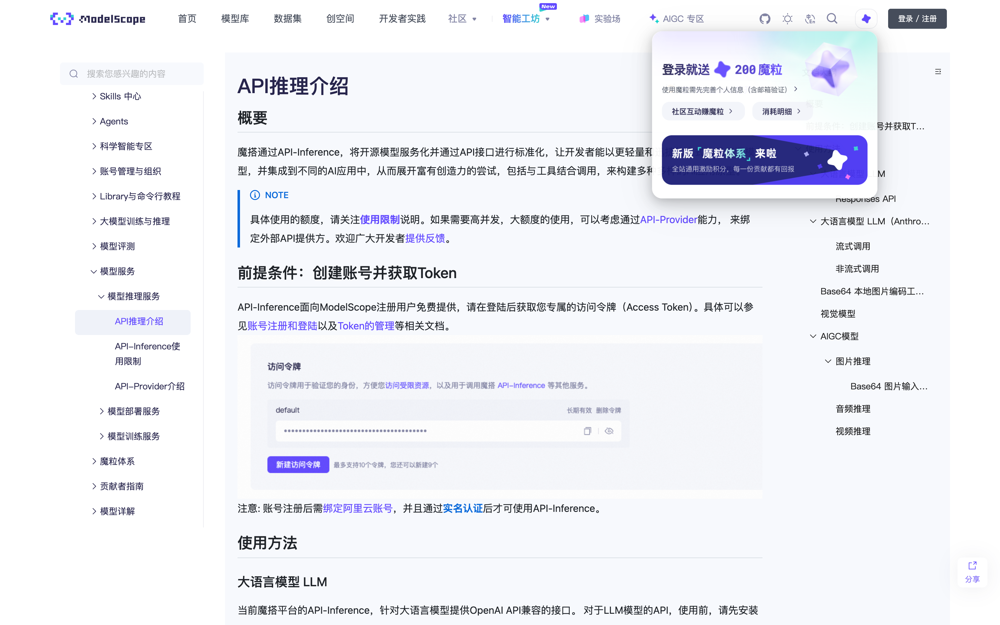
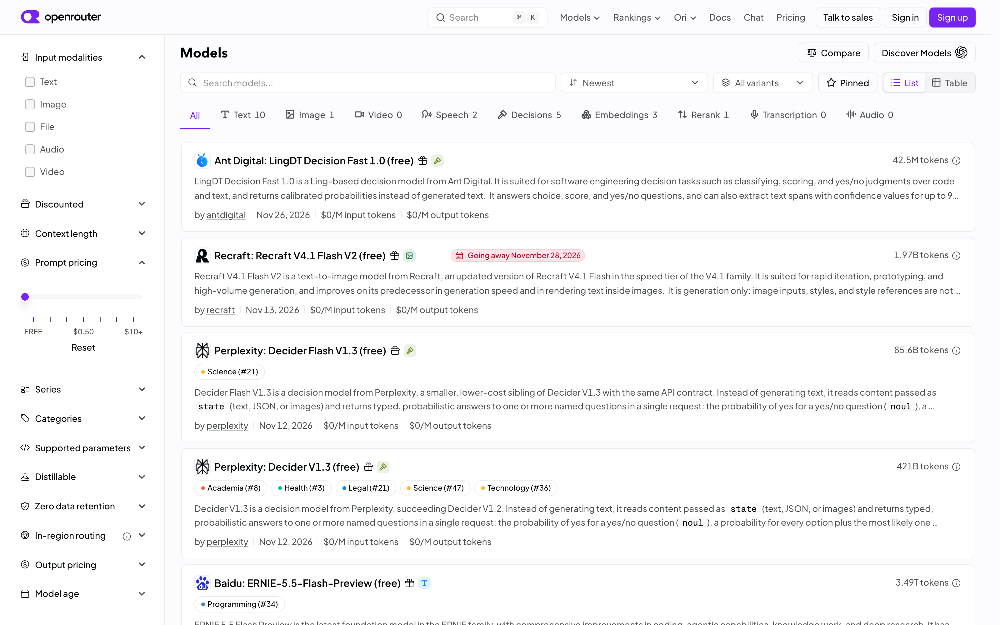
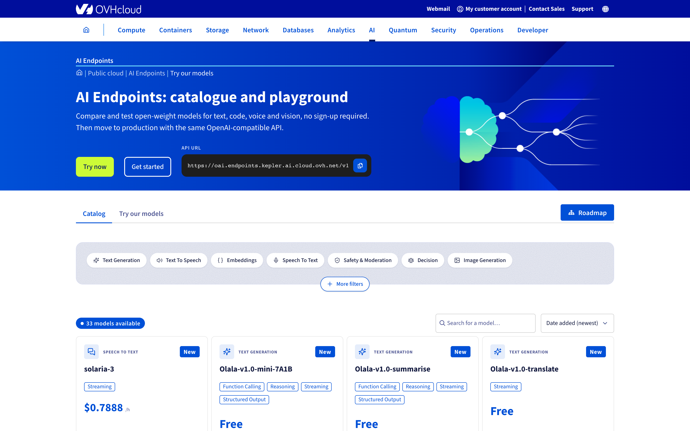
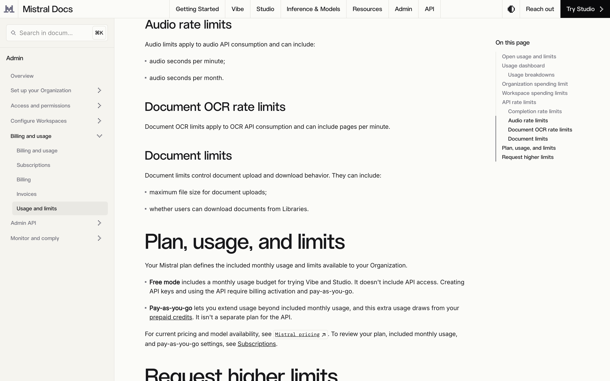
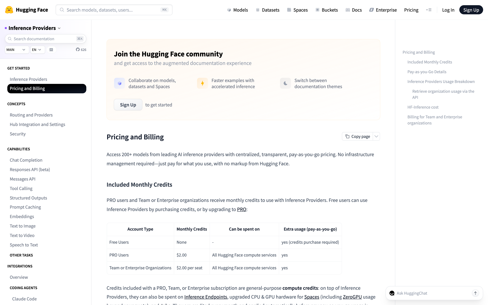

> [!important]
> **2026-11-27 时隔 2 个月全量重测大洗牌更新** · 黑粉科技　|　本次在 Mac 本机同步跑完**中国大陆直连 vs 国际网络代理**双视角真请求，并逐一核实**是否需要注册、是否要 `+86` 手机号与实名认证、是否强制绑信用卡、免费层是否拿数据训练**。最新数据已同步签发至 [下载与更新：黑粉盒子 HyphenBox（GitHub 发行页）](https://github.com/HackerChi-Hub/hyphenbox-release/releases) `2026.11.28.2` 目录。

> [!note]
> 本表只收录官方面向普通开发者发放的正规免费额度与公开免密接口。泄露的私人密钥、来源不明的共享账号、绕额度黑灰产中转站，一律不收录、不测试、不转发。

## 一、2026 年 11 月底实测红黑总表（先看本地使用条件）

　　这 2 个月免费 API 圈子经历了剧烈洗牌：**Mistral 取消了免费 Experiment API（建 Key 强制绑卡计费）**、**Hugging Face 免费用户月赠归零（`None`）**、**Cerebras 取消无卡免费层改为绑外币卡给一次性 \$5 试用**，连 **OpenRouter 全站 477 个模型里也只剩 10 个零价文本对话变体（且 100% 单供应商承载）**。选口子前先看下面这张表里的**网络条件**和**注册门槛**，对号入座最省时间：

| 平台 | 当前评级 | 免费类型 | 本地网络条件（本机实测） | 注册 / 实名 / 绑卡门槛 | 本期核心实测结论（2026-11-27） |
| --- | --- | --- | --- | --- | --- |
| **Groq** | 🟢 主力稳用 | 永久周期免费层 | **需国际网络**（代理 409–1125ms） | 邮箱/Google/GitHub 注册，**免手机实名、免信用卡** | `qwen/qwen3.8-27b` 与 `openai/gpt-oss-120b` 连续 4 次对话全部 `200 OK`，目前海外最快最稳 |
| **Google Gemini API** | 🟢 主力稳用 | 永久周期免费层 | **需国际网络**（支持地区出口） | Google 账号一键建 Key，**Free 层免信用卡** | `gemini-3.5-flash-lite`（621–1387ms）与 `gemini-embedding-2` 均 4/4 通过；`3.6-flash` 高峰易 `503`；`Gemini 4 Carbon/Neon` 仅付费；**免费层数据用于改进产品** |
| **智谱 BigModel** | 🟢 国内首选 | 永久免费型号 + 新户赠额 | **国内直连极快**（137ms） | **`+86` 手机号短信 + 国内实名认证**，免信用卡 | `GLM-4.7-Flash`（200K 上下文）、`GLM-4.6V-Flash`、`CogView-3-Flash` 永久免费，新户另送 2000 万 Tokens，**默认不用于模型训练** |
| **魔搭 ModelScope** | 🟢 国内大杯 | 每日领「魔粒」兑换 | **国内直连极快**（84ms） | **`+86` 手机号 + 验证邮箱 + 绑定已实名阿里云账号** | 每日登录领 200+50 短期魔粒（约合 125–500 次/日），可免费调 `Kimi-K3.1-Pro`、`Qwen3.8-27B` 等大参数模型 |
| **OpenRouter** | 🟢 精选可用 | 指定 `:free` 零价变体 | **国内直连可通**（1377ms，代理 806ms 更稳） | 邮箱/Google/GitHub 注册，**免信用卡**（禁负余额） | 全站仅剩 **10 款**零价文本模型且均单供应商承载；`nvidia/nemotron-3-ultra-550b-a55b:free` 4/4 通过，`gemma-4:free` 连发秒弹 `429`，多款上月旧 `:free` 已 `404` 下架 |
| **NVIDIA NIM** | 🟡 开发备选 | 36 款免费开发端点 | **接口直连可通**（746ms，控制台建议国际网络） | 邮箱注册验证 NVIDIA 开发者账号，**免信用卡** | 36 个 `Free Endpoint`（含 `kimi-k3.1-pro`、`nemotron-3.5`）不按 token 计费，最高 40 RPM；**输入输出会被记录改进模型** |
| **OVHcloud AI Endpoints** | 🟡 免密应急 | 免注册免 Key 公共接口 | **国内直连可用**（1366ms） | **完全免注册、免 Key、免卡** | 免密首调 `Qwen3.8-27B`（1415ms）与 `bge-m3` 向量（1087ms）均 `200 OK`，但匿名连续突发即触发单 IP `429` 冷却约 49 分钟 |
| **Pollinations** | 🟡 免密慢速 | 免 Key 公共接口 | **国内直连偏慢**（7.8s，代理 1.7s） | **匿名免注册免 Key**（注册免费 Key 可提额） | 免密可调通，但新增铁规：**匿名每 IP 每 45 秒仅限 1 次回复**，超频立返 `HTTP 402 FREE_LIMIT` |
| **硅基流动 SiliconFlow** | 🟡 核对账户 | 实名指定 L0 零价模型 | **国内直连极快**（142–200ms） | **`+86` 手机号 + 国内实名认证**，免信用卡 | 官方 L0 免费档仍在（`Qwen2.5-7B`、`bge-m3` 等），但本机旧账户实测因余额状态返回 `HTTP 402/30001`，且误加 `Pro/` 前缀会扣费 |
| **Cloudflare Workers AI** | 🟡 边缘轻量 | 每日 10,000 Neurons | **直连可通**（743ms，代理 544ms） | 注册 Cloudflare 取 Account ID 与 Token，**Free 计划免卡** | 每天 `00:00 UTC` 自动恢复 `10,000 Neurons`，超额即停不扣费，适合顺带跑小模型或向量 |
| **阿里云百炼 / 百度千帆** | 🟠 新户体验 | 一次性新人体验金 | **国内直连极快**（66–123ms） | **国内手机号 + 实名认证** | 按模型送约 100 万 Token/款（90 天有效，用完不重置）；**实名号务必手动开启「用完即停」防反撸** |
| **Cerebras** | 🟠 门槛收紧 | 绑卡一次性 \$5 试用 | **需国际网络**（含 reCAPTCHA） | **强制绑定有效外币信用卡** | 免绑卡免费层已取消，绑卡后仅给一次性 \$5（30 天有效） |
| **Mistral AI** | 🔴 踩坑劝退 | 免费 API 已取消 | 需国际网络 | **建 API Key 强制绑卡开通按量计费** | 官方文档确认 `Free mode` 仅含网页 Studio，**不再包含任何免费 API 权限** |
| **Hugging Face Router** | 🔴 踩坑劝退 | 月赠额度已取消 | 需国际网络 | **必须充值买 credits 或订 PRO** | 官方定价表确认 `Free Users` 月赠额度为 `None`（0 美元） |
| **GitHub Models** | 🔴 已退役 | 服务已下线 | 不适用 | 原免费推理 API 已退役 | 本机持有效 `GITHUB_TOKEN` 实测确认目录为空、不再返回大模型对话结果 |

---

## 二、主力稳用平台接入细节与避坑实证

### 1. Groq（海外速度之王 · 免绑卡）

　　只要你本地开着国际网络，Groq 依然是目前响应最干脆的免费主力。用邮箱、Google 或 GitHub 注册就能直接拿 Key，不需要绑信用卡。本期本机连续 4 次请求 `qwen/qwen3.8-27b`（含中文多段备份方案生成）全部在 **409ms–1125ms** 内返回，`openai/gpt-oss-120b` 也在 **643ms** 内跑通，官方免费限额维持 **30 RPM / 1,000 RPD / 8,000 TPM**。

```python
from openai import OpenAI

client = OpenAI(api_key="<GROQ_API_KEY>", base_url="https://api.groq.com/openai/v1")
resp = client.chat.completions.create(
    model="qwen/qwen3.8-27b",
    messages=[{"role": "user", "content": "用三句话讲清本地备份原则"}],
)
print(resp.choices[0].message.content)
```



### 2. Google Gemini API（认准 Flash-Lite 与 Embedding 2 · 注意隐私条款）

　　11 月 Google 推出 `Gemini 4` 系列后，旗舰 `Gemini 4 Carbon / Argon / Neon` 全部锁死在付费层，免费层保留给 `Gemini 4 Hydrogen` 限流档以及 **`gemini-3.5-flash-lite`**、**`gemini-embedding-2`** 等型号。本期实测 `gemini-3.5-flash-lite` 与 `gemini-embedding-2` 均 4 次全绿通过（621–1387ms），而 `gemini-3.6-flash` 和 `gemma-4-31b-it` 在晚高峰多次撞上 `HTTP 503 High Demand`。另外务必注意：**AI Studio 免费层默认会将输入输出用于改进 Google 产品**，写公司私有代码别往免费层塞。



### 3. 智谱 BigModel & 魔搭 ModelScope（国内直连免代理双保险）

　　不想配国际网络代理的国内开发者，优先看这两家正规大厂入口（都需要 **`+86` 手机号验证码 + 国内实名认证**，都不需要信用卡）：

- **智谱开放平台（[查看智谱免费模型文档](https://docs.bigmodel.cn/cn/guide/models/free/glm-4.7-flash)）**：永久免费主力已经从下线的 `GLM-4.5-Flash` / `GLM-Z1-Flash` 升级到了 **`GLM-4.7-Flash`（30B 参数、200K 上下文、支持工具调用与深度思考）** 和多模态 **`GLM-4.6V-Flash`**，大陆直连延迟约 **137ms**，且协议明确**默认不拿用户 API 数据训练模型**。注意别把名字写成收费的 `GLM-5.3-Flash` 或 `GLM-5.4`。
- **魔搭社区 API-Inference（[查看魔搭 API-Inference 文档](https://modelscope.cn/docs/model-service/API-Inference/intro)）**：绑定已实名的阿里云账号后，每天登录可领 **200+50 短期魔粒**（约合每天免费调用 **125–500 次**），能直接用 OpenAI 兼容格式调 `Kimi-K3.1-Pro`、`Qwen3.8-27B` 等大尺寸模型，大陆直连仅 **84ms**。





### 4. OpenRouter（全站仅剩 10 款零价文本模型 · 必须防单点限流与下架）

　　对比 8 月份的 22 款零价模型，2026 年 11 月 27 日实取 `/api/v1/models` 全站 **477 个模型里只剩 10 个零价文本对话变体**（外加即将于 `11月28日` 下架的 `Recraft` 生图等少量非文本条目），而且**全部 10 款文本模型都只有单一上游供应商承载（`eps=1`）**。本期实测 `nvidia/nemotron-3-ultra-550b-a55b:free`（1M 上下文）连续 4 次任务全部 `200 OK` 通过，但 `google/gemma-4-26b-a4b-it:free` 连发第 2 次立刻弹 `429`，上月还能用的 `nemotron-3-super-120b:free` 则已 `404` 转收费。

```python
from openai import OpenAI

client = OpenAI(api_key="<OPENROUTER_KEY>", base_url="https://openrouter.ai/api/v1")
resp = client.chat.completions.create(
    model="nvidia/nemotron-3-ultra-550b-a55b:free",
    messages=[{"role": "user", "content": "你好"}],
)
print(resp.choices[0].message.content)
```



---

## 三、零注册免密接口与已取消免费层的排雷实证

### 1. 免注册免 Key 应急双口：OVHcloud 与 Pollinations

- **OVHcloud AI Endpoints（[查看官方目录：OVHcloud AI Endpoints](https://endpoints.ai.cloud.ovh.net/)，接口基址为 `/v1`）**：真真正正连账号都不用建、中国大陆直连 **1366ms** 可通。本机免 Key 实测 `Qwen3.8-27B` 与 `bge-m3`（1024 维向量）首轮直接 `200 OK` 出结果，但匿名单 IP 连续突发第 2–3 次即返回 `HTTP 429 API rate limit exceeded`（冷却约 49 分钟），只适合临时单次测连通。
- **Pollinations（[查看官方文档页：Pollinations](https://pollinations.ai/)）**：同样免注册免 Key 可直连，但 11 月底匿名层限速收紧至 **单 IP 每 45 秒最多 1 次回复**，连发第 3 次即返回 `HTTP 402 FREE_LIMIT`（前往 [申请免费密钥：Pollinations 控制台](https://enter.pollinations.ai/) 领免费 Key 可提额）。



### 2. 三大旧神站免费 API 已成历史（别再白费功夫注册）

- **Mistral AI**：官方 [查看 Mistral 用量与限制文档](https://docs.mistral.ai/admin/billing-usage/usage-limits) 已写死 `Free mode` 不含 API 访问权限，建 API Key 必须绑卡激活按量计费。
- **Hugging Face Inference Providers**：官方 [查看 Hugging Face 推理定价页](https://huggingface.co/docs/inference-providers/pricing) 列明 `Free Users` 月赠额度为 `None`。
- **硅基流动旧号 402 提醒**：官方 [查看硅基流动限流文档](https://docs.siliconflow.cn/cn/userguide/faqs/rate-limit-and-upgradation) 仍保留实名免费 L0 模型，但若账户余额状态异常或误选 `Pro/` 前缀同名模型会返回 `HTTP 402 / 30001`。





---

## 四、把稳用路线一键收进「黑粉盒子 HyphenBox」与本地兜底

　　既然单家免费接口随时可能改规则、限流 `429` 或下架旧型号，最稳的做法就是不要在业务代码里硬编码某一家免费模型：

1. **云端免费聚合路由**：打开 [下载与更新：黑粉盒子 HyphenBox（GitHub 发行页）](https://github.com/HackerChi-Hub/hyphenbox-release/releases)（`v1.0.7` 客户端已支持自动接收本期签发的 **`2026.11.27.1`** 最新目录，无需重装软件），把你自己的 Groq、Gemini、智谱或 OpenRouter Key 留在本地钥匙串里，对外暴露一个统一的本地 OpenAI 兼容网关，遇到某家 `429` 自动冷却切备胎；
2. **本地离线多模态与大模型兜底**：涉及绝对不能上云的私有代码、语音转写与生图生视频，直接配合 [下载与更新：方寸智匣 LocalBrain（GitHub 发行页）](https://github.com/HackerChi-Hub/localbrain-releases/releases) 与本机 Ollama / MLX 离线跑通，一分钱 API 账单都不用付。


---

## 🧰 我做的工具

这些工具都由我持续维护。预览版会明确标注，下载、更新和已知边界以发行页为准。

> [!info] 黑粉盒子 HyphenBox
> **状态：** 正式迭代
>
> 免费大模型 API 雷达：持续复测可用性，本地统一接口，Key 只存本机
>
> [下载与更新：黑粉盒子 HyphenBox](https://github.com/HackerChi-Hub/hyphenbox-release/releases)

> [!info] 方寸智匣 LocalBrain
> **状态：** 正式迭代
>
> 本地模型的多模态 MCP 工具箱：TTS / Whisper / 视频生成一站接入
>
> [下载与更新：方寸智匣 LocalBrain](https://github.com/HackerChi-Hub/localbrain-releases/releases)

---

> [!quote] 黑粉科技
> **让AI成为你的超能力**
> 本地部署 · 免费白嫖 · 自制软件
> [黑粉科技](https://hyphentech.top)
