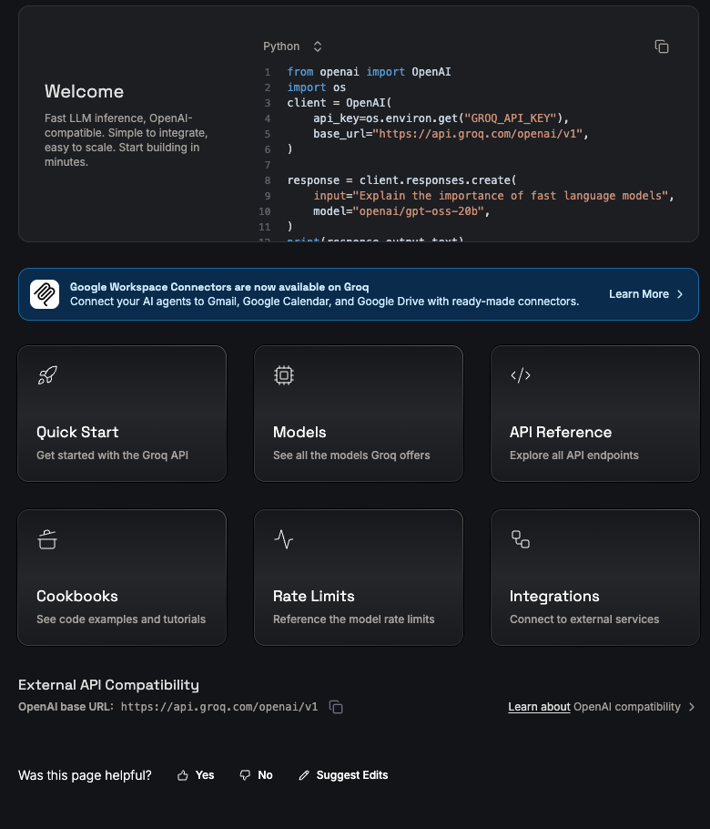
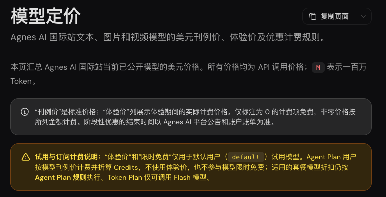
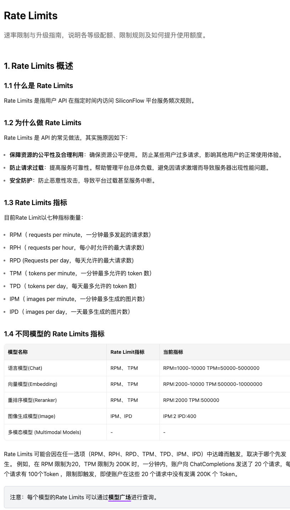

> [!abstract]
> 周期额度、指定零价、免密和社区队列
> 黑粉科技 · 2026年11月2日资料与实测

如果想让一个小工具每天都能调用，先找会恢复的额度或指定零价模型；只想快速验证一个想法，也可以试免密入口。本篇把已收集的周期类与免密类文字方案放在一起，按接入方式看，不按宣传页上的“免费”两个字排队。

已经有完整生成结果的Groq、Gemini、OpenRouter，前面各有一篇实测。Agnes文字也完成了订单和改写，两次正确返回，分别用时4.264秒、3.446秒；其默认试用档阶段优惠和图片篇同一张官网计费说明。这里补齐其余目录，**未拿到本轮生成结果的条目会标明进度**。资料基准为2026年11月2日。



## 补一条已经跑通的Agnes文字接口

```json
{
  "items": [
    {
      "name": "设备A",
      "quantity": 2,
      "unit_price": 1200,
      "subtotal": 2400
    },
    {
      "name": "设备B",
      "quantity": 3,
      "unit_price": 350,
      "subtotal": 1050
    }
  ],
  "shipping": 80,
  "discount": 130,
  "total": 3400
}
```

Agnes文字原始返回



请求型号为agnes-2.5-flash，文字基础地址https://apihub.agnes-ai.com/v1。上面的订单包含完整字段并算出3400元；中文改写也保留四项信息。Agnes文字2.0的另一条旧配置返回500，未取到答案。

## 先选你需要哪一种免费

指定型号零价，像商店里只有贴了活动签的商品免费；周期额度，像每月重新发的体验券；免密服务，像不领号也能排的公共队伍。它们分别解决成本、试用和接入便利，不能把额度单位相加。

| 需求 | 先看哪一类 | 优先检查 |
| --- | --- | --- |
| 每天少量整理文字 | 指定零价／周期额度 | 精确型号、重置、限速 |
| 临时验证脚本 | 免密／共享队列 | 等待、失败、输出是否匹配 |
| 长期接入产品 | 允许相应用途的正式服务 | 额度、权限、失败处理 |

## 指定型号、账户额度与开发免费档

### 智谱免费文字模型（待实测）

**周期免费／指定零价。**定价表输入、输出均为免费；固定限流见账户。

仅指定 Flash 型号；FlashX 及旗舰模型另计费。

本版记录的型号：glm-4.7-flash、glm-4-flash-250414、glm-z1-flash。

```接口基础地址
https://open.bigmodel.cn/api/paas/v4
```

官方入口：[查看资料](https://docs.bigmodel.cn/cn/guide/start/pricing.md)。

### 硅基流动免费型号

**周期免费／指定零价。**免费型号账单为零；固定限流按具体模型。

实名认证后可使用全部免费型号；不能把平台的图片、视频、语音模型全部算免费。

本轮硅基请求返回402的是当前账户和指定型号，不能据此判定所有免费型号都失效。

测试进度：已发请求：本账户返回402余额不足，未取得答案。

```接口基础地址
https://api.siliconflow.cn/v1
```

官方入口：[查看资料](https://docs.siliconflow.cn/docs/userguide/faqs/rate-limit-and-upgradation)。



### 魔搭 API-Inference（待实测）

**周期免费／指定零价。**官方设有免费推理；历史官方公告写每日2000次，当前分模态限额页为动态页面，本期未完整取得。

使用自己的访问令牌，只选带 API-Inference 服务的模型；模型仓库存在不代表开放接口。

官方入口：[查看资料1](https://www.modelscope.cn/docs/model-service/API-Inference/limits)；[查看资料2](https://www.modelscope.cn/headlines/article/795)。

### Mistral 免费开发模式（待实测）

**周期免费／指定零价。**Free 模式有每月包含用量；额度与速率见控制台。

免费模式可建密钥，无需信用卡；逐模型权益须查Limits。

```接口基础地址
https://api.mistral.ai/v1
```

官方入口：[查看资料1](https://docs.mistral.ai/admin/billing-usage/usage-limits)；[查看资料2](https://docs.mistral.ai/getting-started/quickstarts/studio/activate-and-generate-api-key)。

### Cloudflare 文字推理（待实测）

**周期免费／指定零价。**每天共享10000 Neurons；不是10000次，也不是10000个Token。

同一账户多模态共同消耗；Workers Free超额停止，Workers Paid超额计费；部分前沿型号可能另需预付费。

本版记录的型号：@cf/meta/llama-3.1-8b-instruct。

官方入口：[查看资料](https://developers.cloudflare.com/workers-ai/platform/pricing/)。

### Cloudflare 翻译（待实测）

**周期免费／指定零价。**每天共享10000 Neurons；不是10000次，也不是10000个Token。

同一账户多模态共同消耗；Workers Free超额停止，Workers Paid超额计费；部分前沿型号可能另需预付费。

本版记录的型号：@cf/meta/m2m100-1.2b。

官方入口：[查看资料1](https://developers.cloudflare.com/workers-ai/platform/pricing/)；[查看资料2](https://developers.cloudflare.com/workers-ai/models/)。

### 讯飞星火 Lite（待实测）

**周期免费／指定零价。**HTTP文档明确Lite轻量模型支持免费使用；统一额度本期未取得。

需要对应HTTP权限与APIPassword；不能套用WebSocket鉴权方式。

官方入口：[查看资料](https://www.xfyun.cn/doc/spark/HTTP调用文档.html)。

### AMD Token Factory 文字接口（待实测）

**开发用途每日额度。**免费开发服务；以积分计算每日上限，北京时间00:00重置。

中国站开放；不消耗云主机credits；禁止转售，不用于生产。

```接口基础地址
https://developer.amd.com.cn/radeon/api/v1
```

官方入口：[查看资料1](https://amd-aim.github.io/radeon-cloud-docs/guides/token-factory/)；[查看资料2](https://amd-aim.github.io/radeon-cloud-docs/api/rate-limits/)。

### Vercel AI Gateway 免费积分（待实测）

**周期赠送积分。**每个团队每月5美元免费积分，仅适用于免费层子集。

首次请求启动；购买积分后转付费层，月度免费积分不再适用；其他模态不能由平台支持反推免费。

官方入口：[查看资料](https://vercel.com/docs/ai-gateway/pricing)。

### Pollinations Classic 文字（待实测）

**免密限流。**免注册；同IP一次一请求，至少间隔30秒。

最佳努力服务；限额返回402及Retry-After；相同URL结果可能共享缓存。

本版记录的型号：GPT-OSS 20B。

```接口基础地址
https://text.pollinations.ai
```

官方入口：[查看资料](https://raw.githubusercontent.com/pollinations/pollinations/master/APIDOCS.md)。

### AI Horde 志愿者共享队列（待实测）

**社区共享队列。**志愿者共享算力，免费文字和图像任务；队列与优先级随供给变化。

用正式公开API；贡献和kudos影响优先级；不能承诺固定等待时间或商用授权。

官方入口：[查看资料1](https://aihorde.net/)；[查看资料2](https://aihorde.net/api/)。

## 把目录变成能用的接口，还差哪一步

先用自己账户创建密钥，选目录里精确型号，发一条有标准答案的小任务；保留状态码、回答、实际型号和耗时。像这次订单题，总价3400元，程序可以直接检查。用聊天题做通后，再分别测看图、翻译和其他能力，不把一个文字回答算成全平台都已验证。

Cloudflare的Neurons是按模型计算的用量单位，更像不同电器各自消耗的电量；不是请求次数。Vercel的积分是共享钱包；模型数量增加，钱包并不会跟着多出几份。魔搭的模型文件页面和可调用接口也不同，必须找到实际开放的推理服务。

> [!quote] 我的判断
> 先从四篇实测里找一个完成过你相似任务的入口，再按这份目录补备选。需要新注册的条目排在后面逐个测，能省掉“收藏了很多地址，却没有一个真正接通”的时间。

## 主要查证来源

- [Agnes当前定价](https://wiki.agnes-ai.com/zh-Hans/docs/pricing)
- [智谱免费文字模型](https://docs.bigmodel.cn/cn/guide/start/pricing.md)
- [硅基流动免费型号](https://docs.siliconflow.cn/docs/userguide/faqs/rate-limit-and-upgradation)
- [魔搭 API-Inference](https://www.modelscope.cn/docs/model-service/API-Inference/limits)
- [魔搭 API-Inference](https://www.modelscope.cn/headlines/article/795)
- [Mistral 免费开发模式](https://docs.mistral.ai/admin/billing-usage/usage-limits)
- [Mistral 免费开发模式](https://docs.mistral.ai/getting-started/quickstarts/studio/activate-and-generate-api-key)
- [Cloudflare 文字推理](https://developers.cloudflare.com/workers-ai/platform/pricing/)
- [Cloudflare 翻译](https://developers.cloudflare.com/workers-ai/platform/pricing/)
- [Cloudflare 翻译](https://developers.cloudflare.com/workers-ai/models/)
- [讯飞星火 Lite](https://www.xfyun.cn/doc/spark/HTTP调用文档.html)
- [AMD Token Factory 文字接口](https://amd-aim.github.io/radeon-cloud-docs/guides/token-factory/)
- [AMD Token Factory 文字接口](https://amd-aim.github.io/radeon-cloud-docs/api/rate-limits/)
- [Vercel AI Gateway 免费积分](https://vercel.com/docs/ai-gateway/pricing)
- [Pollinations Classic 文字](https://raw.githubusercontent.com/pollinations/pollinations/master/APIDOCS.md)
- [AI Horde 志愿者共享队列](https://aihorde.net/)
- [AI Horde 志愿者共享队列](https://aihorde.net/api/)


---

## 🧰 我做的工具

这些工具都由我持续维护。预览版会明确标注，下载、更新和已知边界以发行页为准。

> [!info] 黑粉助手 HyphenAssistant
> **状态：** 正式迭代
>
> 手机浏览器接续电脑上的 DeepSeek Harness 会话；需本人配对、电脑与原服务在线，模型费用沿用原配置
>
> [下载与更新：黑粉助手 HyphenAssistant](https://github.com/HackerChi-Hub/hyphen-assistant-releases/releases)

> [!info] 黑粉盒子 HyphenBox
> **状态：** 正式迭代
>
> 免费大模型 API 雷达：持续复测可用性，本地统一接口，Key 只存本机
>
> [下载与更新：黑粉盒子 HyphenBox](https://github.com/HackerChi-Hub/hyphenbox-release/releases)

> [!info] 方寸智匣 LocalBrain
> **状态：** 正式迭代
>
> 本地模型的多模态 MCP 工具箱：TTS / Whisper / 视频生成一站接入
>
> [下载与更新：方寸智匣 LocalBrain](https://github.com/HackerChi-Hub/localbrain-releases/releases)

> [!info] ScreenLex 光影词库
> **状态：** 正式迭代
>
> 看美剧顺手把生词背了，Mac/Windows 双平台，免费
>
> [下载与更新：ScreenLex 光影词库](https://github.com/HackerChi-Hub/screenlex-download/releases)

> [!info] 黑粉录屏 HyphenScreen
> **状态：** 正式迭代
>
> 录屏 + 智能剪辑一体：达芬奇式时间线、自动打码、导出前成片体检，免费
>
> [下载与更新：黑粉录屏 HyphenScreen](https://github.com/HackerChi-Hub/HyphenScreen-Releases/releases)

---

> [!quote] 黑粉科技
> **让AI成为你的超能力**
> 本地部署 · 免费白嫖 · 自制软件
> [黑粉科技](https://hyphentech.top)
