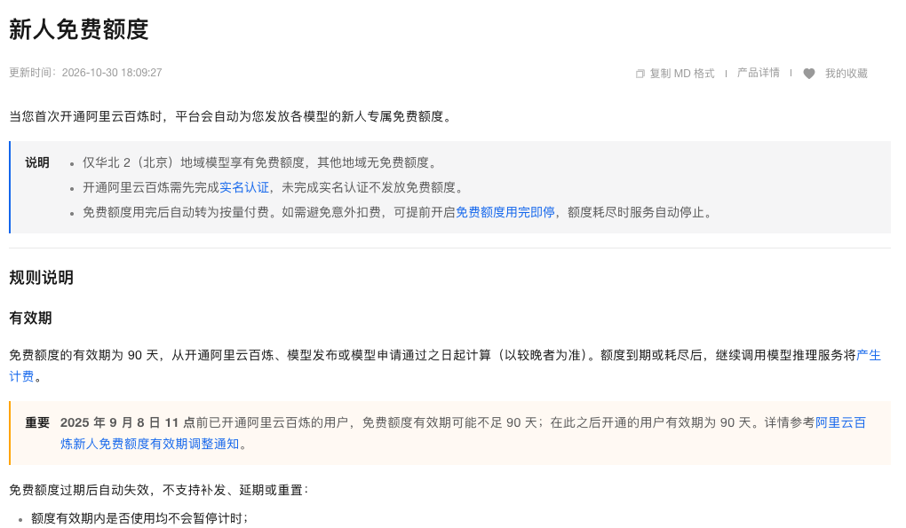

> [!abstract]
> 新人赠额、评估密钥与开发者权限
> 黑粉科技 · 2026年11月2日资料与实测

有些免费接口适合试一个星期，有些额度会每月恢复，还有些只允许评估或原型开发。都能拿到密钥，后面能做的事情却不同。本篇把这些容易混在一起的入口单独整理，避免拿试用钱包去安排长期任务。

本篇是2026年11月2日已收集的一手资料目录，下面七项本轮尚未完成生成实测。已跑出结果的Groq、Gemini、OpenRouter和Agnes在实测篇优先展示；这里的额度数字来自当期结构化资料，不把官网承诺改写成亲测。

## 先看额度会不会恢复，再看能用到什么时候

“每月1000次”和“一次送5美元”很不一样。前者是下个月再开门的体验区，后者是一次领到的钱包；余额、到期时间和用途限制一起决定你能安排什么。额度按账户共享时，也不能让每个型号各领一遍同一笔钱。

### Cohere 评估密钥（待实测）

**周期评估额度。**评估密钥每月1000次API调用；接口另有分钟限流。

评估用途；生产使用需生产密钥及相应条款。

官方入口：[查看资料](https://docs.cohere.com/docs/rate-limits)。

### NVIDIA 托管NIM开发试用（待实测）

**开发用途访问。**开发者计划成员可免费访问托管API进行原型开发；未取得统一现行额度数字。

按模型卡、成员账户和开发用途授权；本地NIM许可证与托管额度分开。

```接口基础地址
https://integrate.api.nvidia.com/v1
```

官方入口：[查看资料](https://docs.api.nvidia.com/nim/docs/product)。

### Cerebras 新账户试用（待实测）

**一次性新人试用。**5美元免费试用，30天到期。

一次性试用，耗尽或到期须付费；不是每日恢复的永久免费档。

官方入口：[查看资料](https://inference-docs.cerebras.ai/support/rate-limits)。

### 腾讯混元文字、翻译与视觉试用（待实测）

**一次性新人试用。**指定生文/视觉/翻译型号共享100万Token，资源包有效期1年。

首次开通；主账号相关型号共享；超额按后付费结算。

官方入口：[查看资料](https://cloud.tencent.com/document/product/1729/97731)。

### 百炼当前型号新人额度（待实测）

**指定型号新人试用。**当前仍参与的新型号免费额度有效期90天，具体数量以型号详情为准。

需实名；仅北京地域及通用Key；10月29日大批旧型号停止向新用户发放，旧账户未过期余额可继续；用完即停默认关闭。

官方入口：[查看资料](https://help.aliyun.com/zh/model-studio/new-free-quota)。



### 火山方舟新人推理试用（待实测）

**一次性新人试用。**新用户有推理试用额度，具体型号额度在开通管理查看。

不同模型分别计算、主账号下共享；只能抵扣相关在线推理Token费用，不能覆盖插件/知识库/缓存存储。

官方入口：[查看资料](https://www.volcengine.com/docs/82379/1399514)。

### Sarvam 新人通用额度（待实测）

**一次性新人试用。**每位验证用户注册得100印度卢比额度；官方称余额不过期。

所有API共享；重点核对所需语言与商业音频许可；用尽返回402。

官方入口：[查看资料](https://docs.sarvam.ai/api/getting-started/pricing)。

## 开通之前，把可能转收费的位置找出来

新人赠额最容易踩的点是超额自动计费。腾讯条目里的后付费、百炼条目里的“用完即停”默认状态，都直接影响会不会产生下一笔账。准备只试免费额度，就在对应产品里确认停止条件，不要因为账户里显示一张赠券，就把所有附加能力都打开。


百炼这一版还有一个时间变化：10月29日，一批旧型号停止向新用户发放免费额度；已有未过期余额与新开账户待遇不同。所以目录保留“当前参与型号”，不复制一张旧的全型号赠额表。

## 哪种任务适合先用试用额度

一份固定文档、一个有参考答案的抽取题，或者几条中文改写，都容易判断结果，也容易估计消耗。直接接一个自动循环的智能体，失败重试和长上下文可能很快用完赠额；第一次先限制任务数量，收下完整返回，再估算扩大使用后的成本。

> [!quote] 我的判断
> 只想验证接口和效果，新人额度很合适；打算每天自动运行，优先找有周期额度且允许相应用途的方案。一次性赠额、评估用途和生产服务分开选择，目录才有实际用处。

## 主要查证来源

- [Cohere 评估密钥](https://docs.cohere.com/docs/rate-limits)
- [NVIDIA 托管NIM开发试用](https://docs.api.nvidia.com/nim/docs/product)
- [Cerebras 新账户试用](https://inference-docs.cerebras.ai/support/rate-limits)
- [腾讯混元文字、翻译与视觉试用](https://cloud.tencent.com/document/product/1729/97731)
- [百炼当前型号新人额度](https://help.aliyun.com/zh/model-studio/new-free-quota)
- [火山方舟新人推理试用](https://www.volcengine.com/docs/82379/1399514)
- [Sarvam 新人通用额度](https://docs.sarvam.ai/api/getting-started/pricing)


---

## 🧰 我做的工具

这些工具都由我持续维护。预览版会明确标注，下载、更新和已知边界以发行页为准。

> [!info] 黑粉助手 HyphenAssistant
> **状态：** 正式迭代
>
> 手机浏览器接续电脑上的 DeepSeek Harness 会话；需本人配对、电脑与原服务在线，模型费用沿用原配置
>
> [下载与更新：黑粉助手 HyphenAssistant](https://github.com/HackerChi-Hub/hyphen-assistant-releases/releases)

> [!info] 黑粉盒子 HyphenBox
> **状态：** 正式迭代
>
> 免费大模型 API 雷达：持续复测可用性，本地统一接口，Key 只存本机
>
> [下载与更新：黑粉盒子 HyphenBox](https://github.com/HackerChi-Hub/hyphenbox-release/releases)

> [!info] 方寸智匣 LocalBrain
> **状态：** 正式迭代
>
> 本地模型的多模态 MCP 工具箱：TTS / Whisper / 视频生成一站接入
>
> [下载与更新：方寸智匣 LocalBrain](https://github.com/HackerChi-Hub/localbrain-releases/releases)

> [!info] ScreenLex 光影词库
> **状态：** 正式迭代
>
> 看美剧顺手把生词背了，Mac/Windows 双平台，免费
>
> [下载与更新：ScreenLex 光影词库](https://github.com/HackerChi-Hub/screenlex-download/releases)

> [!info] 黑粉录屏 HyphenScreen
> **状态：** 正式迭代
>
> 录屏 + 智能剪辑一体：达芬奇式时间线、自动打码、导出前成片体检，免费
>
> [下载与更新：黑粉录屏 HyphenScreen](https://github.com/HackerChi-Hub/HyphenScreen-Releases/releases)

---

> [!quote] 黑粉科技
> **让AI成为你的超能力**
> 本地部署 · 免费白嫖 · 自制软件
> [黑粉科技](https://hyphentech.top)
