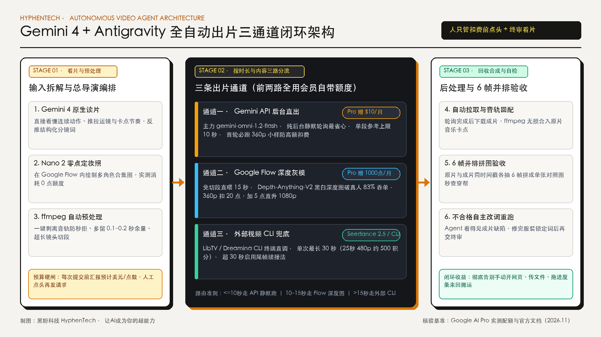
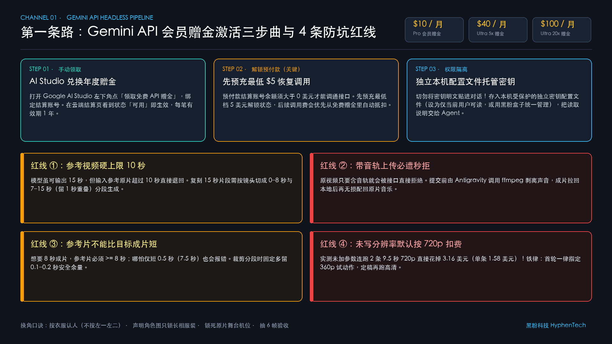
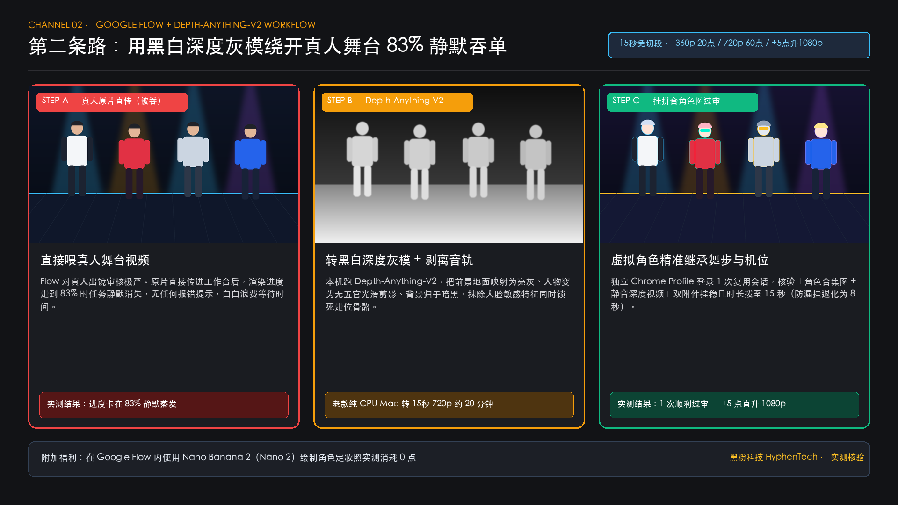
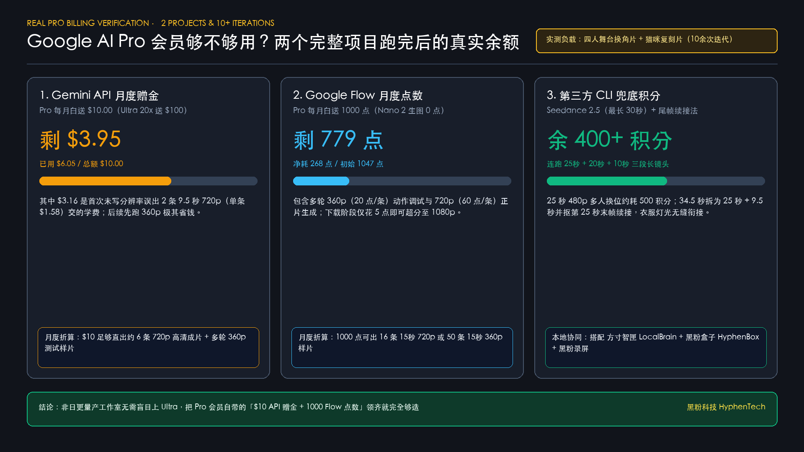

> [!abstract]
> 多模态智能体实操 · 全自动出片三通道指南
> 看完参考片、画好角色定妆照、写完提示词，直接调视频模型出片并抽 6 帧验收——把 Google AI 会员里藏着的两份免费额度真正跑成闭环
> 黑粉科技 · 2026-11-18

　　很多人还没意识到一件事：[Google Antigravity 官方智能体环境](https://antigravity.google/)本身其实不能直接生成视频。之前拿它拆解爆款短视频时，它可以看懂原片动作、反推分镜提示词、顺手把角色定妆照也画好；可一到最后一步「出片」，人还是得自己切去浏览器传图、点生成、盯进度条、下载成片，再拖回本地检查。

　　这两天我把最后这块拼图彻底接上了。现在在同一个对话窗口里，它看完参考视频、画完角色定妆照、写好提示词，会直接调用视频模型出片，自动完成下载、配回原片音轨、抽取 6 帧并排拼图送审——我只管在扣费前点个头，以及最后看成片拍板。

　　整套方案一共跑通 **3 条通道**，其中前两条花的全是 [Google One AI 会员](https://one.google.com/about/google-ai-plans/)本来就白送的隐藏额度，Pro、Ultra 5x、Ultra 20x 都能直接用。下面所有配额、踩坑边界与扣费明细均按 Pro 会员实测核对，每一节末尾都附好了现成指令，复制给 Antigravity 就能直接跑。



## 一、Antigravity 缺的那一块：看得懂，为什么必须接上自动出片？

　　为什么非要把出片这一步交给智能体？核心原因在于它的底层大脑是 Gemini。普通多模态模型看视频往往只是按秒抽几张静态截图猜剧情，而升级到 **Gemini 4** 之后，它能原生读懂连续动作、运镜推拉和卡点节奏。

　　但只要它自己出不了片，工作流在最后一公里就是断的：最折腾人的不是多点那几下鼠标，而是**反馈闭环断了**。智能体看不到自己写出来的提示词跑出了什么画面，就没法对照原片挑错、改写提示词再跑一版；每次来回搬运文件，人都得守在屏幕前当搬运工。

　　把出片通道接进终端后，人机分工立刻清爽了：

- **人的动作**：说清要做哪条片子、每次花钱前确认预算、看对比样片拍板。
- **Antigravity 的动作**：拆解原片、锁定角色定妆照、撰写分镜提示词、选定通道提交、轮询下载、用 `ffmpeg` 配回原声、从原片与成片各抽 **6 帧** 并排拼图自检——发现穿帮自己改一版再交卷。


## 二、你的会员里，原本就藏着两份出片额度

　　不少人订阅了 Google AI Pro 或 Ultra，平时只在网页里聊聊天，完全没领过账号里自带的两份视频生产力额度：

　　**第一份是 Gemini API 云端赠金（美元）**。Google 已经把 [Google Developer Program 开发者福利](https://developers.google.com/program)并进了 AI 订阅体系，按 [Google 开发者计划官方权益说明](https://developers.google.com/profile/help/benefits)与 [AI Studio 会员赠金领取指南](https://aistudio.google.com/learn/claim-google-ai-plan-credits-in-ai-studio)，每月都会发放一笔可直接调用视频模型的云赠金：

- **Pro 会员**：每月 **10 美元**
- **Ultra 5x 会员**：每月 **40 美元**
- **Ultra 20x 会员**：每月 **100 美元**

　　这笔钱不会自动塞进账单，必须手动点一次领取，领到手后每笔有效期 **1 年**。

　　**第二份是 Google Flow 月度点数**。[Google Flow 官方视频工作台](https://flow.google.com/)（桌面端规则详见 [Google Flow 官方帮助文档](https://support.google.com/flow/answer/16353333?hl=en&co=GENIE.Platform%3DDesktop)）可以理解成谷歌自家的多模态制片台：传参考图、传参考视频、写一句调度描述就能出片。Pro 会员每月固定送 **1000 点**，Ultra 点数更多；生视频按分辨率扣点，而用内置的 **Nano Banana 2**（界面简称 **Nano 2**）画角色定妆照，实测消耗 **0 点**。

　　在正式动手前，先把下文反复出现的三个核心名字对号入座：

- **Omni 与 Veo**：谷歌的两条视频模型线。**Omni**（本文主力为 `gemini-omni-1.2-flash`）专门擅长「同时看着参考视频动作和参考角色图来出片」；**Veo** 则偏向纯电影感画质渲染。
- **Nano Banana 2（Nano 2）**：谷歌高人气生图模型，在 Flow 里拿它出多角度角色定妆照不扣点数。
- **Antigravity**：谷歌官方命令行与桌面智能体，能读写本地文件、跑终端命令、受控拉起浏览器（详见 [Antigravity 浏览器控制文档](https://antigravity.google/docs/browser/)），在这套系统里担任总导演。

| 通道方案 | 消耗额度来源 | 单次参考视频上限 | 核心优势与适用场景 | 主要限制与门槛 |
| :--- | :--- | :--- | :--- | :--- |
| **第一条路：Gemini API** | 月度美元赠金（Pro `$10`/月） | 最长 **10 秒** | 纯后台静默轮询，最省心、最接近全自动 | 需先预充 `$5` 激活；超 10 秒需切段；默认 720p 较贵 |
| **第二条路：Google Flow** | 月度会员点数（Pro `1000 点`/月） | 最长 **15 秒** | 免切段喂 15 秒；下载加 `5 点` 直升 1080p | 无公开 API 需操控独立 Chrome；真人参考需转深度灰模 |
| **第三条路：外部视频 CLI** | 第三方平台积分 | 最长 **30 秒**（可尾帧续接） | 谷歌双通道卡审或拍 30 秒以上多人复杂走位时稳健兜底 | 需额外配置第三方 CLI 工具与对应平台积分 |

## 三、第一条路 · Gemini API：用会员赠金纯后台直出

### 1. 三步领出赠金并打通本机调用

　　API 通道的逻辑最干净：Antigravity 在后台把「静音参考视频 + 角色定妆照 + 提示词」打包发往谷歌云端模型，每隔几秒轮询一次状态，生成完毕直接拉回本地，全程不弹窗、不占屏幕。按下面三步就能接通：

1. **领出月度赠金**：打开 [Google AI Studio 控制台](https://aistudio.google.com/)，点击左下角「领取免费 API 赠金」卡片，在弹窗中绑定结算账户并点「兑换并继续」。兑换后在 Google Cloud「结算 → 赠金」页面看到 `Google Developer Program premium benefit` 状态显示「可用」即告成功。
2. **预充 5 美元激活预付款状态（最容易卡壳的一步）**：刚领完赠金直接调接口，结算页往往会弹黄条提示账号处于预付款模式、余额需大于 **0 美元** 才能恢复服务。实测先预充最低档 **5 美元** 即可解锁，恢复后所有 API 账单都会**优先抵扣免费赠金**。
3. **安全存放密钥交由智能体读取**：在 AI Studio 左侧新建绑定该项目的密钥。切勿把密钥明文直接贴进聊天框——建议存入本机受保护的独立密钥配置文件（将文件读取权限设为仅当前系统用户可读，或者交由本机工具统一托管），再把配置文件说明告诉 Antigravity。



### 2. 踩过才知道的 4 条 API 硬边界与换角写法

- **① 参考视频硬上限 10 秒**：模型虽然能输出 **15 秒**，但喂给它的参考原片只要超过 **10 秒** 就会被直接退回。复刻 **15 秒** 片段时，让智能体按镜头切成 **0-8 秒** 和 **7-15 秒** 两段（留 **1 秒** 重叠缓冲）分别跑完再拼。
- **② 上传前必须剥离音轨**：带音轨的原视频传上去会直接秒拒且不报明细原因。先让智能体用 `ffmpeg` 一键静音，等成片下好后再把原片音乐无损配回。
- **③ 参考片绝不能比目标成片短**：比如指定出 **8 秒** 成片，参考视频就必须大于等于 **8 秒**；哪怕短 **0.5 秒**（只有 **7.5 秒**）也会报错退回，裁剪时多留 **0.1-0.2 秒** 最稳妥。
- **④ 不声明分辨率默认跑 720p**：第一次没留神，连跑 **2 条** **9.5 秒** 的 **720p** 直接扣掉 **3.16 美元**（单条 **1.58 美元**），一下吃掉 Pro 月度 **10 美元** 赠金近三分之一。务必立下规矩：**先跑 360p 小样看动作构图，全对再跑高清**。

　　写换角提示词时也有四句铁律：**按衣服认人别按左一左二位置认人**（写清「穿黑袖白衬衣的那位换成角色 A」，多人交叉换位才不串脸）；**声明角色图只锁长相和服装，动作完全照原片**（防止人物照着定妆照站桩）；**写死保留原片的舞台、灯光和机位**；**提示词精简清晰**，出片后固定让智能体各抽 **6 帧** 拼成一张对照图验收。

```text
帮我调用 Gemini API 视频模型（先列出可用模型，优先使用 gemini-omni-1.2-flash）生成一段视频：
参考视频：<原视频本地路径>，角色定妆照：<角色图片路径列表>，密钥读取：<本机受保护密钥配置说明>。
执行规则：
1. 参考视频先用 ffmpeg 剥离音轨；若超过 10 秒，按镜头切分为不超过 10 秒的分段，且每段参考时长比目标生成时长多留 0.1-0.2 秒；
2. 第一轮一律先出 360p 小样，确认构图与动作无误后再询问我是否渲染高清版；
3. 提示词按服装特征绑定替换角色，明确写出「角色图只锁长相和服装，动作、机位与舞台背景完全照原片」；
4. 采用异步任务提交并轮询直到完成后下载；
5. 下载后把原视频音轨配回成片，并从原片与成片各抽 6 帧并排拼成验收图发我；
6. 每次发起扣费请求前，先估算本次预计消耗的美元金额并等我确认。
```

## 四、第二条路 · Google Flow：用深度灰模过审，花会员点数

### 1. 绕开无接口、人机验证与真人舞台 83% 吞单三道坎

　　相比 API，[Google Flow](https://flow.google.com/) 有三个实打实的甜头：能直接塞进整段 **15 秒** 参考视频不用切段；扣的是每月白送的 **1000 点** 会员点数（`Omni 1.2 Flash` 跑一条 **15 秒** 视频，**360p** 扣 **20 点**，**720p** 扣 **60 点**，并发 **2 条** 720p 报价 **120 点**）；而且下载成片时只需加 **5 点** 就能直接超分到 **1080p**（社区也有诸如 [ffroliva/gflow-cli](https://github.com/ffroliva/gflow-cli) 的流程拆解可供对照，但务必阅读其 [账号安全边界说明](https://github.com/ffroliva/gflow-cli/blob/develop/docs/ACCOUNT_SAFETY.md)）。

　　想让 Antigravity 替你丝滑跑通 Flow，得依次跨过三道坎：

1. **独立 Chrome 目录绕开无头拦截**：谷歌会拦截特征明显的无头脚本浏览器。解法是让 Antigravity 拉起一个挂有专用用户数据目录的真实 Chrome 窗口，你只需在第一次弹窗时手动登录 **1 次** Google 账号，后续会话就能持久复用。
2. **Depth-Anything-V2 深度灰模破解真人审核拦截**：Flow 对真人参考视频审核极严。实测直接上传一段四人真人舞台视频，生成进度走到 **83%** 时任务直接静默蒸发，连报错都没有。解法是用开源单目深度估计模型 [DepthAnything/Depth-Anything-V2](https://github.com/DepthAnything/Depth-Anything-V2) 把原片转成**黑白深度灰模视频**——前景舞台亮灰、人物变成没有五官和衣纹的光滑剪影、远景舞台暗黑，既彻底抹掉真人面部敏感特征，又把四人的走位骨骼与空间景深完整保留下来。传深度灰模上去，**1 次**直接过审出片！（注：老款无独显 Mac 纯靠 CPU 跑一条 **15 秒** **720p** 深度视频大约要 **20 分钟**，带 Apple Silicon 或 RTX 独显的机器会快很多。）
3. **提交前核验附件与 15 秒档位**：网页自动化上传视频偶尔会没挂进输入框，一旦漏挂，Flow 就会退化成纯看图生视频并默认只出 **8 秒**。务必在指令里要求智能体提交前检查输入框里「拼合角色图 + 静音深度灰模视频」两项附件齐全，且时长明确拨到 **15 秒**。




```text
帮我通过 Google Flow（https://flow.google.com/）生成一段 15 秒换角视频：
参考视频：<原视频路径>，角色定妆照：<角色图片路径列表>。
执行规则：
1. 若原片包含真人出镜，先调用本机 Depth-Anything-V2 将原片转为黑白深度灰模视频，并用 ffmpeg 去掉音轨；若多张角色图需同台，先拼成一张带编号的角色合集图；
2. 使用独立用户目录启动真实 Chrome 窗口打开 Flow（若未登录先停下等我手动登录一次）；
3. 上传角色合集图与静音深度视频，选用 Omni 1.2 Flash 模型，先设为 360p（20 点）与 15 秒时长；
4. 点击生成前必须截图或检查输入框 DOM，确认「图片 + 视频」两个附件均已挂稳且扣点预估正确，报我确认后再点生成；
5. 下载成片后配回原片音轨，抽 6 帧与原片并排对比；待我确认动作合格后，再花 5 点下载 1080p 超分终版。
```

## 五、第三条路 · 外部视频命令行：长镜头与复杂多人场面兜底

　　如果遇到谷歌两条路同时维护限流，或者你要拍一段 **25 秒** 甚至 **30 秒以上** 的多人大幅度交叉走位长镜头，就需要第三条路兜底——直接让 Antigravity 在终端调度外部视频平台的命令行或 MCP 工具。目前生态已经很成熟，比如支持多模型调度的 [libtv-labs/libtv-skills](https://github.com/libtv-labs/libtv-skills)、官方推出的 [即梦 Dreamina CLI](https://dreamina.capcut.com/tools/dreamina-cli)、海外版 [Pippit CLI](https://github.com/Pippit-dev/cli)、[MiniMax 官方 MCP](https://github.com/MiniMax-AI/MiniMax-MCP) 以及 [可灵 Kling AI 开放平台](https://klingai.com/dev)（接入文档见 [可灵 API 快速入门](https://klingai.com/document-api/guides/get-started/overview)）。

　　以终端实测 `LibTV` 调度为例，不同底层模型的脾气差异很明显：

- **Seedance 2.5（参考生视频模式）**：单次最长支持 **30 秒**。实测 **4 名**虚拟角色在舞台上频繁交叉换位也能稳稳锁住各自服装，跑一条 **25 秒** **480p** 大约消耗 **500 积分**（早期试 **2.0** 版本时背景偶尔会多冒出路人，切到 **2.5** 后干净解决）。
- **Wan 3.0（万相 3.0）**：混合参考模式单次上限 **15 秒**，偏写实光影质感。

　　**超过 30 秒怎么接？用「尾帧续接法」**：实测复刻一条 **34.5 秒** 的完整舞台片段时，先拆成前 **25 秒** 和后 **9.5 秒**（约 **10 秒**）两段。等前 **25 秒** 成片跑完，让 Antigravity 用 `ffmpeg` 把第 **25 秒** 的最后 **1 帧** 精准抠出来，当成下一段生成的首帧参考图，连同后 **9.5 秒** 原片一起喂进去——两段拼起来之后，人物衣服、舞台追光和动作衔接肉眼几乎看不出切口。


```text
帮我用本机已安装的外部视频 CLI（如 LibTV / Dreamina CLI）生成长镜头换角视频：
参考视频：<原视频路径>，角色图：<角色图片路径列表>。
执行规则：
1. 若目标时长在 30 秒以内且为多人走位，优先选 Seedance 2.5 参考生视频模式，先用 480p 试跑；
2. 若原片超过 30 秒（例如 34.5 秒），按镜头拆成前 25 秒与后续片段：跑完第一段后，用 ffmpeg 抽取第一段成片的最后 1 帧作为第二段的首帧参考，保证跨段衣服与站位严丝合缝；
3. 每次提交前先向我汇报预计扣除的平台积分，出片后自动配回原声并生成 6 帧并排验收图。
```

## 六、Pro 会员够不够用？两个完整项目跑完后的真实扣费明细

　　很多朋友最关心：不升昂贵的 Ultra，每个月基础版 **Google AI Pro** 的额度到底经不经造？我拿这套流水线完整磨完了 **2 个项目**（**1 条**四人舞台换角长片 + **1 条**猫咪动作复刻短片），算上前期摸索踩坑一共跑了 **10 余次**生成，后台真实扣费如下：



- **Gemini API 美元赠金**：月度赠送 **10 美元**，跑完还剩 **3.95 美元**，共花掉 **6.05 美元**（其中有一半——**3.16 美元**——是第一次没设分辨率连出 **2 条** **9.5 秒** **720p** 交的学费；如果严格先跑 360p 小样，**10 美元** 足够稳稳交付约 **6 条** 高清成片外加一打测试样片）。
- **Google Flow 月度点数**：初始 **1047 点**，跑完还剩 **779 点**，净耗 **268 点**。按 Pro 每月送 **1000 点** 折算，全出 **15 秒** **720p**（**60 点**/条）能出 **16 条**，全跑 **360p** 小样（**20 点**/条）能跑整整 **50 条**，挑中满意的再花 **5 点** 升 **1080p** 极其划算。
- **第三方兜底平台积分**：跑完 **25 秒** + **20 秒** + **10 秒** 三段长镜头后，账上依然躺着 **400 余积分**。

　　日常只要不是日更工作室级别的批量吞吐，**Pro 会员自带的两份额度叠在一起完全够用**。最后再送一段「总导演自动路由指令」——平时你不用自己纠结走哪条路，让 Antigravity 按片长和画面内容自动选通道就行；如果你平时已经在用我维护的 **方寸智匣 LocalBrain** 管理本地语音与视频 MCP 工具、用 **黑粉盒子 HyphenBox** 统一看管本机接口密钥，或者成片出来后拖进 **黑粉录屏 HyphenScreen** 做达芬奇式时间线精修与成片体检，整套本地创作链路就能彻底串成一体：

```text
你现在是我的视频总导演 Agent。请读取参考视频 <原视频路径> 与角色图 <角色图片路径列表>，按以下路由策略自动选通道并执行闭环：
1. 先分析原片时长、出镜人数与是否为真人实拍，给我一份选路方案与预算预估，等我点头再动手：
   - 时长 <= 10 秒且追求后台静默省心：走 Gemini API（gemini-omni-1.2-flash），先剥离音轨、留 0.1-0.2 秒时长余量，首轮必选 360p；
   - 时长 10-15 秒：走 Google Flow，若含真人先用 Depth-Anything-V2 转黑白深度灰模脱敏，挂稳图文视频双附件，首轮 360p（20 点），定稿后花 5 点升 1080p；
   - 时长 > 15 秒或谷歌通道受阻：走外部视频 CLI（Seedance 2.5），超 30 秒自动启用 ffmpeg 尾帧续接法；
2. 出片后一律自动配回原片音轨，并生成「原片 vs 成片」6 帧并排验收拼图发我审阅。
```

## 限制与适用边界

- Google AI 会员每月赠送的 Cloud API 赠金金额、有效期及 Google Flow 点数计费标准，均可能随谷歌季度订阅政策调整而变动，实操前建议在 [Google AI Studio 控制台](https://aistudio.google.com/)与 [Google Flow 工作台](https://flow.google.com/)核对当月实时配额。
- 操控独立浏览器访问网页工作台仅限个人合规创作辅助，切勿高频并发刷单以免触发平台风控；使用参考视频进行角色替换时，请确保对原片动作编排、背景音乐及替换角色形象拥有合法使用授权。

## 主要查证来源

- [Google Antigravity 官方网站](https://antigravity.google/)
- [Google Antigravity 浏览器子智能体操控文档](https://antigravity.google/docs/browser/)
- [Google AI Studio：领取 Google AI 会员月度 API 赠金官方指南](https://aistudio.google.com/learn/claim-google-ai-plan-credits-in-ai-studio)
- [Google Developer Program 会员权益与常见问题](https://developers.google.com/profile/help/benefits)
- [Google One AI 会员方案对比页](https://one.google.com/about/google-ai-plans/)
- [Google Flow 官方 AI 视频工作台](https://flow.google.com/)
- [GitHub：DepthAnything/Depth-Anything-V2 单目深度估计开源仓库](https://github.com/DepthAnything/Depth-Anything-V2)
- [GitHub：libtv-labs/libtv-skills 多模型视频生成命令行技能库](https://github.com/libtv-labs/libtv-skills)
- [即梦官方工具：Dreamina CLI 命令行文档](https://dreamina.capcut.com/tools/dreamina-cli)
- [GitHub：MiniMax-AI/MiniMax-MCP 官方多模态 MCP 服务](https://github.com/MiniMax-AI/MiniMax-MCP)


---

## 🧰 我做的工具

这些工具都由我持续维护。预览版会明确标注，下载、更新和已知边界以发行页为准。

> [!info] 黑粉助手 HyphenAssistant
> **状态：** 正式迭代
>
> 手机浏览器接续电脑上的 DeepSeek Harness 会话；需本人配对、电脑与原服务在线，模型费用沿用原配置
>
> [下载与更新：黑粉助手 HyphenAssistant](https://github.com/HackerChi-Hub/hyphen-assistant-releases/releases)

> [!info] 黑粉盒子 HyphenBox
> **状态：** 正式迭代
>
> 免费大模型 API 雷达：持续复测可用性，本地统一接口，Key 只存本机
>
> [下载与更新：黑粉盒子 HyphenBox](https://github.com/HackerChi-Hub/hyphenbox-release/releases)

> [!info] 方寸智匣 LocalBrain
> **状态：** 正式迭代
>
> 本地模型的多模态 MCP 工具箱：TTS / Whisper / 视频生成一站接入
>
> [下载与更新：方寸智匣 LocalBrain](https://github.com/HackerChi-Hub/localbrain-releases/releases)

> [!info] ScreenLex 光影词库
> **状态：** 正式迭代
>
> 看美剧顺手把生词背了，Mac/Windows 双平台，免费
>
> [下载与更新：ScreenLex 光影词库](https://github.com/HackerChi-Hub/screenlex-download/releases)

> [!info] 黑粉录屏 HyphenScreen
> **状态：** 正式迭代
>
> 录屏 + 智能剪辑一体：达芬奇式时间线、自动打码、导出前成片体检，免费
>
> [下载与更新：黑粉录屏 HyphenScreen](https://github.com/HackerChi-Hub/HyphenScreen-Releases/releases)

---

> [!quote] 黑粉科技
> **让AI成为你的超能力**
> 本地部署 · 免费白嫖 · 自制软件
> [黑粉科技](https://hyphentech.top)
