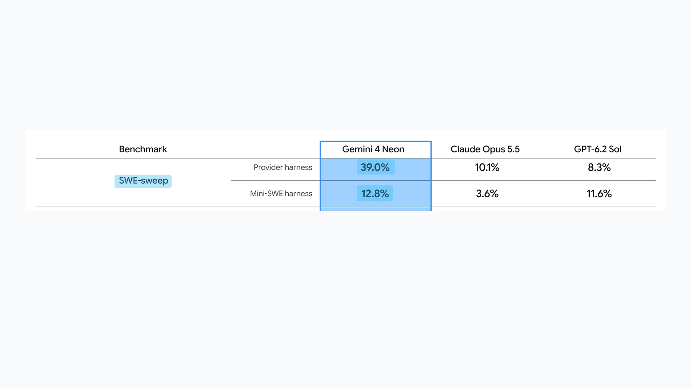
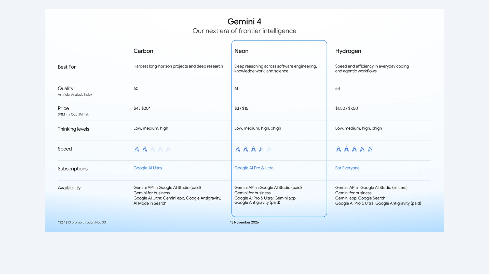
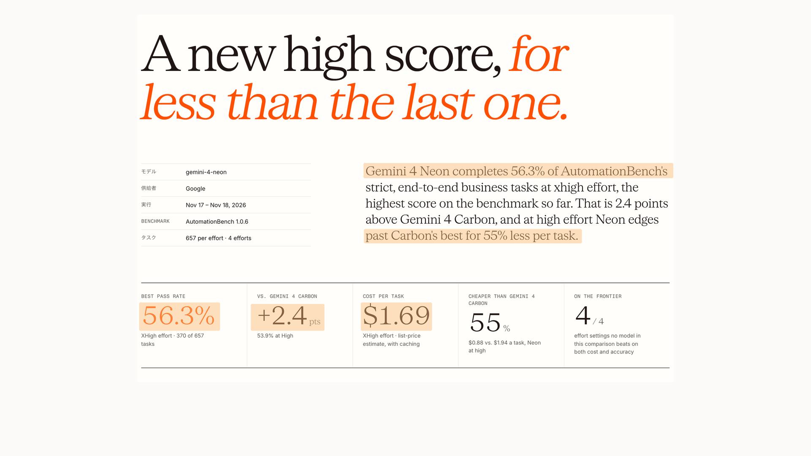
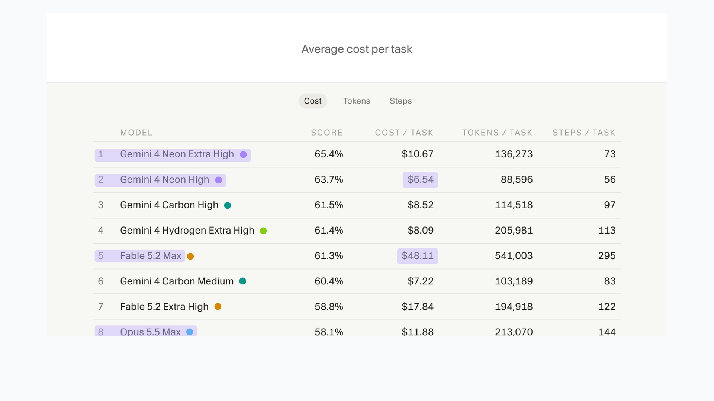
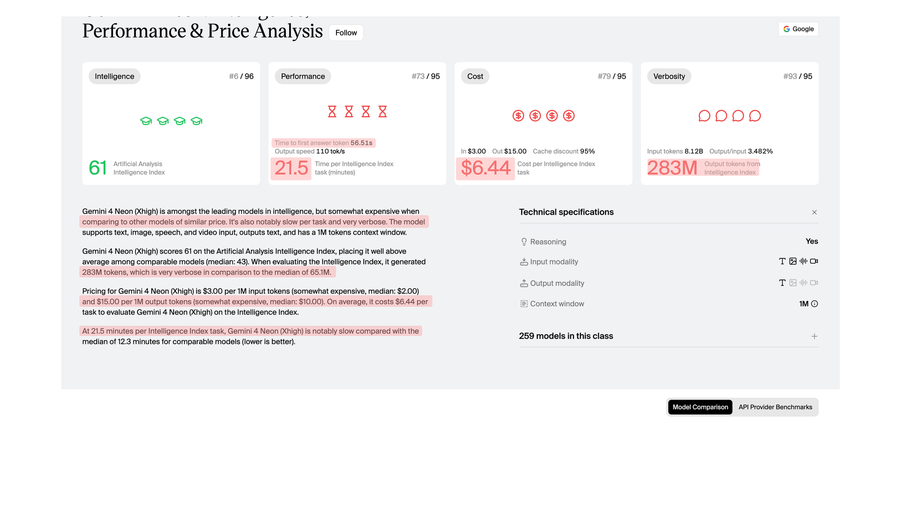
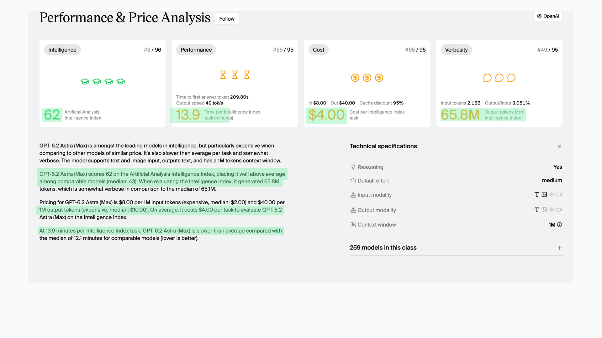
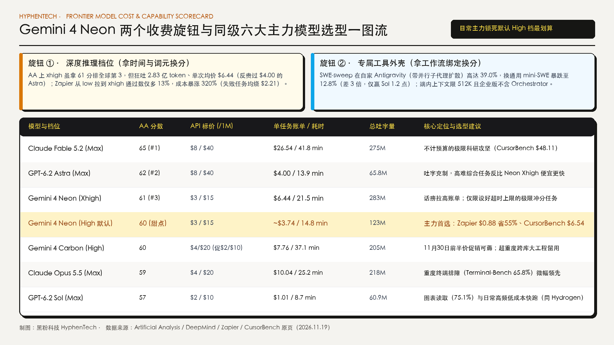

> [!abstract]
> Model Deep Dive · Evidence-Backed Pros, Cons & Real Task Bills
> Priced at `$3/$15` with #1 finishes on Zapier and CursorBench, why does Neon drop 3x in generic harnesses and burn `$6.44` per task at Xhigh? Understanding the two paid knobs behind Google's new workhorse
> HyphenTech · 2026-11-19

　　On **November 18, 2026**, Google officially released **Gemini 4 Neon**, its new mid-tier frontier reasoning model. At first glance on the [Google DeepMind launch post](https://deepmind.google/blog/introducing-gemini-4-neon/), the pitch looks almost unbeatable: **61** on the [Artificial Analysis Intelligence Index](https://artificialanalysis.ai/models/gemini-4-neon) (#3 globally, trailing only far larger models) while cutting list prices by a quarter compared to flagship Gemini 4 Carbon.

　　Yet two rows further down the exact same official benchmark table sits a jarring contrast: inside a shared open-source `mini-SWE` harness, Gemini 4 Neon resolves just **12.8%** of tasks; move that exact same model into Google's proprietary Antigravity environment, and the score leaps to **39.0%**—**a 3x swing from switching the tool harness alone**.

　　An even sharper surprise hides in the invoice: Neon lists at **$3 input / $15 output** per million tokens—less than 40% of **GPT-6.2 Astra** (**$8 / $40**). Yet across the full Artificial Analysis run, cranking Neon to `xhigh` pushed its average bill to **$6.44 per task**, making it *more expensive* per task than GPT-6.2 Astra Max (**$4.00 per task**). Instead of running cherry-picked toy prompts, let's lay out the [10-page Model Card PDF](https://storage.googleapis.com/deepmind-media/Model-Cards/Gemini-4-Neon-Model-Card.pdf), the [6-page Evals Methodology PDF](https://deepmind.google/models/evals-methodology/gemini-4-neon/), and raw leaderboards from Artificial Analysis, Zapier, and Cursor side by side.

## 1. Family Positioning & Three Verified Strengths: Undercutting Rivals in the 60+ Bracket

　　First, place Neon inside the Gemini 4 lineup. Google now splits the family into three clear tiers: **Carbon** tackles the hardest long-horizon research, **Hydrogen** handles ultra-fast low-cost execution, and **Neon** sits squarely in the middle. As the [Gemini 4 Neon Model Card page](https://deepmind.google/models/model-cards/gemini-4-neon/) states plainly, Neon is adapted directly from Carbon and exposes **4 thinking levels**: `low`, `medium`, `high` (default), and `xhigh`.

　　On Google's comparison graphic, AA Quality stands at **60** for Carbon, **61** for Neon, and **54** for Hydrogen. Per million tokens, Carbon lists at **$4 / $20** (with a **$2 / $10** promotional rate through **November 30**), Neon lists at **$3 / $15** with **$0.15** implicit cached input, and Hydrogen sits at **$1.50 / $7.50**. Speed bars rate Carbon at **2**, Neon around **3.5–4**, and Hydrogen at **5/5**—delivering a **25%** lower list price and **32%** lower per-task cost at default `high` effort than Carbon.

　　Where Neon genuinely shines comes down to three concrete pillars:

- **Broad leads over similarly priced peers on official suites**: Against Claude Opus 5.5 and GPT-6.2 Sol, Neon leads on the AA Intelligence Index (**61 vs. 59 vs. 57**), Vals Index (**70.9%** #2 vs. **70.1%** and **66.1%**), HLE-Diamond (**71.3%** vs. **67.9%** and **64.0%**), and long-context GraphWalks (**95.2%** vs. Opus's **66.8%**), while taking **#1** on the AA Coding Agent Index (**58.6**) alongside **90.5%** on SEC-bench Pro, **84.0%** on RiemannBench, and **$16,843** on Vending-Bench 2.
- **Record #1 on Zapier AutomationBench—and 55% cheaper than Carbon at High**: In the independent [Zapier AutomationBench report](https://zapier.com/ja/benchmarks/gemini-neon-4-report) spanning **657** end-to-end enterprise tasks, Neon `xhigh` solved **370** (**56.3%**) to set a new benchmark record—beating Carbon (**53.9%**) by **2.4 points** and GPT-6.2 Astra Max (**52.4%**) by **3.9 points**. Better yet, dropping to default `high` retains **54.3%** accuracy at **$0.88/task** (**55%** cheaper than Carbon's **$1.94**), while `medium` hits **53.3%** at **$0.58/task** (**30%** cheaper than Astra).
- **1-2 finish on CursorBench 4.1 at a fraction of rival task bills**: On the [CursorBench 4.1 leaderboard](https://cursor.com/cursorbench) (see also [Cursor's launch post](https://x.com/cursor_ai/status/2123198346802450926)), Neon Extra High takes **#1** at **65.4%** (**$10.67/task**, **73 steps**), and default High takes **#2** at **63.7%** for **$6.54/task** (**56 steps**)—dramatically undercutting Carbon High (**61.5%**, **$8.52**), Claude Opus 5.5 Max (**58.1%**, **$11.88**), and Claude Fable 5.2 Max (**61.3%**, a whopping **$48.11/task** across **295 steps**).

　　Behavioral discipline improved as well: DeepMind reports its lowest internal fabrication rate to date and a **2.45%** reward-hacking shortcut rate on coding evals (lowest in Gemini 4), while the [GitHub Copilot changelog](https://github.blog/changelog/2026-11-18-gemini-4-neon-in-github-copilot/) notes fewer unsolicited edits compared to Carbon. Inside [Google Antigravity](https://antigravity.google/blog/gemini-4-neon-in-google-antigravity), **Orchestrator mode** pairs Neon as planner with **8** parallel Hydrogen workers—building the 3D synthwave mini-golf game `NEONPUTT '84` with automated browser verification from a single prompt, before handing **Player 2** to Hydrogen in real time.

## 2. Four Real Trade-Offs: Why $3/$15 Ended Up Costing More Per Task Than $8/$40 Astra

　　Now flip the coin over. Treating `$3/$15` as an invitation to leave `xhigh` pinned on every call is the fastest way to blow your monthly API budget.

### 1. Runaway Reasoning Verbosity: 283M Output Tokens Push Xhigh to $6.44/Task

　　[Artificial Analysis](https://artificialanalysis.ai/models/gemini-4-neon) (full standings on the [AA Models Leaderboard](https://artificialanalysis.ai/leaderboards/models)) bluntly characterizes Neon (`xhigh`) as **notably slow, very verbose, and somewhat expensive**. Each Index task averaged **21.5 minutes** (versus a **12.3-minute** peer median) with a **56.51-second** wait for the first answer token. Across the evaluation suite, Neon emitted **283M** output tokens—over **4.3x** the **65.1M** peer median—driving its average cost to **$6.44 per task**.

　　Compare **GPT-6.2 Astra (Max)** side by side: despite a **2.67x** higher list price (**$8 / $40**), Astra generated just **65.8M** tokens, finished in **13.9 minutes**, scored **62**, and averaged **$4.00 per task**. Token price means nothing without token volume.

### 2. Steep Diminishing Returns Across Effort Tiers—and Failed Runs Cost the Most

　　Across AA's four effort settings, Neon scores **61** at `xhigh` (**21.5 min**), **60** at `high` (**14.8 min**, **123M** tokens), **55** at `medium` (**8.3 min**, **62.9M**), and **44** at `low` (**3.7 min**, **28.3M**). On Zapier, cranking from `low` to `xhigh` raised solved tasks by just **13%** (**326** to **370**) while per-task cost jumped **320%** (**$0.40** to **$1.69**) and reasoning tokens expanded **8.8x** to consume **82%** of all output. Worse still, **failed `xhigh` runs averaged $2.21 versus $1.29 for successful runs**—meaning stuck tasks spin in reasoning loops and pad your bill. Conversely, dropping to `low` on CursorBench sinks accuracy to **45.5%**, trailing cheaper Hydrogen High (**57.3%**).

### 3. Harness Lock-In, 512K Client Caps, and Missing Modalities

- **Heavy reliance on Google's own harness**: Dropping from Antigravity (**39.0%**) to generic `mini-SWE` (**12.8%**) shrinks Neon's lead over GPT-6.2 Sol (**11.6%**) from **30.7 points** down to **1.2 points**.
- **512K context cap inside Antigravity**: While the [Google AI Studio model docs](https://aistudio.google.com/docs/models/gemini-4-neon) (and [release notes](https://aistudio.google.com/docs/whats-new-gemini-4-neon)) provide **1M** context via API, the [Google AI Forum rollout post](https://discuss.ai.google.dev/t/202301) confirms Antigravity caps Neon at **512K** and Enterprise plans omit Orchestrator.
- **Category & modality gaps**: Neon trails Opus 5.5 slightly on Terminal-Bench **4.1** (**65.2%** vs. **65.8%**) and FrontierCode **2.0** (**46.2%** vs. **47.3%**), trails Sol on Chartography (**73.5%** vs. **75.1%**), and tops out at **37.5%** on Zapier HR tasks (**5.8 points** behind Astra). It supports **no image generation, no audio generation, no Live API, no explicit caching, and no free API tier**, with a **March 2026** knowledge cutoff and its full safety report still marked `coming soon` (inheriting Argon's CCL assessment).

## 3. Underlying Mechanism & Six-Model Buying Guide: Lock In Default High

　　Every paradox in Neon's launch comes down to **two paid knobs**: the **thinking-depth knob** (buying 1–2 extra points with **82%** internal reasoning tokens and wait time) and the **harness knob** (buying a **3x** repo-repair boost by locking into Antigravity's subagent swarm).

| Model & Effort | AA Score | List Price (In/Out) | Avg. AA Task Bill / Time | Best Practical Fit |
| :--- | :--- | :--- | :--- | :--- |
| **Claude Fable 5.2 (Max)** | `65` (#1) | `$8 / $40` | `$26.54` / `41.8 min` | Budget-unconstrained frontier science & hardest proofs |
| **GPT-6.2 Astra (Max)** | `62` (#2) | `$8 / $40` | `$4.00` / `13.9 min` | Concise output (`65.8M`); faster & cheaper per task than Neon Xhigh |
| **Gemini 4 Neon (Xhigh)** | `61` (#3) | `$3 / $15` | `$6.44` / `21.5 min` | Hard edge cases only—always pair with strict token/timeout caps |
| **Gemini 4 Neon (High, Default)** | **`60`** | **`$3 / $15`** | **`~$3.74` / `14.8 min`** | **Daily sweet spot: `$6.54` on CursorBench, `$0.88` on Zapier** |
| **Gemini 4 Carbon (High)** | `60` | `$4 / $20` (`$2/$10` promo) | `$7.76` / `37.1 min` | Worth grabbing before `Nov 30` half-price promo ends; heavy projects |
| **Claude Opus 5.5 (Max)** | `59` | `$4 / $20` | `$10.04` / `25.2 min` | Slight edge in pure CLI repair (Terminal-Bench 4.1 `65.8%`) |
| **GPT-6.2 Sol (Max)** | `57` | `$2 / $10` | `$1.01` / `8.7 min` | Chart reading (`75.1%`) & fast low-cost execution (alongside Hydrogen) |

　　For day-to-day software engineering, long-context analysis, and multi-step business workflows on your own machine, **lock Gemini 4 Neon to its default `high` effort**—it captures Carbon-class **60-point** reasoning while keeping bills squarely in the sweet spot. Pair it with **GPT-6.2 Sol** or **Hydrogen** for high-frequency lightweight runs, and reserve **GPT-6.2 Astra** (or **Carbon** during its pre-November 30 promo) for massive architectural refactors. If you mix multiple cloud endpoints and local models on your desktop, you can route keys cleanly through **HyphenBox**, wire local TTS/Whisper/video MCP tools in **LocalBrain**, and edit full-resolution technical breakdowns on the DaVinci-style timeline in **HyphenScreen** (which produced our companion video for this episode).

## Limits and Applicable Boundaries

- All benchmark scores, latencies, and per-task dollar figures reflect public Model Cards and independent leaderboard snapshots verified as of **November 19, 2026**; real production bills vary with repository size, implicit cache hit rates, and agent retry loops.
- **Gemini 4 Carbon**'s `$2 / $10` half-price promotion expires on **November 30, 2026**, reverting to `$4 / $20` thereafter.

## Primary Verified Sources

- [Google DeepMind Blog: Introducing Gemini 4 Neon & Official Benchmarks](https://deepmind.google/blog/introducing-gemini-4-neon/)
- [Google DeepMind: Gemini 4 Neon Model Card (10-page PDF)](https://storage.googleapis.com/deepmind-media/Model-Cards/Gemini-4-Neon-Model-Card.pdf)
- [Google DeepMind: Gemini 4 Neon Evaluation Methodology PDF](https://deepmind.google/models/evals-methodology/gemini-4-neon/)
- [Artificial Analysis: Gemini 4 Neon Performance, Verbosity & Cost](https://artificialanalysis.ai/models/gemini-4-neon)
- [Zapier AutomationBench Report: Gemini 4 Neon Across 657 Tasks](https://zapier.com/ja/benchmarks/gemini-neon-4-report)
- [Cursor Official Leaderboard: CursorBench 4.1](https://cursor.com/cursorbench)
- [Google Antigravity Blog: Orchestrator & NEONPUTT '84 Demo](https://antigravity.google/blog/gemini-4-neon-in-google-antigravity)
- [Google AI Forum: Antigravity 512K Context Cap & Rollout Details](https://discuss.ai.google.dev/t/202301)
- [Google AI Studio Docs: Gemini 4 Neon Capabilities & Caching](https://aistudio.google.com/docs/models/gemini-4-neon)
- [GitHub Changelog: Gemini 4 Neon in GitHub Copilot](https://github.blog/changelog/2026-11-18-gemini-4-neon-in-github-copilot/)

---

## 🧰 Tools I build

I maintain all of these tools myself. Preview builds are clearly labeled; the release pages are the source of truth for downloads, updates and known limits.

> [!info] HyphenBox
> **Status:** Official releases
>
> A radar for free LLM APIs: availability is re-tested continuously, one local interface for all of them, and keys stay on your machine
>
> [Downloads & updates：HyphenBox](https://github.com/HackerChi-Hub/hyphenbox-release/releases)

> [!info] LocalBrain
> **Status:** Official releases
>
> A multimodal MCP toolbox for local models: TTS, Whisper and video generation in one place
>
> [Downloads & updates：LocalBrain](https://github.com/HackerChi-Hub/localbrain-releases/releases)

---

> [!quote] HyphenTech
> **Make AI your superpower**
> Local deployment · Free resources · Self-made software
> [HyphenTech](https://hyphentech.top)
