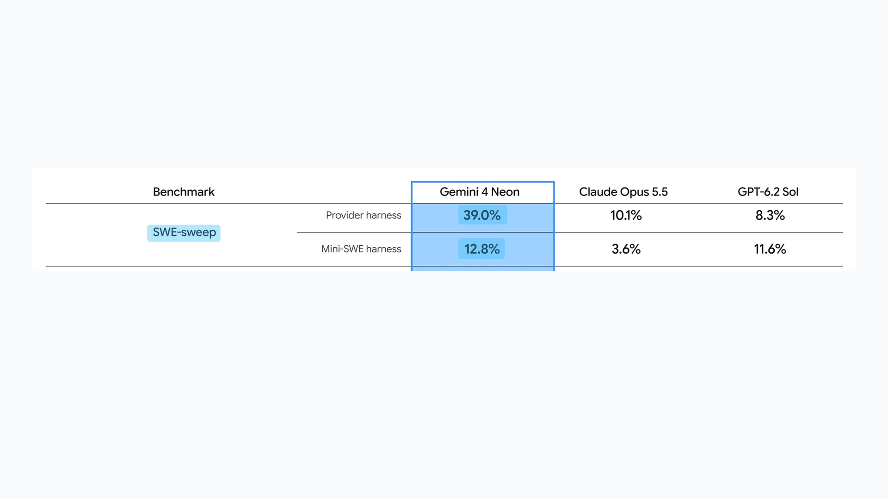
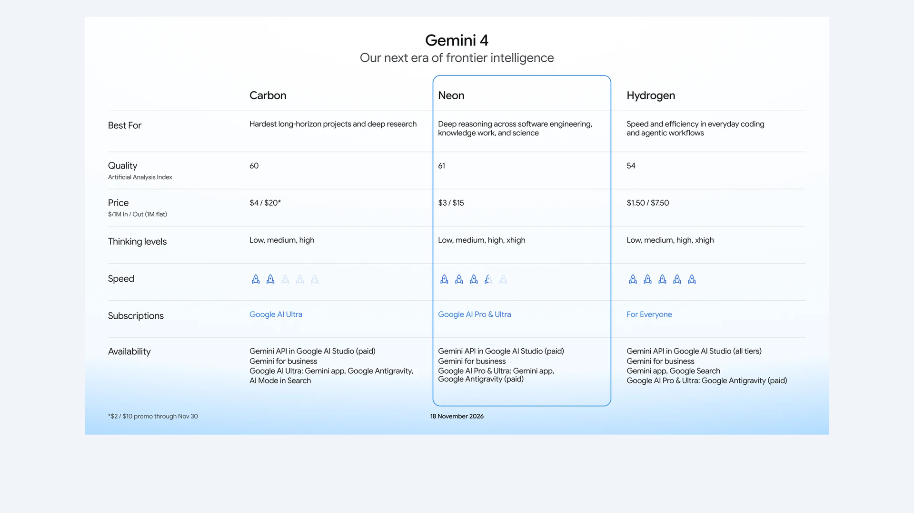
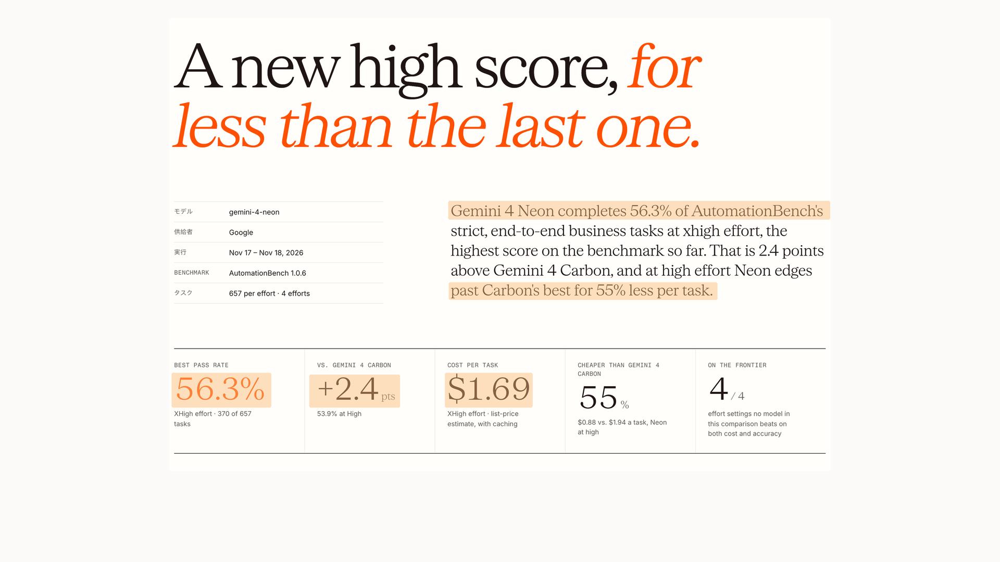
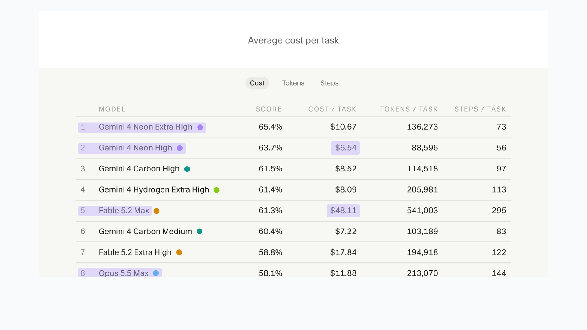
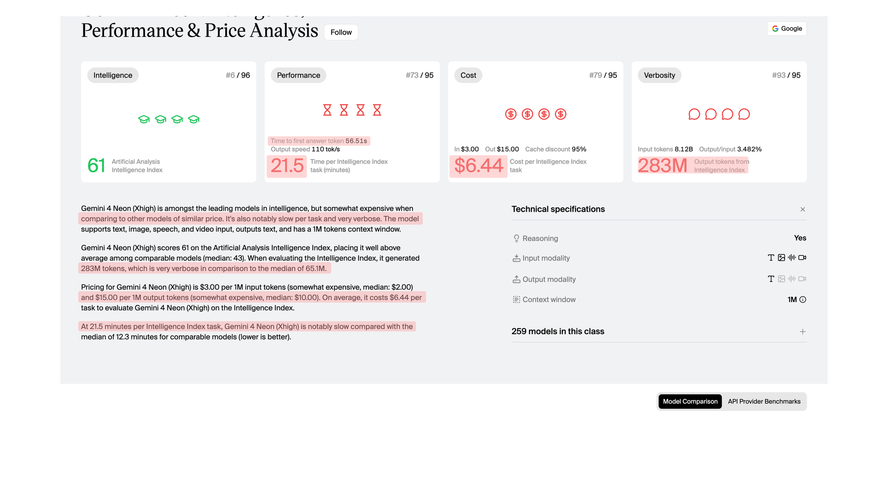
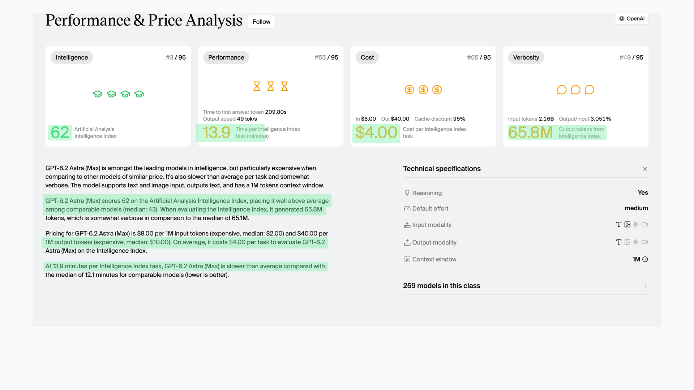
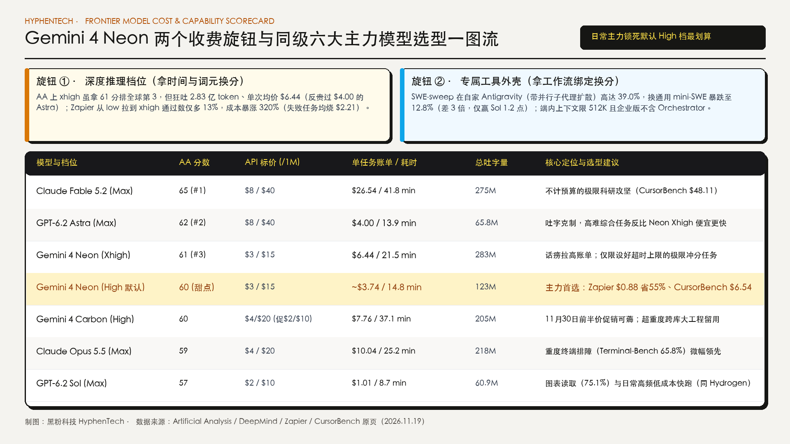

> [!abstract]
> 模型速览深度长文 · 公开一手证据双向拆解
> 标价 `$3/$15` 拿下 Zapier 与 CursorBench 双料第一，为何换通用外壳缩水三倍、顶配单次反烧 `$6.44`？看清两个收费旋钮背后的选型甜点
> 黑粉科技 · 2026-11-19

　　Google 在 **11 月 18 日**正式放出了新一代中坚主力模型 **Gemini 4 Neon**。只看 [Google DeepMind 官方发布博客](https://deepmind.google/blog/introducing-gemini-4-neon/)的首屏海报，它的卖点几乎挑不出毛病：在 [Artificial Analysis 智能指数](https://artificialanalysis.ai/models/gemini-4-neon)上拿下 **61 分**冲到全球**第 3**，仅次于体积更大、速度更慢的顶级巨无霸，标价却比自家旗舰 Carbon 直接砍掉四分之一。

　　可只要顺着同一份官方评测表往下看两行，一组扎眼的反差马上跳了出来：同样一个 Gemini 4 Neon，放进大家共用的开源通用 `mini-SWE` 工具里，代码修复率只有 **12.8%**；一旦换进 Google 自家的 Antigravity 环境，成绩当场飙到 **39.0%**——**同一个底座模型，换个工具壳子成绩差了整整 3 倍**。

　　更反直觉的数字藏在账单里：Neon 每百万词元标价 **$3 输入 / $15 输出**，单价不到 **GPT-6.2 Astra**（**$8 / $40**）的四成；结果去独立评测机构跑完一整套基准，Neon 开满 `xhigh` 档平均每个任务花掉 **$6.44**，反而比单价贵两倍多的 Astra（每任务 **$4.00**）更烧钱。今天咱们不在本地跑主观小测，直接把官方 [10 页模型卡 PDF](https://storage.googleapis.com/deepmind-media/Model-Cards/Gemini-4-Neon-Model-Card.pdf)、[6 页评测方法白皮书](https://deepmind.google/models/evals-methodology/gemini-4-neon/)，连同 Artificial Analysis、Zapier 和 Cursor 三家独立榜单原页全部摊开，看看它到底有没有把 Carbon 的智力做便宜、做快。

## 一、家族定位与三大硬核优点：在 60 分档把同行价格打穿

　　先把 Neon 放回 Google 自家的产品梯队里对号入座。目前 Gemini 4 家族分成三档主力：**Carbon** 负责硬啃最复杂的长程大项目，**Hydrogen** 主打极速高频省钱，**Neon** 正好卡在中间——[Gemini 4 Neon 模型卡页](https://deepmind.google/models/model-cards/gemini-4-neon/)写得很直白，Neon 就是从旗舰 Carbon 直接改造出来的，支持 `low`、`medium`、`high`、`xhigh` **4 个**思考档位。

　　看官方给出的家族横评图：AA 质量分上，Carbon 是 **60 分**，Neon 反而微超拿到 **61 分**，Hydrogen 是 **54 分**；每百万 token 定价上，Carbon 正价 **$4 进 / $20 出**（**11 月 30 日**前限时优惠 **$2 / $10**），Neon 定在 **$3 进 / $15 出**、隐式缓存输入低至 **$0.15**，Hydrogen 则是 **$1.50 / $7.50**；速度格数上，Carbon 只有 **2 格**，Neon 给到 **3.5 格**（约 **4 格**），Hydrogen 满格 **5 格**。单看纸面定位，标价比 Carbon 便宜 **25%**、默认 `high` 档单任务省 **32%**，分还高出 1 分。

　　平心而论，Neon 能打的长板确实够硬，主要集中在三个维度：

- **官方主推榜单全面压制同价位对手**：把 Neon 与 Claude Opus 5.5、GPT-6.2 Sol 摆在一起，AA 智能指数是 **61 对 59 对 57**；Vals 综合商业指数拿到 **70.9%**（排第 2，高于 Opus 的 **70.1%** 与 Sol 的 **66.1%**）；高难推理 HLE-Diamond 拿到 **71.3%**（对 **67.9%** 与 **64.0%**）；长上下文图遍历 GraphWalks 更是跑出 **95.2%**，大幅甩开 Opus 的 **66.8%**；AA 编码智能体指数也以 **58.6** 拿下**第 1**，外加 SEC-bench Pro **90.5%**、RiemannBench **84.0%** 与 Vending-Bench 2 **$16,843**。
- **Zapier 模拟企业独立实战刷新最高分，High 档省 55%**：外部独立跑出来的数据比官方表更有说服力。[Zapier AutomationBench 实测报告](https://zapier.com/ja/benchmarks/gemini-neon-4-report)让智能体在模拟企业里独立完成 **657 个**跨系统端到端任务，Neon 开 `xhigh` 做对 **370 个**（**56.3%**）创下历史最高纪录，高出 Carbon **2.4 个百分点**、高出 GPT-6.2 Astra **3.9 个百分点**；更甜的是切回默认 `high` 档，通过率依然高达 **54.3%**，单任务只花 **$0.88**，比 Carbon（**$1.94**）足足省下 **55%**；就算降到 `medium` 档（**53.3%**，**$0.58**），准确率照样压过 Astra 且便宜 **30%**。
- **CursorBench 4.1 包揽前二，同分位账单差出 7 倍**：在 [CursorBench 4.1 官方排行榜](https://cursor.com/cursorbench)（同步见 [Cursor 官方公告帖](https://x.com/cursor_ai/status/2123198346802450926)）上，Neon Extra High 以 **65.4%**（单任务 **$10.67**，**73 步**）夺得**第 1**；日常默认 High 档拿到 **63.7%** 排**第 2**，单任务仅 **$6.54**（**56 步**）——反观同处 **60 分**出头区间的 Carbon High（**61.5%**，**$8.52**）、Claude Opus 5.5 Max（**58.1%**，**$11.88**）乃至 Claude Fable 5.2 Max（**61.3%**，单任务高达 **$48.11**、跑了 **295 步**），开销差出好几倍。

　　除了跑分和报价，它干活的规矩度也有明显长进。DeepMind 披露其内部捏造率降到了迄今最低，编码评测里走投机捷径的比例只有 **2.45%**（Gemini 4 系列最低）；[GitHub Copilot 更新日志](https://github.blog/changelog/2026-11-18-gemini-4-neon-in-github-copilot/)也专门指出，相比 Carbon，Neon 明显减少了「没让你改却擅自乱动周边代码」的毛病。如果放进自家的 [Google Antigravity 协同环境](https://antigravity.google/blog/gemini-4-neon-in-google-antigravity)开启 **Orchestrator 模式**，还能让 Neon 当总规划师、同时派出 **8 个**并行 worker（底层调 Hydrogen 快速执行，卡壳再交回 Neon 修计划）——官方演示里一句提示词就搭出了带浏览器自检的三维合成波迷你高尔夫 `NEONPUTT '84`，最后切到 Hydrogen 还能直接接管 **Player 2** 陪你同屏对打。

## 二、四大真实代价：为什么标价便宜一半多，xhigh 账单反贵过 Astra？

　　夸完能打的地方，接下来必须把硬币翻过来。如果你只盯着「每百万词元 $3/$15」的低单价无脑把思考档位拉满，月底看账单时多半会倒吸一口凉气。

### 1. 话痨式推理膨胀：狂吐 2.83 亿 Token，单次 $6.44 反超 Astra

　　独立评测站 [Artificial Analysis 模型详情页](https://artificialanalysis.ai/models/gemini-4-neon)（总榜对比见 [Artificial Analysis 模型总榜](https://artificialanalysis.ai/leaderboards/models)）给 Neon（`xhigh`）写下的评语一点都没留情面：**慢、啰嗦、有点贵**。开到 `xhigh` 档跑完单个指数任务平均要等 **21.5 分钟**（同档模型中位数仅 **12.3 分钟**），光等第一个回答词元蹦出来就要 **56.51 秒**（约 **56.5 秒**）；整套指数测下来，它一口气狂吐了 **2.83 亿**（**283M**）个输出 token，是同档中位数（**6510 万** / **65.1M**）的 **4.3 倍**以上，直接把平均每任务账单推高到了 **$6.44**。

　　横向把单价贵 **2.67 倍**的对手 **GPT-6.2 Astra（Max）**拉出来一比，反差感就彻底拉满了：Astra 标价 **$8 进 / $40 出**看着吓人，可人家整套测试只精炼吐出了 **6580 万**（**65.8M**）个 token，耗时 **13.9 分钟**拿下更高的 **62 分**，折算下来平均每个任务反而只要 **$4.00**！单价便宜不等于总价便宜——词元单价乘上四倍多的吐字量，Neon 顶配档的真实花销反而比 Astra 还贵了一截。

### 2. 调档边际收益陡降：多对 13% 却多掏 320%，失败任务最烧钱

　　既然顶配贵，那靠手动加减档能不能白捡便宜？看紧两边的数据边界：在 AA 上，Neon 四个档位分别是 `xhigh` **61 分**（**21.5 分钟**）、`high` **60 分**（**14.8 分钟**，输出 **123M**）、`medium` **55 分**（**8.3 分钟**，输出 **62.9M**）、`low` **44 分**（**3.7 分钟**，输出 **28.3M**）。

　　Zapier 把四个档位从头到尾跑了一遍：从 `low` 一路拧到 `xhigh`，做对的任务数只多了 **13%**（从 **326 个**涨到 **370 个**），单任务成本却暴涨了 **320%**（从 **$0.40** 飙到 **$1.69**），内部推理词元足足膨胀 **8.8 倍**、占掉总输出的 **82%**！更扎心的一条统计是：`xhigh` 档**做失败的任务平均要烧掉 $2.21，做成功的反而只花 $1.29**——换句话说，越是卡壳解不出来的死胡同，它越会在里面反复空转吐词拉爆账单。反过来，如果你为了省钱在 CursorBench 里硬切到 `low` 档，准确率会当场跌到 **45.5%**，连便宜一半的小弟 Hydrogen High（**57.3%**）都打不过。

### 3. 成绩一半吃自家外壳，且客户端上下文砍半、无免费档

- **严重依赖专属工具壳**：SWE-sweep 在自家 Antigravity（自带子代理扩散工具）跑出 **39.0%**，换到通用 `mini-SWE` 跌剩 **12.8%**，对 GPT-6.2 Sol（**11.6%**）的优势从 **30.7 个百分点**瞬间缩水到仅剩 **1.2 个百分点**。
- **端内上下文砍半且企业版无协同**：虽然 [Google AI Studio 官方模型文档](https://aistudio.google.com/docs/models/gemini-4-neon)（及 [AI Studio 更新说明](https://aistudio.google.com/docs/whats-new-gemini-4-neon)）标明 API 支持 **1M**（**100 万**）上下文，但 [Google AI 开发者论坛官方细则](https://discuss.ai.google.dev/t/202301)确认 Antigravity 客户端内上限仅给到 **512K**（**51.2 万**），且企业版（Gemini for business）暂不包含 Orchestrator 协同。
- **分项短板与模态缺失**：Terminal-Bench **4.1**（**65.2%** 对 **65.8%**）与 FrontierCode **2.0**（**46.2%** 对 **47.3%**）略逊 Opus 5.5，Chartography 专业图表读取（**73.5%** 对 **75.1%**）不及 Sol，Zapier 人力资源域最高仅 **37.5%**（落后 Astra **5.8 个百分点**）；同时**不支持生图、不支持生音、不支持 Live API、不支持显式缓存，也没有免费 API 档**。
- **安全报告尚未随发落地**：模型卡显示知识截止 **2026 年 3 月**，完整安全报告仍标为 `coming soon`，本次仅做阈值变更评估并直接沿用 Argon 的安全结论。

## 三、底层机制与选型亮底：看清两个收费旋钮，日常锁死默认 High 档

　　为什么同一款模型，能同时交出「双榜夺冠」的成绩单和「单次反贵过 Astra」的账单？拆到底层其实就两句话：Google 把旗舰 Carbon 改造成 Neon 时，把能力拆成了**两个都得付费的旋钮**。第一个旋钮叫**深度推理档位**——推理拧得越深，分数往上拱一两分，但 **82%** 的输出全变成了内部思考词元，拿你的等待时间和 token 买单；第二个旋钮叫**专属工具环境**——靠 Antigravity 派并行子代理让「Neon 规划 + Hydrogen 干活」，能把仓库排障分拉高 **3 倍**，拿绑定特定 IDE 工作流买单。

| 模型与档位 | AA 智能分 | 标价（输入/输出） | AA 单任务均价 / 耗时 | 最佳适用定位 |
| :--- | :--- | :--- | :--- | :--- |
| **Claude Fable 5.2 (Max)** | `65`（第 1） | `$8 / $40` | `$26.54` / `41.8 分钟` | 不计预算的极限科研与超难推理攻坚 |
| **GPT-6.2 Astra (Max)** | `62`（第 2） | `$8 / $40` | `$4.00` / `13.9 分钟` | 吐字精炼（`65.8M`），高难综合任务反比 Neon Xhigh 更省更快 |
| **Gemini 4 Neon (Xhigh)** | `61`（第 3） | `$3 / $15` | `$6.44` / `21.5 分钟` | 仅适合必须冲极限通过率且配有超时熔断的专项任务 |
| **Gemini 4 Neon (High 默认)** | **`60`** | **`$3 / $15`** | **`~$3.74` / `14.8 分钟`** | **甜点主力档：CursorBench `$6.54`、Zapier `$0.88`，日常编码与代理首选** |
| **Gemini 4 Carbon (High)** | `60` | `$4 / $20`（限时 `$2/$10`） | `$7.76` / `37.1 分钟` | `11 月 30 日`前促销期可薅羊毛；超长程重度工程留用 |
| **Claude Opus 5.5 (Max)** | `59` | `$4 / $20` | `$10.04` / `25.2 分钟` | 重度终端命令行（Terminal-Bench 4.1 `65.8%`）微幅占优 |
| **GPT-6.2 Sol (Max)** | `57` | `$2 / $10` | `$1.01` / `8.7 分钟` | 图表读取（`75.1%`）与高频低成本快速执行（搭 Hydrogen 同理） |

　　落回咱们自己的电脑上怎么配最精明？**日常中等复杂度的项目编程、长文档分析与企业自动化代理，直接锁死 Gemini 4 Neon 默认的 High 档**——它在保持 **60 分**一线智力的同时，把单任务开销稳稳压在了甜点区，千万别养成随手无脑开 `xhigh` 又不设单次词元上限的习惯；遇到批量清洗、高频跑脚本和图表提取，切去 **GPT-6.2 Sol** 或 **Hydrogen**；碰到真正跨几十个文件的重度长程架构重构，再请出 **GPT-6.2 Astra** 或趁 **11 月 30 日**前半价优惠期用 **Carbon**。

　　如果你平时也在自己的电脑上混搭多家接口和本地模型，可以用我持续维护的开源工具 **黑粉盒子 HyphenBox** 在本机统一路由不同档位接口并盯紧可用性，或者在 **方寸智匣 LocalBrain** 里把本地语音、字幕与多模态工具串进日常工作流（顺带一提，这期同步发出的横版深度视频正是全程用 **黑粉录屏 HyphenScreen** 原生时间线编排导出的）。看懂模型背后的推理词元膨胀和外壳加成，每一分预算才花在刀刃上。

## 限制与适用边界

- 本文各项得分、耗时与单任务美元均值均采集自截至 **2026 年 11 月 19 日**公开披露的厂商模型卡与第三方基准快照；实际工程账单会随代码库体积、隐式缓存命中率及代理重试轮数显著波动。
- **Gemini 4 Carbon** 的 `$2 / $10` 半价促销截止于 **2026 年 11 月 30 日**，促销结束后恢复 `$4 / $20` 正价，届时与 Neon 默认 `high` 档的成本差距将进一步拉开。

## 主要查证来源

- [Google DeepMind 官方博客：Introducing Gemini 4 Neon 与官方基准对比表](https://deepmind.google/blog/introducing-gemini-4-neon/)
- [Google DeepMind：Gemini 4 Neon 官方模型卡（10 页 PDF）](https://storage.googleapis.com/deepmind-media/Model-Cards/Gemini-4-Neon-Model-Card.pdf)
- [Google DeepMind：Gemini 4 Neon 评测方法白皮书（SWE-sweep 外壳说明）](https://deepmind.google/models/evals-methodology/gemini-4-neon/)
- [Artificial Analysis 独立实测页：Gemini 4 Neon 各档位耗时、词元量与单次成本](https://artificialanalysis.ai/models/gemini-4-neon)
- [Zapier 官方基准报告：Gemini 4 Neon AutomationBench 657 项任务实测](https://zapier.com/ja/benchmarks/gemini-neon-4-report)
- [Cursor 官方排行榜：CursorBench 4.1 准确率与单任务账单对照](https://cursor.com/cursorbench)
- [Google Antigravity 博客：Orchestrator 多代理协同与 NEONPUTT '84 演示](https://antigravity.google/blog/gemini-4-neon-in-google-antigravity)
- [Google AI 论坛公告：Antigravity 端内 512K 上下文上限与版本细则](https://discuss.ai.google.dev/t/202301)
- [Google AI Studio 官方文档：Gemini 4 Neon 模态支持与缓存边界](https://aistudio.google.com/docs/models/gemini-4-neon)
- [GitHub Changelog：Gemini 4 Neon 上线 GitHub Copilot 更新说明](https://github.blog/changelog/2026-11-18-gemini-4-neon-in-github-copilot/)

---

## 🧰 我做的工具

这些工具都由我持续维护。预览版会明确标注，下载、更新和已知边界以发行页为准。

> [!info] 黑粉盒子 HyphenBox
> **状态：** 正式迭代
>
> 免费大模型 API 雷达：持续复测可用性，本地统一接口，Key 只存本机
>
> [下载与更新：黑粉盒子 HyphenBox](https://github.com/HackerChi-Hub/hyphenbox-release/releases)

> [!info] 方寸智匣 LocalBrain
> **状态：** 正式迭代
>
> 本地模型的多模态 MCP 工具箱：TTS / Whisper / 视频生成一站接入
>
> [下载与更新：方寸智匣 LocalBrain](https://github.com/HackerChi-Hub/localbrain-releases/releases)

---

> [!quote] 黑粉科技
> **让AI成为你的超能力**
> 本地部署 · 免费白嫖 · 自制软件
> [黑粉科技](https://hyphentech.top)
