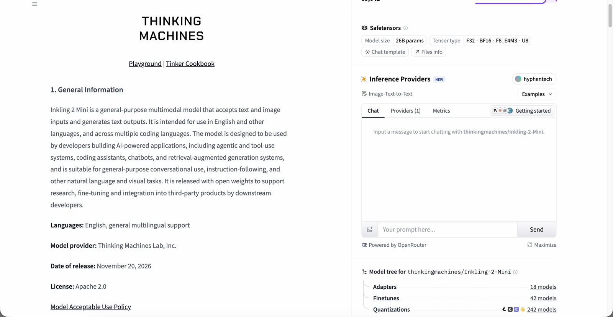
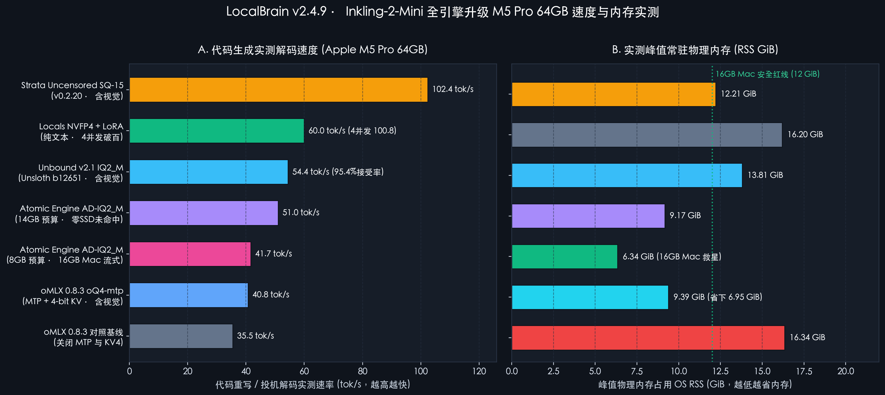
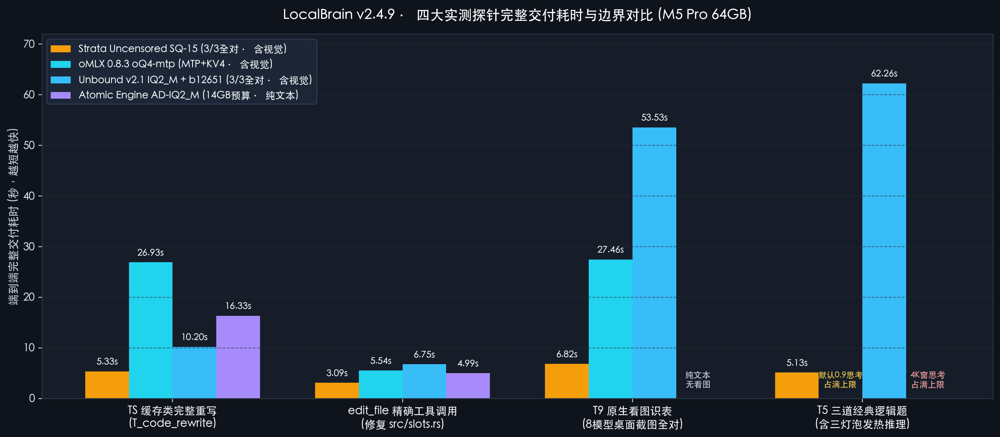
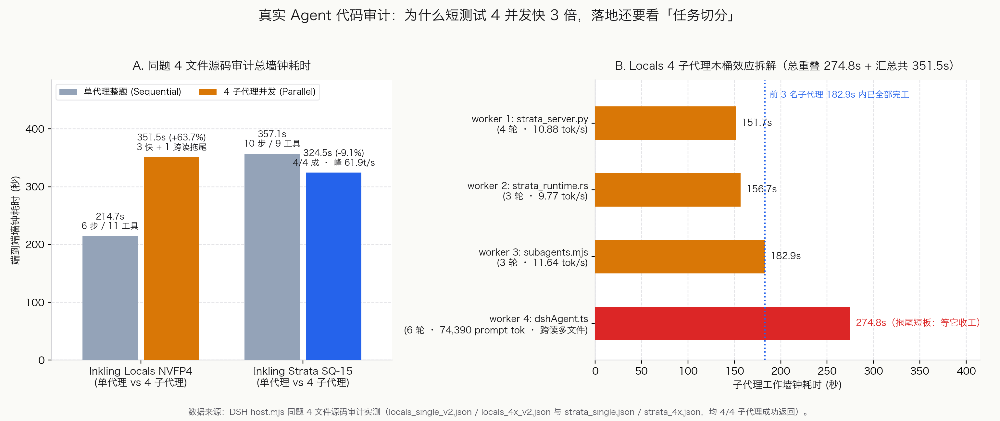
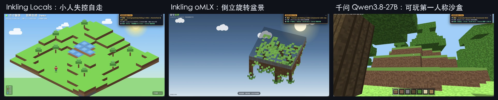
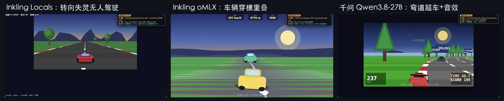
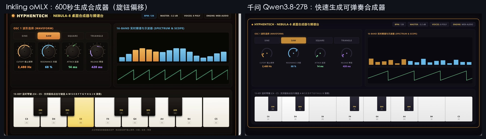
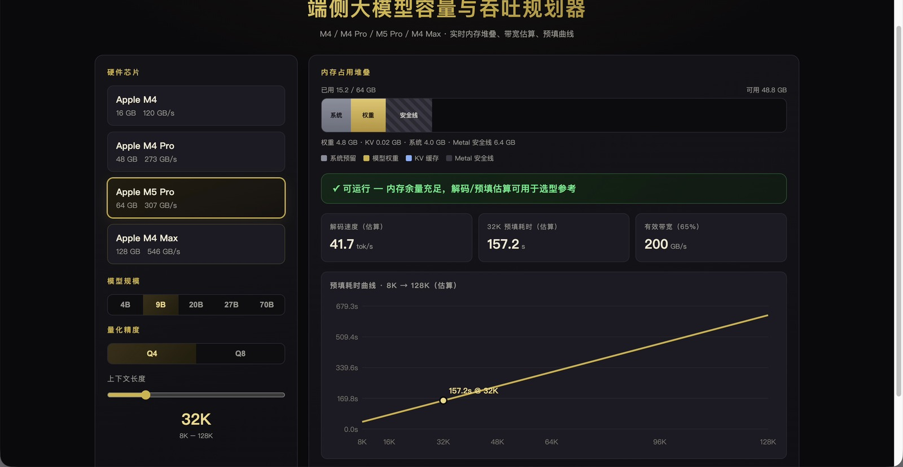
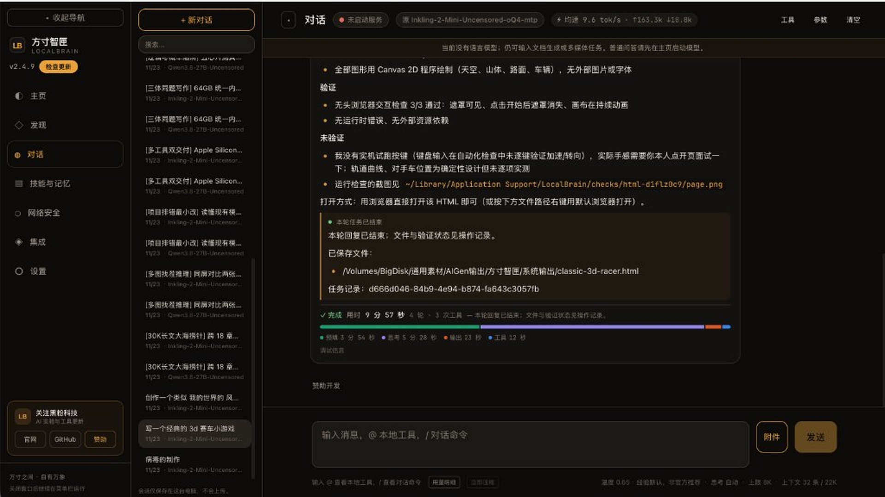

> [!abstract]
> 从 6.34 GiB 救活入门款 Mac，到《我的世界》跑出倒立旋转盆景、赛车变“无人驾驶”：把高分网红模型的极速红利与隐蔽短板一次摊开。
> 2026-11-25 · 黑粉科技

　　就在这几天，由前 OpenAI 核心研究骨干创办的 Thinking Machines 放出了最新开源多模态模型 **Inkling 2 Mini**（Apache 2.0 协议，**26B** 级循环 MoE 架构，总参数约 **26.4B**、单词元激活约 **5.4B**）。上线还不到一周，Hugging Face 原仓下载量已经冲到 **68,042** 次，社区一口气衍生出 **242** 个量化包与 **42** 个微调分支；再看官方贴出的纸面打分，在同体量模型里几乎全线飘红。

　　但玩本地部署的老朋友都懂一个道理：**纸面跑分是一回事，装进自己电脑里能不能写对代码、占多少内存、会不会卡死，完全是另一回事。**为了不看广告看疗效，我在同一台 **Apple M5 Pro 64GB** 统一内存 MacBook Pro 上，用自制桌面工具「**方寸智匣 LocalBrain v2.4.9**」把围绕 Inkling 2 Mini 最火的 **Strata、Locals、Atomic Engine、oMLX 0.8.3、Unbound v2.1** 等六套本地推理方案挨个跑了一遍，又拉上咱们熟悉的端侧守门员 **千问 Qwen3.8-27B**，同题盲测了四组高难度单文件交互网页工程。

> [!important]
> 先把最反差的两组真机结论摆在台面上：论极限吞吐与省内存，Inkling 2 Mini 确实猛得离谱——Strata 单流最高飙到 102.4 tok/s，Atomic Engine 流式方案更是把物理峰值内存压进 6.34 GiB，连 16GB 入门款 Mac 都能顺畅跑；可一旦拉进《我的世界》与 3D 赛车前端盲测，它却当场造出了“倒立旋转盆景”和“方向键失灵的无人驾驶赛车”，反倒是 30+ tok/s 稳扎稳打的千问 3.8-27B 赢下了复杂工程大考。

## 一、M5 Pro 64GB 六引擎硬核跑分：102.4 tok/s 极速与 6.34 GiB 救活 16GB Mac

　　同一个开源模型底座，挂在不同推理引擎和量化格式下，体验往往天差地别。这轮测试我把所有分支全部集成进方寸智匣 v2.4.9，在同一套代码重写、工具调用（`edit_file`）、双语源码排错、原生看图与三道逻辑陷阱题上逐一实测：

| 本地引擎与档位 | 峰值物理内存 RSS | 代码解码峰值 | 原生看图耗时 | 核心强项与适用边界 |
| --- | --- | --- | --- | --- |
| Strata v0.2.20 · Uncensored SQ-15 | 12.21 GiB | 102.40 tok/s | 6.82s（8/8 全对） | 2.27s 极速冷启动，T5 逻辑 3/3 全对，24–64GB Mac 首选 |
| Atomic Engine · AD-IQ2_M（8GB 流式） | 6.34 GiB | 41.67 tok/s | 不含看图 | NVMe 冷专家按需流式读取，救活 16GB/18GB 入门 Mac（限 4K 上下文） |
| Atomic Engine · AD-IQ2_M（14GB 常驻） | 9.17 GiB | 51.02 tok/s | 不含看图 | 1.87s 冷启动，0 次 SSD 冷读未命中，纯文本轻快 |
| oMLX 0.8.3 · Uncensored oQ4-mtp | 9.39 GiB | 40.77 tok/s | 27.46s（8/8 全对） | 开启 MTP + 4-bit KV 后比旧版立省近 7 GiB 内存 |
| Unsloth b12651 · Unbound v2.1 IQ2_M | 13.81 GiB | 54.44 tok/s | 53.53s（8/8 命中） | 跨 Mac/Win/Linux 通用，DSpark 草稿接受率高达 95.4% |
| Locals · Inkling-2-Mini NVFP4 | 约 15–16 GiB | 61.1 tok/s（四并发破百） | 不含看图 | 融合 Metal 算子与语法约束，纯文本工具调用干脆利落 |

> 实测硬件：Apple M5 Pro 64GB 统一内存（macOS arm64 Metal），测试软件：方寸智匣 LocalBrain v2.4.9。

　　这组实测结果里最让人眼前一亮的有两处突破。第一处是 **Strata v0.2.20（Uncensored SQ-15）**：冷启动只要 **2.27 秒**，单流代码重写直接冲上 **102.40 tok/s**，在以前跑 26B–30B 级模型时几乎不敢想；更难得的是它没有因为飙速度牺牲多模态精度，看图识别 8 款模型信息仅用 **6.82 秒**且零误差，45.3K 长上下文暖缓存首字响应更是快到 **0.228 秒**。

　　第二处则是专门给小内存机型雪中送炭的 **Atomic Engine（AD-IQ2_M）**。过去 16GB 统一内存的入门款 Mac 一碰这个体量的模型就会疯狂交换内存甚至直接弹窗报错，而 Atomic Engine 把冷门专家权重留在 NVMe 固态硬盘上按需流式读取，硬生生把操作系统物理峰值内存锁死在 **6.34 GiB**，依然跑出 **41.67 tok/s** 的代码输出和 **7.68 秒**精准改文件调用；哪怕是占内存偏多的分支也普遍控制在 **16 GiB** 左右，手握 48GB 或 64GB 机型更是可以随便敞开跑。

## 二、破百字/秒背后的隐藏猫腻：多 Agent 并发提速与“木桶效应”

　　很多朋友实测时会纳闷：为什么有时候看榜单说 Inkling 在 Locals 或 Strata 下能跑出破百字/秒的惊人吞吐，自己单开一个窗口聊天却只有四五十？

　　答案藏在**多路并发（Multi-Agent）机制**里。当你在提示词里明确要求“开启多 Agent 模式协同完成任务”时，底层引擎会同时拉起 **4 路并发流**共享权重前缀，把四条流每秒生成的词元数叠加在一起，总吞吐轻轻松松就能冲过 **100 tok/s**（Windows 平台配合 Unbound v2.1 开启 **DSpark** 草稿投机解码后，草稿接受率同样能达到惊人的 **95.4%**）。

　　但实测下来，多 Agent 绝不是包治百病的银弹，里面藏着一个非常扎心的**“木桶效应”**：

- **顺风局确实快**：当四路子任务篇幅均匀、互不依赖时（例如 Strata 四并发），聚合吞吐比单代理明显更猛；
- **逆风局反被最慢一棒拖死**：在 Locals 四文件代码审计实测中，前 3 个子 Agent 早在 **80 到 150 秒**内就干完活交卷了，唯独第 4 个子 Agent 钻进牛角尖苦思冥想了 **278 秒**——主控汇总必须死等最后一个 Agent 收工才能合并输出，导致开多代理的整体等待时间反而比单代理更慢、更看运气。

## 三、不看跑分看疗效：四组复杂交互 HTML 实机盲测对决千问 3.8-27B

　　基础题跑得飞快，那真刀真枪写几百行单文件三维游戏、音频合成器和工程计算器呢？我把 **Inkling 2 Mini（Locals NVFP4 与 oMLX 双引擎）**和 **千问 Qwen3.8-27B** 生成的真实 HTML 页面直接摆在一起逐个点开试玩，高下立判：

### 1. 盲测一：《我的世界》3D 体素沙盒——倒立旋转盆景 vs 丝滑第一人称建造

　　第一题要求单文件写出一个可交互的《我的世界》风格体素世界。点开 **Inkling Locals**（耗时 **204 秒**）的作品，等距草地小岛看着还挺清爽，可我手还没碰键盘，画面中间的小人自己就在草地上失控乱逛“吃草”；再点开 **Inkling oMLX**（耗时 **529 秒**），更是让人哭笑不得——整座方块岛屿直接上下颠倒悬在半空悠闲自转，活脱脱变成了一盆电子旋转盆景！

　　反观 **千问 Qwen3.8-27B**，只用了 **271 秒**（比 oMLX 快了近一半），一进页面就是纯正的第一人称 Three.js 3D 视角：前后左右移动、空格起跳、低头挖土块、切换物品栏搭积木一气呵成，完完全全就是能玩的经典沙盒。

### 2. 盲测二：经典 3D 街机赛车——“无人驾驶”穿模 vs 完整弯道超车音效

　　第二题写经典伪 3D 街机赛车。**Inkling Locals** 仅用 **151 秒**闪电交卷，结果按破了键盘左右方向键赛车都纹丝不动，只能在赛道正中间表演“全自动无人驾驶”；**Inkling oMLX**（**231 秒**）倒是能左右变道超车，但几辆对手小车直接叠罗汉穿模卡在了一起。而 **千问 Qwen3.8-27B**（**511 秒**）虽然多花了几分钟打磨，交出的 `OUTRUSH` 不仅弯道透视、路肩树木、超车加分全齐，甚至连原生 WebAudio 引擎轰鸣音效都一并配齐。

### 3. 盲测三 & 四：WebAudio 合成器与统一内存规划器——工具计算扳回一城

　　到了第三题看设计稿还原 `NEBULA-8` 桌面合成器调音台，两边终于都能正常点击琴键发声、切换正弦波与锯齿波并实时跳动 16 段频谱了。区别在于 **Inkling oMLX** 足足长考了 **600 多秒**，且下方四个圆弧旋钮的光圈出现了肉眼可见的错位；**千问 Qwen3.8-27B** 完工更快、面板对齐更工整（仅旋钮指针与个别黑键微偏）。

　　而在第四题偏工程计算的 **《Apple Silicon 端侧大模型容量与吞吐规划器》** 中，**Inkling Locals** 终于迎来高光时刻：**4 轮**工具调用零报错、**270 秒**干净利落拿下第一名，从 M4 **16GB** 到 M4 Max **128GB** 的权重、KV 缓存、Metal 安全线与 8K–128K 预填耗时曲线全部算得明明白白，这一局与千问 3.8-27B 打成平手。

## 四、按手头硬件对号入座：五档本地部署选型清单

　　四组 HTML 盲测跑完，结论其实非常透彻：Inkling 2 Mini 绝不是来革 27B 稠密全能模型命的，它在空间几何推理与复杂单页前端状态协调上明显不如千问老道，甚至让人怀疑海外团队是不是也开始针对性“刷榜应试”了；但它在**超低内存占用**和**短平快代码工具调用**上的极致性价比同样无可替代。

　　如果你打算今天就在本机装一套，直接按手头设备内存和场景对号入座即可：

- **16GB / 18GB 入门款 Mac 用户**：直接选 **Inkling 2 Mini · Atomic Engine（AD-IQ2_M 流式版）**。**6.34 GiB** 物理内存占用不爆机、**41.67 tok/s** 日常改代码够快；需要看图时再单独切轻量视觉模型配合。
- **24GB – 64GB 主力 Mac 用户**：追求极速与多模态兼顾选 **Inkling 2 Mini · Strata Uncensored SQ-15**，**102.4 tok/s** 峰值解码加 **6.82 秒**零误差看图是整套 Inkling 家族体验最爽的一档。
- **Mac / Windows / Linux 跨平台通用**：选 **Unbound v2.1 GGUF**，Windows 独显用户记得务必打开 **DSpark** 草稿投机解码（接受率 **95.4%**），提速立竿见影。
- **已装 oMLX 老用户 / 纯文本高并发用户**：oMLX 务必升级到最新 **0.8.3**（开启 MTP + 4-bit KV 立省近 **7 GiB** 内存）；不看图纯跑文本并发就用 **Locals NVFP4**，但留意避开长思考任务的木桶效应。
- **追求稳妥不翻车的复杂前端与全能主力（32GB+ 内存）**：不用犹豫，现阶段端侧综合工程能力真正的全能王者，依然是咱们的国货之光 **千问 Qwen3.8-27B**。

> [!summary] 写在最后
> 跑分榜单只能告诉你模型的上限切面，真机盲测才能摸清它的脾气底线。把极速省内存的 Inkling 2 Mini 留给 16GB 轻薄本和日常轻量工具调用，把啃硬骨头的复杂工程交给稳扎稳打的千问 3.8-27B——按菜下碟、各取所长，本地算力才能真正变成你手边随叫随到的生产力。

## 主要查证来源

- [Thinking Machines 官方模型卡：thinkingmachines/Inkling-2-Mini (Hugging Face, Apache 2.0)](https://huggingface.co/thinkingmachines/Inkling-2-Mini)
- [黑粉科技官网延伸实测：Inkling 2 Mini 六大引擎逐题原答案与 RSS 完整账本](https://hyphentech.top/inkling-2-mini-versions-m5-pro-compare/)
- [方寸智匣 LocalBrain（纯离线本地多模态与多引擎管理桌面工具 · 介绍页）](https://hyphentech.top/localbrain)
- [方寸智匣 LocalBrain Releases（macOS / Windows 安装包下载与更新）](https://github.com/HackerChi-Hub/localbrain-releases/releases)
- [黑粉盒子 HyphenBox Releases（免费大模型 API 雷达 · 下载与更新）](https://github.com/HackerChi-Hub/hyphenbox-release/releases)

---

## 🧰 我做的工具

这些工具都由我持续维护。预览版会明确标注，下载、更新和已知边界以发行页为准。

> [!info] 黑粉盒子 HyphenBox
> **状态：** 正式迭代
>
> 免费大模型 API 雷达：持续复测可用性，本地统一接口，Key 只存本机
>
> [下载与更新：黑粉盒子 HyphenBox](https://github.com/HackerChi-Hub/hyphenbox-release/releases)

> [!info] 方寸智匣 LocalBrain
> **状态：** 正式迭代
>
> 本地模型的多模态 MCP 工具箱：TTS / Whisper / 视频生成一站接入
>
> [下载与更新：方寸智匣 LocalBrain](https://github.com/HackerChi-Hub/localbrain-releases/releases)

---

> [!quote] 黑粉科技
> **让AI成为你的超能力**
> 本地部署 · 免费白嫖 · 自制软件
> [黑粉科技](https://hyphentech.top)
