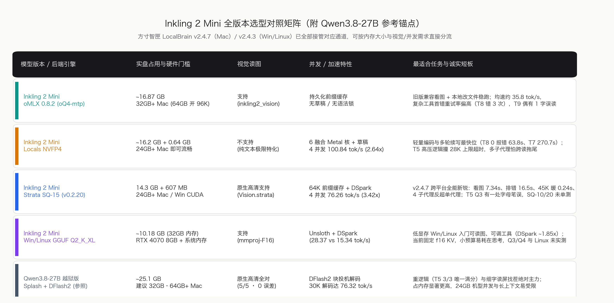
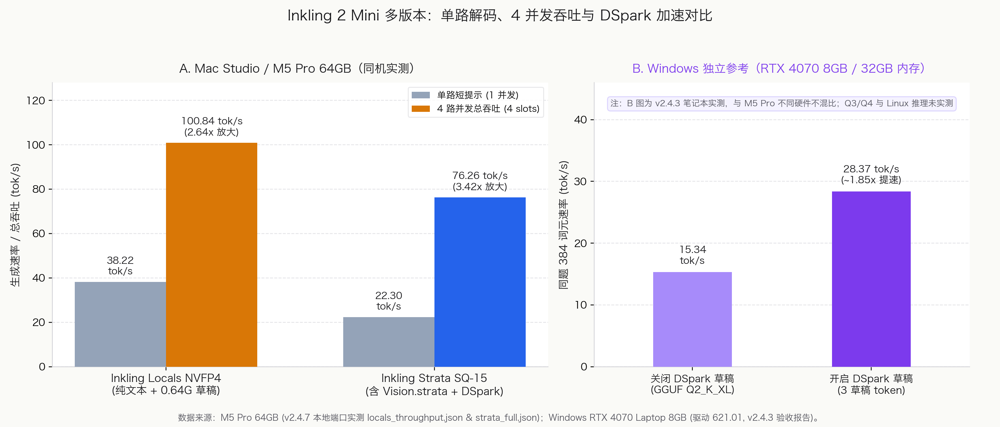
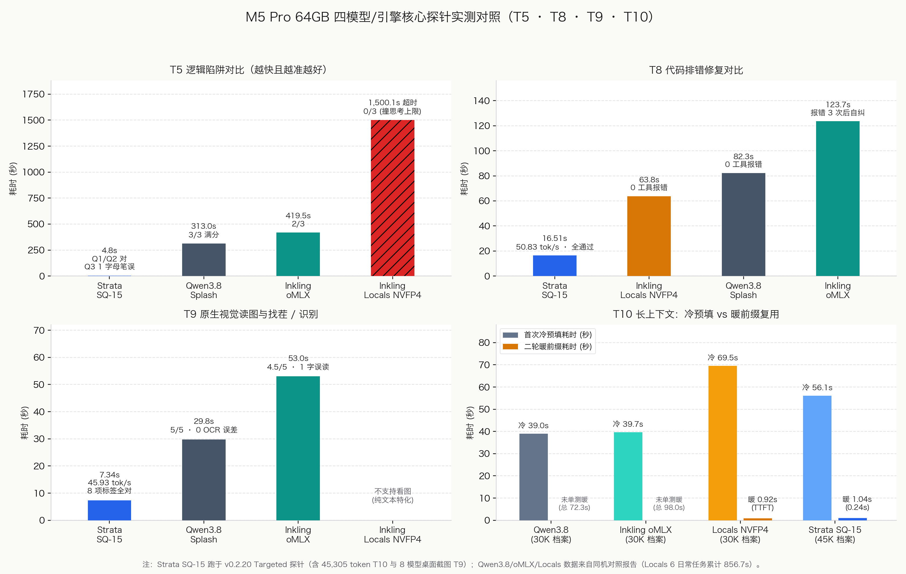
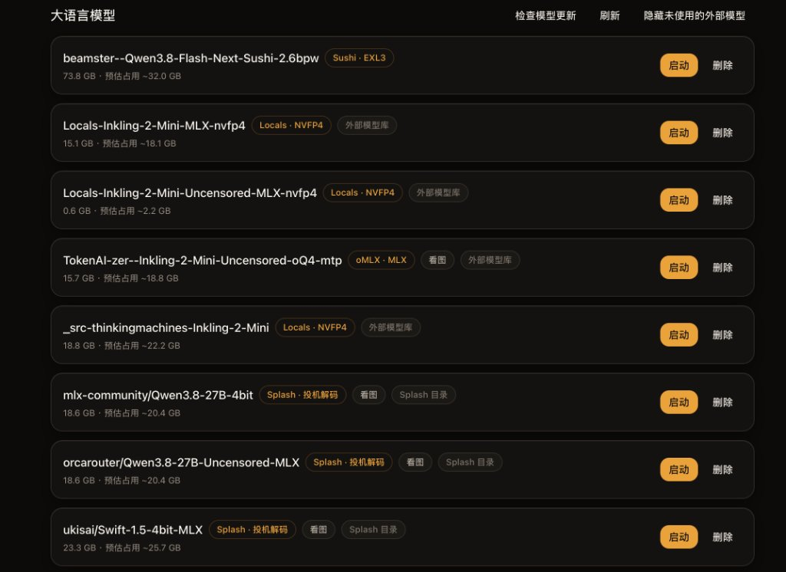

> [!abstract]
> 从 oMLX 原生看图、Locals NVFP4 4 并发 100.84 tok/s、Strata SQ-15 全能多模态到 Windows 8GB 显卡 GGUF + DSpark：一次把 Inkling 2 Mini 全家桶的真实速度、4 子代理木桶效应与各自不能踩的坑全部摆齐
> 黑粉科技 · 2026-11-23

　　这两天后台和评论区被问得最多的一句话就是：明明都是 **Inkling-2-Mini** 这一个模型，怎么方寸智匣里一会儿有 `oMLX` 版，一会儿出了 `Locals NVFP4` 版，今天打包发布的 **Mac v2.4.7** 又接进了 `Strata v0.2.20`（`SQ-10 / SQ-15 / SQ-20`），Windows 和 Linux 那头还挂着 `Unsloth GGUF + DSpark`——这四个版本到底谁快、谁准、谁真能看图，写代码并发到底能差出几倍？

　　为了不靠参数表猜大小，今天我直接在同一台 **Apple M5 Pro 64GB 统一内存 Mac** 上把 Mac 侧三个引擎拉进同一间房间加测，又把刚测过手的 **Windows RTX 4070 Laptop 8GB / 32GB 内存**那组 GGUF + DSpark 数据单列参照，同时用 **Qwen3.8-27B（Splash + DFlash2）** 站在旁边当全能基准标尺。

　　测完之后最大的一个感受是：小参数循环 MoE 模型已经进入「**换一个运行时就像换了一颗芯**」的阶段。它既能把 4 并发吞吐拉到 **100.84 tok/s**、7.3 秒精准识图，也会在真实 4 子代理协作里因为一个跨文件乱翻的队友拖慢整队 **63.7%**。下面按真金白银的实测切片逐一拆开。

## 一、先把四个 Inkling 2 Mini 版本摆清：同一套 26.4B 底座，四种完全不同的装法

　　Thinking Machines 的 Inkling-2-Mini（`inkling2_loop` 架构）总参数约 **26.4B**、每次前向激活约 **3.4B**，物理只存 24 层却把中间 12 层原地循环推演 3 遍，从而在较小的内存体积里滚出等效 48 层的推理深度。但在不同引擎手里，它的权重量化格式、视觉模块取舍和批处理调度完全不是一回事。



- **Inkling 2 Mini · oMLX 0.8.2（`oQ4-mtp`，约 16.87 GB）**：32GB 以上 Mac 起步（64GB 开 96K 窗口），保留原版 `inkling2_vision` 视觉和持久化前缀缓存，但默认关闭草稿也没有 GPU 工具语法锁。
- **Inkling 2 Mini · Locals NVFP4（约 16.2 GB + 0.64 GB 草稿）**：锁定 `Generated-Computers/Locals` 与 AtomicChat 去对齐方向 LoRA。它为了极致纯文本与工具调用速度，**彻底剥离了视觉模块**，用 6 颗融合 Metal 核、0.64 GB 草稿模型加上 `llguidance` Typed-Tools 语法锁，让 **24GB Mac** 也能流畅跑起连续批处理。
- **Inkling 2 Mini · Strata SQ-15（14.3 GB + 607 MB `Vision.strata`）**：今晚在 **LocalBrain v2.4.7** 正式上架发现页的主角（repo 收录 `SQ-10` 11.1 GB / `SQ-15` 15.0 GB / `SQ-20` 20.0 GB 三档，跨 Mac Metal 与 Windows/Linux CUDA）。自带原生视觉组件、DSpark 投机草稿、`64K` 上下文前缀缓存与多槽并行。
- **Inkling 2 Mini · Win/Linux Unsloth GGUF（`Q2_K_XL` 约 10.18 GB 等三档）**：v2.4.3 针对独显与中等内存 PC 的跨平台包，绑定 `dspark-Inkling-2-Mini-Q8_0.gguf`（3 草稿 token）与 `mmproj` 视觉投影，低于 CUDA 12.8 门槛也能切 Vulkan；当前固定走 `f16` KV。

　　还要顺手记一笔今晚打包过程中抓出来的真实工程插曲：本地下载好了 `Inkling-2-Mini-SQ-15`，界面里一度搜不到它。一查源码才发现，Strata 目录里附带一份 `config.json`（声明 `"model_type": "inkling2_loop"`），原先的 `inkling_runtime.rs` 认出这个字段就把整个目录抢去当成 oMLX 模型，接着因为里面没有 `model.safetensors.index.json` 而静默淘汰。

　　在刚发布的 **v2.4.7** 里我已经把 `strata` 的判定优先级提到前面，顺便把 `strata-engine/Inkling-2-Mini-Strata` 三档量化补进了发现页。

## 二、单路解码 vs 4 并发吞吐：Locals 狂飙 100.84 tok/s，Strata 并发放大 3.42 倍

　　本地模型圈最常犯的错，是只盯着单路生成速度。单路输出慢很多时候不是算力满载，而是统一内存带宽被单请求串行调度浪费掉了——尤其多子代理时代，真正决定吞吐的是引擎能不能同时伺候好几个并发槽位。



　　先看同一台 **M5 Pro 64GB** 上的短提示吞吐实测：

- **Locals NVFP4（纯文本 11534 端口）**：单路短提示实测 **38.22 tok/s**（纯解码阶段 `40.37 tok/s`，TTFT `0.713s`）；一开 4 路并发，每路稳在 `25.21–25.23 tok/s`，4 路总吞吐直接拉到 **100.84 tok/s**（**2.64x** 并发放大，首字均稳在 `0.798–0.830s`）。
- **Strata SQ-15（多模态 `--parallel 4 --context 65536`）**：冷加载不到 3 秒即可就绪；单路短提示 **22.30 tok/s**（解码 `22.74 tok/s`，TTFT 仅 `0.183s`）；开到 4 并发时单路依然保持 `19.79–20.84 tok/s`，总吞吐达到 **76.26 tok/s**（放大系数高达 **3.42x**）。

　　为什么单路只有二十多、三十多，四开却几乎不掉速、直接翻出两三倍？核心原因是解码期属于典型的**访存带宽受限（Memory-Bandwidth Bound）**阶段：每次只生成一个词元，也要把活跃专家权重从内存搬进计算单元一遍。一旦引擎支持真正的连续批处理与多槽融合核，把 4 路请求的权重读取合并进同一轮内存总线搬运，相当于顺风车搭了四倍乘客而油费几乎没涨。

　　至于图 B 里单列出来的 **Windows RTX 4070 Laptop 8GB（32GB 系统内存，驱动 621.01）**数据，我必须明确声明：它和 M5 Pro 不是同一台设备，不能拿来比绝对分，但它完美回答了另一个关键问题——**低显存 PC 上的 DSpark 到底是不是心理安慰？** 在同一道 `384` 词元受控短题上，Q2_K_XL 关闭草稿只有 **15.34 tok/s**，打开 DSpark（3 个草稿 token）直接提到 **28.37 tok/s（约 1.85 倍提速）**，代码执行、工具往返与简单读图都跑通了。

　　不过这批机器显存余量紧，该架构目前固定 `f16` KV（即使手选 `q8` 也会回落），小输出预算仍可能耗死在思考段上，而且 `Q3/Q4` 档和 Linux 推理目前还没跑全。

## 三、T5、T8、T9、T10 四道实测探针：Strata 看图 7.34 秒惊艳，也把真实瑕疵摊在桌上

　　短跑快不代表真能干重活。下面把 M5 Pro 64GB 上跑出来的核心探针数据摊开对比——这里不仅看谁最快，更看谁把图看全、把代码改对、把 45K 长文缓存接住，以及谁在哪里会失手。



| 实测维度 | Inkling Strata SQ-15 | Inkling Locals NVFP4 | Inkling oMLX 0.8.2 | Qwen3.8-27B Splash (参考) |
| --- | --- | --- | --- | --- |
| T9 原生视觉识别 | **7.339s**（45.93 tok/s）：8 项模型名与引擎徽章零误差全对 | 不支持看图（纯文本路线） | 53.0s（4.5/5）：5 处找茬全中，但误认「高线优先」1 字 | **29.8s**（5/5）：双控制台 0 误差并准确归因延迟 |
| T8 代码最小改排错 | **16.512s**（50.83 tok/s）：准确指出并修完 TS/Rust 全部 bug | **63.8s**（58 tok/s）：`edit_file` **0 报错**一次通过 3/3 单测 | 123.7s：连续 3 次漏传 `old_string` 报错后自纠通过 | 82.3s：0 报错 3/3 全过，额外提示并发锁风险 |
| T5 逻辑陷阱 | 4.804s（42.98 tok/s）：Q1/Q2 全对，Q3 灯泡机理对但收口 1 字母笔误 | **1,500.1s 超时（0/3）**：两轮撞满 28,672 思考上限 | 419.5s（2/3）：对称欺骗那题绕进死胡同 | **313.0s（3/3 满分）**：构造对称矩阵完胜 |
| T10 长上下文前缀缓存 | **45K** 实测：冷预填 `56.133s`，暖追问 **`1.039s`（TTFT `0.236s`）** | 30K 实测：冷预填 `69.5s`，暖追问 TTFT **`0.92s`**（41.46 tok/s） | 30K 实测：冷预填 `39.7s`，整题 `98.0s`（32.43 tok/s） | 30K 实测：冷预填 `39.0s`，解码 **`76.32 tok/s`**（总 `72.3s`） |

> 注：Qwen3.8 / oMLX / Locals 完整 7 非视觉+3 视觉对照来自同一 M5 Pro 实测；Locals 去掉超时 T5 后 6 项日常任务累计 856.7s（较 Qwen3.8 快 44.4%、较 oMLX 快 49.9%）。Strata SQ-15 使用 v0.2.20 Targeted 探针与 8 模型桌面截图、45,305 token 长上下文测试。

　　最让我惊喜的是 **Strata SQ-15 的看图和长文本暖缓存**。拿下面这张包含 8 个本地模型条目、混杂着 `Sushi`、`Locals`、`oMLX`、`Splash` 四种徽章的软件截图丢给它，607 MB 的 `Inkling-2-Mini-Vision.strata` 仅用 **7.339 秒**（其中视觉+提示预填 `5.706s`，解码飙到 `45.93 tok/s`）就把「大语言模型」、8 条目录和全套引擎标签一字不差读了出来——以前在 oMLX 时代看一张细字截图动辄五十多秒还担心 OCR 错一两个汉字，这次体验直接翻代。



　　到了 **45,305 词元**的重型档案检索（`T10`），Strata SQ-15 首次冷预填花了 `56.133s`（`36.31 tok/s` 解码，准确抽取出口令 `【AZURE-M5PRO-64GB-STRATA-0220】` 与 `7749`）；紧接着带 `45,374` 词元做二轮追问时，整条请求只用了 **1.039 秒**就吐完答案，**首字延迟（TTFT）更是压到了 0.236 秒**，端口号 `11634` 与 `64 词元` 复述零误差。

　　当然，有亮点就得把反面同样钉在明处：**重逻辑稳态依然是 `Qwen3.8-27B Splash + DFlash2` 的江山**。

　　`Locals NVFP4` 加了去对齐 LoRA 之后在 `T5` 逻辑陷阱上连撞两次 `28,672` 思考天花板直接超时；而 `Strata SQ-15` 虽然 4.8 秒极速过题且第 1 问（`1 小时`）、第 2 问（`7 次`）全部答对，在第 3 问「三开关辨三灯泡」上也讲对了摸灯泡发热区分的完整物理机理，却在最后收口文字里把先关掉的灯泡标签顺手串错了一个字母（写成「B 开 1 分钟后关… 亮着的灯是 B」）。

　　这种小概率文字口误提醒我们：**关键代码审查和逻辑定稿，不要只看 4.8 秒的速度去跳过人工或大模型的复核。**

## 四、真实 Agent 上多子代理能提速多少？4 文件源码审计泼来一盆清醒冷水

　　既然 Mac 上 `Locals` 4 并发冲到 **100.84 tok/s**、`Strata` 4 并发放大 **3.42 倍**，很多朋友自然会问：我在 **方寸智匣** 里新做的 DeepSeek Harness 原生多子代理（`subagents.mjs`），一遇到大仓库阅读或审计就拆成 4 个只读子代理一起干，端到端耗时是不是也能稳稳砍掉两三倍？

　　真拿 **同一道真实 4 文件源码审计任务**（同时审计 `strata_server.py`、`strata_runtime.rs`、`subagents.mjs` 和 `dshAgent.ts` 并汇总风险报告）在 **M5 Pro 64GB** 上跑完单代理 vs 4 子代理对决之后，两组数据立刻把大家拉回现实。


- **Strata SQ-15**：单代理跑了 10 步 / 9 次工具调用，总计 **357.1 秒**（`357,145 ms`）；切到 4 子代理并发之后，4 名 worker 全部成功交付，**端到端压缩到 324.5 秒（反超省下 32.6 秒，峰值 worker 解码达到 `61.91 tok/s`）**。
- **Locals NVFP4**：单代理 6 步 / 11 次工具只花 **214.7 秒**；切到 4 子代理之后虽然 **4 个人全部跑通**，但总墙钟时间反而胀到了 **351.5 秒（重度慢过单代理 +63.7%）**！

　　为什么单路更快的 Locals，一上 4 子代理反而慢了将近 137 秒？我直接把 4 个子代理的工作账拆出来（图 03 右半边）：前三名简直快得像飞一样——负责 `strata_server.py` 的 worker 1 仅用了 **151.7 秒**（4 轮），`strata_runtime.rs` 的 worker 2 用了 **156.7 秒**（3 轮），`subagents.mjs` 的 worker 3 用了 **182.9 秒**（3 轮）。**全部三个人在 3 分钟内就已经收工写完报告了！**

　　把整条队伍按在地上摩擦的，只有负责 `dshAgent.ts` 的 **worker 4**。它在审计自己的那份 TypeScript 文件时，觉得接口调用关系没看全，于是连续跨文件把相邻的 `dshTransport.ts` 和 `agentLoop.ts` 也一起读了进来，硬生生跑了 6 轮、上下文膨胀到 **74,390 词元**，独自扛了 **274.8 秒**才交卷，最后再加上主代理等齐四人做合并汇总，端到端墙钟就停在了 `351.5 秒`。

> [!tip]
> 这个真实的木桶短板教训比一百句理论都值钱：多子代理并联的加速上限，**永远不取决于跑得最快的那几个并发槽位，而取决于你给最慢那一名子代理画的边界够不够清晰**。在方寸智匣里开多子代理时，只有把目标切成**范围封闭、彼此不交叉重读大文件**的只读切片，Strata（默认 4 槽）和 Locals（16 槽）的连续批处理红利才会变成真正的墙钟缩短。

## 五、全套实测原题、原代码、标准答案与各引擎真实答复对照

　　看完横评结论，很多朋友最关心的还是：同一套模型在不同运行时上，面对**完全原封不动的考题、问题代码、图片和仓库文件**时，到底回出了什么内容、各自错在哪里、又差了多少字句。这一节把 Mac 侧本轮实测的所有原题、标准答案和引擎原始答复逐项摊开。

### 1）单路与 4 并发吞吐原题（Mac M5 Pro vs Win 4070 受控短测口径说明）

- **Mac 单路短提示原题**（`max_tokens=512, temperature=0.2`）：`请用中文清晰写出 12 条本地 AI 部署时的性能调优工程实践，每条不超过 40 字，不要省略。`
- **Mac 4 并发压测原题**（4 线程同时发送，`max_tokens=512`）：`第{1..4}路并发测试：请用中文清晰列出 12 条代码审查与内存优化检查要点，每条约 25 字。`

　　在这两道纯吞吐考题下，`Locals NVFP4` 单路吐满 `512` 词元用时 `13.395s`（`38.22 tok/s`，解码 `40.37 tok/s`），4 路合并吐出 `2,048` 词元用时 `20.309s`（聚合 `100.84 tok/s`，各路极其均匀稳定在 `25.21–25.23 tok/s`）；`Strata SQ-15` 单路输出 `212` 词元用时 `9.508s`（`22.30 tok/s`，TTFT 仅 `0.183s`），4 路合并吐出 `1,204` 词元用时 `15.789s`（聚合 `76.26 tok/s`，单路 `19.79–20.84 tok/s`，实现 `3.42x` 并发放大）。至于上文提到的 **Windows RTX 4070 Laptop 8GB**，测的是单独控制的 `384` 词元短题，用来验证 `Q2_K_XL` 打开 3-token DSpark 从 `15.34` 翻到 `28.37 tok/s`，属于跨机单独参照，不混排绝对速度。

### 2）Targeted T5 逻辑陷阱：原题、标准答案与 Strata SQ-15 原话笔误实录

　　先说明一个关键测试口径区分：前文成绩表里的 `Qwen3.8`、`oMLX` 与 `Locals` 跑的是上一篇十维横评中的高难对抗版 `T5`（五芯片 2 良 3 坏对称欺骗 + 罕见病贝叶斯 `71.04%` + 22 字中文自指，完整题干与三模型答复已收录在姊妹篇）；而本轮针对新接入 `Strata SQ-15` 的 Targeted 快速探针，测的是下面这 3 道经典逻辑题：

> Strata Targeted T5 原题干：
> 1）医生给你开了 3 颗药丸，嘱咐你每隔半小时吃 1 颗。从吃下第一颗开始，吃完这 3 颗一共需要几小时？
> 2）农夫带着狼、羊和白菜到河边，小船每次除了农夫外最多只能再带一样东西，且农夫不在时狼会吃羊、羊会吃白菜。最少需要过河几次（往返各算一次）把三者都安全带到对岸？
> 3）一个房间里有三盏关闭的白炽灯，门外有三个对应的开关 A/B/C，门关着时门外看不到房间里面。你只能在开关全部拨完后打开门进入房间一次，且进入后不能再碰门外开关。请问如何一次性百分之百判断 A、B、C 分别控制哪一盏灯？

- **第 1 题标准答案：`1 小时`**（第 `0` 分钟吃第 1 颗，第 `30` 分钟吃第 2 颗，第 `60` 分钟吃第 3 颗，总共只有两段半小时）。
- **第 2 题标准答案：`7 次`**（带羊去 → 空回 → 带狼去 → 带羊回 → 带白菜去 → 空回 → 带羊去）。
- **第 3 题标准答案：先开 A 等 10 分钟后关掉，立刻打开 B 并保持开启、C 全程关闭**；进门后**亮着的是 B，熄灭但摸着发烫的是 A，熄灭且冰冷的是 C**。

```text
1) 结论：1 小时。理由：第一颗吃下后，第二颗在 30 分钟后、第三颗在 60 分钟后，所以从第一颗到第三颗共 60 分钟。

2) 结论：7 次。理由：经典河渡问题，最少需要 7 次往返（含农夫回程）才能安全完成。

3) 结论：先让 A 开 10 分钟后关，B 开 1 分钟后关，C 保持关闭；进入房间后，亮着的灯是 B，热但不亮的灯是 A，冷且不亮的灯是 C。理由：A 的热量来自较长时间通电，B 的亮度来自短时间通电，C 无任何状态，三者可区分。
```

Strata SQ-15 T5 原始答复实录（4.804s / TTFT 0.313s / 解码 42.98 tok/s）

　　对照原始答复一眼就能看穿 Strata SQ-15 的真实特性：前两道数字与步骤推理秒对，第 3 题也清楚利用了白炽灯通电发热滞后的物理原理，但收口表述却顺手写成了「**B 开 1 分钟后关…… 亮着的灯是 B**」——既然关掉了自然不会亮着。这个真实现场翻车样本也直观印证了一句话：**极速小模型做初筛非常爽，关键定稿必须留人工或强模型复核**。

### 3）Targeted T8 代码找茬：原题两段问题源码、Bug 清单与 Strata 修复

　　同样注明分工边界：`Locals`、`oMLX` 与 `Qwen3.8` 的 `T8` 考核的是用 `edit_file` 工具动手改造本地 `ledger.mjs`（实测细节已收在姊妹篇）；而本轮针对 `Strata SQ-15` 的 Targeted T8 探针直接考核 TypeScript 与 Rust 双语隐蔽 Bug 诊断，原题和两段问题源码如下：

```typescript
async function runBatch(urls: string[], limit = 4) {
  const results = [];
  for (let i = 0; i < urls.length; i += limit) {
    const chunk = urls.slice(i, i + limit);
    chunk.forEach(async (u, idx) => {
      const res = await fetch(u);
      results[i + idx] = await res.json();
    });
  }
  return results;
}
```

T8 问题原代码 1（TypeScript）：异步并发批处理函数 runBatch

```rust
fn safe_slots(ctx: u32, requested: u32) -> u32 {
    let mut slots = requested;
    while ctx / slots < 4096 {
        slots -= 1;
    }
    slots
}
```

T8 问题原代码 2（Rust）：上下文槽位安全分配函数 safe_slots

- **TS 原代码全部 Bug**：① `chunk.forEach(async ...)` 根本**不会等待异步回调**，`runBatch` 在 `fetch` 尚未返回时就立刻返回一个几乎为空的 `results`；② `limit <= 0` 时 `i += limit` 触发死循环；③ 缺乏 `try/catch` / 状态码校验且未按 `new Array(urls.length)` 预分配。
- **Rust 原代码全部 Bug**：① 当 `requested == 0` 时首轮 `ctx / slots` 直接除零 panic；② 当 `ctx < 4096` 时 `while` 循环会把 `slots` 一路减到 `0`，下一轮评估 `ctx / 0` 同样直接除零 panic（若改成先减后判断还会遭遇无符号整数 `u32` 下溢）；③ 正确做法是用 `requested.max(1)` 起步，并把循环护栏设为 `while slots > 1 && ctx / slots < 4096`。

```rust
// TypeScript 修复核心（Strata SQ-15 实答）
if (limit <= 0) throw new Error('limit must be > 0');
const results: any[] = new Array(urls.length);
for (let i = 0; i < urls.length; i += limit) {
  const chunk = urls.slice(i, i + limit);
  await Promise.all(chunk.map(async (u, idx) => {
    try {
      const res = await fetch(u);
      results[i + idx] = await res.json();
    } catch (e) {
      results[i + idx] = { error: String(e) };
    }
  }));
}

// Rust 修复核心（Strata SQ-15 实答）
fn safe_slots(ctx: u32, requested: u32) -> u32 {
    let mut slots = requested.max(1);
    while slots > 1 && ctx / slots < 4096 {
        slots -= 1;
    }
    slots
}
```

Strata SQ-15（16.512s / 50.83 tok/s）给出的 TS + Rust 实修核心代码

　　Strata SQ-15 在 `16.512s` 内一次性找全了 TS 的 4 项问题并贴出可直接使用的 `Promise.all` + `try/catch` 版本；Rust 部分同样抓出除零与 `u32` 下溢并交出了 `requested.max(1)` 加 `while slots > 1 && ctx / slots < 4096` 的标准安全写法——不过文字解释第 2 点里它也曾短暂嘀咕“减小 `slots` 会增大 `ctx / slots` 方向对不对”（减小并发槽数正是为了给每条槽留足 ≥ 4096 上下文），好在最终输出代码本身完全正确。

### 4）Targeted T9 & T10：视觉原题读屏与 45K 长日志原题及冷暖实答

```prompt
请仔细看这张软件截图：1) 页面顶部标题是什么？2) 截图中一共列出了多少个模型条目？3) 这些条目右侧黄色标签分别写有哪些引擎名称（例如 Sushi / Locals / oMLX / Splash）？
```

T9 视觉原题干（输入原图即前面第三节展示的 8 模型桌面列表原图）

```text
1) 页面顶部标题是“大语言模型”。
2) 截图中列出了 8 个模型条目。
3) 右侧黄色标签对应的引擎名称依次为：Sushi、Locals、Locals、oMLX、Locals、Splash、Splash、Splash。
```

Strata SQ-15 T9 原文答复（7.339s / TTFT 5.706s / 解码 45.93 tok/s · 与标准答案 100% 一致）

```text
【620 行背景日志模板（第 342 行埋入真实暗号）】
常规行：记录条目：在本地异构计算节点 #node-{0000..0619} 上，上下文分片编号 CTX-{n}，权重缓存命中率为 94.2%，KV 页大小 64 词元，端口 11634 延迟 12.4 毫秒；
第 342 行：核心暗号记录条目：在本地异构计算节点 #node-0342 上，秘密口令为 【AZURE-M5PRO-64GB-STRATA-0220】，校验码 7749。

第一轮冷问（45,305 tok）：节点 #node-0342 的秘密口令与校验码分别是什么？直接给出精确原文。
→ Strata 实答（56.133s，TTFT 55.251s，36.31 tok/s）：秘密口令：【AZURE-M5PRO-64GB-STRATA-0220】；校验码：7749。

第二轮暖追问（45,374 tok）：基于上面同一份日志，每个分片的 KV 页大小和端口分别是什么？直接一行回答。
→ Strata 实答（1.039s，TTFT 0.236s，32.37 tok/s）：每个分片的 KV 页大小均为 64 词元，端口均为 11634。
```

T10 45K 长上下文大海捞针原题模板 + 冷/暖两轮实答（Strata SQ-15）

### 5）DSH 4 文件源码核查：完整任务书、标准核对值与四组真实运行差异

> AUDIT_PROMPT 原题干（节选核心 4 点要求）：请对 LocalBrain 仓库中的以下 4 个核心文件执行只读代码核查（只读取必要行范围即可，不要编造任何未读到的符号或数值）：
> 1) src-tauri/src/strata_runtime.rs：核对 RELEASE_TAG、ENGINE_VERSION、StrataFamily 枚举变体、以及 64GB 内存下 planned_context_window 返回值。
> 2) src-tauri/resources/dsh-engine/subagents.mjs：核对 SUBAGENT_TOOL_NAME、DEFAULT_READONLY_SUBAGENT_TOOLS 清单数量、以及单批并发范围上限。
> 3) src-tauri/resources/strata_server.py：核对 APP_ORIGINS 数量、INKLING_TIERS、以及 build_launch_config 对 parallel 参数的夹紧范围。
> 4) src/lib/dshAgent.ts：核对 subagent/event 的处理分支与向 options 透传 subagents 字段的位置。

| 目标源码文件 | 被测关键符号 | 源码标准核对真值（附精确行号） |
| --- | --- | --- |
| `src-tauri/src/strata_runtime.rs` | `RELEASE_TAG` / `ENGINE_VERSION` / `StrataFamily` / `planned_context_window` | `"v0.2.20"`（L7）/ `"0.1.66"`（L8）/ 3 变体 `Inkling`、`Hy4Flash`、`QwenMoe`（L15–19）/ 64GB 下全分支均返回 **`65_536`**（L368–389） |
| `src-tauri/resources/dsh-engine/subagents.mjs` | `SUBAGENT_TOOL_NAME` / `DEFAULT_READONLY_SUBAGENT_TOOLS` / 并发上限 | `'localbrain_run_subagents'`（L11）/ **`11` 项**只读工具（L13–25）/ 内联夹紧 `Math.max(1, Math.min(8, ...))` 即上限 **`8`**、默认 `4`（L27–28 & L429） |
| `src-tauri/resources/strata_server.py` | `APP_ORIGINS` / `INKLING_TIERS` / `parallel` 夹紧 | **`5` 条**本地来源（L23–29）/ 3 档元组 `("SQ-20", "SQ-15", "SQ-10")`（L34）/ 默认 `parallel=1`（L362），L367 夹紧为 **`[1, 8]`** |
| `src/lib/dshAgent.ts` | `subagent/event` 分支 / `subagents` 透传 | `onEvent` 内 **L330–338** 分处理 `batch-start`、`worker-done`、`batch-end` 三类通知；**L370** 在 `runDshTask` 的 `config` 对象内透传 `...(options.subagents?{subagents:options.subagents}:{})` |

- **四组结果准确率**：无论是 `Strata 单代理`、`Strata 4 子代理`、`Locals 单代理` 还是 `Locals 4 子代理`，最终输出结论表均 **100% 命中上述全部常量、数值与行号，零编造幻觉**。
- **Strata 单 vs 4 子代理差异（357.1s vs 324.5s）**：单代理花了 10 步 / 9 次工具读完四份文件；4 子代理把每名队员牢牢锁死在各自 1 份文件里（`177.0s / 182.5s / 204.2s / 223.1s`，其中 `subagent-1` 解码冲到 `61.91 tok/s`），尽管 `subagent-4` 原始回传开头短暂夹带了一段英文思考（`"A user asked to read src/lib/dshAgent.ts..."`），但关键行号 L330–338 与 L370 全对、主代理统一整理回干净中文表，端到端比单代理省下 **32.6 秒**。
- **Locals 单 vs 4 子代理差异（214.7s vs 351.5s）**：`Locals` 4 并发前三名分别只用了 **`151.7s / 156.7s / 182.9s`** 就迅速收工；唯独负责 `dshAgent.ts` 的第 4 号队友（`dshAgent_ts`）为了做“交叉核对”，擅自多翻了 `dshTransport.ts`（校对 L19 `DshConfig.subagents` 与 L23 `DshEvent`）和 `agentLoop.ts`，跑了 6 轮、把上下文撑到 **`74,390` 词元**、独自用掉 **`274.8s`**（虽然交出四组里最详尽的一份接口对齐说明，却拖垮了整队墙钟时间）。

## 六、落在手头机器怎么选？LocalBrain v2.4.7 一页直接分流

　　目前刚刚打包推送的 **方寸智匣 LocalBrain v2.4.7** 已经把这三套 Mac 引擎和配套多子代理开关全部接通，并且专门修复了发现页上架与本地 `.strata` 目录被 oMLX 抢占隐藏的问题；Windows / Linux 侧则继续保留独立发布的 **v2.4.3** 通道。你按手头的机器和任务类型直接照下面挑就好：

- **24GB–64GB Mac 想一个包兼顾极速看图、写代码与多子代理并发**：优先装 **v2.4.7 发现页上线的 `Inkling 2 Mini · Strata 原生量化（SQ-15）`**。`14.3 GB` 主权重加 `607 MB Vision.strata`，冷加载快、45K 暖首字 0.24 秒、4 并发 76.26 tok/s，日常几乎挑不出明显偏科；同仓附带的 `SQ-10`（16GB+ 可装）与 `SQ-20` 已同步挂进发现页，但两档尚未在同机跑全套。
- **纯文本编码 / 批量写修改脚本 / 追求极限单路与四路并发吞吐**：选 **Inkling 2 Mini · Locals NVFP4**（`24GB Mac` 可直接流畅运行）。写改代码回合稳拿 `58–60 tok/s`、`--typed-tools` 零报错且 4 并发破百（`100.84 tok/s`），但记得它**完全不能看图**、也不建议用来硬刚 `T5` 这种超长思维悖论题。
- **保留稳态兼容的日常看图加简单改文件**：旧版 **oMLX 0.8.2**（64GB 开 96K 上下文）与新 `Strata`、`Locals` 共存，已经下载好的无需删重装。
- **高难推理、严谨代码终审与细字多图找茬**：64GB 大内存 Mac 上依然留给 **`Qwen3.8-27B Splash + DFlash2`**（`T5` 唯一满分，30K 解码 `76.32 tok/s`）。
- **8GB 显存 + 32GB 内存 Windows / Linux 笔记本**：在对应版本下载 **`Inkling 2 Mini GGUF Q2_K_XL`**，默认带 3-token DSpark 草稿（实测从 `15.34` 提到 `28.37 tok/s`），记住当前架构 `f16` KV 开销与小预算上限，别一次塞进过长上下文。

> [!quote] 我的判断
> 同一套 **Inkling 2 Mini** 权重摆在桌上，真正拉出两代体验差距的已经是后端工程——**Locals** 靠 6 颗融合 Metal 核与语法锁把纯文本编码与 4 并发推到 **100.84 tok/s**，**Strata v0.2.20** 靠原生 `.strata` + `Vision.strata` + DSpark 把 7.34 秒精准看图、0.24 秒 45K 暖首字与多子代理协同第一次补齐进同一个轻量包里；而实测暴露出的 `Locals` T5 死循环、跨读队友拖尾与 `Strata` Q3 口误也同样说明：**端侧加速不是魔法，选对引擎分工、管住并发子代理各自读的范围，才是让小模型在真实工作流里稳定反超的关键。**

## 主要查证来源与实测样本

- [方寸智匣 LocalBrain Mac v2.4.7 正式发行页（含 Strata 发现页上架与扫描修复）](https://github.com/HackerChi-Hub/localbrain-releases/releases/tag/v2.4.7)
- [方寸智匣 LocalBrain Windows / Linux v2.4.3 发行页（GGUF + DSpark 验收说明）](https://github.com/HackerChi-Hub/localbrain-releases/releases/tag/v2.4.3-win-linux)
- [Hugging Face：strata-engine/Inkling-2-Mini-Strata（SQ-10 / SQ-15 / SQ-20 + Vision.strata）](https://huggingface.co/strata-engine/Inkling-2-Mini-Strata)
- [GitHub：Niko1221/Strata（v0.2.20 / 0.1.66 Metal 与 CUDA 引擎）](https://github.com/Niko1221/Strata)
- [GitHub：Generated-Computers/Locals（40be2496 融合 Metal 核与 Typed-Tools）](https://github.com/Generated-Computers/Locals)
- [Hugging Face：TokenAI-zer/Inkling-2-Mini-Uncensored-oQ4-mtp（oMLX 0.8.2 版）](https://huggingface.co/TokenAI-zer/Inkling-2-Mini-Uncensored-oQ4-mtp)
- [Hugging Face：unsloth/Inkling-2-Mini-GGUF（Windows / Linux 动态量化与 DSpark）](https://huggingface.co/unsloth/Inkling-2-Mini-GGUF)


---

## 🧰 我做的工具

这些工具都由我持续维护。预览版会明确标注，下载、更新和已知边界以发行页为准。

> [!info] 黑粉盒子 HyphenBox
> **状态：** 正式迭代
>
> 免费大模型 API 雷达：持续复测可用性，本地统一接口，Key 只存本机
>
> [下载与更新：黑粉盒子 HyphenBox](https://github.com/HackerChi-Hub/hyphenbox-release/releases)

> [!info] 方寸智匣 LocalBrain
> **状态：** 正式迭代
>
> 本地模型的多模态 MCP 工具箱：TTS / Whisper / 视频生成一站接入
>
> [下载与更新：方寸智匣 LocalBrain](https://github.com/HackerChi-Hub/localbrain-releases/releases)

---

> [!quote] 黑粉科技
> **让AI成为你的超能力**
> 本地部署 · 免费白嫖 · 自制软件
> [黑粉科技](https://hyphentech.top)
