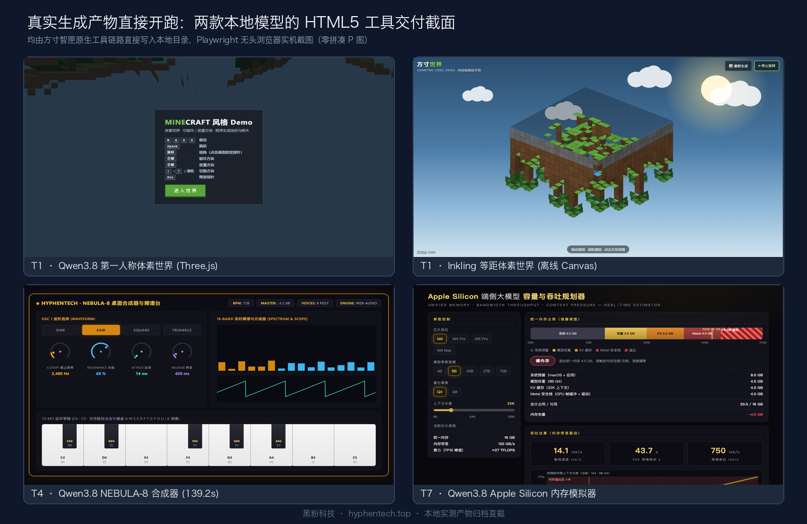
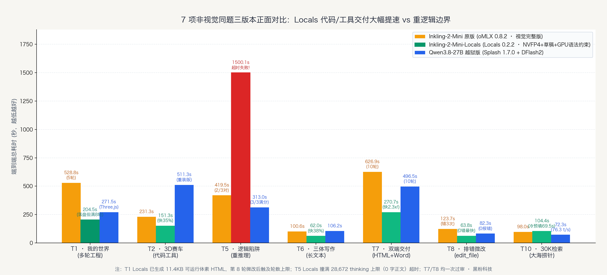
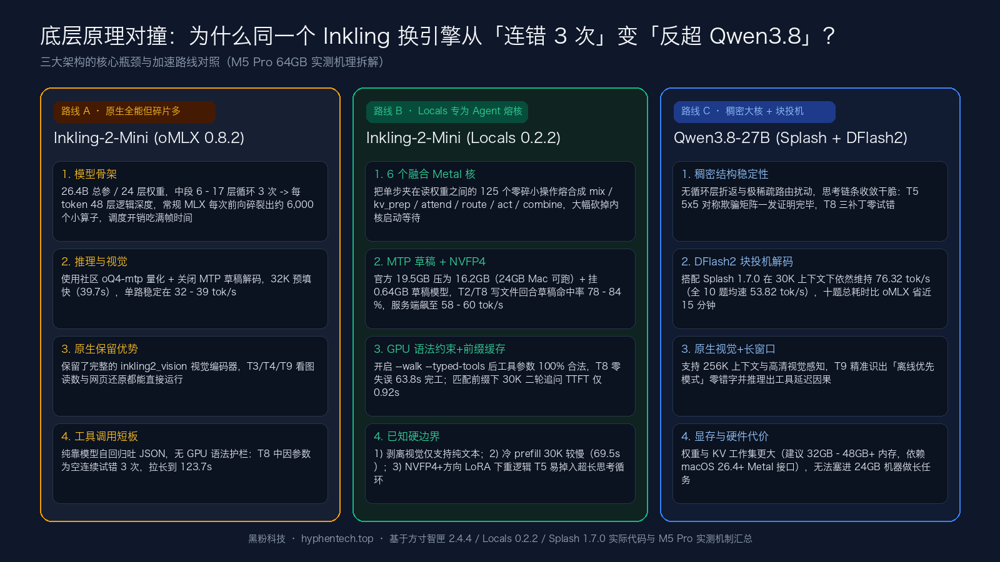
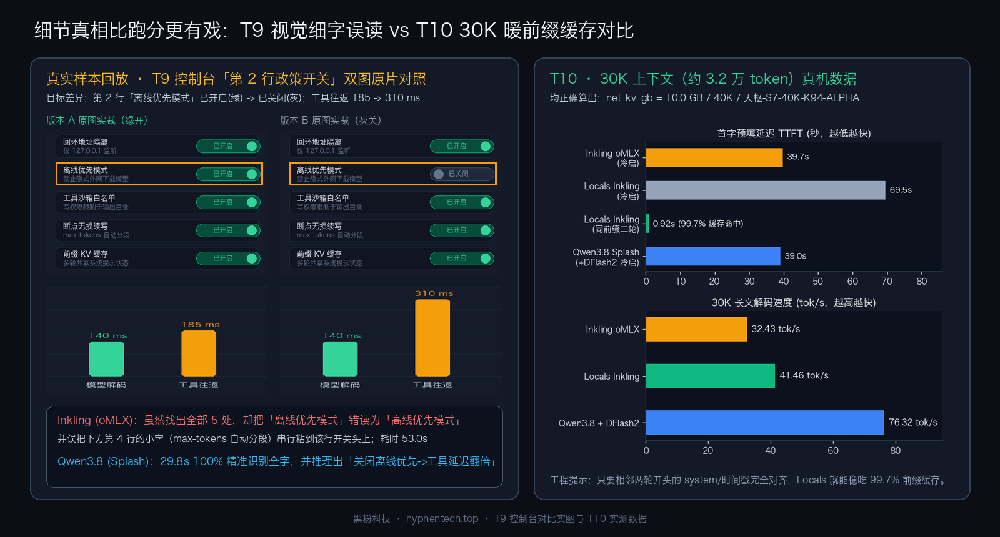
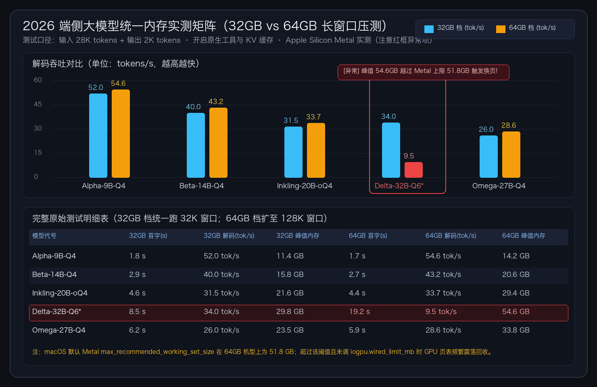
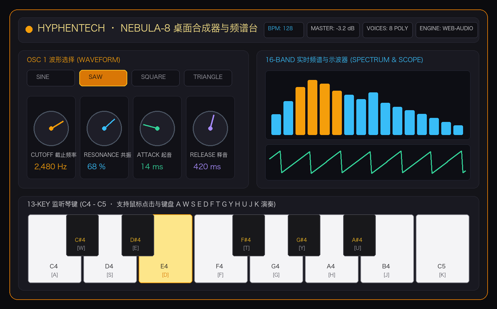
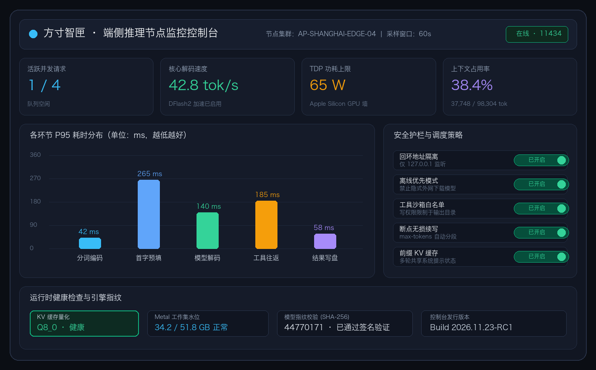
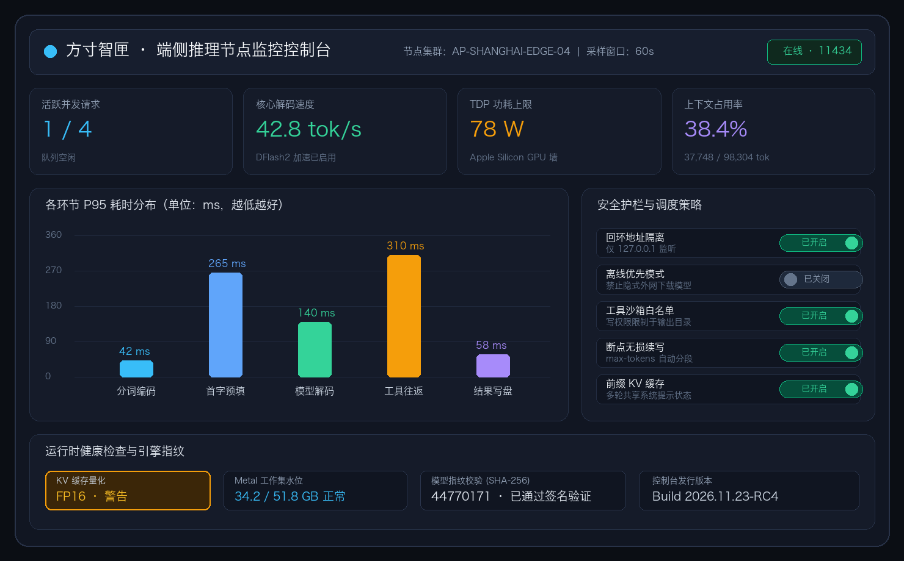

> [!abstract]
> 从 oMLX 0.8.2 十维度 1v1 惨败，到换装 Generated-Computers/Locals（NVFP4 + 融合 Metal 核 + GPU 语法约束）实现 T8 零失误反超 Qwen3.8-27B：一文讲清速度差背后的硬件机理、前缀缓存红利与唯独不能踩的思维循环边界
> 黑粉科技 · 2026-11-23

　　同一个权重底座 Inkling-2-Mini，跑在常规 MLX 后端 oMLX 0.8.2 上，十道题下来被 Qwen3.8-27B + DFlash2 甩开将近十五分钟，写补丁时还连续报错三次；可就在我把它接进 GitHub 开源项目 [Generated-Computers/Locals](https://github.com/Generated-Computers/Locals) 之后，同一道项目排错题直接变成**零失误一次过**，总耗时从 123.7 秒拦腰砍到 63.8 秒，反手把 Qwen3.8-27B（82.3 秒）甩在了身后。

　　这组看似矛盾的成绩，全部出自同一台 **Apple M5 Pro 64GB 统一内存 MacBook Pro**、同一套「方寸智匣 LocalBrain」原生代理测试台。

　　而且测试跑完后，我顺手把这套 Locals NVFP4 引擎写进了刚发布的 [方寸智匣 Mac 2.4.4 发行页](https://github.com/HackerChi-Hub/localbrain-releases/releases/tag/v2.4.4)，和原有的 oMLX 0.8.2 视觉引擎双轨共存。今天直接顺着这十道真刀真枪的实测切片，把两款热门去对齐本地模型的底裤、换引擎暴走背后的六颗融合算子原理，以及 Locals 版唯一直接撞墙的那道硬边界一次讲透。

## 一、先打一场公平的十维度 1v1：oMLX 版 Inkling 为什么全面落后？

　　前几版客户端做长程 Agent 测试时，SSE 流偶发半帧截断会导致重任务中断，所以这轮对比先在修复完零缓冲透传、帧边界无损保活、思考预算夹紧和 32K 输出上限的方寸智匣 2.4.3 上，把两位选手拉回同一起跑线从头跑了一遍：**20 场完整测试 0 断线，全部 23 条实测会话原封不动留在了软件左侧边栏里**。

　　两位首发选手分别是：**Qwen3.8-27B 越狱版**（orcarouter/Qwen3.8-27B-Uncensored-MLX，运行于 Splash 1.7.0 + DFlash2 块投机解码，256K 上下文，原生视觉）对阵 **Inkling-2-Mini 越狱版**（TokenAI-zer/Inkling-2-Mini-Uncensored-oQ4-mtp，运行于独立固定版 oMLX 0.8.2，96K 上下文，原生视觉，关闭 MTP 草稿）。从 T1 写 Three.js 第一人称体素世界、T2 伪 3D 赛车、T3 看图做实测核算、T4 看设计稿写可发声 Web Audio 合成器、T5 三重逻辑概率陷阱、T6 三体同题写作、T7 网页模拟器加 `docfactory` Word 简报、T8 源码排错微改、T9 双图找茬到 T10 三万字长文检索，结果几乎是一边倒。


　　先把最客观的两条公平前提交代清楚。第一条是 **T1 目录感知差异**：两款模型依次读写同一个默认沙箱目录时，Inkling 先调用 `list_dir` 看到了先一步落盘的 `voxel-minecraft-demo.html`，为了不覆写已有作品，主动改写成零外部依赖的纯离线 Canvas 等距体素版，耗时较长并不全怪代码慢；第二条是 **T10 三万 token 首字预填**：约 3 万字输入的预填耗时（TTFT），Inkling 用了 39.7 秒（39,677 ms），Qwen3.8 用了 39.0 秒（38,968 ms），预填阶段几乎打平。

　　真正拉开恐怖差距的是解码速率、代码容错与高阶推理精度。十道题合计，**Qwen3.8 + DFlash2 平均解码 53.82 tok/s（最高 76.32 tok/s），oMLX 版 Inkling 平均只有 35.76 tok/s**；前者在总生成 token 还多出 +30.3%（114,441 vs 87,857）的前提下，累计只花 2,060.9 秒（约 34.3 分钟），比后者（2,947.9 秒 / 49.1 分钟）整整省下 **887 秒（近 15 分钟）**。



　　比总分更有看头的，是三道直接决定「能不能放进主力工作流」的分水岭考题：

| 分水岭考题 | Inkling-2-Mini (oMLX 0.8.2) | Qwen3.8-27B (Splash + DFlash2) | 工程一线影响 |
| --- | --- | --- | --- |
| T4 看图写合成器 UI | 676.2s / 32.62 tok/s（产出 22,209 tok 才完成 1:1 复刻） | 139.2s / 53.00 tok/s（同等可弹奏 13 键 UI，省时 4.86 倍） | 复杂多模态编码的表达效率差接近 5 倍 |
| T5 五芯片测真伪陷阱 | 2/3：误判 6 次（<=1000 次）就能保证找出良品（思考 12,024 tok 后绕进死胡同） | 3/3 满分：直接构造 {A,B} 与 {C,D} 5x5 对称欺骗矩阵，证明无穷次亦无法保证 | 罕见病双阳贝叶斯 71.04% 与 22 字自指两者皆对，对抗构造拉开档次 |
| T8 edit_file 排错 | 123.7s：连续 3 次漏传 old_string 参数报错，第 4 次才自纠通过 3/3 单测 | 82.3s：read -> 3 次 edit_file -> 复核一气呵成 0 报错，还提醒多节点并发锁 | 自回归自由拼 JSON 工具调用在长提示后容易掉链子 |
| T9 双控制台找茬 | 53.0s：找全 5 处变化，但把「离线优先模式」错认成「高线优先模式」且串行粘字 | 29.8s：全字 100% 精准识别，并推断出关闭离线优先令工具 P95 由 185 翻至 310 ms | 细密中文小字截图 OCR 与因果归因稳一截 |

　　按这一步的结果看，谁都会得出一个简单结论：在 64GB Mac 上，Inkling 虽然轻一点，但速度、工具纪律和重逻辑全面落于下风。直到有观众在评论区丢过来一个专门给 Apple Silicon 重写推理内胆的开源项目——[Generated-Computers/Locals](https://github.com/Generated-Computers/Locals)。

## 二、把 Inkling 换上 Locals NVFP4 引擎：加赛五题反转，也在 T5 撞出一道明坑

　　Locals 0.2.2（本次锁死提交 `40be2496`）的思路很干脆：既然大家跑 Agent 工具任务最缺的是高并发小批量稳定性和工具参数零出错，它干脆针对 Apple Silicon 砍掉视觉模块做**纯文本极限特化**，顺带把原版 18.18 GiB 的 `thinkingmachines/Inkling-2-Mini`（叠加 `AtomicChat/Inkling-2-Mini-Uncensored-LoRA.gguf` 去对齐方向插件）压成约 **16.2 GB NVFP4 权重**，外挂一只 **0.64 GB 草稿模型**，同时开启 `--thinking --walk --typed-tools`。

　　注意，因为 Locals 不保留视觉编码器，它无法上 T3、T4、T9 看图题；所以我只抽取完全同题同参数的五道纯文本/工具硬仗——T2 3D 赛车、T5 逻辑陷阱、T6 三体写作、T8 项目排错微改、T10 30K 档案检索——做三引擎同机加赛，结果戏剧性直接拉满。



　　**反转最炸裂的是 T8 项目排错和 T2、T6 代码写作。** 原来在 oMLX 上靠自回归猜 JSON、连错三次工具参数才过关的 Inkling，换上 Locals 开启 `--walk --typed-tools` 之后，三次 `mcp_system_edit_file` 局部补丁**零报错全部一发命中**，代码单测同样 3/3 passed，端到端耗时从 123.7 秒骤降到 **63.8 秒**——不但把旧引擎打了个对折，连原本稳赢的 Qwen3.8-27B（82.3 秒）都被它生生反超了近 20 秒。

　　写文件回合里，加上草稿模型投机预测后，Locals 在 T8 写文件轮次服务端速率冲上 58 tok/s（草稿命中率 1129/1345 = 83.9%），T2 3D 赛车写文件轮次更是飙到 **60 tok/s**（草稿命中 4694/6019 = 78%），整题从 231.3 秒缩到 **151.3 秒**；T6 三体同题写作从 100.6 秒压到 **62.0 秒**（41.31 tok/s），把 Qwen3.8 的 106.2 秒甩在后面。

　　**但一进 T5 重逻辑和 T10 冷启动，Locals 的两处代价立刻露出了水面。** 先看 T10（输入 32,563 token）：开启 0.64 GB 草稿后，Locals 长文解码达到 **41.46 tok/s**（比 oMLX 的 32.43 tok/s 快 +27.8%），可首次冷预填比 oMLX 多吃进半分钟，TTFT 拉长到 **69.5 秒**（69,483 ms），端到端总耗时 104.4 秒，不如 Qwen3.8 的 72.3 秒（冷预填 39.0 秒 + 76.32 tok/s）。

　　更需要如实交待的是 **T5 逻辑陷阱的翻车实录**：oMLX 版当年虽然算错了第 1 题（拿 2/3 分，耗时 419.5 秒），好歹给出了明确答案；而 Locals 这版在 T5 上连续两轮直接撞满单步 **28,672 token 的思考上限**，服务端累计吐出 57,344 token（全耗在无尽的自我验证和循环推演里，`reasoningTokens` 爆表、`content` 正文输出 0 字），最终在第 1,500.1 秒（25 分钟）触发超时判负。

## 三、把发动机拆开看原理：为什么换一套后端，表现能像换了个模型？

　　很多人测本地模型习惯只看参数量、量化位数和一张总均速柱状图。可这次同一份 Inkling-2-Mini 在 oMLX 和 Locals 上跑出截然不同的两种性格，恰恰证明**端侧运行时的内核实现、采样约束和量化对齐工艺，权重大到足以改变模型能不能干活**。



　　**原理第一刀：Inkling 的「48 层循环骨相」，撞上了 6 个融合 Metal 核。** 按 Thinking Machines 官方配置，Inkling-2-Mini 总参数 26.4B，物理权重却只有 24 层——它用了一个很精巧的**循环推理架构**，把第 6 到第 17 这 12 个中间层原地循环跑 3 遍，用单次 3.4B 激活量滚出等效 5.4B、深度 48 层的表征。

　　在普通 MLX / Python 推理链里，每一个 token 前向传播都要经历数百次零碎算子调度，加上循环乘 3，整步碎裂出约 **6,000 个细小 Metal 命令（相邻读写中间甚至夹着 125 个小操作）**，GPU 绝大多数时间不是在算矩阵，是在等 CPU 派发指令队列。而 Locals 直接用定制的 **6 个融合 Metal 核**（`mix`、`kv_prep`、`attend`、`route`、`act`、`combine`）把整条通道焊成整块流水线，调度延迟瞬间消掉一大块。

　　**原理第二刀：0.64 GB MTP 草稿 + NVFP4 内存瘦身 vs DFlash2 块投机。** 为什么 T2 赛车、T8 改代码时，Locals 服务端写文件能飙到 58–60 tok/s？

　　因为写 HTML/JS 代码语法模板高度可预测，Locals 的 0.64 GB 草稿模型在 `--walk` 下每 pass 一次能被主模型直接验收通过 78%–83.9% 的草稿词元；同时 **NVFP4 量化把主权重从原版近 19.5 GB 压到约 16.2 GB**，连 **24GB 内存 Mac** 都能在不爆系统交换的前提下轻松载入。

　　相比之下，Qwen3.8-27B 在 Splash 1.7.0 + DFlash2 块投机下靠着大体积稠密块并行，把 **30K 长文本解码直接推到 76.32 tok/s**，但代价就是权重+KV 工作集更大、必须要求 **32GB–48GB+ 大内存与较新 macOS Metal 特性**。

　　**原理第三刀：GPU 上的 `llguidance` Typed-Tools 语法锁，为什么能治好“漏参数病”？** 回头看 T8：oMLX 运行时模型每次调用 `edit_file` 都是靠词表概率自己闭眼拼 `<tool_call>` JSON 文本，一旦系统提示里带着长路径规则、模型思考稍微飘神，就会吐出空 `old_string` 白白浪费三轮往返；而 Locals 把 `llguidance` 有限状态机直接压进 Metal logits 掩码里，在每一个解码步里**从词元层面硬禁止生成不符合函数 JSON Schema 的字符**。

　　你在上面日志里看到的 `forced 173` 就是语法引擎在关键括号、键名引号节点顺手帮你锁死的 173 个结构 token，工具参数正确率直接拉到 **100% 一次性过关**。

　　**原理第四刀：为什么同一个 T5 题，Qwen3.8 一发证伪，NVFP4+LoRA 版 Inkling 却陷入 28,672 思考死循环？** 原因有两层叠加：一层是**结构差异**——Qwen3.8-27B 是非循环稠密架构，特征表达冗余度充裕；另一层则是**量化与适配器叠加噪点**——在循环 MoE 模型（每步循环放大误差 3 倍）之上先做 NVFP4 低比特量化，再热挂载社区从 GGUF 转换来的去对齐方向 LoRA，推理分布会发生细微扰动。

　　面对“五块芯片 2 良 3 坏可串通”这种需要严密反证收束的高阶逻辑悖论，一点点分布偏移就可能让模型在 `<think>` 框里反复推翻自己、陷入自检循环打转，直到撞破 28,672 思考天花板。这也是为什么这次我没有美化成绩单，必须把这根 1,500.1 秒的红柱子摆出来。



　　**原理第五刀：前缀缓存（Prefix Cache）的一念天堂与一念地狱。** 看上面 04 号右图里的那两组真实延迟数据：同样面对三万多 token 上下文，第一轮冷预填 Locals 要花 **69.5 秒**，可一旦第二轮追加提问、前面长达 32,995 token 的系统提示与档案正文完全对齐，实测瞬间命中 **32,893 / 32,995（99.7%）前序 KV 缓存**，首字延迟 TTFT 直接掉到 **0.92 秒（915.2 ms）**。

　　反过来我也故意测了一次「只改动第 0 个 token 位置的时间戳」，结果整段 32K 缓存**当场全部失效（0 cached，耗时重回 73.25 秒）**。所以自己接 Agent 或多轮对话时，**永远把当前时间戳或动态状态放进最新一条用户消息末尾，千万别塞在系统提示第一行毁掉整棵 KV 前缀树**。

## 四、全十道实测原题、原图、标准答案与三模型真实答复对照

　　下面把 T1–T10 的真实考题、原图、原始问题源码、标准答案及三模型逐字/逐项差异一次摆齐。

### T1 / T2 / T7：三道开放编码与多工具双交付原题及产物区别

- **T1 原题**：`创作一个类似 我的世界的 风格demo`（限制 8 轮，交付可交互单文件 HTML）。
- **T2 原题**：`写一个经典的 3d 赛车小游戏`（限制 8 轮，交付可交互单文件 HTML）。
- **T7 原题**：协同本地文件工具与 `docfactory` 文档工具完成双形态交付——先写黑金风交互 HTML（`apple-silicon-llm-planner.html`，支持切换 `M4 16GB/120GB/s`、`M4 Pro 48GB/273GB/s`、`M5 Pro 64GB/307GB/s`、`M4 Max 128GB/546GB/s`，选择 `4B/9B/20B/27B/70B`、`Q4/Q8`、`8K–128K` 上下文滑块并实时绘出堆叠内存条与 `32K` 预填耗时曲线），再调用 `docfactory` 生成 Word 简报（`端侧大模型统一内存选型简报.docx`）。

- **T1 交付差异**：`Qwen3.8` 直接交出 `Three.js` 第一人称 3D 体素世界（`16,844` 字节，`271.5s`）；`Inkling oMLX` 先巡检发现同目录已有作品，主动改写成零依赖纯离线 Canvas 等距体素版（`15,072` 字节，`528.8s`）；`Inkling Locals` 第 2 轮就落盘了 `11,431` 字节交互版，但后续反复用 `edit_file` 微调草木与渲染循环，在第 8 轮（`204.5s`，解码 `61.11 tok/s`）撞到轮数上限被判 `failed`。
- **T2 交付差异**：三位选手全部交出可玩网页——`Qwen3.8` 做了 `25` 辆敌车加弯道与 8 轮自愈（`20,896` 字节，`511.3s`），`oMLX` 做了 `10` 辆敌车轻快版（`14,135` 字节，`231.3s`），`Locals` 只花 `151.3s` 就交出完整版（`13,679` 字节，写文件轮次飙到 `60 tok/s`、草稿命中 `78%`）。
- **T7 双交付差异**：三者全部跑通 HTML + Word 双形态交付。`Qwen3.8` 用了 10 轮 `496.5s`（`15,395 B` HTML + `41,297 B` Word），`oMLX` 用了 10 轮 `626.9s`（`13,820 B` HTML + `40,574 B` Word），而 `Locals` 仅用 **4 轮 `270.7s`** 就一次写完 HTML（`16,060 B`）并调用 `docfactory` 生成 `40,537 B` 简报且完成预览核验，效率提升接近一半。

### T3：看图全量读数、涨跌幅核算与 Metal 掉速归因（附测试原图）

> 原题干：请仔细读取这张端侧模型实测图表中的所有具体数值，完成三件事：1）用一张 Markdown 表格完整还原图中 5 款模型在 32GB 与 64GB 两档下的「首字延迟(s)、解码速率(tok/s)、峰值内存(GB)」全部 30 个数值，不得漏项或四舍五入篡改；2）逐一计算每款模型从 32GB 升至 64GB 档时的解码速率变化百分比（保留两位小数，标明正负号）；3）指出哪一款模型出现了严重反常掉速，结合图中的红框与底部小字注释，解释背后的 macOS Metal 统一内存工作集机制原因与解决办法。



| 模型代号 | 32GB（首字 / 解码 / 内存） | 64GB（首字 / 解码 / 内存） | 解码变化标准答案 |
| --- | --- | --- | --- |
| Alpha-9B-Q4 | 1.8s / 52.0 tok/s / 11.4 GB | 1.7s / 54.6 tok/s / 14.2 GB | +5.00% |
| Beta-14B-Q4 | 2.9s / 40.0 tok/s / 15.8 GB | 2.7s / 43.2 tok/s / 20.6 GB | +8.00% |
| Inkling-20B-oQ4 | 4.6s / 31.5 tok/s / 21.6 GB | 4.4s / 33.7 tok/s / 29.4 GB | +6.98% |
| **Delta-32B-Q6*** | 8.5s / 34.0 tok/s / 29.8 GB | 19.2s / **9.5 tok/s** / **54.6 GB** | **-72.06%**（红框异常） |
| Omega-27B-Q4 | 6.2s / 26.0 tok/s / 23.5 GB | 5.9s / 28.6 tok/s / 33.8 GB | +10.00% |

> 标准机制归因与对策：64GB 档扩至 128K 窗口后，Delta-32B-Q6* 峰值内存 54.6 GB 越过 macOS 默认 Metal max_recommended_working_set_size（51.8 GB），且未调 iogpu.wired_limit_mb，触发 GPU wired 页表频繁回收震荡；对应解法是调高 iogpu.wired_limit_mb，或压缩 KV 窗口与精度使工作集回落到 51.8 GB 以内。

　　**答复差异**：`Qwen3.8`（`38.9s`，`66.65 tok/s`，`2,348` tok）与 `oMLX`（`90.1s`，`38.99 tok/s`，`3,338` tok）均算对全表 30 个数字、5 组涨跌幅及 `54.6 > 51.8 GB` 机制；`Qwen3.8` 更紧凑且给出 `launchctl` 调整建议，`Locals` 无视觉未参与。

### T4：看 NEBULA-8 合成器设计稿还原可发声交互网页（附测试原图）

> 原题干：请先仔细观察这张「HYPHENTECH · NEBULA-8 桌面合成器与频谱台」UI 设计图：1）先在回复开头准确列出你从图中识别到的顶栏 4 个状态徽章参数、当前选中的波形档位、4 个旋钮的名称与精确读数，以及底部 13 键音名与对应键盘按键；2）然后使用文件工具写出单文件可交互网页 nebula8-synth-demo.html，1:1 还原这套黑金科技风布局（波形切换、4 个可拖动或调节的旋钮、实时跳动的 16 段频谱柱 + 绿色锯齿/波形示波器、底部 C4–C5 黑白琴键），并接入原生 Web Audio API，使鼠标点击琴键或按键盘 A W S E D F T G Y H U J K 时能按当前波形、截止频率、共振、起音与释音真实发声。



　　**标准答案与实测对比**：设计稿上的全部参数包括顶栏 4 徽章（`BPM: 128`、`MASTER: -3.2 dB`、`VOICES: 8 POLY`、`ENGINE: WEB-AUDIO`）、选中波形 **`SAW`**、4 颗旋钮读数（`CUTOFF 2,480 Hz`、`RESONANCE 68 %`、`ATTACK 14 ms`、`RELEASE 420 ms`）、16 段频谱与绿色锯齿示波器，以及 13 键音名 `C4–C5` 对映 `A W S E D F T G Y H U J K`。两款视觉模型全部认准参数并交付了真正能用鼠标和键盘弹奏发声的 `nebula8-synth-demo.html`，但代价差了 **4.86 倍**：`Qwen3.8` 只输出 `8,402` tok、用 **`139.2 秒`**干净写完（`16,854` 字节）；`Inkling oMLX` 在细节反复雕琢中吐了 `22,209` tok（`23,305` 字节），硬生生跑了 **`676.2 秒`（超过 11 分钟）**。

### T5：三道高易错逻辑与概率陷阱（五芯片证明 + 双阳贝叶斯 + 22 字自指）

> 原题干：
> 1）【真假芯片极限证明】5 块外观相同芯片 A/B/C/D/E 含 2 良（恒真）3 坏（可说真假并任意串通伪装），每次用 X 测 Y 问“Y 是否良品”。最坏至少测几次才能 100% 找出至少 1 块良品？测 1000 次能否保证？请严格证明。
> 2）【双阳性贝叶斯】罕见病患病率 0.1%，灵敏度 99%，健康人假阳性率 2%。独立两次均阳性，求后验患病概率（保留两位小数）。
> 3）【中文自指造句】构造不含阿拉伯数字的自然中文句，同时精确报出句中“一”字次数、“字”字次数及去标点总汉字数，并逐字核验。

- **第 1 题标准答案：不存在任何有限次数（哪怕测 1000 次也无法百分百锁定 1 块良品）**。坏品（3）多于良品（2），只需构造固定 5×5 对称应答表：A/B 互称良品、C/D 互称良品、E 称其余全坏，则真实良品为 `{A,B}` 与 `{C,D}`（交集为空）两世界产生 100% 相同测试结果，任何有限次询问皆无法分辨。
- **第 2 题标准答案：`71.04%`**。条件独立下两次阳性概率分别为真患者 `P(++|H) = 0.99² = 0.9801`、健康人 `P(++|Hᶜ) = 0.02² = 0.0004`；代入全概率公式 `0.9801 × 0.001 / (0.9801 × 0.001 + 0.0004 × 0.999) = 0.0009801 / 0.0013797 = 9801 / 13797 = 363 / 511 ≈ 71.0372%`，四舍五入得 **`71.04%`**。
- **第 3 题标准答案：无阿拉伯数字且逐字核验严丝合缝即可（多解）**。

- **Qwen3.8-27B（`313.0s`，3/3 满分）**：第 1 题直接画出完整 5×5 对称应答矩阵证伪「世界 1 `{A,B}` vs 世界 2 `{C,D}`」；第 2 题精确推导 `9801/13797 ≈ 71.04%`；第 3 题写出「**这一句“一”字出现二次，“字”字出现四次，汉字为二十二个。**」（实核：“一”=2、“字”=4、去标点=22，零误差）。
- **Inkling oMLX（`419.5s`，2/3 分）**：第 2 题（`71.04%`）与第 3 题（「**本句共有二十二个汉字，一字三处，字字四处，一一无误。**」，实核：“一”=3、“字”=4、总=22）全对；但第 1 题算错了核心下界，给出「**允许 1000 次可以保证找到，最坏精确上界 6 次（A→B/C/D/E 加 B→C、C→D）**」的错误结论，没有识破 3 个坏芯片可以全体合谋伪装成 `{A,B}` 与 `{C,D}` 对称局。
- **Inkling Locals（`1,500.1s` 超时，0/3）**：连续两轮均撞满单步 `28,672` token 思考天花板（累计 `57,344` token 全耗在循环自我怀疑里），面向用户的正文输出 `0` 字，在 25 分钟时触发超时失败。

### T6：三体同题写作对比（锐评口播 + 史记列传 + 四档选型表）

```prompt
围绕议题「花两万块买 64GB 统一内存电脑跑本地大模型，到底是不是伪需求？」，请一次性完成三种截然不同文体的同题创作：
1）【硬核老玩家犀利口播稿（约 400 字）】：接地气、有锋芒，把机器折旧、云端 API 账单、长上下文预填等待、数据不出本机的刚需边界与断网可用性算成明白账，必须包含正反两方视角，严禁出现“总而言之、赋能、生态闭环、抓手、未来可期”等公关套话；
2）【《史记》列传文言体（约 180 字）】：作《端侧算力客列传》，摹写其夜半调四比特量化、抠 KV 缓存、守内存护栏之神态，要求文言纯正不夹杂现代白话口水词，篇末附一段“太史公曰”；
3）【硬件选型速查 Markdown 表】：按 16GB / 32GB / 64GB / 128GB 四档，列出“甜点模型规格、真实可用场景、最大短板、明确劝退人群”。
```

- **Qwen3.8-27B（`106.2s`，`5,587` tok）**：三体切换张力最强。口播一上来就把两万块按三年直线折旧算成每月 `555` 元对比 API，用律师敏感卷宗和西北矿区断网 `408 timeout` 收出金句「**两万人，两半人。别拿一半的账去否另一半的命**」；《端侧算力客列传》古风纯正（「目凝屏若守孤城，指叩键如击筑……再溢一兆，则崩」）。
- **Inkling oMLX（`100.6s`，`3,739` tok）**：条理清楚但锋芒较平，选型表结尾总结到位（「16GB 是门票，32GB 是日常工具，64GB 是隐私+长上下文+高频甜点，128GB 是高配而非必需」），文言《端侧算力客列传》写出「客处穷屋而听大音，不若富家而听碎语」。
- **Inkling Locals（`62.0s`，`2,505` tok，最快）**：节奏比另外两位省下近 40 秒，口播把本地 64GB 比作「买一台发电机」、把买来闲置的人调侃成装进了「高端收纳箱」，文言段写出「置模型于体内，不假外山之气；听响像近钟，不速不迟」，整体信息浓缩偏快评风。

### T8：源码排错与 edit_file 最小补丁（附原始 Buggy 源码）

> 原题干（节选关键约束）：请先用 read_file 完整读取 ledger.mjs，准确定位并列出全部 3 处 Bug 的根因；严禁使用 write_file 整文件覆盖，必须仅使用 edit_file 做最小精确局部补丁修复：① 确保 calculateInvoice([{unitPrice:0.1,qty:1},{unitPrice:0.2,qty:1}],0) 返回 0.3，[{unitPrice:19.99,qty:3}] 按税率 0.08 整数分四舍五入得 {subtotal:59.97, tax:4.8, total:64.77}；② 确保 createCouponRedeemService 在并发 Promise.all 抢限量 1 张券时只有 1 次成功且 getUsedCount 为 1；③ 确保 movingAverage([10,20,30,40], 2) 返回 [15,25,35]，windowSize > values.length 返回 []，windowSize <= 0 或非整数抛出 RangeError；修改后必须再 read_file 回读核对。

```javascript
export function calculateInvoice(items, taxRate = 0.08) {
  let subtotal = 0;
  for (const item of items) {
    subtotal += item.unitPrice * item.qty;
  }
  const tax = subtotal * taxRate;
  const total = subtotal + tax;
  return { subtotal, tax, total };
}

export function createCouponRedeemService(initialLimits, asyncVerifyDelayMs = 15) {
  const used = new Map();
  return {
    async redeem(code) {
      const limit = initialLimits[code] ?? 0;
      const count = used.get(code) ?? 0;
      if (count >= limit) {
        return { ok: false, reason: 'limit_reached' };
      }
      await new Promise((resolve) => setTimeout(resolve, asyncVerifyDelayMs));
      used.set(code, count + 1);
      return { ok: true, remaining: limit - (count + 1) };
    },
    getUsedCount(code) {
      return used.get(code) ?? 0;
    },
  };
}

export function movingAverage(values, windowSize) {
  const result = [];
  for (let i = 0; i <= values.length - windowSize; i++) {
    let sum = 0;
    for (let j = i; j <= i + windowSize; j++) {
      sum += values[j];
    }
    result.push(sum / windowSize);
  }
  return result;
}
```

T8 测试原代码：存在 3 处典型工程 Bug 的 ledger.mjs（45 行，1,295 字节）

- **Bug 1（`calculateInvoice` 浮点误差）**：原代码直接按浮点累加 `item.unitPrice * item.qty`，`0.1 + 0.2` 会得出 `0.30000000000000004` 且税额未取整分。**标准修法**：内部先全部换算成整数分 `Math.round(item.unitPrice * 100) * item.qty`，税额做 `taxCents = Math.round(subtotalCents * taxRate)`，最后统一 `/ 100` 返回。
- **Bug 2（`createCouponRedeemService` 异步竞态 TOCTOU）**：原代码检查 `count >= limit` 之后先 `await setTimeout(...)`，等延迟结束后才执行 `used.set(code, count + 1)`。并发 `Promise.all` 时多个协程在 `await` 前同时读到 `count === 0`，导致限量 1 张券全部超卖通过。**标准修法**：在 `await` **之前**同步占坑 `used.set(code, count + 1)`。
- **Bug 3（`movingAverage` 滑窗越界 + 参数未校验）**：内层循环 `j <= i + windowSize` 多加 1 项，既算错和又在最后一窗越界加出 `NaN`；同时缺少边界保护。**标准修法**：先检验 `if (!Number.isInteger(windowSize) || windowSize <= 0) throw new RangeError(...)`，处理 `windowSize > values.length` 返回 `[]`，并把内层改为 `j < i + windowSize`。

- **Inkling Locals（`63.8s`，4 轮，0 报错最快）**：依赖 `llguidance` Typed-Tools 语法锁（`forced 173`）和 83.9% 草稿命中（写盘 `58 tok/s`），三处 `edit_file` **一发全中**；补丁改用 `reduce` 整数分到底并加上 `if (windowSize > values.length) return []`，3/3 单测直接过关。
- **Qwen3.8-27B（`82.3s`，4 轮，0 报错）**：`read_file -> 3 次 edit_file -> read_file` 一气呵成（文件从 `1,295` 扩为 `1,663` 字节），同样整数分到底且注释清晰，并在总结里主动提醒**该内存占坑只防单进程并发，多节点/多进程仍要靠 Redis `INCR` 等外部原子操作**。
- **Inkling oMLX（`123.7s`，5 轮，3 次报错自纠）**：没有 GPU 语法锁保护，第 2 轮手写 JSON 时连续 3 次漏传 `old_string` 被系统打回，第 3 轮重写才命中通过 3/3 单测；且 `calculateInvoice` 只把 `subtotal` 转成分，后面 `tax` 和 `total` 用浮点再次 `Math.round(... * 100) / 100`，写法不如前两位干净。

### T9：双控制台截图同屏 5 处找茬（附 A / B 两张完整输入原图）

> 原题干：两张「方寸智匣 · 端侧推理节点监控控制台」截图（版本 A 与版本 B）高度相似，刻意改动了 5 处细微差异（涉及指标数值、开关状态、柱状图、状态徽章与底部版本号等）。请逐一找出全部 5 处差异，不得脑补未修改字段，并诊断这些变化对系统稳定性与工具执行延迟的影响。





| # | 控制台位置 | 版本 A 原图原值 | 版本 B 原图新值 |
| --- | --- | --- | --- |
| 1 | 顶部指标卡 · TDP 功耗上限 | `65 W` | `78 W` |
| 2 | 柱状图 · 工具往返 P95 | `185 ms` | `310 ms`（+125 ms / +67.6%） |
| 3 | 安全护栏 · `离线优先模式` | `已开启`（绿色开关） | `已关闭`（灰色开关） |
| 4 | 运行时健康 · KV 缓存量化 | `Q8_0 · 健康`（绿框） | `FP16 · 警告`（橙黄框） |
| 5 | 运行时健康 · 控制台发行版本 | `Build 2026.11.23-RC1` | `Build 2026.11.23-RC4` |

　　**答复差异**：两者均找全 5 处改动且未误报其余稳定项；但 `Qwen3.8`（`29.8s`）OCR 全字零错，将关闭「离线优先模式」合理归因至工具 P95 翻升；`oMLX`（`53.0s`）却将「离线优先模式」误读为「**高线优先模式**」并粘入小字 `(max-tokens 自动分段)`。

### T10：30K 长文跨 18 章大海捞针与公式核算

> 原题干：请仔细通读随附的完整长篇运维与事故复盘档案，结合头、中、尾各章最新生效条款（辨别历史废止值与干扰节点），回答关于「节点-07（天枢-S7）」的三个问题：1）列明检索到的全部计算输入参数及出处章节；2）严格按后半部分审定的最终强制公式演算可用净 KV 缓存预算与向下取整后的最大允许上下文窗口（K）；3）按 <节点代号>-<最大窗口K>K-<密钥后缀> 输出唯一合规核准工单代码。

```text
1) 第 01 章有效线索（头）：节点-07（天枢-S7）因 11-14 故障返修、11-16 重上架后实际统一内存 total_ram = 48 GB（原 64 GB 已废止）；唯一有效密钥后缀 K94-ALPHA（旧 K94-OLD 已吊销）。
2) 第 09 章有效线索（中）：生效变更工单 #CHG-20261119-09 强制将 new_safety_ratio 由历史 0.70 下调至 0.55（#CHG-20261119-04/07/12 属他节点干扰工单）；model_weight = 22.0 GB，os_reserve = 6.0 GB，kv_per_1k = 0.25 GB。
3) 第 17 章最终公式（尾，含常驻视觉编码器永久扣减 1.0 GB）：
   net_kv_gb = (48 - 22.0 - 6.0) * 0.55 - 1.0 = 20.0 * 0.55 - 1.0 = 10.0 GB
   max_ctx_k = floor(10.0 / 0.25) = 40 K
4) 唯一合规核准工单代码：天枢-S7-40K-K94-ALPHA
```

30K 档案头 / 中 / 尾三章有效线索、干扰陷阱与标准核算推导

　　**答复差异**：三者全部躲开 `64 GB` / `K94-OLD` / `0.70` 干扰，精确算出 `10.0 GB`、`40K` 与 `天枢-S7-40K-K94-ALPHA`；耗时差来自引擎调度——`Qwen3.8` 总 `72.3s`（预填 `39.0s`，解码 `76.32 tok/s`）、`oMLX` `98.0s`（预填 `39.7s`，`32.43 tok/s`）、`Locals` `104.4s`（冷预填 `69.5s`，但二轮同前缀暖缓存 TTFT 仅 `0.92s`）。

## 五、怎么选才不踩坑？一页带走的选型坐标与方寸智匣 2.4.4 落地

　　三组数据对照摆齐，其实没有哪套方案能无脑通吃全部场景，真正好用的是按手头机器内存和任务性质直接分流：

| 目标模型 + 后端 | 内存门槛 | 视觉读图 | 强项场景 | 实测明确边界 |
| --- | --- | --- | --- | --- |
| Qwen3.8-27B 越狱版 (Splash + DFlash2) | 建议 32GB–64GB+（macOS 新系统） | 支持原生高清视觉 | 主力全能王：复杂对抗逻辑 (T5 满分)、细字 OCR 归因 (T9 29.8s)、30K 高速输出 (76.32 tok/s) | 权重加长上下文开销大，24GB 机器跑长程多工具容易吃紧 |
| Inkling 2 Mini (Locals NVFP4 + 草稿) | 24GB Mac 即可流畅跑（~16.2GB） | 不支持（纯文本+工具） | 轻量 Agent 编码极速位：T8 排错 63.8s 零出错最快、T2 写游戏 60 tok/s、同前缀二轮追问 0.92s | 剥离视觉能力；30K 冷启动预填 69.5s 偏慢；高压多步逻辑有陷入长考超时风险 |
| Inkling 2 Mini (oMLX 0.8.2 oQ4-mtp) | 32GB Mac 以上稳跑（~16.5 GiB） | 支持 inkling2_vision 视觉 | 轻量兼顾读屏补丁位：既能看设计稿/图表又能改本地文件，2.4.3 修复后全程不断线 | 无草稿与 GPU 语法锁，均速 35.76 tok/s，复杂工具首错重试率偏高 |

　　正因为看透了 **Locals（极速纯文本/工具）与 oMLX（完整保留原生视觉）是一对互补搭档**，在刚刚推送的 **方寸智匣 Mac 2.4.4** 里，我没有用 Locals 去替换掉原来的 oMLX 通道，而是做成了**彼此独立的双引擎共存**。

　　你在「发现」页搜索并下载原版 `thinkingmachines/Inkling-2-Mini` 时，软件会自动把上游 18.18 GiB 主权重、0.59 GiB MTP 草稿和去对齐适配器 `AtomicChat/Inkling-2-Mini-Uncensored-LoRA.gguf`（41.8 MiB）一起拉全。首次点启动时，`inkling-locals-env` 会离线花约**半分钟（本机实测 30.2 秒）**自动帮你把原版权重和去对齐方向向量融合成 NVFP4 + 草稿目录并写下 `.ready` 印记，之后每次重开 **3 秒**即刻就绪——同时既不篡改你的原始权重目录，也不会去干扰旁边留着专门看图的 oMLX 0.8.2 环境，首页卡面上也会清晰挂着 `Locals · NVFP4` 徽章。

　　整套 2.4.4 新安装包已经打包推送到发布页，你可以直接按下面的对照数据下载升级，对照左边栏现成的实测样本自己动手跑一圈感受手感。

> [!quote] 我的判断
> 端侧模型进入拼引擎内功的阶段之后，只换一套像 **Locals** 这样把融合 Metal 核、投机草稿和 GPU 语法锁焊在一起的运行时，就能让一台 24GB 可跑的轻量循环小模型在代码与工具任务上反手赢过 27B 稠密大模型；但涉及高难逻辑稳态与精细视觉读屏时，**`Qwen3.8-27B + DFlash2` 依然是大内存工作站上最省心的全能主力，而“纯文本跑 Locals + 看图留 oMLX”的双轨分工，才是当下中小内存 Mac 最务实的最优解。**

## 主要查证来源

- [方寸智匣 LocalBrain Mac 2.4.4 安装包（SHA-256 校验与发行页）](https://github.com/HackerChi-Hub/localbrain-releases/releases/download/v2.4.4/LocalBrain_2.4.4_aarch64.dmg)
- [GitHub：Generated-Computers/Locals（本次锁死 40be2496）](https://github.com/Generated-Computers/Locals)
- [Hugging Face：thinkingmachines/Inkling-2-Mini 官方原版](https://huggingface.co/thinkingmachines/Inkling-2-Mini)
- [Hugging Face：AtomicChat/Inkling-2-Mini-Uncensored-GGUF（含去对齐 LoRA.gguf）](https://huggingface.co/AtomicChat/Inkling-2-Mini-Uncensored-GGUF)
- [Hugging Face：TokenAI-zer/Inkling-2-Mini-Uncensored-oQ4-mtp（oMLX 视觉版）](https://huggingface.co/TokenAI-zer/Inkling-2-Mini-Uncensored-oQ4-mtp)
- [Hugging Face：orcarouter/Qwen3.8-27B-Uncensored-MLX（对比主将）](https://huggingface.co/orcarouter/Qwen3.8-27B-Uncensored-MLX)


---

## 🧰 我做的工具

这些工具都由我持续维护。预览版会明确标注，下载、更新和已知边界以发行页为准。

> [!info] 黑粉盒子 HyphenBox
> **状态：** 正式迭代
>
> 免费大模型 API 雷达：持续复测可用性，本地统一接口，Key 只存本机
>
> [下载与更新：黑粉盒子 HyphenBox](https://github.com/HackerChi-Hub/hyphenbox-release/releases)

> [!info] 方寸智匣 LocalBrain
> **状态：** 正式迭代
>
> 本地模型的多模态 MCP 工具箱：TTS / Whisper / 视频生成一站接入
>
> [下载与更新：方寸智匣 LocalBrain](https://github.com/HackerChi-Hub/localbrain-releases/releases)

---

> [!quote] 黑粉科技
> **让AI成为你的超能力**
> 本地部署 · 免费白嫖 · 自制软件
> [黑粉科技](https://hyphentech.top)
