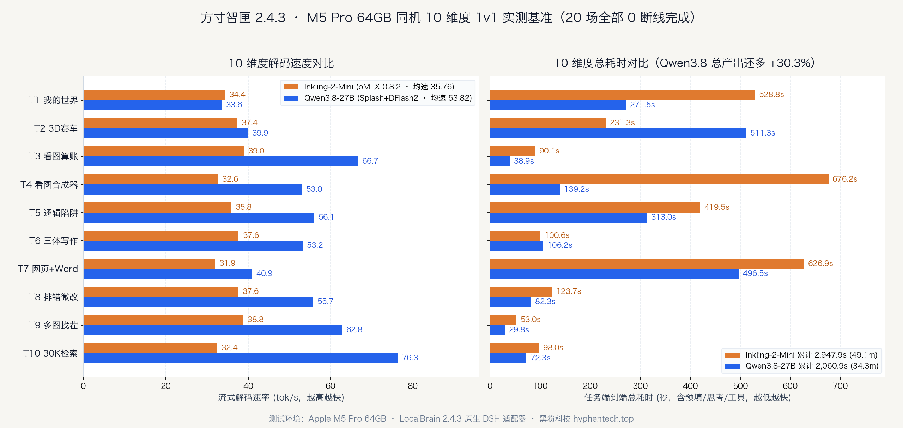

> [!abstract]
> Qwen3.8-27B 原语版（Splash + DFlash2）、Inkling-2-Mini 原版（oMLX 0.8.2 视觉完整版）与 Inkling-2-Mini-Locals（Locals NVFP4 + 0.64 GB 草稿极速版）三方全量对比：补齐全部 7 项非视觉同题加赛与 5 题文字答案质量核验，一次讲清速度反转、大工具集避坑与各自真实边界
> 黑粉科技 · 2026-11-23

　　同一台 **Apple M5 Pro 64GB 统一内存 MacBook Pro**、同一套「方寸智匣 LocalBrain」原生代理测试台，我把最近端侧最受关注的三套越狱主力方案拉到同一起跑线上打完了全套实测——**Qwen3.8-27B 越狱版**（`orcarouter/Qwen3.8-27B-Uncensored-MLX`，运行于 Splash 1.7.0 + DFlash2 块投机解码）、**Inkling-2-Mini 原版**（`TokenAI-zer/Inkling-2-Mini-Uncensored-oQ4-mtp`，运行于独立固定版 oMLX 0.8.2）、以及换装开源极速引擎 [Generated-Computers/Locals](https://github.com/Generated-Computers/Locals) 的 **Inkling-2-Mini-Locals**（NVFP4 + 0.64 GB 草稿模型 + GPU 语法锁）。

　　结果非常有意思：**没有谁能一张表通吃全场，反而是同一颗 Inkling-2-Mini 在换上 Locals 引擎后直接拆出了截然不同的两副面孔**——原本在 oMLX 上跑 T7 双交付要磨 10 轮 626.9 秒、改 T8 代码连错三次，换成 Locals 后直接 4 轮 270.7 秒反超 Qwen3.8 接近一倍；可偏偏在同一套模型底座上遇到重度对抗逻辑 T5，它却连吃两轮 28,672 思考上限直接 25 分钟超时翻车。

　　这次测试之后，我也顺手把 Locals 引擎遇 DeepSeek Harness 大工具集报 `DFA exceeds 400000 states` 的问题，以及外部模型扫描混入过渡/底座目录的小毛病一并修掉，打包推出了最新的 [方寸智匣 Mac 2.4.5 发行页](https://github.com/HackerChi-Hub/localbrain-releases/releases/tag/v2.4.5)。今天就把这 **三版本全量数据、文字回答真实含金量、核心原理与清晰选型边界** 一次摆清。

## 一、先定调：三版本放在一起比，核心 7+3 题成绩全公开

　　先把三套参测版本的底层身份与测试范围对齐。此前客户端做长程 Agent 评测时，SSE 流偶发半帧截断会导致重任务中断，所以整组对比全部基于修复零缓冲透传、帧边界无损保活、思考预算夹紧和 32K 输出上限之后的方寸智匣 2.4.3–2.4.5 完成，27 场实测会话 **0 断线**：

| 参测版本 | 模型标识与引擎 | 上下文 / 输出 | 原生视觉 | 内存定位与特点 |
| --- | --- | --- | --- | --- |
| **Qwen3.8-27B 越狱版（原语版）** | `orcarouter/Qwen3.8-27B-Uncensored-MLX`（Splash 1.7.0 + DFlash2） | `256K` / `32K` | ✅ 高清视觉 | 建议 32GB–64GB+，大内存工作站全能主力 |
| **Inkling-2-Mini 原版（oMLX 视觉版）** | `TokenAI-zer/Inkling-2-Mini-Uncensored-oQ4-mtp`（oMLX 0.8.2） | `96K` / `32K` | ✅ `inkling2_vision` | 32GB+ 稳跑，保留看图与长思考兜底，无草稿与语法锁 |
| **Inkling-2-Mini-Locals（NVFP4 极速版）** | `Locals/Inkling-2-Mini-Uncensored-MLX-nvfp4`（Locals 0.2.2） | `96K` / `28K` | ❌ 纯文本 | 24GB Mac 可跑，6 融合 Metal 核 + 0.64 GB 草稿 + GPU 语法锁 |

　　先看**7 项非视觉同题**（`T1 / T2 / T5 / T6 / T7 / T8 / T10`）的三版本正面交锋，这张图已经把第一版测试补测了 `T1 我的世界` 和 `T7 网页模拟器 + Word 简报` 两道缺项全部补齐：

| 题号与任务 | Qwen3.8-27B（原语 Splash） | Inkling-2-Mini 原版（oMLX） | Inkling-2-Mini-Locals（NVFP4） |
| --- | --- | --- | --- |
| **T1 我的世界体素** | `completed` · 2 轮 · **271.5s** · Three.js 第一人称 3D（16.8 KB） | `completed` · 5 轮 · **528.8s** · Canvas 等距体素（15.1 KB） | `failed (maxRounds=8)` · 8 轮 · **204.5s** · 写出可用 Canvas 体素网页（11.4 KB，JS/DOM 无错，写/改 57–61 tok/s），第 8 轮刚改完触及轮次上限 |
| **T2 经典 3D 赛车** | `completed` · 8 轮 · **511.3s** · 重装版（20.9 KB） | `completed` · 2 轮 · **231.3s** · OutRun 赛车（14.1 KB） | `completed` · 3 轮 · **151.3s**（**写文件 60 tok/s，草稿命中 78%** · 13.7 KB） |
| **T5 三重逻辑陷阱** | `completed` · 1 轮 · **313.0s** · **3/3 满分** | `completed` · 1 轮 · **419.5s** · **2/3**（第 1 题误判 6 次可解） | `failed (timeout)` · 3 轮 · **1,500.1s** · **0/3**（思考耗尽 57,344 tok，0 字正文） |
| **T6 三体同题写作** | `completed` · 1 轮 · **106.2s** · 53.24 tok/s · 2,020 字文采丰满 | `completed` · 1 轮 · **100.6s** · 37.65 tok/s · 1,353 字克制稳健 | `completed` · 1 轮 · **62.0s** · 41.31 tok/s · 1,704 字结构完整 |
| **T7 网页模拟器 + Word 简报** | `completed` · 10 轮 · **496.5s** · 15.4 KB HTML + 41.3 KB DOCX | `completed` · 10 轮 · **626.9s** · 13.8 KB HTML + 40.6 KB DOCX | `completed` · **4 轮** · **270.7s** · 16.1 KB HTML + 40.5 KB DOCX（5 页 PDF 一次过审） |
| **T8 `edit_file` 排错微改** | `completed` · 4 轮 · **82.3s** · **0 失误**、`3/3` 单测过 | `completed` · 5 轮 · **123.7s** · 漏参数连错 3 次后改通 `3/3` | `completed` · 4 轮 · **63.8s**（**改代码 58 tok/s，草稿命中 83.9%**）· **0 失误**、`3/3` 单测过 |
| **T10 30K 跨章检索核算** | `completed` · 1 轮 · **72.3s**（冷 TTFT 39.0s / 76.32 tok/s） | `completed` · 1 轮 · **98.0s**（冷 TTFT 39.7s / 32.43 tok/s） | `completed` · 1 轮 · **104.4s**（**冷 TTFT 69.5s / 暖前缀 0.92s** / 41.46 tok/s） |

　　看一组非常提气的对比账：**排除 `T5` 超时那一道极端重逻辑后，剩余 6 项常规工程、写作与检索（`T1, T2, T6, T7, T8, T10`），`Inkling-2-Mini-Locals` 累计耗时只有 `856.7s`（14.3 分钟），比 `Qwen3.8-27B`（`1,540.1s`）整整快了 44.4%，比 `Inkling-2-Mini 原版`（`1,709.3s`）省下将近一半时间（49.9%）**。尤其是需要协同调度文件工具与 `DocFactory` 文档工具的双交付任务 **T7**，Locals 靠 **4 轮零废话**在 `270.7s` 就干净收工；不过 **T1 我的世界** 也暴露出小参数版喜欢在细枝末节里多调几轮的脾气——虽然第 2 轮已写出可运行的 11.4 KB 体素 HTML，之后反复读改三轮，正好卡在第 8 轮上限收尾。

　　至于剩下的 **3 项视觉专项（T3 看图算账、T4 看设计稿写 NEBULA-8 合成器 UI、T9 双控制台截图找茬）**，`Locals` 因纯文本架构不参测，结果由保留视觉的两位选手收下：**`Qwen3.8-27B` 三题全面领跑**——`T4` 同样写完 1:1 可发声 13 键 UI 只用 `139.2s`（比 `oMLX` 的 `676.2s` 快 **4.86 倍**）；`T3` 38.9 秒全对 30 格数字与 5 组涨跌幅，并精准建议将 `iogpu.wired_limit_mb` 调高到 `60000` 以上（`oMLX` 虽算对数字却耗时 90.1 秒且未给具体调参阈值）；`T9` 更是 29.8 秒零错字揪出全部 5 处变化并推理出“关闭离线优先导致工具 P95 由 185 翻倍至 310 ms”。

## 二、文字题答案质量到底如何？五题逐项剥开核验

　　很多人看长文本评测归档时容易被成千上万字的回复吓住，怀疑“模型是不是在凑字数瞎编”。我直接把所有纯文字与分析题（`T3 / T5 / T6 / T9 / T10`）的正文逐字抽出来核对结论、公式与扣分点，实话实说：**真正出现有效信息失准的，集中在高阶对抗证明 `T5` 和细字 OCR `T9`；其他写作与长文检索，三版本核心结论全部立得住。**

| 核验题 | Qwen3.8-27B（原语 Splash） | Inkling-2-Mini 原版（oMLX） | Inkling-2-Mini-Locals（NVFP4） |
| --- | --- | --- | --- |
| **T3 看图算账** | **满分**：30 格与 5 组涨跌幅（含 `-72.06%`）100% 准确，明确给出 `iogpu.wired_limit_mb >= 60000` | **优良**：数值与归因同样全对，但保守未给具体设定值，耗时多 2.3 倍 | —（纯文本后端不参测） |
| **T5 三重逻辑陷阱** | **3/3 满分**：唯一构造 `{A,B}` vs `{C,D}` 5×5 对称欺骗矩阵证明无穷次亦无解；贝叶斯 `71.04%` 对；22 字中文自指一字不差 | **2/3**：贝叶斯 `71.04%` 与 22 字自指皆对；第 1 题陷入思维陷阱误判“6 次（≤1000 次）保证找出良品” | **0/3 失败**：两轮均在 `<think>` 撞满 `28,672` token 思考天花板，正文 **0 字输出**、1,500.1s 超时 |
| **T6 三体同题写作** | **第一**：口播有律师卷宗/矿区断网等强画面感，《端侧算力客列传》古韵最凝练，表格带具体劝退线，零禁词 | **第二**：结构工整、老实注明“4-bit 估算非实测”，文言偏短谨、锐气略弱于 Qwen3.8，零禁词 | **高效过关**：**62.0s** 最快交卷，结构齐全、语气务实且同样严守禁词，适合高效率生成底稿 |
| **T9 双图找茬** | **5/5 满分**：5 处变化 0 误报且全字准确，因果链完整 | **4.5/5**：找齐 5 处位置，但把 **“离线优先模式”错识为“高线优先模式”** 并混入相邻小字 `(max-tokens 自动分段)` | —（纯文本后端不参测） |
| **T10 30K 检索核算** | **100% 准确**：精准剔除旧值干扰算得 `10.0 GB / 40K / 天枢-S7-40K-K94-ALPHA` | **100% 准确**：跨 18 章 3 条孤立线索全部召回，公式核对无误 | **100% 准确**：尽管冷预填 69.5s 较慢，三线索与最终代码 **`天枢-S7-40K-K94-ALPHA` 一字不差** |

　　一句话评价这组文字结果：**除了 Locals 在 `T5` 直接爆掉、以及 oMLX 在 `T5` 第 1 题与 `T9` 一个词上失分，其余文字题都不是空话水词**——尤其 `T10` 三万字跨章大海捞针三版全部零失误算准，而日常短文本与代码解释环节上，`Locals` 的快恰恰建立在没有丢掉主干准确性之上。

## 三、拆开看机理：同底座换引擎，为什么性能差距这么大？

　　同样一具 Inkling-2-Mini 权重，换成 `Locals` 以后从“慢且漏参数”变成“快准狠”的同时又丢掉了 `T5` 稳定性，原因全在下面几处底层机理：

　　**第一刀：48 层循环骨相撞上 6 颗融合 Metal 核。** Thinking Machines 这套 Inkling-2-Mini 总参数 26.4B，物理却只放了 24 层，第 6 到第 17 层在原地循环滚 3 遍，单 token 等效 48 层逻辑深度。普通 Python/MLX 跑起来每步切出约 6,000 个零碎调度操作（相邻读写之间夹着上百个小算子），GPU 光等 CPU 发令了；而 `Locals` 用 `mix / kv_prep / attend / route / act / combine` **6 个融合 Metal 核**把整条链路焊成一个整块，大幅抹掉了调度空窗。

　　**第二刀：0.64 GB 草稿在写代码时开挂，在纯中文长考时回到基线。** 这点我自己接入外部 DeepSeek Harness 实测也能直接印证：日常普通中文问答只有 `38–42 tok/s`，并不像网帖截成 `85 tok/s` 那么神（那个数其实是同时开 8 个子代理的 8 路合算总吞吐）；**真正的单路暴走发生在写 HTML / 局部改代码时**——代码语法极好猜，Locals 的 0.64 GB 草稿命中率冲到 `76%–94%`（`T2` `3,832/5,043` 飙出 60 tok/s、`T8` 改文件 `83.9%` 命中、`T1` `792/843`），效率才猛跳一大截。

　　**第三刀：`llguidance` GPU 语法锁治好漏参数，但碰到 40+ 工具需要大工具集自动退化。** 在 `Locals` 上开 `--walk --typed-tools` 会把工具 JSON Schema 编成字节自动机压进 Metal 掩码里（`T8` 和 `T7` 之所以 0 报错一发过关靠的就是它）。不过我们实测一接入 DeepSeek Harness 这类自带 40+ 工具和海量可选参数的宿主，原本为每个字段枚举类型的强语法瞬间会胀破 `40 万` DFA 状态报错 `400 DFA exceeds 400000 states`。刚发布的 [方寸智匣 Mac 2.4.5](https://github.com/HackerChi-Hub/localbrain-releases/releases/tag/v2.4.5) 已经加了智能降级守卫：紧凑工具集继续锁死参数类型拿加速，一旦工具表过大自动平滑切回非强类型工具文法（DFA 状态瞬间压回 ~950 个），45 工具实测直接流式跑通。

　　**第四刀：NVFP4 + 方向 LoRA 循环放大的微扰代价，以及前缀缓存的红利。** 在本来每步就循环 3 遍的稀疏架构上先压 NVFP4、再叠去对齐方向 LoRA，遇到 `T5` 这种走错一步全盘坍塌的高难度组合反证题，微小的分布偏移被放大后让模型在 `<think>` 框里反复推翻自己直至超时。另一方面，前缀缓存的威力极大：看下方右侧那组实测——同样三万多 token，`Locals` 冷预填要 69.5 秒，二轮同前缀追加提问瞬间命中 `32,893 / 32,995`（`99.7%`），**首字 TTFT 直接跌到 `0.92 秒`**；而只要第 0 个 token（比如系统提示开头放时间戳）变了 1 个字，整棵缓存树当场作废回到 `73.25 秒`。

## 四、三版本各自优势与客观评价：到底该留哪一个？

　　把测试账算到底，其实三套方案在本地工作流里各有站位，谁都不用急着“一刀全删”：

1. **Qwen3.8-27B 越狱版（Splash + DFlash2）—— 大内存工作站的全能主力（最稳）**：逻辑最强（`T5` 唯一满分 `3/3`）、视觉 OCR 最准（`T9` 零错字、`T4` 快 4.86 倍）、`256K` 长文解码最快（`76.32 tok/s`）。缺点只一条：**吃内存、门槛高（32GB–64GB+ 且依赖新 macOS Metal）**。只要机器内存够大、想找一个写作+读图+重推理+复杂工程全扛得住的主力，依然首选它。
2. **Inkling-2-Mini-Locals（Locals NVFP4 + 草稿）—— 24GB 机器与并发工具流的速度尖兵（最划算）**：6 项日常工程/写作/检索总耗时 **`856.7s`** 最快（`T7` 4 轮 `270.7s`、`T8` 零错 `63.8s`、`T6` `62.0s`），约 `16.2 GB` 体积能塞进 **24GB Mac**，原生支持 16 槽连续批处理适配外部 DeepSeek Harness / OpenCode 多子代理并发。明确短板：**不能看图**、30K 冷预填较慢（`69.5s`）、**不能拿去死磕极高难度纯数学/逻辑证明**。
3. **Inkling-2-Mini 原版（oMLX 0.8.2）—— 轻量级“保留看图 + 稳定收口”专职备选**：在纯文本赛道它已经全面被同门 `Locals` 取代，但它是这套 `16 GB` 级权重里**唯一完整保留 `inkling2_vision` 视觉编码器**、且长思考不会像 Locals 那样爆满超时死循环的版本。在 **方寸智匣 2.4.5** 里，“Locals 跑纯文本/多工具并发 + oMLX 留作看图读屏专口”刚好互补共存（新版外部模型扫描也已经自动藏掉 `_src-*` 过渡目录、零碎组件与软链底座，主页只保留唯一干净入口）。

> [!quote] 实测落底
> 把融合 Metal 核、投机草稿与 GPU 语法锁焊在一起的 **Locals**，确实让一款 24GB Mac 可跑的小模型在代码工具与日常写作耗时上反手赢过 27B 稠密大模型将近一半；但在需要稳健长逻辑收束和高清细节读屏时，**`Qwen3.8-27B + DFlash2` 依然是大内存主机上的定海神针，而“日常编码用 Locals、看图切 oMLX、大内存上 Qwen3.8”才是当下最省心的组合。**

## 主要查证来源

- [方寸智匣 LocalBrain Mac 2.4.5 安装包（SHA-256 校验与发行页）](https://github.com/HackerChi-Hub/localbrain-releases/releases/download/v2.4.5/LocalBrain_2.4.5_aarch64.dmg)
- [GitHub：方寸智匣 Mac v2.4.5 发行说明](https://github.com/HackerChi-Hub/localbrain-releases/releases/tag/v2.4.5)
- [GitHub：Generated-Computers/Locals（本次锁死 40be2496）](https://github.com/Generated-Computers/Locals)
- [Hugging Face：thinkingmachines/Inkling-2-Mini 官方原版](https://huggingface.co/thinkingmachines/Inkling-2-Mini)
- [Hugging Face：AtomicChat/Inkling-2-Mini-Uncensored-GGUF（含去对齐 LoRA.gguf）](https://huggingface.co/AtomicChat/Inkling-2-Mini-Uncensored-GGUF)
- [Hugging Face：TokenAI-zer/Inkling-2-Mini-Uncensored-oQ4-mtp（oMLX 视觉版）](https://huggingface.co/TokenAI-zer/Inkling-2-Mini-Uncensored-oQ4-mtp)
- [Hugging Face：orcarouter/Qwen3.8-27B-Uncensored-MLX（对比主将）](https://huggingface.co/orcarouter/Qwen3.8-27B-Uncensored-MLX)

---

## 🧰 我做的工具

这些工具都由我持续维护。预览版会明确标注，下载、更新和已知边界以发行页为准。

> [!info] 黑粉盒子 HyphenBox
> **状态：** 正式迭代
>
> 免费大模型 API 雷达：持续复测可用性，本地统一接口，Key 只存本机
>
> [下载与更新：黑粉盒子 HyphenBox](https://github.com/HackerChi-Hub/hyphenbox-release/releases)

> [!info] 方寸智匣 LocalBrain
> **状态：** 正式迭代
>
> 本地模型的多模态 MCP 工具箱：TTS / Whisper / 视频生成一站接入
>
> [下载与更新：方寸智匣 LocalBrain](https://github.com/HackerChi-Hub/localbrain-releases/releases)

---

> [!quote] 黑粉科技
> **让AI成为你的超能力**
> 本地部署 · 免费白嫖 · 自制软件
> [黑粉科技](https://hyphentech.top)
