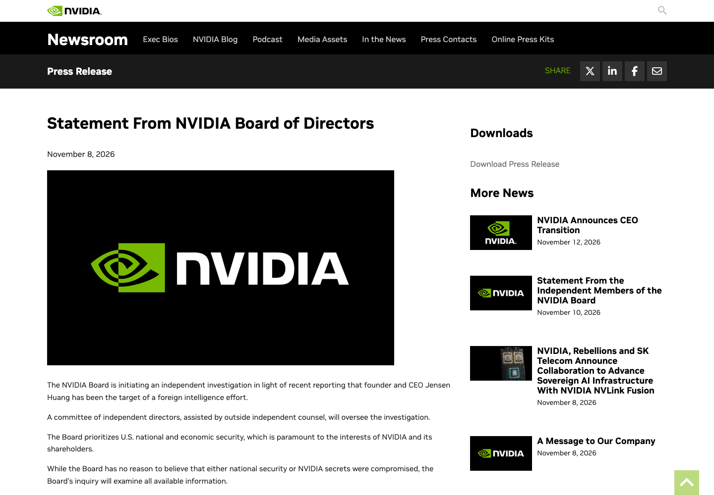
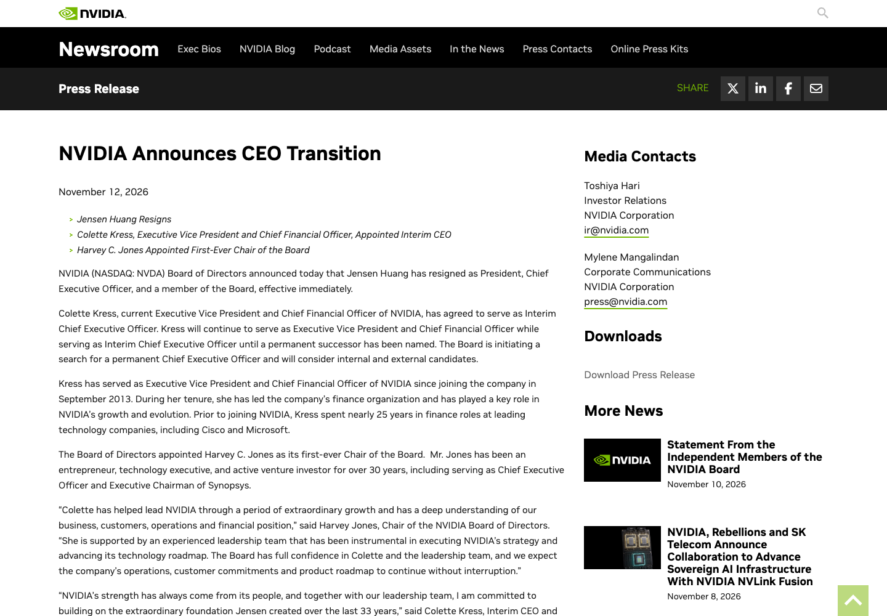
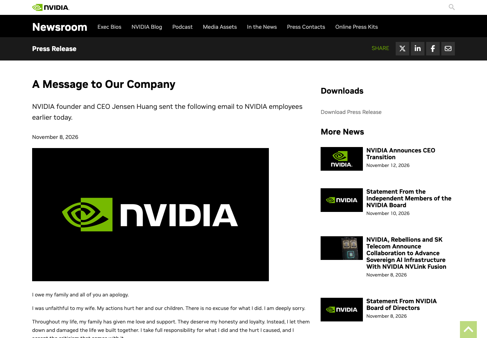
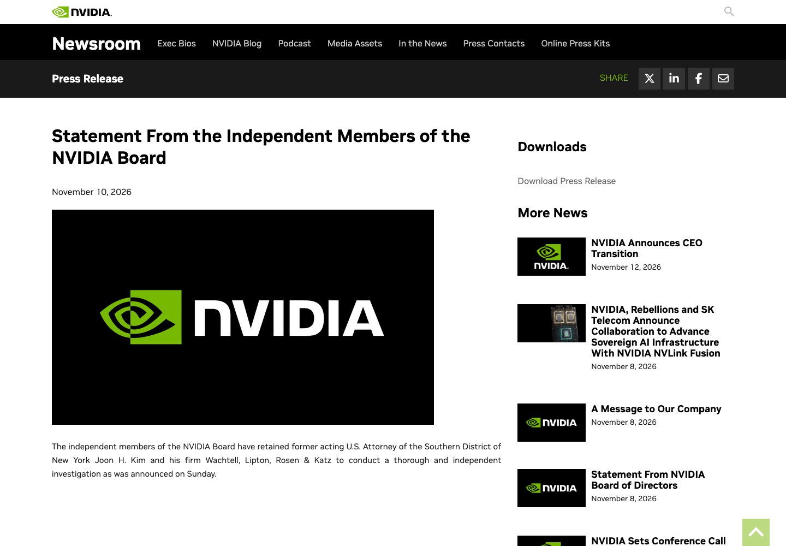
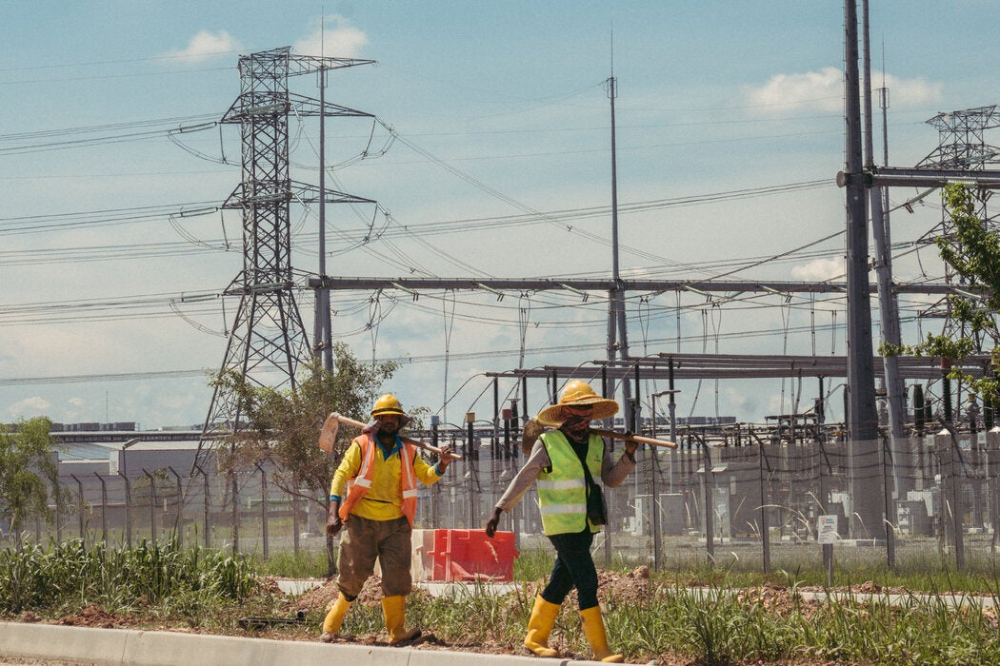
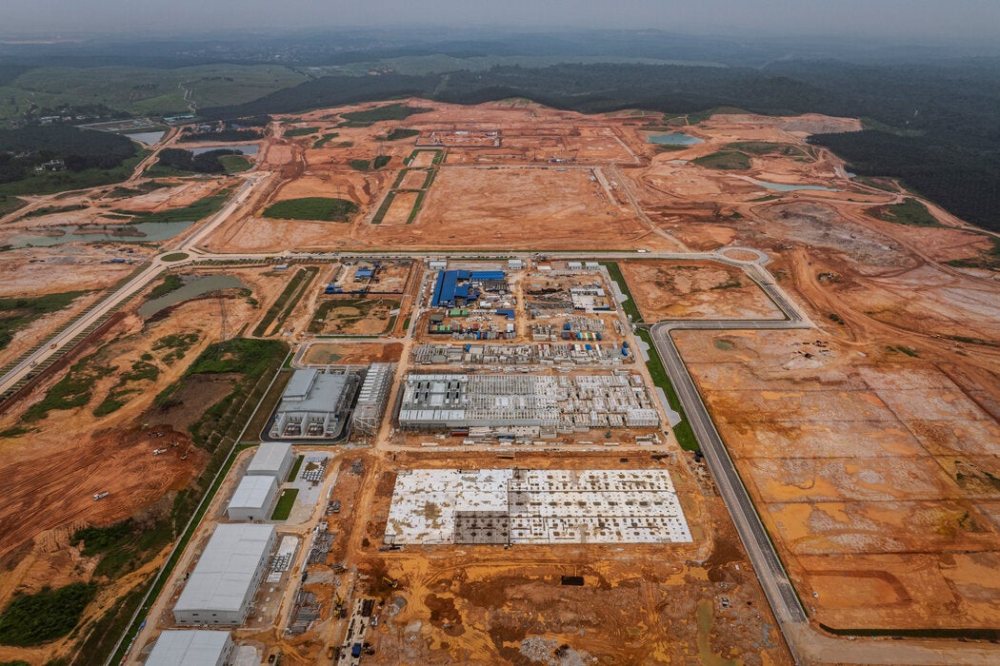
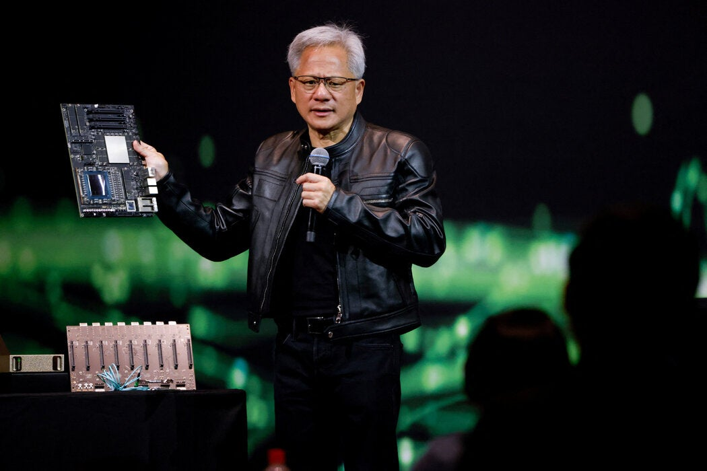

> 一篇讲清英伟达的芯片管制与政治博弈

　　各位朋友，咱们先看两份相隔4天的公告。11月8日，英伟达董事会还在说，对黄仁勋和他的领导团队保持信心；11月12日，黄仁勋辞去总裁、首席执行官和董事职务，即刻生效，首席财务官科莱特·克雷斯临时接班。

　　33年，一个创始人把公司带到人工智能时代的中心；4天，董事会从公开力挺走到接受辞任。这个反转不是因为某一条八卦突然有多热闹，而是私人失信、公司调查、芯片出口和政治压力在同一时间汇合了。

　　私人失信、公司调查、芯片出口和政治压力在同一时间汇合。**黄仁勋的私人问题是引线，英伟达长期依赖创始人的治理结构才是弱点，华盛顿政治则把这场危机放大成了产业事件。**咱们按这个顺序往下讲。

## 董事会为什么改变态度：私人失信已经碰到公司红线

　　11月8日，黄仁勋向英伟达员工发出公开信，承认“我对妻子不忠”，向家人、同事、董事会、合作伙伴和股东道歉，并表示支持调查、充分配合。公司原文没有点名任何人，也没有承认泄露机密。

　　董事会同日启动独立调查。11月10日，独立董事聘请前纽约南区代理联邦检察官金俊和外部律所介入。到了这一步，董事会要处理的是最高负责人的信用、潜在利益冲突和股东责任，已经不再只是他的家庭私事。

　　《纽约时报》还援引五名曾在英伟达工作的人士，报道黄仁勋与一名下属高管存在婚外情。该说法尚未得到当事人公开确认，但它指向一个直接问题：英伟达的行为准则要求员工避免私人关系造成利益冲突，最高负责人同样应该受这条规则约束。

　　美国证券交易委员会文件显示，董事会在11月11日接受辞任。继续调查、上下级关系和继任不确定性已经威胁公司整体利益，董事会因此选择切断黄仁勋个人与公司的连带风险。**一家33年离不开创始人的公司，到了这一天才发现，个人信用也是基础设施。**

## 48亿美元设备采购，让私人关系接上全球算力生意

　　《纽约时报》依据ImportGenius贸易记录报道，从2024年6月到2026年2月，Megaspeed在马来西亚的关联公司采购了至少48亿美元、包含英伟达芯片和技术的先进人工智能设备。设备规模巨大，又与中国客户、海外数据中心和出口调查相连，黄仁勋与客户高管的私人关系自然会被放进商业审查。

　　这些设备是否曾被非法转运仍在调查，英伟达和Megaspeed都否认违规。真正值得普通读者理解的，是这门生意已经不只发生在海关。芯片可以留在马来西亚机房，客户通过跨国网络购买算力，货物位置和使用者位置从此可以分开。

　　就好比您不用把游戏机买回家，只要远程连接别人的机器，照样能玩。过去的出口规则主要盯着实体货物，云服务却要求监管回答一个新问题：远程使用受控技术，应该怎样审批、追踪和执法？

　　美国《远程访问安全法》正是针对这个方向。2026年1月12日，众议院以369票对22票通过，之后送交参议院委员会，目前尚未生效。它一旦继续推进，海外机房面临的就不再只是商业风险，还包括更明确的许可与合规要求。

## 出口管制之外，美国两党都在争夺这件事的解释权

　　黄仁勋长期反对过度限制对华芯片销售。2025年他在台北公开说“总而言之，出口管制是失败的”，理由是中国企业如果买不到英伟达芯片，就会使用自己的芯片。这个观点同时服务两件事：美国技术生态继续扩张，英伟达继续保住市场和CUDA优势。

　　再把华盛顿的公开行动按日期排开，就能看出这场危机怎样进入党派政治。

| 日期 | 主体 | 公开行动 |
| --- | --- | --- |
| 10月29日 | 媒体与英伟达 | 《纽约时报》报道情报评估；英伟达称相关互动属于正常客户接触 |
| 11月3日／4日 | 民主党 | 中期选举投票；媒体随后判定民主党赢得下一届参众两院控制权 |
| 11月4日发信／5日公开 | 共和党众议院委员会 | 三个委员会要求黄仁勋11月18日参加闭门简报 |
| 11月9日 | 民主党Jeffries | 要求更多答案，并推动把对华芯片限制纳入年度国防法案 |
| 11月10日 | 共和党Cramer／民主党Schumer | Cramer要求辞职；Schumer要求解释特朗普的力挺，并呼吁推进芯片监督与安全法案 |
| 11月11日 | 董事会／民主党Warren、Coons | 董事会接受辞任；两位参议员签署保存出口与相关沟通记录的信件 |
| 11月10日事件／13日报道 | 特朗普 | 《纽约时报》报道他曾致电鼓励黄仁勋保住职位 |

　　共和党众议院委员会要求简报，共和党参议员Cramer公开要求辞职；民主党Jeffries、Schumer、Warren和Coons分别推动简报、立法和记录保存。特朗普却被报道在挽留黄仁勋。这里既有两党竞争，也有共和党内部、白宫与国会之间的分歧。

　　共和党议员强调外国情报、国家安全和出口执法；民主党除了同样谈安全，还能同时推进科技巨头问责、监管审查以及数据中心和就业议题。中期选举结果增强了民主党对下一届国会的议程预期，黄仁勋的丑闻则降低了各方继续为他辩护的收益。**两党都在利用这个窗口推进自己的科技政策议程。**

　　所以，压力集中出现并不奇怪。不是谁需要亲自指挥每一步，而是事件发展到这个节点后，继续观望的代价变高，主动表态和推动调查的收益变大。接下来要看闭门简报是否继续、相关法案能否获得跨党派支持、参议院是否真正推进，这些动作才决定它会不会成为长期政策转折。

　　《纽约时报》另报道，2025年8月，英伟达总法律顾问向商务部调查人员询问Megaspeed案件，并提到上级已经批准接触。调查人员担心程序受影响，案件随后移交司法部。这个细节说明，英伟达与监管者的接触方式本身也成为调查争议的一部分。

　　围绕黄乐的间谍身份、监控和机密备忘录，主要信息仍来自匿名情报报道。中国外交部否认所谓“间谍叙事”，美国司法部长托德·布兰奇11月12日表示，司法部尚未就黄乐是否为中国间谍得出结论。这个未决状态需要说清楚，但它不妨碍我们分析公开行动怎样改变了英伟达和华盛顿的政治压力。

## 黄仁勋真正留下的问题：公司和市场都太依赖一个人

　　英伟达的成功长期依赖黄仁勋的技术判断、个人魅力和对外游说。《纽约时报》报道他有60多名直接下属，公司又缺少明显继任者。顺风时，这种集中带来速度和执行力；当私人信用、客户调查和政策冲突同时出现，它就变成单点故障。

　　2018年，英特尔首席执行官布赖恩·克尔扎尼奇因与员工存在双方自愿的亲密关系辞职。这个旧案说明，公司治理规则不会因为一个人功劳大就失去意义。黄仁勋面对的局面更复杂，因为英伟达还站在全球芯片管制和人工智能竞争的交叉口。

　　技术形态也跑在了监管前面。硬件、CUDA、海外机房和远程租赁已经连成新的供应链，规则仍在补远程访问的管辖方式。黄仁勋离开不会改变这个矛盾，继任者仍要处理同一套技术、客户和政策问题。

　　彭博评论称“中国成了最大输家”，这个说法把复杂的产业竞争压成了一句输赢口号。短期看，中国企业失去了一位反对全面脱钩的重要游说者，海外算力的不确定性确实上升；长期结果还要看国产芯片、软件生态、实际算力成本和替代供应。**黄仁勋离场是压力，不是结局。**

## 接下来盯住真正会改变判断的事情

　　第一，看原始文件，别只看二手转述。英伟达公告、证监会文件、国会议员信件和法案状态，能直接回答谁做了什么。评论可以大胆，事实必须准确。

　　第二，盯住11月17日英伟达财报和电话会、独立调查的后续披露、正式首席执行官人选，以及远程访问法案在参议院的进展。尤其要看两党是否愿意把公开表态变成共同投票。

> 试玉要烧三日满，辨材须待七年期。——白居易《放言五首·其三》

　　黄仁勋的时代结束了，英伟达的问题还没有结束。公司要重新建立信任，美国要决定怎样管理远程算力，中国企业则要在更高的不确定性里安排自己的技术与供应。真正的答案，在这些后续行动里。

## 主要查证来源

- [英伟达：11月12日首席执行官更替公告](https://nvidianews.nvidia.com/news/nvidia-announces-ceo-transition)
- [英伟达：11月8日董事会调查声明](https://nvidianews.nvidia.com/news/statement-from-nvidia-board-of-directors)
- [英伟达：黄仁勋员工信全文](https://nvidianews.nvidia.com/news/a-message-to-our-company)
- [美国证监会：英伟达8-K辞任文件](https://www.sec.gov/Archives/edgar/data/1045810/000104581026000082/nvda-20261111.htm)
- [纽约时报：Megaspeed调查与英伟达律师邮件](https://cn.nytimes.com/usa/20261110/nvidia-megaspeed-investigation-huang/)
- [纽约时报：48亿美元采购与国会简报要求](https://cn.nytimes.com/usa/20261106/house-republicans-nvidia-jensen-huang-china/)
- [美国众议院：要求黄仁勋闭门简报的原始公告](https://foreignaffairs.house.gov/news/press-releases/chairmen-mast-moolenaar-and-crawford-request-jensen-huang-brief-congress-on-link-to-chinese-intelligence-asset)
- [外交部：2026年11月12日例行记者会](https://www.mfa.gov.cn/web/fyrbt_673021/202611/t20261112_12058185.shtml)
- [路透社：司法部尚未就黄乐间谍身份得出结论](https://international.astroawani.com/business-news/us-justice-department-has-not-concluded-alice-huang-was-chinese-spy-blanche-says)
- [美国国会：《远程访问安全法》状态](https://www.congress.gov/bill/119th-congress/house-bill/2683)
- [NPR：民主党赢得2026年中期选举两院控制权](https://www.npr.org/2026/11/03/g-s1-149526/2026-midterms-congress-balance-of-power)
- [Politico：共和党参议员Cramer要求黄仁勋辞职](https://www.politico.com/news/2026/11/10/senate-banking-republican-nvidia-ceo-resign-01160543)
- [路透社：Schumer推动芯片监督与安全法案](https://www.usnews.com/news/politics/articles/2026-11-10/schumer-says-congress-must-have-answers-on-trump-defense-of-nvidia-ceo)
- [Politico：Jeffries推动国防法案中的芯片限制](https://www.politico.com/live-updates/2026/11/09/congress/momentum-builds-on-chip-exports-01157548)
- [Warren与Coons：要求保存英伟达对华出口记录的原始信件](https://www.banking.senate.gov/imo/media/doc/20261111_warren_coons_letter_to_wh_commerce_state_re_nvidia_record_retentionpdf.pdf)

## 我做的工具

这些工具都由我持续维护。预览版会明确标注，下载、更新和已知边界以发行页为准。

### 黑粉助手 HyphenAssistant

状态：正式迭代

手机浏览器接续电脑上的 DeepSeek Harness 会话；需本人配对、电脑与原服务在线，模型费用沿用原配置

[下载与更新](https://github.com/HackerChi-Hub/hyphen-assistant-releases/releases)

### 黑粉盒子 HyphenBox

状态：正式迭代

免费大模型 API 雷达：持续复测可用性，本地统一接口，Key 只存本机

[下载与更新](https://github.com/HackerChi-Hub/hyphenbox-release/releases)

### 方寸智匣 LocalBrain

状态：正式迭代

本地模型的多模态 MCP 工具箱：TTS / Whisper / 视频生成一站接入

[下载与更新](https://github.com/HackerChi-Hub/localbrain-releases/releases)

### ScreenLex 光影词库

状态：正式迭代

看美剧顺手把生词背了，Mac/Windows 双平台，免费

[下载与更新](https://github.com/HackerChi-Hub/screenlex-download/releases)

### 黑粉录屏 HyphenScreen

状态：正式迭代

录屏 + 智能剪辑一体：达芬奇式时间线、自动打码、导出前成片体检，免费

[下载与更新](https://github.com/HackerChi-Hub/HyphenScreen-Releases/releases)

---

## 🧰 我做的工具

这些工具都由我持续维护。预览版会明确标注，下载、更新和已知边界以发行页为准。

> [!info] 黑粉助手 HyphenAssistant
> **状态：** 正式迭代
>
> 手机浏览器接续电脑上的 DeepSeek Harness 会话；需本人配对、电脑与原服务在线，模型费用沿用原配置
>
> [下载与更新：黑粉助手 HyphenAssistant](https://github.com/HackerChi-Hub/hyphen-assistant-releases/releases)

> [!info] 黑粉盒子 HyphenBox
> **状态：** 正式迭代
>
> 免费大模型 API 雷达：持续复测可用性，本地统一接口，Key 只存本机
>
> [下载与更新：黑粉盒子 HyphenBox](https://github.com/HackerChi-Hub/hyphenbox-release/releases)

> [!info] 方寸智匣 LocalBrain
> **状态：** 正式迭代
>
> 本地模型的多模态 MCP 工具箱：TTS / Whisper / 视频生成一站接入
>
> [下载与更新：方寸智匣 LocalBrain](https://github.com/HackerChi-Hub/localbrain-releases/releases)

> [!info] ScreenLex 光影词库
> **状态：** 正式迭代
>
> 看美剧顺手把生词背了，Mac/Windows 双平台，免费
>
> [下载与更新：ScreenLex 光影词库](https://github.com/HackerChi-Hub/screenlex-download/releases)

> [!info] 黑粉录屏 HyphenScreen
> **状态：** 正式迭代
>
> 录屏 + 智能剪辑一体：达芬奇式时间线、自动打码、导出前成片体检，免费
>
> [下载与更新：黑粉录屏 HyphenScreen](https://github.com/HackerChi-Hub/HyphenScreen-Releases/releases)

---

> [!quote] 黑粉科技
> **让AI成为你的超能力**
> 本地部署 · 免费白嫖 · 自制软件
> [黑粉科技](https://hyphentech.top)
