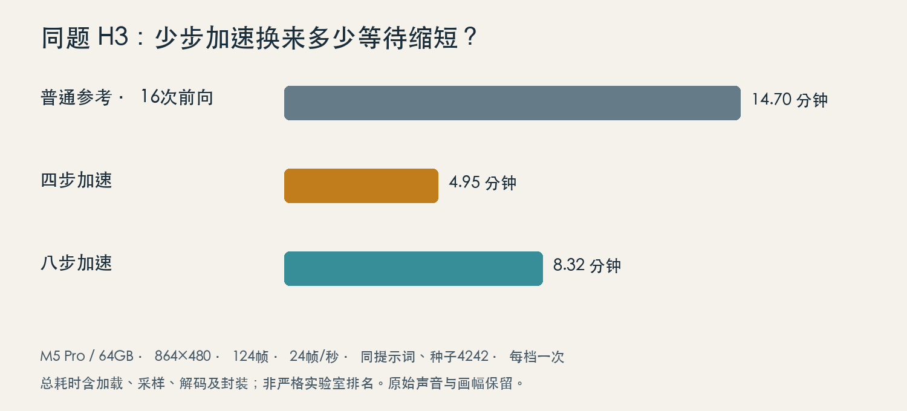
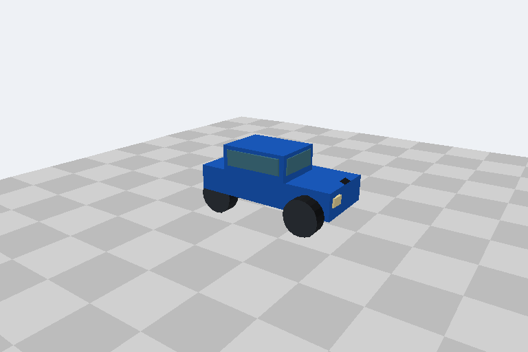
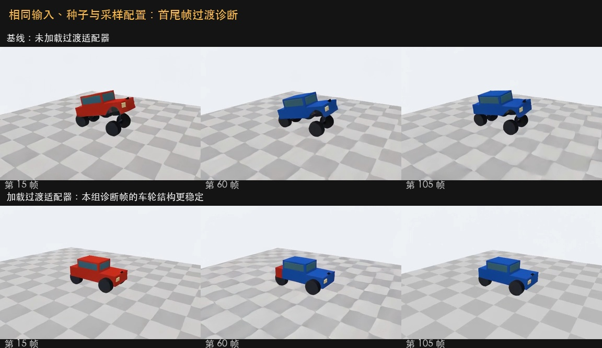
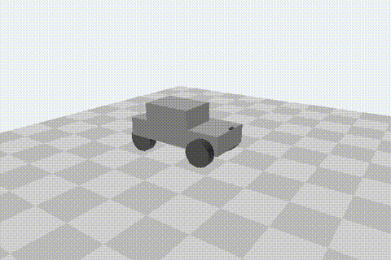
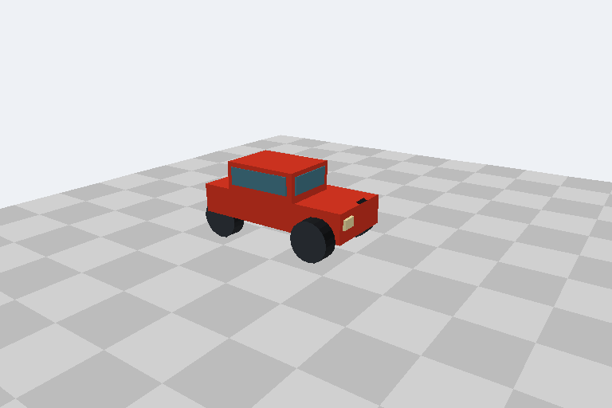
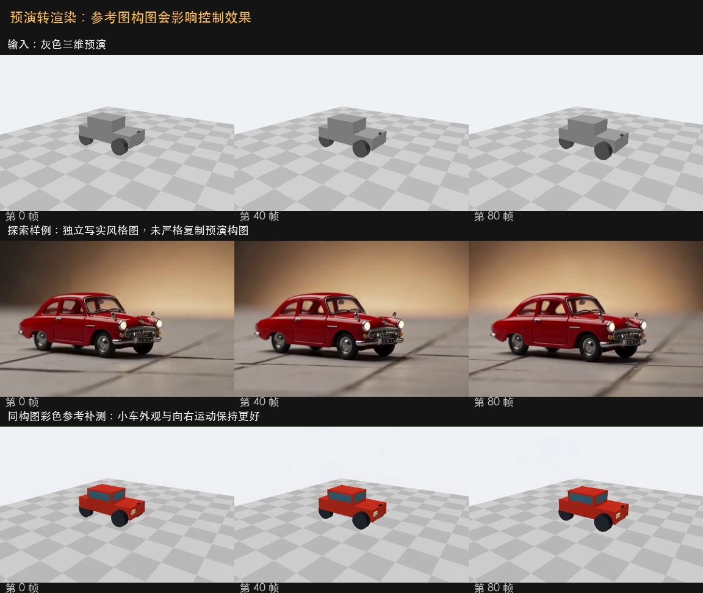
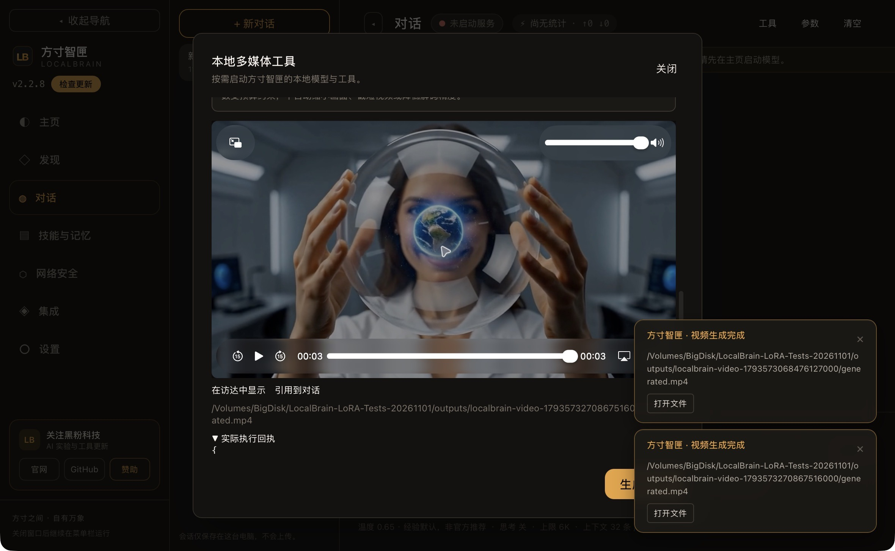
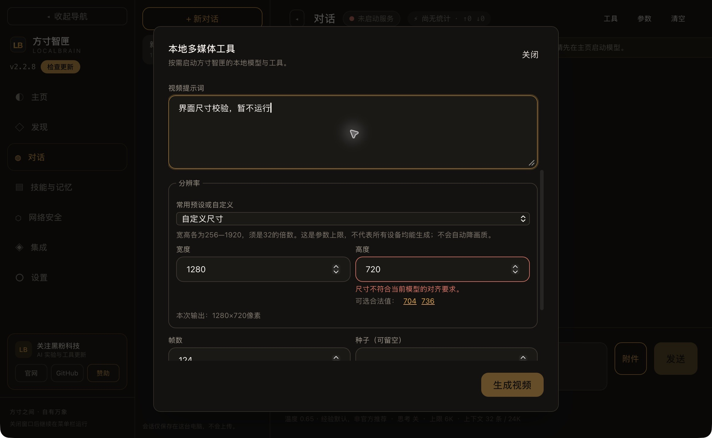

黄雨衣里的姑娘把纸鹤放在掌心，纸鹤飞了起来；云海上的花园里，裙摆和蝴蝶一起移动；森林里还有一架钢琴。先看这几段：它们都由这台 M5 Pro、64GB 统一内存的 Mac，通过方寸智匣调用本地模型生成。

[打开完整原声视频](/obsidian-assets/localbrain-h3-ltx25-video-practical-test/creative-01.mp4)

[打开完整原声视频](/obsidian-assets/localbrain-h3-ltx25-video-practical-test/creative-03.mp4)

[打开完整原声视频](/obsidian-assets/localbrain-h3-ltx25-video-practical-test/creative-06.mp4)

它们各约3.04秒。纸鹤和花园用 H3 四步加速，分别等待177.55秒、171.49秒；钢琴用 LTX-2.5 普通蒸馏流程，等待79.87秒。题材、画幅和算法不同，先把这些数字当成做一条素材要等多久的实用参考。判断谁更快，要回到后面的同题对照。

这次我想回答的，是把视频模型放进自己的工具之后，怎样选才省时间：什么时候用四步，什么时候需要首尾帧，什么时候应该先做一个粗糙的镜头预演。测试分成11月1日的独立管线对照、2.2.7安装版超短调用，以及11月2日2.2.8候选版的六段创意样片。本文重新整理原片与回执，没有重新跑模型。

动态预览按原速显示，动图没有声音；博客与录制阅读版可打开完整原声视频。公众号保留动态画面与关键帧，完整声音请到文末的博客入口播放。

## 先分清三件事：少等一会儿、顺利转场、按镜头拍

| 要解决的问题 | 本期用到的能力 | 需要准备的输入 |
| --- | --- | --- |
| 快速看创意方向 | H3 四步／八步加速 | 提示词；按所选方式提供参考图 |
| 从一张画面走到另一张 | LTX Transition | 首帧、尾帧、过渡描述 |
| 先安排运动与构图 | LTX Layout to Render | 几何预演视频、同构图外观参考图、描述 |

LoRA 可以理解成给已有机器换一组调校零件。零件的用途不一样：有的教模型少算几轮，有的偏向过渡连续性，有的接收镜头与几何位置。把任何一个都叫“画质增强开关”，很容易选错。它们仍然依赖对应基础模型和推理流程，不能只下载一份小适配器就开始生成。

来源也要分清。H3 Turbo 来自 LightX2V 项目；Transition 来自社区作者 joyfox，训练基础是 LTX-2.3；Layout to Render 来自 Lightricks 官方。本轮为了复用已有模型，在 LTX-2.5 上测试 Transition 兼容配方，后面会把这项区别带到实际结果里。

## H3 四步，究竟省下多少等待？

我给三档同一个任务：红色玩具车在浅灰地面向前行驶，镜头贴近车轮跟随；希望车身保持形状与颜色，带轻微电机声和一次短喇叭。统一864×480、124帧、24帧/秒、种子4242，成片都是约5.17秒。

[打开完整原声视频](/obsidian-assets/localbrain-h3-ltx25-video-practical-test/h3-standard-16.mp4)

[打开完整原声视频](/obsidian-assets/localbrain-h3-ltx25-video-practical-test/h3-turbo-4.mp4)

[打开完整原声视频](/obsidian-assets/localbrain-h3-ltx25-video-practical-test/h3-turbo-8.mp4)

| 方式 | 总耗时 | MLX活动峰值 |
| --- | --- | --- |
| 普通参考：16次前向 | 14分41.9秒 | 25.68 GiB |
| 四步加速 | 4分57.0秒 | 27.22 GiB |
| 八步加速 | 8分19.4秒 | 27.29 GiB |

每档一次，包含本轮加载、采样、解码与封装；MLX活动峰值不等于整机内存占用。

四步本组约快2.97倍，等待时间缩短约66.3%；八步约快1.77倍。这里的普通参考是本轮16次前向的单条件路径。最初一条与最后一段下载有过重叠，所以我把它作为这次工作流的耗时对照，不拿它给所有硬件、所有官方高质量配方排位。

“步”也容易误会。它描述生成过程主要计算的轮数，帧数描述成片有多少幅画面。四步照样可以生成124帧。回执里还会看到5个采样时间点对应4次实际前向，因此只看界面或某个 steps 字段，可能误读真正计算了几轮。

这组小车三档都能看出完整主体，但车款与镜头角度有变化。四步适合先看创意、动作和构图；八步可以另试一种取舍，目前这一组不足以断言八步必然更好。Mac 适配使用八位骨干和完整32位视频解码，原画幅与原声音保留；这与官方全量BF16骨干的逐数值效果不是同一份验收。

## 换成创意镜头，先看它到底听懂了什么

[打开完整原声视频](/obsidian-assets/localbrain-h3-ltx25-video-practical-test/creative-02.mp4)

[打开完整原声视频](/obsidian-assets/localbrain-h3-ltx25-video-practical-test/creative-05.mp4)

[打开完整原声视频](/obsidian-assets/localbrain-h3-ltx25-video-practical-test/creative-04.mp4)

| 场景 | 方式／画幅 | 约3.04秒成片的等待 |
| --- | --- | --- |
| 纸鹤雨巷 | H3四步／864×480 | 177.55秒 |
| 掌心星球 | H3八步／864×480 | 279.35秒 |
| 浮空花园 | H3四步／864×480 | 171.49秒 |
| 月球旅行 | H3四步／480×864 | 181.24秒 |
| 纸牌蝴蝶 | LTX普通／768×512 | 71.85秒 |
| 森林钢琴 | LTX普通／768×512 | 79.87秒 |

纸鹤的任务比较集中：手中一只纸鹤，向上飞，人物跟着看。拿它做插入镜头很直观。掌心星球要同时维持透明球体、里面的蓝色星球和手部关系；录制时可以放大这些交界处看，别只停在最好看的一帧。

月球旅行则留下了一个很适合讲的偏差：原要求是“机器人柯基”，结果画面里出现普通柯基和另一个独立机器人。画面生成了，词的组合关系却没完全照做。这个样本我保留，不把它剪掉后再说提示词都能听懂。

六段中 H3 的 MLX 活动峰值约25.67—25.69 GiB，LTX两段约20.97 GiB。两者不是整机总占用，也不能和进程RSS直接相加。短片通常更容易试错；想做连续角色、精确台词或商业广告，还要另测身份、手部、标识和声音。

## Transition：首尾帧接上了，车轮有没有跟上？

这个任务从红色小车变到蓝色小车，输入两张图，并保持同一组种子和采样设置。先不加载 Transition，再加载它，看中间过程发生什么。与普通文字生视频相比，首尾帧像是给导航设了起点和终点，适配器要改善的是中间怎样走过去。

[打开完整原声视频](/obsidian-assets/localbrain-h3-ltx25-video-practical-test/ltx25-transition-baseline.mp4)

[打开完整原声视频](/obsidian-assets/localbrain-h3-ltx25-video-practical-test/ltx25-transition-lora.mp4)

768×512、121帧、约5.04秒，基线耗时108.57秒，加载 Transition 后112.68秒。基线在第15、60、105帧能看到车轮与车身分离或形变；适配后这些诊断帧的车轮连接更稳定，红蓝转换也完成了。中间仍有颜色分段，棋盘地面形变没有消失。

所以我会把它用于有明确起止图的过渡尝试，不把它当成一个加速按钮。它比本组基线还多用约4秒。社区模型训练在2.3，本轮576对适配层在2.5上匹配成功；已经观察到可用结果，原生2.3、复杂人脸和其它镜头仍然需要分别验证。

## Layout：先给模型一段粗糙的镜头预演

Layout 的做法更接近先排练再拍摄。灰色方块小车提供位置、方向和运动；外观图负责颜色、材质与光线。Lightricks 的官方方案也强调这两份输入的分工，外观图应从预演首帧建立，保持构图关系。[查看官方说明与工作流](https://huggingface.co/Lightricks/LTX-2.5-22b-IC-LoRA-Layout-To-Render)。

[打开完整原声视频](/obsidian-assets/localbrain-h3-ltx25-video-practical-test/ltx25-layout-to-render.mp4)

[打开完整原声视频](/obsidian-assets/localbrain-h3-ltx25-video-practical-test/ltx25-layout-aligned-reference.mp4)

第一次，我拿另一条 H3 视频的写实红车帧当外观图。成片确实接近那辆写实车，但车辆大小、位置和镜头关系没严格跟着灰色预演。第二次改用同一预演的彩色首帧，并同步修改描述，红色方块车随驱动向右移动，诊断帧没有看到车轮脱离。

两次都是768×512、81帧、约3.38秒，耗时约145秒。补测调整了参考图和描述两个输入，因此不把改善全部归因到其中一个变量。这个结果足以展示正确准备材料的重要性，复杂人物、精确几何误差和高分辨率还没有因此自动通过。

声音也要如实说：同构图补测虽然有音轨，整体响度约−95.7 dBFS，接近静音。想做有声片段时，需要真正播放原声，不能看到一个AAC流就宣布声音效果好了。本期不对原片做增益，把问题一起保留。

## 在方寸智匣里怎么用：选模型，再选可用能力

软件入口统一为一条顺序：发现页准备模型及可选能力；对话页打开本地多媒体工具，进入视频生成；先选择这次使用的模型，再选生成方式、加速和参数。H3四步／八步在H3模型下，Transition／Layout在LTX模型下。关闭加速或切回普通生成时，已有模型与文件保留。

1. 在“发现”选择模型目录。已有文件用“使用已有文件／选择模型目录”复用；新用户先核对缺少哪些基础权重、适配器和环境。模型与缓存可以放外置盘。
2. 打开对话中的视频工具，先选模型。H3选择普通、四步或八步；LTX按任务选择普通文字、首尾帧或预演转成片。
3. 先填输入，再定画幅、帧数和种子。Transition提供首尾图；Layout提供同构图参考和与请求等长的24帧/秒预演，不把不匹配的长视频直接塞进去。
4. 提交后等原任务完成，播放完整原声，检查真实输出尺寸；保留提示词、种子、回执与日志，以便重试和比较。

| 安装版2.2.7调用 | 真实输出 | 耗时 |
| --- | --- | --- |
| H3四步 | 256×256／22帧 | 21.56秒 |
| H3八步 | 256×256／22帧 | 25.96秒 |
| Transition | 384×256／25帧 | 27.61秒 |
| Layout | 384×256／25帧 | 33.28秒 |

四条约一秒小样用于确认安装版调用，不能拿来估算五秒720P速度。

这四个能力先在2.2.7安装版逐项点选，回执分别核对4／8次真实前向、Transition的576对适配层，以及Layout的480对适配层。随后2.2.8候选版增加了下面的分辨率预设和即时检查，并用前面的六段3秒小样验证调用。当前公开包与候选包请以发行页和本机版本为准，不把本地候选写成所有用户都已收到。

H3这条原生配方要求宽高为32的倍数，LTX为64的倍数。普通1280×720里的720不符合它们的对齐条件，所以界面给出“接近720P”等合法预设，而不是先接收再等引擎报错。2.2.8候选中两者单边参数范围是256—1920；这个输入上限只表示软件允许的合法参数，不代表这台64GB Mac已跑过范围里的每一种组合。

帧数同样有阶梯：H3采用17n＋5，LTX采用8n＋1。24帧/秒下，H3的124帧约5.17秒，LTX的121帧约5.04秒。增加画幅和帧数通常会增加等待与内存压力，界面按模型提示合法尺寸、片长和预算；内存峰值未知时提示风险，不能暗自降低尺寸、缩短片段或更换解码精度。

## Pika 的高清旧片保留了，但别和这一轮混算

[打开完整原声视频](/obsidian-assets/localbrain-h3-ltx25-video-practical-test/Pika-720p-float32.mp4)

此前这台Mac已经生成过1344×768、124帧、约5.17秒的 Pika 原片，六步、完整32位视频解码，耗时1336.86秒，约22分17秒。MLX活动峰值29.55 GiB；阶段末同时刻活动加缓存最高约39.82 GiB，这是另一个口径。原音轨很轻，整体约−53.07 dBFS，没有做音量增强。

这解释了当时为什么要修正内存预估，而不是看到“720P”就一刀切拒绝。不过它是此前的独立测试，不是这轮给H3、LTX做的统一速度题。按我的清理要求，Pika专用权重和环境后来移除了，原片、声音与验收记录仍在。要重新生成才需要重新准备；播放和剪这批既有素材不需要下载模型。[此前Pika实测与官方演示](https://hyphentech.top/pika-h3-flex-localbrain-mac/)。

## 我会怎样用这几种能力

要做几秒钟的创意插入镜头，我会先用现有H3四步试方向，再逐帧挑手、物体和镜头关系。已经有起止画面时，Transition值得试一次；镜头路径必须跟着设计走时，先做简单几何预演，再用Layout，准备材料比把提示词再写长一倍更重要。

H3和LTX的这些Mac结果依赖八位转换、专用管线和本期参数。它们已经能交付可以拿来剪辑的短镜头，长片一致性、复杂台词和最高规格仍要单独检验。原始视频里能看到的失误，我会和成功片一起给出来。这样下次升级时，才能拿相同输入复测，看改善到底发生在哪。

[下载与更新：方寸智匣 LocalBrain](https://github.com/HackerChi-Hub/localbrain-releases/releases) 是安装包发行页，模型权重需要另行准备，不能把软件包体积当成全部占用。Mac视频结果不代表Windows、Linux已完成相同推理验收。下载部分模型需要国际网络，Layout还需要本人在官方页面取得访问权限；软件不会代替你接受账号信息共享条款。

公众号中的动图没有声音。想看完整原声，可进入[黑粉科技博客](https://hyphentech.top)，按本文标题查找对应文章；博客版在每段动态样片旁提供完整视频入口。

## 模型来源与复现入口

- [LightX2V H3 Turbo 权重与用法](https://huggingface.co/lightx2v/Minimax-h3-Turbo)
- [Transition 社区模型与训练基础](https://huggingface.co/joyfox/LTX-2.3-Transition-LORA)
- [Layout to Render 官方工作流](https://huggingface.co/Lightricks/LTX-2.5-22b-IC-LoRA-Layout-To-Render)
- [方寸智匣下载与已知边界](https://github.com/HackerChi-Hub/localbrain-releases/releases)

---

## 🧰 我做的工具

这些工具都由我持续维护。预览版会明确标注，下载、更新和已知边界以发行页为准。

> [!info] 黑粉助手 HyphenAssistant
> **状态：** 正式迭代
>
> 手机浏览器接续电脑上的 DeepSeek Harness 会话；需本人配对、电脑与原服务在线，模型费用沿用原配置
>
> [下载与更新：黑粉助手 HyphenAssistant](https://github.com/HackerChi-Hub/hyphen-assistant-releases/releases)

> [!info] 黑粉盒子 HyphenBox
> **状态：** 正式迭代
>
> 免费大模型 API 雷达：持续复测可用性，本地统一接口，Key 只存本机
>
> [下载与更新：黑粉盒子 HyphenBox](https://github.com/HackerChi-Hub/hyphenbox-release/releases)

> [!info] 方寸智匣 LocalBrain
> **状态：** 正式迭代
>
> 本地模型的多模态 MCP 工具箱：TTS / Whisper / 视频生成一站接入
>
> [下载与更新：方寸智匣 LocalBrain](https://github.com/HackerChi-Hub/localbrain-releases/releases)

> [!info] ScreenLex 光影词库
> **状态：** 正式迭代
>
> 看美剧顺手把生词背了，Mac/Windows 双平台，免费
>
> [下载与更新：ScreenLex 光影词库](https://github.com/HackerChi-Hub/screenlex-download/releases)

> [!info] 黑粉录屏 HyphenScreen
> **状态：** 正式迭代
>
> 录屏 + 智能剪辑一体：达芬奇式时间线、自动打码、导出前成片体检，免费
>
> [下载与更新：黑粉录屏 HyphenScreen](https://github.com/HackerChi-Hub/HyphenScreen-Releases/releases)

---

> [!quote] 黑粉科技
> **让AI成为你的超能力**
> 本地部署 · 免费白嫖 · 自制软件
> [黑粉科技](https://hyphentech.top)
