## Windows / Linux 2.5.2 · 本機技能與記憶按需讀取

「技能與記憶」自動探索本機既有 Agent 技能和記憶來源，可獨立設定技能讀取與記憶讀取。外部來源以唯讀方式掛載，按需載入對話。Windows 已通過安裝、讀取開關及 Inkling GGUF Q2 工具往返驗證。Linux Debian 和 AppImage 已通過 WSL2 Ubuntu 22.04 安裝、啟動與包內宿主檢查。Linux 模型推論未實測。Mac 2.5.2 使用獨立發行套件。 原始碼 CI 因 GitHub 帳單限制未執行。

[Windows x64](https://github.com/HackerChi-Hub/localbrain-releases/releases/download/v2.5.2-win-linux/LocalBrain_2.5.2_x64-setup.exe) · [Debian amd64](https://github.com/HackerChi-Hub/localbrain-releases/releases/download/v2.5.2-win-linux/LocalBrain_2.5.2_amd64.deb) · [AppImage](https://github.com/HackerChi-Hub/localbrain-releases/releases/download/v2.5.2-win-linux/LocalBrain_2.5.2_amd64.AppImage)

## Windows / Linux 2.5.1：長期記憶併入「技能卡」、零顯存中英混合檢索與跨 Agent 相容

Windows 與 Linux 正式安裝包同步跟進至 `2.5.1`，與 Mac 端對齊三平台 `2.5.1` 更新清單：

- **技能卡與長期記憶合一 + 零顯存中英混合 BM25 檢索**：「技能與記憶」升級為統一技能卡工作台，置頂內建「個人長期記憶（`personal-memory`）」核心卡，並與官方任務技能卡及自訂技能卡統一維護 `card_memories/<card>/*.md` 標準 YAML + Markdown 帳本；模型載入技能卡時依 `1800` 字元預算自動附帶本卡記憶與置頂個人記憶，純 CPU 中英混合（ASCII + CJK 2-gram/3-gram + BM25）檢索毫秒級命中且零顯存佔用。
- **聊天 `/remember` 快捷指令 + 網頁防注入隔離佇列 + 跨 Agent 唯讀同步**：對話輸入框傳送 `/remember` 即可一鍵歸卡，原生代理新增 `localbrain_skill_remember` 工具（單條 `500` 字上限、SHA-256 去重、不遞增 `policy.revision`），網頁讀取後自動進入「待確認技能卡記憶」防注入隔離佇列；同時支援唯讀掃描併入 Claude Code、Codex、Antigravity、Gemini CLI、OpenCode、DSH、Cursor（`.mdc`）、Windsurf、Cline、Continue 與 MCP `memory.jsonl`。
- **本機實裝驗收與平台邊界**：Windows x64（`LocalBrain_2.5.1_x64-setup.exe`，`43,898,612` 位元組，SHA-256 `a709f8441ccc669a4c2aa4a05db1ac77412516b8d63f077d232f8ba741c6728d`）完成覆蓋安裝（`13,994` 項檔案一致）、技能卡記憶寫入/網頁防注入隔離審批/無空格中文 BM25 檢索、`Unsloth b12651` CUDA 12.8 引擎自檢與原生 `Inkling-2-Mini-GGUF` `Q2_K_XL` 工具往返驗收；Linux amd64（Debian SHA-256 `d99729eb8bc9fcf04931b029c6012810d7b7a2e08692e2a2242e93b957816d65`、AppImage SHA-256 `b86635f592a2231b75ec21c772273ffb6a0b8b6e682e61be1f0d3aa149166de0`）於 WSL2 Ubuntu 22.04 完成安裝啟動（`14,020` 項資源）與 ext4 包內 DSH 宿主校驗（不代表裸機 GPU 或 Linux 模型推論驗收；`Atomic Engine` 與 `oMLX 0.8.3` 僅限 Apple Silicon Mac，Strata 在 Windows/Linux 上的推論與 `Q3/Q4`/`Unbound v2.1` 權重未在本輪本機實測）。

[Windows x64 (2.5.1)](https://github.com/HackerChi-Hub/localbrain-releases/releases/download/v2.5.1-win-linux/LocalBrain_2.5.1_x64-setup.exe) · [Debian amd64 (2.5.1)](https://github.com/HackerChi-Hub/localbrain-releases/releases/download/v2.5.1-win-linux/LocalBrain_2.5.1_amd64.deb) · [AppImage (2.5.1)](https://github.com/HackerChi-Hub/localbrain-releases/releases/download/v2.5.1-win-linux/LocalBrain_2.5.1_amd64.AppImage) · [SHA-256](https://github.com/HackerChi-Hub/localbrain-releases/releases/download/v2.5.1-win-linux/SHA256SUMS-2.5.1-WIN-LINUX.txt) · [驗收紀錄](https://github.com/HackerChi-Hub/localbrain-releases/blob/main/VERIFICATION-2.5.1-WIN-LINUX.md)

## Mac 2.5.1：長期記憶直接併入「技能卡」、零顯存中英混合檢索與跨 Agent 全生態相容

Mac 2.5.1 將原本相互割裂的「技能」與「獨立手動勾選記憶」重構合併為統一的**技能卡記憶體系**，在不增加顯存佔用的前提下實現開箱即用與跨 Agent 生態互通：

- **統一「技能卡 + 實戰記憶帳本」，隨卡按需注入且零顯存開銷**：「技能與記憶」升級為統一技能卡網格與雙分頁工作台，置頂內建「個人長期記憶（`personal-memory`）」核心卡，並與官方任務技能卡（`software-development`、`office-documents`、`office-spreadsheets`、`office-presentations`、`research-sources`）及自訂技能卡統一維護 `card_memories/<card>/*.md` 標準 YAML + Markdown 帳本。模型載入任意技能卡時依 `1800` 字元預算自動附帶本卡記憶與置頂個人記憶，置頂個人記憶同步依 `800` 字元預算注入系統上下文；底層搭載純 CPU 中英混合（ASCII 詞元 + 中日韓 2-gram/3-gram + BM25）檢索引擎，無空格中文短語毫秒級命中，零顯存佔用。
- **聊天 `/remember` 快捷指令 + 模型受控寫入與網頁防注入隔離閘**：於對話輸入框傳送 `/remember 內容`（支援 `/記住` 斜線選單補全及 `/remember [software-development] 連接埠固定 5173` 定向歸卡）即可一鍵寫入對應技能卡；原生對話代理新增 `localbrain_skill_remember` 工具（單條上限 `500` 字、SHA-256 冪等去重、獨立檔案原子寫入且不遞增 `policy.revision`，不會打斷執行中的原生對話或既有上下文壓縮摘要）；一旦目前任務曾透過 `webminer` 讀取外部網頁，模型提交的記憶會自動進入「待確認技能卡記憶」隔離橫幅，經本人確認後才正式入卡，防止外部網頁提示詞注入污染長期記憶。
- **跨 Agent 記憶與規則雙向相容（外部來源全程 100% 唯讀）**：一鍵掃描並支援併入 Claude Code、Codex（自動跳過 `> 256 KiB` 的聚合 `MEMORY.md`，精準擷取 `extensions/ad_hoc/notes/*.md` 原子筆記並依 YAML `scope:` 標籤自動歸入對應技能卡）、Antigravity、Gemini CLI、OpenCode、DeepSeek Harness (DSH)、Cursor（`.cursor/rules/*.mdc` 含 `globs` 範圍解析）、Windsurf、Cline、Continue 以及 MCP `server-memory`（`memory.jsonl` 實體與關係圖譜轉 Markdown），同時支援一鍵匯出帶 `scope` 元資料的跨 Agent 通用 Markdown。

安裝包（`LocalBrain_2.5.1_aarch64.dmg`）為 `80,422,148` 位元組（本機簽章，未經 Apple 公證），SHA-256：`ded8f3666ddff88c5840530f473e44cd4e7f99ad24f731b97889e3372e77dd69`。Windows 與 Linux `2.5.1` 正式安裝包已同步完成本機實裝驗收（見上方小節）。

[下載 Mac 2.5.1（Apple Silicon DMG）](https://github.com/HackerChi-Hub/localbrain-releases/releases/download/v2.5.1/LocalBrain_2.5.1_aarch64.dmg) · [查看 v2.5.1 發行頁](https://github.com/HackerChi-Hub/localbrain-releases/releases/tag/v2.5.1) · [下載與更新：方寸智匣 LocalBrain 發行頁](https://github.com/HackerChi-Hub/localbrain-releases/releases/latest)

## Windows / Linux 2.5.0：同步上線「目前對話超級權限」開關、跨平台 Shell 放行與系統根目錄保護

Windows 與 Linux 正式安裝包同步跟進至 `2.5.0`，與 Mac 端對齊三平台 `2.5.0` 更新清單：

- **對話頁對話級 `[超級權限]` 獨立開關、擔責確認與一鍵撤回**：於對話頁輸入框右側 `[附件]` 與 `[停止]` / `[傳送]` 旁同步上線 `54px` 等高雙行狀態按鈕 `[超級權限]`（閒置與 `產生中...` 期間均支援即時切換），開啟前強制彈出後果擔責確認視窗（明確提示 **「使用者須對一切後果負全部責任」**），開啟後常駐紅色警示橫幅並提供一鍵 `[退出超級權限]` 入口；狀態嚴格依 `sessionId` 駐留執行記憶體，新建或切換其他對話預設關閉，重啟應用程式自動復位。
- **跨平台原生 Shell 執行與系統根目錄保護加固**：開啟後於目前對話解鎖原生 `run_shell_command`（Windows 採用 `PowerShell -NoProfile -NonInteractive -ExecutionPolicy Bypass` 相容預設 `Restricted` 策略下的 `npm`/`pnpm` 等 `.ps1` 指令，並自動剝離 `\\?\` 冗長磁碟機前綴以避免子處理序 UNC 路徑報錯；Linux 採用 `bash`）、`write_any_file` 與 `remove_path`（於 `/` 與 `~` 之外補齊 Windows `C:\Windows`·`C:\Users`·`C:\Program Files`·`C:\ProgramData` 及 Linux `/usr`·`/etc`·`/bin`·`/var`·`/home` 等系統根目錄防誤刪硬保護），同步解除本對話 `system` / `network` 目錄與指令白名單及逐次確認彈窗。
- **本機實裝驗收與平台邊界**：Windows x64（`LocalBrain_2.5.0_x64-setup.exe`，`43,847,826` 位元組，SHA-256 `3071551e59aa4a404b14d41c36562920ec4f25a203f0e80b059631626f7937e4`）完成覆蓋安裝（`13,994` 項檔案一致）、超級權限彈窗/對話隔離/PowerShell 執行/系統根目錄攔截、`Unsloth b12651` CUDA 12.8 引擎自檢與原生 `Inkling-2-Mini-GGUF` `Q2_K_XL` 工具往返驗收；Linux amd64（Debian SHA-256 `87adca99e4cbc5ac74ecaf6b3f75afca673b6437535fe9f0f7710c403b2abffd`、AppImage SHA-256 `532857fddc1bc133073cd88251cdc1be1ba4b961ef21ac4cf35422292785e7ec`）於 WSL2 Ubuntu 22.04 完成安裝啟動（`14,020` 項資源）與 ext4 包內 DSH 宿主校驗（不代表裸機 GPU 或 Linux 模型推論驗收；`Atomic Engine` 與 `oMLX 0.8.3` 僅限 Apple Silicon Mac，Strata 在 Windows/Linux 上的推論與 `Q3/Q4`/`Unbound v2.1` 權重未在本輪本機實測）。

[Windows x64 (2.5.0)](https://github.com/HackerChi-Hub/localbrain-releases/releases/download/v2.5.0-win-linux/LocalBrain_2.5.0_x64-setup.exe) · [Debian amd64 (2.5.0)](https://github.com/HackerChi-Hub/localbrain-releases/releases/download/v2.5.0-win-linux/LocalBrain_2.5.0_amd64.deb) · [AppImage (2.5.0)](https://github.com/HackerChi-Hub/localbrain-releases/releases/download/v2.5.0-win-linux/LocalBrain_2.5.0_amd64.AppImage) · [SHA-256](https://github.com/HackerChi-Hub/localbrain-releases/releases/download/v2.5.0-win-linux/SHA256SUMS-2.5.0-WIN-LINUX.txt) · [驗收紀錄](https://github.com/HackerChi-Hub/localbrain-releases/blob/main/VERIFICATION-2.5.0-WIN-LINUX.md)

## Mac 2.5.0 · 對話頁新增「目前對話超級權限」按鈕、強制擔責確認與全碟 Shell 執行

- **輸入框旁精排「超級權限」對話開關 + 開啟前強制後果擔責彈窗**：於對話頁輸入框右側 `[附件]` 與 `[停止]` / `[傳送]` 旁邊新增雙行狀態指示的 `[超級權限]` 按鈕（`● 超級權限 / 目前對話` ↔ `● 超級權限 / 本對話已開`），統一 `54px` 高度圓角排版且於 **`產生中...` 執行期間同樣支援即時開啟或關閉**；點擊開啟時強制彈出高風險權限確認視窗，明確提示 **「使用者須對一切後果負全部責任」**，確認後於輸入框上方常駐紅色警示橫幅並提供一鍵 `[退出超級權限]` 入口。
- **嚴格依目前對話記憶體隔離，全鏈路解鎖任意 Shell 與全碟檔案操作**：狀態僅綁定目前對話 `sessionId` 駐留執行記憶體，**新建或切換至其他對話預設關閉**，刪除對話或重啟軟體自動復位；目前對話開啟後解鎖原生 `run_shell_command`（支援完整 Shell 語法、管線與重新導向）、`write_any_file`（全碟任意路徑寫入並自動建立父目錄）、`remove_path`（檔案/遞迴目錄刪除，保留 `/` 與 `~` 根目錄硬保護），同步解除 `read_file` / `edit_file` / `run_workspace_command` / `start_workspace_job` 的工作區與白名單限制並免除本對話逐次確認彈窗。

安裝包（`LocalBrain_2.5.0_aarch64.dmg`）為 `80,361,883` 位元組（本機簽章，未經 Apple 公證），SHA-256：`35e696d9673359f92e2ef04aceafadf8164cef489af8ebeb30c97b0418ab4ef8`。Windows 與 Linux `2.5.0` 正式安裝包已同步完成本機實裝驗收（見上方小節）。

[下載 Mac 2.5.0（Apple Silicon DMG）](https://github.com/HackerChi-Hub/localbrain-releases/releases/download/v2.5.0/LocalBrain_2.5.0_aarch64.dmg) · [查看 v2.5.0 發行頁](https://github.com/HackerChi-Hub/localbrain-releases/releases/tag/v2.5.0) · [下載與更新發行頁](https://github.com/HackerChi-Hub/localbrain-releases/releases/latest)

## Windows / Linux 2.4.9：升級 Unsloth b12651 引擎（解鎖 Q8_0 KV）、上線 Unbound v2.1 與單檔案掛載同步

Windows 與 Linux 正式安裝包同步跟進至 `2.4.9`，與 Mac 端對齊三平台 `2.4.9` 更新清單：

- **跨平台獨立 `inkling-gguf` 升級至 `Unsloth b12651-mix-c7059d6` 並上線新模型目錄**：Windows（CUDA 12.8 / Vulkan）與 Linux（Vulkan）同步升級獨立受管 `inkling-gguf` 引擎，同時相容 `inkling2` 與主線 `inkling2_loop` 架構並解除原 `f16` KV 硬夾緊（支援 `Q8_0` KV 快取）；發現頁上線 `nokeepai/Inkling-2-Mini-Unbound-GGUF`（`v2.1` `IQ2_M / IQ3_M / Q4_K_M` + `mmproj-Q8_0` + `DSpark`）、主線 `unsloth/Inkling-2-Mini-GGUF` 與 `RX5950XT/Inkling-2-Mini-Uncensored-Strata`（`SQ-10/15/20` + `Vision.strata`）。
- **同步單檔案 `.gguf` 掛載、軟連結防環掃描與載入授權閉環**：合併發現頁「掛載單檔案」（選中單個 `.gguf` 不誤掛整個 `Downloads` 目錄）、外部模型庫軟連結目錄防環掃描、`.localbrain-reference.json` 掛載路徑設定儲存/啟動放行及對話原生看圖統一判定。
- **本機實裝驗收與平台邊界**：Windows x64（`LocalBrain_2.4.9_x64-setup.exe`，SHA-256 `b761c071ef9781b82da1080291db43191b053e2a9b8647897dd5fe14bc137974`）完成覆蓋安裝、`Unsloth b12651` CUDA 12.8 執行環境校驗、原生 GGUF Q2 工具往返推論、官方與 Uncensored/Unbound 卡片隔離、獨立單檔案 `.gguf` 掛載及外部庫移除實測；Linux amd64（Debian SHA-256 `5f01bb07d44a83b27472ed8e60fd4b4a261397a4d0d732ab174e683fe6dd70ab`、AppImage SHA-256 `e3f4d43db7fefb7399d7f4a1c516723f2c6dc513624c6db442541558085aebf6`）於 WSL2 Ubuntu 22.04 完成安裝啟動與 ext4 包內 DSH 宿主校驗（不代表裸機 GPU 或 Linux 模型推論驗收；`Atomic Engine` 與 `oMLX 0.8.3` 僅限 Apple Silicon Mac，Strata 在 Windows/Linux 上的推論與 Unbound v2.1 權重未在本機實測）。

[Windows x64 (2.4.9)](https://github.com/HackerChi-Hub/localbrain-releases/releases/download/v2.4.9-win-linux/LocalBrain_2.4.9_x64-setup.exe) · [Debian amd64 (2.4.9)](https://github.com/HackerChi-Hub/localbrain-releases/releases/download/v2.4.9-win-linux/LocalBrain_2.4.9_amd64.deb) · [AppImage (2.4.9)](https://github.com/HackerChi-Hub/localbrain-releases/releases/download/v2.4.9-win-linux/LocalBrain_2.4.9_amd64.AppImage) · [SHA-256](https://github.com/HackerChi-Hub/localbrain-releases/releases/download/v2.4.9-win-linux/SHA256SUMS-2.4.9-WIN-LINUX.txt) · [驗收紀錄](https://github.com/HackerChi-Hub/localbrain-releases/blob/main/VERIFICATION-2.4.9-WIN-LINUX.md)

## Mac 2.4.9：Inkling 2 Mini 四大引擎全面升級、16GB Mac 冷專家 SSD 串流與四款新變體實測上線

Mac 2.4.9 在 `2.4.8` 打通全鏈路本機目錄、軟連結與單檔案 `.gguf` 掛載辨識的基礎上，將圍繞 **Inkling-2-Mini** 的四項底層引擎升級與四款最新最佳化權重一次性全量接入並完成 Apple M5 Pro 64GB 同題實測：

- **新增 `Atomic Engine`（`e110381ae2`）Mac Metal 冷專家 SSD 串流引擎 + `AtomicChat` 官方/Uncensored `AD-IQ2_M / AD-IQ3_S / AD-Q4_K`**：依本機統一記憶體自動規劃 `--engine-budget-mib`（16GB→`8292 MiB` 至 48GB+→`20580 MiB`）並配齊 `DSpark Q8_0` 7/32 草稿與 `Q4_0` KV。M5 Pro 實測於 `8GB` 預算下依靠 NVMe SSD 冷專家按需串流讀取將實體峰值 `RSS` 壓至 **`6.34 GiB`**，程式碼重寫 **`41.7 tok/s`**、`edit_file` **`7.68s`**，讓 **16GB / 18GB Mac 首次流暢跑起 30B 循環 MoE**；`14GB` 預算實現零 SSD 未命中、冷啟動 `1.87s`、峰值 `RSS` `9.17 GiB`、程式碼重寫 **`51.0 tok/s`**、`edit_file` **`4.99s`**（鎖定 `4096` 視窗，純文字與工具專用）。
- **上線 `Strata Uncensored`（`SQ-10 / SQ-15 / SQ-20` + `Vision.strata`）與 `Unbound v2.1` 正交去拒答多模態 GGUF，全量升級 `oMLX 0.8.3` 與 `Unsloth b12651`**：
  - `RX5950XT/Inkling-2-Mini-Uncensored-Strata`（`SQ-15`）：冷啟動 **`2.27s`**，程式碼重寫衝上 **`102.4 tok/s`（`5.33s`）**，4 並行 `75.1 tok/s`，`T9` 桌面截圖 **`6.82s`（8/8 零誤差）**，`T5` 邏輯 **`5.13s`（3/3 全對）**，`45.3K` 暖前綴首字 **`0.228s`**。
  - 獨立 `inkling-gguf` 升至 `Unsloth b12651-mix-c7059d6`（解鎖 `Q8_0` KV 快取），新增 `nokeepai/Inkling-2-Mini-Unbound-GGUF`（`v2.1`），`IQ2_M` 程式碼重寫 **`54.4 tok/s`（DSpark 接受率 `95.4%`）**、`T5` 邏輯 `3/3` 滿分。
  - 獨立 `oMLX` 升至 **`0.8.3`**，預設開啟 Lightning MTP 與 4-bit TurboQuant KV，實體峰值 `RSS` 由 `16.34 GiB` 直降至 **`9.39 GiB`**，`T9` 看圖縮短至 **`27.46s`**。

安裝包（`LocalBrain_2.4.9_aarch64.dmg`）為 `80,337,957` 位元組（本機簽章，未 Apple 公證），SHA-256：`16f32c2c8fc6f47a41ba3547cff67a0b38939d0dcf4a13f9165da75d06b48592`。Windows / Linux `2.4.9` 正式安裝包已同步完成本機實裝驗收（見上方小節）。

[下載 Mac 2.4.9（Apple Silicon DMG）](https://github.com/HackerChi-Hub/localbrain-releases/releases/download/v2.4.9/LocalBrain_2.4.9_aarch64.dmg) · [查看 v2.4.9 發行頁](https://github.com/HackerChi-Hub/localbrain-releases/releases/tag/v2.4.9) · [M5 Pro 逐題實測歸檔](https://github.com/HackerChi-Hub/localbrain/blob/main/docs/benchmarks/INKLING_2_4_9_M5_PRO_BENCHMARK.md)

## Windows / Linux 2.4.8：徹底解決新模型下載完成狀態、量化檔位聚焦、快取隔離與外部目錄移除問題

針對近期新加入模型容易重現的「下載完畢仍顯示未完成 / 虛報已快取位元組」與外部目錄無法正常管理移除問題，2.4.8 從前後端模型登記與目錄比對層進行了系統性修復：

- **統一扁平目錄、量化子目錄與外部模型庫的完成狀態與預設選檔**：支援量化子目錄（如 `Q2_K_XL/`）與儲存庫根部共享輔助元件（`dspark`、`mmproj`、`Vision.strata`）組合辨識，排除對外部目錄選用 `SHA256SUMS.txt` 或預轉換建置原始檔名的誤判；多檔位模型卡片重新開啟時自動聚焦至本機已安裝的量化檔位，斷點快取嚴格依所選檔位主權重隔離計數，切換至未下載檔位不再誤報 `已快取 11.2 GB · 可繼續下載`。
- **打通三類模型來源的管理移除入口與誠實提示**：修復外部模型庫（`origin === "library"`，`recordPath` 為空）點擊「管理 / 移除」無法定位真實路徑的問題，依受管目錄（`managed`）、外部模型庫（`library`）與單次引用目錄（`reference`）準確區分確認文案（「刪除目錄中的模型檔案」vs「僅移除引用、保留原始檔案」），並在首頁、發現頁卡片、已安裝與快取管理視圖共用同一筆目標紀錄；同時收緊受管 `strata`/`sushi`/`splash` 未完成 `.part`/`.partial` 過濾與非 macOS GGUF+DSpark 引擎分流，新增涵蓋全量 `CURATED_MODELS` 的跨配置自動化回歸測試。
- **本機實裝驗收與平台邊界**：Windows x64 安裝包（`LocalBrain_2.4.8_x64-setup.exe`，SHA-256 `7c8c5af46d9132a23dd56533c9974d1ad10961122ae2cc48166034122cd6213e`）完成覆蓋安裝（13,994 項檔案一致）、CUDA 執行環境校驗、GGUF Q2 工具往返推論，以及基於本機 `unsloth--Inkling-2-Mini-GGUF`（`Q2_K_XL` 子目錄）與 `strata-engine--Inkling-2-Mini-Strata`（`SQ-10`）真實目錄及可拋棄外部庫模型的自動選檔、`已安裝` 顯示、跨檔快取隔離與移除實測；Linux amd64（Debian SHA-256 `a786efb899f275008a910863d76332544344de3f46f583aa831cfbc55dcaaba0`、AppImage SHA-256 `132ee00849cc356968c7c7b96bfd106c2f2b75314a12fb3e04ff3d08fbdec259`）於 WSL2 Ubuntu 22.04 完成安裝啟動與 ext4 包內 DSH 宿主校驗（不代表裸機 GPU 或 Linux 模型推論驗收；Strata 在 Windows/Linux 上的推論尚未實測）。Mac 共用模型管理原始碼已同步修復，線上 Mac 安裝包與更新清單保留 `2.4.7`，待 macOS 本機建置與實機驗收後單獨更新。

[Windows x64 (2.4.8)](https://github.com/HackerChi-Hub/localbrain-releases/releases/download/v2.4.8-win-linux/LocalBrain_2.4.8_x64-setup.exe) · [Debian amd64 (2.4.8)](https://github.com/HackerChi-Hub/localbrain-releases/releases/download/v2.4.8-win-linux/LocalBrain_2.4.8_amd64.deb) · [AppImage (2.4.8)](https://github.com/HackerChi-Hub/localbrain-releases/releases/download/v2.4.8-win-linux/LocalBrain_2.4.8_amd64.AppImage) · [SHA-256](https://github.com/HackerChi-Hub/localbrain-releases/releases/download/v2.4.8-win-linux/SHA256SUMS-2.4.8-WIN-LINUX.txt) · [驗收紀錄](https://github.com/HackerChi-Hub/localbrain-releases/blob/main/VERIFICATION-2.4.8-WIN-LINUX.md)

## Windows / Linux 2.4.7

Windows/Linux 2.4.7 已完成本機安裝驗收，首頁模型統一顯示，移除 PolyStrata 獨立說明卡片，安裝與接入收進「新增模型」。Windows GGUF Q2、CUDA 引擎與工具往返通過；Linux Debian/AppImage 在 WSL2 Ubuntu22.04 安裝啟動、宿主檢查通過。Strata Windows/Linux 推論未實測，Locals 限 Apple Silicon。Python 全套未通過：Mac Locals 測試缺少 locals 依賴，畫布變化斷言連續複測失敗；這兩項不列為已驗證能力。原始碼 CI 因帳單／額度限制未執行，作者已授權先發布已驗證範圍。Mac 原包保留。

[Windows x64](https://github.com/HackerChi-Hub/localbrain-releases/releases/download/v2.4.7-win-linux/LocalBrain_2.4.7_x64-setup.exe) · [Debian amd64](https://github.com/HackerChi-Hub/localbrain-releases/releases/download/v2.4.7-win-linux/LocalBrain_2.4.7_amd64.deb) · [AppImage](https://github.com/HackerChi-Hub/localbrain-releases/releases/download/v2.4.7-win-linux/LocalBrain_2.4.7_amd64.AppImage)


## Mac 2.4.7：接入 Strata v0.2.20 多模態極速引擎、發現頁上線 Inkling 2 Mini Strata 與原生多子代理並行排程

Mac 2.4.7（合併並完善 `2.4.6` 引擎與並行架構更新）帶來三項核心能力：

- **新增 Strata v0.2.20（`0.1.66`）受管引擎與發現頁 `Inkling 2 Mini · Strata 原生量化（含視覺）`**：在「發現」頁提供 `strata-engine/Inkling-2-Mini-Strata`（`SQ-10` 11.1 GB / `SQ-15` 15.0 GB / `SQ-20` 20.0 GB，均自帶 `636 MB` `Inkling-2-Mini-Vision.strata` 與完整分詞器），首次啟動依需自動安裝 Strata Metal 執行環境（支援 `64K` 原生上下文、持久化前綴快取及 `tauri://localhost` / `http://tauri.localhost` 雙網域 `204` 預檢）。同時修復 `inkling_runtime` 因目錄內附帶同款 `config.json`（`model_type: "inkling2_loop"`）而誤搶並隱藏本機/受管 `.strata` 目錄的衝突，補齊 `.strata` 權重校驗與更新檢查。
- **M5 Pro 64GB `Inkling-2-Mini-SQ-15` 實測數據**：冷載入 `< 3s`，4 並行短提示總吞吐 **`76.26 tok/s`**（單路 `22.30 tok/s`，**3.42x**）；`T9` 桌面截圖（`8` 項模型與引擎標籤全對）僅 **`7.339s`**（`45.93 tok/s` 解碼），`T8` 程式碼除錯 **`16.512s`**（`50.83 tok/s`），`T5` 邏輯陷阱 `4.804s`（Q1/Q2 精準答對，Q3 燈泡機理對但收尾字母有 1 處筆誤），`T10` `45K` 詞元冷預填 `56.133s`、暖快取二輪追問僅 **`1.039s`**（TTFT **`0.236s`**）。
- **原生多子代理（Multi-Subagent）並行排程上線**：DeepSeek Harness 宿主（`subagents.mjs`）與對話工作台整合唯讀並行子代理拆分與彙整，充分釋放 `Locals` / `Strata` 連續批處理頻寬——`Locals NVFP4` 4 並行短提示從 `38.22 tok/s` 拉升至 **`100.84 tok/s`**（**2.64x**）；4 檔案原始碼稽核對照中，`Strata SQ-15` 由單代理 `357.1s` 縮短至 **`324.5s`**（`4/4` 全成，峰值 worker `61.91 tok/s`），`Locals` 三名並行子代理於 `151.7s–182.9s` 完成（受跨讀 `dshAgent.ts` 的單名拖尾 worker `274.8s` 牽制，總計 `351.5s`，單代理 `214.7s`）。

安裝包（`LocalBrain_2.4.7_aarch64.dmg`）為 `80,316,165` 位元組（本機簽章，未經 Apple 公證），SHA-256：`8a3ca09ece28855c70c2fb216326a03207e39645060a48cf2b2f8533d32023ba`。

[下載 Mac 2.4.7（Apple Silicon DMG）](https://github.com/HackerChi-Hub/localbrain-releases/releases/download/v2.4.7/LocalBrain_2.4.7_aarch64.dmg) · [查看 v2.4.7 發行說明](https://github.com/HackerChi-Hub/localbrain-releases/releases/tag/v2.4.7)

## Mac 2.4.5：修復 Locals 大工具集 DFA 超限、收斂唯一模型入口與三版本 7+3 全項實測

Mac 2.4.5 在 `2.4.4` 引入 `Locals NVFP4` 極速通道的基礎上解決兩項實作痛點，並補齊 M5 Pro 三版本全套同題驗證：

- **修復 DeepSeek Harness 等大工具集呼叫 `DFA exceeds 400000 states`**：內建啟動器 `inkling_locals_server.py` 在緊湊小工具集上保留 `--typed-tools` GPU 強制文字加速；遇到 40+ 工具或複雜 Schema（正則超過 `150,000` 字元或編譯觸及 40 萬 DFA 狀態 / int16 限制）時，自動平順退回非強型別工具呼叫語法並複用編譯快取。已完成 45 工具模擬 DeepSeek + MCP 串流呼叫與 12 工具 `system + docfactory` 雙交付實測，零報錯通過。
- **徹底去噪外部模型清單並修正軟連結體積**：跳過 `_` 開頭過渡目錄（如 `_src-thinkingmachines-Inkling-2-Mini`）及 `vae / draft / adapter / lora / mmproj / transformer` 等管線子組件目錄，過濾獨立 `*LoRA.gguf`、`mmproj-*.gguf`、投機草稿頭（`dflash / draft / mtp`）與向量/編碼輔助小模型；修正 `dir_size` 在 macOS 上跟隨檔案軟連結統計真實權重位元組（解決軟連結疊層 `Locals-Inkling-2-Mini-Uncensored-MLX-nvfp4` 誤顯為 `0.6 GB`，實測準確恢復為 `15.73 GB`），並自動折疊共用底座重複條目，只保留唯一入口。
- **補測 `T1` 與 `T7` 後的三版本實測小結（M5 Pro 64GB）**：7 項非視覺同題裡扣除 `T5` 逾時的 6 項常規工程/寫作/檢索（`T1/T2/T6/T7/T8/T10`），`Inkling-2-Mini-Locals` 累計 `856.7s`（比 `Qwen3.8-27B Splash` 快 44.4%、比 `Inkling-2-Mini oMLX` 快 49.9%，其中 `T7` 模擬器網頁 + Word 簡報僅 **4 輪 `270.7s`**）；極限重邏輯 `T5`（`3/3`）與原生看圖 `T3/T4/T9` 仍由 `Qwen3.8-27B` 穩居全能榜首。

安裝包（`LocalBrain_2.4.5_aarch64.dmg`）為 `80,290,111` 位元組（本機簽章，未經 Apple 公證），SHA-256：`4ad9f62a746aa81093329c8f75bdf4139f49e2fdb111a9d8b4745caca596e8a5`。

[下載 Mac 2.4.5（Apple Silicon DMG）](https://github.com/HackerChi-Hub/localbrain-releases/releases/download/v2.4.5/LocalBrain_2.4.5_aarch64.dmg) · [查看 v2.4.5 發行說明](https://github.com/HackerChi-Hub/localbrain-releases/releases/tag/v2.4.5)

## Mac 2.4.4：新增 Inkling 2 Mini Uncensored · Locals NVFP4 極速通道（與 oMLX 視覺版雙軌共存）

Mac 2.4.4 面向 Apple Silicon（macOS 15 及以上）新增獨立受管環境 `inkling-locals-env`（鎖定 [Generated-Computers/Locals](https://github.com/Generated-Computers/Locals) `@ 40be2496`、`mlx 0.32.4`、`mlx-lm 0.32.2`、`llguidance 1.9.1`、`outlines-core 0.2.14`、`transformers 5.24.0`），與既有 `inkling-omlx-env`（`oMLX 0.8.2`）並行共存、互不取代。在「發現」頁搜尋即可下載 `thinkingmachines/Inkling-2-Mini` 並自動附帶 `AtomicChat/Inkling-2-Mini-Uncensored-LoRA.gguf`（主權重約 18.18 GiB、MTP 草稿約 0.59 GiB、LoRA 約 41.8 MiB），首次啟動由內建 `inkling_locals_server.py` 自動離線轉為約 `16.2 GB` NVFP4 權重 + `0.64 GB` 草稿模型，並寫入 `.ready` 印記避免重複轉換；同時亦支援直接掃描辨識本機已轉換的 `Locals NVFP4` 目錄，並於首頁顯示 `Locals · NVFP4` 徽章。

`Locals` 後端定位為**純文字與工具呼叫加速通道**（`supports_vision: false`，啟動參數 `--thinking --walk --typed-tools --temp 1.0 --top-p 0.95`），透過融合 Metal 核、0.64 GB 草稿模型與 GPU 工具語法約束提升程式碼與檔案操作命中率；需要原生看圖讀屏時，繼續使用原有 `TokenAI-zer/Inkling-2-Mini-Uncensored-oQ4-mtp`（`oMLX 0.8.2`）即可。M5 Pro 64GB 本機實測驗證：官方原版權重 + 去對齊 LoRA 首次自動轉換與載入耗時 `30.2s`，命中 `.ready` 印記後二次啟動 `3.0s` 就緒；預轉換包經 `responses_bridge.py` 轉發串流對話、`typed-tools` 工具呼叫與關閉思考均通過驗收，原 `oMLX` 視覺通道無回退；同機實測中，Locals 將 `T8` 排錯編輯由 `123.7s`（`edit_file` 連錯 3 次）壓至 `63.8s` 零失誤、`T2` 3D 賽車提至 `151.3s`（寫檔回合 `60 tok/s`）、`T10` 30K 檔案同前綴二輪追問命中 `99.7%` 快取（TTFT `0.92s`，首次冷預填 `69.5s`），但高難度多步對抗邏輯 `T5` 在目前 NVFP4+LoRA 建置下出現連續兩輪撞滿 `28,672` 思考上限並在 `1500.1s` 逾時失敗。

安裝包（`LocalBrain_2.4.4_aarch64.dmg`）為 `80,277,789` 位元組（本機簽章，未經 Apple 公證），SHA-256：`862b37c7c5f98b24138b70a5f8378361f5e7694b59a9f76881d330feac5db157`。

[下載 Mac 2.4.4（Apple Silicon DMG）](https://github.com/HackerChi-Hub/localbrain-releases/releases/download/v2.4.4/LocalBrain_2.4.4_aarch64.dmg) · [下載與更新：方寸智匣發行頁](https://github.com/HackerChi-Hub/localbrain-releases/releases/latest)

<!-- win-linux-2.4.3:start -->
## Windows / Linux 2.4.3：Inkling 三檔下載、DSpark 與串流連線修復

Windows / Linux 2.4.3 已完成本機建置、安裝與驗收，提供 Windows 安裝程式、Debian 與 AppImage。作者於 2026-11-23 批准記錄原始碼 CI 帳單／額度限制後正式發布。Mac 2.4.3 原包與獨立執行環境保留。

在「發現」搜尋 Inkling 2 Mini，可選 Q2_K_XL、Q3_K_XL、Q4_K_M。主權重約 9.14、13.63、16.61 GB，連同 DSpark 草稿模型與視覺投影，總下載約 10.18、14.67、17.65 GB。Windows/Linux x64 使用獨立固定版本的 Unsloth GGUF 引擎，預設啟用 DSpark（三個草稿 token）；缺少草稿會明確提示。啟動模型不會自動升級第三方引擎。

**8GB 指顯示記憶體，不是整機記憶體。** 我在 RTX 4070 Laptop 8GB、32GB 系統記憶體、NVIDIA 621.01 驅動的 Windows 電腦測試 Q2，已完成程式執行、工具往返與簡單讀圖。同題、同種子、384 token 的對照中，開啟 DSpark 為 28.37 token/s，關閉為 15.34 token/s，約 1.85 倍。這只代表該題的解碼對照；顯示記憶體接近滿載，長回答可能降速，小輸出額度也可能全耗在思考上。Q3、Q4 與 Linux 模型推論尚未實測。

本次同步串流連線修復：橋接收到資料後即時轉發，保活訊息只在完整 SSE 幀之間插入，減少累積文字與半行 JSON 引起的斷線；並更新長任務逾時、各引擎的思考額度與輸出續寫。速度統計扣除首字等待時間。模型卡片手填的最低記憶體要求改為與系統記憶體比較，避免誤標為顯示記憶體。

Windows CUDA 12.8 路徑要求驅動達到門檻，較舊驅動使用 Vulkan；Linux 使用獨立維護的 Vulkan 包。Linux 安裝、啟動及包內宿主檢查在 WSL2 Ubuntu 22.04 進行，不代表裸機顯卡或模型推論驗收。目前 Inkling 架構固定使用 f16 KV，8GB 顯卡仍需系統記憶體參與，建議 32GB 系統記憶體。原始碼 CI 因 GitHub 帳戶帳單／額度限制未執行，本機驗收與遠端 CI 分別記錄。
[Windows x64](https://github.com/HackerChi-Hub/localbrain-releases/releases/download/v2.4.3-win-linux/LocalBrain_2.4.3_x64-setup.exe) · [Debian amd64](https://github.com/HackerChi-Hub/localbrain-releases/releases/download/v2.4.3-win-linux/LocalBrain_2.4.3_amd64.deb) · [AppImage](https://github.com/HackerChi-Hub/localbrain-releases/releases/download/v2.4.3-win-linux/LocalBrain_2.4.3_amd64.AppImage)

[SHA-256](https://github.com/HackerChi-Hub/localbrain-releases/releases/download/v2.4.3-win-linux/SHA256SUMS-2.4.3-WIN-LINUX.txt) · [Verification](https://github.com/HackerChi-Hub/localbrain-releases/blob/main/VERIFICATION-2.4.3-WIN-LINUX.md)
<!-- win-linux-2.4.3:end -->

## Mac 2.4.3：根治大型任務中途斷連、SSE 幀邊界無損保活、思考預算與真實解碼測速

Mac 2.4.3 針對長程式碼、單檔案 3D 小遊戲與多步複雜工具任務集中修復三類問題：一是打通本機零緩衝串流透傳與幀邊界無損保活並拆除隱藏逾時死閘——將 `responses_bridge.py` 串流透傳由阻塞湊滿 4096 位元組的 `resp.read(4096)` 改為單次系統呼叫即刻透傳的 `resp.read1(8192)`（與 `splash_bridge.py` 對齊），消除前 20 多個 token 的攢字延遲與半行 JSON 硬切；`local-wire` 新增幀邊界守衛，僅在靜默滿 15 秒且位元組流嚴格閉合於 `\n\n` 時傳送 `: keep-alive`，Inkling `oMLX` 切換為標準註解模式 `--sse-keepalive-mode comment`，徹底杜絕 `malformed server-sent event JSON` 斷連；同時關閉原生代理宿主 Node `fetch`（Undici）預設的 300 秒 `headersTimeout / bodyTimeout`、`local-wire` HTTP 服務逾時與橋接層 600 秒讀取逾時，前端串流靜默容忍度放寬至 15 分鐘。

二是補齊原生代理各引擎專屬思考詞元預算與自動分段續寫：依後端精準下發思考上限（Splash `thinking_token_budget`、Inkling/oMLX `thinking_budget`、llama.cpp `reasoning_budget_tokens`）並依當步實際容量動態夾緊，杜絕複雜題目一上來思考數萬字元擠爆程式碼額度；64GB+ 大視窗機型預設單次最大輸出由 16K 提至 **32K**；當單步觸及 `max-tokens` 上限時自動引導模型改為分段寫檔完成任務，不再直接判整輪未完成。三是修復頂欄解碼速度與字數構成統計：串流輸出扣除首字前長上下文預填耗時（TTFT）計算真實解碼速率（修正多步長上下文被稀釋顯示為 `1.6 tok/s` 的問題），補齊串流即時字數與「模型已寫內容構成（思考 / 工具參數 / 正文）」環形圖統計，並修正收尾落庫順序與雙計問題。Windows 與 Linux 正式版維持 2.3.7（2.4.2 Inkling 2 Mini GGUF + DSpark 正在建置驗收中）。

安裝包（`LocalBrain_2.4.3_aarch64.dmg`）為 80,263,046 位元組（本機簽章，未經 Apple 公證），SHA-256：`4477017197008f71c30de6a6c1a1ddcba101b8f9df7f32fb4b6810797e839e14`。

[下載 Mac 2.4.3（Apple Silicon DMG）](https://github.com/HackerChi-Hub/localbrain-releases/releases/download/v2.4.3/LocalBrain_2.4.3_aarch64.dmg) · [下載與更新：方寸智匣發行頁](https://github.com/HackerChi-Hub/localbrain-releases/releases/latest)

## Mac 2.4.0：全模型最大安全上下文、Inkling 滿速護欄與前綴快取

Mac 2.4.0 重點最佳化大記憶體機型下的上下文容量與持續推論速度：一是將 Inkling 2 Mini（`inkling-omlx`）的記憶體護欄由過保守的 `safe`（在 64GB Mac 上僅給約 33GB 導致反覆回收 Metal 緩衝池並掉速至 2.4 tok/s）升級為 `balanced`，同時移除 `--no-cache` 正式開啟前綴快取，消除每輪從頭預填的漫長等待，並將 64GB Mac 的 Inkling 2 Mini 視窗進一步擴至 **96K**（96GB+ 機型 **128K**）。

二是將全部 MLX 語言模型在扣除權重與系統/應用安全預留後的 KV 快取預算比例由 50% 提升至 **70%**（同等記憶體下上下文擴容 40%），`llama.cpp` 繼續維持 Q8_0 KV 量化與高比例動態規劃，讓所有模型在不觸發 swap 的前提下盡可能給足上下文空間。Windows 與 Linux 正式版維持 2.3.7。

安裝包（`LocalBrain_2.4.0_aarch64.dmg`）為 80,261,150 位元組（本機簽章，未經 Apple 公證），SHA-256：`d395275daf37460e32bf64c42c2730fbb2d9c3d5ce2746e1800347e796343549`。

[下載 Mac 2.4.0（Apple Silicon DMG）](https://github.com/HackerChi-Hub/localbrain-releases/releases/download/v2.4.0/LocalBrain_2.4.0_aarch64.dmg) · [下載與更新：方寸智匣發行頁](https://github.com/HackerChi-Hub/localbrain-releases/releases/latest)

## Mac 2.3.9：動態大上下文、預設大模型自動壓縮、Inkling 真關思考與外部模型統一管理

Mac 2.3.9 重點解決長對話與長輸出場景下的截斷、自動壓縮中斷與外部模型管理問題：一是依統一記憶體動態規劃 Inkling 2 Mini（`inkling-omlx`）上下文視窗與輸出上限（24GB → 16K/8K、32GB → 32K/12K、48–64GB → 64K/24K、96GB+ → 128K/32K），全引擎預設單次輸出比例由視窗 20% 提升至 30%（64K 視窗預設給到 16K，12GB+ 量化大模型不再誤降檔為 8K），`mlx_lm.server` 伺服端預設輸出上限升至 16K；二是純對話與帶工具對話預設均啟用大模型自動壓縮，若遇到異常摘要未採納則自動平滑回退至視窗裁剪繼續回答，不再直接中止本輪產生。

三是獨立 `oMLX` 推論服務攔截「關閉思考」請求並改寫為 `reasoning_effort="none"` + `thinking_budget=0`（實測 `reasoning_tokens = 0`）；四是外部模型掃描自動略過 `results / isolated-profile / logs / tmp / temp` 等非模型目錄，對 `weights / model / checkpoint` 子目錄自動還原父目錄真實模型名、補齊 `oMLX · MLX` 徽章，並在首頁為外部模型庫統一開放經目錄與模型身分校驗的「刪除」入口；五是將對話頁 Token 用量面板改版為更直白的中文「記憶容量與字數明細」。Windows 與 Linux 正式版維持 2.3.7。

安裝包（`LocalBrain_2.3.9_aarch64.dmg`）為 80,264,337 位元組（本機簽章，未經 Apple 公證），SHA-256：`f350a17acff699382b1d456dc8d4e01c87fc5f244427c0e1d21f164fc51b05e0`。

[下載 Mac 2.3.9（Apple Silicon DMG）](https://github.com/HackerChi-Hub/localbrain-releases/releases/download/v2.3.9/LocalBrain_2.3.9_aarch64.dmg) · [下載與更新：方寸智匣發行頁](https://github.com/HackerChi-Hub/localbrain-releases/releases/latest)

## Mac 2.3.8：接入 Inkling 2 Mini 與去對齊版（獨立 oMLX 推論）

Mac 2.3.8 針對 Apple Silicon（macOS 15 或更新版本）新增獨立受管推論環境 `inkling-omlx-env`（固定 `oMLX 0.8.2` + `mlx 0.32.4`，僅監聽本機回環位址並限制為推論與健康檢查介面，預設 16K 上下文、關閉 DSpark）。在「發現」頁可搜尋並一鍵下載固定版本的原版 [Inkling 2 Mini · MLX oQ4e-mtp](https://huggingface.co/mlx-community/Inkling-2-Mini-oQ4e-mtp) 或基於 OpenUncensored 的去對齊版 [Inkling 2 Mini Uncensored · MLX oQ4-mtp](https://huggingface.co/TokenAI-zer/Inkling-2-Mini-Uncensored-oQ4-mtp)（各約 16.87 GB），也可透過「使用已有」登記外接硬碟上的本機目錄。

在「首頁 → 大語言模型」啟動後，對話中的圖片會直接交給已啟動的 Inkling 模型處理，統一支援純文字對話、原生讀圖與工具呼叫。M5 Pro（64 GiB）獨立 oMLX 實測：原版兩輪中文短題解碼中位數為 39.71 詞元/秒（上一輪 GGUF 四位版為 32.65）；去對齊版完成對話（35.33 詞元/秒）、原生讀圖與工具呼叫三項實測，佔用統一記憶體約 16.48 GiB。長上下文尚未驗證；Windows 與 Linux 正式下載版本為 2.3.7。

安裝包（`LocalBrain_2.3.8_aarch64.dmg`）為 80,255,421 位元組（本機簽章，未經 Apple 公證），SHA-256：`098c91c9515973b434a0142decd4c265a54eacd633e83dd7fddfebd81ab51905`。

[下載 Mac 2.3.8（Apple Silicon DMG）](https://github.com/HackerChi-Hub/localbrain-releases/releases/download/v2.3.8/LocalBrain_2.3.8_aarch64.dmg) · [下載與更新：方寸智匣發行頁](https://github.com/HackerChi-Hub/localbrain-releases/releases/latest)

## Mac 2.3.7（含 Windows 原始碼同步適配）：接入 FLUX 3 Image Klein 生圖與多參考圖編輯

這次在 Apple Silicon Mac 正式接入並同步完成 Windows x64（及 Linux）原始碼適配：引入 Black Forest Labs 16 步流匹配蒸餾生圖與改圖一體模型 [FLUX 3 Image Klein（Unsloth Dynamic 2.0 GGUF）](https://huggingface.co/unsloth/flux-3-image-klein-GGUF)，完整相容既有圖像架構並保留 `Qwen-Image-2.1-Turbo`、`Z-Image-Turbo`、`MiniMax H3-Image` 等原有模型。預設推薦混合精度 `UD-Q4_K_XL`（SSIM 0.940，主權重 3.66 GiB），配套 `Qwen3VL-4B-Instruct-Q4_K_M.gguf`（2.33 GiB）與免門禁公開倉庫 `vae/ae.safetensors`（0.31 GiB），整包僅 6.30 GiB 且三個組件全部經 SHA-256 逐檔案鎖死；8GB 顯存 Windows 筆電與 16GB 統一記憶體 Mac 均可執行。

GGUF 圖像引擎（`sd-cpp`）同步升級為官方預編譯 `stable-diffusion.cpp`（`master-1106-532d2c1`）：Apple Silicon 走 Metal，Windows 原始碼已適配依顯示卡與驅動自動匹配 CUDA 12（含同級 `cudart` DLL）或純 CPU 包，並開啟 `--auto-fit` 顯存預算自動分段卸載；同時解耦系統 Git / CMake 編譯工具鏈與約 5GB `torch-env` 依賴，外層常駐服務補齊純標準庫 PNG / JPEG / WebP 標頭解析與全透明通道護欄，僅憑基礎受管 Python 即可執行。原始碼同步對 Windows 開放首頁「本地圖片編輯」卡片、對話「編輯圖片」分頁與聊天 `edit_image` MCP 工具（含源圖最多十張參考圖，支援提示詞 `[x1, y1, x2, y2]` 0–1000 歸一化座標框佈局控制），外接硬碟模型庫掃描補齊分體圖像 GGUF 自動識別並略過 `CACHEDIR.TAG` 快取目錄。M5 Pro 64GiB 實測冷啟動約 3.6 秒，`1024×1024` 文生圖、單圖編輯與 `1248×832` 雙參考圖座標框組合峰值常駐記憶體約 6.5–7.4 GiB。因私有原始碼倉 GitHub Actions 帳戶帳單／支出限額使線上 Windows 建置作業未啟動，本批先行發布 Mac `2.3.7`，Windows/Linux 保留既有公開安裝包（`2.3.4`）與分平台更新清單。

安裝包（`LocalBrain_2.3.7_aarch64.dmg`）為 129,793,580 位元組（本機簽章，未經 Apple 公證），SHA-256：`bc5c9039aeb9bc0fda3bd3175605ed0c009ffd0538c7e7146f6381e56086ff91`。

[下載 Mac 2.3.7（Apple Silicon DMG）](https://github.com/HackerChi-Hub/localbrain-releases/releases/download/v2.3.7/LocalBrain_2.3.7_aarch64.dmg) · [下載與更新：方寸智匣發行頁](https://github.com/HackerChi-Hub/localbrain-releases/releases/latest)

## Mac 2.3.6：執行環境維護佇列與配方憑據自癒

這次集中修復「設定 → 執行環境與診斷」在安裝元件與狀態檢測中的三處阻塞問題：一是消除原生確認彈窗關閉切回主視窗時，背景唯讀重新整理搶佔寫入佇列造成的 `元件維護尚未完成` 誤攔，並在啟動首次重新整理時自動核對本機儲存中的擱置佇列——已安裝就緒的元件自動移出待辦；執行中或已暫停的佇列與錯誤提示統一移到首屏頂部，直接顯示目前佔用任務、已執行秒數、是否可暫停下載，並提供保留已安裝環境、模型與下載快取的無損「重設維護佇列」按鈕。

二是補齊受管獨立環境（Drama 3 語音、H3-Image、Wuli H3、Pika H3、LTX）的配方憑據自癒：當環境目錄已存在但缺失內部配方印章時，頁面直接開放「校驗」操作，且在啟動服務或點擊安裝前自動執行配方探針，相依套件版本合規即自動補寫憑據放行，相依套件缺失或版本不符則分類提示具體異常而非籠統報未安裝。三是官方引擎更新檢測改為 6 倉並行有界逾時（連線 5 秒 / 總計 12 秒），下載串流加入 45 秒閒置逾時保護，並統一 `mlx-serve`、`sushi` 快取封存檔名與同版本摘要漂移去重。

Mac 安裝包為 80,252,996 位元組，使用本機簽章，未經 Apple 公證。Windows 和 Linux 公開安裝包保持 2.3.4。Mac 安裝包的 SHA-256 為 `7cf3407b6e7f86341f5c18b8f2597c35887e84ccdc435e438a4fe27aba6cbf1b`。

[下載 Mac 2.3.6（Apple Silicon DMG）](https://github.com/HackerChi-Hub/localbrain-releases/releases/download/v2.3.6/LocalBrain_2.3.6_aarch64.dmg) · [下載與更新：方寸智匣發行頁](https://github.com/HackerChi-Hub/localbrain-releases/releases/latest)

## Mac 2.3.5：底層相容層與受管引擎基線升級

這次把方寸智匣的代理核心相容層與 Mac 受管執行環境基線一起升到最新：內嵌任務核心升至官方 `0.2.2-rc.3`（Cordis 4.1.0 與獨立原生工具執行外掛），隨包 Node 升至 `24.22.3`；67 項宿主、中文摘要、按需工具目錄及持久復原回歸通過，`0.1.5-rc.3` 至 `0.2.1-rc.5` 的歷史檢查點繼續相容讀取。原始碼同時放開 Windows / Linux PolyStrata 對上游 `0.1.45` 引擎建置記錄的相容校驗（保留 `0.1.44.1`），Torch 圖像配方收斂至正式版 `diffusers==0.43.0`。

Apple Silicon Mac 的受管引擎新裝基線更新至 [Splash 1.7.0](https://github.com/incoai/splash/releases/tag/1.7.0)、[Sushi 1.6.0](https://github.com/beamivalice/sushi/releases/tag/v1.6.0)（新增 `deepseek_v41` 專用包識別）、[mlx-serve 26.11.2](https://github.com/ddalcu/mlx-serve/releases/tag/v26.11.2)、llama.cpp `b12477`、Prism `prism-b12128-d7b2896` 與 Trivy `0.76.2`。既有使用者可在「設定 → 執行環境與診斷」檢查更新並確認升級；舊基線安裝繼續識別，保留上一版回復槽與全部模型權重，啟動模型不會聯網隱式更新。本機已完成六份官方封存檔 SHA-256 與服務探針核驗，並以真實 Splash 1.7.0 通過一般 Qwen3.8-27B、去審查 27B 與 Swift 1.5 分詞器的一般及嚴格工具語法邊界校驗。同一安裝包包含 2.3.4 接入的 MiniMax H3-Image 本機生圖與參考圖編輯（需 macOS 26+）。

Mac 安裝包為 80,248,232 位元組，使用本機簽章，未經 Apple 公證。Windows 和 Linux 公開安裝包保持 2.3.4。Mac 安裝包的 SHA-256 為 `61e3e6f35158dff35575a0ed76b00f437185d7e6a42659bf746438a5f4cbb40f`。

[下載 Mac 2.3.5（Apple Silicon DMG）](https://github.com/HackerChi-Hub/localbrain-releases/releases/download/v2.3.5/LocalBrain_2.3.5_aarch64.dmg) · [下載與更新：方寸智匣發行頁](https://github.com/HackerChi-Hub/localbrain-releases/releases/latest) · [Splash 1.7.0 官方說明](https://github.com/incoai/splash/releases/tag/1.7.0) · [Sushi 1.6.0 官方說明](https://github.com/beamivalice/sushi/releases/tag/v1.6.0)

## Mac 2.3.3：受管 Splash 1.6.0

Mac 受管 Splash 的新裝基準升至 1.6.0。既有使用者可到「設定 → 執行環境與診斷」檢查環境更新，確認 Splash 版本後升級。程式驗證官方封存檔與服務介面，保留上一版供回復，繼續使用既有模型權重。

上游這版集中改善記憶體受限時的請求排程、快取回收和異常復原，並強化分片 GGUF 支援。速度仍受模型、草稿配對和並行負載影響。

安裝版沿用 Qwen3.8-27B-4bit，在 256K 服務視窗下通過中文回覆、串流輸出和嚴格工具參數往返。實際切換過 1.5.0 → 1.6.0 → 1.5.0 → 1.6.0。256K 是服務視窗，回覆驗收使用短輸入。

Mac 安裝包為 75,350,839 位元組，使用本機臨時簽章，未經 Apple 公證。Windows 和 Linux 正式版為 2.3.2。安裝包的 SHA-256 為 `50755c412ccacccbe1350aab9026aa561b137e8d7c0d161fdce8344adc8d1983`。

[下載 Mac 2.3.3](https://github.com/HackerChi-Hub/localbrain-releases/releases/download/v2.3.3/LocalBrain_2.3.3_aarch64.dmg) · [發行說明](https://github.com/HackerChi-Hub/localbrain-releases/releases/tag/v2.3.3) · [SHA-256 校驗檔](https://github.com/HackerChi-Hub/localbrain-releases/releases/download/v2.3.3/SHA256SUMS-2.3.3-MAC.txt) · [實測範圍](https://github.com/HackerChi-Hub/localbrain-releases/blob/main/VERIFICATION-2.3.3-MAC.md) · [官方發行說明](https://github.com/incoai/splash/releases/tag/1.6.0)

## Mac 2.3.2：Android 唯讀命令集與 nuclei 範本篩選

Android 裝置工作階段新增固定唯讀命令集：SELinux、核心、運行時間、`/data` 空間、電量、開機完成、第三方應用數量。命令寫死在程式裡，模型只能選這個檢查項，不能傳自由命令或參數；裝置工作階段仍然唯讀。

網頁檢查支援依標籤、嚴重度、範本 ID 在檔位內篩選：`nuclei_tags`、`nuclei_severity`、`nuclei_ids`。路徑、空格和高風險標籤一律拒絕；指定範本 ID 或 `full` 檔時自動把沙箱記憶體提高到 1024m，避免載入上萬條範本被 OOM。報告記錄篩選範圍與載入數量，未篩選時要求至少 50 條範本。

驗收：nuclei 對 `httpd:2.4.49` 命中 CVE-2021-41773（high），自寫 PoC 重現路徑穿越並以目標級核驗取得 `accepted=true`；Juice Shop 登入 SQL 注入重現同樣通過。

## Mac 2.3.1：自寫 PoC 四種語言、UDP 與裝置覆蓋

這次把「自寫 PoC」擴到能真正覆蓋裝置：python、sh、node、go 四種語言都能在隔離沙箱裡執行，同一授權連接埠同時發布 TCP 與 UDP，SNMP、SSDP、mDNS、CoAP 這些只走 UDP 的裝置協定不再被漏掉。腳本仍只能經代理到達授權位址與連接埠，破壞性操作繼續拒絕。

PoC 結果也不只是「腳本自報」：可為目標單獨設定 SHA-256 核驗摘要，提交時以 `grant_id` 核驗，匯出的報告帶逐位元組清單。核驗只回答「候選在不在已讀視窗」「摘要是否相符」，不會告訴候選對錯。

裝置側補了五類 profile（主機、網路設備、IoT、行動裝置、韌體）；Android 唯讀檢查加上市場名，避免模型按型號猜錯機型；韌體可以在斷網 QEMU 沙箱裡模擬，預設關閉、要單獨確認，介面能看到開機日誌。

另外兩處收緊：交付時拒絕把應用內部證據路徑當成品檔案；`NO_PROXY` 裡帶方括號的 IPv6（如 `[::1]`）先正規化，避免下載器網路初始化失敗。

本機驗收：四種語言各跑通一次「執行→讀報告→核驗→匯出」；Android 實機讀回 8 條唯讀屬性；韌體 QEMU 在沙箱內啟動 SeaBIOS。只發布 Mac 2.3.1，Windows/Linux 維持 2.2.9。

## Mac 2.3.0：Drama 3 本人聲音複製、長稿配音與分段修改

這次把 Fish Audio Drama 3 放進同一套配音流程：選好模型與本人參考聲，輸入全文；生成後若只想改時間、數字或語氣，可在工程中選一段重新生成，其餘音訊沿用原檔，完整新版本另存，原稿與原音訊均保留。

Mac 使用 [Drama 3 的 MLX 4bit 社群轉換版](https://huggingface.co/mlx-community/fish-audio-drama-3-4bit)，不是 Fish Audio 官方 Mac 發行版；[官方原模型與說明](https://huggingface.co/fishaudio/drama-3)另列。既有完整權重可匯入，不必重新下載。Drama 3 使用獨立語音環境，不升級原有語言模型、語音或轉寫環境。下載及商用前，請分別閱讀原模型與轉換倉庫的現行授權條款。

### 本人聲音怎麼用

1. 在「發現」找到 Drama 3，下載或匯入既有模型，只補缺少檔案。需要準備環境時，到「設定→執行環境與診斷」安裝或驗證 Drama 3 語音環境。
2. 在「設定→語音合成」選擇本人參考錄音，填入與錄音一致的準確轉寫。參考聲與轉寫是一組，更換錄音時一起核對。
3. 從首頁或「對話→本機多媒體工具→配音」進入，選擇 Drama 3，輸入正文並生成。配音入口共用所選模型與參考聲，完成後可播放及開啟輸出檔案。

### 情緒怎樣控制

「語氣補充」可寫「輕快自然，帶一點笑意」或「平靜地解釋」。程式會轉成模型實際接受的方括號表達標籤；正文亦可在相應位置寫 `[laughs]`、`[sighs]`、`[whispers]`。先用一小段試聽，再套用至長稿；不同文本與參考聲的表現會有差異。

目前沒有精確語速、強制語言或精確毫秒停頓控制；不支援的參數會明確提示。也不將所有自然語言描述宣稱為穩定、可量化的情緒強度控制。

### 長稿怎樣儲存及繼續改

輸入完整稿件後直接生成。模型原生分塊時攜帶首段與前一段上下文，程式保留全文、分段音訊、完整 WAV、工程、設定及日誌，不自動刪字或壓縮時長。生成後開啟配音工程，選擇要修改的段落，改詞或調整情緒，再點「僅重生成這一段」；新版本儲存後可與舊版對照試聽。

局部修改的範圍是**一個完整分段**。其他段落逐位元組保留，所選段重新生成並無損拼接，原版本不覆蓋；這與取樣級音訊填補或官方伺服器端的歷史 VQ 延續介面不同。修改後的語速、段長及接縫自然度仍須試聽。既有生成任務執行時，新請求提示佔用，不停止目前任務。

### 已安裝版本實際核對了什麼

獨立 HTTP 測試輸入211字，生成3個原生段、45.929秒音訊；只修改中間段後另存36.409秒版本，另外兩段逐位元組一致。安裝版原生介面另生成2段、24.335秒配音，把首段「三點」改成「四點」並調整情緒後儲存24.102秒新版本，第二段位元組保持；獨立轉寫讀回「明天下午4點」。音色相似度、情緒自然度及拼接聽感留待試聽，不以轉寫分數代替音質評分。

15,655項安裝檔案、權限與連結和建構一致；應用程式簽章、更新套件驗章與 DMG 校驗通過，為本機簽章、未經 Apple 公證。前端1671項、Rust478項、受管 Python399條案例通過，另有跳過或忽略項。長稿鏈路已測試，數小時成品及新機器線上從零安裝環境未單獨驗收。

[下載 Mac 2.3.0（Apple Silicon DMG）](https://github.com/HackerChi-Hub/localbrain-releases/releases/download/v2.3.0/LocalBrain_2.3.0_aarch64.dmg) · [發行與更新](https://github.com/HackerChi-Hub/localbrain-releases/releases/tag/v2.3.0) · [完整驗收](https://github.com/HackerChi-Hub/localbrain-releases/blob/main/VERIFICATION-2.3.0-MAC.md)

安裝包75,327,316位元組，約75.3MB。SHA-256：`1f5140a4ce612651ac01c7c1116395044fda71e2d186e9f7bf412f804a1743fc`。本次僅發布 Mac 2.3.0；Windows/Linux 保持正式2.2.9原包、簽章與分平台更新清單。既有模型、環境、資料及任務不作變動。下方舊文、舊圖及各版記錄保留原日期與驗收範圍，目前下載以本節及下載表為準。

## Windows / Linux 2.2.9：分開顯示已安裝環境與容器離線

設定→執行環境與診斷現在只將確認缺少或檔案不完整的元件計入「一鍵安裝缺少元件」。容器服務尚未連接時，既有工具不再一併顯示為需要重裝；映像與資料卷標為待核實，先啟動容器服務，再重新整理狀態。查詢失敗會保留具體原因，不用空清單代替失敗。既有外部工具的受管副本仍須單獨選擇。

執行環境頁面會在維護結束、重新進入及視窗恢復時重新讀取清單，減少舊狀態停留。Windows x64 提供安裝程式，Linux amd64 提供 Debian 與 AppImage；本輪 Linux 安裝與啟動驗收使用 Ubuntu 22.04 WSL2/Xvfb，不作為裸機 GPU 驗收。

Mac 端已獨立發布 2.2.9，本批保留其正式安裝資產及更新清單；H3、LTX、Pika 影片後端仍限 Apple Silicon Mac。本批未接入先前調查的新模型，也未升級使用者驅動、模型權重或特殊推理引擎。

[Windows](https://github.com/HackerChi-Hub/localbrain-releases/releases/download/v2.2.9-win-linux/LocalBrain_2.2.9_x64-setup.exe) · [Debian](https://github.com/HackerChi-Hub/localbrain-releases/releases/download/v2.2.9-win-linux/LocalBrain_2.2.9_amd64.deb) · [AppImage](https://github.com/HackerChi-Hub/localbrain-releases/releases/download/v2.2.9-win-linux/LocalBrain_2.2.9_amd64.AppImage) · [Verification](https://github.com/HackerChi-Hub/localbrain-releases/blob/main/VERIFICATION-2.2.9-WIN-LINUX.md)

## Mac 2.2.9：分開顯示安裝狀態與服務連線

工具已安裝，卻被統計成「缺少13項」，本次修復這項誤判。容器服務連線失效時，軟體無法確認其中的工具；現在顯示「狀態待核實」，先恢復連線再讀取清單，不將查詢失敗計為檔案遺失。

進入「設定→執行環境與診斷」，頂部只統計確認缺少或不完整的元件。已安裝元件不重複安裝；既有容器服務、套件管理器及構建工具保留原版本，單項不提供解除安裝。前景每30秒自動偵測，返回視窗立即重新整理，維護期間暫停輪詢。

容器啟動會等待實際服務回應，單獨一條「已經執行」日誌不再代替就緒結果。歷史維護失敗仍可展開；目前已恢復時顯示「上次維護未完成；目前偵測已就緒」。連線失效時保留原磁碟、映像與資料，不自動重新啟動或重建虛擬機。

11月5日實際安裝版識別27項受管元件及3項既有系統依賴，缺少0項、待核實0項；單選Sushi、系統依賴按鈕、舊錯誤詳細資訊與手動重新整理均已實際點選核實。15,653項安裝子項目、權限及連結一致，模型與執行環境目錄、設定及影片資料庫摘要保持。應用程式及更新套件驗簽、DMG校驗與掛載核對通過；本機簽章，未Apple公證。本輪未重新生成影片，原有影片實測與截圖保留各自日期。

[下載 Mac 2.2.9（Apple Silicon DMG）](https://github.com/HackerChi-Hub/localbrain-releases/releases/download/v2.2.9/LocalBrain_2.2.9_aarch64.dmg) · [發行與更新](https://github.com/HackerChi-Hub/localbrain-releases/releases/tag/v2.2.9) · [完整驗收](https://github.com/HackerChi-Hub/localbrain-releases/blob/main/VERIFICATION-2.2.9-MAC.md)

套件為75,310,516位元組，約75.3MB。SHA-256：`8323c521ec6d0fb39fcd838a1c38636e775381559c9211213ec24ead39dc342a`。Windows/Linux繼續使用既有2.2.8原套件、簽章及獨立更新清單；下方舊文、舊圖與歷史驗收保留，現行下載以本節及下載表為準。

## Mac 2.2.8：影片尺寸提前校驗，同步封存安全修復

Mac正式套件補齊後續安全修復，並公開先前候選的解析度設定。先選模型，再選常用解析度預設或自訂畫幅；即時顯示合法尺寸、對齊、邊長與面積限制。不合法值保留原輸入，使用者主動選取後才變更，不自動縮圖、截短或降低畫質。

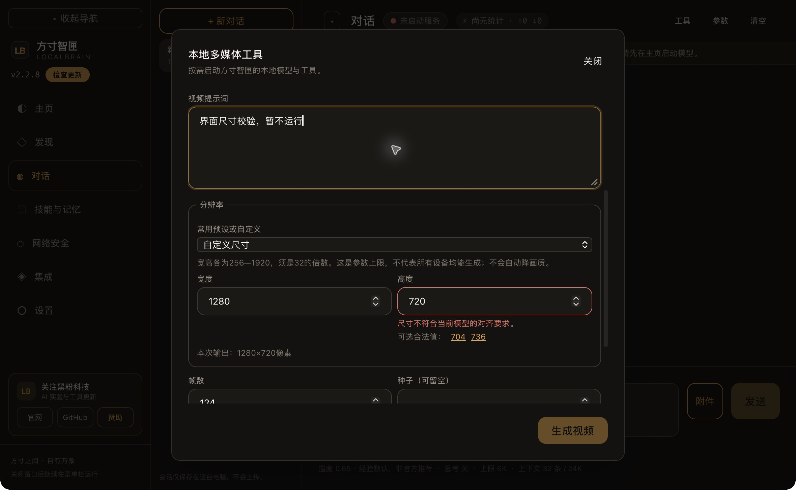

記憶體提示區分引擎預算與目前可用記憶體；未知峰值只作提示，實際執行保留原參數並受引擎預算約束，像素與影格相對規模不冒充精確預測。

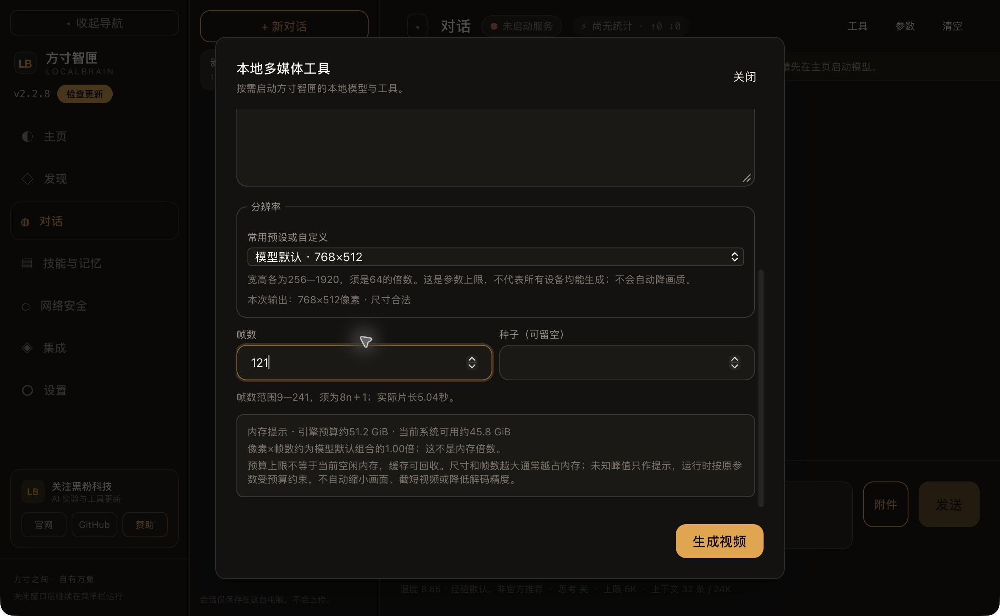

原始碼解壓前同時檢查兩套系統路徑規則，拒絕絕對路徑、磁碟機、目錄穿越、符號連結、硬連結及特殊檔案。合法原始碼正常解壓，既有原始碼直接復用；保留模型、環境、正式設定與錄製素材，不必清空模型重裝。

11月3日新套件已安裝：15,653項檔案、權限及連結一致，應用程式、更新套件及可信簽註驗簽與DMG校驗通過；本機簽章、未Apple公證。安裝套件實際解壓實作8項回歸及系統MCP檔案讀寫通過；前端主測試1668、Rust474、Python395條單元用例及兩項腳本、DSH53項通過，另有明確略過項。原生輔助功能讀回2.2.8、既有模型與0項服務執行中；原生操作工具服務不可用，本輪未重做全部點選或生成新影片。11月2日六段影片與尺寸驗收保留為先前獨立記錄。

[下載 Mac 2.2.8（Apple Silicon DMG）](https://github.com/HackerChi-Hub/localbrain-releases/releases/download/v2.2.8/LocalBrain_2.2.8_aarch64.dmg) · [正式發行與更新](https://github.com/HackerChi-Hub/localbrain-releases/releases/tag/v2.2.8) · [本輪驗收](https://github.com/HackerChi-Hub/localbrain-releases/blob/main/VERIFICATION-2.2.8-MAC.md)

DMG為75,294,743位元組，SHA-256：`4b66333e2778a637291e069fd2bd7cd7836b3e07f3877cf4bd3795e3ca2e2481`。Windows/Linux保留獨立發布2.2.8的原套件、簽章及清單。下方各版保留當時狀態，現行下載以本節和下載表為準。

## Windows / Linux 2.2.8：同步最新資源，補齊跨平台解壓校驗

Windows與Linux本批同步至2.2.8，內部工具套件隨主程式升級。原始碼封存解壓同時檢查POSIX與Windows路徑，拒絕絕對路徑、磁碟機、上層目錄穿越與連結，保留既有原始碼及執行環境。

Windows安裝版核對五個適用模組從2.2.4遷移並保留回退、既有Qwen3.8 2B請求、文件讀寫與維護狀態；Linux分別驗收Debian及AppImage的資源、宿主初始化與WSL2/Xvfb啟動。模型請求和文件工具為獨立檢查，不代表自主完成複雜任務。

H3、LTX、Pika及影片增強仍僅適配Apple Silicon Mac，本批未啟用Windows/Linux影片後端。近期調查的Bonsai、LFM3與低顯示記憶體圖片方案尚未接入，不列為已可用模型。Mac正式下載保持2.2.7，Mac2.2.8六段影片屬獨立候選驗收，不借用為兩平台成績。保留使用者模型、驅動程式、特殊引擎及既有設定。

[Windows](https://github.com/HackerChi-Hub/localbrain-releases/releases/download/v2.2.8-win-linux/LocalBrain_2.2.8_x64-setup.exe) · [Debian](https://github.com/HackerChi-Hub/localbrain-releases/releases/download/v2.2.8-win-linux/LocalBrain_2.2.8_amd64.deb) · [AppImage](https://github.com/HackerChi-Hub/localbrain-releases/releases/download/v2.2.8-win-linux/LocalBrain_2.2.8_amd64.AppImage) · [Verification](https://github.com/HackerChi-Hub/localbrain-releases/blob/main/VERIFICATION-2.2.8-WIN-LINUX.md)

## Mac 2.2.7：選好模型，再選影片功能

影片增強現在共用同一流程：先於探索頁準備模型與可選功能，進入對話後選模型、生成方式、增強和參數，最後點「產生影片」。H3四步、八步加速放在MiniMax H3八位模型下；Transition首尾影格過渡、Layout預演轉成片放在LTX-2.5下。一般生成保留，H3加速預設關閉。

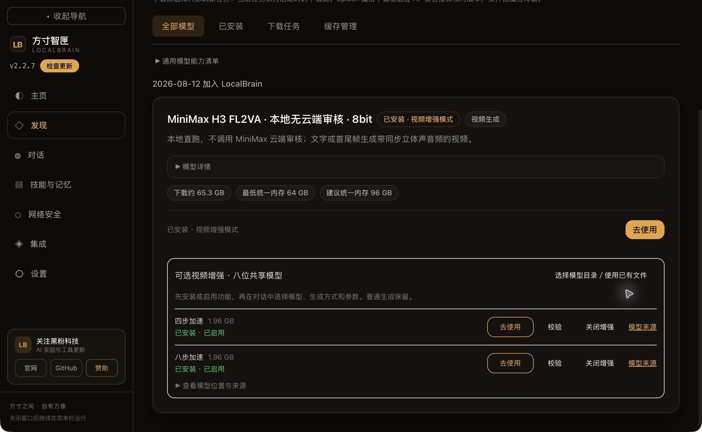

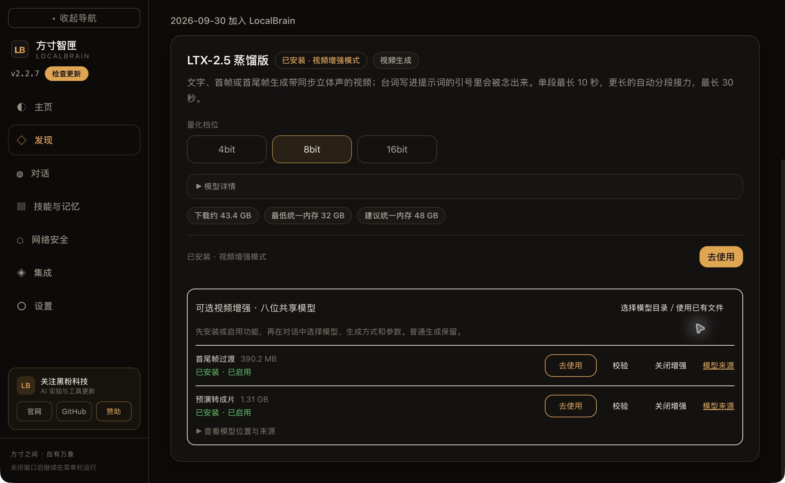

四項功能重用兩個基礎模型。已有完整H3八位轉換檔時，可跳過約41.4GB原始骨幹。先選擇模型目錄或使用既有檔案；新使用者先核對安裝清單中缺少的共用檔案、適配器及環境。模型、轉換、快取與影片隨所選目錄保存，支援外接磁碟、暫停、續傳及固定摘要校驗；安裝不會自動生成。

1. 在探索頁連接MiniMax H3八位或LTX-2.5既有目錄，安裝或啟用需要的功能。
2. 點「前往使用」，於統一工作台先選模型；H3選一般取樣、四步或八步，LTX選一般文字、首尾影格過渡或預演轉成片。
3. Transition提供首尾兩圖；Layout提供24影格/秒、等長預演及同構圖外觀圖，再設定畫幅、影格數與種子。
4. 生成完成後預覽、定位檔案或引用到對話，並由回執核對實際參數、用時及日誌。

Layout需要官方存取權及本機Hugging Face權杖，軟體不代為同意帳號資訊共享條款。匯入檔案只建立引用，關閉增強保留檔案；解除安裝僅處理軟體下載且登記的適配器，保留共用基模、環境、輸入與影片。既有工作占用時不自動停止其他模型。不重下載Pika，不暗自降低畫幅或解碼精度。

### 四項安裝版短片實測

M5 Pro、64GB，從安裝版2.2.7原生介面逐項生成，同一句玩具小車提示詞、種子22704、24影格/秒。約一秒小樣確認呼叫，不代表五秒720P速度；MLX峰值為活動配置，不是整機記憶體。

|功能|實際輸出|用時|MLX活動峰值|
|---|---|---:|---:|
|H3四步|256×256，22影格，約0.92秒|21.56秒|25.63 GiB|
|H3八步|256×256，22影格，約0.92秒|25.96秒|25.63 GiB|
|Transition|384×256，25影格，約1.04秒|27.61秒|21.81 GiB|
|Layout|384×256，25影格，約1.04秒|33.28秒|24.57 GiB|


H3分別執行四次、八次真實前向計算，208層匹配，完整32位影片解碼。減少取樣計算不保證所有內容細節都等同一般取樣。

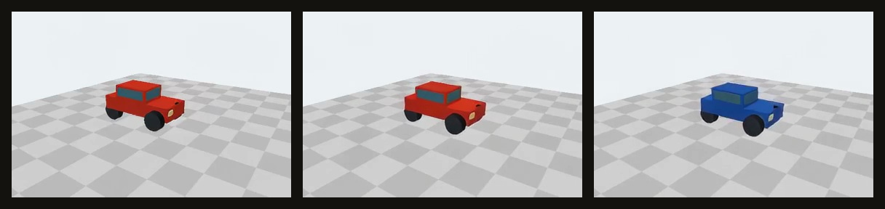

Transition採2.3適配器搭配2.5八位蒸餾基模的相容配方，576對匹配，非原生2.3全功能驗收。


Layout使用明確準備的25影格預演，保留原81影格素材；480對適配層匹配，完成兩階段控制。輸入須與請求等長，不自動截短或變速。四段影片及音訊解碼、畫幅與影格數核對通過，保留原音軌；有音軌不等於聲量、台詞和音畫同步已完成聽感驗收。高解析度、長片與複雜場景仍需另測。

### 下載與安裝核對

Apple Silicon Mac2.2.7 DMG為92,790,171位元組，約92.8MB。構建、映像及安裝的15,652項檔案、權限與連結一致，應用程式、更新簽章及映像校驗通過；本機簽章，未Apple公證。Rust474項、前端1660項通過，另有明確略過項；Python49檔通過。未重下載全部大型基模驗收全新機器，亦未在Windows/Linux驗收影片推論。

[下載 Mac 2.2.7（Apple Silicon DMG）](https://github.com/HackerChi-Hub/localbrain-releases/releases/download/v2.2.7/LocalBrain_2.2.7_aarch64.dmg) · [完整下載與更新](https://github.com/HackerChi-Hub/localbrain-releases/releases/latest) · [驗收記錄](https://github.com/HackerChi-Hub/localbrain-releases/blob/main/VERIFICATION-2.2.7-MAC.md)

SHA-256：`a0eea9853c6f5c8f8ff142749257c6ae4e5b426bb1a75f0646c21a9f3523c89f`。

本輪只更新Mac，Windows/Linux保持2.2.4。下文保留各版當時說明與舊圖，不將歷史條件當成本輪新成績。

## Windows / Linux 2.2.4：保留啟動錯誤原因，修正內部工具升級

模型啟動失敗保留真實錯誤，程序回收後仍可診斷。內部工具版本跟隨宿主，避免固定1.0.0跳過更新；自訂外掛安裝仍關閉。

Windows隔離驗收由2.2.2應用的1.0.0模組升到2.2.4，保留舊模組回退；貼上副本、維護回執、既有2B請求與真實文件讀寫分別驗收。

Pika H3 Flex目前僅Apple Silicon/MLX適用；Windows/Linux顯示不適用，不借用Mac影片成績或下載Pika權重。

兩平台DSH各53通過，Windows Rust454通過/37略過，前端1650通過/2略過、介面卡14、佇列7通過，Python46檔（44個單元檔375用例及兩個腳本）與安全7項通過。背景任務首輪400毫秒等待失敗，改為有界就緒輪詢與斷言前清理，完整重跑通過。Linux限Ubuntu22.04 WSL2/Xvfb，非裸機GPU或媒體推理。CI限制與發布狀態見驗收。

[Windows](https://github.com/HackerChi-Hub/localbrain-releases/releases/download/v2.2.4-win-linux/LocalBrain_2.2.4_x64-setup.exe) · [Debian](https://github.com/HackerChi-Hub/localbrain-releases/releases/download/v2.2.4-win-linux/LocalBrain_2.2.4_amd64.deb) · [AppImage](https://github.com/HackerChi-Hub/localbrain-releases/releases/download/v2.2.4-win-linux/LocalBrain_2.2.4_amd64.AppImage)

以下Mac段落保留首次發布時的獨立驗收範圍，Windows/Linux本批以上文為準。

## Mac 2.2.4：Pika H3 Flex 文字與首幀有聲影片

Pika H3 Flex 已合併到方寸智匣主專案：可用文字描述產生短片，也可用一張本機圖片作為首幀。目前管線固定六步、124 幀、每秒 24 幀，輸出約 5.17 秒有聲影片；尾幀、多參考圖及自動續段尚未接入。它使用 Pika 專用適配器，不會將 Wuli 或一般 H3 權重當成 Pika 執行。

需要 Apple Silicon Mac、macOS 26 或更新系統，建議 64 GB 統一記憶體。原始檔案約 78.2 GB，Q8 轉換及適配器另需約 23 GB，下載前請預留足夠磁碟空間。既有完整檔案及有效下載片段會沿用。模型原件、轉換檔、快取與回執留在軟體受管目錄，Pika 使用獨立執行環境，保留其他模型及環境。產生影片前，請先確認其他大型模型任務結束並釋放相應記憶體。

使用步驟：

1. 在「發現」準備 Pika H3 Flex；既有檔案可直接沿用。
2. 在「設定 → 執行環境與診斷」安裝或校驗 Pika 專用環境。
3. 在「設定 → 多媒體後端 → 影片產生」選取既有 Pika 模型並儲存。
4. 在對話頁選擇影片工具，使用「純文字產生」或「首幀參考（圖生影片）」。先用 256×256 或 448×256、六步、124 幀測試。

同一天先前的開發驗收，在 M5 Pro、64 GB、256×256、六步及固定種子條件下，文字產生耗時 63.71 秒，首幀產生 64.12 秒；引擎觀測峰值分別為 25.658 GiB 及 26.540 GiB。先前安裝版的真實 MCP 呼叫產生 448×256 樣片耗時 102.90 秒。三份樣片均有 124 幀及 32 kHz 雙聲道音軌，完成解碼及非靜音檢查；這些是本機小樣，不是跨裝置速度承諾，音軌檢查也沒有代替人耳聽感評測。


本次由合併後的主專案重新封裝安裝，15,401 項檔案、權限及連結與映像和更新封存檔一致，應用程式及更新包簽章通過，尚未 Apple 公證。Pika 與媒體介面的 13 項針對性測試通過；合併階段另有 Rust 467 項及前端 1,650 項通過的記錄。本次重新封裝沒有重下載模型，也未執行影片產生，文字與首幀效果依作者要求留待本人驗收。內部工具包隨宿主版本更新，活動任務占用時延後切換；修正舊工具包因相同版號而跳過升級，以及未設為預設的媒體模型被過濾的問題。

本次僅提供 Mac 新包。Windows/Linux 繼續使用獨立發布的 2.2.2，Mac 的 Pika 結果不代表其他平台已適配。[查看本輪核對及實際驗收範圍](https://github.com/HackerChi-Hub/localbrain-releases/blob/main/VERIFICATION-2.2.4-MAC.md)。

[Mac 2.2.4 發行頁](https://github.com/HackerChi-Hub/localbrain-releases/releases/tag/v2.2.4) · [下載 Mac 2.2.4（Apple Silicon DMG）](https://github.com/HackerChi-Hub/localbrain-releases/releases/download/v2.2.4/LocalBrain_2.2.4_aarch64.dmg)

Mac DMG SHA-256：`63f040f7ea65df5afe4a28b8e7d9b64c4686db0ed2772ee81b6b70dd3a8495a0`。

## Mac 2.2.3：啟動失敗顯示實際原因

Mac 2.2.3修復模型啟動時誤報「後端已被移除」的問題。狀態重新整理先回收退出程序後，啟動呼叫仍保留本次退出狀態與日誌；Sushi駐留預算與上下文快取超限時顯示引擎報告的實際數值。模型與執行環境保留，不自動修改參數、不提高系統記憶體上限，也不重新下載權重。參數超限時，請到設定→執行環境與診斷手動降低駐留預算或上下文再重試。

本機安裝版已從首頁按啟動並讀回真實預檢失敗原因，失敗後按鈕恢復，模型卡仍在；15,639項檔案、權限與連結一致，設定校驗值未變。Rust回歸462通過、39略過，應用簽章、更新封存檔驗簽與映像校驗通過，未做Apple公證。作者於2026-10-31明確批准本次原始碼說明CI計費限制例外，本機檢查通過不冒稱遠端CI通過。Windows/Linux保持獨立發布的2.2.2。

[Mac 2.2.3](https://github.com/HackerChi-Hub/localbrain-releases/releases/tag/v2.2.3) · [Mac 2.2.3 DMG](https://github.com/HackerChi-Hub/localbrain-releases/releases/download/v2.2.3/LocalBrain_2.2.3_aarch64.dmg)

SHA-256：`ad556e3ef043c5e592e27a642eb876b3c4a635ccc68d6b8470c04cf02442efc3`


## Mac 2.2.2：環境維護交代結果，圖片和檔案直接貼上

Mac 2.2.2 已完成本機安裝驗收並正式發布。Windows/Linux 2.2.2 由獨立建置另行發布，其實測範圍見[Windows/Linux 驗收記錄](https://github.com/HackerChi-Hub/localbrain-releases/blob/main/VERIFICATION-2.2.2-WIN-LINUX.md)。以下介紹這次 Mac 更新的實際行為，舊版本內容和截圖保留原來的日期與測試條件。

開啟「設定 → 執行環境與診斷」，同一個動作現在使用相同名稱和按鈕樣式，按照「安裝、更新、校驗、回滾、解除安裝、清理快取」排列。目前版本、可回滾版本與檢查時間放在說明區，長版本號不再擠亂按鈕。已安裝的一般元件不重複提供安裝，沒有快取不顯示清理，沒有保留版本不顯示回滾；外部 Docker、套件管理器和建置工具仍優先偵測、沿用並保留。

點「檢查環境更新」只查詢官方版本資訊，確認後才更新引擎，啟動模型不會自動升級。本輪安裝版將六個獨立引擎更新到下表版本，並保留各自上一環境：

| 元件 | 本輪實際安裝版本 |
| --- | --- |
| Splash | 1.5.0 |
| Sushi | 1.4.1 |
| 音樂與圖片編輯 mlx-serve | 26.10.3 |
| GGUF 文字與視覺 llama.cpp | b12018，官方滾動建置 |
| 三值模型引擎 Prism | prism-b10831-9d9efea |
| 離線元件檢查 Trivy | 0.76.1 |

更新先校驗官方封裝檔與啟動介面，再切換到獨立目錄。校驗失敗保留原環境，回滾也會檢查檔案與相關任務狀態。本輪在安裝版實際完成 Trivy 0.76.1 → 0.75.0 → 0.76.1，最後恢復到 0.76.1。共用 Python、Torch 等仍按軟體驗證過的組合維護，不把所有相依套件一次升級。

維護完成會留下重新開啟仍能查看的結果：升級前後版本、無需升級、沿用快取、本次下載、資料庫更新時間或失敗原因。裝置漏洞庫本輪沿用一項有效快取，容器漏洞庫沿用兩項，介面明確寫出「本次未下載」；網頁檢查規則則實際更新並校驗。未知進度顯示目前處理的階段，有真實下載位元組才顯示百分比。不相關的模型啟動不再阻擋獨立資料庫更新；相關環境正在使用時，提示「本次未執行，目前任務保留」。

Splash 1.5 的啟動參數辨識也已修復。先前說明文字換行被誤判成位置參數，導致尚未載入模型就退出；現在依實際參數宣告解析。既有 Qwen3.8 27B 權重已完成一般回覆和圖片理解，沒有重新下載。首次啟動還包含上游校準與預熱，本輪總就緒時間約 2 分 14 秒，權重載入約 5 秒，兩個時間分開記錄。

對話框可以直接貼上 Finder 裡的圖片、文字檔和影片，也可以貼上複製的圖片像素。附件先進入待傳送區，點擊傳送後才讀取。本輪把三種檔案一起送入安裝版：模型正確讀出文字首行，辨識出圖片的橙黃色正方形與青色圓形，並明確說明影片只引用本機位置、沒有讀取影像和聲音。影片貼上引用已可用，影片理解仍需對應能力。取消傳送會清理本次建立的圖片副本，保留原始檔案。

內嵌 DeepSeek Harness 已適配 0.2.1-rc.5，隨應用程式更新。安裝版實際多模態對話完成；Rust 458 項、TypeScript 1650 項、適配器 14 項及核心回歸 53 項通過，另有明確跳過和忽略的測試。建置、磁碟映像與安裝應用程式的 15,638 項檔案、權限和連結一致，應用程式與更新封裝驗簽通過。Mac 仍使用本機簽章，未完成 Apple 公證；Windows/Linux 本輪未做原生實機驗收。臨時驗收對話已清理，詳細記錄只留本機。

Mac 2.2.2 DMG 的 SHA-256：`8304011e22eda8b7e2b6947ae3ba226ceb5412233b3679880702abdc238526d4`。原始碼說明檢查因 GitHub 帳戶計費限制未能啟動，作者已於 2026-10-31 明確批准本次 Mac 例外發布；本機檢查與實際安裝驗收通過，不冒稱遠端 CI 通過。[下載 Mac 2.2.2 安裝包（Apple Silicon DMG）](https://github.com/HackerChi-Hub/localbrain-releases/releases/download/v2.2.2/LocalBrain_2.2.2_aarch64.dmg) · [下載、更新與其他平台](https://github.com/HackerChi-Hub/localbrain-releases/releases/latest) · [本輪驗收記錄](https://github.com/HackerChi-Hub/localbrain-releases/blob/main/VERIFICATION-2.2.2-MAC.md)。


## Windows / Linux 2.2.2：環境維護回執與貼上附件

設定→執行環境與診斷統一安裝、更新、校驗、回滾、卸載與快取操作，維護結果按元件保存。明確檢查官方更新，模型啟動不更新引擎；Windows/Linux獨立更新通道目前僅支援Trivy，llama.cpp與Prism保留已驗證多資源安裝器，不借用Mac六引擎成績。貼上建立檔案或圖片草稿，手動傳送後讀取；影片與未知二進位僅引用，不宣稱已理解。DSH固定0.2.1-rc.5，Node22.23.4依官方散列準備。Windows安裝版驗證原檔引用、貼上副本建立及刪除、Torch實際校驗回執、既有2B請求及DOCX/Markdown。Linux限WSL2/Xvfb啟動和宿主初始化，不代表裸機GPU、媒體生成或系統剪貼簿實際手勢驗收。Windows Rust445通過/37略過，前端1650通過/2略過，介面卡14、佇列7、兩平台DSH各53通過；Python43檔371用例與兩個腳本分別通過，安全7通過。瀏覽器畫布首輪失敗，單獨重跑通過，保留不穩定性記錄。本批CI帳戶限制及作者例外批准見驗收。

[Windows](https://github.com/HackerChi-Hub/localbrain-releases/releases/download/v2.2.2-win-linux/LocalBrain_2.2.2_x64-setup.exe) · [Debian](https://github.com/HackerChi-Hub/localbrain-releases/releases/download/v2.2.2-win-linux/LocalBrain_2.2.2_amd64.deb) · [AppImage](https://github.com/HackerChi-Hub/localbrain-releases/releases/download/v2.2.2-win-linux/LocalBrain_2.2.2_amd64.AppImage)

## Windows / Linux 2.2.1：維護到哪一步，現在說清楚

Windows/Linux2.2.1已建置安裝，作者已批准本批記錄原始碼CI帳戶付款／額度限制後例外發布。Mac今天發布的同版安裝包保留。這次修正維護長期停在0%，或結果已完成但左下角仍顯示維護的情況。

設定→執行環境與診斷僅在實際下載位元組與總量齊全時顯示百分比；準備、安裝依賴、解壓縮、校驗與卸載顯示階段，切換時撤下舊比例。主漏洞庫與Java索引庫分別交代快取、下載來源及校驗。操作結束先清除維護占用，再重新讀取清單，慢更新不再拖住完成提示。

Windows最終安裝包已安裝，六份原有設定散列不變。原生Torch校驗、既有2B模型驗收編號4276、35項MCP清單與真實DOCX建立/讀取及Markdown匯出通過。受控介面另確認3MB/8MB為37.5%，解壓與校驗清除舊數字，清單尚未返回時維護徽標已結束；這不是Windows實際下載證據，Mac的49MB實測獨立記錄。

Windows Rust435通過/36略過，前端1641通過/2略過，介面卡14與佇列3項通過；兩平台Harness各53通過，完整Python45檔與安全7項通過。Linux兩包通過Ubuntu22.04 WSL2/Xvfb資源與啟動檢查，Debian已安裝，不代表裸機GPU或媒體生成通過。獨立完整Harness8K固定工具提示超限仍是已知問題，進度修正不等於模型能力升級。

[Windows](https://github.com/HackerChi-Hub/localbrain-releases/releases/download/v2.2.1/LocalBrain_2.2.1_x64-setup.exe) · [Linux Debian](https://github.com/HackerChi-Hub/localbrain-releases/releases/download/v2.2.1/LocalBrain_2.2.1_amd64.deb) · [Linux AppImage](https://github.com/HackerChi-Hub/localbrain-releases/releases/download/v2.2.1/LocalBrain_2.2.1_amd64.AppImage) · [Mac 2.2.1](https://github.com/HackerChi-Hub/localbrain-releases/releases/tag/v2.2.1)

[Windows/Linux verification](https://github.com/HackerChi-Hub/localbrain-releases/blob/main/VERIFICATION-2.2.1-WIN-LINUX.md)

## Windows / Linux 2.2.0：內部模組升級，保留原來入口

Windows及Linux補齊2.2.0下載，Windows與WSL2 Ubuntu22.04中的Debian已安裝，保留既有Mac同版安裝包。工具、模型後端、頁面與執行環境共用能力登錄。內部模組隨軟體升級維護，使用者無需另找外掛安裝；自訂安裝介面及命令仍關閉，原有模型、資料與執行環境維護入口保留。

八類是隨軟體交付的模組總數，Windows/Linux目前適用文件、聯網檢索、圖像、本地工作區及授權網路五類。語音合成、轉寫及影片的MLX模組不計入這兩平台可用數。壓縮前後統一核心計量並包含摘要包裝，保留原文，恢復不重複執行已完成工具。Windows圖像環境誤報修正保留。

Windows最終安裝版確認五個模組就緒，既有Qwen3.8-2B-Distill Q4_K_M真實請求回覆編號4276。五類隨包MCP與相容入口的35個工具名稱、參數和描述一致；真實建立及讀取DOCX，獨立文件庫核對標題與原件散列不變，Markdown匯出通過。模型請求與MCP呼叫分別驗收，不冒稱完整自主任務鏈通過。

首次文件實測失敗，原因是Windows打包輸入仍為舊文件實作，與2.2.0宣告的Markdown介面不符。最終兩平台改用2.2.0原始碼附帶且逐檔驗證的文件實作重新建置，真實讀寫重測通過；未改寫使用者獨立DocFactory安裝。

Windows Rust435項通過、36項略過，另兩項真實模組測試通過；TypeScript1638項通過、2項略過，介面卡14項通過。兩平台Harness各53項通過，完整Python45檔、安全7項、打包2項通過。Linux兩包資源與Xvfb啟動檢查通過，Debian已安裝；WSL2不代表裸機GPU或Linux真實媒體生成驗收。Windows語音、影片、真實出圖、外部Harness8K任務及真實HTB仍有獨立邊界，不挪用Mac媒體結果。原始碼CI帳戶限制及本批批准範圍見驗收記錄。

[Windows](https://github.com/HackerChi-Hub/localbrain-releases/releases/download/v2.2.0/LocalBrain_2.2.0_x64-setup.exe) · [Linux Debian](https://github.com/HackerChi-Hub/localbrain-releases/releases/download/v2.2.0/LocalBrain_2.2.0_amd64.deb) · [Linux AppImage](https://github.com/HackerChi-Hub/localbrain-releases/releases/download/v2.2.0/LocalBrain_2.2.0_amd64.AppImage) · [Mac 2.2.0](https://github.com/HackerChi-Hub/localbrain-releases/releases/tag/v2.2.0)

[Windows/Linux verification](https://github.com/HackerChi-Hub/localbrain-releases/blob/main/VERIFICATION-2.2.0-WIN-LINUX.md)

下方版本段落與截圖保留當時測試範圍，目前平台下載以本節與GitHub下載表為準。

## Windows / Linux 2.1.7：裝好了，就別再提示重裝

圖像生成環境已顯示「操作已完成」，回到列表卻仍是「部分安裝 · 待修復」，再次一鍵安裝又回到同一位置。本次定位到 Windows 狀態偵測：程式只找 Linux/macOS 的 lib/python*/site-packages，漏了 Windows 的 Lib/site-packages。

本機既有 Torch、Diffusers、Torchvision 與 Z-Image、Qwen-Image-2.1 兩個流水線均可匯入，CUDA 可用。新版補上 Windows 路徑，保留 Linux/macOS 辨識方式。安裝包的原生環境頁面已確認顯示「已安裝」，不再提供重複安裝入口；不因誤報重新下載環境，也不升級模型、CUDA 或顯示卡驅動。

Windows 與 WSL2 Ubuntu22.04 的 Debian 已安裝為 2.1.7；Linux AppImage 同步提供。Windows Rust 428 項通過、34 項略過，TypeScript 1632 項通過、2 項略過，介面卡 14 項通過；Windows/Linux 隨包 Harness 各 53 項通過。Linux 兩包完成資源與 Xvfb 啟動檢查，保留 Unix 目錄布局回歸。Mac 繼續使用已發布的 2.1.6。

匯入成功僅證明環境可以載入，真實出圖尚未驗收；Linux WSL2 結果不代表裸機 GPU 推理通過。獨立 Harness 桌面向 PolyStrata 8K 視窗傳送過長提示的既有問題仍未解決。本批原始碼 CI 受帳戶付款/額度限制，發布狀態與例外批准範圍見驗收記錄。本次未重跑完整 Python 或原 12 題模型評測，不挪用舊版結果作為本批測試。

[Windows](https://github.com/HackerChi-Hub/localbrain-releases/releases/download/v2.1.7/LocalBrain_2.1.7_x64-setup.exe) · [Linux Debian](https://github.com/HackerChi-Hub/localbrain-releases/releases/download/v2.1.7/LocalBrain_2.1.7_amd64.deb) · [Linux AppImage](https://github.com/HackerChi-Hub/localbrain-releases/releases/download/v2.1.7/LocalBrain_2.1.7_amd64.AppImage)

[Verification / 验收记录](https://github.com/HackerChi-Hub/localbrain-releases/blob/main/VERIFICATION-2.1.7-WIN-LINUX.md)

下方各版本段落與截圖保留當時記錄；目前下載以本節及 GitHub 分平台下載表為準。

## Mac 2.1.6：更新 Harness 核心，修正重複安裝與移除提示

Mac 2.1.6 已正式發布並完成本機安裝；Windows/Linux 保留已發布的 2.1.3，由作者另行封裝。內嵌 DSH 從 0.2.0-rc.2 適配至官方目前候選版 **0.2.1-rc.3**，精確固定相依版本與鎖定檔。它隨方寸智匣更新，不修改獨立 Harness 用戶端、帳戶或既有模型設定。

這次修正「已經全部安裝，單獨勾選後卻還能安裝」的矛盾。在「設定 → 執行環境與診斷」，已就緒一般元件不再有個別安裝入口，勾選後也不會啟用批次安裝。缺少的元件仍可一鍵補齊；離線資料庫保留明確的「更新並校驗」。

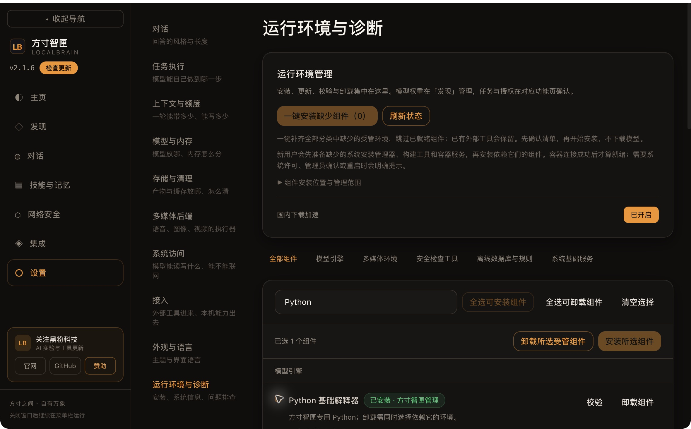

移除也會立即說明原因。只選 Python 而未選依賴它的環境時，原生提示會列出全部未選相依項，本輪實測為四項；程式不擅自代選或直接刪除。Docker 等系統程式仍先偵測本機：已有環境重用，離線時提供啟動，缺少才準備安裝。共用系統元件保留原版本，不提供移除。

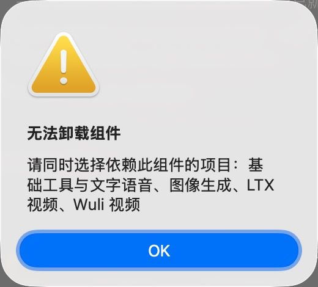

核心更新的實際相容差異是技能外掛新增工作目錄服務。適配後只傳遞宿主已選目錄身分，工具仍回到方寸智匣的授權執行器。技能隨需讀取、完全關閉、中文增量摘要與舊會話恢復繼續保留。

安裝版使用既有 Splash 模型完成兩輪、一次唯讀安全能力查詢，實際讀回 phase=2、dockerInstalled=true，未掃描目標。之後按「立即壓縮」，持久記錄保留精簡中文摘要、可信使用者原文與真實回執，原始日誌保留。另以舊版產生的會話升級恢復，驗證工具只執行一次、不完整尾端記錄可恢復；隨包 Node 的 53 項核心回歸、1632 項 TypeScript 及 14 項適配器測試通過，另有 2 項略過。

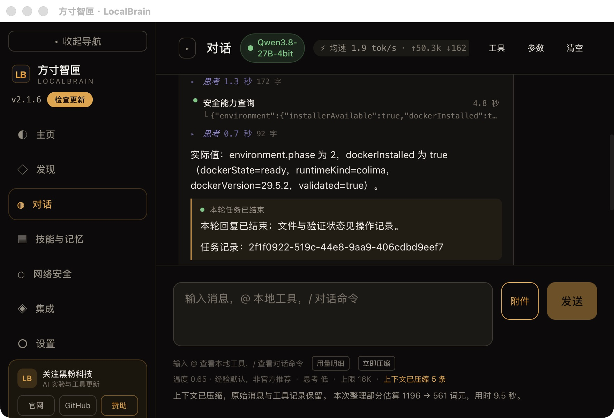

建置包、DMG、更新封存與已安裝程式的 13,984 個檔案、權限及連結一致，應用程式與更新簽章通過，四處正式設定校驗值未變。本輪未下載模型，也未解除安裝環境模擬新機。原生按鈕、實際工具結果及壓縮終態均已讀回；臨時驗收會話與原始副本已移出正式資料庫，證據僅留本機。Mac 仍採本機簽章、未 Apple 公證；全新 Mac、Windows/Linux 與真實 HTB 不屬本輪實測。

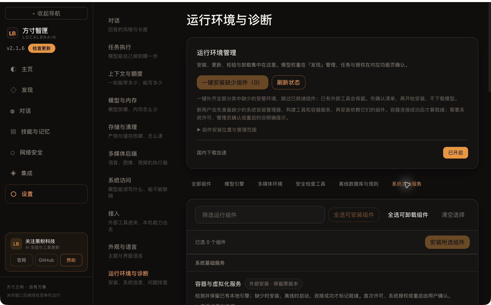

GitHub 原始碼說明檢查因帳戶付款／支出限制未啟動；作者已於 2026-10-25 明確批准本次 Mac 2.1.6 例外發布。本機檢查通過，不冒稱遠端 CI 通過。

Mac 2.1.6 DMG SHA-256：`5a52f1d0c240e3957d6b62a634267289d3e4d150309f0aa332a026c7466cb776`。

[下載 Mac 2.1.6 安裝包（Apple Silicon DMG）](https://github.com/HackerChi-Hub/localbrain-releases/releases/download/v2.1.6/LocalBrain_2.1.6_aarch64.dmg) · [驗收記錄](https://github.com/HackerChi-Hub/localbrain-releases/blob/main/VERIFICATION-2.1.6-MAC.md)

## Mac 2.1.5：統一準備新使用者相依環境與容器服務

Mac 2.1.5 已正式發布，完成封裝、安裝及本輪原生介面驗收；Windows/Linux 保留各自已發布的 2.1.3，由作者另行封裝。

新使用者打開「設定 → 執行環境與診斷」，按「一鍵安裝缺少元件」，核對清單再開始。程式先準備缺少的系統套件管理器、建置工具與容器服務，再準備相依環境。一項失敗就停止後續，修正後重新補齊；已就緒項目會略過。容器連線成功才標記就緒，已安裝但離線時提供啟動入口。

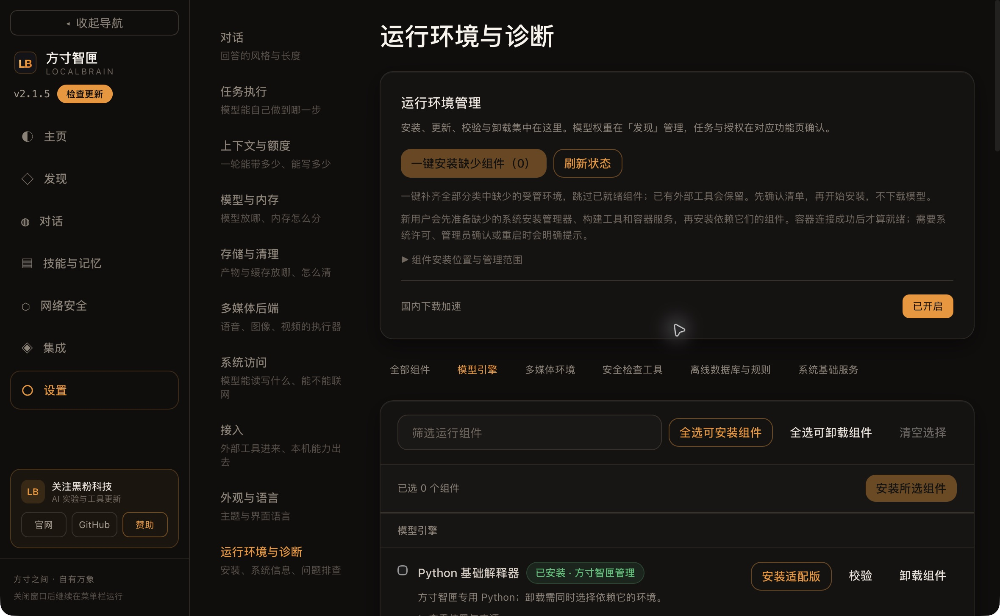

優先重用既有本機 Docker Desktop 或 Colima，保留預設連線、虛擬機資源與現有容器。系統共用元件不提供解除安裝；Python、FFmpeg、模型引擎及工具仍使用各自受管環境。Mac 缺少 Homebrew 時下載校驗官方套件，再交給系統安裝程式；首次條款、管理員授權及重新啟動仍需使用者確認。

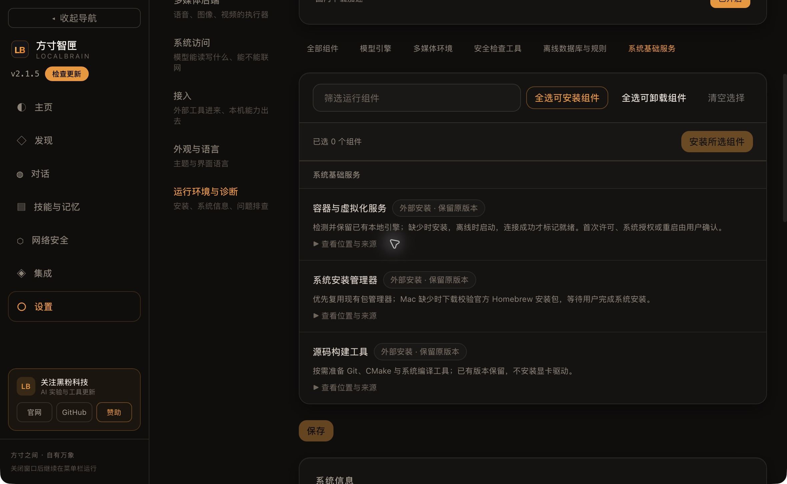

下載可暫停並保留分片，恢復後手動繼續；解壓縮、pip 或容器步驟完成目前元件後才暫停後續。無快取顯示下載、有分片顯示續傳、完整封存顯示使用快取安裝；僅確認已安裝的受管元件提供移除，有快取才顯示清理。內建文件、網頁工具與 Harness 核心隨軟體更新，不再個別列出。

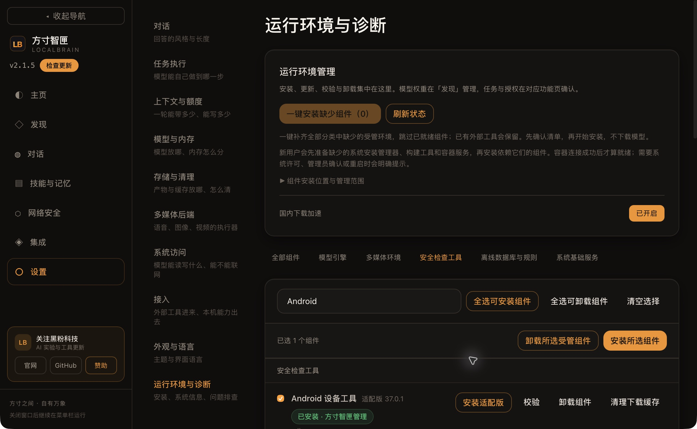

本輪安裝版核對五類元件、缺少項 0、三項系統依賴無移除按鈕、篩選、批次選取、安裝範圍確認與取消；取消後未執行安裝。建置、映像、更新封存與安裝應用程式的 12,995 項檔案及連結一致，應用與更新簽章通過；既有環境重用、官方套件下載/簽章/快取重用通過。無 Homebrew 全新 Mac、Windows/Linux 首次系統安裝尚待實裝，未移除既有環境模擬新機，亦未下載模型或停止容器。

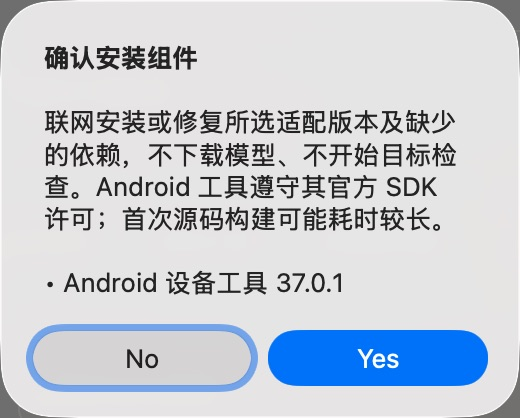

Mac 沿用本機簽章，未 Apple 公證。GitHub 原始碼說明檢查因帳戶付款／支出限制未啟動，作者已明確批准本次 Mac 2.1.5 例外發布；本機通過不冒稱遠端 CI 通過。詳見[本輪驗收](https://github.com/HackerChi-Hub/localbrain-releases/blob/main/VERIFICATION-2.1.5-MAC.md)及[新使用者相依步驟](https://github.com/HackerChi-Hub/localbrain-releases/blob/main/SYSTEM_PREREQUISITES_2.1.5.md)。

本次 Mac 2.1.5 DMG SHA-256：`35323326f50b065abc1e9c089b44b5cc9fe6cdf07625472452e1a6470175f407`。

[下載 Mac 2.1.5 安裝包（Apple Silicon DMG）](https://github.com/HackerChi-Hub/localbrain-releases/releases/download/v2.1.5/LocalBrain_2.1.5_aarch64.dmg)


## Mac 2.1.4 候選：一鍵補齊缺少環境

「設定 → 執行環境與診斷」收為模型引擎、多媒體、安全工具、離線資料庫與規則、系統服務五組。內建文件、網頁工具及 Harness 核心隨軟體更新，不列出個別維護項。網路安全頁保留目標、授權、證據及報告，維護入口跳轉至此。**本節為待發布候選，公開下載尚未更新。**

點選「一鍵安裝缺少元件」，核對相依清單再確認；佇列跳過已就緒的受管環境，專用容器恢復連線後重新識別並重用既有映像與資料庫。切頁繼續維護，一項失敗即停止後續，再次補齊只處理仍缺少項目。單項安裝、更新與校驗繼續保留。

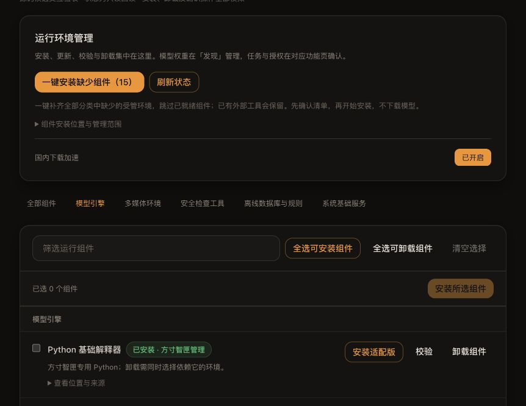

**尚未安裝的元件不顯示解除安裝。** 部分安裝、外部版本及離線待核實狀態也不提供移除，批次刪除僅接受確認已安裝的受管項目。沒有可移除選取時不顯示批次刪除按鈕。移除 Python 需同時確認相依環境；模型權重、外部安裝、對話、報告與虛擬機保留。

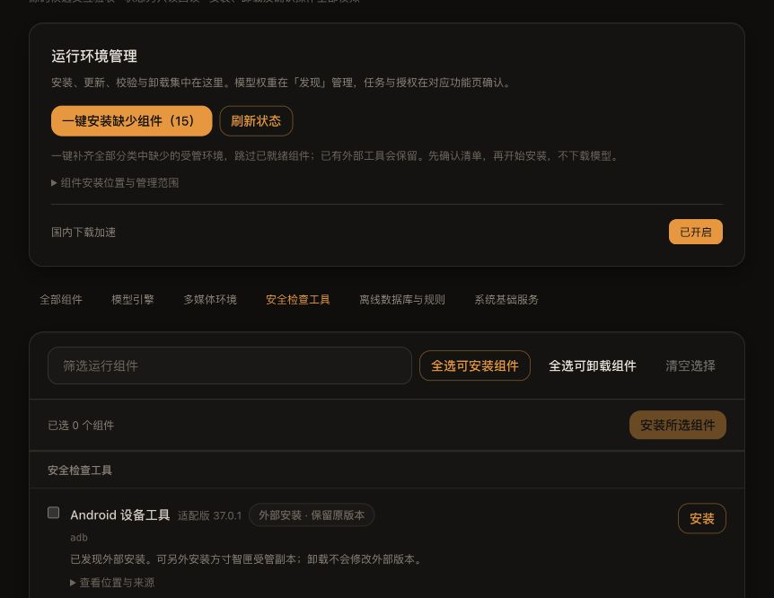

兩張圖使用相同正式元件與唯讀清單，安裝及移除明確模擬，不作為正式環境全部安裝完成的證據。系統原生擷取仍報錯，安裝包檔案校驗與原生點選的驗收邊界分別記錄。

ADB、Trivy、Splash 使用官方固定版本受管副本。共用執行環境封存下載器保留中斷分片，重試核對範圍再續傳；完整 SHA-256 不符不解壓，已校驗封存可離線重用。Python 套件與容器映像仍用各自快取。環境位於專屬資料目錄，不向唯讀或已簽章應用套件寫入。缺少 Docker/Colima 且有支援的官方套件管理器時，可隨相依計畫準備；系統條款、管理員確認及重新啟動要求保留。已就緒系統服務不再展示多餘安裝說明按鈕。

### 暫停、繼續和清理分開處理

執行環境下載時可按「暫停下載」，保留分片與後續清單；重新整理或重開後，需要自行按「繼續下載」。若已進入解壓縮、相依套件安裝或容器準備，會先完成目前元件操作再暫停後續，避免強行中斷留下不完整環境。Splash 也增加暫停入口，繼續時保留原權重並由原安裝器續傳。

未安裝且無快取時顯示「下載並安裝」；有分片顯示「斷點續傳」，完整封存檔顯示「使用快取安裝」。僅已安裝受管元件提供解除安裝，有下載快取才提供清理。清理後立即回讀；小檔案依 KB、MB 顯示，暫停撤下舊速度，左下角保留任務狀態。

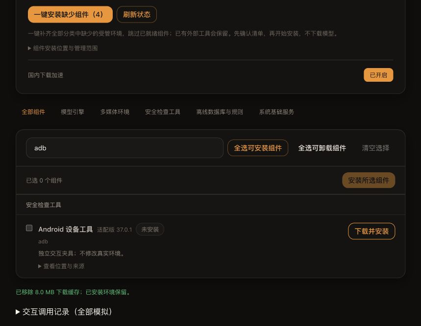

此圖為獨立介面預覽，安裝及移除操作明確模擬。真實網路另測官方約 25 MB Python 封存檔：在 1,011,849 位元組暫停，從相同偏移續傳，完整 25,159,977 位元組校驗通過；離線重用及清理計數一致。pip 與容器仍用自身快取，不承諾每個第三方安裝步驟都可立即暫停。未重新下載大型模型，Splash 大型模型暫停中斷尚未實測。

Splash 維持 1.3.1、Sushi 維持現有適配版，Harness 核心維持 0.2.0-rc.2；0.2.1-rc.3 已評估，需獨立相容回歸後才升級。安裝工具及漏洞庫不建立目標授權、不開始檢查，原有授權與隔離驗證持續生效。

Mac 2.1.4 候選已重新封裝安裝，暫不公開發布。[目前公開發行及各平台下載](https://github.com/HackerChi-Hub/localbrain-releases/releases/latest)。候選 DMG SHA-256：`4619d1f9803c2c72549e40ab1ece75229cdb2217a2a816b42e206988aa5457e8`。Mac 為本機臨時簽章，未 Apple 公證；Windows/Linux 保留公開 2.1.3。

前端 1628 項通過、2 項略過，介面卡 14 項通過，Rust 436 項通過、33 項忽略。10 項下載專項覆蓋續傳、斷流保留、錯位回應、損壞快取、離線重用及路徑保護；介面另核對取消不執行、跨頁繼續、恢復後重用與失敗重試。三份 Mac 官方工具封存先前已完成實際校驗、解壓及移動探針；完整容器批次安裝、新增 Binwalk 建置及真實移除仍未列為通過。以下舊版保留當時測試與截圖。

Windows/Linux 2.1.3 已公開發布，Windows修復版及虛擬機中的Debian已安裝。Linux Debian、AppImage於Ubuntu22.04 WSL2獨立建置，兩包資源、DSH初始化、20秒啟動及53條DSH測試通過；三個安裝包已重新下載核對SHA-256及更新簽章。Linux裸機GPU、完整DSH圖片及工具任務尚未驗收。原始碼CI因帳戶付款／額度限制未啟動，作者已明確批准本批例外發布，不將本機通過寫成線上CI通過。Mac既有安裝包保持不變。

[Windows](https://github.com/HackerChi-Hub/localbrain-releases/releases/download/v2.1.3/LocalBrain_2.1.3_x64-setup.exe) · [Linux Debian](https://github.com/HackerChi-Hub/localbrain-releases/releases/download/v2.1.3/LocalBrain_2.1.3_amd64.deb) · [Linux AppImage](https://github.com/HackerChi-Hub/localbrain-releases/releases/download/v2.1.3/LocalBrain_2.1.3_amd64.AppImage)

[本批驗收記錄](https://github.com/HackerChi-Hub/localbrain-releases/blob/main/VERIFICATION-2.1.3-WIN-LINUX.md)。下方Mac首次發布及2.1.2等段落保留當時記錄，目前下載以本節為準。

## Windows 本機修復與 DSH 接入邊界（2026-10-24）

接入頁頂部已補回「一鍵恢復接入」，可集中撤銷 Harness 完整接入及 Codex、Claude Code 的受管 MCP；各用戶端分別回報鎖定、衝突及無恢復點，保留原有設定。Windows 2.1.3 修復包已於本機安裝，公開下載狀態以下方分平台下載為準。Linux 新包獨立建置及驗收，不沿用 Windows 結果。

使用者已確認 **Qwen3.8-2B-Distill Q4_K_M 在 DSH 的基本文字使用可用**。本機服務實際回報262144 token視窗，與匯出設定一致；不代表已驗證填滿後的速度、記憶體及長文品質，也不等於工具呼叫、多輪任務全部通過。目前2B端點不支援看圖；圖片理解、MCP圖片顯示與視覺模型接入須分別驗收。

**PolyStrata 35B 的完整 DSH 桌面請求在8K視窗仍會超限。** 截圖顯示系統提示約1.5K、工具定義約7.4K，兩項已超過8K，另一次請求輸入12728 token。只壓縮對話或降低輸出上限不足以解決固定開銷；需要按任務精簡工具，或另測較大視窗。這是上下文預算問題，不能據此判定顯示記憶體不足。先前介面卡短請求通過，只證明連線與模型路由，並非完整桌面代理驗收。

[待解問題與驗收邊界](https://github.com/HackerChi-Hub/localbrain-releases/blob/main/KNOWN-ISSUES-DSH-LOCAL-MODELS.md)。GitHub 原始碼 CI 仍受帳戶限制，本機檢查不冒稱線上通過。

## Mac 2.1.3：讓 Codex、Claude Code 使用本機工具

這次恢復 Codex 與 Claude Code 的 MCP 一鍵接入，DeepSeek Harness 繼續保留。MCP 是工具介面：現有用戶端可以呼叫方寸智匣的文件、搜尋、轉寫、配音、影像及影片工具，原本使用的模型保持不變。工具所需的本機環境與權重仍須備妥，網路搜尋仍需要網路。

打開「接入」，找到對應用戶端，點選「一鍵寫入 MCP」，確認使用者級作用範圍後，在用戶端新會話使用。工具程序隨用戶端會話啟動，媒體模型按實際呼叫載入。各用戶端設定預設收起，需要時再展開或複製；桌面用戶端正在執行時，軟體會要求你在工作結束後先退出，避免設定快取覆蓋寫入，不會代為結束程序。

**寫入與撤銷僅處理方寸智匣工具項目。** 模型、提供方、其他 MCP 與專案設定保留；再次寫入也保留首次接入前的恢復點。外部變更衝突時保留目前設定並提示處理。Harness 工具撤銷僅處理工具區塊，模型接入另行管理；OpenCode 沒有恢復。

我以獨立設定副本進行 Codex 實際呼叫：核驗碼只放在臨時 DOCX，提示詞僅要求透過方寸智匣文件工具讀取。紀錄是一筆成功的 `document_read`，最終完整核驗碼正確，正式用戶端設定雜湊未變。測試只預先批准這一項唯讀工具，產品不會替你關閉用戶端審批。**Claude Code 的介面、設定合併及協議檢查已核對，本輪模型呼叫因原有登入憑據失效而停止，未列為實際呼叫通過。**

[下載 Mac 2.1.3 安裝包（Apple Silicon DMG）](https://github.com/HackerChi-Hub/localbrain-releases/releases/download/v2.1.3/LocalBrain_2.1.3_aarch64.dmg) · [Mac 驗收紀錄](https://github.com/HackerChi-Hub/localbrain-releases/blob/main/VERIFICATION-2.1.3-MAC.md) · [最新發行與各平台下載](https://github.com/HackerChi-Hub/localbrain-releases/releases/latest)。Windows/Linux 保留已發布的 2.1.2，本次不宣稱兩平台已更新至 2.1.3。Mac 使用臨時簽章，尚未 Apple 公證。

Mac 2.1.3 已完成本機安裝：應用程式、DMG 及更新套件中的 12,995 個檔案與連結一致，應用簽章檢查及獨立更新驗章通過。安裝版 MCP 協定與工具發現自檢為 26/26；這不等於全部媒體模型生成品質都已重測。DMG 的 SHA-256 為 `023934d617c93cb50cd3dd41f55bd7ad672d29983548000cfb78d1f7985417b8`。

原始碼倉庫的 GitHub 說明同步檢查因帳戶付款／支出限制未啟動。本機檢查與安裝驗收通過後，我已明確批准本次僅 Mac 2.1.3 例外發布；這不等於遠端 CI 通過，也不代替其他平台驗收。

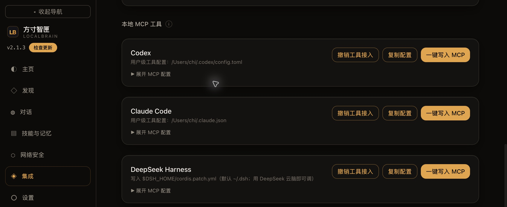

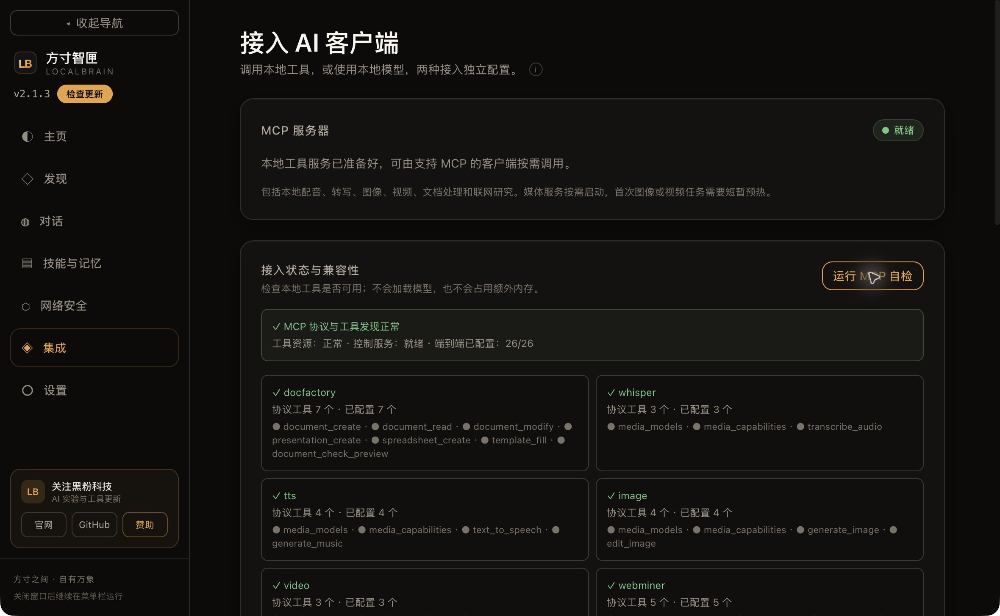

兩張圖取自最終安裝版，僅裁除頂端系統自動操作控制列，原圖與裁切紀錄保留本機。以下 2.1.2 及更早部分保留當時版本、測試與截圖。

## 2.1.2：三平台下載與工具安裝修正

LocalBrain 將本機模型、語音、圖片、影片及檔案工具放在一個桌面工作台。Mac、Windows、Linux 各自維護執行環境：Mac 可選 MLX、Splash、Sushi；Windows 可用 llama.cpp 與 PolyStrata，Linux 提供 Debian 及 AppImage 預覽套件。模型相容性與記憶體需求以本機檢查及引擎要求為準，應用程式升版不會順帶升級 CUDA、驅動或模型權重。

2.1.2 不再向唯讀程式目錄寫入建置產物，而是向受管 Python 環境註冊資源路徑，並以新程序驗證來源；Windows 中文路徑及診斷輸出統一使用 UTF-8。安全工作台目標名單改為全寬，連線及工具按需展開；批次交接只產生草稿，仍需手動傳送與執行批准。接入頁保留 DeepSeek Harness 設定。每輪結束僅顯示「贊助開發」文字，點擊才出現 QR 碼，不加入模型上下文。

Windows 最終套件在 RTX 4070 Laptop 8GB／32GB 記憶體機器，以 PolyStrata Qwen3.6-35B-A3B Q3、8K 視窗核對原生聊天、一次檔案寫入、實際壓縮及續答；安裝前後正式設定雜湊未變。Linux 兩種套件通過內建 Node／DSH、資源核對及 WSL2 Ubuntu22.04＋Xvfb 啟動檢查，Debian 已安裝。這不等於 Linux 裸機 GPU 推理或真實 HTB 任務驗收，也不是原12題能力評測重跑。Windows 使用應用更新簽章，非 Authenticode；既有 Mac 套件保留其獨立驗收紀錄。

[Windows 安裝程式](https://github.com/HackerChi-Hub/localbrain-releases/releases/download/v2.1.2/LocalBrain_2.1.2_x64-setup.exe) · [Linux Debian](https://github.com/HackerChi-Hub/localbrain-releases/releases/download/v2.1.2/LocalBrain_2.1.2_amd64.deb) · [Linux AppImage](https://github.com/HackerChi-Hub/localbrain-releases/releases/download/v2.1.2/LocalBrain_2.1.2_amd64.AppImage) · [Mac DMG](https://github.com/HackerChi-Hub/localbrain-releases/releases/download/v2.1.2/LocalBrain_2.1.2_aarch64.dmg)

本次已獲作者明確授權例外發布：原始碼 GitHub 檢查因帳戶付款／額度限制未啟動，不能把本機通過當作線上 CI 通過。

[Windows/Linux 驗收與校驗值](https://github.com/HackerChi-Hub/localbrain-releases/blob/main/VERIFICATION-2.1.2-WIN-LINUX.md) · [Mac 驗收](https://github.com/HackerChi-Hub/localbrain-releases/blob/main/VERIFICATION-2.1.2-MAC.md) · [最新發行](https://github.com/HackerChi-Hub/localbrain-releases/releases/latest)。以下舊版本數字、功能介紹及截圖保留撰寫時狀態，不當作本輪新測結果。

## Windows 2.0.0：小視窗任務與壓縮修復

2026年10月20日核對公開發行，Windows現為2.0.0，Mac保留1.9.9。Windows修復短片段壓縮沒有縮減收益卻使任務提早停止的問題：仍有安全回答空間時保留原文繼續，真實溢出仍停止並保存紀錄。內建長工具參數表按需載入，摘要停用工具與思考；歷史工具回執按唯讀資料處理，避免接續執行舊工具指令。

發行驗收包含最終套件安裝、問候、倒數計時檔案交付、自動壓縮後續答、2K／5K輸出上限下真實連網與聊天介面操作；倒數開始、暫停、重設通過。這不是原12題全量重測；摘要仍可能錯誤推斷局部狀態，連網成功不代表新聞新鮮度或事實正確性。

[下載Windows 2.0.0安裝程式](https://github.com/HackerChi-Hub/localbrain-releases/releases/download/v2.0.0/LocalBrain_2.0.0_x64-setup.exe) · [最終套件驗收及限制](https://github.com/HackerChi-Hub/localbrain-releases/blob/main/VERIFICATION-2.0.0.md)。SHA-256：`547c745ad1494b89bc7c4d3ee8646b6fcc28f1c469a59be3496361e149b6e668`。更新器簽章已驗證，非Windows Authenticode簽章；CUDA、驅動及第三方模型環境未升級。

## 1.9.9更新：Sushi常駐與精確SSD已實測

Mac 1.9.9修復下載100%後的終態重新整理與Sushi啟動錯誤診斷。安裝版已驗證真實記憶體預檢拒絕並顯示所需／可用數值；狀態輪詢先回收退出程序也不遮蔽具體原因。恢復32K後完整常駐重新載入並完成中文回應。原有約79.21 GB權重保留，沒有重新下載。

2026年10月20日，M5 Pro／64 GiB，同一份Qwen3.8 Flash Next 2.6位權重、Sushi1.2.4、32K上下文、關閉思考：完整常駐／32 GiB精確SSD登記駐留44.20／31.21 GiB；首次材料回答總耗時4.99／8.10秒，重複材料2.68／2.87秒。重複材料命中2595個輸入快取詞元。隔離首次啟動40.39／8.98秒，原生再次常駐啟動17.02秒；未清系統檔案快取，不當作冷啟動平均值。

常駐預設載入視覺塔，SSD預設關閉；顯式載入視覺塔的SSD補測首次材料8.23秒、重複2.60秒，僅確認載入，未測看圖品質。單機樣本不外推普遍速度與品質。SSD原生對話完成中文短答及本機時間工具往返。

**兩模式手動選擇：** 設定→執行環境與診斷，SSD預算0為完整常駐，非零如32為精確SSD，儲存並重啟模型生效。不因記憶體不足自動切換，不繞過保護；專家快取內部自動調度不等於模式切換。

[下載Mac 1.9.9（DMG）](https://github.com/HackerChi-Hub/localbrain-releases/releases/download/v1.9.9/LocalBrain_1.9.9_aarch64.dmg) · [實測條件與驗收限制](https://github.com/HackerChi-Hub/localbrain-releases/blob/main/VERIFICATION-1.9.9-MAC.md)。DMG SHA-256：`6fbc94eb895220fbf99a8d497b8ec3506074e6964c51dc895374d985ae5d6c27`。本機簽章、未Apple公證；Windows保留1.9.8、Linux保留既有套件。下方舊文及截圖保留當時狀態。

## 把 Mac 變成 私有 AI 盒子

> 不是再造一個聊天網頁，而是把本機模型、多媒體、文件和 Agent 工具收進同一個 Mac 工作台。

> [!note]
> 黑粉科技 HyphenTech · LocalBrain 1.9.4 · 2026-10-18 · 本頁另有简体中文與 English 版本（標題下方切換）

---

我做 LocalBrain，不是因為本機模型已經能打贏雲端。同一個複雜任務，頂級雲端模型通常還是更聰明、更穩。真正讓我頭大的，是模型在一個目錄，MLX 在一個終端機，GGUF 又要另一套服務；轉寫、配音、生圖、影片和文件還各有自己的執行方式。

所以目標一直沒變：**不造一個更聰明的大腦，而是造一個更省心的本機 AI 總開關。** 這頁正文寫於 1.4.8，現行版本是 1.9.4。下面按頁面走一遍，圖都是 1.4.6 的真實介面（之後的版本陸續加了安全檢查、辦公文件、Splash 模型等，見文末「1.4.8 之後」「1.4.8 新增」「1.4.7 新增」）：任務過程全透明、產生的檔案和快取可以指定位置並徹底清理、完整的三種介面語言。

> [!note]
> LocalBrain 的定位不是取代 Codex、Claude Code 或 OpenCode，而是給它們和內建對話提供一組可控、按需啟動、盡量留在本機的模型與工具。

### ▍首頁：一屏看清這台機器的記憶體帳

打開軟體，首頁先回答三個問題：這台機器是什麼配置，現在誰在佔記憶體，還能再開什麼。下圖是我的 M5 Pro（64 GB 統一記憶體），正在跑 Qwen3.6-35B-A3B 的 Splash 版本。

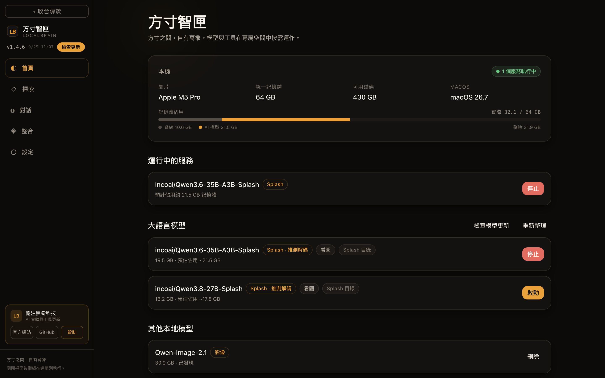

- **記憶體條拆兩段**：系統佔多少、AI 模型佔多少、還剩多少，直接寫出來。模型卡片上的「預估佔用」來自模型體積，Splash 按體積的 1.1 倍估算。
- **啟動前先仲裁**：記憶體仲裁會把已執行的後端和待啟動的模型放在一起算，資源不夠就明確拒絕，而不是先把系統撐爆再報錯。
- **三種引擎一套開關**：MLX、llama.cpp（GGUF）和 Splash 用同樣的方式啟停。Splash 自帶草稿模型做推測解碼，能看圖的模型會單獨標出來。
- **多媒體後端按需啟動**：語音轉寫、語音合成（含聲音克隆）、影像產生、影像編輯、影片產生、音樂產生各佔一張卡；閒置一段時間或記憶體吃緊時自動釋放。

※ 這不是「記憶體越大就一定更快」的承諾。能不能開、開多大，最後以首頁和探索頁依本機算出來的數字為準。

---

### ▍探索：下載之前就知道能不能跑

大模型動輒幾十 GB，下完才發現跑不動是最貴的試錯。探索頁的每張卡片把這件事提前了。

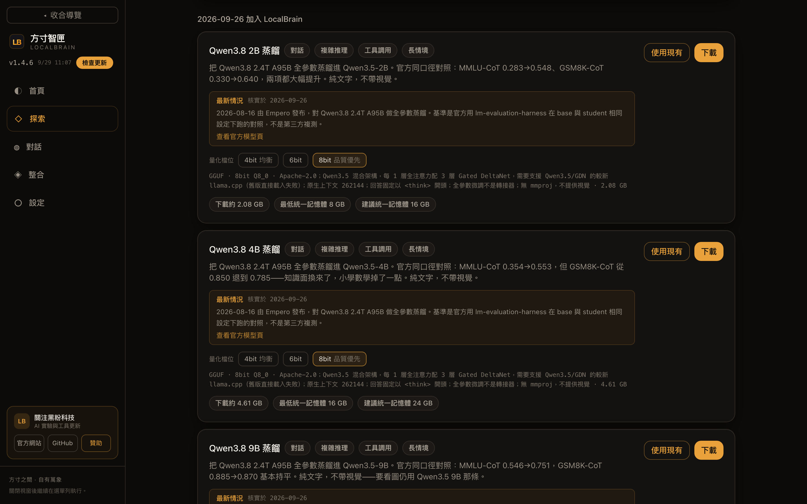

- **精選目錄 40 多條**：語言、視覺、語音、影像、影片和音樂模型，依加入時間排列。卡片寫明能力標籤、官方基準的原始數字和出處（比如上圖 Qwen3.8 2B 蒸餾版的 MMLU-CoT 0.283→0.548），以及每個量化檔位的體積。
- **記憶體依本機算**：「最低 / 建議統一記憶體」不是抄模型卡，是結合本機記憶體和模型結構算出來的。
- **授權放在下載按鈕之前**：禁止商用這類比通常更嚴的限制會提前標出，並附原文連結，不留到下完才發現。
- **下載來源測速**：ModelScope、HF-Mirror 和 Hugging Face 官方之間一鍵測速，選當次最快的；下載結束再做 SHA-256 校驗，「體積看著對」但內容損壞的檔案不會被當成成功。
- **已有模型不用搬家**：選中已經下載好的目錄即可掛載，自動識別引擎、類別與上下文能力，不複製權重、不改動來源目錄。
- **登記前先核對身分（1.4.4 新增）**：用卡片上的「使用現有」選資料夾時，會先辨識資料夾裡到底是什麼模型。確定對不上的直接拒絕，比如把影片模型包登記成圖像編輯模型；只是名稱或類別看起來不一致，就把辨識結果列出來請你確認，改過名的資料夾照樣能匯入。我自己的機器上就查出過一條：圖像編輯模型 Mage-Flow 的登記，指向的是一個 MiniMax H3 影片包的目錄，而那個目錄早就不在了。這種指向已不存在目錄的舊登記，以前會被悄悄略過，現在首頁的「失效的模型登記」會列出來，一鍵移除，只刪登記、不碰模型檔案。

> [!note]
> **識別到不等於一定能啟動。** 格式、模型架構、視覺投影檔案和目前執行環境都會影響相容性；軟體會盡量給出具體原因，不把「掃到了」包裝成「肯定能跑」。

---

### ▍對話：從回答一句話，到交付一個檔案

內建對話支援串流輸出、附件、停止、會話保存和本機工具。但我更在意的是：你讓它改一個網頁、做一份表格，它能不能真的交付，而且過程經得起檢查。

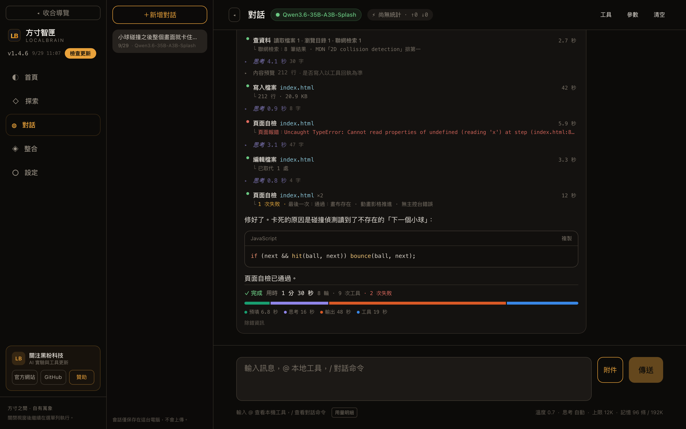

上圖是一段示範對話，但每一種顯示都是 1.4.6 的真實介面：

- **每一步都擺出來**：讀檔案、列目錄、聯網檢索、寫檔案、逐處編輯、網頁自檢，各自顯示目標和耗時；複雜任務會先列計畫，計畫卡片註明「模型自記，非獨立驗收」。
- **失敗不藏**：同一工具的重複呼叫合併成「頁面自檢 ×2」，但「1 次失敗」照樣寫在旁邊。圖裡模型第一次自檢拿到頁面報錯，只改了一行判空，再自檢才通過。
- **自檢是真跑**：產生的網頁會在無頭瀏覽器裡檢查畫布是否存在、動畫影格是否推進、主控台有沒有錯誤，不靠模型自己說「我檢查過了」。
- **時間去哪了**：任務結束給出總用時、輪數、工具次數、失敗次數，並把時間拆成預填、思考、輸出、工具四段。
- **長任務不卡介面**：1.3.27 修掉了快模型長輸出時介面卡死的問題，串流刷新和計量都做了節流。

文件任務還能直接交付 DOCX、PPTX、XLSX 或 PDF。沒有真實產生檔案時，零產物閘門會拒絕把任務報成「已完成」。

---

### ▍儲存與清理：1.4 的主角

用了一個多月，我自己的機器上積了一堆看不見的東西：檢查截圖、任務檢查點、日誌、早期版本寫進暫存目錄的圖片和配音。1.4.0 把它們全部擺到了設定裡。

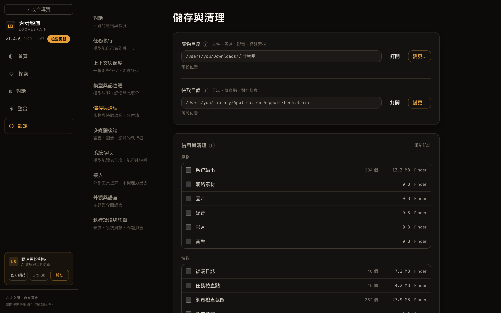

- **兩個目錄都能換位置**：「產物目錄」放產生的文件、圖片、配音、影片、音樂和網路素材；「快取目錄」放日誌、任務檢查點、檢查截圖和暫存檔案。都可以改到外接硬碟。
- **換位置自動搬家**：同一顆硬碟直接移動；跨硬碟先複製、核對無誤，再把舊的移到垃圾桶。
- **預設移到垃圾桶**：勾選清理時預設移到垃圾桶，也可以選永久刪除；移到垃圾桶的資料夾名稱帶著來源目錄，一眼認得出是哪一類。
- **自動收斂**：日誌總量、檢查點天數、暫存檔天數各有門檻，由程式在背景定時執行，視窗沒開也照常清理。

圖裡的數字是我這台機器的實測：系統輸出 13.3 MB、204 個檔案，網頁檢查截圖 27.9 MB、262 個檔案。裝上 1.4.0 後第一次自動收斂，移走了 145 個任務檢查點和 35 組舊檢查截圖。我對照應用程式保存的會話清單逐個核對過，那 145 個檢查點沒有一個屬於還在的會話。

---

### ▍接入：把本機能力交給別的 Agent

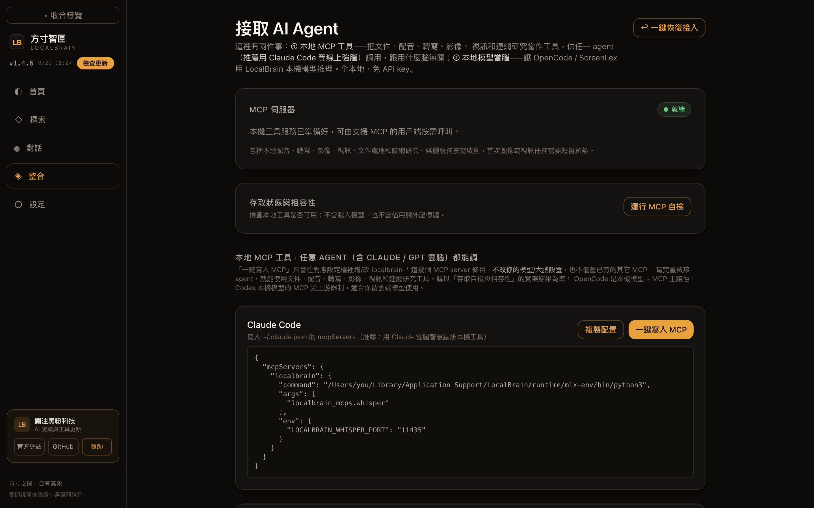

- **本機 MCP 工具**：文件處理、語音轉寫、語音合成、影像、影片和聯網研究，一鍵寫入 Claude Code、OpenCode、Codex、DeepSeek Harness 的設定。只增改 `localbrain-*` 這幾項，不動你的模型設定和其他 MCP；需要時一鍵恢復到寫入前的原樣。
- **本機模型當腦**：OpenCode、ScreenLex、DeepSeek Harness 可以透過 `127.0.0.1:11434/v1` 這個 OpenAI 相容介面直接用本機模型，不需要 API key。
- **MCP 自檢**：檢查協定與工具發現是否正常，不載入模型、不佔額外記憶體。

Codex 和 Claude Code 更穩的用法，是保留它們的雲端推理模型，只透過 MCP 呼叫 LocalBrain 的本機工具。**LocalBrain 能提供介面和工具，但不能替第三方客戶端解除它自身的模型或工具限制。**

---

### ▍三種介面語言，這次是真的補齊了

1.2.70 起就有簡體中文、繁體中文和英文三種介面。但做這組截圖時，我讓截圖台把英文介面上實際出現的中文逐條列出來，結果查出幾十處漏網：模型目錄裡 26 條沒有譯文，確認框、數字和單位的拼接也有問題。這些之前的自動檢查全是綠的，因為它們只認一種寫法。

1.4.3 把這些補齊了，並把三類漏譯方式加進了測試。1.4.4 又把約 1400 條英文逐條審校了一遍，改掉機翻腔和前後不統一的用詞；思考檔位、相容性表、附件處理狀態這類由程式拼出來的標籤，在英文和繁體介面裡也不再漏出簡體。切換語言只翻譯介面，不改對話、模型回答、程式碼和檔案路徑。

---

### ▍「私有」的邊界：哪些留在 Mac，哪些仍然會聯網

本機推理、轉寫和媒體產生可以留在 Mac 上，對話也只保存在這台電腦裡。但「本機 AI」不等於「所有操作永遠斷網」：下載模型會存取模型來源，聯網檢索會把查詢送到搜尋引擎，Codex 或 Claude Code 如果用雲端模型，推理也不在本機。

檔案工具預設只能讀取你允許的目錄。執行專案命令的能力預設關閉，打開後每次執行前都會跳出確認，並寫明「工作目錄限制不等於系統沙箱」。1.4.7 新增的「存取網路裝置」同樣預設關閉，開啟後模型才能發 HTTP 請求或用 SSH 連你 `~/.ssh/config` 裡的裝置，變更類操作每次也先請你確認。**私有不是一個標籤，而是你能看清資料去向、授權目錄和後端生命週期。**

| 如果你是這種情況 | 我的建議 |
| --- | --- |
| 本機已散落多套 MLX、GGUF、語音或媒體模型 | 適合，統一目錄引用、啟停、資源管理和清理 |
| 想讓 OpenCode 或雲端 Agent 呼叫本機多媒體工具 | 適合，用整合頁一鍵寫入或複製設定 |
| 只有一兩個 Ollama 模型，偶爾問幾句 | 未必需要再加一層管理 |
| 期待本機小模型在所有任務上取代頂級雲端模型 | 不適合，本機的優勢是控制、隱私和可重複使用，不是所有能力都更強 |

---

### ▍四步上手

- 從 **GitHub Releases** 下載最新 DMG，把 LocalBrain.app 拖進「應用程式」。

- 在「設定」安裝需要的執行環境，選好介面語言、模型目錄和下載來源。

- 在「探索」下載一個適合本機的模型，或把已有模型目錄掛載進來。

- 回首頁啟動模型，用內建對話測一次；需要外部 Agent 時再去「整合」寫入設定。

### ▍1.4.8 新增：第二個本機影片引擎 LTX-2.5

**寫一句帶引號的台詞，影片裡的人會把它說出來。** LTX-2.5 是和 MiniMax H3 並列的第二個影片引擎：文字、首幀、首尾幀都能產生帶同步立體聲的影片。它和 H3 共用同一套影片介面——時長同樣是 1～30 秒，單次最長 10 秒，更長的自動分段接力（下一段以上一段的最後一幀作首幀，接縫處畫面連續）；提示詞模板、分段拼接和 MCP `generate_video` 都照常可用，模板在 LTX 上另有一套實測結論。參考機（M5 Pro 64GB）上 1024×576 的 4 秒約 2 分鐘、10 秒約 6 分鐘、20 秒約 12 分鐘；峰值記憶體文字生成約 25 GB，帶首幀或接力的 10 秒一段約 37 GB，放不下時自動逐塊載入。參考圖還是要用 MiniMax H3 REF2VA。

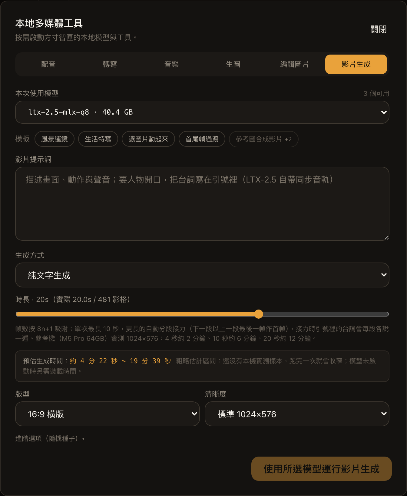

**探索頁一鍵下載，中國大陸直連。** 43.4 GB，檔案和 mlx-community 發布的一字不差；選 ModelScope 來源即可直連——Hugging Face 上這兩個倉庫是 Xet 儲存，hf-mirror 只轉發、不快取。影片執行環境 ltx-2-mlx 在首次啟動時自動安裝，約 404 MB。從 ModelScope 下載的模型現在也逐檔核對 SHA-256，之前只比大小。

**執行環境預設的 54 GB 峰值，壓到了 25 GB。** 同一段 4 秒影片，執行環境預設參數下行程峰值 54 GB：它的 Gemma 編碼器把快取上限拉到記憶體的 90%，解碼又從不分塊。方寸智匣把快取鉗在 2 GiB、解碼每塊 5 個潛幀，峰值降到 25 GB，耗時不變。

### ▍1.4.7 新增：文件能出八種格式，以及「存取網路裝置」

**文件不再只有 DOCX 和 PDF。** 讓模型「寫一份文件」時，現在還能直接產出 Markdown、HTML、TXT、RTF、ODT 和 EPUB。更要緊的是所有格式都先過一道清洗：模型寫來的內容裡那些 `{"type":"markdown", ...}` 包裝、被轉義的換行、零寬字元會先被拆掉、還原、清掉，再變成真正的標題、（能巢狀、能帶勾選框的）清單、表格和程式碼區塊——不是把一段原始 JSON 塞進 Word。這修的是一個真實翻車：一份讓它「寫一個瀏覽器三維飛行遊戲」的需求，因為其中一句「建立階段 0 文件」被整個派給了文件工具，結果幾百行原始碼被塞進八個內容沒清洗的 DOCX。現在這類寫程式、做工程的活會交給能真正寫工程檔案的通用代理，除非你點名要 DOCX、PDF、EPUB 這樣的檔案格式。

**遇到難點能聯網查、能 SSH 設定別的機器。** 新增的「存取網路裝置」開關預設關；打開後，模型能發 HTTP 請求呼叫 API 或讀取端點、用 SSH 在你 `~/.ssh/config` 裡的裝置上執行命令和傳檔案、檢查連通性與 TLS 憑證、查看本機網路狀態。SSH 只用金鑰登入，方寸智匣不碰也不儲存密碼。權限按對話來：查看類操作直接放行，會變更的（重啟服務、改設定、上傳檔案、POST/PUT 之類）每次先請你確認，你也可以在某個對話裡開啟完全信任，之後不再逐次打斷。它和「聯網檢索」是兩件事、各自獨立——那一項是查網頁，這一項是操作別的機器；掃連接埠、抓封包這類對別人網路做探測的能力，沒有做。

### ▍1.4.8 之後：安全檢查、辦公文件、社群模型、下載體驗（現行 1.9.4）

正文與截圖停在 1.4.8，之後的版本各有專題文章，這裡只把主線列出來：

- **授權網路安全檢查（1.5～1.6）**：工作區安全審查與授權網路檢查兩個入口，固定參數向量、隔離沙箱執行、本機靶場反向驗證，全程 fail-closed。詳見[[localbrain-network-security|網路安全測試]]。
- **辦公文件保格式（1.6.8）**：DOCX / XLSX / PPTX 的保格式編輯與模板填充，「按表格填入、不改原格式」。
- **對話裡直接呼叫多媒體（1.8.0）**：模型執行時，語音、轉寫、圖片、音樂、影片進同一個任務代理。詳見[[localbrain-media-chat-180|對話多媒體呼叫]]。
- **Splash 社群模型（1.8.x）**：社群四位模型的下載、組裝與啟動，支援魔搭傳輸、斷流自動續傳與固定提交雜湊核對。
- **下載速度顯示（1.8.8）**：進度裡直接顯示即時速度與預計剩餘時間；斷流後撤下舊讀數並提示等待資料，不再出現虛高或滯留的假速度。
- **技能與長期記憶（1.8.9）**：探索其他代理的資料位置，選擇唯讀掛載或複製匯入，在軟體內編輯，並分別設為自動、僅手動或關閉。模型目前可檢索與讀取資料，不能自行新增或啟用內部技能與記憶。
- **上下文整理（1.9.1）**：長聊天像一疊聊天記錄：程式保留原文，另寫一份接續提綱。達到筆數或容量門檻後增量合併摘要，也可在閒置時點「立即壓縮」；工具對話採精簡中文摘要，還原不重新執行已完成工具。安裝版本輪自動整理約2.97秒、手動約2.48秒，只代表這次樣例；摘要仍可能遺漏細節。

- **設定與介面修復（Mac 1.9.3）**：還原外部客戶端設定時僅回退受管欄位，空備份保留後來新增項，格式錯誤則保留原檔與備份。首頁失焦暫停輪詢，探索頁切換視窗不再掃描目錄；對話可搜尋與改名，清單與附件減少無關刷新。媒體記憶體衝突可手動切換，語言模型停止失敗時不繼續啟動媒體。Windows／Linux 保留各自1.9.2版本。

---

- **個人裝置唯讀檢查（Mac 1.9.4）**：手機、電腦、嵌入式與韌體分開登記，先批次加入名單，再到對話補充要求並手動傳送。Android僅擷取已授權的系統／修補資訊，電腦查詢本機安全狀態，網路裝置限制少量授權連接埠；韌體只做指紋、單執行緒識別或離線元件比對。模型不能自選任意路徑或借其他工具擴大範圍。缺少依賴與漏洞庫會明確提示，不將失敗當成零漏洞；本機與離線樣例已驗證，真實手機及嵌入式硬體仍待實測。

#### LocalBrain 2.3.5

方寸智匣：把 Mac 上的本機模型、多媒體、文件和 MCP 工具收進同一個工作台。

> [!note]
> 平台 macOS 13.0+ / Apple Silicon · Windows / Linux 為 2.3.4 · 安裝包 LocalBrain\_2.3.5\_aarch64.dmg

[LocalBrain 下載與更新（發行頁）](https://github.com/HackerChi-Hub/localbrain-releases/releases/latest)

[LocalBrain 產品介紹](https://hyphentech.top/localbrain)

目前安裝包的 SHA-256 是 **61e3e6f35158dff35575a0ed76b00f437185d7e6a42659bf746438a5f4cbb40f**。它使用開發簽章，尚未完成 Apple 公證；第一次打開被 Gatekeeper 攔下時，先確認下載來源和雜湊，再用下面的命令移除隔離屬性。

```shell
xattr -dr com.apple.quarantine /Applications/LocalBrain.app
```

*只對從官方 Releases 下載且已核對雜湊的安裝包使用。*

如果它幫上了忙，側欄「關注黑粉科技」裡的「贊助」可以看到微信贊助碼；贊助完全自願，不影響任何功能。

> **// 雲端模型負責把複雜問題想明白，本機工具負責把你的檔案、模型和工作流程握在自己手裡。這兩件事不衝突。**

---

> [!note]
> 最後的選擇很簡單
> 
> 如果你的本機模型和工具已經多到開始反過來管理你，LocalBrain 能省下的就不只是幾條命令，而是每次重啟、換模型、換任務、清快取時重複折騰的時間。如果你只需要偶爾聊幾句，保持現在的簡單工具就好。


---

## 🧰 我做的工具

這些工具都由我持續維護。預覽版會明確標註，下載、更新和已知邊界以發行頁為準。

> [!info] 黑粉助手 HyphenAssistant
> **狀態：** 正式迭代
>
> 手機瀏覽器接續電腦上的 DeepSeek Harness 對話；需本人配對、電腦與原服務在線，模型費用沿用原設定
>
> [下載與更新：黑粉助手 HyphenAssistant](https://github.com/HackerChi-Hub/hyphen-assistant-releases/releases)

> [!info] 黑粉盒子 HyphenBox
> **狀態：** 正式迭代
>
> 免費大模型 API 雷達：持續複測可用性，本機統一介面，Key 只存本機
>
> [下載與更新：黑粉盒子 HyphenBox](https://github.com/HackerChi-Hub/hyphenbox-release/releases)

> [!info] 方寸智匣 LocalBrain
> **狀態：** 正式迭代
>
> 本機模型的多模態 MCP 工具箱：TTS / Whisper / 影片生成一站接入
>
> [下載與更新：方寸智匣 LocalBrain](https://github.com/HackerChi-Hub/localbrain-releases/releases)

> [!info] ScreenLex 光影詞庫
> **狀態：** 正式迭代
>
> 看美劇順手把生詞背了，Mac/Windows 雙平台，免費
>
> [下載與更新：ScreenLex 光影詞庫](https://github.com/HackerChi-Hub/screenlex-download/releases)

> [!info] 黑粉錄屏 HyphenScreen
> **狀態：** 正式迭代
>
> 錄屏 + 智慧剪輯一體：達文西式時間軸、自動打碼、匯出前成片體檢，免費
>
> [下載與更新：黑粉錄屏 HyphenScreen](https://github.com/HackerChi-Hub/HyphenScreen-Releases/releases)

---

> [!quote] 黑粉科技
> **讓AI成為你的超能力**
> 本機部署 · 免費白嫖 · 自製軟體
> [黑粉科技](https://hyphentech.top)
