## Windows / Linux 2.5.1：长期记忆并入「技能卡」、零显存中英混合检索与跨 Agent 兼容

Windows 与 Linux 正式安装包同步跟进至 `2.5.1`，与 Mac 端对齐三平台 `2.5.1` 更新清单：

- **技能卡与长期记忆合一 + 零显存中英混合 BM25 检索**：「技能与记忆」升级为统一技能卡工作台，置顶内置「个人长期记忆（`personal-memory`）」核心卡，并与官方任务技能卡及自定义技能卡统一维护 `card_memories/<card>/*.md` 标准 YAML + Markdown 账本；模型加载技能卡时按 `1800` 字符预算自动附带本卡记忆与置顶个人记忆，纯 CPU 中英混合（ASCII + CJK 2-gram/3-gram + BM25）检索毫秒级命中且零显存占用。
- **聊天 `/remember` 快捷指令 + 网页防注入隔离队列 + 跨 Agent 只读同步**：对话输入框发送 `/remember` 即可一键归卡，原生代理新增 `localbrain_skill_remember` 工具（单条 `500` 字上限、SHA-256 去重、不递增 `policy.revision`），网页读取后自动进入「待确认技能卡记忆」防注入隔离队列；同时支持只读扫描并入 Claude Code、Codex、Antigravity、Gemini CLI、OpenCode、DSH、Cursor（`.mdc`）、Windsurf、Cline、Continue 与 MCP `memory.jsonl`。
- **本机实装验收与平台边界**：Windows x64（`LocalBrain_2.5.1_x64-setup.exe`，`43,898,612` 字节，SHA-256 `a709f8441ccc669a4c2aa4a05db1ac77412516b8d63f077d232f8ba741c6728d`）完成覆盖安装（`13,994` 项文件一致）、技能卡记忆写入/网页防注入隔离审批/无空格中文 BM25 检索、`Unsloth b12651` CUDA 12.8 引擎自检与原生 `Inkling-2-Mini-GGUF` `Q2_K_XL` 工具往返验收；Linux amd64（Debian SHA-256 `d99729eb8bc9fcf04931b029c6012810d7b7a2e08692e2a2242e93b957816d65`、AppImage SHA-256 `b86635f592a2231b75ec21c772273ffb6a0b8b6e682e61be1f0d3aa149166de0`）在 WSL2 Ubuntu 22.04 完成安装启动（`14,020` 项资源）与 ext4 包内 DSH 宿主校验（不代表裸机 GPU 或 Linux 模型推理验收；`Atomic Engine` 与 `oMLX 0.8.3` 仅限 Apple Silicon Mac，Strata 在 Windows/Linux 上的推理与 `Q3/Q4`/`Unbound v2.1` 权重未在本轮本机实测）。

[Windows x64 (2.5.1)](https://github.com/HackerChi-Hub/localbrain-releases/releases/download/v2.5.1-win-linux/LocalBrain_2.5.1_x64-setup.exe) · [Debian amd64 (2.5.1)](https://github.com/HackerChi-Hub/localbrain-releases/releases/download/v2.5.1-win-linux/LocalBrain_2.5.1_amd64.deb) · [AppImage (2.5.1)](https://github.com/HackerChi-Hub/localbrain-releases/releases/download/v2.5.1-win-linux/LocalBrain_2.5.1_amd64.AppImage) · [SHA-256](https://github.com/HackerChi-Hub/localbrain-releases/releases/download/v2.5.1-win-linux/SHA256SUMS-2.5.1-WIN-LINUX.txt) · [验收记录](https://github.com/HackerChi-Hub/localbrain-releases/blob/main/VERIFICATION-2.5.1-WIN-LINUX.md)

## Mac 2.5.1：长期记忆直接并入「技能卡」、零显存中英混合检索与跨 Agent 全生态兼容

Mac 2.5.1 将原本相互割裂的「技能」与「独立手动勾选记忆」重构合并为统一的**技能卡记忆体系**，在不增加一分显存占用的前提下实现开箱即用与跨 Agent 生态互通：

- **统一「技能卡 + 实战记忆账本」，随卡按需注入且零显存开销**：「技能与记忆」升级为统一技能卡网格与双标签工作台，置顶内置「个人长期记忆（`personal-memory`）」核心卡，并与官方任务技能卡（`software-development`、`office-documents`、`office-spreadsheets`、`office-presentations`、`research-sources`）及自定义技能卡统一维护 `card_memories/<card>/*.md` 标准 YAML + Markdown 账本。模型加载任意技能卡时按 `1800` 字符预算自动附带本卡记忆与置顶个人记忆，置顶个人记忆同步按 `800` 字符预算注入系统上下文；底层搭载纯 CPU 中英混合（ASCII 词元 + 中日韩 2-gram/3-gram + BM25）检索引擎，无空格中文短语毫秒级命中，零显存占用。
- **聊天 `/remember` 快捷指令 + 模型受控写入与网页防注入隔离闸**：在对话输入框发送 `/remember 内容`（支持 `/记住` 斜杠菜单补全及 `/remember [software-development] 端口固定 5173` 定向归卡）即可一键写入对应技能卡；原生对话代理新增 `localbrain_skill_remember` 工具（单条上限 `500` 字、SHA-256 幂等去重、独立文件原子写入且不递增 `policy.revision`，不会打断正在运行的原生会话或已有上下文压缩摘要）；一旦当前任务曾通过 `webminer` 读取外部网页，模型提交的记忆会自动进入「待确认技能卡记忆」隔离横幅，经本人确认后才正式入卡，防止外部网页提示词注入污染长期记忆。
- **跨 Agent 记忆与规则双向兼容（外部来源全程 100% 只读）**：一键扫描并支持并入 Claude Code、Codex（自动跳过 `> 256 KiB` 的聚合 `MEMORY.md`，精准提取 `extensions/ad_hoc/notes/*.md` 原子笔记并按 YAML `scope:` 标签自动归入对应技能卡）、Antigravity、Gemini CLI、OpenCode、DeepSeek Harness (DSH)、Cursor（`.cursor/rules/*.mdc` 含 `globs` 范围解析）、Windsurf、Cline、Continue 以及 MCP `server-memory`（`memory.jsonl` 实体与关系图谱转 Markdown），同时支持一键导出带 `scope` 元数据的跨 Agent 通用 Markdown。

安装包（`LocalBrain_2.5.1_aarch64.dmg`）为 `80,422,148` 字节（本地签名，未 Apple 公证），SHA-256：`ded8f3666ddff88c5840530f473e44cd4e7f99ad24f731b97889e3372e77dd69`。Windows 与 Linux `2.5.1` 正式安装包已同步完成本机实装验收（见上方小节）。

[下载 Mac 2.5.1（Apple Silicon DMG）](https://github.com/HackerChi-Hub/localbrain-releases/releases/download/v2.5.1/LocalBrain_2.5.1_aarch64.dmg) · [查看 v2.5.1 发行页](https://github.com/HackerChi-Hub/localbrain-releases/releases/tag/v2.5.1) · [下载与更新：方寸智匣 LocalBrain 发行页](https://github.com/HackerChi-Hub/localbrain-releases/releases/latest)

## Windows / Linux 2.5.0：同步上线「当前会话超级权限」开关、跨平台 Shell 放行与系统根目录保护

Windows 与 Linux 正式安装包同步跟进至 `2.5.0`，与 Mac 端对齐三平台 `2.5.0` 更新清单：

- **对话页会话级 `[超级权限]` 独立开关、担责确认与一键撤回**：在对话页输入框右侧 `[附件]` 与 `[停止]` / `[发送]` 旁同步上线 `54px` 等高双行状态按钮 `[超级权限]`（空闲与 `生成中...` 期间均支持实时切换），开启前强制弹出后果担责确认模态框（明确提示 **「使用者须对一切后果负全部责任」**），开启后常驻红色警示横幅并提供一键 `[退出超级权限]` 入口；状态严格按 `sessionId` 驻留运行内存，新建或切换其他对话默认关闭，重启应用自动复位。
- **跨平台原生 Shell 执行与系统根目录保护加固**：开启后在当前会话解锁原生 `run_shell_command`（Windows 采用 `PowerShell -NoProfile -NonInteractive -ExecutionPolicy Bypass` 兼容默认 `Restricted` 策略下的 `npm`/`pnpm` 等 `.ps1` 命令，并自动剥离 `\\?\` 冗长盘符前缀以避免子进程 UNC 路径报错；Linux 采用 `bash`）、`write_any_file` 与 `remove_path`（在 `/` 与 `~` 之外补齐 Windows `C:\Windows`·`C:\Users`·`C:\Program Files`·`C:\ProgramData` 及 Linux `/usr`·`/etc`·`/bin`·`/var`·`/home` 等系统根目录防误删硬保护），同步解除本会话 `system` / `network` 目录与命令白名单及逐次确认弹窗。
- **本机实装验收与平台边界**：Windows x64（`LocalBrain_2.5.0_x64-setup.exe`，`43,847,826` 字节，SHA-256 `3071551e59aa4a404b14d41c36562920ec4f25a203f0e80b059631626f7937e4`）完成覆盖安装（`13,994` 项文件一致）、超级权限弹窗/会话隔离/PowerShell 执行/系统根目录拦截、`Unsloth b12651` CUDA 12.8 引擎自检与原生 `Inkling-2-Mini-GGUF` `Q2_K_XL` 工具往返验收；Linux amd64（Debian SHA-256 `87adca99e4cbc5ac74ecaf6b3f75afca673b6437535fe9f0f7710c403b2abffd`、AppImage SHA-256 `532857fddc1bc133073cd88251cdc1be1ba4b961ef21ac4cf35422292785e7ec`）在 WSL2 Ubuntu 22.04 完成安装启动（`14,020` 项资源）与 ext4 包内 DSH 宿主校验（不代表裸机 GPU 或 Linux 模型推理验收；`Atomic Engine` 与 `oMLX 0.8.3` 仅限 Apple Silicon Mac，Strata 在 Windows/Linux 上的推理与 `Q3/Q4`/`Unbound v2.1` 权重未在本轮本机实测）。

[Windows x64 (2.5.0)](https://github.com/HackerChi-Hub/localbrain-releases/releases/download/v2.5.0-win-linux/LocalBrain_2.5.0_x64-setup.exe) · [Debian amd64 (2.5.0)](https://github.com/HackerChi-Hub/localbrain-releases/releases/download/v2.5.0-win-linux/LocalBrain_2.5.0_amd64.deb) · [AppImage (2.5.0)](https://github.com/HackerChi-Hub/localbrain-releases/releases/download/v2.5.0-win-linux/LocalBrain_2.5.0_amd64.AppImage) · [SHA-256](https://github.com/HackerChi-Hub/localbrain-releases/releases/download/v2.5.0-win-linux/SHA256SUMS-2.5.0-WIN-LINUX.txt) · [验收记录](https://github.com/HackerChi-Hub/localbrain-releases/blob/main/VERIFICATION-2.5.0-WIN-LINUX.md)

## Mac 2.5.0 · 对话页新增「当前会话超级权限」按钮、强制担责确认与全盘 Shell 执行

- **输入框旁精排「超级权限」会话开关 + 开启前强制后果担责弹窗**：在对话页输入框右侧 `[附件]` 与 `[停止]` / `[发送]` 旁边新增双行状态指示的 `[超级权限]` 按钮（`● 超级权限 / 当前会话` ↔ `● 超级权限 / 本会话已开`），统一 `54px` 高度圆角排版且在 **`生成中...` 运行中同样支持实时开启或关闭**；点击开启时强制弹出高风险权限确认框，明确提示 **「使用者须对一切后果负全部责任」**，确认后在输入框上方展示常驻红色警示横幅与一键 `[退出超级权限]` 入口。
- **严格按当前会话内存隔离，全链路解锁任意 Shell 与全盘文件操作**：状态仅绑定当前会话 `sessionId` 驻留运行内存，**新建或切换到其他对话默认关闭**，删除会话或重启软件自动复位；当前会话开启后解锁原生 `run_shell_command`（支持完整 Shell 语法、管道与重定向）、`write_any_file`（全盘任意路径写入并自动建目录）、`remove_path`（文件/递归目录删除，保留 `/` 与 `~` 根目录硬保护），同步解除 `read_file` / `edit_file` / `run_workspace_command` / `start_workspace_job` 的工作区与白名单限制并免除本会话逐次确认弹窗。

安装包（`LocalBrain_2.5.0_aarch64.dmg`）为 `80,361,883` 字节（本地签名，未 Apple 公证），SHA-256：`35e696d9673359f92e2ef04aceafadf8164cef489af8ebeb30c97b0418ab4ef8`。Windows 与 Linux `2.5.0` 正式安装包已同步完成本机实装验收（见上方小节）。

[下载 Mac 2.5.0（Apple Silicon DMG）](https://github.com/HackerChi-Hub/localbrain-releases/releases/download/v2.5.0/LocalBrain_2.5.0_aarch64.dmg) · [查看 v2.5.0 发行页](https://github.com/HackerChi-Hub/localbrain-releases/releases/tag/v2.5.0) · [下载与更新发行页](https://github.com/HackerChi-Hub/localbrain-releases/releases/latest)

## Windows / Linux 2.4.9：升级 Unsloth b12651 引擎（解锁 Q8_0 KV）、上线 Unbound v2.1 与单文件挂载同步

Windows 与 Linux 正式安装包同步跟进至 `2.4.9`，与 Mac 端对齐三平台 `2.4.9` 更新清单：

- **跨平台独立 `inkling-gguf` 升级至 `Unsloth b12651-mix-c7059d6` 并上线新模型目录**：Windows（CUDA 12.8 / Vulkan）与 Linux（Vulkan）同步升级独立受管 `inkling-gguf` 引擎，同时兼容 `inkling2` 与主线 `inkling2_loop` 架构并解除原 `f16` KV 硬夹紧（支持 `Q8_0` KV 缓存）；发现页上线 `nokeepai/Inkling-2-Mini-Unbound-GGUF`（`v2.1` `IQ2_M / IQ3_M / Q4_K_M` + `mmproj-Q8_0` + `DSpark`）、主线 `unsloth/Inkling-2-Mini-GGUF` 与 `RX5950XT/Inkling-2-Mini-Uncensored-Strata`（`SQ-10/15/20` + `Vision.strata`）。
- **同步单文件 `.gguf` 挂载、软链防环扫描与加载授权闭环**：合并发现页「挂载单文件」（选中单个 `.gguf` 不误挂整个 `Downloads` 目录）、外部模型库软链目录防环扫描、`.localbrain-reference.json` 挂载路径配置保存/启动放行及对话原生看图统一判定。
- **本机实装验收与平台边界**：Windows x64（`LocalBrain_2.4.9_x64-setup.exe`，SHA-256 `b761c071ef9781b82da1080291db43191b053e2a9b8647897dd5fe14bc137974`）完成覆盖安装、`Unsloth b12651` CUDA 12.8 运行库校验、原生 GGUF Q2 工具往返推理、官方与 Uncensored/Unbound 卡片隔离、独立单文件 `.gguf` 挂载及外部库移除实测；Linux amd64（Debian SHA-256 `5f01bb07d44a83b27472ed8e60fd4b4a261397a4d0d732ab174e683fe6dd70ab`、AppImage SHA-256 `e3f4d43db7fefb7399d7f4a1c516723f2c6dc513624c6db442541558085aebf6`）在 WSL2 Ubuntu 22.04 完成安装启动与 ext4 包内 DSH 宿主校验（不代表裸机 GPU 或 Linux 模型推理验收；`Atomic Engine` 与 `oMLX 0.8.3` 仅限 Apple Silicon Mac，Strata 在 Windows/Linux 上的推理与 Unbound v2.1 权重未在本机实测）。

[Windows x64 (2.4.9)](https://github.com/HackerChi-Hub/localbrain-releases/releases/download/v2.4.9-win-linux/LocalBrain_2.4.9_x64-setup.exe) · [Debian amd64 (2.4.9)](https://github.com/HackerChi-Hub/localbrain-releases/releases/download/v2.4.9-win-linux/LocalBrain_2.4.9_amd64.deb) · [AppImage (2.4.9)](https://github.com/HackerChi-Hub/localbrain-releases/releases/download/v2.4.9-win-linux/LocalBrain_2.4.9_amd64.AppImage) · [SHA-256](https://github.com/HackerChi-Hub/localbrain-releases/releases/download/v2.4.9-win-linux/SHA256SUMS-2.4.9-WIN-LINUX.txt) · [验收记录](https://github.com/HackerChi-Hub/localbrain-releases/blob/main/VERIFICATION-2.4.9-WIN-LINUX.md)

## Mac 2.4.9：Inkling 2 Mini 四大引擎全面升级、16GB Mac 冷专家 SSD 流式与四款新变体实测上线

Mac 2.4.9 在 `2.4.8` 打通全链路本地目录、软链与单文件 `.gguf` 挂载识别的基础上，将围绕 **Inkling-2-Mini** 的四项底层引擎升级与四款最新优化权重一次性全量接入并完成 Apple M5 Pro 64GB 同题实测：

- **新增 `Atomic Engine`（`e110381ae2`）Mac Metal 冷专家 SSD 流式引擎 + `AtomicChat` 官方/Uncensored `AD-IQ2_M / AD-IQ3_S / AD-Q4_K`**：按本机统一内存自动规划 `--engine-budget-mib`（16GB→`8292 MiB`、18GB→`10340 MiB`、24GB→`14436 MiB`、32GB→`18532 MiB`、48GB+→`20580 MiB`，支持 `LOCALBRAIN_ATOMIC_BUDGET_GIB` 覆盖）并配齐 `DSpark Q8_0` 7/32 草稿与 `Q4_0` KV。M5 Pro 实测在 `8GB` 预算下依靠 NVMe SSD 冷专家按需流式读取（`488,434` 次冷读）将物理峰值 `RSS` 压至 **`6.34 GiB`**，代码重写 **`41.7 tok/s`**、`edit_file` **`7.68s`**，让 **16GB / 18GB Mac 首次流畅跑起 30B 循环 MoE**；`14GB` 预算实现零 SSD 未命中、冷启动 `1.87s`、峰值 `RSS` `9.17 GiB`、代码重写 **`51.0 tok/s`**、`edit_file` **`4.99s`**（锁定 `4096` 窗口，纯文本与工具专用；多问长思考题建议使用下方 `Strata` 或 `Unbound`）。
- **上线 `Strata Uncensored`（`SQ-10 / SQ-15 / SQ-20` + `Vision.strata`）与 `Unbound v2.1` 正交去拒答多模态 GGUF，全量升级 `oMLX 0.8.3` 与 `Unsloth b12651`**：
  - `RX5950XT/Inkling-2-Mini-Uncensored-Strata`（`SQ-15`）：冷启动 **`2.27s`**，代码重写冲上 **`102.4 tok/s`（`5.33s`）**，4 并发 `75.1 tok/s`，`T9` 桌面截图 **`6.82s`（8/8 零误差）**，`T5` 逻辑 **`5.13s`（3/3 全对）**，`45.3K` 暖前缀首字 **`0.228s`**，峰值 `RSS` `12.21 GiB`。
  - 独立 `inkling-gguf` 升至 `Unsloth b12651-mix-c7059d6`（开放 Mac Metal + Win CUDA12/Vulkan + Linux Vulkan 及 `Q8_0` KV 缓存），新增 `nokeepai/Inkling-2-Mini-Unbound-GGUF`（`v2.1` `IQ2_M / IQ3_M / Q4_K_M` + `mmproj-Q8_0` + `DSpark`），2-bit `IQ2_M` 即实现代码重写 **`54.4 tok/s`（DSpark 接受率 `95.4%`）**、`T5` 逻辑 `3/3` 满分与 `T9` 8 条目识图。
  - 独立 `oMLX` 升至 **`0.8.3`**，默认开启 Lightning MTP 与 4-bit TurboQuant KV，物理峰值 `RSS` 由 `16.34 GiB` 直降至 **`9.39 GiB`**，`T9` 看图由 `53.0s` 缩短至 **`27.46s`**。

安装包（`LocalBrain_2.4.9_aarch64.dmg`）为 `80,337,957` 字节（本地签名，未 Apple 公证），SHA-256：`16f32c2c8fc6f47a41ba3547cff67a0b38939d0dcf4a13f9165da75d06b48592`。Windows / Linux `2.4.9` 正式安装包已同步完成本机实装验收（见上方小节）。

[下载 Mac 2.4.9（Apple Silicon DMG）](https://github.com/HackerChi-Hub/localbrain-releases/releases/download/v2.4.9/LocalBrain_2.4.9_aarch64.dmg) · [查看 v2.4.9 发行页](https://github.com/HackerChi-Hub/localbrain-releases/releases/tag/v2.4.9) · [M5 Pro 逐题实测归档](https://github.com/HackerChi-Hub/localbrain/blob/main/docs/benchmarks/INKLING_2_4_9_M5_PRO_BENCHMARK.md)

## Windows / Linux 2.4.8：彻底解决新模型下载完成状态、量化档位聚焦、缓存隔离与外部目录移除问题

针对近期新加入模型容易复现的“下载完毕仍显示未完成 / 虚报已缓存字节”和外部目录无法正常管理移除问题，2.4.8 从前后端模型登记与目录匹配层做了系统性修复：

- **统一扁平目录、量化子目录与外部模型库的完成状态与默认选档**：支持量化子目录（如 `Q2_K_XL/`）与仓库根部共享辅助组件（`dspark`、`mmproj`、`Vision.strata`）组合识别，剔除对外部目录可选 `SHA256SUMS.txt` 或预转换构建原始文件名的误判；多档位模型卡片重新打开时自动聚焦到本机已安装的量化档位，断点缓存严格按所选档位主权重隔离计数，切换至未下载档位不再误报 `已缓存 11.2 GB · 可继续下载`。
- **打通三类模型来源的管理移除入口与诚实提示**：修复外部模型库（`origin === "library"`，`recordPath` 为空）点击「管理 / 移除」无法定位真实路径的问题，按受管目录（`managed`）、外部模型库（`library`）与单次引用目录（`reference`）准确区分确认文案（「删除目录中的模型文件」vs「仅移除引用、保留原始文件」），并在首页、发现页卡片、已安装与缓存管理视图共用同一条目标记录；同时收紧受管 `strata`/`sushi`/`splash` 未完成 `.part`/`.partial` 过滤与非 macOS GGUF+DSpark 引擎分流，新增覆盖全量 `CURATED_MODELS` 的跨布局自动化回归测试。
- **本机实装验收与平台边界**：Windows x64 安装包（`LocalBrain_2.4.8_x64-setup.exe`，SHA-256 `7c8c5af46d9132a23dd56533c9974d1ad10961122ae2cc48166034122cd6213e`）完成覆盖安装（13,994 项文件一致）、CUDA 运行库校验、GGUF Q2 工具往返推理，以及基于本机 `unsloth--Inkling-2-Mini-GGUF`（`Q2_K_XL` 子目录）与 `strata-engine--Inkling-2-Mini-Strata`（`SQ-10`）真实目录和可抛弃外部库模型的自动选档、`已安装` 显示、跨档缓存隔离与移除实测；Linux amd64（Debian SHA-256 `a786efb899f275008a910863d76332544344de3f46f583aa831cfbc55dcaaba0`、AppImage SHA-256 `132ee00849cc356968c7c7b96bfd106c2f2b75314a12fb3e04ff3d08fbdec259`）在 WSL2 Ubuntu 22.04 完成安装启动与 ext4 包内 DSH 宿主校验（不代表裸机 GPU 或 Linux 模型推理验收；Strata 在 Windows/Linux 上的推理尚未实测）。Mac 共用模型管理源码已同步修复，线上 Mac 安装包与更新清单保留 `2.4.7`，待 macOS 本机构建与实机验收后单独更新。

[Windows x64 (2.4.8)](https://github.com/HackerChi-Hub/localbrain-releases/releases/download/v2.4.8-win-linux/LocalBrain_2.4.8_x64-setup.exe) · [Debian amd64 (2.4.8)](https://github.com/HackerChi-Hub/localbrain-releases/releases/download/v2.4.8-win-linux/LocalBrain_2.4.8_amd64.deb) · [AppImage (2.4.8)](https://github.com/HackerChi-Hub/localbrain-releases/releases/download/v2.4.8-win-linux/LocalBrain_2.4.8_amd64.AppImage) · [SHA-256](https://github.com/HackerChi-Hub/localbrain-releases/releases/download/v2.4.8-win-linux/SHA256SUMS-2.4.8-WIN-LINUX.txt) · [验收记录](https://github.com/HackerChi-Hub/localbrain-releases/blob/main/VERIFICATION-2.4.8-WIN-LINUX.md)

## Windows / Linux 2.4.7

Windows/Linux 2.4.7 已完成本地安装验收，首页模型统一展示，移除 PolyStrata 独立说明卡片，安装和接入收进「添加模型」。Windows GGUF Q2、CUDA 引擎与工具往返通过；Linux Debian/AppImage 在 WSL2 Ubuntu22.04 安装启动、宿主检查通过。Strata Windows/Linux 推理尚未实测，Locals 限 Apple Silicon。Python 全套未通过：Mac Locals 测试缺少 locals 依赖，画布变化断言连续复测失败；这两项不列为已验证能力。源码 CI 因 GitHub 账单／额度限制未运行，作者已授权先发布已验证范围。Mac 原包保留。

[Windows x64](https://github.com/HackerChi-Hub/localbrain-releases/releases/download/v2.4.7-win-linux/LocalBrain_2.4.7_x64-setup.exe) · [Debian amd64](https://github.com/HackerChi-Hub/localbrain-releases/releases/download/v2.4.7-win-linux/LocalBrain_2.4.7_amd64.deb) · [AppImage](https://github.com/HackerChi-Hub/localbrain-releases/releases/download/v2.4.7-win-linux/LocalBrain_2.4.7_amd64.AppImage)


## Mac 2.4.7：接入 Strata v0.2.20 多模态极速引擎、发现页上线 Inkling 2 Mini Strata 与原生多子代理并发调度

Mac 2.4.7（合并并完善 `2.4.6` 引擎与并发架构更新）带来三项核心能力：

- **新增 Strata v0.2.20（`0.1.66`）受管引擎与发现页 `Inkling 2 Mini · Strata 原生量化（含视觉）`**：在「发现」页提供 `strata-engine/Inkling-2-Mini-Strata`（`SQ-10` 11.1 GB / `SQ-15` 15.0 GB / `SQ-20` 20.0 GB，均自带 `636 MB` `Inkling-2-Mini-Vision.strata` 与完整分词器），首次启动按需自动安装 Strata Metal 运行时（支持 `64K` 原生上下文、持久化前缀缓存及 `tauri://localhost` / `http://tauri.localhost` 双域 `204` 预检）。同时修复 `inkling_runtime` 因目录内附带同款 `config.json`（`model_type: "inkling2_loop"`）而误抢并隐藏本地/受管 `.strata` 目录的冲突，补齐 `.strata` 权重校验与更新检查。
- **M5 Pro 64GB `Inkling-2-Mini-SQ-15` 实测数据**：冷加载 `< 3s`，4 并发短提示总吞吐 **`76.26 tok/s`**（单路 `22.30 tok/s`，**3.42x**）；`T9` 桌面截图（`8` 项模型与引擎标签全对）仅 **`7.339s`**（`45.93 tok/s` 解码），`T8` 代码排错 **`16.512s`**（`50.83 tok/s`），`T5` 逻辑陷阱 `4.804s`（Q1/Q2 精准答对，Q3 灯泡机理对但收口字母有 1 处笔误），`T10` `45K` 词元冷预填 `56.133s`、暖缓存二轮追问仅 **`1.039s`**（TTFT **`0.236s`**）。
- **原生多子代理（Multi-Subagent）并发调度上线**：DeepSeek Harness 宿主（`subagents.mjs`）与对话工作台集成只读并发子代理拆分与汇总，压榨 `Locals` / `Strata` 连续批处理带宽——`Locals NVFP4` 4 并发短提示从 `38.22 tok/s` 拉升至 **`100.84 tok/s`**（**2.64x**）；4 文件源码审计对照中，`Strata SQ-15` 由单代理 `357.1s` 缩短至 **`324.5s`**（`4/4` 全成，峰值 worker `61.91 tok/s`），`Locals` 三名并发子代理在 `151.7s–182.9s` 完成（受跨读 `dshAgent.ts` 的单名拖尾 worker `274.8s` 牵制，总计 `351.5s`，单代理 `214.7s`）。

安装包（`LocalBrain_2.4.7_aarch64.dmg`）为 `80,316,165` 字节（本地签名，未 Apple 公证），SHA-256：`8a3ca09ece28855c70c2fb216326a03207e39645060a48cf2b2f8533d32023ba`。

[下载 Mac 2.4.7（Apple Silicon DMG）](https://github.com/HackerChi-Hub/localbrain-releases/releases/download/v2.4.7/LocalBrain_2.4.7_aarch64.dmg) · [查看 v2.4.7 发行说明](https://github.com/HackerChi-Hub/localbrain-releases/releases/tag/v2.4.7)

## Mac 2.4.5：修复 Locals 大工具集 DFA 超限、收敛唯一模型入口与三版本 7+3 全项实测

Mac 2.4.5 在 `2.4.4` 引入 `Locals NVFP4` 极速通道的基础上解决两项实操痛点，并补齐 M5 Pro 三版本全套同题验证：

- **修复 DeepSeek Harness 等大工具集调用 `DFA exceeds 400000 states`**：内置启动器 `inkling_locals_server.py` 在紧凑小工具集上继续保留 `--typed-tools` GPU 强制文本加速；遇到 40+ 工具或复杂 Schema（正则超 `150,000` 字符或编译触及 40 万 DFA 状态 / int16 限制）时，自动平顺退回非强类型工具调用语法并复用编译缓存。已完成 45 工具模拟 DeepSeek + MCP 流式调用与 12 工具 `system + docfactory` 双交付实测，零报错跑通。
- **彻底去噪外部模型列表并修正软链体积**：跳过 `_` 开头过渡目录（如 `_src-thinkingmachines-Inkling-2-Mini`）及 `vae / draft / adapter / lora / mmproj / transformer` 等管线子组件目录，过滤独立 `*LoRA.gguf`、`mmproj-*.gguf`、投机草稿头（`dflash / draft / mtp`）与向量/编码辅助小模型；修正 `dir_size` 在 macOS 上跟随文件软链统计真实权重字节（解决软链叠层 `Locals-Inkling-2-Mini-Uncensored-MLX-nvfp4` 误显为 `0.6 GB`，实盘准确恢复为 `15.73 GB`），并自动折叠共用底座重复条目，仅保留唯一入口。
- **补测 `T1` 与 `T7` 后的三版本实测小结（M5 Pro 64GB）**：7 项非视觉同题里去掉 `T5` 超时的 6 项常规工程/写作/检索（`T1/T2/T6/T7/T8/T10`），`Inkling-2-Mini-Locals` 累计 `856.7s`（比 `Qwen3.8-27B Splash` 快 44.4%、比 `Inkling-2-Mini oMLX` 快 49.9%，其中 `T7` 模拟器网页 + Word 简报仅 **4 轮 `270.7s`**）；极限重逻辑 `T5`（`3/3`）与原生看图 `T3/T4/T9` 仍由 `Qwen3.8-27B` 稳居全能榜首。

安装包（`LocalBrain_2.4.5_aarch64.dmg`）为 `80,290,111` 字节（本地签名，未 Apple 公证），SHA-256：`4ad9f62a746aa81093329c8f75bdf4139f49e2fdb111a9d8b4745caca596e8a5`。

[下载 Mac 2.4.5（Apple Silicon DMG）](https://github.com/HackerChi-Hub/localbrain-releases/releases/download/v2.4.5/LocalBrain_2.4.5_aarch64.dmg) · [查看 v2.4.5 发行说明](https://github.com/HackerChi-Hub/localbrain-releases/releases/tag/v2.4.5)

## Mac 2.4.4：新增 Inkling 2 Mini Uncensored · Locals NVFP4 极速通道（与 oMLX 视觉版双轨共存）

Mac 2.4.4 面向 Apple Silicon（macOS 15 及以上）新增独立受管环境 `inkling-locals-env`（锁定 [Generated-Computers/Locals](https://github.com/Generated-Computers/Locals) `@ 40be2496`、`mlx 0.32.4`、`mlx-lm 0.32.2`、`llguidance 1.9.1`、`outlines-core 0.2.14`、`transformers 5.24.0`），与既有 `inkling-omlx-env`（`oMLX 0.8.2`）并行共存、互不替代。在「发现」页搜索即可下载 `thinkingmachines/Inkling-2-Mini` 并自动附带 `AtomicChat/Inkling-2-Mini-Uncensored-LoRA.gguf`（主权重约 18.18 GiB、MTP 草稿约 0.59 GiB、LoRA 约 41.8 MiB），首次启动由内置 `inkling_locals_server.py` 自动离线转为约 `16.2 GB` NVFP4 权重 + `0.64 GB` 草稿模型，并写入 `.ready` 印记避免重复转换；同时也支持直接扫描识别本机已转换的 `Locals NVFP4` 目录，并在首页展示 `Locals · NVFP4` 徽章。

`Locals` 后端定位为**纯文本与工具调用加速通道**（`supports_vision: false`，启动参数 `--thinking --walk --typed-tools --temp 1.0 --top-p 0.95`），利用融合 Metal 核、0.64 GB 草稿模型与 GPU 工具语法约束提升代码与文件操作命中率；需要原生看图读屏时，继续使用原有 `TokenAI-zer/Inkling-2-Mini-Uncensored-oQ4-mtp`（`oMLX 0.8.2`）即可。M5 Pro 64GB 本机实测验证：官方原版权重 + 去对齐 LoRA 首次自动转换与加载耗时 `30.2s`，命中 `.ready` 印记后二次启动 `3.0s` 就绪；预转换包经 `responses_bridge.py` 转发流式对话、`typed-tools` 工具调用与关闭思考均通过验收，原 `oMLX` 视觉通道无回退；同机实测中，Locals 将 `T8` 排错编辑由 `123.7s`（`edit_file` 连错 3 次）压至 `63.8s` 零失误、`T2` 3D 赛车提至 `151.3s`（写文件回合 `60 tok/s`）、`T10` 30K 档案同前缀二轮追问命中 `99.7%` 缓存（TTFT `0.92s`，首次冷预填 `69.5s`），但高难度多步对抗逻辑 `T5` 在当前 NVFP4+LoRA 构建下出现连续两轮撞满 `28,672` 思考上限并在 `1500.1s` 超时失败。

安装包（`LocalBrain_2.4.4_aarch64.dmg`）为 `80,277,789` 字节（本地签名，未 Apple 公证），SHA-256：`862b37c7c5f98b24138b70a5f8378361f5e7694b59a9f76881d330feac5db157`。

[下载 Mac 2.4.4（Apple Silicon DMG）](https://github.com/HackerChi-Hub/localbrain-releases/releases/download/v2.4.4/LocalBrain_2.4.4_aarch64.dmg) · [下载与更新：方寸智匣发行页](https://github.com/HackerChi-Hub/localbrain-releases/releases/latest)

<!-- win-linux-2.4.3:start -->
## Windows / Linux 2.4.3：Inkling 三档下载、DSpark 与流式连接修复

Windows / Linux 2.4.3 已完成本地构建、安装与验收，提供 Windows 安装程序、Debian 与 AppImage。作者于 2026-11-23 批准在记录源码 CI 账单／额度限制后正式发布。Mac 2.4.3 原包与独立运行环境保留。

在「发现」搜索 Inkling 2 Mini，可以选择 Q2_K_XL、Q3_K_XL、Q4_K_M。主权重分别约 9.14、13.63、16.61 GB，连同 DSpark 草稿模型与视觉投影，总下载约 10.18、14.67、17.65 GB。Windows/Linux x64 使用独立固定版本的 Unsloth GGUF 引擎，默认启用 DSpark（三个草稿 token）；缺少草稿会明确提示。模型启动不会自动升级第三方引擎。

**8GB 指显存，不是整机内存。** 我在 RTX 4070 Laptop 8GB、32GB 系统内存、NVIDIA 621.01 驱动的 Windows 机器上测试 Q2，已完成代码执行、工具往返与简单读图。相同题目、相同种子、384 token 的对照中，开启 DSpark 为 28.37 token/s，关闭为 15.34 token/s，约为 1.85 倍。这个结果只代表该题的解码对照；显存接近满载，长回答可能掉速，小输出额度也可能全耗在思考上。Q3、Q4 与 Linux 模型推理尚未实测，不应由下载入口推断效果。

这次还同步流式连接修复：桥接收到数据后及时转发，保活消息只在完整 SSE 帧之间插入，减少攒字和半行 JSON 导致的断连；长任务超时、按引擎分配的思考预算与输出续写逻辑一起更新。速度统计扣除首字等待时间。模型卡片中手填的最低内存要求改为与系统内存比较，避免误标为最低显存。

Windows 的 CUDA 12.8 路径要求驱动达到门槛，较旧驱动使用 Vulkan；Linux 使用单独维护的 Vulkan 包。Linux 安装、启动和包内宿主检查在 WSL2 Ubuntu 22.04 进行，不能代替裸机显卡与模型推理验收。当前 Inkling 架构固定使用 f16 KV，8GB 显卡仍需系统内存参与，建议 32GB 系统内存。源码 CI 受 GitHub 账户账单／额度限制未运行，本地验收与远端 CI 分开记录。
[Windows x64](https://github.com/HackerChi-Hub/localbrain-releases/releases/download/v2.4.3-win-linux/LocalBrain_2.4.3_x64-setup.exe) · [Debian amd64](https://github.com/HackerChi-Hub/localbrain-releases/releases/download/v2.4.3-win-linux/LocalBrain_2.4.3_amd64.deb) · [AppImage](https://github.com/HackerChi-Hub/localbrain-releases/releases/download/v2.4.3-win-linux/LocalBrain_2.4.3_amd64.AppImage)

[SHA-256](https://github.com/HackerChi-Hub/localbrain-releases/releases/download/v2.4.3-win-linux/SHA256SUMS-2.4.3-WIN-LINUX.txt) · [Verification](https://github.com/HackerChi-Hub/localbrain-releases/blob/main/VERIFICATION-2.4.3-WIN-LINUX.md)
<!-- win-linux-2.4.3:end -->

## Mac 2.4.3：根治大型任务中途断连、SSE 帧边界无损保活、思考预算与真实解码测速

Mac 2.4.3 针对长代码、单文件 3D 小游戏与多步复杂工具任务集中修复三类问题：一是打通本机零缓冲流式透传与帧边界无损保活并拆除隐藏超时死闸——将 `responses_bridge.py` 流式透传由阻塞凑满 4096 字节的 `resp.read(4096)` 改为单次系统调用即刻透传的 `resp.read1(8192)`（与 `splash_bridge.py` 对齐），消除前 20 多个 token 的攒字延迟与半行 JSON 硬切；`local-wire` 新增帧边界守卫，仅在静默满 15 秒且字节流严格闭合于 `\n\n` 时发送 `: keep-alive`，Inkling `oMLX` 切换为标准注释模式 `--sse-keepalive-mode comment`，彻底杜绝 `malformed server-sent event JSON` 断连；同时关闭原生代理宿主 Node `fetch`（Undici）默认的 300 秒 `headersTimeout / bodyTimeout`、`local-wire` HTTP 服务超时与桥接层 600 秒读超时，前端流静默容忍度放宽至 15 分钟。

二是补齐原生代理各引擎专属思考词元预算与自动分段续写：按后端精准下发思考上限（Splash `thinking_token_budget`、Inkling/oMLX `thinking_budget`、llama.cpp `reasoning_budget_tokens`）并按当步实际容量动态夹紧，杜绝复杂题目一上来思考数万字符挤爆代码额度；64GB+ 大窗口机型默认单次最大输出由 16K 提至 **32K**；当单步触及 `max-tokens` 上限时自动引导模型改为分段写文件完成任务，不再直接判整轮未完成。三是修复顶栏解码速度与字数构成统计：流式输出扣除首字前长上下文预填耗时（TTFT）计算真实解码速率（修正多步长上下文被稀释显示为 `1.6 tok/s` 的问题），补齐流式实时字数与「模型已写内容构成（思考 / 工具参数 / 正文）」环形图统计，并修正收尾落库顺序与双计问题。

安装包（`LocalBrain_2.4.3_aarch64.dmg`）为 80,263,046 字节（本地签名，未 Apple 公证），SHA-256：`4477017197008f71c30de6a6c1a1ddcba101b8f9df7f32fb4b6810797e839e14`。

[下载 Mac 2.4.3（Apple Silicon DMG）](https://github.com/HackerChi-Hub/localbrain-releases/releases/download/v2.4.3/LocalBrain_2.4.3_aarch64.dmg) · [下载与更新：方寸智匣发行页](https://github.com/HackerChi-Hub/localbrain-releases/releases/latest)

## Mac 2.4.0：全模型最大安全上下文、Inkling 满速护栏与前缀缓存

Mac 2.4.0 重点优化大内存机型下的上下文容量与持续推理速度：一是将 Inkling 2 Mini（`inkling-omlx`）的内存护栏从过保守的 `safe`（在 64GB Mac 上仅给约 33GB 导致反复回收 Metal 缓冲池并掉速至 2.4 tok/s）升级为 `balanced`，同时移除 `--no-cache` 正式开启前缀缓存，消除每轮从头预填的漫长等待，并将 64GB Mac 的 Inkling 2 Mini 窗口进一步扩至 **96K**（96GB+ 机型 **128K**）。

二是将全部 MLX 语言模型在扣除权重与系统/应用安全预留后的 KV 缓存预算比例由 50% 提升至 **70%**（同等内存下上下文扩容 40%），`llama.cpp` 继续保持 Q8_0 KV 量化与高比例动态规划，让所有模型在不触发 swap 的前提下尽可能给足上下文空间。Windows 与 Linux 正式版保持 2.3.7。

安装包（`LocalBrain_2.4.0_aarch64.dmg`）为 80,261,150 字节（本地签名，未 Apple 公证），SHA-256：`d395275daf37460e32bf64c42c2730fbb2d9c3d5ce2746e1800347e796343549`。

[下载 Mac 2.4.0（Apple Silicon DMG）](https://github.com/HackerChi-Hub/localbrain-releases/releases/download/v2.4.0/LocalBrain_2.4.0_aarch64.dmg) · [下载与更新：方寸智匣发行页](https://github.com/HackerChi-Hub/localbrain-releases/releases/latest)

## Mac 2.3.9：动态大上下文、默认大模型自动压缩、Inkling 真关思考与外部模型统一管理

Mac 2.3.9 重点解决长对话与长输出场景下的截断、自动压缩中断与外部模型管理问题：一是按统一内存动态规划 Inkling 2 Mini（`inkling-omlx`）上下文窗口与输出上限（24GB → 16K/8K、32GB → 32K/12K、48–64GB → 64K/24K、96GB+ → 128K/32K），全引擎默认单次输出比例由窗口 20% 提升至 30%（64K 窗口默认给到 16K，12GB+ 量化大模型不再被误降档为 8K），`mlx_lm.server` 服务端默认输出上限升至 16K；二是普通对话与带工具对话默认均启用大模型自动压缩，若遇到异常摘要未采纳则自动平滑回退到窗口裁剪继续回答，不再直接中止本轮生成。

三是独立 `oMLX` 推理服务拦截「关闭思考」请求并改写为 `reasoning_effort="none"` + `thinking_budget=0`（实测 `reasoning_tokens = 0`）；四是外部模型扫描自动跳过 `results / isolated-profile / logs / tmp / temp` 等非模型目录，对 `weights / model / checkpoint` 子目录自动还原父目录真实模型名、补齐 `oMLX · MLX` 徽章，并在主页为外部模型库统一开放经目录与模型身份校验的「删除」入口；五是将对话页 Token 用量面板改版为更直白的中文「记忆容量与字数明细」。Windows 与 Linux 正式版保持 2.3.7。

安装包（`LocalBrain_2.3.9_aarch64.dmg`）为 80,264,337 字节（本地签名，未 Apple 公证），SHA-256：`f350a17acff699382b1d456dc8d4e01c87fc5f244427c0e1d21f164fc51b05e0`。

[下载 Mac 2.3.9（Apple Silicon DMG）](https://github.com/HackerChi-Hub/localbrain-releases/releases/download/v2.3.9/LocalBrain_2.3.9_aarch64.dmg) · [下载与更新：方寸智匣发行页](https://github.com/HackerChi-Hub/localbrain-releases/releases/latest)

## Mac 2.3.8：接入 Inkling 2 Mini 与去对齐版（独立 oMLX 推理）

Mac 2.3.8 面向 Apple Silicon（macOS 15 及以上）新增独立受管推理环境 `inkling-omlx-env`（固定 `oMLX 0.8.2` + `mlx 0.32.4`，仅监听本机回环地址并限制为推理与健康检查接口，默认 16K 上下文、关闭 DSpark）。在「发现」页可搜索并一键下载固定版本的原版 [Inkling 2 Mini · MLX oQ4e-mtp](https://huggingface.co/mlx-community/Inkling-2-Mini-oQ4e-mtp) 或基于 OpenUncensored 的去对齐版 [Inkling 2 Mini Uncensored · MLX oQ4-mtp](https://huggingface.co/TokenAI-zer/Inkling-2-Mini-Uncensored-oQ4-mtp)（各约 16.87 GB），也可通过「使用已有」登记外接磁盘上的本地目录。

在「主页 → 大语言模型」启动后，对话中的图片会直接交给已启动的 Inkling 模型处理，统一支持纯文本对话、原生读图与工具调用。M5 Pro（64 GiB）独立 oMLX 实测：原版两轮中文短题解码中位数为 39.71 词元/秒（上一轮 GGUF 四位版为 32.65）；去对齐版完成对话（35.33 词元/秒）、原生读图与工具调用三项实测，占用统一内存约 16.48 GiB。暂未验证长上下文；Windows 与 Linux 正式下载版本为 2.3.7。

安装包（`LocalBrain_2.3.8_aarch64.dmg`）为 80,255,421 字节（本地签名，未 Apple 公证），SHA-256：`098c91c9515973b434a0142decd4c265a54eacd633e83dd7fddfebd81ab51905`。

[下载 Mac 2.3.8（Apple Silicon DMG）](https://github.com/HackerChi-Hub/localbrain-releases/releases/download/v2.3.8/LocalBrain_2.3.8_aarch64.dmg) · [下载与更新：方寸智匣发行页](https://github.com/HackerChi-Hub/localbrain-releases/releases/latest)

## Mac 2.3.7（含 Windows 源码同步适配）：接入 FLUX 3 Image Klein 生图与多参考图编辑

这次在 Apple Silicon Mac 正式接入并同步完成 Windows x64（及 Linux）源码适配：引入 Black Forest Labs 16 步流匹配蒸馏生图与改图一体模型 [FLUX 3 Image Klein（Unsloth Dynamic 2.0 GGUF）](https://huggingface.co/unsloth/flux-3-image-klein-GGUF)，完整兼容既有图像架构并保留 `Qwen-Image-2.1-Turbo`、`Z-Image-Turbo`、`MiniMax H3-Image` 等原有模型。默认推荐混合精度 `UD-Q4_K_XL`（SSIM 0.940，主权重 3.66 GiB），配套 `Qwen3VL-4B-Instruct-Q4_K_M.gguf`（2.33 GiB）与免门禁公开仓库 `vae/ae.safetensors`（0.31 GiB），整包仅 6.30 GiB 且三个组件全部经 SHA-256 逐文件锁死；8GB 显存 Windows 笔记本与 16GB 统一内存 Mac 均可运行。

GGUF 图像引擎（`sd-cpp`）同步升级为官方预编译 `stable-diffusion.cpp`（`master-1106-532d2c1`）：Apple Silicon 走 Metal，Windows 源码已适配按显卡与驱动自动匹配 CUDA 12（含同级 `cudart` DLL）或纯 CPU 包，并开启 `--auto-fit` 显存预算自动分段卸载；同时解耦系统 Git / CMake 编译工具链与约 5GB `torch-env` 依赖，外层常驻服务补齐纯标准库 PNG / JPEG / WebP 头解析与全透明通道护栏，仅凭基础受管 Python 即可运行。源码同步对 Windows 开放主页「本地图片编辑」卡片、对话「编辑图片」选项卡与聊天 `edit_image` MCP 工具（含源图最多十张参考图，支持提示词 `[x1, y1, x2, y2]` 0–1000 归一化坐标框布局控制），外接移动硬盘模型库扫描补齐分体图像 GGUF 自动识别并跳过 `CACHEDIR.TAG` 缓存目录。M5 Pro 64GiB 实测冷启动约 3.6 秒，`1024×1024` 文生图、单图编辑与 `1248×832` 双参考图坐标框组合峰值常驻内存约 6.5–7.4 GiB。因私有源码仓 GitHub Actions 账户账单／支出限额使在线 Windows 构建作业未启动，本批先行发布 Mac `2.3.7`，Windows/Linux 保留既有公开安装包（`2.3.4`）与分平台更新清单。

安装包（`LocalBrain_2.3.7_aarch64.dmg`）为 129,793,580 字节（本地签名，未 Apple 公证），SHA-256：`bc5c9039aeb9bc0fda3bd3175605ed0c009ffd0538c7e7146f6381e56086ff91`。

[下载 Mac 2.3.7（Apple Silicon DMG）](https://github.com/HackerChi-Hub/localbrain-releases/releases/download/v2.3.7/LocalBrain_2.3.7_aarch64.dmg) · [下载与更新：方寸智匣发行页](https://github.com/HackerChi-Hub/localbrain-releases/releases/latest)

## Mac 2.3.6：运行环境维护队列与配方凭据自愈

这次集中修复「设置 → 运行环境与诊断」在安装组件与状态检测中的三处阻塞问题：一是消除原生确认弹窗关闭切回主窗口时，后台只读刷新抢占写队列造成的 `组件维护未完成` 误拦，并在启动首次刷新时自动核对本地存储中的挂起队列——已安装就绪的组件自动移出待办；运行中或已暂停的队列与错误提示统一移到首屏顶部，直接展示当前占用任务、已运行秒数、是否可暂停下载，并提供保留已安装环境、模型与下载缓存的无损「重置维护队列」按钮。

二是补齐受管独立环境（Drama 3 语音、H3-Image、Wuli H3、Pika H3、LTX）的配方凭据自愈：当环境目录已存在但缺失内部配方印章时，页面直接开放「校验」操作，且在启动服务或点击安装前自动运行配方探针，依赖版本合规即自动补写凭据放行，依赖缺失或版本不符则分类提示具体异常而非笼统报未安装。三是官方引擎更新检测改为 6 仓并发有界超时（连接 5 秒 / 总计 12 秒），下载流加入 45 秒空闲超时保护，并统一 `mlx-serve`、`sushi` 缓存归档名与同版本摘要漂移去重。

Mac 安装包为 80,252,996 字节，使用本地签名，未 Apple 公证。Windows 和 Linux 公开安装包保持 2.3.4。Mac 安装包的 SHA-256 为 `7cf3407b6e7f86341f5c18b8f2597c35887e84ccdc435e438a4fe27aba6cbf1b`。

[下载 Mac 2.3.6（Apple Silicon DMG）](https://github.com/HackerChi-Hub/localbrain-releases/releases/download/v2.3.6/LocalBrain_2.3.6_aarch64.dmg) · [下载与更新：方寸智匣发行页](https://github.com/HackerChi-Hub/localbrain-releases/releases/latest)

## Mac 2.3.5：底层兼容层与受管引擎基线升级

这次把方寸智匣的代理内核兼容层与 Mac 受管运行环境基线一起升到最新：内嵌任务内核升至官方 `0.2.2-rc.3`（Cordis 4.1.0 与独立原生工具执行插件），随包 Node 升至 `24.22.3`；67 项宿主、中文摘要、按需工具目录及持久恢复回归通过，`0.1.5-rc.3` 至 `0.2.1-rc.5` 的历史检查点继续兼容读取。源码同时放开 Windows / Linux PolyStrata 对上游 `0.1.45` 引擎构建记录的兼容校验（保留 `0.1.44.1`），Torch 图像配方收敛至正式版 `diffusers==0.43.0`。

Apple Silicon Mac 的受管引擎新装基线更新至 [Splash 1.7.0](https://github.com/incoai/splash/releases/tag/1.7.0)、[Sushi 1.6.0](https://github.com/beamivalice/sushi/releases/tag/v1.6.0)（新增 `deepseek_v41` 专用包识别）、[mlx-serve 26.11.2](https://github.com/ddalcu/mlx-serve/releases/tag/v26.11.2)、llama.cpp `b12477`、Prism `prism-b12128-d7b2896` 与 Trivy `0.76.2`。已有用户可在「设置 → 运行环境与诊断」检查更新并确认升级；旧基线安装继续识别，保留上一版回滚槽与全部模型权重，启动模型不会联网隐式更新。本机已完成六份官方归档 SHA-256 与服务探针核验，并用真实 Splash 1.7.0 通过普通 Qwen3.8-27B、去审查 27B 与 Swift 1.5 分词器的普通及严格工具语法边界校验。同一安装包包含 2.3.4 接入的 MiniMax H3-Image 本地生图与参考图编辑（需 macOS 26+）。

Mac 安装包为 80,248,232 字节，使用本地签名，未 Apple 公证。Windows 和 Linux 公开安装包保持 2.3.4。Mac 安装包的 SHA-256 为 `61e3e6f35158dff35575a0ed76b00f437185d7e6a42659bf746438a5f4cbb40f`。

[下载 Mac 2.3.5（Apple Silicon DMG）](https://github.com/HackerChi-Hub/localbrain-releases/releases/download/v2.3.5/LocalBrain_2.3.5_aarch64.dmg) · [下载与更新：方寸智匣发行页](https://github.com/HackerChi-Hub/localbrain-releases/releases/latest) · [Splash 1.7.0 官方说明](https://github.com/incoai/splash/releases/tag/1.7.0) · [Sushi 1.6.0 官方说明](https://github.com/beamivalice/sushi/releases/tag/v1.6.0)

## Mac 2.3.3：受管 Splash 1.6.0

Mac 受管 Splash 的新装基线升到 1.6.0。已有用户可到「设置 → 运行环境与诊断」检查环境更新，确认 Splash 版本后升级。应用校验官方归档和服务接口，保留上一版供回滚，模型权重继续使用。

上游本版集中改善内存受限时的请求调度、缓存回收和异常恢复，并增强分片 GGUF 支持。速度仍受模型、草稿匹配和并发负载影响。

安装版复用 Qwen3.8-27B-4bit，在 256K 服务窗口下通过中文回复、流式输出和严格工具参数往返。实际切换过 1.5.0 → 1.6.0 → 1.5.0 → 1.6.0。256K 是服务窗口，回复验收使用短输入。

Mac 安装包为 75,350,839 字节，使用本地临时签名，未 Apple 公证。Windows 和 Linux 正式版为 2.3.2。安装包的 SHA-256 为 `50755c412ccacccbe1350aab9026aa561b137e8d7c0d161fdce8344adc8d1983`。

[下载 Mac 2.3.3](https://github.com/HackerChi-Hub/localbrain-releases/releases/download/v2.3.3/LocalBrain_2.3.3_aarch64.dmg) · [发行说明](https://github.com/HackerChi-Hub/localbrain-releases/releases/tag/v2.3.3) · [SHA-256 校验文件](https://github.com/HackerChi-Hub/localbrain-releases/releases/download/v2.3.3/SHA256SUMS-2.3.3-MAC.txt) · [实测范围](https://github.com/HackerChi-Hub/localbrain-releases/blob/main/VERIFICATION-2.3.3-MAC.md) · [官方发行说明](https://github.com/incoai/splash/releases/tag/1.6.0)

## Mac 2.3.2：Android 只读命令集与 nuclei 模板筛选

Android 设备会话新增固定只读命令集：SELinux、内核、运行时长、`/data` 空间、电量、启动完成、第三方应用数量。命令写死在程序里，模型只能选这个检查项，不能传自由命令或参数；设备会话仍然只读。

网页检查支持按标签、严重度、模板 ID 在档位内筛选：`nuclei_tags`、`nuclei_severity`、`nuclei_ids`。路径、空格和高危标签一律拒绝；指定模板 ID 或 `full` 档时自动把沙箱内存提到 1024m，避免加载上万条模板被 OOM。报告记录筛选范围与加载数量，未筛选时要求至少 50 条模板。

验收：nuclei 对 `httpd:2.4.49` 命中 CVE-2021-41773（high），自写 PoC 复现路径穿越并用目标级核验拿到 `accepted=true`；Juice Shop 登录 SQL 注入复现同样通过。

## Mac 2.3.1：自写 PoC 四种语言、UDP 与设备覆盖

这次把「自写 PoC」扩到能真正覆盖设备：python、sh、node、go 四种语言都能在隔离沙箱里跑，同一授权端口同时发布 TCP 与 UDP，SNMP、SSDP、mDNS、CoAP 这些只走 UDP 的设备协议不再被漏掉。脚本仍只能经代理到达授权地址与端口，破坏性操作继续拒绝。

PoC 结果也不只是「脚本自报」：可为目标单独配置 SHA-256 核验摘要，提交时按 `grant_id` 核验，导出的报告带逐字节清单。核验只回答「候选在不在已读窗口」「摘要是否匹配」，不会告诉候选对错。

设备侧补了五类 profile（主机、网络设备、IoT、移动端、固件）；Android 只读检查加了市场名，避免模型按型号猜错机型；固件可以在断网 QEMU 沙箱里模拟，默认关闭、要单独确认，界面能看到启动日志。

另外两处收紧：交付时拒绝把应用内部证据路径当成品文件；`NO_PROXY` 里带方括号的 IPv6（如 `[::1]`）先归一化，避免下载器网络初始化失败。

本机验收：四种语言各跑通一次「执行→读报告→核验→导出」；Android 实机读回 8 条只读属性；固件 QEMU 在沙箱内启动 SeaBIOS。只发布 Mac 2.3.1，Windows/Linux 保持 2.2.9。

## Mac 2.3.0：Drama 3 本人克隆、长稿配音与分段修改

这次把 Fish Audio Drama 3 放进同一套配音流程：选好模型和本人参考声，输入全文；生成后如果只想改时间、数字或语气，可以在工程中选一段重新生成，其余音频继续用原来的，完整新版本另存，原稿和原音频都保留。

Mac 使用 [Drama 3 的 MLX 4bit 社区转换版](https://huggingface.co/mlx-community/fish-audio-drama-3-4bit)，不是 Fish Audio 官方 Mac 发行版；[官方原模型与说明](https://huggingface.co/fishaudio/drama-3)另列。已有完整权重可以导入，不必重新下载。Drama 3 使用独立语音环境，不升级原有语言模型、语音或转写环境。下载和商用前请分别阅读原模型、转换仓的现行许可。

### 本人声音怎么用

1. 在“发现”找到 Drama 3，下载或导入已有模型；只补缺少文件。需要准备环境时，到“设置→运行环境与诊断”安装或校验 Drama 3 语音环境。
2. 在“设置→语音合成”选择本人参考录音，填入与录音一致的准确转写。参考声和转写是一组，换录音时一起核对。
3. 从主页或“对话→本地多媒体工具→配音”进入，选择 Drama 3，输入正文并生成。配音入口共用所选模型与参考声，完成后可播放并打开输出文件。

### 情绪怎样控制

“语气补充”可以写“轻快自然，带一点笑意”或“平静地解释”。程序把它转成模型实际接受的方括号表达标签；正文也可在相应位置写 `[laughs]`、`[sighs]`、`[whispers]`。先用一小段听效果，再应用到长稿；不同文本和参考声的表现会有差别。

当前没有精确语速、强制语言或精确毫秒停顿控制；不支持的参数会明确提示。它也没有把所有自然语言描述都变成稳定、可量化的情绪强度旋钮。

### 长稿怎样保存和继续改

输入完整稿件后直接生成。模型原生分块时携带首段与前一段上下文，程序保留全文、分段音频、完整 WAV、工程、设置和日志，不自动删字或压缩时长。生成后打开配音工程，选择需要修改的段落，改词或调整情绪，再点“仅重生成这一段”；新版本保存后可与旧版对照试听。

局部修改的范围是**一个完整分段**。其他段落逐字节保留，所选段重新生成并无损拼接，原版本不覆盖；这与采样级音频填补或官方服务端的历史 VQ 延续接口不同。修改后的语速、段长和接缝自然度仍需试听。已有生成任务运行时，新请求提示占用，不停止当前任务。

### 已安装版本实际核对了什么

独立 HTTP 测试输入211字，生成3个原生段、45.929秒音频；只修改中间段后另存36.409秒版本，另外两段逐字节一致。安装版原生界面又生成2段、24.335秒配音，将首段“三点”改成“四点”并调整情绪后保存24.102秒新版本，第二段字节保持；独立转写回读为“明天下午4点”。音色相似度、情绪自然度及拼接听感留给试听，不用转写分数代替音质评分。

15,655项安装文件、权限与链接和构建一致；应用签名、更新包验签和 DMG 校验通过，本地签名、未 Apple 公证。前端1671项、Rust478项、受管 Python399条用例通过，另有跳过或忽略项。长稿链路已测试，数小时成片和新机器在线从零安装环境未单独验收。

[下载 Mac 2.3.0（Apple Silicon DMG）](https://github.com/HackerChi-Hub/localbrain-releases/releases/download/v2.3.0/LocalBrain_2.3.0_aarch64.dmg) · [发行与更新](https://github.com/HackerChi-Hub/localbrain-releases/releases/tag/v2.3.0) · [完整验收](https://github.com/HackerChi-Hub/localbrain-releases/blob/main/VERIFICATION-2.3.0-MAC.md)

安装包75,327,316字节，约75.3MB。SHA-256：`1f5140a4ce612651ac01c7c1116395044fda71e2d186e9f7bf412f804a1743fc`。本次只发布 Mac 2.3.0；Windows/Linux 保持正式2.2.9原包、签名和分平台更新清单。现有模型、环境、数据与任务不作改动。下方旧文、旧图及各版记录保留其原日期与验收范围，当前下载以本节和下载表为准。

## Windows / Linux 2.2.9：已安装和容器离线分开显示

设置→运行环境与诊断现在只把确认缺少或文件不完整的组件计入“一键安装缺少组件”。容器服务尚未连接时，已有工具不再一起显示成需要重装；镜像和数据卷标为待核实，先启动容器服务，再刷新状态。查询失败会保留具体原因，不用空清单代替失败。已有外部工具的受管副本仍需单独选择。

运行环境页面在维护结束、重新进入和窗口恢复时重新读取清单，减少旧状态停留。Windows x64 提供安装程序，Linux amd64 提供 Debian 和 AppImage；Linux 本轮安装与启动验收使用 Ubuntu 22.04 WSL2/Xvfb，未作为裸机 GPU 验收。

Mac 端已独立发布 2.2.9，本批保留其正式安装资产和更新清单；H3、LTX、Pika 视频后端仍限 Apple Silicon Mac。本批没有接入此前调查的新模型，也没有升级用户驱动、模型权重或特殊推理引擎。

[Windows](https://github.com/HackerChi-Hub/localbrain-releases/releases/download/v2.2.9-win-linux/LocalBrain_2.2.9_x64-setup.exe) · [Debian](https://github.com/HackerChi-Hub/localbrain-releases/releases/download/v2.2.9-win-linux/LocalBrain_2.2.9_amd64.deb) · [AppImage](https://github.com/HackerChi-Hub/localbrain-releases/releases/download/v2.2.9-win-linux/LocalBrain_2.2.9_amd64.AppImage) · [Verification](https://github.com/HackerChi-Hub/localbrain-releases/blob/main/VERIFICATION-2.2.9-WIN-LINUX.md)

## Mac 2.2.9：环境装没装，与服务通不通分开显示

已经安装的工具，却被统计成“缺少13项”，这次修复的就是这个问题。容器服务连接失效时，软件无法确认里面的工具；现在会显示“状态待核实”，先恢复连接再读清单，不再把查询失败算成文件丢失。

进入“设置→运行环境与诊断”，顶部只统计确认缺少或不完整的组件。已安装组件不重复安装；已有的容器服务、包管理器和构建工具保留原版本，单项不提供卸载。前台每30秒自动检测，返回窗口立即刷新，维护期间暂停轮询。

容器启动会等待真实服务响应。“已经运行”一条日志不再代替服务就绪结果。历史维护失败仍能展开查看；当前已恢复时显示“上次维护未完成；当前检测已就绪”。连接失效时保留原磁盘、镜像与数据，不自动重启或重建虚拟机。

11月5日实际安装版识别27项受管组件、3项已有系统依赖，缺少0项、待核实0项；单选Sushi、系统依赖按钮、旧错误详情及手动刷新均已点选核实。15,653项安装子条目、权限和链接一致，模型与运行环境目录、配置及视频资料库摘要保持。应用和更新包验签、DMG校验与挂载核对通过；本地签名，未Apple公证。本轮不重新生成视频，原有视频测试与截图继续保留各自日期。

[下载 Mac 2.2.9（Apple Silicon DMG）](https://github.com/HackerChi-Hub/localbrain-releases/releases/download/v2.2.9/LocalBrain_2.2.9_aarch64.dmg) · [发行与更新](https://github.com/HackerChi-Hub/localbrain-releases/releases/tag/v2.2.9) · [完整验收](https://github.com/HackerChi-Hub/localbrain-releases/blob/main/VERIFICATION-2.2.9-MAC.md)

安装包为75,310,516字节，约75.3MB。SHA-256：`8323c521ec6d0fb39fcd838a1c38636e775381559c9211213ec24ead39dc342a`。Windows/Linux继续使用现有2.2.8原包、签名和独立更新清单；下方旧文、旧图与历史验收记录保留，当前下载以本节和下载表为准。

## Mac 2.2.8：视频尺寸提前校验，同步归档安全修复

Mac 正式包补齐后续安全修复，并公开此前候选中的分辨率设置。视频工作台先选模型，再从常用分辨率预设或自定义输入中选择画幅；立即显示该模型的合法尺寸、对齐要求、边长与面积限制。非法值保持原输入并提示可选值，用户主动选择后才更改，不自动缩图、截短或降低画质。

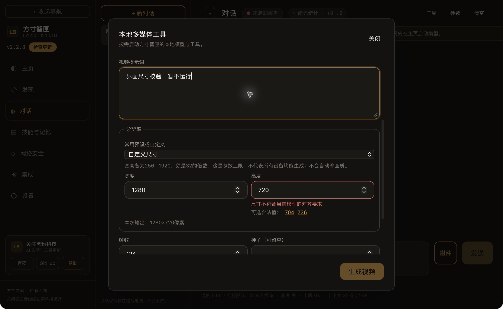

内存提示区分引擎预算和当前可用内存。未知峰值作提示，实际执行保留原参数并受引擎预算约束；像素与帧数的相对规模不冒充精确内存预测。

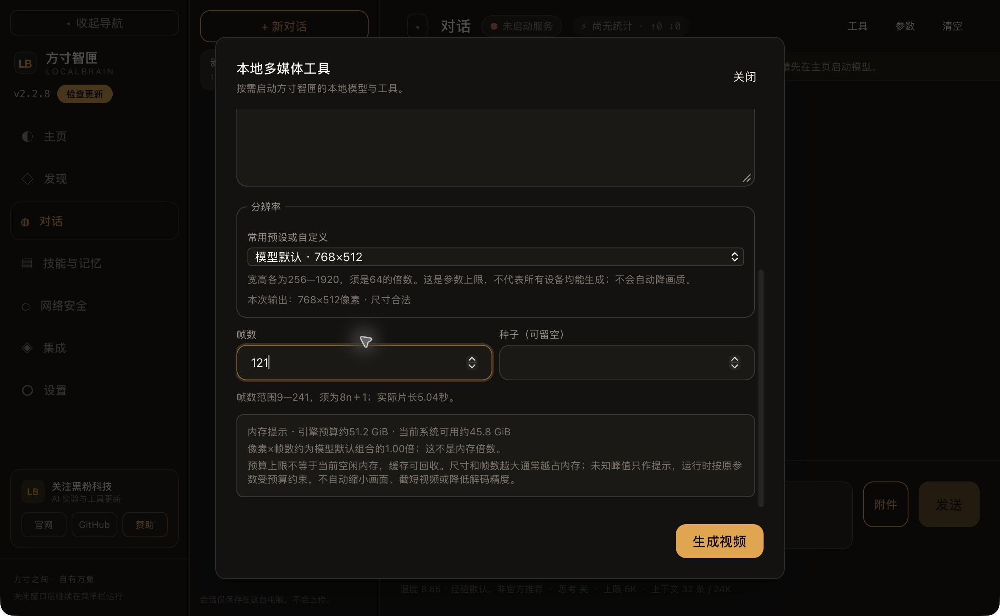

安全修复在源码包解压前同时检查两套系统路径规则，拒绝绝对路径、盘符、目录穿越、符号链接、硬链接和特殊文件。合法源码正常解压，已有源码直接复用。升级保留用户模型、运行环境、正式配置和录制素材，无需清空模型后重装。

11月3日新包已安装：15,653项文件、权限与链接一致，应用、更新包与可信签注验签通过，DMG校验通过；本地签名、未Apple公证。安装包实际解包实现8项回归、系统MCP文件写入与读取通过；前端主测试1668、Rust474、Python395条单元用例及两项脚本、DSH53项通过，另有明确跳过项。原生辅助功能读回2.2.8、已有模型卡和0个服务运行中；原生操作工具服务不可用，本轮未重做全部点选或生成新视频。11月2日六段视频和原生尺寸验收作为此前独立记录保留。

[下载 Mac 2.2.8（Apple Silicon DMG）](https://github.com/HackerChi-Hub/localbrain-releases/releases/download/v2.2.8/LocalBrain_2.2.8_aarch64.dmg) · [正式发行与更新](https://github.com/HackerChi-Hub/localbrain-releases/releases/tag/v2.2.8) · [本轮验收](https://github.com/HackerChi-Hub/localbrain-releases/blob/main/VERIFICATION-2.2.8-MAC.md)

DMG为75,294,743字节，SHA-256：`4b66333e2778a637291e069fd2bd7cd7836b3e07f3877cf4bd3795e3ca2e2481`。Windows/Linux保留独立发布的2.2.8原包、签名及清单。以下各版说明保留当时状态，当前下载以本节和下载表为准。

## Windows / Linux 2.2.8：同步最新资源，补齐跨平台解包校验

Windows和Linux本批同步到2.2.8，内部工具包随宿主升级。源码归档解包同时核对POSIX与Windows路径，拒绝绝对路径、盘符、上级目录穿越和链接，已有源码与运行环境继续保留。

Windows安装版核对五个适用模块从2.2.4迁移并保留回退、已有Qwen3.8 2B请求、文档读写与维护状态；Linux分别验收Debian和AppImage的资源、宿主初始化及WSL2/Xvfb启动。模型请求与文档工具是独立检查，不能当作自主完成复杂任务的成绩。

H3、LTX、Pika及视频增强仍只适配Apple Silicon Mac，本批不启用Windows/Linux视频后端。近期调查的Bonsai、LFM3及低显存图片方案尚未接入，不列为已可用模型。Mac正式下载保持2.2.7，2.2.8的Mac六段视频是独立候选验收，不借用为两平台成绩。用户模型、驱动、特殊引擎和既有配置保留。

[Windows](https://github.com/HackerChi-Hub/localbrain-releases/releases/download/v2.2.8-win-linux/LocalBrain_2.2.8_x64-setup.exe) · [Debian](https://github.com/HackerChi-Hub/localbrain-releases/releases/download/v2.2.8-win-linux/LocalBrain_2.2.8_amd64.deb) · [AppImage](https://github.com/HackerChi-Hub/localbrain-releases/releases/download/v2.2.8-win-linux/LocalBrain_2.2.8_amd64.AppImage) · [Verification](https://github.com/HackerChi-Hub/localbrain-releases/blob/main/VERIFICATION-2.2.8-WIN-LINUX.md)

## Mac 2.2.7：选好模型，再选视频功能

这次把此前分散的视频增强收回同一条使用流程：在发现页准备模型及可选功能，进入对话后先选模型，再选生成方式、增强和参数，最后点“生成视频”。H3四步、八步加速放在MiniMax H3八位模型下面；Transition首尾帧过渡、Layout预演转成片放在LTX-2.5下面。普通生成继续保留，H3加速默认关闭。

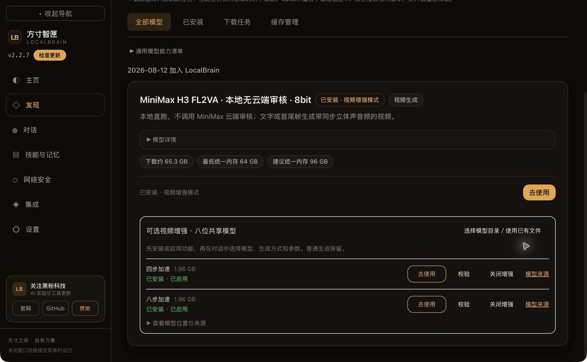

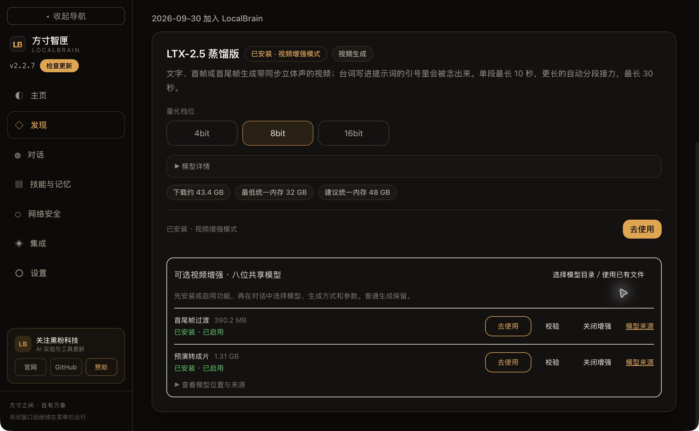

它们复用两个基础模型，不需要为了四个功能安装四份基模。已有完整H3八位转换文件时跳过约41.4GB原始骨干。先点“选择模型目录／使用已有文件”，连接已经准备好的目录；新用户则先看安装清单，确认实际缺少的共享文件、适配器和环境。模型、转换、缓存与成片随所选目录保存，可以直接放外置磁盘。下载安装支持暂停、断点续传和固定摘要校验，安装不会自动开始生成。

使用顺序是：

1. 在发现页找到MiniMax H3八位或LTX-2.5，连接已有目录，安装或启用需要的功能。
2. 点“去使用”，进入统一视频工作台，先选择模型。H3选择普通采样、四步或八步；LTX选择普通文字、首尾帧过渡或预演转成片。
3. Transition提供首尾两张图；Layout提供24帧/秒、与请求等长的预演视频及同构图外观图，再设置画幅、帧数和种子。
4. 点击生成，完成后预览、定位文件或引用到对话；回执可核对真实参数、用时和日志。

Layout需要先在官方模型页获得访问权限，并在本机提供Hugging Face令牌。软件不会替用户接受账号信息共享条款。导入的模型只建立引用，关闭增强保留文件；卸载仅处理本软件下载并登记的适配器，保留共享基模、环境、输入和成片。已有任务运行时，新生成会提示占用，不自动停止其他模型。没有重新下载Pika，也不会暗自缩小画面或降低解码精度。

### 四项安装版小样，分别确认成功调用

这一轮使用M5 Pro、64GB，从已安装的2.2.7原生界面逐项选择并生成。四项使用同一句玩具小车提示词、固定种子22704和24帧/秒。为确认调用而选择约一秒小样，耗时不能直接当成五秒720P速度；峰值为MLX活动分配，不是整机内存。

|功能|真实输出|生成用时|MLX活动峰值|
|---|---|---:|---:|
|H3四步|256×256，22帧，约0.92秒|21.56秒|25.63 GiB|
|H3八步|256×256，22帧，约0.92秒|25.96秒|25.63 GiB|
|Transition|384×256，25帧，约1.04秒|27.61秒|21.81 GiB|
|Layout|384×256，25帧，约1.04秒|33.28秒|24.57 GiB|


H3回执分别记录四次、八次真实前向计算，208层适配匹配，视频完整32位解码。采样步数变少可以缩短计算，但不保证每种内容的细节都等同普通采样。

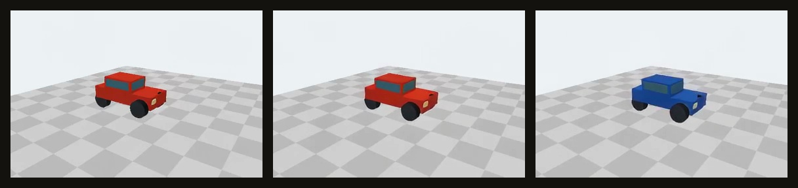

Transition使用2.3适配器与2.5八位蒸馏基模的兼容配方，本轮576对适配层匹配；这不等同原生2.3全功能验收。


Layout使用明确准备的25帧预演，原81帧素材另行保留；480对适配层匹配，两阶段完成。软件要求输入与请求等长，不自动截短或变速。四个输出均完成视频和音频解码、画幅与帧数核对；原音轨保留，但有音轨不等于声音响度、台词或音画同步已完成听感评测。高分辨率、长片与复杂构图仍需分别验证。

### 下载与安装核对

Mac2.2.7安装包为Apple Silicon DMG，92,790,171字节，约92.8MB。构建、镜像和安装应用共15,652项文件、权限与链接一致，应用签名、更新归档验签与镜像校验通过；本地签名，未做Apple公证。Rust474项、前端1660项通过，另有明确忽略或跳过的项目；Python49个文件通过。新机器从零下载全部大型基模、Windows/Linux视频推理不在本轮范围。

[下载 Mac 2.2.7 安装包（Apple Silicon DMG）](https://github.com/HackerChi-Hub/localbrain-releases/releases/download/v2.2.7/LocalBrain_2.2.7_aarch64.dmg) · [完整下载与更新](https://github.com/HackerChi-Hub/localbrain-releases/releases/latest) · [本轮验收记录](https://github.com/HackerChi-Hub/localbrain-releases/blob/main/VERIFICATION-2.2.7-MAC.md)

SHA-256：`a0eea9853c6f5c8f8ff142749257c6ae4e5b426bb1a75f0646c21a9f3523c89f`。

本轮只更新Mac，Windows/Linux保持2.2.4。下文保留各版发布时的说明与旧图，历史参数、平台范围和当时的限制不作为本轮新成绩。

## Windows / Linux 2.2.4：保留启动错误原因，修复内部工具升级

模型启动失败时保留真正的错误原因，进程回收后仍可诊断。内部工具包跟随宿主版本升级，避免固定1.0.0让已有环境跳过工具更新；不开放自定义插件安装。

Windows隔离安装验收从2.2.2应用的1.0.0模块迁移到2.2.4，保留旧模块用于回退；原生粘贴副本、维护回执、已有2B请求和真实文档读写单独核对。

当前Pika H3 Flex运行时仅支持Apple Silicon/MLX；Windows/Linux明确显示不适用，不借用Mac视频成绩，也不下载Pika权重。

两平台各53项DSH通过；Windows Rust454通过/37忽略，前端1650通过/2跳过、适配器14、维护队列7通过，Python46文件（44个单元文件375条用例及两个脚本）和额外安全7项通过。后台任务测试首轮固定400毫秒等待失败，已改为有界就绪轮询并在断言前清理，完整重跑通过。Linux仅Ubuntu22.04 WSL2/Xvfb资源与启动验收，不冒称裸机GPU或媒体推理通过。源码CI账户限制及本批发布状态见验收。

[Windows](https://github.com/HackerChi-Hub/localbrain-releases/releases/download/v2.2.4-win-linux/LocalBrain_2.2.4_x64-setup.exe) · [Debian](https://github.com/HackerChi-Hub/localbrain-releases/releases/download/v2.2.4-win-linux/LocalBrain_2.2.4_amd64.deb) · [AppImage](https://github.com/HackerChi-Hub/localbrain-releases/releases/download/v2.2.4-win-linux/LocalBrain_2.2.4_amd64.AppImage)

以下Mac段落保留首次发布时的独立验收范围，Windows/Linux当前批次以上文为准。

## Mac 2.2.4：Pika H3 Flex 文字与首帧有声视频

Pika H3 Flex 已合并到方寸智匣主项目：可以用文字描述生成短视频，也可以用一张本地图片作为首帧。当前管线固定六步、124 帧、24 帧/秒，输出约 5.17 秒的有声视频；尾帧、多参考图和自动续段暂未接入。它使用 Pika 的专用适配器，不会把 Wuli 或普通 H3 权重当成 Pika 运行。

使用 Apple Silicon Mac、macOS 26 或更新系统，建议 64 GB 统一内存。原始文件约 78.2 GB，Q8 转换与适配器另需约 23 GB；下载前请预留足够磁盘空间。已有完整文件和有效下载片段会复用。模型原件、转换文件、缓存和回执留在软件的受管目录，Pika 使用独立运行环境，其他模型和环境保留。准备生成前，请先确认其他大型模型任务结束并释放相应内存。

使用步骤：

1. 在“发现”中准备 Pika H3 Flex；已有文件可直接复用。
2. 在“设置 → 运行环境与诊断”安装或校验 Pika 专用环境。
3. 在“设置 → 多媒体后端 → 视频生成”选择已有 Pika 模型并保存。
4. 在对话页选择视频工具，使用“纯文字生成”或“首帧参考（图生视频）”。先用 256×256 或 448×256、六步、124 帧测试。

同一天此前的开发验收，在 M5 Pro、64 GB、256×256、六步及固定种子条件下，文字生成耗时 63.71 秒，首帧生成 64.12 秒；引擎观测峰值分别为 25.658 GiB 和 26.540 GiB。此前安装版的真实 MCP 调用生成 448×256 样片耗时 102.90 秒。三份样片均有 124 帧和 32 kHz 双声道音轨，完成解码与非静音检查；这些是本机小样，不是跨设备速度承诺，音轨检查也没有代替人耳听感评测。


本次从合并后的主项目重新打包安装，15,401 项文件、权限和链接与镜像及更新包一致，应用和更新包签名通过，尚未 Apple 公证。Pika 与媒体接口的 13 项针对性测试通过；合并阶段另有 Rust 467 项和前端 1,650 项通过的记录。本次重打包没有重新下载模型，没有运行视频生成，文字与首帧效果按作者要求留待本人验收。内部工具包随宿主版本更新，活动任务占用时延后切换；修正旧工具包被同版号跳过，以及未设为默认的媒体模型被过滤的问题。

本次只提供 Mac 新包。Windows/Linux 继续使用独立发布的 2.2.2，Mac 的 Pika 结果不代表其他平台已适配。[查看本轮核对与实际验收范围](https://github.com/HackerChi-Hub/localbrain-releases/blob/main/VERIFICATION-2.2.4-MAC.md)。

[Mac 2.2.4 发行页](https://github.com/HackerChi-Hub/localbrain-releases/releases/tag/v2.2.4) · [下载 Mac 2.2.4（Apple Silicon DMG）](https://github.com/HackerChi-Hub/localbrain-releases/releases/download/v2.2.4/LocalBrain_2.2.4_aarch64.dmg)

Mac DMG SHA-256：`63f040f7ea65df5afe4a28b8e7d9b64c4686db0ed2772ee81b6b70dd3a8495a0`。

## Mac 2.2.3：启动失败显示实际原因

Mac 2.2.3修复模型启动时误报“后端已被移除”的问题。状态刷新先回收退出进程后，启动调用仍保留本次退出状态和日志；Sushi驻留预算与上下文缓存超限时显示引擎报告的实际数值。模型和运行环境保留，不自动修改参数、不提高系统内存上限，也不重新下载权重。参数超限时，请到设置→运行环境与诊断手动降低驻留预算或上下文后重试。

本机安装版已从主页点击启动并读回真实预检查失败原因，失败后按钮恢复，模型卡仍在；15,639项文件、权限与链接一致，配置校验值未变。Rust回归462通过、39忽略，应用签名、更新归档验签和镜像校验通过，未做Apple公证。作者于2026-10-31明确批准本次源码说明CI计费限制例外，本地检查通过不冒称远端CI通过。Windows/Linux保持独立发布的2.2.2。

[Mac 2.2.3 下载与更新](https://github.com/HackerChi-Hub/localbrain-releases/releases/tag/v2.2.3) · [Mac 2.2.3 DMG](https://github.com/HackerChi-Hub/localbrain-releases/releases/download/v2.2.3/LocalBrain_2.2.3_aarch64.dmg)

SHA-256：`ad556e3ef043c5e592e27a642eb876b3c4a635ccc68d6b8470c04cf02442efc3`


## Mac 2.2.2：环境维护说清结果，图片和文件直接粘贴

Mac 2.2.2 已完成本机安装验收并正式发布。Windows/Linux 2.2.2 由独立构建另行发布，其实测范围见[Windows/Linux 验收记录](https://github.com/HackerChi-Hub/localbrain-releases/blob/main/VERIFICATION-2.2.2-WIN-LINUX.md)。下面介绍这次 Mac 更新的实际行为，旧版本内容和截图保留原来的日期与测试条件。

打开“设置 → 运行环境与诊断”，同一个动作现在使用同一个名称和按钮样式，按“安装、更新、校验、回滚、卸载、清理缓存”的顺序排列。当前版本、可回滚版本与检查时间放在说明区，长版本号不会再把按钮挤到不同位置。已经安装的普通组件不重复提供安装，没有缓存不显示清理，没有保留版本不显示回滚；外部 Docker、包管理器和构建工具仍优先检测、复用和保留。

点“检查环境更新”只查询官方版本信息，确认后才更新引擎，启动模型不会自动升级。本轮安装版将六个独立引擎更新到下表版本，并保留各自上一环境：

| 组件 | 本轮实际安装版本 |
| --- | --- |
| Splash | 1.5.0 |
| Sushi | 1.4.1 |
| 音乐与图片编辑 mlx-serve | 26.10.3 |
| GGUF 文字与视觉 llama.cpp | b12018，官方滚动构建 |
| 三值模型引擎 Prism | prism-b10831-9d9efea |
| 离线组件检查 Trivy | 0.76.1 |

更新先校验官方归档和启动接口，再切换到独立目录。校验失败保留原环境，回滚也会核对文件与相关任务状态。本轮在安装版实际完成 Trivy 0.76.1 → 0.75.0 → 0.76.1，最后恢复到 0.76.1。共享 Python、Torch 等仍按软件验证过的组合维护，不把所有依赖一股脑升级。

维护完成会留下可以重新打开查看的结果：升级前后版本、无需升级、缓存复用、本次下载、库更新时间或失败原因。设备漏洞库本轮复用一项有效缓存，容器漏洞库复用两项，界面明确写出“本次未下载”；网页检查规则则实际更新并校验。未知进度显示正在处理的阶段，有真实下载字节才显示百分比。不相关的模型启动不会再挡住独立数据库更新；相关环境正在使用时，提示“本次未执行，当前任务保留”。

Splash 1.5 的启动参数识别也已修复。此前帮助文本换行被误判成位置参数，导致还没加载模型就退出；现在根据实际参数声明解析。已有 Qwen3.8 27B 权重完成了普通回复和图片理解，没有重新下载。首次启动还包含上游校准与预热，本轮总就绪时间约 2 分 14 秒，权重加载约 5 秒，两个时间分别记录。

对话框可以直接粘贴 Finder 里的图片、文本文件和视频，也可以粘贴复制的图片像素。附件先进入待发送区，点击发送后才读取。本轮把三种文件一起送入安装版：模型正确读出了文本首行，认出了图片里的橙黄色正方形与青色圆形，并明确说明视频只引用本地位置、没有读取画面和声音。视频粘贴引用已经可用，视频理解仍需要对应能力，不能混为一谈。取消发送会清理本次创建的图片副本，原文件保留。

内嵌 DeepSeek Harness 已适配 0.2.1-rc.5，随应用更新。安装版实际多模态对话完成；Rust 458 项、TypeScript 1650 项、适配器 14 项和内核回归 53 项通过，另有明确跳过和忽略的测试。构建、镜像和安装应用的 15,638 项文件、权限与链接一致，应用和更新归档验签通过。Mac 仍使用本地签名，未完成 Apple 公证；Windows/Linux 本轮未做原生实机验收。临时验收会话已清理，详细记录只留本地。

Mac 2.2.2 DMG 的 SHA-256：`8304011e22eda8b7e2b6947ae3ba226ceb5412233b3679880702abdc238526d4`。源码说明检查因 GitHub 账户计费限制未能启动，作者已于 2026-10-31 明确批准本次 Mac 例外发布；本地检查与实际安装验收通过，不冒称远端 CI 通过。[下载 Mac 2.2.2 安装包（Apple Silicon DMG）](https://github.com/HackerChi-Hub/localbrain-releases/releases/download/v2.2.2/LocalBrain_2.2.2_aarch64.dmg) · [下载、更新与其他平台](https://github.com/HackerChi-Hub/localbrain-releases/releases/latest) · [本轮验收记录](https://github.com/HackerChi-Hub/localbrain-releases/blob/main/VERIFICATION-2.2.2-MAC.md)。


## Windows / Linux 2.2.2：环境维护回执与粘贴附件

设置→运行环境与诊断统一安装、更新、校验、回滚、卸载和缓存操作，维护结果按组件保存。显式检查官方更新，启动模型不更新引擎；Windows/Linux独立更新通道当前仅支持Trivy，llama.cpp和Prism继续使用已验证的多资源安装器，Mac六引擎升级不能当作本平台成绩。对话支持粘贴文件和图片草稿，手动发送后读取；视频和未知二进制仅引用，不冒称已经理解。内嵌DSH固定0.2.1-rc.5，Node22.23.4按官方散列准备。Windows安装版验证原文件引用、粘贴副本创建及删除、Torch真实校验回执、已有2B请求及真实DOCX/Markdown。Linux两包完成WSL2/Xvfb启动与宿主初始化；不冒称裸机GPU、媒体生成或系统剪贴板实际手势验收。Windows Rust445通过/37忽略，前端1650通过/2跳过，适配器14、维护队列7、两平台DSH各53通过；Python43文件371用例及两个脚本分别通过，安全7通过。浏览器画布首轮失败、单独重跑通过，保留不稳定性记录。本批CI账户限制及作者例外批准见验收记录。

[Windows](https://github.com/HackerChi-Hub/localbrain-releases/releases/download/v2.2.2-win-linux/LocalBrain_2.2.2_x64-setup.exe) · [Debian](https://github.com/HackerChi-Hub/localbrain-releases/releases/download/v2.2.2-win-linux/LocalBrain_2.2.2_amd64.deb) · [AppImage](https://github.com/HackerChi-Hub/localbrain-releases/releases/download/v2.2.2-win-linux/LocalBrain_2.2.2_amd64.AppImage)

## Windows / Linux 2.2.1：维护到哪一步，现在说清楚

Windows/Linux2.2.1已构建并安装，作者已批准本批记录源码CI账户付款／额度限制后例外发布。Mac今天发布的同版安装包继续保留。这次处理的是之前反复遇到的现象：维护长期挂在0%，或者结果已经完成，左下角却还在转。

在“设置→运行环境与诊断”里，有实际下载字节和总量才显示百分比；准备、安装依赖、解压、校验和卸载显示具体阶段。进入下一阶段会撤下旧比例。容器主漏洞库和Java索引库分别交代正在检查缓存、从哪下载、校验到哪；操作结束先撤下维护占用，再重新读取组件状态，慢刷新不再把完成任务拖成“还在维护”。

本机Windows最终安装包已安装，原来六份配置散列保持不变。原生Torch校验返回完成终态，已有2B模型正常返回验收编号4276；35项MCP工具清单、真实DOCX创建/读取与Markdown导出通过。另用受控界面确认3MB/8MB显示37.5%，解压、校验不残留旧数字，清单还没返回时维护徽标已结束。这段是受控IPC证据，不把它说成Windows真实下载；Mac的49MB实际下载也单独记录。

Windows Rust435项通过、36项忽略；前端1641项通过、2项跳过，适配器14项、维护队列3项通过；两平台随包Harness各53项，完整Python45个文件和额外安全7项通过。Linux Debian和AppImage已在Ubuntu22.04 WSL2完成资源与Xvfb启动检查，Debian已安装；这不代表裸机GPU或Linux媒体生成也通过。完整独立Harness的8K固定工具提示超限仍保留为已知问题，不能把进度显示修复算成模型能力升级。

[Windows](https://github.com/HackerChi-Hub/localbrain-releases/releases/download/v2.2.1/LocalBrain_2.2.1_x64-setup.exe) · [Linux Debian](https://github.com/HackerChi-Hub/localbrain-releases/releases/download/v2.2.1/LocalBrain_2.2.1_amd64.deb) · [Linux AppImage](https://github.com/HackerChi-Hub/localbrain-releases/releases/download/v2.2.1/LocalBrain_2.2.1_amd64.AppImage) · [Mac 2.2.1](https://github.com/HackerChi-Hub/localbrain-releases/releases/tag/v2.2.1)

[Windows/Linux verification](https://github.com/HackerChi-Hub/localbrain-releases/blob/main/VERIFICATION-2.2.1-WIN-LINUX.md)

## Windows / Linux 2.2.0：内部模块升级，保留原来的使用入口

Windows和Linux已补齐2.2.0下载，Windows与WSL2 Ubuntu22.04中的Debian已安装，Mac已有同版安装包继续保留。这次把工具、模型后端、页面和运行环境的能力登记统一起来。内部模块随软件升级维护，用户不用额外找插件安装；自定义安装界面和命令仍关闭，原有模型、资料和运行环境维护入口保留。

八类是软件交付的模块包总数，Windows/Linux当前适用五类：文档、联网检索、图像、本地工作区与授权网络工具。语音合成、转写和视频的MLX模块不计入这两平台可用数。压缩前后改用同一内核计量，包含摘要包装；保留原文，恢复时不重复执行已完成工具。Windows图像环境已安装却显示待修复的问题也继续修正。

Windows最终安装版确认五个模块全部就绪，已有Qwen3.8-2B-Distill Q4_K_M完成实际请求，返回验收编号4276。五类随包MCP与兼容入口的35个工具名、参数和描述一致；真实创建并读取DOCX，独立文档库读到标题，读取后原文件散列不变，Markdown导出也通过。这些模型请求和工具调用是分别验收，不能写成完整自主任务链已经通过。

初次文档实测确实失败：Windows打包输入保留了旧文档实现，与2.2.0声明的Markdown接口不一致。最终两平台采用2.2.0源码随附、逐文件校验的文档实现重新构建，重新通过真实读写；没有改写用户独立安装的DocFactory。

本批Windows Rust435项通过、36项忽略，两项真实模块测试另行通过；TypeScript1638项通过、2项跳过，适配器14项通过。两平台随包Harness各53项通过，完整Python45文件、安全7项及打包2项通过。Linux两包资源与Xvfb启动检查通过，Debian已安装；WSL2结果不代表裸机GPU或Linux真实媒体生成验收。Windows语音、视频、真实出图、完整外部Harness8K任务和真实HTB仍有独立验收边界，不挪用Mac的媒体结果。源码CI的账户限制与本批批准范围见验收记录。

[Windows](https://github.com/HackerChi-Hub/localbrain-releases/releases/download/v2.2.0/LocalBrain_2.2.0_x64-setup.exe) · [Linux Debian](https://github.com/HackerChi-Hub/localbrain-releases/releases/download/v2.2.0/LocalBrain_2.2.0_amd64.deb) · [Linux AppImage](https://github.com/HackerChi-Hub/localbrain-releases/releases/download/v2.2.0/LocalBrain_2.2.0_amd64.AppImage) · [Mac 2.2.0](https://github.com/HackerChi-Hub/localbrain-releases/releases/tag/v2.2.0)

[Windows/Linux verification](https://github.com/HackerChi-Hub/localbrain-releases/blob/main/VERIFICATION-2.2.0-WIN-LINUX.md)

下方版本段落和截图保留当时的测试范围，当前平台下载以本节和GitHub下载表为准。

## Windows / Linux 2.1.7：装好了，就别再提示重装

图像生成环境已经显示“操作已完成”，回到列表却还是“部分安装 · 待修复”，再次一键安装又回到同一个位置。这次定位到的是 Windows 状态检测：程序只找 Linux/macOS 的 lib/python*/site-packages，漏了 Windows 的 Lib/site-packages。

本机已有 Torch、Diffusers、Torchvision 及 Z-Image、Qwen-Image-2.1 两个流水线均可导入，CUDA 可用。新版补上 Windows 路径，保留 Linux/macOS 识别方式。安装包的原生环境页面已确认显示“已安装”，不再提供重复安装入口；不会因为这个误报重新下载环境，也不升级模型、CUDA 或显卡驱动。

Windows 与 WSL2 Ubuntu22.04 的 Debian 已安装为 2.1.7；Linux AppImage 同步提供。Windows Rust 428 项通过、34 项忽略，TypeScript 1632 项通过、2 项跳过，适配器 14 项通过；Windows/Linux 随包 Harness 各 53 项通过。Linux 两包完成资源和 Xvfb 启动检查，保留 Unix 目录布局回归。Mac 继续使用已发布的 2.1.6。

导入成功只证明环境可以加载，真实出图尚未验收；Linux WSL2 结果也不代表裸机 GPU 推理通过。独立 Harness 桌面向 PolyStrata 8K 窗口发送过长提示的既有问题仍未解决。本批源码 CI 受账户付款/额度限制，发布状态和例外批准范围见验收记录。本次没有重跑完整 Python 或原 12 题模型评测，不借用旧版结果充当本批测试。

[Windows](https://github.com/HackerChi-Hub/localbrain-releases/releases/download/v2.1.7/LocalBrain_2.1.7_x64-setup.exe) · [Linux Debian](https://github.com/HackerChi-Hub/localbrain-releases/releases/download/v2.1.7/LocalBrain_2.1.7_amd64.deb) · [Linux AppImage](https://github.com/HackerChi-Hub/localbrain-releases/releases/download/v2.1.7/LocalBrain_2.1.7_amd64.AppImage)

[Verification / 验收记录](https://github.com/HackerChi-Hub/localbrain-releases/blob/main/VERIFICATION-2.1.7-WIN-LINUX.md)

下方各版本段落和截图保留当时的记录；当前下载以本节及 GitHub 分平台下载表为准。

## Mac 2.1.6：更新 Harness 内核，修正重复安装和卸载提示

Mac 2.1.6 已正式发布并完成本机安装；Windows/Linux 保留已发布的 2.1.3，由作者另行打包。内嵌 DSH 从 0.2.0-rc.2 适配到官方当前候选版 **0.2.1-rc.3**，依赖与锁文件精确固定。它随方寸智匣更新，不修改独立 Harness 客户端、账户或原来的模型配置。

这次修复了“已经全部安装，单独勾选后却还能安装”的矛盾。在“设置 → 运行环境与诊断”，已就绪普通组件不再有单项安装入口，勾选后也不会启用批量安装。确实缺少的组件仍可一键补齐；离线数据库保留明确的“更新并校验”。

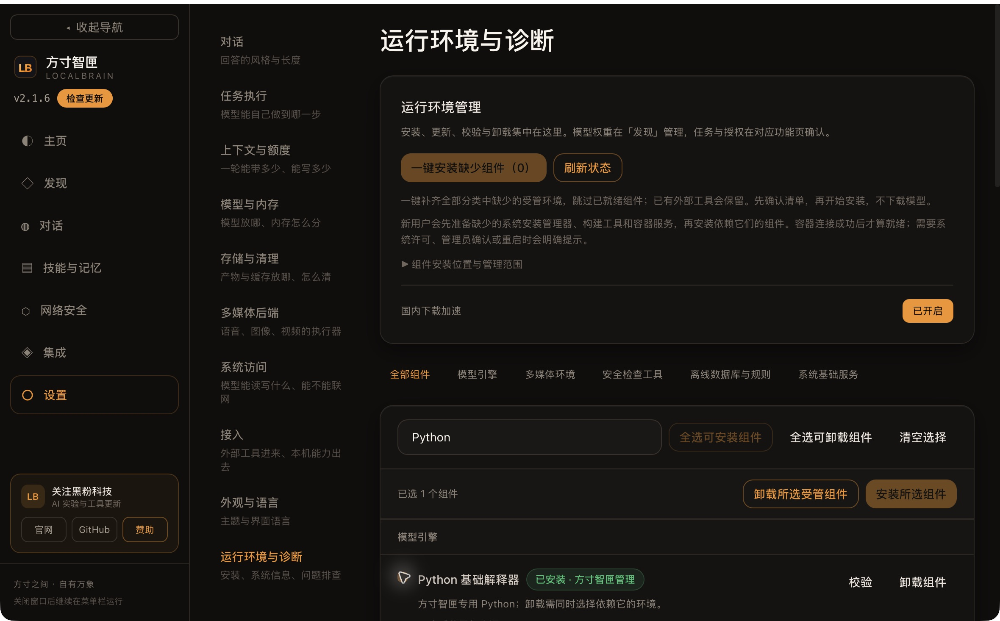

卸载也会立即交代原因。只选 Python 而没有选择依赖它的环境时，系统确认框会列出全部未选依赖，本轮实测显示四项；程序不擅自替你勾选，更不会直接删除。Docker 等系统程序继续先检测本地：已有环境复用，离线时提供启动，缺少才准备安装。系统共享组件保留原版本，不提供卸载。

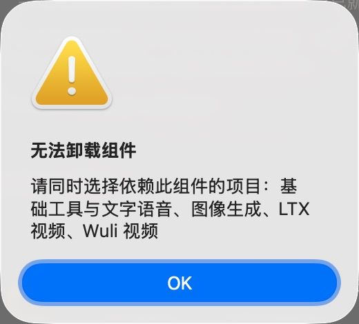

内核更新遇到的实际兼容差异是技能插件新增了工作目录服务。适配后只传递宿主已选的目录身份，工具调用仍回到方寸智匣的授权执行器。技能按需读取、完全关闭、中文增量摘要和旧会话恢复继续保留。

安装版使用已有 Splash 模型完成两轮、一次只读安全能力查询，实际读回 phase=2、dockerInstalled=true，没有扫描目标。随后点击“立即压缩”，持久日志记录了精简中文摘要、可信用户原文与真实回执，原始日志保留。另用旧版生成的会话升级恢复，验证工具只执行一次、不完整尾记录可以恢复；53 项内核回归在随包 Node 上通过，1632 项 TypeScript 与 14 项适配器测试通过，另有 2 项跳过。

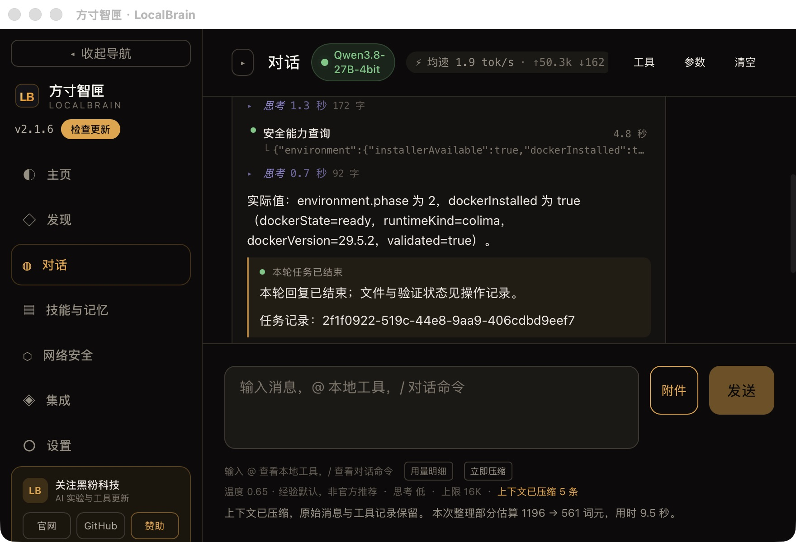

构建包、DMG、更新归档和安装应用的 13,984 个文件、权限与链接一致，应用及更新包签名通过，四处正式配置校验值未变。本轮没有下载模型，也没有卸载环境模拟新机。原生按钮、实际工具结果与压缩终态均已读回；临时验收会话和原始副本已移出正式资料库，证据只留本地。Mac 仍是本地签名、未 Apple 公证；全新 Mac、Windows/Linux 和真实 HTB 不属于本轮实测。

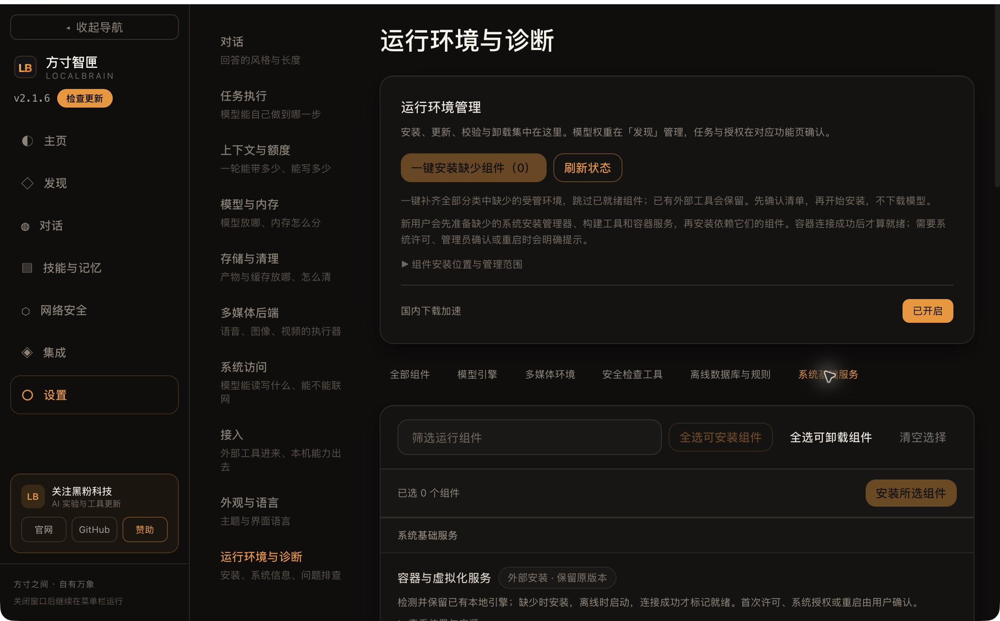

源码 GitHub 说明检查因账户付款／支出限制未启动；作者已于 2026-10-25 明确批准本次 Mac 2.1.6 例外发布。本地检查通过，不冒称远端 CI 通过。

Mac 2.1.6 DMG SHA-256：`5a52f1d0c240e3957d6b62a634267289d3e4d150309f0aa332a026c7466cb776`。

[下载 Mac 2.1.6 安装包（Apple Silicon DMG）](https://github.com/HackerChi-Hub/localbrain-releases/releases/download/v2.1.6/LocalBrain_2.1.6_aarch64.dmg) · [验收记录](https://github.com/HackerChi-Hub/localbrain-releases/blob/main/VERIFICATION-2.1.6-MAC.md)

## Mac 2.1.5：新用户依赖与容器服务统一准备

Mac 2.1.5 已正式发布，完成打包、安装及本轮原生界面验收；Windows/Linux 保留各自已发布的 2.1.3，由作者另行打包。

新用户打开“设置 → 运行环境与诊断”，点击“一键安装缺少组件”，核对清单后开始。程序先准备缺少的系统安装管理器、构建工具和容器服务，再准备依赖它们的环境。一项失败后停止后续，修复后重新补齐；已就绪组件会跳过。容器服务只有连接成功才标记就绪，已安装但离线时提供启动入口。

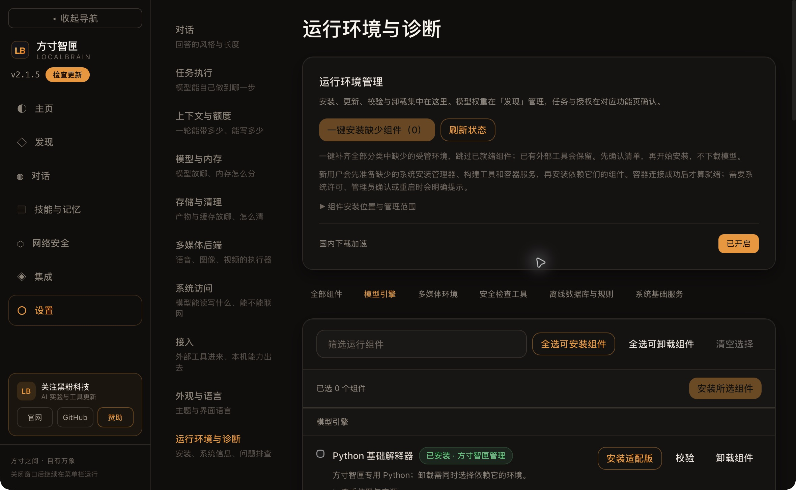

已有本地 Docker Desktop 或 Colima 会优先复用，保留默认连接、虚拟机资源参数和现有容器。系统共享组件不提供卸载；Python、FFmpeg、模型引擎和工具使用各自受管环境。Mac 缺少 Homebrew 时下载校验官方安装包，再交给系统安装器。首次许可、管理员授权和重启仍需用户确认。

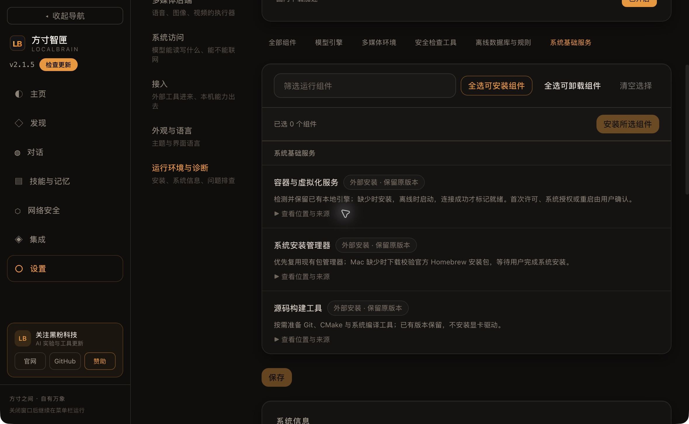

下载中可暂停并保留分片，恢复后显式继续；解压、pip 或容器步骤在当前组件完成后暂停后续。没有缓存显示下载，有分片显示续传，有完整归档显示使用缓存安装；只对确认已安装的受管组件显示卸载，有缓存才显示清理。内置文档、网页工具和 Harness 内核随软件更新，不再单列维护行。

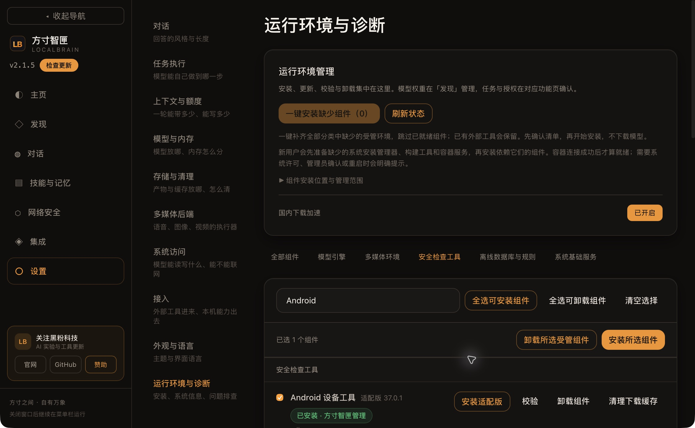

本轮安装版已核对五类组件、缺少项 0、三项系统依赖无卸载、筛选、批量选择、安装范围确认和取消。取消后未执行安装。此前构建、镜像、更新包与安装应用的 12,995 项文件及链接一致；应用及更新签名通过。真实复用已有环境、官方安装包下载/签名/缓存复用通过。无 Homebrew 全新 Mac、Windows/Linux 首次系统安装仍未实装验收；本轮没有卸载环境模拟新机，也没有下载模型或停止既有容器。

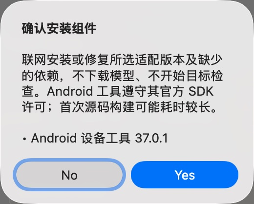

Mac 沿用本地签名，未 Apple 公证。源码仓 GitHub 说明检查因账户付款／支出限制未启动；作者已明确批准本次 Mac 2.1.5 例外发布；本地通过不冒称远端 CI 通过。详见[本轮验收](https://github.com/HackerChi-Hub/localbrain-releases/blob/main/VERIFICATION-2.1.5-MAC.md)及[新用户依赖步骤](https://github.com/HackerChi-Hub/localbrain-releases/blob/main/SYSTEM_PREREQUISITES_2.1.5.md)。

本次 Mac 2.1.5 DMG SHA-256：`35323326f50b065abc1e9c089b44b5cc9fe6cdf07625472452e1a6470175f407`。

[下载 Mac 2.1.5 安装包（Apple Silicon DMG）](https://github.com/HackerChi-Hub/localbrain-releases/releases/download/v2.1.5/LocalBrain_2.1.5_aarch64.dmg)


## Mac 2.1.4 候选：一键补齐缺少环境

这版把“设置 → 运行环境与诊断”收为五组：模型引擎、多媒体环境、安全工具、离线数据库与规则、系统基础服务。内置文档和网页工具、DeepSeek Harness 内核跟着软件更新，不再列出单独的维护行。网络安全页继续负责目标、授权、证据与报告，维护入口跳转到这里。**本节是待发布候选，公开下载尚未更新。**

推荐直接点“一键安装缺少组件”，核对实际依赖清单后再确认。队列自动跳过已就绪的受管环境；专用容器恢复在线后，会重新识别已有镜像和数据库，复用已经准备好的内容。一项失败即停止后续，再次一键补齐只处理仍然缺少的组件。也可以选择单项安装、更新或校验。

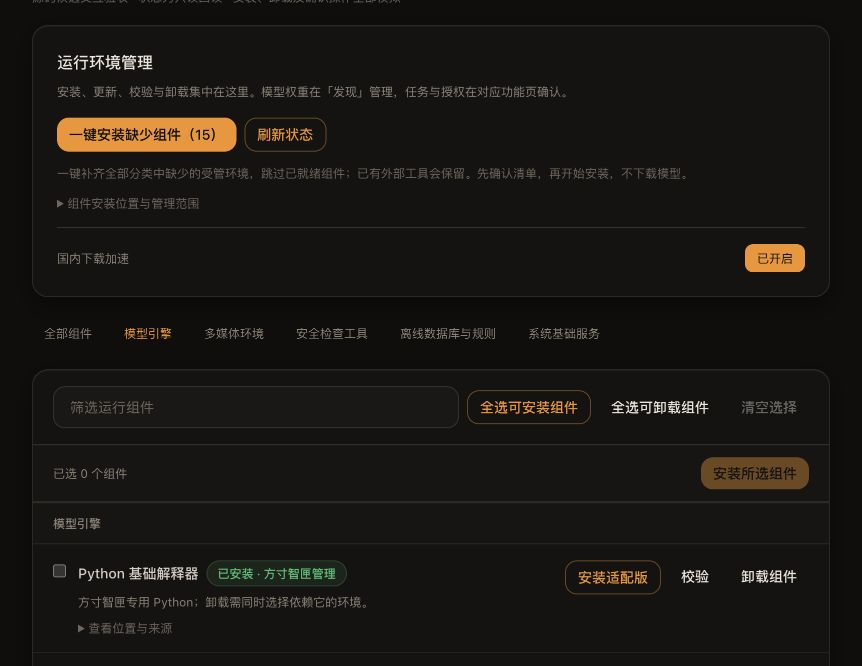

**没安装的组件不显示卸载。** 安装不完整、外部版本和离线待核实状态也不提供卸载；批量卸载只接受确认已经安装的受管项目。没有可卸载选择时不出现批量删除按钮。Python 仍需连同依赖它的受管环境一起确认，模型权重、外部安装、会话、报告和虚拟机保留。

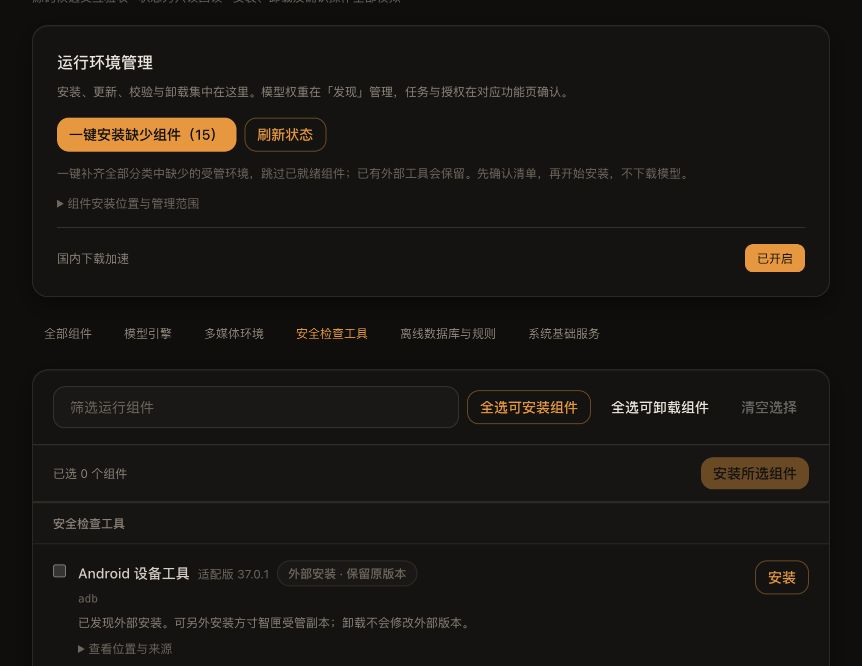

两张图使用同一生产组件和只读环境清单，安装/卸载操作明确模拟，不当作正式环境已经全部安装的证据。系统原生捕获仍返回错误，因此安装包文件核对与原生点选的验收边界分别记录。

ADB、Trivy、Splash 使用官方固定版本的受管副本。共用运行环境归档下载器会保留断流分片，再次安装时检查服务端范围后续传；完整 SHA-256 不符不会解压，已校验归档可以离线复用。Python 包和容器镜像继续使用各自缓存。组件维护放在应用专属数据目录，不向已签名、可能只读的应用包写入。Docker/Colima 缺少且有支持的官方包管理器时，可随依赖计划自动准备；系统许可、管理员确认和重启要求仍保留。已就绪服务不再放一个多余的安装说明按钮。

### 暂停、继续和清理分开处理

运行环境下载中可以点“暂停下载”，分片和后续清单会留下；刷新或重开后，需要自己点“继续下载”。如果已经进入解压、安装依赖或容器准备，程序会先完成当前组件操作，再暂停后续，避免强行中断留下半套环境。Splash 也补上暂停入口，继续时保留原权重并由原安装器续传。

没安装也没缓存，就显示“下载并安装”；有分片时显示“断点续传”，有完整归档时显示“使用缓存安装”。已安装的受管组件才有卸载，有下载归档或分片才有“清理下载缓存”。清理后立即回读；小文件按 KB、MB 显示，暂停后撤下旧速度，左下角保留任务状态。

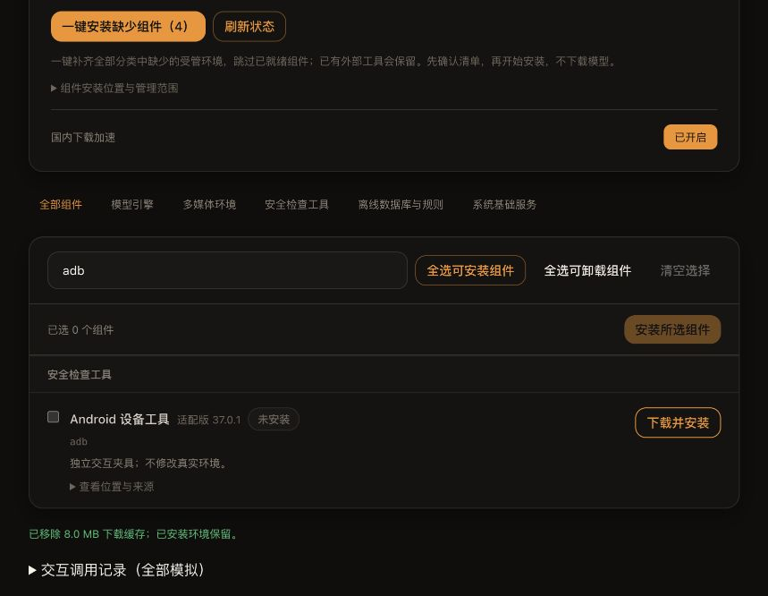

这张图是独立界面预览，安装和卸载操作明确模拟。真实网络另测官方约 25 MB 的 Python 归档：在 1,011,849 字节暂停，继续请求从同一位置接上，最终 25,159,977 字节的完整校验通过；离线复用及清理字节数一致。pip 和容器仍使用自身缓存，不承诺每个第三方安装步骤都能即时暂停。此次没有重新下载大模型，Splash 大模型暂停中断尚未实测。

Splash 保持已适配的 1.3.1，Sushi 保持现有适配版，DeepSeek Harness 内核仍为 0.2.0-rc.2。0.2.1-rc.3 的取消、异常恢复和按需工具加载已评估，须经过独立适配后再升级。安装工具或漏洞库不创建目标授权、不开始检查，现有授权与隔离验证继续生效。

Mac 2.1.4 候选已重新打包安装，暂不公开发布。[当前公开发行与各平台下载](https://github.com/HackerChi-Hub/localbrain-releases/releases/latest)。候选 DMG 的 SHA-256 为 `4619d1f9803c2c72549e40ab1ece75229cdb2217a2a816b42e206988aa5457e8`；Mac 使用本地临时签名，未 Apple 公证。Windows/Linux 保留已发布 2.1.3。

本轮前端 1628 项通过、2 项跳过，适配器 14 项通过，Rust 436 项通过、33 项忽略。10 项下载专项覆盖续传、断流保留、错位响应、损坏缓存、离线复用及路径保护；界面另核对取消零执行、切页继续、恢复后复用与失败重试。三份 Mac 官方工具包此前通过实际校验、解压及移动探针；完整容器批量安装、新增 Binwalk 构建和真实卸载仍未列为通过。以下旧版本内容保留当时的测试和截图。

Windows/Linux 2.1.3 已公开发布，Windows 修复版和虚拟机中的 Debian 已安装。Linux Debian、AppImage 在 Ubuntu22.04 WSL2 独立构建，两包资源、DSH初始化、20秒启动和53条DSH测试通过；三个安装包已重新下载核对SHA-256及更新签名。Linux裸机GPU、完整DSH图片及工具任务尚未验收。源码CI因账户付款／额度限制未启动，作者已明确批准本批例外发布，不将本地通过写成线上CI通过。Mac已有包保持不变。

[Windows](https://github.com/HackerChi-Hub/localbrain-releases/releases/download/v2.1.3/LocalBrain_2.1.3_x64-setup.exe) · [Linux Debian](https://github.com/HackerChi-Hub/localbrain-releases/releases/download/v2.1.3/LocalBrain_2.1.3_amd64.deb) · [Linux AppImage](https://github.com/HackerChi-Hub/localbrain-releases/releases/download/v2.1.3/LocalBrain_2.1.3_amd64.AppImage)

[本批验收记录](https://github.com/HackerChi-Hub/localbrain-releases/blob/main/VERIFICATION-2.1.3-WIN-LINUX.md)。下方Mac初次发布及2.1.2等段落保留当时的记录，当前下载以本节为准。

## Windows 本机修复与 DSH 接入边界（2026-10-24）

接入页顶部已补回“一键恢复接入”，可集中撤销 Harness 完整接入与 Codex、Claude Code 的受管 MCP；各客户端分别报告锁定、冲突和无恢复点，保留原有配置。Windows 2.1.3 修复包已在本机安装，公开下载状态以下方分平台下载为准。Linux 新包独立构建与验收，不借用 Windows 结果。

用户已确认 **Qwen3.8-2B-Distill Q4_K_M 在 DSH 的基础文本使用可用**。本机服务实际报告262144 token窗口，与导出配置一致；这不代表已验证填满后的速度、内存与长文质量，也不等于工具调用、多轮任务全部通过。当前2B端点不支持看图；图片理解、MCP图片显示与视觉模型接入需要分开验收。

**PolyStrata 35B 的完整 DSH 桌面请求在8K窗口仍会超限。** 截图显示系统提示约1.5K、工具定义约7.4K，两项已超过8K，另一次请求输入12728 token。仅压缩对话或降低输出上限不足以解决固定开销；需要按任务精简工具，或另测更大窗口。这是上下文预算问题，不能据此认定显存不足。此前适配器短请求通过，只证明连接与模型路由，不是完整桌面代理验收。

[待解决问题与验收边界](https://github.com/HackerChi-Hub/localbrain-releases/blob/main/KNOWN-ISSUES-DSH-LOCAL-MODELS.md)。GitHub 源码 CI 仍受账户限制，本地检查不冒充线上通过。

## Mac 2.1.3：给 Codex、Claude Code 接上本地工具

这次把 Codex 和 Claude Code 的 MCP 一键接入补回来了，DeepSeek Harness 继续保留。这里的 MCP 是工具接口：你可以让现有客户端调用方寸智匣的文档、搜索、转写、配音、图像和视频工具，客户端原来用什么模型就继续用什么模型。工具所需的本地环境与权重仍要准备好，联网搜索也仍需要网络。

打开“接入”，找到对应客户端，点“一键写入 MCP”，确认用户级作用范围后，在客户端新会话中使用。工具进程会随客户端会话启动，媒体模型按实际调用加载。各客户端的配置默认折叠，需要时再展开或复制；如果桌面客户端正在运行，软件会要求你在任务结束后先退出，避免配置缓存覆盖写入，不会替你结束进程。

**写入和撤销都只处理方寸智匣的工具条目。** 模型、提供方、其它 MCP 和项目设置保留；再次写入也保留第一次接入前的恢复点。用户后来改过的内容发生冲突时，会保留当前配置并提示处理。Harness 的工具撤销只处理工具块，模型接入单独管理；OpenCode 没有恢复。

我用独立配置副本做了 Codex 实际调用：核验码只放在临时 DOCX 里，提示词只要求通过方寸智匣的文档工具读取。实际记录是一笔成功的 `document_read`，最终返回的完整核验码正确，正式客户端配置哈希未变。测试时只预先批准这一项只读工具，产品不会替你关闭客户端审批。**Claude Code 的接口、配置合并与协议检查已核对，本轮模型调用因原有登录凭据失效而停止，没有把它列为实际调用通过。**

[下载 Mac 2.1.3 安装包（Apple Silicon DMG）](https://github.com/HackerChi-Hub/localbrain-releases/releases/download/v2.1.3/LocalBrain_2.1.3_aarch64.dmg) · [Mac 验收记录](https://github.com/HackerChi-Hub/localbrain-releases/blob/main/VERIFICATION-2.1.3-MAC.md) · [最新发行与各平台下载](https://github.com/HackerChi-Hub/localbrain-releases/releases/latest)。Windows/Linux 继续使用已发布的 2.1.2，本次不宣称两平台已更新到 2.1.3。Mac 使用临时签名，尚未 Apple 公证。

Mac 2.1.3 已完成本机安装：应用、DMG 与更新包中的 12,995 个文件及链接一致，应用签名检查和独立更新验签通过。安装版 MCP 协议与工具发现自检为 26/26；这不等于全部媒体模型生成质量都已重测。DMG 的 SHA-256 为 `023934d617c93cb50cd3dd41f55bd7ad672d29983548000cfb78d1f7985417b8`。

源码仓的 GitHub 说明同步检查因账户付款／支出限制没有启动。本地检查与安装验收通过后，我已明确批准本次仅 Mac 2.1.3 例外发布；这不等于远端 CI 通过，也不代替其它平台验收。

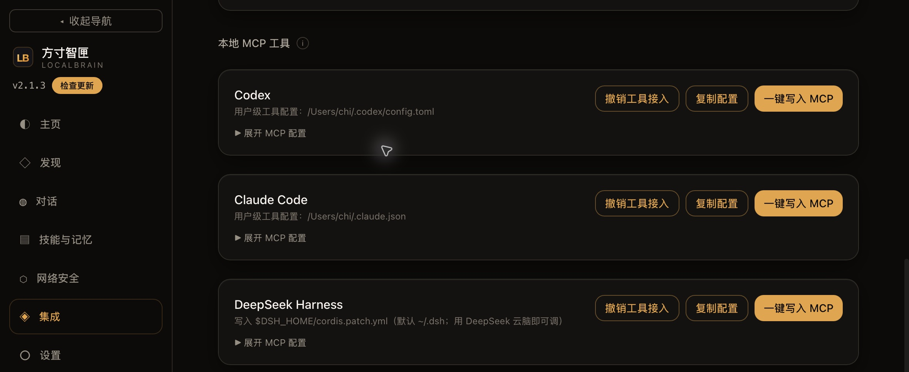

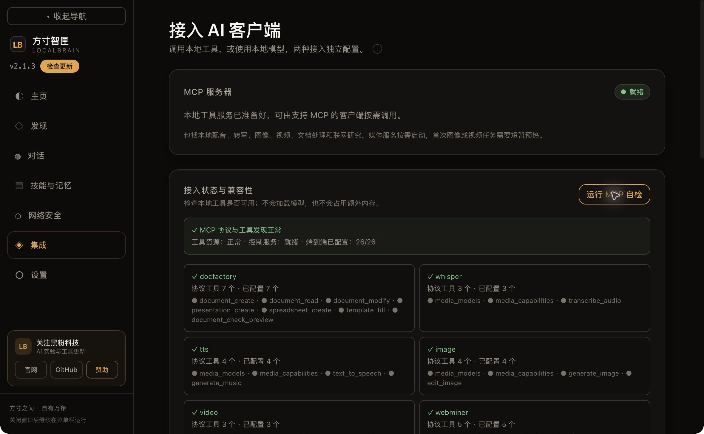

两张图来自最终安装版，仅裁除顶部系统自动操作控制栏，原图和裁切记录留在本地。下面的 2.1.2 及更早部分保留当时的版本、测试与截图。

## 2.1.2：三平台下载与工具安装修复

LocalBrain 把本地模型、语音、图片、视频和文件工具放在一个桌面工作台。Mac、Windows、Linux 分别维护运行环境：Mac 可选 MLX、Splash、Sushi 等专用引擎；Windows 可用 llama.cpp 与 PolyStrata，Linux 提供 Debian 和 AppImage 预览包。能运行哪些模型、需要多少内存，以本机检查和对应引擎要求为准，应用升版不会顺带升级 CUDA、驱动或模型权重。

2.1.2 主要处理两件事。工具安装不再往只读程序目录写构建产物，而是向受管 Python 环境注册资源路径、重新启动进程核对来源；Windows 的中文路径和诊断输出也统一使用 UTF-8。安全工作台把目标名单铺满宽度，连接和工具按需展开；批量交接只生成草稿，仍需手动发送与执行批准。接入页保留 DeepSeek Harness 配置。每轮结束只显示“赞助开发”文字，点击才出现二维码，不加入模型上下文。

Windows 最终包在 RTX 4070 Laptop 8GB／32GB 内存机器上，用 PolyStrata Qwen3.6-35B-A3B Q3、8K 窗口复核原生聊天、一次文件写入、实际压缩和续答；安装前后正式配置哈希不变。Linux 两种包通过包内 Node／DSH、资源校验和 WSL2 Ubuntu22.04＋Xvfb 启动检查，Debian 已安装。这些检查不等于 Linux 裸机 GPU 推理或真实 HTB 任务验收，也不是原12题能力评测的重跑。Windows 使用应用更新签名，非 Authenticode；已有 Mac 包保留本轮 Mac 自己的验收记录。

[Windows 安装程序](https://github.com/HackerChi-Hub/localbrain-releases/releases/download/v2.1.2/LocalBrain_2.1.2_x64-setup.exe) · [Linux Debian](https://github.com/HackerChi-Hub/localbrain-releases/releases/download/v2.1.2/LocalBrain_2.1.2_amd64.deb) · [Linux AppImage](https://github.com/HackerChi-Hub/localbrain-releases/releases/download/v2.1.2/LocalBrain_2.1.2_amd64.AppImage) · [Mac DMG](https://github.com/HackerChi-Hub/localbrain-releases/releases/download/v2.1.2/LocalBrain_2.1.2_aarch64.dmg)

本次已获作者明确授权例外发布：源码 GitHub 检查因账户付款／额度限制未启动，不能把本地通过说成线上 CI 通过。

[Windows/Linux 验收及校验值](https://github.com/HackerChi-Hub/localbrain-releases/blob/main/VERIFICATION-2.1.2-WIN-LINUX.md) · [Mac 验收](https://github.com/HackerChi-Hub/localbrain-releases/blob/main/VERIFICATION-2.1.2-MAC.md) · [最新发行](https://github.com/HackerChi-Hub/localbrain-releases/releases/latest)。下面的旧版本数字、功能介绍和截图保留其撰写时状态，不作为本次新测结果。

## Windows 2.0.0：小窗口任务与压缩修复

2026年10月20日核对公开发行，Windows现为2.0.0，Mac保留1.9.9。Windows这轮修复了短片段压缩没有缩减收益却使任务提前停止的问题：仍有安全回答空间时保留原文继续，真实溢出仍停止并保存记录。内置长工具参数表按需加载，摘要请求禁用工具与思考；摘要中的历史工具回执按只读资料处理，避免继续执行历史工具指令。

发行验收记录包括最终包安装、问候、倒计时文件交付、自动压缩后续答、2K／5K输出上限下的真实联网与聊天界面操作；倒计时开始、暂停、重置通过。它不是原12题全量重测，摘要仍可能错误推断局部状态，联网链路成功也不代表新闻新鲜度与事实正确性。

[下载Windows 2.0.0安装程序](https://github.com/HackerChi-Hub/localbrain-releases/releases/download/v2.0.0/LocalBrain_2.0.0_x64-setup.exe) · [Windows最终包验收与限制](https://github.com/HackerChi-Hub/localbrain-releases/blob/main/VERIFICATION-2.0.0.md)。SHA-256：`547c745ad1494b89bc7c4d3ee8646b6fcc28f1c469a59be3496361e149b6e668`。更新器签名已验证，未使用Windows Authenticode签名；没有升级CUDA、驱动或第三方模型环境。

## 1.9.9更新：Sushi常驻与精确SSD已实测

Mac 1.9.9补上下载100%后的终态刷新与Sushi启动错误诊断。安装版已真实验证内存预检拒绝，提示需要／可用内存；状态轮询先回收退出进程时，也不会再用“后端已被移除”遮住具体原因。恢复32K后，完整常驻重新加载并完成中文响应。用户原有约79.21 GB权重保留，没有重新下载。

2026年10月20日，M5 Pro／64 GiB，同一份Qwen3.8 Flash Next 2.6位权重、Sushi1.2.4、32K上下文、关闭思考：

| 项目 | 完整常驻 | 32 GiB精确SSD |
|---|---:|---:|
| 引擎登记驻留 | 44.20 GiB | 31.21 GiB |
| 首次材料回答总耗时 | 4.99秒 | 8.10秒 |
| 重复材料回答总耗时 | 2.68秒 | 2.87秒 |
| 隔离首次启动至就绪 | 40.39秒 | 8.98秒 |

常驻新材料更快；重复材料命中2595个输入缓存词元后差距很小。最后从原生主页再次常驻启动为17.02秒；未清系统文件缓存，启动数字是单次观测。完整常驻默认加载视觉塔，SSD默认关闭；显式加载视觉塔的SSD补测首次材料8.23秒、重复2.60秒，仅确认加载，未测看图质量。原始请求、回答与逐秒采样均保留，不外推普遍速度与质量。

**两模式手动选择。** 设置→运行环境与诊断，SSD驻留预算0为完整常驻，非零如32为精确SSD；保存并重启模型生效。不会因内存不足自动切换或绕过保护，SSD专家缓存内部的自动调度也不等于模式切换。SSD模式还在原生对话完成了中文短答与本地时间工具往返。

[下载Mac 1.9.9安装包（DMG）](https://github.com/HackerChi-Hub/localbrain-releases/releases/download/v1.9.9/LocalBrain_1.9.9_aarch64.dmg) · [本轮验收、对比条件与限制](https://github.com/HackerChi-Hub/localbrain-releases/blob/main/VERIFICATION-1.9.9-MAC.md)。DMG SHA-256：`6fbc94eb895220fbf99a8d497b8ec3506074e6964c51dc895374d985ae5d6c27`。Mac本地签名、未Apple公证；Windows保留1.9.8、Linux保留既有包。下方旧版本叙述与截图保留其拍摄、撰写时状态。

## 把 Mac 变成 私有 AI 盒子

> 不是再造一个聊天网页，而是把本地模型、多媒体、文档和 Agent 工具收进同一个 Mac 工作台。

> [!note]
> 黑粉科技 HyphenTech · LocalBrain 1.9.4 · 2026-10-18 · 本页另有繁體中文与 English 版本（标题下方切换）

---

我做 LocalBrain，不是因为本地模型已经能打赢云端。同一个复杂任务，顶级云模型通常还是更聪明、更稳。真正让我头大的，是模型在一个目录，MLX 在一个终端，GGUF 又要另一套服务；转写、配音、生图、视频和文档还各有自己的运行方式。

所以目标一直没变：**不造一个更聪明的大脑，而是造一个更省心的本地 AI 总开关。** 这页正文写于 1.4.8，现行版本是 1.9.4。下面按页面走一遍，图都是 1.4.6 的真实界面（之后的版本陆续加了安全检查、办公文档、Splash 模型等，见文末「1.4.8 之后」「1.4.8 新增」「1.4.7 新增」）：任务过程全透明、生成文件和缓存可以指定位置并彻底清理、完整的三种界面语言。

> [!note]
> LocalBrain 的定位不是替代 Codex、Claude Code 或 OpenCode，而是给它们和内置对话提供一组可控、按需启动、尽量留在本机的模型与工具。

### ▍主页：一屏看清这台机器的内存账

打开软件，主页先回答三个问题：这台机器是什么配置，现在谁在占内存，还能再开什么。下图是我的 M5 Pro（64 GB 统一内存），正在跑 Qwen3.6-35B-A3B 的 Splash 版本。

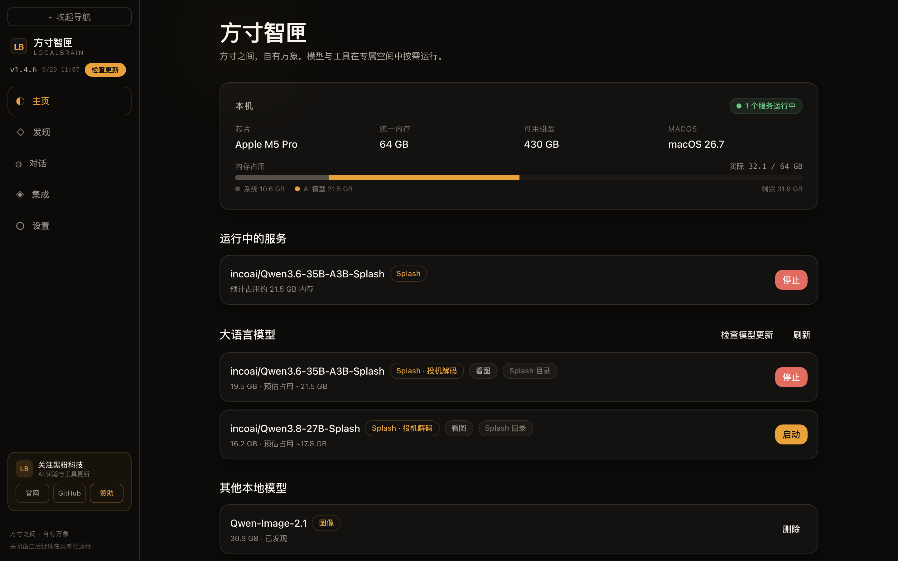

- **内存条拆两段**：系统占多少、AI 模型占多少、还剩多少，直接写出来。模型卡片上的「预估占用」来自模型体积，Splash 按体积的 1.1 倍估算。
- **启动前先仲裁**：内存仲裁会把已运行的后端和待启动的模型放在一起算，资源不够就明确拒绝，而不是先把系统撑爆再报错。
- **三种引擎一套开关**：MLX、llama.cpp（GGUF）和 Splash 用同样的方式启停。Splash 自带草稿模型做投机解码，能看图的模型会单独标出来。
- **多媒体后端按需启动**：语音转写、语音合成（含声音克隆）、图像生成、图像编辑、视频生成、音乐生成各占一张卡；空闲一段时间或内存吃紧时自动释放。

※ 这不是「内存越大就一定更快」的承诺。能不能开、开多大，最后以主页和发现页按本机算出来的数字为准。

---

### ▍发现：下载之前就知道能不能跑

大模型动辄几十 GB，下完才发现跑不动是最贵的试错。发现页的每张卡片把这件事前置了。

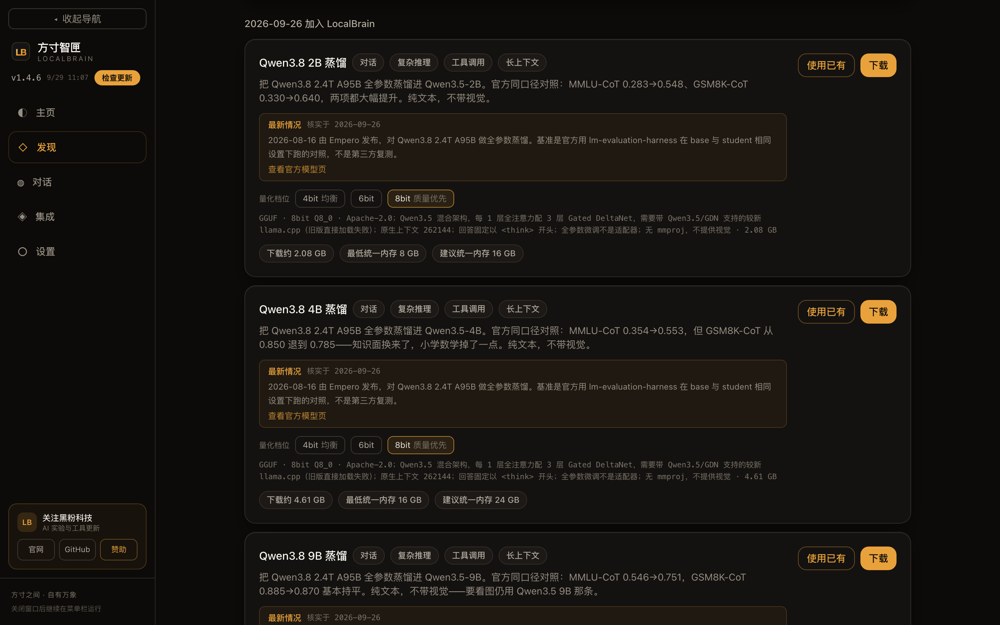

- **精选目录 40 多条**：语言、视觉、语音、图像、视频和音乐模型，按加入时间排列。卡片写明能力标签、官方基准的原始数字和出处（比如上图 Qwen3.8 2B 蒸馏版的 MMLU-CoT 0.283→0.548），以及每个量化档位的体积。
- **内存按本机算**：「最低 / 建议统一内存」不是抄模型卡，是结合本机内存和模型结构算出来的。
- **许可证放在下载按钮之前**：禁止商用这类比通常更严的限制会提前标出，并附原文链接，不留到下完才发现。
- **下载源测速**：ModelScope、HF-Mirror 和 Hugging Face 官方之间一键测速，选当次最快的；下载结束再做 SHA-256 校验，「体积看着对」但内容损坏的文件不会被当成成功。
- **已有模型不用搬家**：选中已经下载好的目录即可挂载，自动识别引擎、类别与上下文能力，不复制权重、不改动源目录。
- **登记前先核对身份（1.4.4 新增）**：用卡片上的「使用已有」选文件夹时，会先识别文件夹里到底是什么模型。确定对不上的直接拒绝，比如把视频模型包登记成图像编辑模型；只是名字或类别看着不一致，就把识别结果摆出来请你确认，改过名的文件夹照样能导入。我自己的机器上就查出过一条：图像编辑模型 Mage-Flow 的登记，指向的是一个 MiniMax H3 视频包的目录，而那个目录早就不在了。这种指向已不存在目录的旧登记，以前会被悄悄跳过，现在主页的「失效的模型登记」会列出来，一键移除，只删登记、不碰模型文件。

> [!note]
> **识别到不等于一定能启动。** 格式、模型架构、视觉投影文件和当前运行时都会影响兼容性；软件会尽量给出具体原因，不把「扫到了」包装成「肯定能跑」。

---

### ▍对话：从回答一句话，到交付一个文件

内置对话支持流式输出、附件、停止、会话持久化和本地工具。但我更在意的是：你让它改一个网页、做一份表格，它能不能真的交付，而且过程经得起检查。

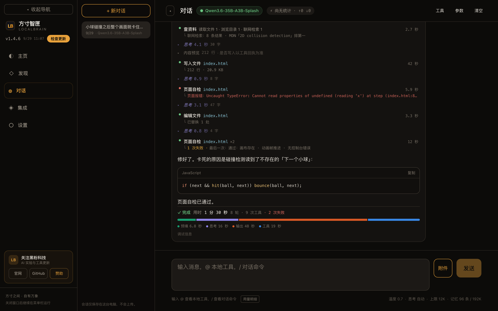

上图是一段演示对话，但每一种显示都是 1.4.6 的真实界面：

- **每一步都摆出来**：读文件、列目录、联网检索、写文件、逐处编辑、网页自检，各自显示目标和耗时；复杂任务会先列计划，计划卡片注明「模型自记，非独立验收」。
- **失败不藏**：同一工具的重复调用合并成「页面自检 ×2」，但「1 次失败」照样写在旁边。图里模型第一次自检拿到页面报错，只改了一行判空，再自检才通过。
- **自检是真跑**：生成的网页会在无头浏览器里检查画布是否存在、动画帧是否推进、控制台有没有报错，不靠模型自己说「我检查过了」。
- **时间去哪了**：任务结束给出总用时、轮数、工具次数、失败次数，并把时间拆成预填、思考、输出、工具四段。
- **长任务不卡界面**：1.3.27 修掉了快模型长输出时界面卡死的问题，流式刷新和计量都做了节流。

文档任务还能直接交付 DOCX、PPTX、XLSX 或 PDF。没有真实生成文件时，零产物闸门会拒绝把任务报成「已完成」。

---

### ▍存储与清理：1.4 的主角

用了一个多月，我自己的机器上积了一堆看不见的东西：检查截图、任务检查点、日志、早期版本写进临时目录的图片和配音。1.4.0 把它们全部摆到了设置里。

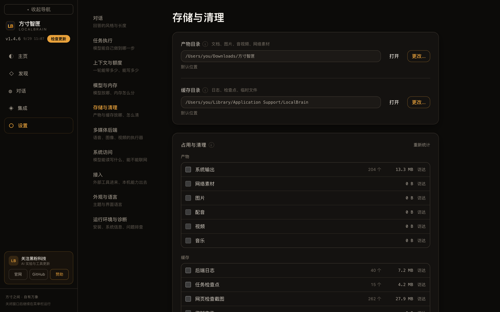

- **两个目录都能换位置**：「产物目录」放生成的文档、图片、配音、视频、音乐和网络素材；「缓存目录」放日志、任务检查点、检查截图和临时文件。都可以改到外置盘。
- **换位置自动搬家**：同一块盘直接移动；跨盘先复制、核对无误，再把旧的移进废纸篓。
- **默认进废纸篓**：勾选清理时默认移进废纸篓，也可以选彻底删除；进废纸篓的文件夹名带着来源目录，一眼认得出是哪一类。
- **自动收敛**：日志总量、检查点天数、临时文件天数各有阈值，由程序后台定时执行，窗口没打开也照常清理。

图里的数字是我这台机器的实测：系统输出 13.3 MB、204 个文件，网页检查截图 27.9 MB、262 个文件。装上 1.4.0 后第一次自动收敛，移走了 145 个任务检查点和 35 组旧检查截图。我对照应用保存的会话列表逐个核对过，那 145 个检查点没有一个属于还在的会话。

---

### ▍接入：把本地能力交给别的 Agent

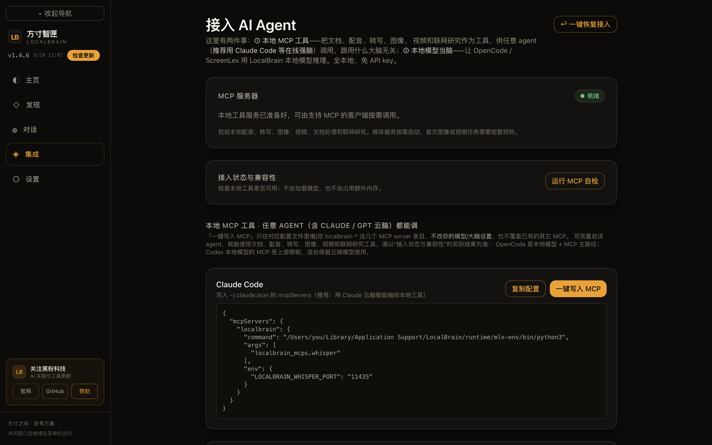

- **本地 MCP 工具**：文档处理、语音转写、语音合成、图像、视频和联网研究，一键写入 Claude Code、OpenCode、Codex、DeepSeek Harness 的配置。只增改 `localbrain-*` 这几项，不动你的模型设置和其它 MCP；需要时一键恢复到写入前的原样。
- **本地模型当脑**：OpenCode、ScreenLex、DeepSeek Harness 可以通过 `127.0.0.1:11434/v1` 这个 OpenAI 兼容接口直接用本地模型，不需要 API key。
- **MCP 自检**：检查协议与工具发现是否正常，不加载模型、不占额外内存。

Codex 和 Claude Code 更稳的用法，是保留它们的云端推理模型，只通过 MCP 调用 LocalBrain 的本地工具。**LocalBrain 能提供接口和工具，但不能替第三方客户端解除它自身的模型或工具限制。**

---

### ▍三种界面语言，这次是真的补齐了

1.2.70 起就有简体中文、繁体中文和英文三种界面。但做这组截图时，我让截图台把英文界面上实际出现的中文逐条列出来，结果查出几十处漏网：模型目录里 26 条没有译文，确认框、数字和单位的拼接也有问题。这些之前的自动检查全是绿的，因为它们只认一种写法。

1.4.3 把这些补齐了，并把三类漏译方式加进了测试。1.4.4 又把约 1400 条英文逐条审校了一遍，改掉机翻腔和前后不统一的用词；思考档位、兼容性表、附件处理状态这类由程序拼出来的标签，在英文和繁体界面里也不再漏出简体。切换语言只翻译界面，不改对话、模型回答、代码和文件路径。

---

### ▍「私有」的边界：哪些留在 Mac，哪些仍然会联网

本地推理、转写和媒体生成可以留在 Mac 上，对话也只保存在这台电脑里。但「本地 AI」不等于「所有操作永远断网」：下载模型会访问模型源，联网检索会把查询发到搜索引擎，Codex 或 Claude Code 如果用云端模型，推理也不在本机。

文件工具默认只能读取你允许的目录。运行项目命令的能力默认关闭，打开后每次执行前都会弹窗确认，并写明「工作目录限制不等于系统沙箱」。1.4.7 新增的「访问网络设备」同样默认关闭，开启后模型才能发 HTTP 请求或用 SSH 连你 `~/.ssh/config` 里的设备，改动类操作每次也先请你确认。**私有不是一个标签，而是你能看清数据去向、授权目录和后端生命周期。**

| 如果你是这种情况 | 我的建议 |
| --- | --- |
| 本机已散落多套 MLX、GGUF、语音或媒体模型 | 适合，统一目录引用、启停、资源管理和清理 |
| 想让 OpenCode 或云端 Agent 调本地多媒体工具 | 适合，用集成页一键写入或复制配置 |
| 只有一两个 Ollama 模型，偶尔问几句 | 未必需要再加一层管理 |
| 期待本地小模型在所有任务上替代顶级云模型 | 不适合，本地的优势是控制、隐私和可复用，不是所有能力都更强 |

---

### ▍四步上手

- 从 **GitHub Releases** 下载最新 DMG，把 LocalBrain.app 拖进「应用程序」。

- 在「设置」安装需要的运行环境，选好界面语言、模型目录和下载来源。

- 在「发现」下载一个适合本机的模型，或把已有模型目录挂载进来。

- 回主页启动模型，用内置对话测一次；需要外部 Agent 时再去「集成」写入配置。

### ▍1.4.8 新增：第二个本地视频引擎 LTX-2.5

**写一句带引号的台词，视频里的人会把它说出来。** LTX-2.5 是和 MiniMax H3 并列的第二个视频引擎：文字、首帧、首尾帧都能生成带同步立体声的视频。它和 H3 共用同一套视频界面——时长同样是 1～30 秒，单次最长 10 秒，更长的自动分段接力（下一段以上一段的最后一帧作首帧，接缝处画面连续）；提示词模板、分段拼接和 MCP `generate_video` 都照常可用，模板在 LTX 上另有一套实测结论。参考机（M5 Pro 64GB）上 1024×576 的 4 秒约 2 分钟、10 秒约 6 分钟、20 秒约 12 分钟；峰值内存文生约 25 GB，带首帧或接力的 10 秒一段约 37 GB，放不下时自动逐块加载。参考图还是要用 MiniMax H3 REF2VA。

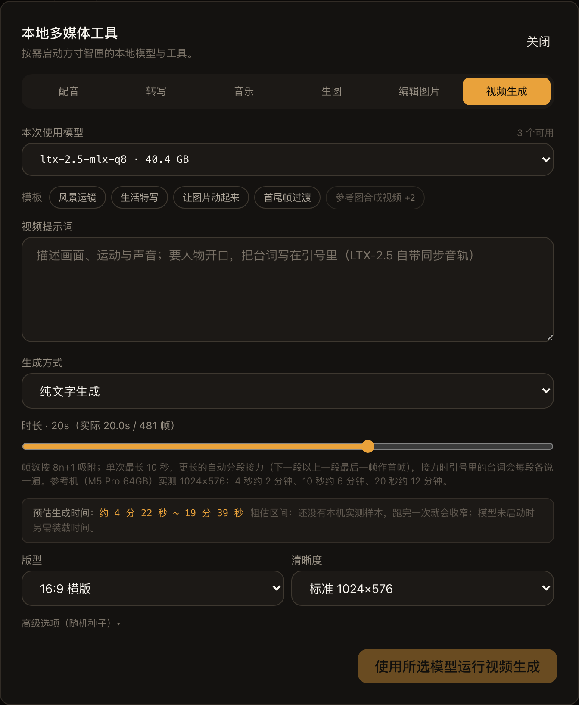

**发现页一键下载，国内直连。** 43.4 GB，文件和 mlx-community 发布的一字不差；选 ModelScope 源即可直连——Hugging Face 上这两个仓是 Xet 存储，hf-mirror 只转发、不缓存。视频运行时 ltx-2-mlx 在首次启动时自动安装，约 404 MB。从 ModelScope 下载的模型现在也逐文件核对 SHA-256，之前只比大小。

**运行时默认的 54 GB 峰值，压到了 25 GB。** 同一段 4 秒视频，运行时默认参数下进程峰值 54 GB：它的 Gemma 编码器把缓存上限抬到内存的 90%，解码又从不分块。方寸智匣把缓存钳在 2 GiB、解码每块 5 个潜帧，峰值降到 25 GB，耗时不变。

### ▍1.4.7 新增：文档能出八种格式，以及「访问网络设备」

**文档不再只有 DOCX 和 PDF。** 让模型「写一份文档」时，现在还能直接产出 Markdown、HTML、TXT、RTF、ODT 和 EPUB。更要紧的是所有格式都先过一道清洗：模型写来的内容里那些 `{"type":"markdown", ...}` 包装、被转义的换行、零宽字符会先被拆掉、还原、清掉，再变成真正的标题、（能嵌套、能带勾选框的）列表、表格和代码块——不是把一段原始 JSON 塞进 Word。这修的是一个真实翻车：一份让它「写一个浏览器三维飞行游戏」的需求，因为其中一句「创建阶段 0 文档」被整个派给了文档工具，结果几百行源码被塞进八个内容没清洗的 DOCX。现在这类写代码、做工程的活会交给能真正写工程文件的通用代理，除非你点名要 DOCX、PDF、EPUB 这样的文件格式。

**遇到难点能联网查、能 SSH 配置别的机器。** 新增的「访问网络设备」开关默认关；打开后，模型能发 HTTP 请求调 API 或读接口、用 SSH 在你 `~/.ssh/config` 里的设备上执行命令和传文件、检查连通性与 TLS 证书、查看本机网络状态。SSH 只用密钥登录，方寸智匣不碰也不保存密码。权限按对话来：查看类操作直接放行，会改动的（重启服务、改配置、上传文件、POST/PUT 之类）每次先请你确认，你也可以在某个对话里开启完全信任，之后不再逐次打断。它和「联网检索」是两件事、各自独立——那一项是查网页，这一项是动别的机器；扫端口、抓包这类对别人网络做探测的能力，没有做。

### ▍1.4.8 之后：安全检查、办公文档、社区模型、下载体验（现行 1.9.4）

正文与截图停在 1.4.8，之后的版本各有专题文章，这里只把主线列出来：

- **授权网络安全检查（1.5～1.6）**：工作区安全审查与授权网络检查两个入口，固定参数向量、隔离沙箱执行、本地靶场反向验证，全程 fail-closed。详见[[localbrain-network-security|网络安全测试]]。
- **办公文档保格式（1.6.8）**：DOCX / XLSX / PPTX 的保格式编辑与模板填充，「按表格填入、不改原格式」。
- **对话里直接调多媒体（1.8.0）**：模型运行时，语音、转写、图片、音乐、视频进同一个任务代理。详见[[localbrain-media-chat-180|对话媒体调用]]。
- **Splash 社区模型（1.8.x）**：社区四位模型的下载、组装与启动，支持魔搭传输、断流自动续传与固定提交哈希核对。
- **下载速度显示（1.8.8）**：进度里直接显示实时速度与预计剩余时间；断流后撤下旧读数并提示等待数据，不再出现虚高或滞留的假速度。
- **技能与长期记忆（1.8.9）**：发现其他代理的资料位置，选择只读挂载或复制导入，在软件内编辑，并分别设为自动、仅手动或关闭。模型目前可以检索和读取这些资料，不能自行新建或启用内部技能与记忆。
- **上下文整理（1.9.1）**：长聊天像一叠聊天记录：程序保留原文，另写一份接续提纲。达到条数或容量阈值后增量合并摘要，也可以在空闲时点“立即压缩”；工具会话使用精简中文摘要，恢复不重执行已完成工具。安装版本轮自动整理约2.97秒、手动约2.48秒，只代表本次样例；摘要仍可能漏细节。

- **配置与界面修复（Mac 1.9.3）**：恢复外部客户端配置时只回退受管字段，空备份保留后来新增项，格式错误则保留原文件和备份。主页失焦暂停轮询，发现页切窗不再扫描目录；会话可搜索和改名，列表与附件减少无关刷新。媒体内存冲突可手动切换，语言模型停止失败时不继续启动媒体。Windows／Linux 保留各自1.9.2版本。

---

- **个人设备只读检查（Mac 1.9.4）**：手机、电脑、嵌入式和固件分开登记，先批量加入名单，再到对话里补充要求并手动发送。Android只采集已授权的系统/补丁信息，电脑查询本机安全状态，网络设备限制少量授权端口；固件只做指纹、单线程识别或离线组件匹配。模型不能自选任意路径或借其他工具扩大范围。依赖与漏洞库缺失会明确提示，不把失败当零漏洞；本机与离线样例已验证，真实手机和嵌入式硬件仍待实测。

#### LocalBrain 2.3.5

方寸智匣：把 Mac 上的本地模型、多媒体、文档和 MCP 工具收进同一个工作台。

> [!note]
> 平台 macOS 13.0+ / Apple Silicon · Windows / Linux 为 2.3.4 · 安装包 LocalBrain\_2.3.5\_aarch64.dmg

[LocalBrain 下载与更新（发行页）](https://github.com/HackerChi-Hub/localbrain-releases/releases/latest)

[LocalBrain 产品介绍](https://hyphentech.top/localbrain)

当前安装包的 SHA-256 是 **61e3e6f35158dff35575a0ed76b00f437185d7e6a42659bf746438a5f4cbb40f**。它使用开发签名，尚未完成 Apple 公证；首次打开被 Gatekeeper 拦截时，先确认下载来源和哈希，再用下面的命令移除隔离属性。

```shell
xattr -dr com.apple.quarantine /Applications/LocalBrain.app
```

*只对从官方 Releases 下载且已核对哈希的安装包使用。*

如果它帮上了忙，侧栏「关注黑粉科技」里的「赞助」可以看到微信赞助码；赞助完全自愿，不影响任何功能。

> **// 云端模型负责把复杂问题想明白，本地工具负责把你的文件、模型和工作流握在自己手里。这两件事不冲突。**

---

> [!note]
> 最后的选择很简单
> 
> 如果你的本地模型和工具已经多到开始反过来管理你，LocalBrain 能省下的就不只是几条命令，而是每次重启、换模型、换任务、清缓存时重复折腾的时间。如果你只需要偶尔聊几句，保持现在的简单工具就好。


---

## 🧰 我做的工具

这些工具都由我持续维护。预览版会明确标注，下载、更新和已知边界以发行页为准。

> [!info] 黑粉助手 HyphenAssistant
> **状态：** 正式迭代
>
> 手机浏览器接续电脑上的 DeepSeek Harness 会话；需本人配对、电脑与原服务在线，模型费用沿用原配置
>
> [下载与更新：黑粉助手 HyphenAssistant](https://github.com/HackerChi-Hub/hyphen-assistant-releases/releases)

> [!info] 黑粉盒子 HyphenBox
> **状态：** 正式迭代
>
> 免费大模型 API 雷达：持续复测可用性，本地统一接口，Key 只存本机
>
> [下载与更新：黑粉盒子 HyphenBox](https://github.com/HackerChi-Hub/hyphenbox-release/releases)

> [!info] 方寸智匣 LocalBrain
> **状态：** 正式迭代
>
> 本地模型的多模态 MCP 工具箱：TTS / Whisper / 视频生成一站接入
>
> [下载与更新：方寸智匣 LocalBrain](https://github.com/HackerChi-Hub/localbrain-releases/releases)

> [!info] ScreenLex 光影词库
> **状态：** 正式迭代
>
> 看美剧顺手把生词背了，Mac/Windows 双平台，免费
>
> [下载与更新：ScreenLex 光影词库](https://github.com/HackerChi-Hub/screenlex-download/releases)

> [!info] 黑粉录屏 HyphenScreen
> **状态：** 正式迭代
>
> 录屏 + 智能剪辑一体：达芬奇式时间线、自动打码、导出前成片体检，免费
>
> [下载与更新：黑粉录屏 HyphenScreen](https://github.com/HackerChi-Hub/HyphenScreen-Releases/releases)

---

> [!quote] 黑粉科技
> **让AI成为你的超能力**
> 本地部署 · 免费白嫖 · 自制软件
> [黑粉科技](https://hyphentech.top)
