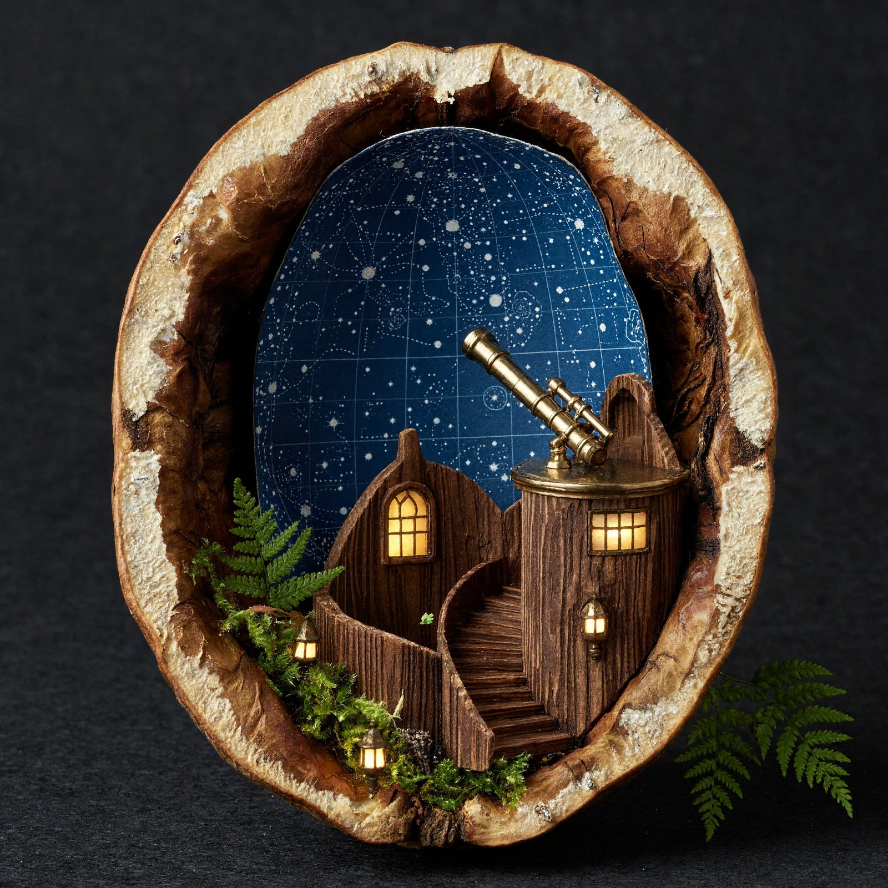
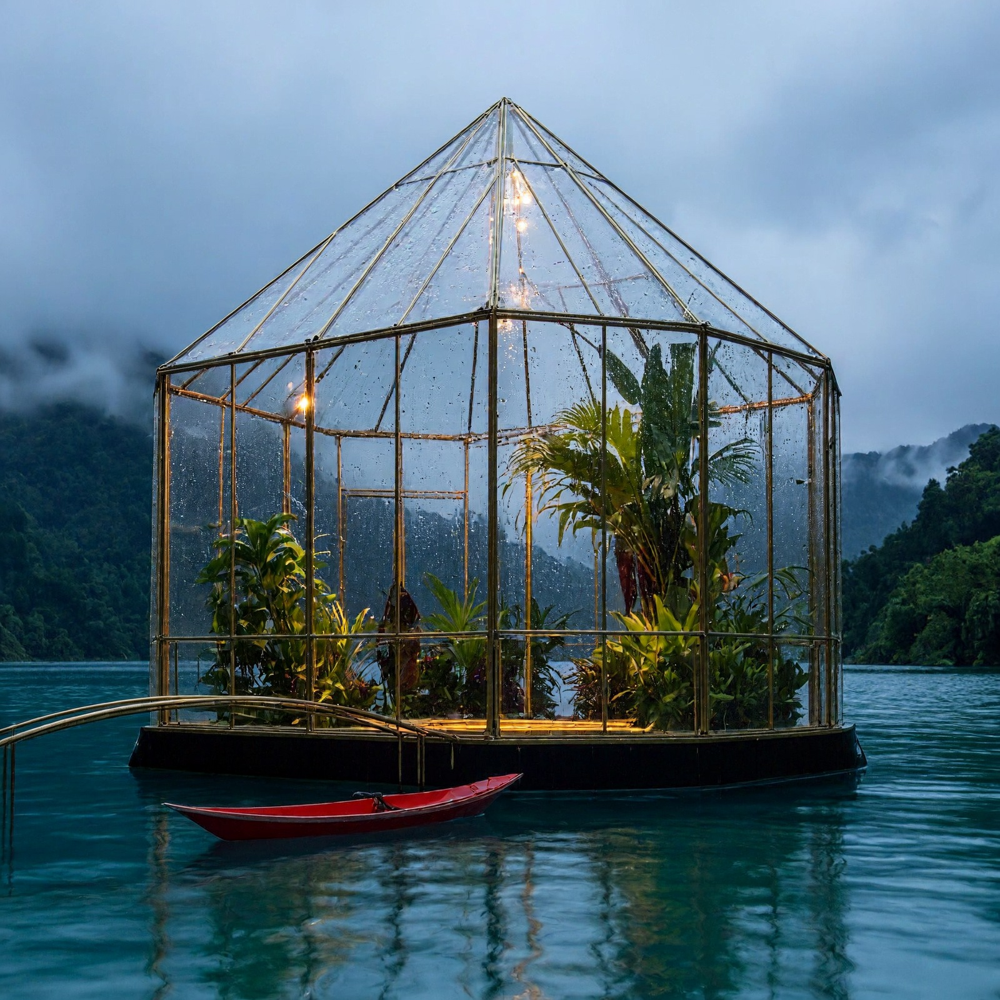
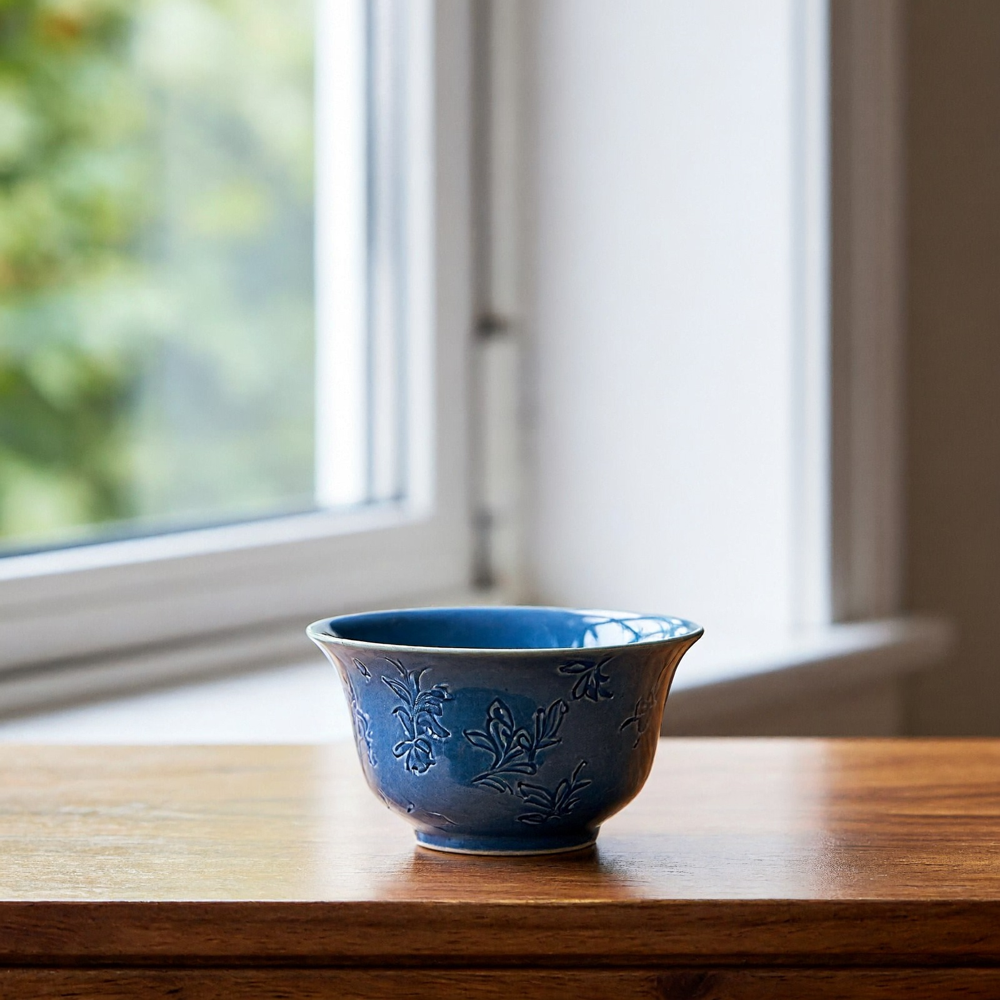

> [!abstract]
> 在 M5 Pro 64GB Mac 上实跑社区四位版：2K 生图约 73 秒，原生 4K 约 6 分 17 秒。对照单图、双图编辑的原图和内存记录，看它适合什么任务。
> 2026年11月11日 · 让 AI 成为你的超能力

我给 MiniMax H3-Image 的第一道题，是让它画一张湖边玻璃温室：水上有一艘红色独木舟，晨雾挡住一点远景。接着，把刚生成的图还给模型，请它把船改成黄色，再加一轮月亮。最后才把尺寸推到 4096×4096。尺寸和用时都从成品和日志核对；图好不好、改对没有，得把图放在一起看。

## 原生 4K 跑通了，编辑也确实能改

| 本地任务 | 成品尺寸 | 端到端耗时 | 图形计算峰值 |
| --- | --- | --- | --- |
| 纯文字生图 | 2048×2048 | 72.6 秒 | 24.46 GiB |
| 单参考图编辑 | 2048×2048 | 191.4 秒 | 25.21 GiB |
| 纯文字生图 | 4096×4096 | 376.9 秒 | 24.46 GiB |
| 双参考图组合 | 2048×2048 | 341.7 秒 | 25.27 GiB |

> M5 Pro，64 GiB 统一内存，macOS 26.7.1；每项一次，独立进程，未清除系统文件缓存。耗时包含编码、采样、解码和写盘。

4K 图里，木壳的裂纹、黄铜望远镜和星图纹理都能辨认。放到网页宽度以后，这些细节很容易被压掉。下面直接截取原图一块区域，方便判断 4K 对这类静物素材有没有用。

如果你只是要给一张配图换颜色、加一个明显元素，这组编辑结果已经有用。要求一旦精确到位置，就得留复核时间。双图任务里，我让它把胡桃壳天文台摆到温室前的桥上；两张图的主要元素都进了成品，但天文台落在画面左边，没有准确放到桥上。对位置、文字或像素级保留有硬要求的活，我仍会用图层合成收尾。

## 54.5 GB 权重，为什么实测图形峰值约 25 GiB？

磁盘大小和运行峰值是两笔账。54.5 GB 是社区四位版的整包大小，里面有文字编码器、采样主干和解码器。适配实现分阶段调用组件，并对部分线性层和嵌入层做四位量化；并非所有层都变成四位。计量的是 MLX 记录的图形计算分配峰值，不能直接拿它当整机内存占用，也不能据此推断 32GB 机器就能跑。四次任务中系统交换空间没有增加，机器测试前已经存在交换占用。

尺寸加大后，最明显的代价是时间。2048 到 4096，宽高各翻倍，像素变为四倍；这两次文字生图耗时从 72.6 秒变到 376.9 秒，约 5.2 倍。两次都是六步，4K 的单步采样仍贵得多。我会先用 2K 定构图、颜色和镜头感，画面值得保留再用 4K 出稿。用同一提示词换尺寸重新采样，构图也可能变化，要再看一眼成图。

## 接进方寸智匣后，怎么选？

方寸智匣 2.3.4 把 MiniMax H3-Image 接进了「发现」的图片生成分类。这个模型入口仅支持搭载 Apple 芯片、运行 macOS 26 或更新版本的 Mac；同版的 Windows 和 Linux 安装包不包含此模型功能。已有完整权重可以复用。到「对话 → 本地多媒体工具 → 生图」选中模型、选好尺寸，加入参考图就能按指令编辑。「编辑图片」也可以选首图和其他参考图。安装包见[方寸智匣 2.3.4 发行页](https://github.com/HackerChi-Hub/localbrain-releases/releases/tag/v2.3.4)，校验值见[下载说明](https://github.com/HackerChi-Hub/localbrain-releases)。

为了确认接入后真的能工作，我用候选安装包和外置盘里已校验的模型再跑了一组：先生成蓝色茶杯，再把这张图交给编辑入口，改成红色。两次都得到 2048×2048 原图；前者回读种子 0，后者回读种子 19。杯身花纹、窗框和木桌位置保留得不错。这一组换了提示词和磁盘环境，用时不与上表直接对比。

尺寸可以选预设，也可以自定义。当前适配要求宽和高为 32 的整数倍，单边 32 至 8192，总像素不超过 2000 万，最长边不超过短边八倍。填错会先提示；不把请求偷偷改成低分辨率。低于约 420 万像素的请求会先在内部画布生成，再按请求尺寸输出。2K、4K 方图有实测；能填入合法尺寸，不等于每种比例和内存配置都已经实测通过。

官方还有一个独立的 [提示词扩写模型](https://huggingface.co/MiniMaxAI/MiniMax-H3-Image-PE)，单独约 17.9 GB。默认关闭，生图和改图都能选择本地目录后启用。用「窗边木桌上的蓝色陶瓷茶杯」做测试，它补出了光线、釉面、杯垫和桌面材质；扩写约 73 秒，整张图约 210 秒。再用中文要求换成红杯，带参考图的扩写约 162 秒，完整编辑约 484 秒。两张成品都是指定的 2496×1664，原始短句、实际扩写和种子都留在回执里。想省时间或已有精写提示词，保持默认关闭就行。

开头表格里的四项测试用的是 [社区 MLX 四位版](https://huggingface.co/nativ-community/MiniMax-H3-Image-4bit)，关闭了额外的提示词扩写，按固定六步和引导系数一运行。测试没有比较官方全精度或在线服务，也没有把上游最多十六张参考图的规格当成本机实测。社区转换沿用 [MiniMax 社区许可](https://huggingface.co/MiniMaxAI/MiniMax-H3-Image/blob/main/LICENSE)；用于商业项目之前，先核对你的使用场景和地区是否符合条款。

## 模型与适配来源

- [MiniMax H3-Image 官方模型卡](https://huggingface.co/MiniMaxAI/MiniMax-H3-Image)
- [实测使用的社区权重固定版本](https://huggingface.co/nativ-community/MiniMax-H3-Image-4bit/tree/d2e36369b1ea5cfeb90bde50592a509250052172)
- [Apple 芯片原生运行适配记录](https://github.com/Neywa-Labs/mlx-vlm/pull/2702)

---

## 🧰 我做的工具

这些工具都由我持续维护。预览版会明确标注，下载、更新和已知边界以发行页为准。

> [!info] 黑粉助手 HyphenAssistant
> **状态：** 正式迭代
>
> 手机浏览器接续电脑上的 DeepSeek Harness 会话；需本人配对、电脑与原服务在线，模型费用沿用原配置
>
> [下载与更新：黑粉助手 HyphenAssistant](https://github.com/HackerChi-Hub/hyphen-assistant-releases/releases)

> [!info] 黑粉盒子 HyphenBox
> **状态：** 正式迭代
>
> 免费大模型 API 雷达：持续复测可用性，本地统一接口，Key 只存本机
>
> [下载与更新：黑粉盒子 HyphenBox](https://github.com/HackerChi-Hub/hyphenbox-release/releases)

> [!info] 方寸智匣 LocalBrain
> **状态：** 正式迭代
>
> 本地模型的多模态 MCP 工具箱：TTS / Whisper / 视频生成一站接入
>
> [下载与更新：方寸智匣 LocalBrain](https://github.com/HackerChi-Hub/localbrain-releases/releases)

> [!info] ScreenLex 光影词库
> **状态：** 正式迭代
>
> 看美剧顺手把生词背了，Mac/Windows 双平台，免费
>
> [下载与更新：ScreenLex 光影词库](https://github.com/HackerChi-Hub/screenlex-download/releases)

> [!info] 黑粉录屏 HyphenScreen
> **状态：** 正式迭代
>
> 录屏 + 智能剪辑一体：达芬奇式时间线、自动打码、导出前成片体检，免费
>
> [下载与更新：黑粉录屏 HyphenScreen](https://github.com/HackerChi-Hub/HyphenScreen-Releases/releases)

---

> [!quote] 黑粉科技
> **让AI成为你的超能力**
> 本地部署 · 免费白嫖 · 自制软件
> [黑粉科技](https://hyphentech.top)
