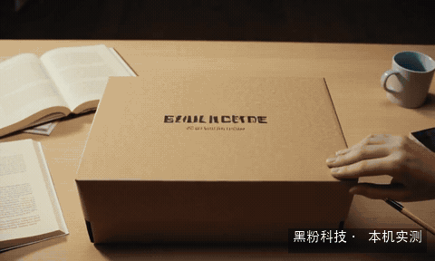
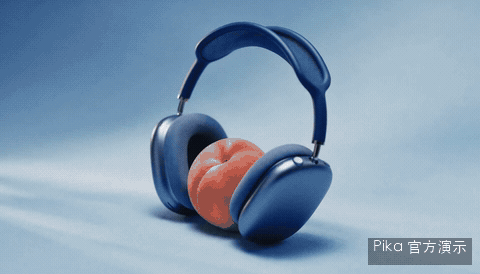
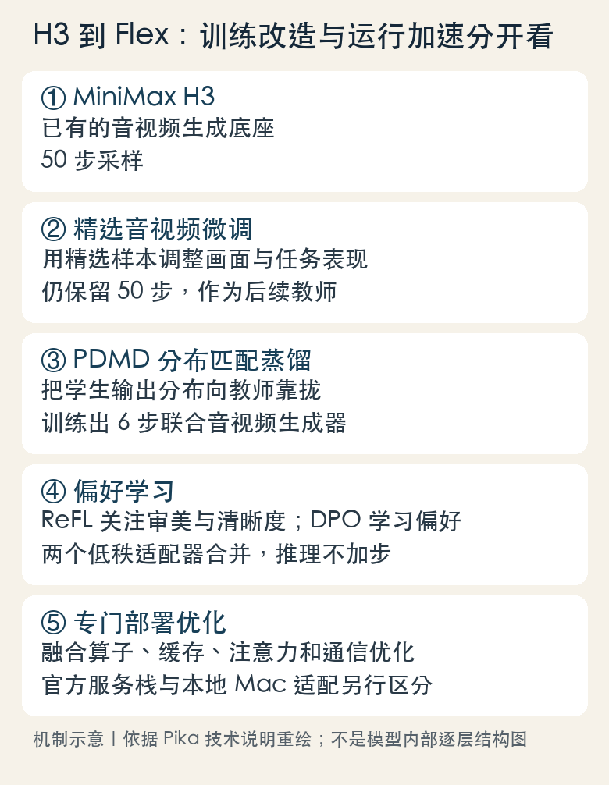
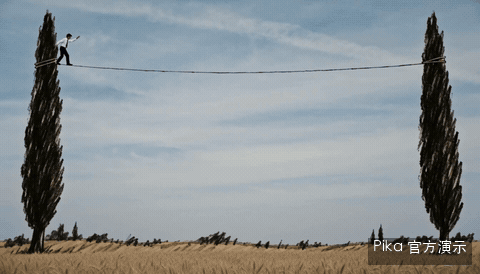
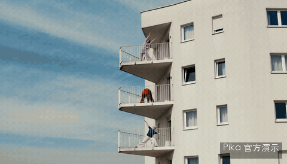
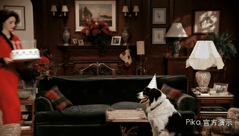
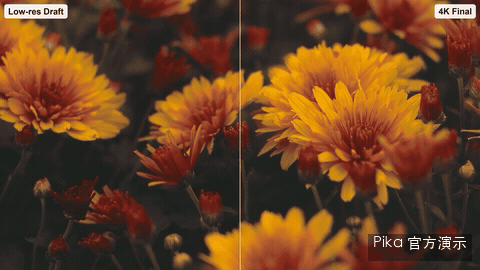
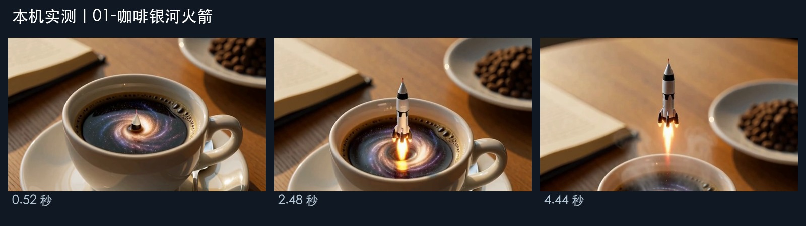
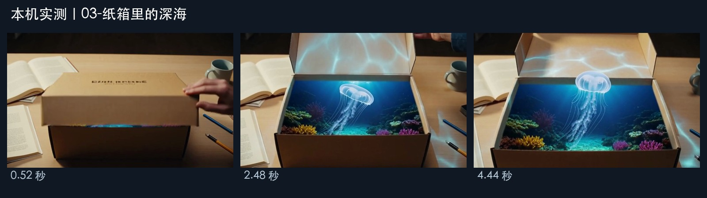

## 完整动态样片

[打开或下载完整视频](/obsidian-assets/pika-h3-flex-localbrain-mac/video-1-b99bdc9ce0.mp4)

[打开或下载完整视频](/obsidian-assets/pika-h3-flex-localbrain-mac/video-2-dc6b108cc6.mp4)

[打开或下载完整视频](/obsidian-assets/pika-h3-flex-localbrain-mac/video-3-9ccac9736a.mp4)

> [!abstract]
> 从50步到6步，从官方能力到Mac实际运行
> 2026年11月1日 · 让AI成为你的超能力

一杯咖啡里，火箭从银河中升空；雨夜的老街上，蓝鲸从屋顶游过去；桌上的纸箱一打开，里面竟然是一片深海。

这三段，是我这台 **M5 Pro、64GB 统一内存的 Mac** 生成的。用的是 Pika H3 Flex，通过我自己做的 **方寸智匣 LocalBrain** 调用。每个题材只生成一次，原片都有声音，分辨率是640×384，每段约5.17秒。真实等待时间约三分钟。

文中的动态预览没有声音，官方较长片段只预览连续前6秒；原片保留完整时长与声音。判断音效和画面是否贴合，需要播放原始MP4，不能靠动图判断。

最值得聊的，恰好是“三分钟”和官方那句“七秒”之间的距离：同一个模型家族，为什么会有如此不同的数字？把50步压到6步，到底改了什么？更实际一点，你现在打开方寸智匣，究竟能用到哪些功能？

先说我的判断：Flex最有吸引力的是把生成、参考控制和后续修改连成一条创作流程；这次Mac实测说明，其中的短片有声生成已经能进入我的本地工具。想拍广告、做长片和要4K成品，还需要看清各环节的实际支持。

## Pika这次更新，接在谁的肩膀上？

Pika在2026年10月29日发布H3 Flex。这里的“H3”有明确来历：它是在 **MiniMax H3底座上进行后训练** 的模型家族，并非把Pika 2.5换个名字，也不是从头训练一套全新的底座。底座提供基础音视频生成能力，Pika再围绕审美、速度和参考控制进行改造。

可以把这件事想成一家成熟后厨：原来的厨师已经会做很多菜，后来有人重新筛选菜谱、训练出餐节奏，并根据食客偏好调整味道。后厨基础还在，最后交到顾客手里的体验却会发生变化。对应到Flex，底座、后训练、推理服务和本地软件，各自承担不同工作。

它想解决的也很具体。生成第一条视频，通常只是创作的开始。下一次可能要保留人物换场景，再下一次要动作不动、把衣服换掉，最后才做高分辨率和混音。模型如果每改一下都得重新抽一整条片子，创作者很快就会把时间花在等待和返工上。

耳机广告和针织游戏世界，是Pika给出的两种方向：前者围绕一个产品组织镜头，后者用角色、场景等参考建立连续的视觉世界。它们来自官方，不是我的Mac生成。看这些例子时，问题可以从“漂亮不漂亮”往前走一步：产品外形、角色身份、镜头之间的关系，到底能不能持续保住？

截至11月1日，发布说明把API作为已提供的体验入口，并写明11月2日进入Pika创作产品。读者若在普通网页创作界面暂时找不到这个模型，先核对入口和开放日期。[查看Pika发布说明](https://pika.art/blog/pika-h3-flex)。

## 50步变6步，省掉的是什么？

先把“步”说清楚。音视频生成模型会在压缩表示中反复修正画面和声音，逐渐从噪声走向成片，这个过程常被称为去噪。就像画一幅草图，先确定整体，再反复改形状和细节。不过这里每一“步”是一次模型计算，不是一帧视频，也不是改一个像素。

所以，6步能生成124帧，完全不矛盾。帧数说的是成片里有多少幅连续画面；步数说的是模型为了形成这组画面和声音，进行了几轮主要更新。把这两个数字混在一起，会误以为6步只能画6张图。

### 先选好老师，再教出能少走弯路的学生

Pika公开的方法分为三个训练阶段。先用内部精选音视频进行监督微调，让原来的50步模型在风格和任务表现上更符合目标；再进行分布匹配蒸馏，把生成过程压到6步；最后用奖励和偏好学习改善快速模型的输出。

“蒸馏”可以用学做菜来理解：老师傅可能边尝边改很多轮，徒弟经过专门训练，学到较少轮次就做出接近目标的结果。模型里的老师和学生不是人在现场逐帧指导；训练要让少步学生产生的结果分布向老师靠近。它学的是更短的生成路径，因此不能把普通H3的设置从50改成6，就宣布得到了Flex。

技术页写明，普通分布匹配蒸馏在他们的实验中有训练不稳定问题，因此采用 **PDMD，也就是投影分布匹配蒸馏**。这个名称不必死记，读者要抓住的是：六步效果是训练出来的，背后有专门模型和采样时间表。少算几次只是结果，如何少算而不明显损坏成片，才是技术工作。

### 做得快以后，还要教它什么结果值得留下

蒸馏完成后，Pika用两种偏好方法继续训练。ReFL更侧重审美和清晰度，DPO利用成对偏好学习指令遵循、真实感和视觉质量。可以理解为厨师出餐变快后，再拿成品进行品评：不是只问“出菜了吗”，还要问“好不好看、有没有按点菜单做”。

这两部分以低秩适配器，也就是LoRA的形式训练后合并。LoRA像是在原有大机器上加一组较小的调校零件，不必把整台机器重造；但运行时仍需要底座，下载适配器本身不会凭空得到一个完整生成器。官方说合并后的偏好适配不增加生成步数。

炭笔钢丝和动态图形适合用来观察快速模型的“风格＋动作”能力。看完整原片时，可以检查线条是否在运动中跳变、文字形状是否连续、镜头切换后主体是否还一致。漂亮的单帧回答不了这些问题。

50÷6约等于8.33，说明主要去噪轮数约缩减到原来的八分之一；它不能直接当成所有设备上的8.33倍加速。文字编码、模型加载、视频解码、音频解码和封装还要耗时。服务器上还有算子融合、缓存与注意力优化，这些又是另一层工作。

## 优势在“能接着改”：参考、运镜和声音怎么配合？

### 把参考的分工说清，比把提示词写长更有用

这组舞蹈例子，先看参考原片，再看唱片店中的新角色。任务的重点是借用动作、节奏和镜头，同时由其他图像决定人物和场景。这里的“多模态”，就是模型能接收图片、视频、声音等不同类型的输入，并把它们用在同一次生成中。

它很像学校文艺汇演前的一张分工单：服装看这张图，舞步看这段录像，舞台背景按另一张布置图来。把分工写清楚，大家才不会把舞蹈示范者的衣服、脸和背景也一起照搬。写多参考提示词也是同样的道理：哪份参考决定什么，要明确交代。

官方参考工作流最多接收9张图、3段视频、3段独立音频，**总文件数上限仍然是12**，不能把三个分类上限直接加成15。还要求至少有图片或视频；单个音视频通常为2～15秒，视频合计与独立音频合计各有时长限制。这种约束会影响你怎么准备素材，不能只记一个“12参考”。

### 镜头可以有要求，故事也要有先后

青蛙乒乓和阳台运镜，适合看镜头运动；蛋糕短剧则适合看事件怎样在多个镜头间发展。运镜要求的是摄影机的位置和运动关系，多镜头叙事还得照顾事件顺序、角色连续性、对白与动作。它们彼此有关，却是不同难题。

如果你要给店里的产品做短广告，比较可执行的要求是“先拍包装，再靠近材质，最后给使用场景”，并为每个镜头安排动作和时间。只写“高级、大片、电影感”，模型收到的是审美愿望，缺少具体的拍摄安排。官方样片的提示词普遍写得很细，这也解释了为什么只抄一句“同款电影感”往往差得很远。

### 只改衣服、保留动作，为什么更有实际价值？

这组官方原片与编辑结果，要求保留人物表演和镜头，调整衣物等指定部分。它对应的是创作中最常见的一类返工：大部分都能用，只想改一处。能保留已有成果，往往比再生成一条完全不同的漂亮片子更省事。

当然，录制时要把两段放在相邻位置看，检查动作时序、脸、手、道具和背景的变化。若只展示编辑后的单条视频，观众很难判断它究竟保住了什么。官方列出了参考编辑方向，我这次Mac样本测的是文字和首帧，尚未测本地多参考编辑。

### 声音不是有就够了，还得方便你剪

Flex会生成同步立体声。Pika托管服务还允许取出对白、配乐、特效音、拟音和环境声五类音轨。区别可以用家里看电视来理解：整段声音混在一起时，你想把背景音乐调低，往往连说话声也一起小了；分轨后，可以只调音乐，留下对白和现场效果。

这里最容易混淆的是“同步有声”和“独立分轨”。本期Mac原片保存的是混合立体声音轨，可以直接播放、剪辑；五类独立音轨属于官方托管扩展，当前方寸智匣本地入口没有开放。用一段有声MP4，不能直接当成已经拿到了五条可分别混音的素材。

## 为什么先生成草片，再做4K？

官方的马匹例子，先有768p生成，再做2K或4K精修。这个流程很像装修前先看效果图：方向还没定，不必每改一个想法就先做最高规格。把角色、动作和镜头挑好，再把资源投入高分辨率，返工成本更容易控制。

“升采样”就是把已有视频提升到更高分辨率，并补充细节。输出文件的像素变多了，但它仍然依赖原始生成的构图和动作。主体长错、镜头关系不合理时，单靠提高像素不会自动解决。适合比较的是毛发、布料、边缘与运动中的细节，而不只是看播放器标了一个4K。

开放包原生支持480p和768p；官方的1080p、2K、4K精修、独立音轨、提示词增强和专用加速服务栈属于托管扩展。**下载开放权重后，这些云端配套不会自动进入本地。** 方寸智匣本期640×384的片子也保持原始尺寸，没有放大成高清成绩。

## 回到64GB Mac：三分钟，实际换来了什么？

| 题材 | 总耗时 | 阶段峰值 |
| --- | --- | --- |
| 咖啡银河火箭 | 191.22秒 | 25.724 GiB |
| 雨夜街道与巨鲸 | 186.75秒 | 25.717 GiB |
| 纸箱里的深海 | 190.17秒 | 25.730 GiB |

> 2026-10-31，M5 Pro／64GB，Q8、6步、640×384、124帧、24fps；每题一次。峰值为引擎阶段观测，不是整机总占用。

三次平均约189.38秒，生成的每条视频约5.17秒。它还不是边打字边实时冒画面的体验，但已经可以在本地拿一个明确想法，等几分钟看到带声音的结果。对做创意小样、片头过场、科幻插入镜头的人，这个节奏有实际用途。

### 咖啡银河火箭：一个主体，一条连续动作

这条的目标很集中：从一杯咖啡开始，一枚微型火箭向上飞，镜头缓慢跟随。首、中、末帧可以看到升空过程，适合拿来讲“主体、动作、镜头、声音”如何写在同一个任务里。它的难点不是塞进更多物体，而是让杯子、火箭、液面和相机保持连续关系。

> 白色陶瓷杯放在木桌上，咖啡里是一片微型发光银河。一枚手指大小的银色火箭从液面垂直升空，蒸汽盘旋，液滴落回杯中。镜头缓慢向上跟随，清晨暖光，单一连续镜头，无文字。声音包含杯碟轻响、发动机声和冒泡声。

### 雨夜街道与巨鲸：氛围很抓人，细节也得看

雨夜、积水倒影、屋顶上方的半透明巨鲸，这是现实场景中插入超现实主体。实际原片保留了巨鲸掠过街道的表现，也出现了提示词没要求的店招字样。拿它做氛围镜头有意思；如果要做品牌画面，招牌和文字就得逐帧检查，不能把随意生成的字直接拿去当店名。

> 虚构的暖灯老街，雨夜，地面积水倒映灯光。一头巨型半透明蓝鲸游过屋顶，腹部的光照亮雨丝，尾鳍从近处掠过。摄影机在街道中央缓慢前进，单一连续镜头，无文字。声音是雨声、低沉鲸鸣和水声。

### 纸箱里的深海：创意实现了，约束没有全听

纸箱打开，里面出现深海和水母，想象中的反差在画面里出现了。不过纸箱上也长出了提示词没有要求的字。我的要求里明明写着无文字，它还是给自己加了点“包装设计”。这个结果值得保留：同一条样片，既能展示创意落地，也能提醒我们检查具体约束。

> 桌上一个牛皮纸箱，画面外的手把盖子打开，箱内竟然是深海。发光小水母缓缓飘出，蓝色波纹照在纸箱和桌面上。镜头正面缓慢推进，单一连续镜头，无文字。声音包含纸板摩擦、海水气泡和空灵低音。

这里的提示词按本期中文原意整理，完整原始记录仍保留在录制资料里。三条都完成了视频与音轨解码、非静音检查，首中末帧已核对；本轮没有做系统的人耳听感打分，因此声音的贴合程度，请播放原声一起听。

咖啡这条，联合去噪约156.54秒，视频解码约27.43秒。也就是说，绝大多数时间仍然花在生成和还原画面上。六步省下的是主要生成轮次，没有把整条音视频流水线变成六个瞬间完成的小动作。

官方“15秒768p最短7秒”测的是服务器DiT，也就是负责主要去噪的Transformer核心计算；本期191.22秒测的是Mac实际请求的总耗时。技术页另一个5秒768p加速实验使用8张B300，完整推理从3.409秒降到2.129秒。硬件、分辨率、时长和计时范围都不同，这些数字应分开阅读，不做一个假装公平的速度排行榜。

## 方寸智匣现在能用Pika，具体怎么用？

我做这次接入，目的就是把模型、专用适配器和调用流程放进日常能用的软件。现在 **方寸智匣Mac 2.2.4已公开接入Pika H3 Flex**。这三条创意原片来自10月31日安装版2.2.4候选阶段的真实调用；正式版后来重新打包公开，本篇没有在正式包上重新跑一轮来充当新成绩。

| 准备项 | 当前要求 |
| --- | --- |
| 系统与芯片 | Apple Silicon，macOS 26或更新系统 |
| 内存 | 建议64GB统一内存；本期设备为M5 Pro／64GB |
| 磁盘 | 受管原始文件约78.2GB，Q8转换与适配器另需约23GB；还应留缓存和成片空间 |
| 已开放输入 | 纯文字，或文字＋单张首帧 |
| 固定生成规格 | 6步，124帧，24fps，约5.17秒 |
| 画幅约束 | 宽高至少256、为32的倍数，像素面积不超过512×512；本期使用640×384 |
| 暂未开放 | 尾帧、多参考、自动续段、云端4K精修和五类独立音轨 |
| 其他平台 | Windows／Linux 2.2.4已有独立发行，当前Pika运行时不适用 |

下载时请进 **Mac 2.2.4专属发行页**，不要只看“最新发行”：现在Windows／Linux也有独立标签，混着下载容易拿错平台。[下载与更新：方寸智匣Mac 2.2.4](https://github.com/HackerChi-Hub/localbrain-releases/releases/tag/v2.2.4)。

装好后，先在发现页找到 **“Pika H3 Flex · Mac 六步有声视频”** 的专用入口，完成模型准备。它会保留原始权重、Q8转换与专用适配器，已有完整文件与下载片段可以复用。软件包不包含那一百多GB模型文件，安装完应用也不意味着模型已经准备好了。

模型准备成功后，进入对话的**视频功能**，选择 **Pika H3 Flex**。先输入一个主体、一条动作、一种镜头运动的提示词，需要时附一张首帧。当前是固定6步和124帧，不要照搬官方15秒、多参考或尾帧示例的参数。

这组基础记录补上了另一半：文字样片、以首帧为条件的样片，以及此前安装版MCP横屏生成。它们分别用于看输入方式和真实调用链，分辨率与耗时不同于上面的三条创意片，不能混在一起算一个“统一成绩”。首帧的作用像给画师先摆好第一张构图，后续动作仍要靠提示词和模型展开。

生成结束后打开输出MP4，画面和原声一起看：主体是否变形、动作有没有接上、镜头运动是否符合提示词、是否混进怪字。模型有专用独立环境，调用前还会检查实际支持的能力；如果当前有大模型任务占着内存，先等它结束，再安排视频生成，别为了试一个镜头把正在工作的实例打断。

安装包已签名，尚未Apple公证；系统若提示来源或安全检查，请以发行页的真实说明为准。本篇的流程图来自已有接口和调用记录，不是伪造客户端截图。之前原生窗口捕获失败，因此没有把后台运行成功扩大成完整界面点击录屏已验收。具体安装与支持范围见[Mac 2.2.4验收说明](https://github.com/HackerChi-Hub/localbrain-releases/blob/main/VERIFICATION-2.2.4-MAC.md)。

## 本地开放权重，成本究竟落在哪里？

Pika公开的是适配器和推理代码，并要配合指定底座。官方原版示例按NVIDIA单卡请求设计，验收环境包括H100 80GB；CPU卸载能降低GPU阶段占用，但要付出主机内存和搬运开销。CPU卸载可以理解为厨房台面不够，把部分食材放到旁边储物架：台面空出来了，来回取放并不免费。

官方文档中的某些卸载配置，GPU阶段约29～32GiB，同时主机观测约94GiB、含页面缓存。因此“显存能降到32GB”和“一台32GB电脑能跑”不是同一句话。我的Mac成绩来自另一套Apple芯片MLX/Q8适配，不能照搬到官方NVIDIA命令，也不能直接推给所有Mac型号。

Q8里的8，指主要权重使用约8位表示。可以把它想成给大量测量值减少小数位：文件和存储负担有机会下降，误差也可能随之引入，实际还要看哪些部分转换、怎样运行。这次用的是受管的专用骨干和适配器组合，不是把任何H3文件改个后缀就能使用。

| 路径 | 你实际付出的成本 | 适合用途 |
| --- | --- | --- |
| 方寸智匣本地 | 已有Mac、约百GB文件与额外缓存、电力和生成等待；这次3条不调用付费生成API | 本地短片尝试、隐私素材、反复做创意小样 |
| Pika在线API | 技术页标价：文／图生成0.01美元／输出秒起，多参考0.03美元／输出秒起；精修、分轨等另核具体报价 | 要更完整参考控制和托管能力的工作流 |
| 自行部署官方包 | GPU、主机内存、完整组件、依赖维护与调试时间 | 已有相应硬件和部署能力的开发者 |

按上述“起价”只做一个算例：15秒基础生成对应0.15美元起，多参考对应0.45美元起。实际费用要看具体接口、计费与附加处理，不能拿基础起价包办4K和全部功能。本篇没有为比较而新建付费生成请求。

代码示例采用Apache 2.0，不代表模型权重也完全不受限制：权重遵循MiniMax H3 Community License，底座组件还有各自许可。做商用产品或重新分发时应分别读条款。官方演示的视频也没有因为推理代码开源，就自动变成可随意转售的素材。

## 我更看好它什么，又会先拿它做什么？

如果目标是今天就做一集稳定的长动画，我不会只凭这三条5秒样片下结论。人物跨场景一致性、台词、口型、长段故事和反复修改，都还需要更系统的任务。当前方寸智匣的本地入口，也明确停在文字与单张首帧的短片生成。

但如果要给一个抽象概念找画面、给视频补一段超现实过场，或者先看产品广告的创意方向，这已经是一个可操作的起点。咖啡银河、雨夜巨鲸、纸箱深海，都是先把主体和连续动作写清，再看模型具体做到了哪里。能用的留下，怪字和不听话的部分照样记下来。

Pika这次的路线也值得观察：先把H3后训练成更少步、更适合创作控制的生成器，再把高分辨率、分轨和加速服务接在后面，同时开放适配器让开发者做自己的工具。这种分层让本地工具有机会接住一部分能力，也把商业服务留在精修与完整生产链。它能不能长期吸引创作者，最后要看修改成功率、成片稳定性和整条流程的总成本。

> [!quote] 我的判断
> Pika H3 Flex的价值，是用专门后训练换来六步有声生成，并围绕参考和修改继续做创作控制。对我这台64GB Mac，已有的实际成果是：通过方寸智匣，约三分钟得到一段640×384、有原声的5秒创意片。先从这个已跑通的小任务入手，再决定是否需要云端的多参考、分轨与4K。

## 官方资料与下载入口

- [Pika发布说明与官方视频](https://pika.art/blog/pika-h3-flex)
- [Pika技术方法、评测条件与价格说明](https://pika.art/blog/pika-h3-flex-research)
- [开放权重、工作流与许可证](https://huggingface.co/Pika-Labs/Pika-H3-Flex)
- [官方推理代码与安装说明](https://github.com/Pika-Labs/Pika-H3-Flex)
- [官方硬件与卸载要求](https://github.com/Pika-Labs/Pika-H3-Flex/blob/main/docs/hardware.md)
- [提示词与参考分工指南](https://github.com/Pika-Labs/Pika-H3-Flex/blob/main/docs/prompt-guidance.md)
- [下载与更新：方寸智匣Mac 2.2.4](https://github.com/HackerChi-Hub/localbrain-releases/releases/tag/v2.2.4)
- [方寸智匣Mac 2.2.4实际验收范围](https://github.com/HackerChi-Hub/localbrain-releases/blob/main/VERIFICATION-2.2.4-MAC.md)

---

## 🧰 我做的工具

这些工具都由我持续维护。预览版会明确标注，下载、更新和已知边界以发行页为准。

> [!info] 黑粉助手 HyphenAssistant
> **状态：** 正式迭代
>
> 手机浏览器接续电脑上的 DeepSeek Harness 会话；需本人配对、电脑与原服务在线，模型费用沿用原配置
>
> [下载与更新：黑粉助手 HyphenAssistant](https://github.com/HackerChi-Hub/hyphen-assistant-releases/releases)

> [!info] 黑粉盒子 HyphenBox
> **状态：** 正式迭代
>
> 免费大模型 API 雷达：持续复测可用性，本地统一接口，Key 只存本机
>
> [下载与更新：黑粉盒子 HyphenBox](https://github.com/HackerChi-Hub/hyphenbox-release/releases)

> [!info] 方寸智匣 LocalBrain
> **状态：** 正式迭代
>
> 本地模型的多模态 MCP 工具箱：TTS / Whisper / 视频生成一站接入
>
> [下载与更新：方寸智匣 LocalBrain](https://github.com/HackerChi-Hub/localbrain-releases/releases)

> [!info] ScreenLex 光影词库
> **状态：** 正式迭代
>
> 看美剧顺手把生词背了，Mac/Windows 双平台，免费
>
> [下载与更新：ScreenLex 光影词库](https://github.com/HackerChi-Hub/screenlex-download/releases)

> [!info] 黑粉录屏 HyphenScreen
> **状态：** 正式迭代
>
> 录屏 + 智能剪辑一体：达芬奇式时间线、自动打码、导出前成片体检，免费
>
> [下载与更新：黑粉录屏 HyphenScreen](https://github.com/HackerChi-Hub/HyphenScreen-Releases/releases)

---

> [!quote] 黑粉科技
> **让AI成为你的超能力**
> 本地部署 · 免费白嫖 · 自制软件
> [黑粉科技](https://hyphentech.top)
