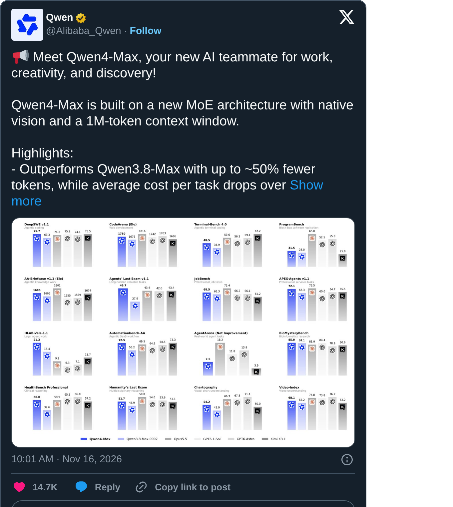
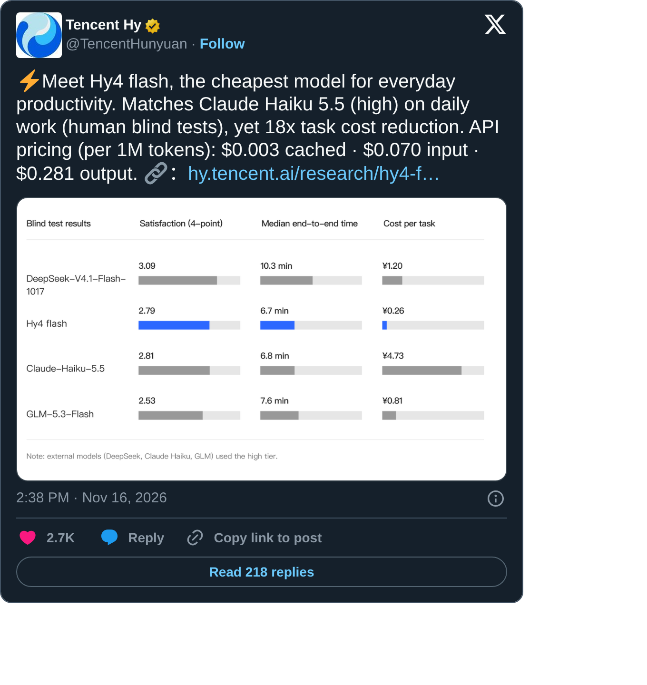
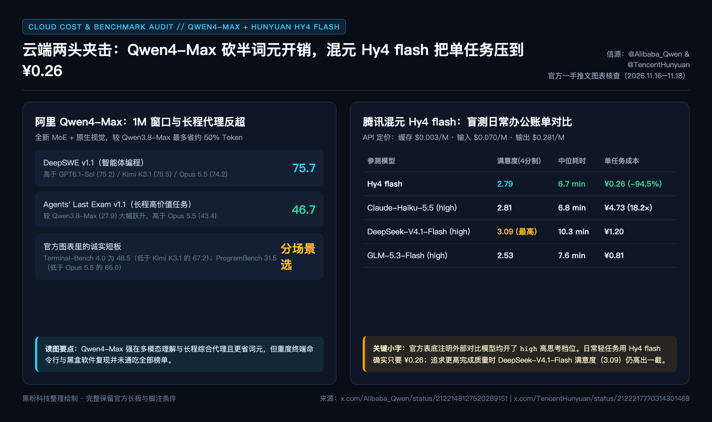
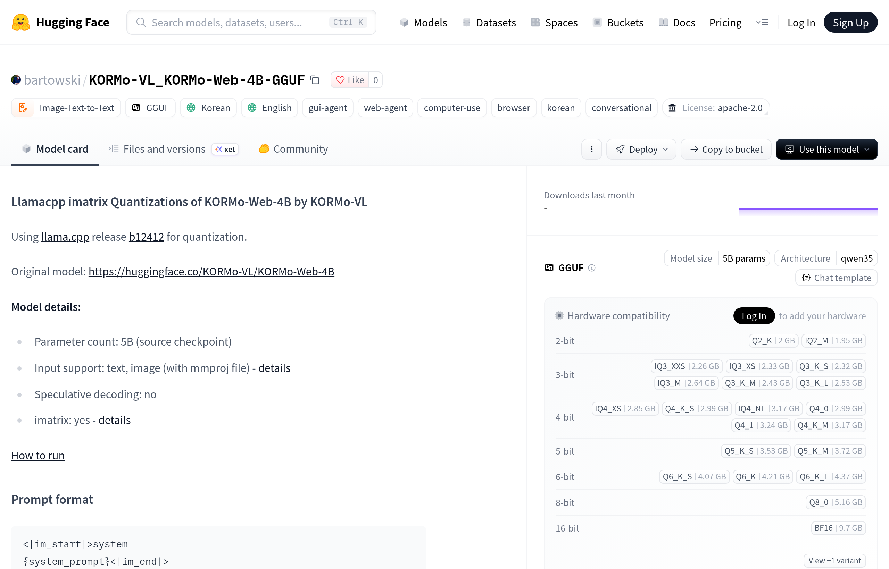
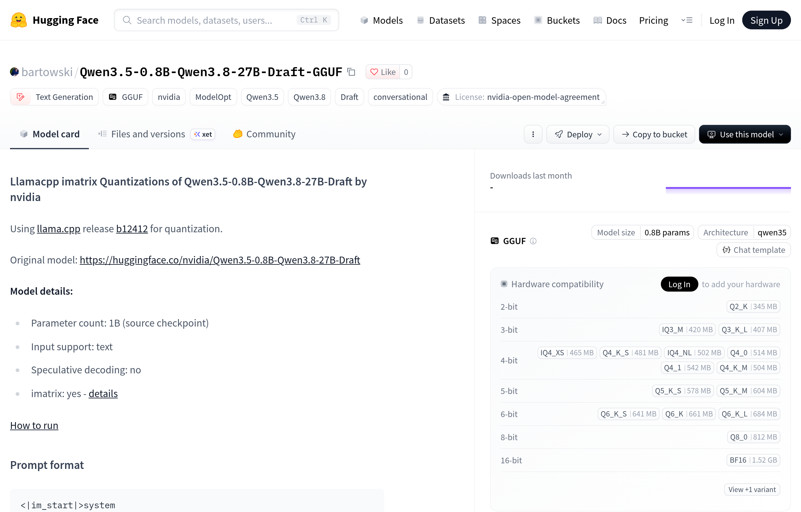
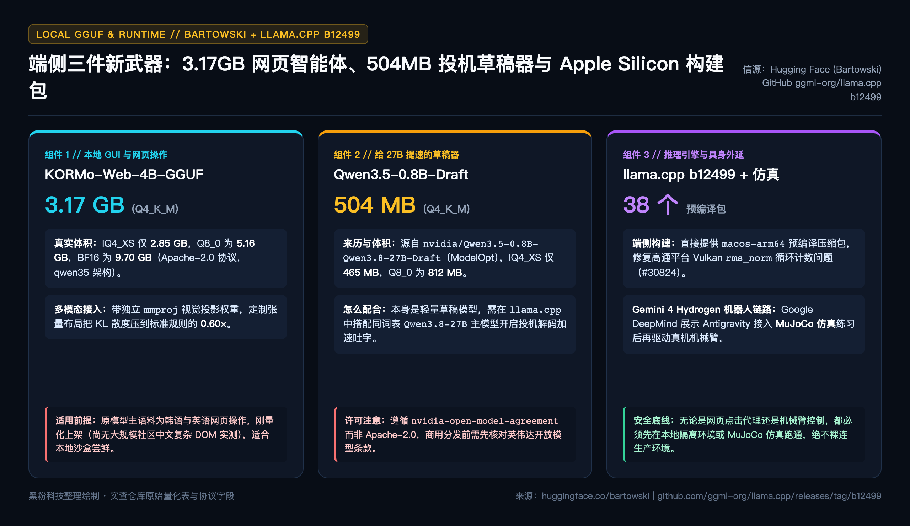
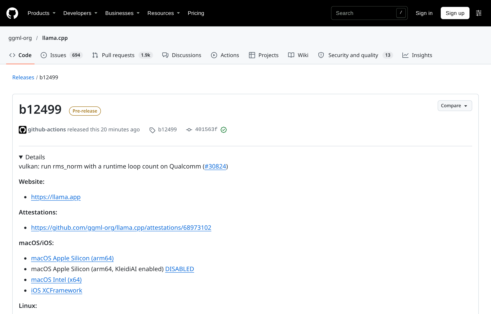

> [!abstract]
> 一边是云端百万窗口砍半词元与单任务两毛六，一边是塞进笔记本的 3.17GB 网页代理与 504MB 投机草稿器
> 黑粉科技 · 2026-11-18

　　把这两天国内外放出来的一手模型动态摆在一起看，风向裂成了看似矛盾的两头。云端大厂忙着把长窗口和日常调用费继续往下砸：阿里发了支持 **100 万词元上下文**的 **Qwen4-Max**，主打比上一代最多省掉约 **50% Token**；腾讯混元推出 **Hy4 flash**，直接贴出人工盲测单任务 **¥0.26** 的账单。

　　与此同时，Hugging Face 和 GitHub 上热闹的却是另一拨东西——压到 **3.17 GB** 的网页操作模型 KORMo-Web-4B，以及只有 **504 MB** 的 Qwen3.5-0.8B 投机解码草稿器。

　　不少朋友看完直犯嘀咕：既然云端跑一次任务都快降到两毛六了，咱们手里的 16GB Mac 和 8GB 显卡还有必要折腾本地小模型吗？更关键的是，大厂海报上那些「省一半词元」「成本降 18 倍」的大字底下，各自藏着哪些先决条件？我把这几家的官方原图、模型卡量化表和发版记录全拉了下来，逐条拆给你看。

## 一、拆开两张云端海报：长板够硬，但小字和分项别漏看

　　先看阿里通义官方账号放出的 **Qwen4-Max** 首发说明（截至查证已获 **14.7K** 点赞）。这一代换上了新的 MoE 架构，把原生视觉理解和 **1M 上下文窗口**合在同一个底座里，官方给出的核心卖点是在超越 Qwen3.8-Max 的同时，单任务最多能少消耗约 **50% Token**。

　　把官方配图里的 16 张柱状图放大看，它的优势区间和短板其实标得很清楚。在考验智能体修代码的 DeepSWE v1.1 上，**Qwen4-Max 拿到 75.7**，微幅压过 Kimi K3.1（75.5）、GPT6.1-Sol（75.2）和 Opus 5.5（74.2）；在长程复杂任务 Agents' Last Exam v1.1 上更是从 Qwen3.8-Max 的 27.9 一口气跳到 **46.7**，高出 Opus 5.5（43.4）。

　　不过翻到同一张图上半区的 Terminal-Bench 4.0（重度终端命令行），Qwen4-Max 得分是 **48.5**，跟 Kimi K3.1 的 **67.2** 和 Opus 5.5 的 **59.6** 还有明显距离；黑盒软件复现 ProgramBench（31.5）也排在 Opus 5.5（65.0）后面。拿它接长文档、看图分析、跑常规工程读写很划算，但重度终端排障不能盲目迷信单一最高分。

　　再看腾讯混元同档期推出的 **Hy4 flash**。官方给出的每百万词元 API 定价压到了极低水位：**缓存命中 $0.003、输入 $0.070、输出 $0.281**。

　　配图里的日常办公人工盲测表显示，Hy4 flash 的 4 分制满意度拿到 **2.79**、中位端到端耗时 **6.7 分钟**，而单任务平均花费只有 **¥0.26**；紧挨着它的 Claude-Haiku-5.5 满意度 **2.81**、耗时 **6.8 分钟**，单任务却花了 **¥4.73**——算下来整整差了 **18.2 倍**（降幅约 94.5%）。

　　但读这张表一定要看最底下那行灰色小字：**外部对比模型（DeepSeek、Claude Haiku、GLM）在测试时统一开了 high 高档位**。

　　高思考档位本来就会拉长推理链条、多吐不少中间词元，所以你会看到同表里的 DeepSeek-V4.1-Flash-1017 中位耗时拉到了 **10.3 分钟**、单次花了 **¥1.20**，换回来的则是全场最高的 **3.09** 满意度。日常摘要、表格清洗、简单脚本交给两毛六一次的 Hy4 flash 确实省钱；一旦碰到容错率低的硬骨头，多花九毛钱切回高满意度的模型，返工反而更少。

## 二、本地端侧为什么还在卷 3.17GB 网页代理和 504MB 草稿器

　　既然云端快模型已经这么便宜，为什么社区还在拼命把模型往几 GB 甚至几百 MB 里压？点开 Bartowski 刚在 Hugging Face 上传的两个新量化仓库，答案一下就具体了。

　　第一个仓库是 **KORMo-VL_KORMo-Web-4B-GGUF**（底层来自 KORMo-VL/KORMo-Web-4B，采用可商用的 **Apache-2.0** 协议，qwen35 架构，原始检查点参数量 **5B**）。

　　很多快讯按经验把它估算成 4.1GB，我直接翻了仓库的原始量化文件表：最推荐的主力档位 **Q4_K_M 实际只有 3.17 GB**，更省内存的 IQ4_XS 只有 **2.85 GB**，往上走到 Q8_0 也就 **5.16 GB**（全精度 BF16 为 9.70 GB）。仓库同时打包了 mmproj 视觉投影文件，并用定制张量分配规则把 Q4_K_M 的 KL 散度压到了标准规则的 **0.60 倍**。

　　它瞄准的是云端最难替代的一块硬需求：**本地浏览器与桌面界面自动化（GUI / Web Agent）**。你让 AI 帮你在后台管理页点按钮、填内部报销单或者盯本地网页状态，如果每截一张全屏图都往云端传，不光视觉词元哗哗烧钱，屏幕上的账号 Cookie 和内部后台数据也全出去了。

　　3.17 GB 的多模态网页小模型刚好能塞进 16GB 统一内存的 Mac 或 8GB 独显本里全天常驻。当然它的局限也得提前摆在明面上：这个底座模型的主要训练标签是**韩语和英语**，而且刚完成量化上架，面对国内结构极其复杂的中文动态网页，点击准确率还需要大家在本地沙盒里实测验证，现阶段不能当成全自动生产脚本裸跑。

　　第二个仓库 **Qwen3.5-0.8B-Qwen3.8-27B-Draft-GGUF** 则完全是另一种用法。它的源头是英伟达用 ModelOpt 蒸馏出来的 nvidia/Qwen3.5-0.8B-Qwen3.8-27B-Draft，Bartowski 做完量化后，主力档 **Q4_K_M 只有 504 MB**（0.50 GB），IQ4_XS 更是压到 **465 MB**，连 Q8_0 都才 **812 MB**。

　　千万别拿这个 504 MB 的小家伙单独去写长代码——它存在的意义，是给本地跑 **Qwen3.8-27B** 的机器当「投机解码草稿器」。在 32GB 或 64GB 内存的电脑上跑 27B 模型，逻辑够用但吐字容易受限于内存带宽；加挂一个额外只占半个 G 内存、共享同架构词表的 0.8B 草稿模型先猜词，再由 27B 一次性并行核验，就能在不牺牲 27B 输出质量的前提下把本地生成速度提上去。

　　这里同样有个容易被忽略的合规细节：它的许可证是 **nvidia-open-model-agreement**，不像上面的 KORMo 那样是宽松的 Apache-2.0，如果打算打包进商业软件分发，得先看清英伟达的开放模型协议。

## 三、从 llama.cpp 新构建包到机器人插件：先在隔离场练熟再上真机

　　要把上面这两类 GGUF 模型真正跑顺，底层运行时也在同步补课。今天 ggml-org/llama.cpp 刚放出了最新的 **b12499** 构建版，一口气打出 **38 个**跨平台预编译包，其中直接包含开箱即用的 macOS Apple Silicon (arm64) 二进制压缩包，同时修补了高通芯片上 Vulkan 后端 rms_norm 的运行时循环计数问题（#30824）。

　　顺手提醒一句，发版页也如实标着：Apple Silicon 上的 KleidiAI 变体由于历史兼容问题（#23780）目前依然处于关闭状态，Mac 用户直接拉标准 arm64 包最稳。

　　当模型从「陪你聊天」跨进「替你点网页、替你控设备」的时候，最后一道坎其实是执行安全。Google DeepMind 今天放出的 **Gemini 4 Hydrogen 机器人插件**演示正好给所有做智能体的人打了个样：哪怕接进了自家的 Google Antigravity 环境、能够用自然语言直接教机械臂干活，官方展示的标准工序依然是**先接进 MuJoCo 物理仿真环境反复练习验证，确认动作无误之后，再切到受支持的实体机械臂上执行**。

　　这套「先仿真隔离、后碰真实资产」的规矩，放在我们日常用电脑上也是一模一样的。不管你是拿云端的免费通道做测试，还是把 3.17 GB 的网页操作模型接进我平时维护的本地多模态工具箱 **方寸智匣 LocalBrain**，或者用 **黑粉盒子 HyphenBox** 在本机统一调度不同价格档位的接口，凡是带点击、写文件、改配置权限的智能体，第一步都该在独立浏览器 Profile 或本地沙盒目录里跑通验收。

| 模型 / 工具 | 核心规格与花费 | 最擅长的活 | 使用前必看的条件 |
| --- | --- | --- | --- |
| Qwen4-Max | MoE + 原生视觉 + 1M 窗口；较 3.8-Max 最多省约 50% Token | 百万字多模态长文档分析、跨文件编程代理 | Terminal-Bench 4.0 (48.5) 低于 Kimi K3.1，重度命令行按需搭配 |
| 腾讯混元 Hy4 flash | 缓存 $0.003 / 输入 $0.070 / 输出 $0.281；盲测单次 ¥0.26 | 高频日常办公、批处理清洗、低成本轻量调用 | 盲测对照外部模型均开了 high 档；复杂任务满意度仍略逊 DeepSeek V4.1 Flash |
| KORMo-Web-4B-GGUF | Q4_K_M 仅 3.17 GB（带 mmproj）；Apache-2.0 | 16GB Mac / 8GB 独显本地离线网页识别与点击实验 | 主训练语料为韩语与英语，中文复杂网页需先在隔离浏览器实测 |
| Qwen3.5-0.8B-Draft-GGUF | Q4_K_M 仅 504 MB；nvidia-open-model-agreement | 搭配本地 Qwen3.8-27B 开启投机解码提速 | 不可单独当主力大模型用；商业分发需核对英伟达开放协议 |
| llama.cpp b12499 | 开源免费；含 macOS arm64 等 38 个构建包 | Mac 与多平台本地加载 GGUF 及双模型投机推理 | macOS arm64 的 KleidiAI 构建保持关闭，直接下载标准 arm64 包即可 |

## 云端算清小字，端侧守住隐私与延迟

　　回头看开头那个问题，云端降价和本地小模型其实压根没有撞车。云端靠 MoE 稀疏激活把百万上下文和日常批处理打到几毛钱，替我们省下的是通识推理与长文档吞吐的账单；端侧 3.17 GB 的视觉网页代理和 504 MB 的投机草稿器，守住的是屏幕隐私不出本机、以及 27B 本地模型不卡顿的体验。

　　看发布会海报时先盯住底下的测试小字和分项短板，落回自己电脑时按真实量化体积、语种边界和沙盒规矩去配工具，这波新模型红利才算真正吃进了自己的工作流里。

## 主要查证来源

- [Alibaba Qwen 官方 X 公告：Qwen4-Max MoE 原生视觉与 1M 上下文发布](https://x.com/Alibaba_Qwen/status/2122148127520289151)
- [腾讯混元官方 X 公告：Hy4 flash API 定价与人工盲测成本对比](https://x.com/TencentHunyuan/status/2122217770314301469)
- [腾讯混元研究页：Hy4 flash 技术说明](https://hy.tencent.ai/research/hy4-flash)
- [Hugging Face (Bartowski)：KORMo-VL_KORMo-Web-4B-GGUF 量化仓库与体积表](https://huggingface.co/bartowski/KORMo-VL_KORMo-Web-4B-GGUF)
- [Hugging Face (Bartowski)：Qwen3.5-0.8B-Qwen3.8-27B-Draft-GGUF 草稿模型仓库](https://huggingface.co/bartowski/Qwen3.5-0.8B-Qwen3.8-27B-Draft-GGUF)
- [GitHub：ggml-org/llama.cpp b12499 预编译构建发布页](https://github.com/ggml-org/llama.cpp/releases/tag/b12499)
- [Google DeepMind 官方 X 公告：Gemini 4 Hydrogen 机器人插件与 MuJoCo 仿真](https://x.com/GoogleDeepMind/status/2122767521925230896)

---

## 🧰 我做的工具

这些工具都由我持续维护。预览版会明确标注，下载、更新和已知边界以发行页为准。

> [!info] 黑粉助手 HyphenAssistant
> **状态：** 正式迭代
>
> 手机浏览器接续电脑上的 DeepSeek Harness 会话；需本人配对、电脑与原服务在线，模型费用沿用原配置
>
> [下载与更新：黑粉助手 HyphenAssistant](https://github.com/HackerChi-Hub/hyphen-assistant-releases/releases)

> [!info] 黑粉盒子 HyphenBox
> **状态：** 正式迭代
>
> 免费大模型 API 雷达：持续复测可用性，本地统一接口，Key 只存本机
>
> [下载与更新：黑粉盒子 HyphenBox](https://github.com/HackerChi-Hub/hyphenbox-release/releases)

> [!info] 方寸智匣 LocalBrain
> **状态：** 正式迭代
>
> 本地模型的多模态 MCP 工具箱：TTS / Whisper / 视频生成一站接入
>
> [下载与更新：方寸智匣 LocalBrain](https://github.com/HackerChi-Hub/localbrain-releases/releases)

> [!info] ScreenLex 光影词库
> **状态：** 正式迭代
>
> 看美剧顺手把生词背了，Mac/Windows 双平台，免费
>
> [下载与更新：ScreenLex 光影词库](https://github.com/HackerChi-Hub/screenlex-download/releases)

> [!info] 黑粉录屏 HyphenScreen
> **状态：** 正式迭代
>
> 录屏 + 智能剪辑一体：达芬奇式时间线、自动打码、导出前成片体检，免费
>
> [下载与更新：黑粉录屏 HyphenScreen](https://github.com/HackerChi-Hub/HyphenScreen-Releases/releases)

---

> [!quote] 黑粉科技
> **让AI成为你的超能力**
> 本地部署 · 免费白嫖 · 自制软件
> [黑粉科技](https://hyphentech.top)
