> [!abstract]
> 按6种场景找工具，把免费条件、上手方式和容易踩的坑一起收好
> 2026年11月6日 · 让AI成为你的超能力

周五下班前，客户突然要一份合并好的PDF；同事发来一张要改字的设计稿；下周培训还缺流程图和一段操作演示。每件事单看都不大，凑在一起，浏览器能开出半壁江山。

这是一个常见的工作场景。解决它未必需要再订阅三套软件，但也不能看见“免费”就把合同、录音和客户名单一股脑上传。真正好用的收藏夹，应该让你在任务出现时知道：**打开哪一个、怎样做、成品怎样检查，以及钱和资料会流向哪里。**

这份清单保留了原来的35个条目和编号，重新按6种场景整理。其中第01项目前没有确认可用，不计入可立即使用的推荐；其余条目也按“基础免费、免费增值、体验额度、自托管或待核实”分别说明。本文核对了官网功能、定价或帮助资料，并采集部分公开页面；没有把官网展示写成本人逐项实测。

这篇文章的完整版同步保存在[黑粉科技官网](https://hyphentech.top/useful-websites-35-work-life/)，网站入口可直接点击，方便随用随查。公众号正文的外部网页跳转受平台限制，若不能直接打开，请复制对应网址到浏览器；也可以收藏黑粉科技官网，随时查阅完整版。

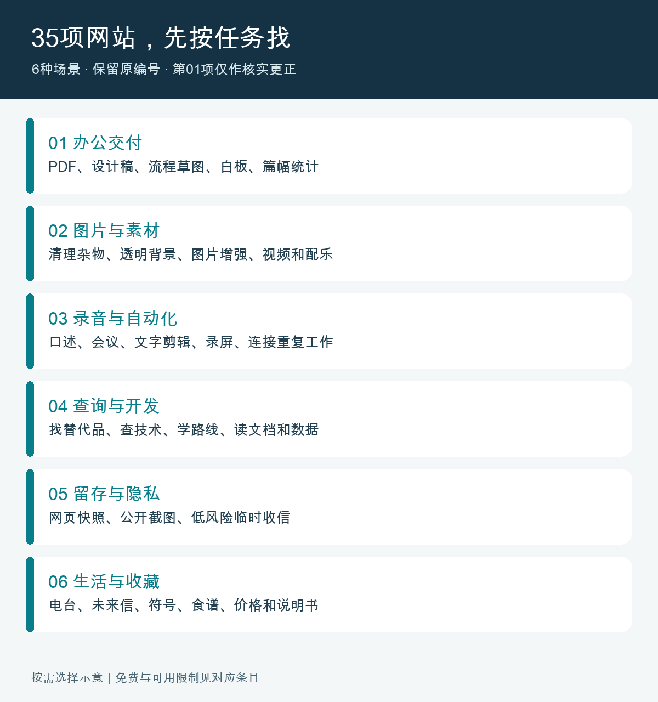

| 你现在要做什么 | 先看这些 | 最先检查什么 |
| --- | --- | --- |
| 处理文件、改图、讲流程 | PDF24、Photopea、Excalidraw | 原文件备份、资料是否上传 |
| 修图和找视频音乐素材 | Cleanup、RemovePhotos、Mixkit | 免费输出规格、素材许可 |
| 转写、录屏、连接重复工作 | Dictation、Otter、Loom、n8n | 中文、录音同意、额度和凭据 |
| 选软件、查文档、读技术数据 | AlternativeTo、DevDocs、JSON Crack | 版本、平台、数据是否脱敏 |
| 留存网页和临时收信 | Archive、Temp Mail、Screenshot Guru | 公开性、账号恢复、访问权限 |
| 生活、学习和偶尔放松 | Radio Garden、FutureMe、ManualsLib | 地区、型号、长期保存和收听权利 |

如果只想马上开始，先挑一个今天就有的任务。收藏夹里多35个网址不算进度，少返工一次才算。

## 一、先把今天的工作交出去：文件、图片、流程和字数

这一组最适合临时救急。先看交付物：收件人要PDF，先处理页序和清晰度；设计稿要继续改，保留图层；讨论还没定，先画草图。把交付要求说清，能少在不同工具间来回搬文件。

### 09｜TinyWow：临时转换和整理普通文件

[打开官网：TinyWow](https://tinywow.com) · **免费在线工具**。

在工具搜索框里按“合并PDF”“图片转PDF”之类的具体任务找入口，先拿一份不含隐私的副本试做，再下载到本机。它把多类小工具放在一起，适合偶尔遇到格式问题、又不想安装整套软件的人。

**用前留意：**官网称处理前后的文件会在1小时内删除。这是服务方的保留政策，不能当成文件从未离开电脑。客户名单、身份证、未公开财务资料应改用经单位允许的本地方案；页面广告和第三方入口也要与真正下载按钮区分。

### 11｜PDF24：合并、压缩、拆分PDF

[打开官网：PDF24](https://tools.pdf24.org/zh) · **在线工具免费；桌面版也免费**。

例如要交一份“报价＋合同附件”：在合并工具里放入文件，拖动页序，生成后重点翻封面、签章页和最后一页；要压缩，则先保留原件，检查小字、印章和二维码还能不能辨认。

**用前留意：**在线版在服务器处理文件。PDF24 Creator桌面版可离线处理，但它是Windows软件；Mac能用网页工具，不等于有同样的Mac桌面版。给PDF盖一个图片章，也不等于取得可靠的电子签名。

[查看官方说明](https://tools.pdf24.org/en/)。

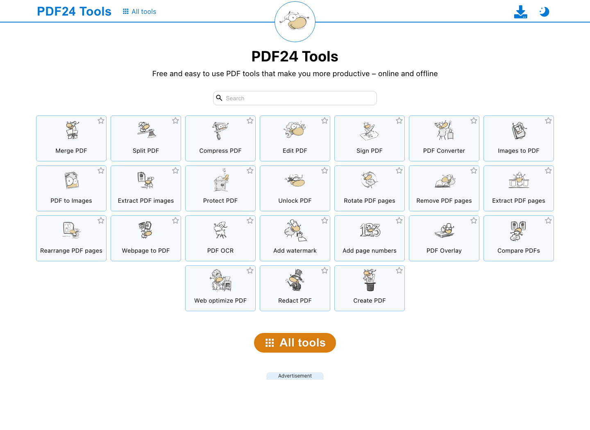

### 10｜Photopea：临时改设计稿，保留图层继续交接

[打开官网：Photopea](https://www.photopea.com) · **基础编辑免费；有付费方案**。

打开PSD后先另存副本，在图层面板定位文字或图片层，改完保存PSD便于后续修改，再按交付要求导出PNG或JPEG。图层就像一叠透明胶片：文字、背景、人物分别放，修改其中一层，不必把整张图重画。

**用前留意：**官网说明常规编辑在本机浏览器运行，文件不需要上传。这个结论不要扩展到你主动使用的云盘、外部插件或在线AI服务。缺字体时版式可能变，导出前核对中文、换行和字体授权；支持PSD也不等于所有复杂特效完全复现。

### 12｜Excalidraw：把报销、审批和操作流程讲清

[打开官网：Excalidraw](https://excalidraw.com) · **基础白板免费；托管增强服务另计**。

先画三个框“提交→审批→报销”，再补一个菱形“材料齐不齐”，把退回修改的箭头接回提交。它的手绘感适合开会时边讨论边画，导出PNG放汇报，另存可编辑文件留给下次修改。

**用前留意：**白板文件和图片承担不同作用：图片方便看，原文件才能改。开启协作后检查分享范围；别把“知道链接的人能进”当成只对指定同事可见。流程图画得顺，不代表业务规则本身没有漏洞。

### 13｜tldraw：把零散想法摆成可讨论的全景

[打开官网：tldraw](https://www.tldraw.com) · **基础在线白板免费；开发与商业条款另核**。

筹备一次培训时，把报名、讲师、场地、物料分成四片区域，每片放便签和连接线。与正式流程图相比，无限白板更像会议室里可以不断往旁边贴纸的大墙，适合先发散、再归并。

**用前留意：**别让无限画布变成无限迷路：给区域起标题，讨论结束导出结论。网站能免费使用，与把其开发工具包嵌进自己收费产品，是两件事；协作、数据保存及开发许可分别看当前说明。

### 32｜WordCounter：查字符与词数，辅助控制篇幅

[打开官网：WordCounter](https://wordcounter.net) · **基础统计免费**。

把不含机密的文案粘贴进去，查看字符数、英文词数和关键词频率。投英文摘要时很方便；写中文短介绍，可以拿字符数作为一项参考，再回到实际投稿后台核对。

**用前留意：**英文按空格和语言规则分词，中文“字数”与网站的英文词数口径不同。标点、空格、表情和链接也可能被不同平台另算；不能因为它显示达标，就保证公众号、简历或投稿系统一定接受。

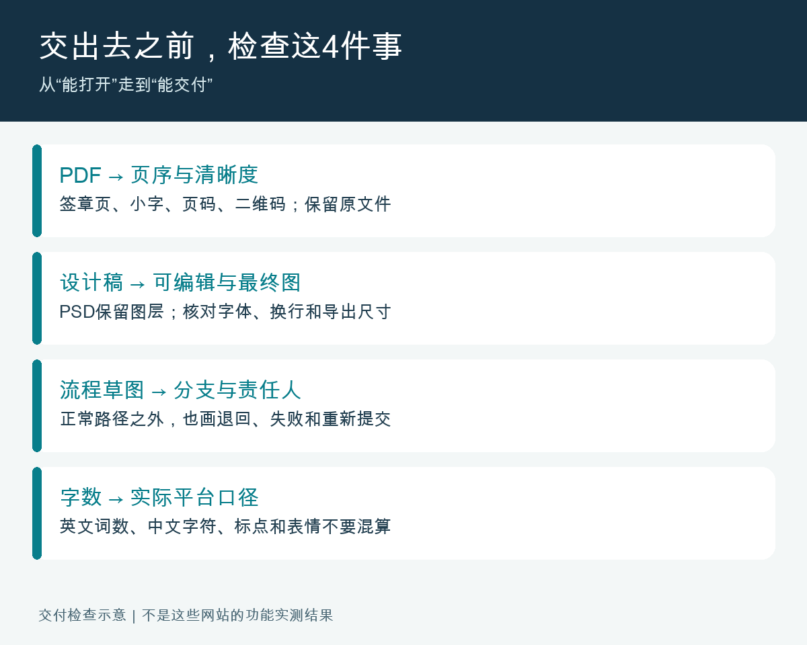

## 二、修图和找素材：能下载，不代表能随便用

修图工具的分工先分清：抠图是把主体与背景分开；消除是在选区里补画背景；放大则可能推测新的细节。像做菜时择菜、切菜、调味，各有位置。拿错步骤，图片可能更漂亮，却离原来的事实更远。

### 08｜Cleanup.pictures：清理自己照片中的杂物

[打开官网：Cleanup.pictures](https://cleanup.pictures) · **免费增值；免费导出限制720像素**。

上传有权修改的图片，用笔刷覆盖要消除的路人、桌面杂物或污点，生成后放大检查边缘、阴影和重复纹理。官网免费档的导出分辨率有限；先确认用途是聊天配图还是印刷，再决定是否值得继续。

**用前留意：**它会推测被挡住的内容，不能拿来“还原”证据、票据或产品缺陷。也不要用消除功能去掉别人作品的权利标记后冒充自己的；编辑自己的照片仍要检查处理后的真实含义。

### 20｜RemovePhotos：快速给商品或人物去背景

[打开官网：RemovePhotos](https://remove.photos) · **官网标注免费、免注册**。

上传自己的照片，生成透明背景后下载支持透明通道的PNG，再放到海报或文档中。看效果时把图分别放到白底和深色底上，发丝、眼镜和半透明物体的问题更容易露出来。

**用前留意：**处理毛发、网纱、玻璃和复杂背景时不能只看缩略图。网页上传涉及把照片交给服务，证件照和客户肖像先核隐私与授权。导成JPEG会失去透明背景；“免注册”也不自动等于永久免费、无限高清。

### 21｜Let’s Enhance：放大旧图片，准备视觉小样

[打开官网：Let’s Enhance](https://letsenhance.io) · **注册体验额度；持续使用付费**。

选择放大或增强，先用低风险图片对照原图，看脸、产品纹理、商标和小字有没有被改。核查时官网提供10个注册免费额度，免费输出带水印；印刷前还要看实际像素、版面尺寸和输出要求。

**用前留意：**“无损放大”容易误导。它可能生成看起来合理的新细节，模糊小字不一定被正确读回；合同、监控、检测照片不能靠AI补画作事实认定。额度、水印和可用尺寸以当前账户显示为准。

[查看官方说明](https://letsenhance.io/pricing)。

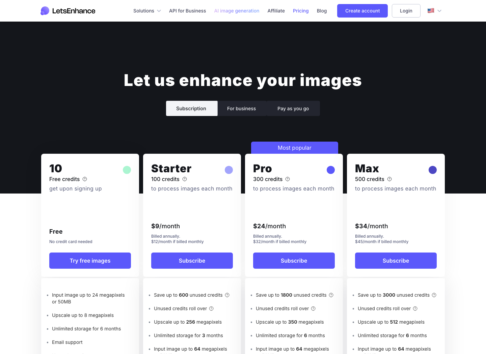

### 22｜Pixabay：给文章和视频找图片、视频、音乐

[打开官网：Pixabay](https://pixabay.com) · **可按内容许可免费使用**。

按具体画面搜，例如“办公室沟通”“雨天街道”；下载时一并保存素材页、作者、日期和许可页面。选音乐还要听完整开头结尾，再决定是否能与旁白衔接。

**用前留意：**免费素材仍有许可。禁止把基本未改动的素材当独立商品转卖；可识别品牌、人物等可能涉及额外权利。音乐遇到版权识别时，需要原素材与授权记录协助申诉，下载成功不能保证所有平台自动放行。

[查看官方说明](https://pixabay.com/service/license-summary/)。

### 23｜Mixkit：寻找视频补镜头、配乐、音效与模板

[打开官网：Mixkit](https://mixkit.co) · **按素材类别和具体许可免费使用**。

做培训演示，可以用空镜交代环境、提示音标记步骤，不必每个镜头都现拍。进入具体素材页，先看许可，再核视频比例、分辨率和模板所需软件；别只看首页的“免费”二字。

**用前留意：**官方分别列出视频免费许可与受限许可，音乐、音效和模板也各有条款。下载一段能预览的视频，不代表能用于任何商业项目；模板可能依赖特定版本或额外字体、插件。

[查看官方说明](https://mixkit.co/license/)。

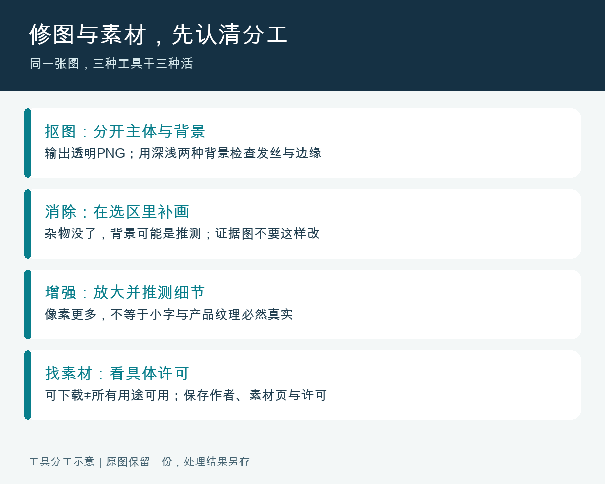

## 三、少开会、少重复劳动：先看额度，再接工作流

会议工具最容易造成一种错觉：文字生成了，纪要就完成了。真正要落地的是“谁在什么时间做什么”，尤其要听清否定词、金额和期限。自动化也是同样道理，连上两个应用只是开始，失败了谁知道、重复触发会不会多发一遍，才决定它能不能长期用。

### 14｜Dictation：把临时口述变成文字草稿

[打开官网：Dictation](https://dictation.io) · **在线语音输入工具**。

用兼容的Chrome浏览器打开，允许麦克风，选中文语言，先说一句带数字的短句，确认识别后再继续。适合写待办和口述初稿；它更接近语音输入法，不是把多人长会议自动整理好的完整系统。

**用前留意：**官网依赖Google语音识别和联网。网页把文字保存在浏览器，不等于音频识别全离线；企业会议应先核数据要求。在中国大陆的具体网络下可能不可用，标点指令与中文准确率也需自己短测。

### 15｜Otter：把受支持语言的会议录音整理成可检索材料

[打开官网：Otter](https://otter.ai) · **免费增值；基础档有月度与导入限制**。

会前核对当前支持语言，告知参会者并取得相应同意，再用短样本检查人名和术语。核查时Basic列出每月300分钟转写、终身合计3次音视频文件导入；后者不是每月刷新3次。

**用前留意：**不能从“多语言”直接推定普通话、方言和中英混说都适用。本文没有完成中文会议实测，也没有核到足够的当前普通话支持证据，因此中文工作场景先试短片段。自动摘要里的责任人、日期和承诺必须回听。

[查看官方说明](https://otter.ai/pricing)。

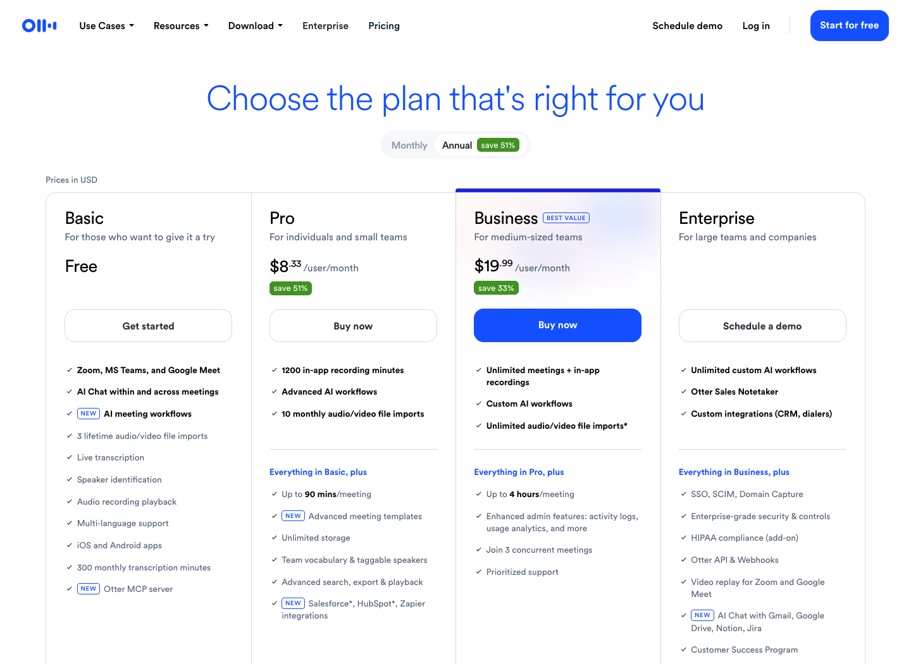

### 16｜Descript：通过改转写文字来剪口播

[打开官网：Descript](https://www.descript.com) · **免费增值；媒体处理与AI功能有额度**。

导入一段录音或视频，生成转写后，删除对应的赘句，再播放剪切处检查语气和画面跳点。它把文字位置与音视频时间对应起来，像拿着索引找录像里的某句话，比不断拖进度条直观。

**用前留意：**删字可能连同对应声音一起删掉。“不可以”里的“不”、句尾条件和重说后的正确版本尤其要保留。免费版不是无限转写或无限AI生成，高清无水印和高级能力要核当前方案；上传工作录音前先确认授权。

[查看官方说明](https://www.descript.com/pricing)。

### 17｜Loom：把“这里怎么点”录给同事看

[打开官网：Loom](https://www.loom.com) · **免费增值；Starter限25个视频、单次录屏5分钟**。

选需要的窗口或区域，先关通知、隐藏账号信息，录一段围绕单个问题的演示，再检查声音和分享权限。适合交接一个操作、复现一个界面问题，而不是每次都约人线上看屏幕。

**用前留意：**核查时免费档列出25个视频、每段录屏5分钟，别把其会议时长规则套到屏幕录制。分享链接不是本地备份；交付后要检查收件人权限、下载需要和离职后的归属。

[查看官方说明](https://www.loom.com/pricing)。

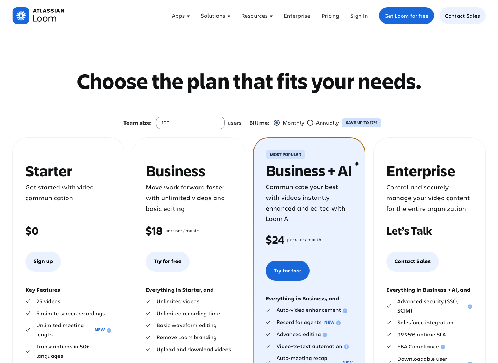

### 18｜Zapier：连接已有服务，处理简单重复动作

[打开官网：Zapier](https://zapier.com) · **免费增值；免费档100任务/月、两步流程**。

例如“收到一条表单→新增一条记录”。先用虚构信息跑一条，确认字段映射和收件人，检查日志后才开自动运行。它像给两个窗口安排一名传递单据的办事员，触发条件决定何时搬，动作决定搬到哪里。

**用前留意：**免费方案不是任意多步骤。官方核查页为100任务/月，具体动作和调用怎样扣额度要看计费规则。企业微信、飞书、钉钉及单位内部系统能否接入，要查实际连接器或接口，不能默认国外服务都直接兼容。

[查看官方说明](https://zapier.com/pricing)。

### 19｜n8n：搭建更可控的自动化流程

[打开官网：n8n](https://n8n.io) · **社区自托管可用；官方云付费/试用**。

先从“人工触发→读一份脱敏数据→写出摘要文件”开始，把发送通知、删除文件等动作暂时关闭。工作流像一张能执行的办事流程图：每个节点干一件事，连线决定资料往哪里走，分支处理不同情况。

**用前留意：**自己部署也有电脑、运维、备份成本，调用外部AI仍可能收费。社区代码采用有用途限制的许可，不等于任意转售托管服务；接入外部接口也不再是纯离线。凭据加密、更新、最小权限和失败通知都要安排。

[查看官方说明](https://github.com/n8n-io/n8n/blob/master/LICENSE.md)。

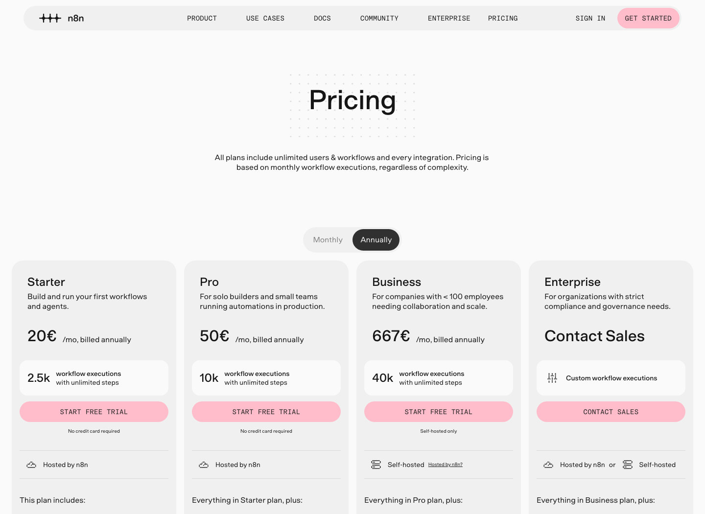

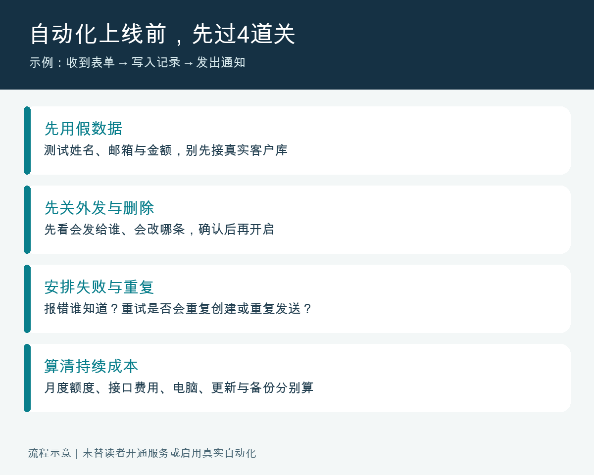

如果需求是处理不宜上传的录音或录屏，也可以选择本机软件。我的方寸智匣提供本地转写等工具，黑粉录屏负责录制、剪辑与导出；是否真正离线取决于所用模型和服务配置。它们与上面这些在线协作服务各有位置，选择时先看资料能否出本机。

## 四、查资料与学技术：地图、字典、放大镜，各有用途

学习路线是地图，速查语法是随身小册子，开发文档才是查规则的地方。把这三件事分开，比同时收藏几十个教程更容易推进。下面几项也适合非程序员：选软件、画决策表、看懂定时任务，工作中都可能遇到。

### 06｜AlternativeTo：寻找现有软件的替代品

[打开官网：AlternativeTo](https://alternativeto.net) · **检索免费；被推荐软件各自计费**。

搜索熟悉的软件名，再按系统、免费、开源和所需功能筛选。比如找Mac上的图片编辑器，先限定能打开你的文件格式，再比下载方式和维护状态，比直接搜“最好用的软件”具体得多。

**用前留意：**社区票数与评价可以帮你发现候选，不能代替兼容性和许可核查。“开源”“免费”“免费试用”分开看，下载只走项目官网或可信发行页，别被第三方下载站带跑。

### 07｜BuiltWith：了解公开网站的技术组成

[打开官网：BuiltWith](https://builtwith.com) · **基础查询与付费报告并存**。

输入公开域名，查看分析、站点构建和托管等可见技术线索。像从店铺招牌和装修猜它用了哪些供应商，能帮助做技术调研，但看到的只是外部留下的痕迹。

**用前留意：**检测可能过时、误报或漏报，不能据此断言后端全部代码和版本，也不能把“用了某技术”写成“存在漏洞”。只查公开站点信息；任何进一步安全测试都需明确授权，批量和导出功能另看方案。

### 24｜Untools：把模糊纠结变成决策问题

[打开官网：Untools](https://untools.co) · **框架介绍可免费读；模板等另核**。

选供应商时找决策矩阵，把价格、交付期、售后列成维度；排工作先看重要与紧急矩阵。每个格子里写你手里的实际证据，而不是先挑一个自己喜欢的答案，再给它补高分。

**用前留意：**框架负责帮助思考，不替你提供真实数据。给维度加权时说明依据，换一组合理权重看看结论会不会变；下载模板、邮件订阅和付费产品是不同入口。

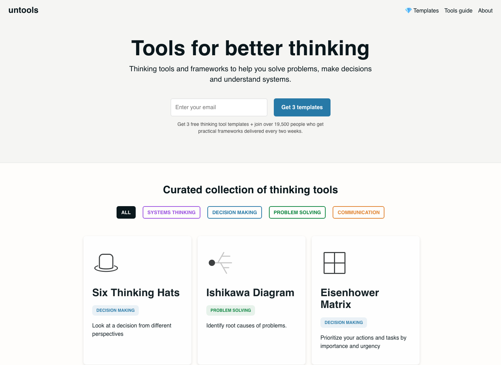

### 25｜roadmap.sh：知道学一项技能需要哪些前置知识

[打开官网：roadmap.sh](https://roadmap.sh) · **公开路线可读；课程等分项核查**。

选择与你目标对应的路线，再从能做出的小项目倒推：比如先做一个本地表单，而不是把整个前端地图涂完才敢开始。每学一个节点，就把它用在项目里，再补下一个缺口。

**用前留意：**路线是社区整理的建议，不是招聘单位统一考纲。地图很大不意味着每项都必须先学；AI、开发和安全方向更新快，具体库与版本仍回官方文档核实，付费学习入口不代表整站所有内容免费。

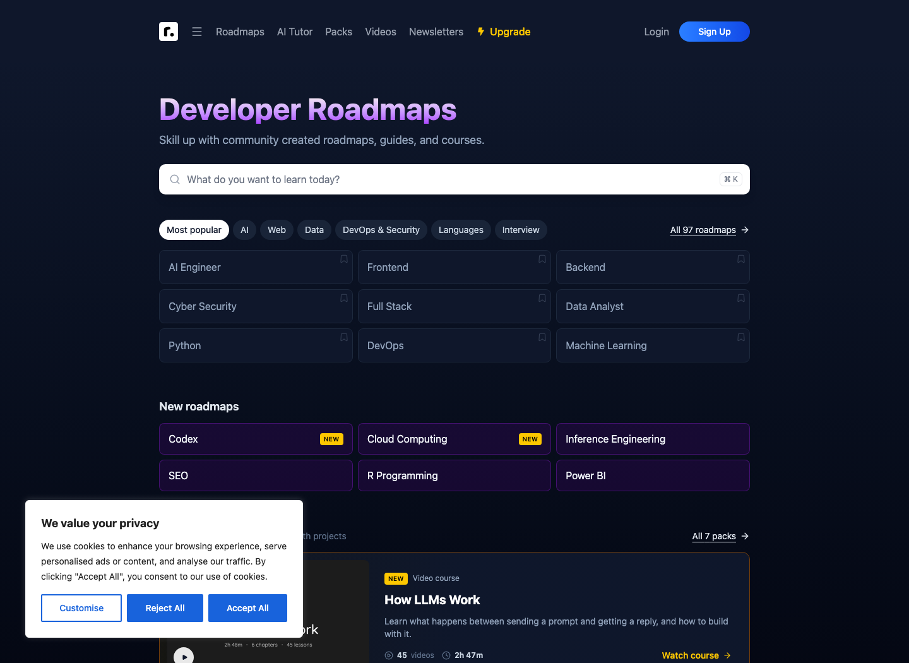

### 26｜Learn X in Y Minutes：快速比较一门语言的基本写法

[打开官网：Learn X in Y Minutes](https://learnxinyminutes.com) · **社区速查内容免费阅读**。

已经会一点编程时，用它对照变量、循环、函数和容器写法，边看边在自己的小文件里改一个例子。部分页面有简体中文翻译，适合从熟悉语言切换到另一门语言时快速找位置。

**用前留意：**“几分钟”是速览，不是掌握工程开发。示例可能省略输入校验、依赖管理和错误处理；复制代码前核版本，不把陌生命令直接贴进终端执行。

### 27｜DevDocs：在一个入口查常用开发文档

[打开官网：DevDocs](https://devdocs.io) · **免费文档聚合**。

只启用当前项目使用的文档集，再搜索函数或属性；对能缓存的文档，按页面设置提前安装离线数据。像把几本常用工具书放在同一个书架，查东西省事，但每本书仍有自己的版本。

**用前留意：**聚合文档的更新时间与原官方站可能不同。关键接口、弃用说明和安全行为回官方确认；离线功能需要提前缓存，并非第一次断网打开就自动拥有所有文档。

### 28｜JSON Crack：把嵌套数据画成可读结构

[打开官网：JSON Crack](https://jsoncrack.com) · **基础编辑器与公开代码；高级服务另核**。

把脱敏JSON粘进编辑器，沿节点查看层级，确认某个字段究竟属于订单还是订单里的商品。JSON可以想成有层级的快递清单：订单里装商品列表，每件商品又有名称、数量和规格。结构图帮助找错层和漏项。

**用前留意：**先移除账号令牌、真实客户、内网地址和配置秘密。图画出来只说明结构能展示，不证明业务数据正确；大文件可能卡顿。本文采集其公开主页资料成功，浏览器截图超时，未把未取得的编辑器结果当配图。

### 29｜Crontab Guru：看懂计划任务什么时候执行

[打开官网：Crontab Guru](https://crontab.guru) · **表达式解释免费；监控产品另计**。

比如“每2小时的第06分钟”，可查看五字段表达式“6 */2 * * *”；若要每小时的第06分钟，则是“6 * * * *”。多一个“/2”，时间间隔就不同。填好后再看解释，并检查运行机器时区。

**用前留意：**它解释时间表达式，不替你安装任务，也不保证脚本成功。常规cron与某些带秒字段的调度器格式不同；电脑休眠、任务重叠、权限与失败通知，仍由运行环境处理。

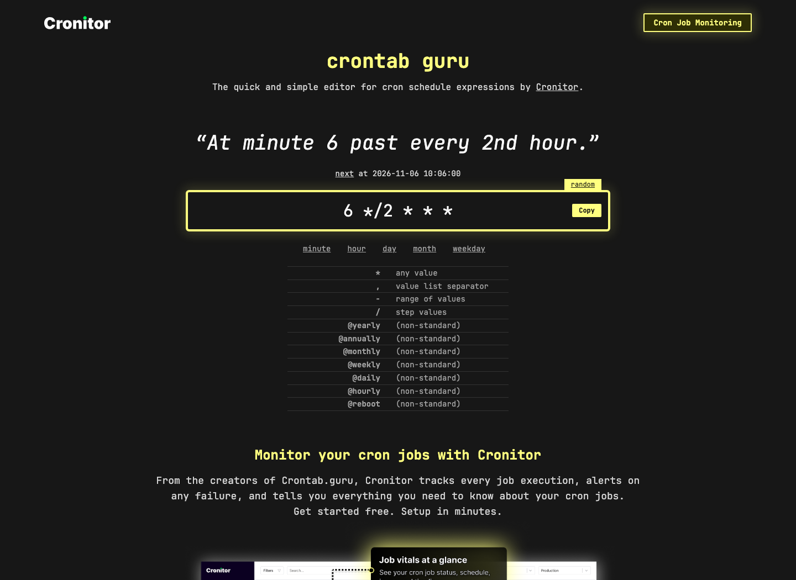

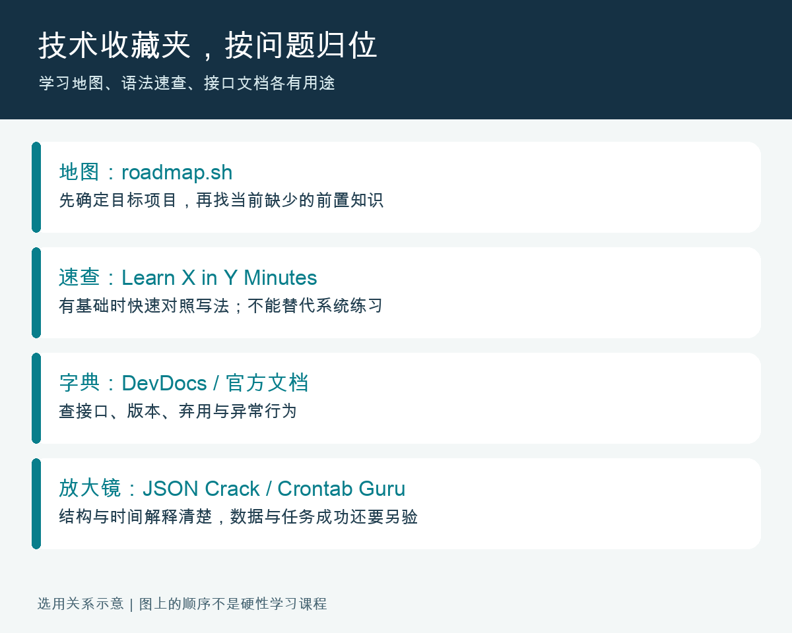

## 五、网页留存和临时邮箱：便利之前，先分清公开与私密

网页快照、网页截图、本地PDF很像存档袋里三种不同材料：快照保留某次页面，截图保留当时的外观，本地PDF便于自己留档。它们都不会自动变成完整网站备份，也不能替代正式凭据和合同原件。

### 01｜twelveft.io／常见名称12ft：原清单的“绕过付费墙”项先别照抄

[打开官网：twelveft.io／常见名称12ft](https://12ft.io) · **本次未确认可用；仅保留核实记录**。

原始网址是twelveft.io，网上常见12ft服务使用的是12ft.io。本次前者无法确认有效服务，后者抓取返回错误；因此这里不给可用承诺，也不提供绕过访问控制的操作。要看一篇文章，先找作者公开稿、单位或图书馆订阅、正规试读与开放获取版本。

**用前留意：**一次抓取失败不能证明全球永久关站，也不能据一个相似域名推荐读者输入资料。不要在所谓解锁网站填媒体账号、付款信息或安装来历不明的扩展；本文35项里这一项只作更正保留。

### 02｜Archive.today／archive.ph：保存可公开访问页面的历史版本

[打开官网：Archive.today／archive.ph](https://archive.ph) · **公开网页快照服务；本次入口遇到限流**。

适合给公开产品说明、公开声明留一份带日期的参考。保存后记录原网址、快照地址与保存时间，并另存一份本地副本；引用时分清“当时的页面写了什么”与“现在的服务还有什么”。

**用前留意：**不要上传带访问令牌的分享链接、客户资料或需要登录的私密内容。快照可能公开并可被检索，动态内容和视频不一定完整；“永久保存”不是可保证的合同。本次访问遭遇限流，未完成保存测试。

### 05｜Temp Mail：给低风险临时收信用一个一次性地址

[打开官网：Temp Mail](https://temp-mail.org) · **基础临时邮箱与付费增强并存**。

临时查收一封不重要的资料邮件时，复制当前邮箱地址，收完即走。它更像临时取件点：方便一次交接，但你不能指望多年后还能回到同一个柜子取回账号。

**用前留意：**不要用它注册工作主账号、银行、重要云盘或订阅付款服务。后续找回密码可能收不到邮件，部分网站会拒绝临时域名；不用于绕过试用额度、批量注册或接收身份凭证。

### 31｜Screenshot Guru：把公开长网页留成一张图

[打开官网：Screenshot Guru](https://screenshot.guru) · **公开网页截图工具**。

输入公开网页网址，按页面要求完成验证码后发起截图。给方案留版式参考、记录一次公开页面外观很方便；下载后看标题、关键数字和页面底部有没有真正加载出来。

**用前留意：**官网说明不支持需要登录的页面，复杂动态应用也可能失败。不要把公司内网、附带签名令牌的链接交给第三方；它拍到的是服务端看到的页面，不保证与你登录后的浏览器一致。

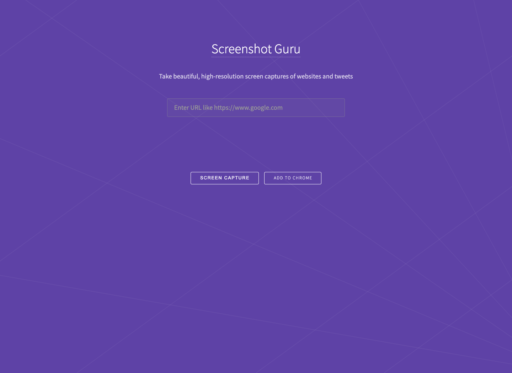

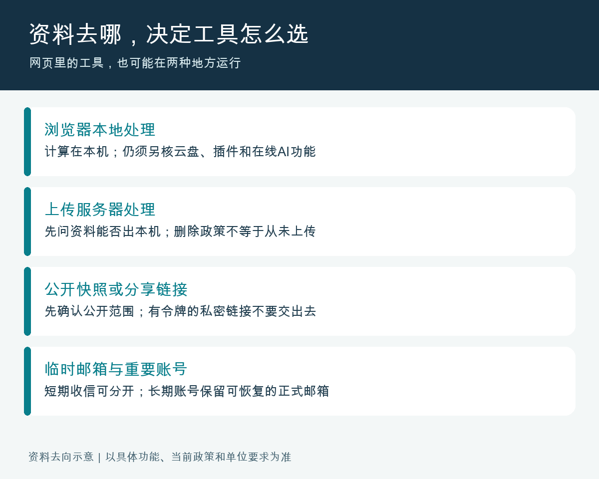

## 六、下班后也能用：电台、未来信、菜谱、价格与说明书

工作效率工具之外，收藏夹也该留几个能让生活省心或有意思的入口。这里的地区限制尤其重要：国外价格追踪并不是国内全网比价，国外说明书也未必对应国行同型号。

### 03｜Radio Garden：在地图上发现不同地方的电台

[打开官网：Radio Garden](https://radio.garden) · **在线收听入口；可用范围按地区和电台**。

在地图里移动到一座城市，选电台收听，喜欢的再记下来。做语言环境输入、了解不同城市的日常声音，比一直刷同一种推荐内容多一个入口。本文未完成本机实际收听验收。

**用前留意：**地理授权、台站离线、网络和地区规则可能影响播放，不能承诺全球任何台都可听。能在线收听不等于可以下载、转播或把节目配进自己的商业视频。

### 04｜FutureMe：给半年或一年后的自己留一封信

[打开官网：FutureMe](https://www.futureme.org) · **基础写信与Premium增强并存**。

写清今天在做什么、担心什么和希望完成什么，选投递日期，选择私密或公开匿名，填写长期使用的邮箱并完成验证。比如给下一次年终复盘留一份原始心愿，届时再和真实结果对照。

**用前留意：**私密与公开匿名要看清，学校或单位邮箱离开后可能失效。图片、视频和附件等增强功能有付费入口；第三方长期投递不能替代你自己的备份，更不要寄密码和重要身份信息。

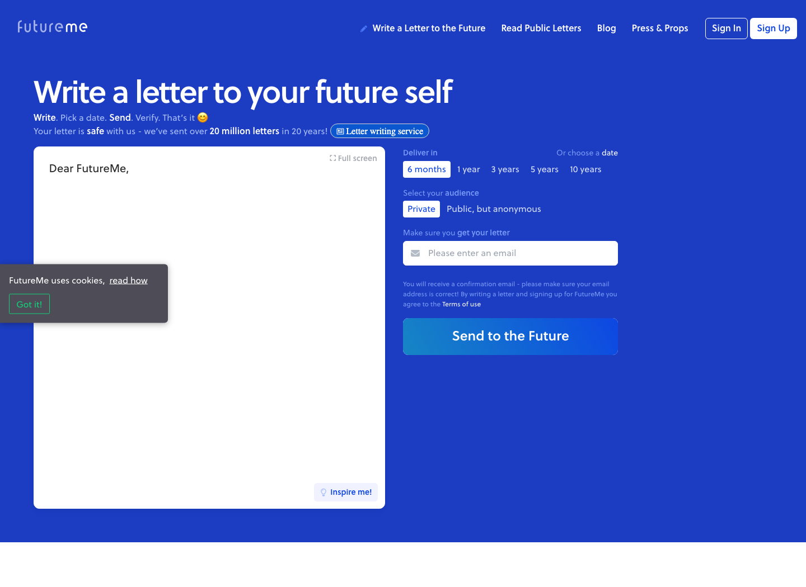

### 30｜CopyChar：找对箭头、数学符号和特殊字符

[打开官网：CopyChar](https://copychar.cc) · **基础符号复制免费**。

按分类找到“→”“≤”“×”等符号，点选复制，再粘到文档里。写操作说明和培训材料时，正确字符比用字母x硬凑乘号、靠空格对齐更省心。

**用前留意：**不同字体和设备显示可能不同，发布前预览。登录名、网址、命令和密码别随意混入外观相似的字符；做无障碍文档时也不要用一串表情代替关键信息。

### 33｜Just the Recipe：把支持的食谱链接整理成食材和步骤

[打开官网：Just the Recipe](https://www.justtherecipe.com) · **基础提取与高级方案分别核查**。

把公开食谱链接放进入口，核对提取后的食材数量、烤箱温度和时间，再决定是否收藏。做饭时少翻几屏背景故事有帮助，但处理结果应当和原食谱对照，不是把作者内容改个名字据为己有。

**用前留意：**本次公开页面抓取未取得完整正文，不能承诺任何中文食谱网站都兼容，也不引用未核实的免费次数。杯、盎司、华氏度要换算；过敏提示、熟制要求和储存条件不能被精简掉。

### 34｜camelcamelcamel：参考受支持Amazon站点的价格变化

[打开官网：camelcamelcamel](https://camelcamelcamel.com) · **价格历史与提醒服务；本次访问受阻**。

确认所用Amazon站点在支持范围，再用商品链接查记录，分清平台自营、第三方和二手。它适合常买对应站点的人判断“这次降价在历史里算什么位置”，不是国内电商通用比价器。

**用前留意：**本次访问返回403，未完成查询与提醒测试。历史价格不一定含优惠券、运费、税费或会员条件，更不能拿国外含义不同的价格与京东、淘宝到手价直接比较。

### 35｜ManualsLib：找丢失的家电、办公设备说明书

[打开官网：ManualsLib](https://www.manualslib.com) · **可检索在线说明书；具体入口另核**。

先拍下设备铭牌，再按品牌＋完整型号搜索，核对电压、后缀、年份和页码。下载后看文件是否为PDF，并保存对应型号；要操作恢复出厂、校准或维护时，先读完整相关章节。

**用前留意：**本次官方页面资料抓取可读，直接浏览器访问遇到安全验证，未完成下载验收。海外型号与国行可能不同，优先厂家官网的对应版本；不要把广告中的安装包当说明书，也别凭相似型号做电气维修。

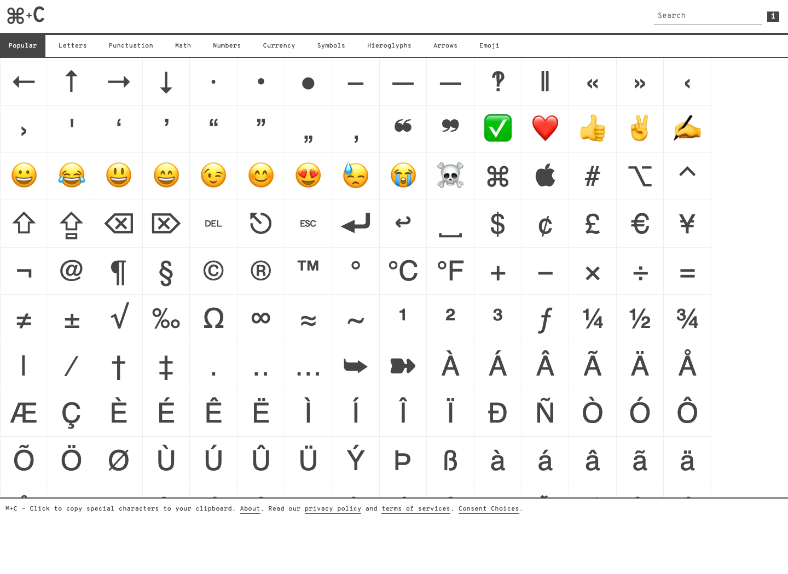

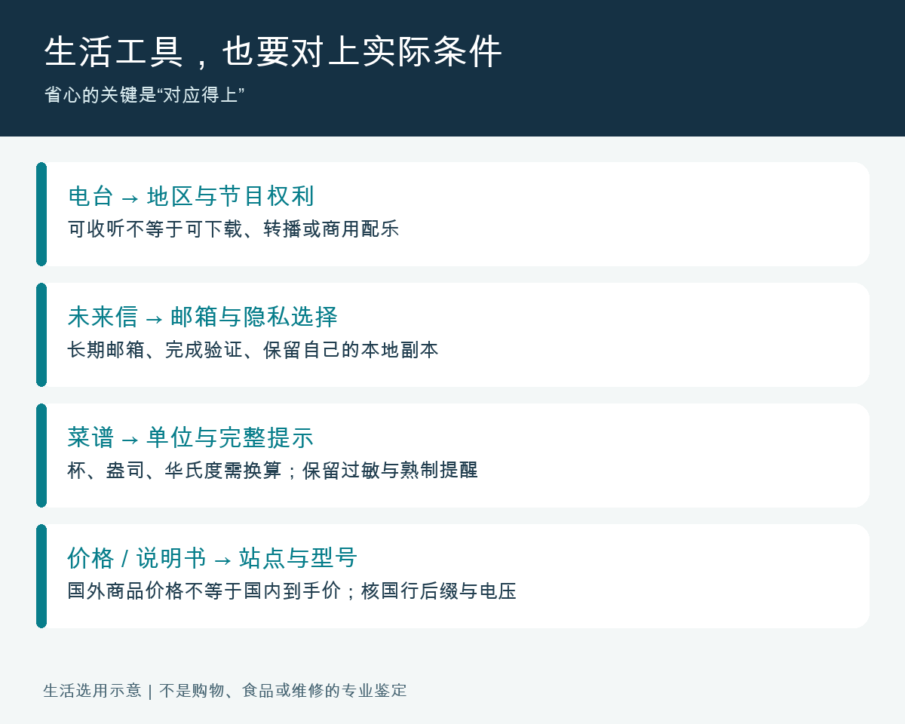

## 不用全收藏：先装好自己的“小工具抽屉”

普通办公可以先放PDF24、Photopea、Excalidraw；创作者再补Cleanup、Mixkit和合适的录屏工具；开发者加上DevDocs、JSON Crack、Crontab Guru。剩下的等任务需要时再打开。这个分法并非排名，而是让收藏夹和你真实要做的事情对应起来。

| 情形 | 先做一步 | 交付前再看一眼 |
| --- | --- | --- |
| 文件里有客户或个人信息 | 确认能否上传；优先受允许的本地方案 | 副本脱敏、权限、保留位置 |
| 页面写免费或免费试用 | 查额度、导出、水印、试用到期 | 是否绑定支付与自动续费 |
| 修过图、转过写、自动出摘要 | 保留原图、原声、原文件 | 数字、否定词、主体和事实含义 |
| 下载音乐、视频、模板 | 保存素材页和对应许可 | 商用、平台、人物品牌与插件要求 |
| 连接自动化 | 先用假数据，发送与删除先关掉 | 重复触发、失败通知、凭据与备份 |

在中国大陆使用这些境外网站，还要把实际网络、单位制度、账号条件和语言算进选择。网页加载不出来就先换一个已有合适方案，不为一个小任务随便装陌生加速器、证书或浏览器扩展。本文没有替任何服务做可用性担保，明确标出的失败项留给后续复核。

真正值得收藏的，是一套遇事能找到、做完能检查、资料放得安心的方法。今天从一份PDF、一张设计稿或一张流程草图开始，就足够了。

## 官网与关键说明

- [twelveft.io／常见名称12ft｜核实入口](https://12ft.io)
- [Archive.today／archive.ph｜官网与说明](https://archive.ph)
- [Radio Garden｜官网与说明](https://radio.garden)
- [FutureMe｜官网与说明](https://www.futureme.org)
- [Temp Mail｜官网与说明](https://temp-mail.org)
- [AlternativeTo｜官网与说明](https://alternativeto.net)
- [BuiltWith｜官网与说明](https://builtwith.com)
- [Cleanup.pictures｜官网与说明](https://cleanup.pictures)
- [TinyWow｜官网与说明](https://tinywow.com)
- [Photopea｜官网与说明](https://www.photopea.com)
- [PDF24｜官网与说明](https://tools.pdf24.org/en/)
- [Excalidraw｜官网与说明](https://excalidraw.com)
- [tldraw｜官网与说明](https://www.tldraw.com)
- [Dictation｜官网与说明](https://dictation.io)
- [Otter｜官网与说明](https://otter.ai/pricing)
- [Descript｜官网与说明](https://www.descript.com/pricing)
- [Loom｜官网与说明](https://www.loom.com/pricing)
- [Zapier｜官网与说明](https://zapier.com/pricing)
- [n8n｜官网与说明](https://github.com/n8n-io/n8n/blob/master/LICENSE.md)
- [RemovePhotos｜官网与说明](https://remove.photos)
- [Let’s Enhance｜官网与说明](https://letsenhance.io/pricing)
- [Pixabay｜官网与说明](https://pixabay.com/service/license-summary/)
- [Mixkit｜官网与说明](https://mixkit.co/license/)
- [Untools｜官网与说明](https://untools.co)
- [roadmap.sh｜官网与说明](https://roadmap.sh)
- [Learn X in Y Minutes｜官网与说明](https://learnxinyminutes.com)
- [DevDocs｜官网与说明](https://devdocs.io)
- [JSON Crack｜官网与说明](https://jsoncrack.com)
- [Crontab Guru｜官网与说明](https://crontab.guru)
- [CopyChar｜官网与说明](https://copychar.cc)
- [Screenshot Guru｜官网与说明](https://screenshot.guru)
- [WordCounter｜官网与说明](https://wordcounter.net)
- [Just the Recipe｜官网与说明](https://www.justtherecipe.com)
- [camelcamelcamel｜官网与说明](https://camelcamelcamel.com)
- [ManualsLib｜官网与说明](https://www.manualslib.com)

---

## 🧰 我做的工具

这些工具都由我持续维护。预览版会明确标注，下载、更新和已知边界以发行页为准。

> [!info] 黑粉助手 HyphenAssistant
> **状态：** 正式迭代
>
> 手机浏览器接续电脑上的 DeepSeek Harness 会话；需本人配对、电脑与原服务在线，模型费用沿用原配置
>
> [下载与更新：黑粉助手 HyphenAssistant](https://github.com/HackerChi-Hub/hyphen-assistant-releases/releases)

> [!info] 黑粉盒子 HyphenBox
> **状态：** 正式迭代
>
> 免费大模型 API 雷达：持续复测可用性，本地统一接口，Key 只存本机
>
> [下载与更新：黑粉盒子 HyphenBox](https://github.com/HackerChi-Hub/hyphenbox-release/releases)

> [!info] 方寸智匣 LocalBrain
> **状态：** 正式迭代
>
> 本地模型的多模态 MCP 工具箱：TTS / Whisper / 视频生成一站接入
>
> [下载与更新：方寸智匣 LocalBrain](https://github.com/HackerChi-Hub/localbrain-releases/releases)

> [!info] ScreenLex 光影词库
> **状态：** 正式迭代
>
> 看美剧顺手把生词背了，Mac/Windows 双平台，免费
>
> [下载与更新：ScreenLex 光影词库](https://github.com/HackerChi-Hub/screenlex-download/releases)

> [!info] 黑粉录屏 HyphenScreen
> **状态：** 正式迭代
>
> 录屏 + 智能剪辑一体：达芬奇式时间线、自动打码、导出前成片体检，免费
>
> [下载与更新：黑粉录屏 HyphenScreen](https://github.com/HackerChi-Hub/HyphenScreen-Releases/releases)

---

> [!quote] 黑粉科技
> **让AI成为你的超能力**
> 本地部署 · 免费白嫖 · 自制软件
> [黑粉科技](https://hyphentech.top)
